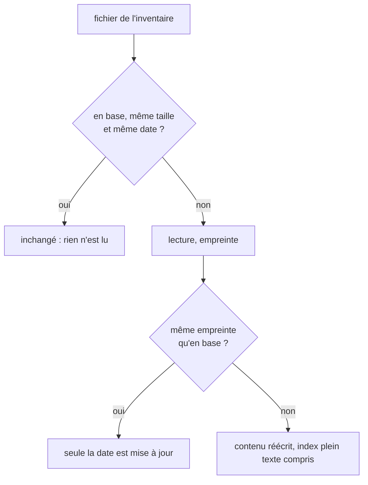

# Module `ingestion` (D2)

Phase 7E couverte : Éléments.

## 1. Inventaire (D2.INV-1)

| Situation | Inventaire |
|---|---|
| `ingest` dans un dépôt git | `git ls-files -z --cached --others --exclude-standard` : fichiers suivis, et non suivis non ignorés (`.gitignore`, `.git/info/exclude`, exclusion globale de git) |
| `watch`, dans le miroir | `git ls-files -z` : les fichiers suivis du commit chargé |
| hors dépôt git | parcours du dossier, sans les dossiers `.git`, `.skill4appli`, `.skills`, `node_modules`, `venv`, `.venv`, `__pycache__`, `dist`, `build`, `.next`, `.nuxt`, `.output`, `target`, `vendor`, `.gradle`, `.idea`, `.vscode`, `coverage`, `.pytest_cache`, `.mypy_cache`, `.tox`, `out` |

Seuls les fichiers ordinaires entrent dans la base : un lien symbolique, un sous-module (une entrée de dossier pour git) ou un fichier suivi supprimé du disque n'y figurent pas. Les chemins sont relatifs à la racine indexée, au format POSIX (`src/app/main.ts`), uniques.

## 2. Types de fichier (D2.INV-3)

| `type` | Condition | `content` | `sha` |
|---|---|---|---|
| `skipped` | fichier de verrouillage (`package-lock.json`, `npm-shrinkwrap.json`, `pnpm-lock.yaml`, `yarn.lock`, `bun.lockb`, `composer.lock`, `poetry.lock`, `Pipfile.lock`, `Cargo.lock`, `Gemfile.lock`, `gradle.lockfile`), fichier minifié (`*.min.js`, `*.min.css`), carte de source (`*.map`) | nul | nul |
| `large` | taille au-delà de `--max-size` (1 Mo par défaut) | nul | nul |
| `binary` | un octet nul dans les 8 000 premiers octets | nul | empreinte |
| `file` | tout le reste | texte complet | empreinte |

`metadata` (JSON) donne la raison d'une exclusion : `{"raison": "verrouillage"}`, `{"raison": "taille", "limite": 1048576}`.

Lecture d'un fichier `file` : décodage UTF-8 strict, marque d'ordre des octets conservée ; s'il échoue, lecture en latin1 et `encoding = latin1`. Aucun caractère n'est remplacé : un `.properties` Java en ISO-8859-1 garde ses accents. `lines` compte les lignes ; `lang` vient de l'extension ou du nom (`Dockerfile`, `Makefile`, `Jenkinsfile`) ; `sha` est l'empreinte blob de git, `sha1("blob <taille>\0" + contenu)`, égale à celle de `git hash-object` pour un fichier sans filtre de conversion.

## 3. Relecture limitée (D2.INV-4)

Pour chaque fichier de l'inventaire :

Puis chaque fichier présent en base et absent de l'inventaire est supprimé (D2.INV-2). Un changement de mode (`travail` après `miroir`, ou l'inverse) relit tout.

## 4. Transaction et index plein texte

- Une ingestion s'exécute en une seule transaction (`BEGIN IMMEDIATE` … `COMMIT`), métadonnées de l'instantané comprises (module `fraicheur`) : un lecteur voit l'état d'avant ou celui d'après, jamais un mélange.
- `app_fts` est un index FTS5 à contenu externe sur `app_structure` (`path`, `content`), tokeniseur `trigram remove_diacritics 1`. Trois déclencheurs le tiennent à jour : ajout, suppression, et mise à jour de `path` ou de `content` seulement. Une mise à jour de la date seule ne le touche pas.
- La ligne d'un fichier garde son `id` d'une ingestion à l'autre (`INSERT … ON CONFLICT (path) DO UPDATE`), au lieu de l'`INSERT OR REPLACE` de la version d'origine, qui supprimait puis recréait la ligne.

## 5. Mesures

Sur 3 000 fichiers Java de 1,2 Ko (Node 22.22, SQLite 3.50.4) :

| Opération | Durée |
|---|---|
| ingestion complète, index plein texte compris | 0,62 s |
| ré-ingestion sans changement | 67 ms |
| version d'origine, même jeu, une transaction par fichier | 5,4 s |

## 6. Pièges connus

- **UTF-16** : un fichier en UTF-16 contient des octets nuls et passe pour binaire.
- **Fichier modifié à la même seconde, même taille** : la date en millisecondes le distingue ; sur un système de fichiers à la seconde, un changement de même taille dans la même seconde peut échapper à `ingest`. `status` le signale aussi peu : relire le disque avant d'affirmer (agent, D7.INV-2).
- **Fichiers générés suivis** : un fichier généré mais suivi par git est indexé ; l'exclure du dépôt, ou le filtrer dans les requêtes.
- **Fins de ligne** : avec `core.autocrlf=true`, réglage par défaut de Git for Windows, les fichiers extraits sont en CRLF et le contenu indexé est celui du disque. `lines` et les numéros de ligne ne changent pas, les extraits de `search` sont rendus sans retour chariot (D12.INV-4), mais `sha` diffère alors de l'identifiant du blob dans git.

## 7. Contrôle de sortie

- Fichiers ignorés jamais indexés, non suivis non ignorés indexés (D2.INV-1) : T8.
- Aucun fichier fantôme, index plein texte compris (D2.INV-2) : T9.
- Binaire, verrouillage, gros fichier sans contenu ; latin1 sans perte (D2.INV-3) : T10.
- Ré-ingestion sans réécriture, date seule sans réindexation (D2.INV-4) : T11.
