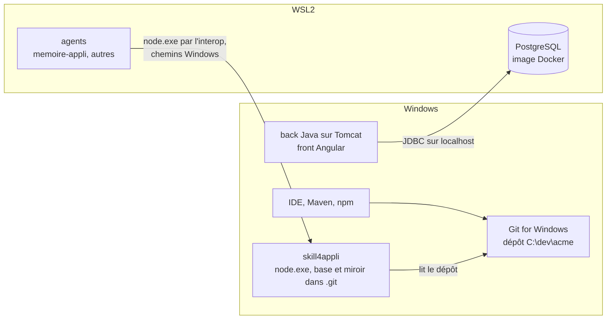

# Module `parite` (D12)

Phase 7E couverte : Environnement. Facteur X des douze facteurs : le skill se comporte de même sur chaque plateforme où on le lance, et la même recette le prouve sur chacune.

## 1. Plateformes

| Plateforme | Node | git | Recette |
|---|---|---|---|
| Linux | Node 22.13 ou plus récent | git 2.38 ou plus récent | 34 tests, en CI sur `ubuntu-latest` |
| WSL2 | le Node de la distribution | le git de la distribution | 34 tests, comme Linux, dont WSL2 a le noyau ; non rejouée en CI |
| Windows natif | Node pour Windows | Git for Windows | 33 tests et 1 sauté, en CI sur `windows-latest` |

Sous Windows, le skill se lance depuis CMD, PowerShell ou Git Bash ; rien ne dépend du shell, puisque le script ne lance aucune commande par un shell (D1.INV-1).

## 2. Poste type : code sous Windows, PostgreSQL dans WSL2



**Règle** : le skill tourne du côté du git qui possède le worktree source. Le code Java et Angular est sous Windows et son git est Git for Windows : le skill tourne sous Windows, avec `node.exe`.

- Un seul git crée, lit et déplace le miroir : les worktrees enregistrent des chemins absolus au format du git qui les a créés.
- Les fins de ligne et l'état des fichiers sont ceux que voit le développeur : `core.autocrlf` de Git for Windows est réglé dans sa configuration système, que le git de WSL ne lit pas.
- La documentation de WSL recommande, pour la vitesse, de garder les fichiers sur le système de fichiers de la ligne de commande qui les traite : celui de Windows pour des outils Windows, celui de WSL pour des outils Linux. Lus depuis WSL par `/mnt/c`, les fichiers de Windows passent par un protocole de partage de fichiers, plus lent pour git.

PostgreSQL est un service externe de l'application, attaché par une URL de connexion : le skill ne s'y connecte pas. Le back Java en fait évoluer le schéma par Liquibase, que Spring Boot applique au démarrage de l'application : le schéma entre dans la mémoire par les changelogs Liquibase du dépôt (`src/main/resources/db/changelog/` par défaut), indexés comme tout fichier, et `search` y retrouve une table ou une colonne (module `interrogation`, § 6).

Le cas inverse suit la même règle : un dépôt rangé dans le système de fichiers de WSL (`/home/...`), avec le git de WSL, se lit avec le skill lancé dans WSL.

## 3. Appeler le skill d'un côté à l'autre

D'un agent qui tourne dans WSL2, vers un dépôt sous Windows : l'interopérabilité de WSL lance les exécutables Windows par leur nom complet, extension comprise. Les arguments passent tels quels : ils s'écrivent en chemins Windows. La sortie standard, la sortie d'erreur et le code de sortie reviennent à l'appelant.

```bash
node.exe 'C:\dev\acme\.skills\skill4appli\scripts\app_db.mjs' status --repo 'C:\dev\acme'
# les mêmes chemins, convertis depuis leur forme WSL
node.exe "$(wslpath -w /mnt/c/dev/acme/.skills/skill4appli/scripts/app_db.mjs)" status --repo "$(wslpath -w /mnt/c/dev/acme)"
```

`node.exe` doit être dans le `PATH` de Windows, que WSL ajoute au sien par défaut. Le watcher se lance de même côté Windows (module `watcher`, § 8), et `watch-stop` se lance du même côté que lui, par `node.exe` depuis WSL : le verrou porte un PID de Windows, que le Node de WSL ne saurait pas vérifier, et l'identifiant de la base dépend du chemin vu par le côté qui exécute.

## 4. Identité canonique (D12.INV-1)

Le worktree source est ramené à son chemin réel, par `realpath` natif : liens symboliques résolus et, sous Windows, casse du disque et noms longs rétablis (`RUNNER~1` devient `runneradmin`). L'identifiant de la base est l'empreinte de ce chemin, en minuscules sous Windows, où NTFS ne distingue pas la casse. `C:\DEV\Acme` et `c:\dev\acme` désignent donc une seule base et un seul miroir. Les comparaisons de chemins du script ignorent la casse sous Windows.

## 5. Chemins (D12.INV-2)

| Chemin | Format |
|---|---|
| `source`, `root`, `mirror_path` dans `app_metadata` ; `worktree_path` dans `git_branches` ; emplacements de `config` | absolu, réel, au format de la plateforme qui exécute : `C:\dev\acme\.git\skill4appli\…` sous Windows |
| `app_structure.path`, `branch_files.path`, chemins de `search` et de `status` | relatif au worktree, toujours en `/` : `src/main/java/…`, sur toutes les plateformes |

Une requête écrite sous Linux (`WHERE path LIKE 'src/main/%'`) vaut donc telle quelle sous Windows.

## 6. Arrêt commun (D12.INV-3)

Sous Windows, terminer un processus ne lui transmet aucun signal : la documentation de Node le précise pour `kill`, qui y termine le processus de force. `watch-stop` est l'arrêt propre de toutes les plateformes ; les signaux restent gérés là où le système les transmet (module `watcher`, § 5).

## 7. Fins de ligne (D12.INV-4)

Avec `core.autocrlf=true`, le miroir est extrait en CRLF. Le skill indexe le contenu du disque ; les lignes se comptent et se numérotent sur `\n`, et les extraits de `search` sont rendus sans `\r`. `status` compare ce que voit le git qui exécute : avec le git du développeur, un fichier en CRLF dans le worktree n'est pas une modification.

## 8. Diagnostic (D12.INV-5)

Dans WSL (`WSL_DISTRO_NAME` posé, ou noyau `microsoft`), `status` et `config` cherchent le montage qui porte le worktree source dans `/proc/self/mounts`. Un montage DrvFs (`9p` avec `aname=drvfs`, type `drvfs`, ou périphérique `C:\`) désigne le système de fichiers Windows ; sans table lisible, le chemin `/mnt/<lecteur>/` suffit. Le skill rend alors `depot_windows_depuis_wsl: true` et l'avertissement `depot_windows_depuis_wsl`, sans refuser la commande : un dépôt tenu de bout en bout par le git de WSL sur `/mnt/c` reste possible, le développeur en décide.

## 9. Pièges connus

- **Deux git sur un même dépôt** : Git for Windows et le git de WSL enregistrent chacun les worktrees avec leurs propres chemins absolus. Le miroir créé par l'un paraît manquant à l'autre ; verrouillé, il n'est pas élagué. Ne pas activer `worktree.useRelativePaths` pour y remédier : ce réglage active `extensions.relativeWorktrees`, ce qui, selon la documentation de git, rend le dépôt incompatible avec les versions plus anciennes de git, comme le git 2.43 d'Ubuntu 24.04.
- **Chemins longs sous Windows** : le miroir ajoute une cinquantaine de caractères à chaque chemin (`.git\skill4appli\<id>\miroir\`). Si l'extraction échoue (« Filename too long »), `git config core.longpaths true` dans le dépôt.
- **Fichiers ouverts** : sous Windows, un fichier du miroir ouvert par un autre programme peut bloquer son déplacement ; le watcher écrit `erreur` et réessaie au cycle suivant.
- **Console** : les sorties sont en UTF-8 ; `chcp 65001` les affiche correctement dans CMD.

## 10. Contrôle de sortie

- Une seule base par worktree, par lien symbolique ou par casse (D12.INV-1) : T28.
- Chemins absolus natifs et existants, chemins du dépôt en `/` (D12.INV-2) : T29.
- `watch-stop` sur toutes les plateformes (D12.INV-3) : T30.
- Fins de ligne CRLF sans effet sur les lignes, les extraits et la fraîcheur (D12.INV-4) : T31.
- Diagnostic d'un worktree Windows lu depuis WSL (D12.INV-5) : T32.
- La recette passe en CI sous `ubuntu-latest` et `windows-latest`, avec Node 22 et 24 (module `recette`, § 4).
