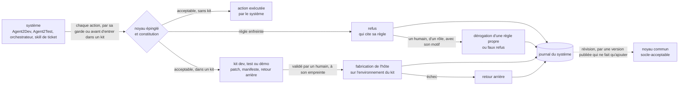

# Socle de l'acceptable, version 1.2.0

Ce socle est le modèle de l'acceptable du troisième couplage du troisième ordre, celui des valeurs (`EVOLUTION.md`, section 10) : ce que tous les systèmes du dépôt refusent, explicite, versionné et épinglé, au lieu de listes éparses et figées dans chaque constitution. Il est inclus à l'identique, à une version épinglée, par `agent2dev` et `agent2test`, qui l'appliquent et produisent le kit dev et le kit test ; `orchestrateur-c7e` et `generateur-skill-ticket` le référencent, à des dimensions réservées, et l'incluront quand elles deviendront actives. Un système ne retire ni n'affaiblit jamais une règle du socle : sa constitution peut seulement en ajouter.

Les identifiants du socle commencent par `SA` (`SA2.INV-1`), pour ne jamais se confondre avec ceux d'une spécification, qui commencent par `D`, ni avec ceux des deux autres socles, `SC` pour le socle back-front et `SO` pour le socle d'observation.

## 1. Vue d'ensemble



Le noyau ne remplace aucune constitution : chacune l'inclut et y ajoute ses propres règles. Il ne s'applique pas par lui-même : il dit à la garde d'un système, et au système qui produit un kit, ce qui se refuse et pourquoi.

## 2. Registre des dimensions du socle

| ID | Dimension | Statut 1.2.0 |
|---|---|---|
| SA1 | Intentions refusées : ce qu'une demande ne peut pas viser | active |
| SA2 | Actions interdites, et le retour arrière des actions d'un kit | active |
| SA3 | Écritures interdites : ce qu'un agent ne modifie jamais, et rien avant la validation humaine | active |
| SA4 | Secrets : ce qui ne s'écrit nulle part | active |
| SA5 | Leçons interdites : ce qu'un système n'apprend pas | active |
| SA6 | Application : confrontation avant l'action, refus, dérogations, faux refus | active |
| SA7 | Épinglage par les constitutions, et révision du noyau | active |
| SA8 | Kits : ce qu'un système remet à la fabrication de l'hôte, et ce qu'il consigne après elle | active |

## 3. Vocabulaire

| Terme | Sens |
|---|---|
| Action à effet extérieur | toute action d'un agent qui change autre chose que sa propre mémoire de travail : écrire un fichier, une base ou un ticket, lancer un programme, pousser un commit, déployer |
| Kit | le livrable par lequel un système écrit : Agent2Dev produit le kit dev, Agent2Test le kit test ; le kit démo complète la famille. Un kit est un patch, avec son application et son retour arrière, et son manifeste ; la fabrication de l'hôte l'applique sur l'environnement de son nom, dev, test ou démo, jamais en production. Le système qui le produit confronte chacune de ses actions au noyau épinglé et à sa constitution avant de le remettre, et il ne s'applique que tel qu'il a été confronté et validé (SA8) |
| Fabrication des kits | l'outil de l'hôte d'IA qui applique un kit et le défait : hors du dépôt, ce socle n'en fixe ni le code ni les commandes, seulement ce qu'un système lui remet et ce qu'il consigne après elle |
| Garde | le contrôle d'un système qui confronte une demande ou une action avant son exécution, sans kit : garde de périmètre, garde d'écriture, contrôle des leçons du binôme |
| Refus | une demande ou une action arrêtée avant son exécution parce qu'elle enfreint une règle ; il cite sa règle |
| Dérogation | la décision d'un humain, d'un rôle nommé, de laisser passer une action refusée par une règle propre à la constitution, que celle-ci déclare dérogeable, avec son motif, qui reste dans l'instance ; aucune règle du noyau ne se déroge |
| Faux refus | un refus qu'un humain juge infondé, la règle ne visant pas cette action ; l'action ne s'exécute pas pour autant, et le faux refus signale une règle trop large |
| Retour arrière | l'action inverse, préparée avant l'action, qui la défait |

## 4. SA1 : intentions refusées

### 4.1 Règles

- Une demande se confronte, à son entrée, aux intentions refusées du noyau et de la constitution du système, avant tout traitement.
- Intentions refusées du noyau, hors d'un kit : `deployer`, `administrer`, un environnement, et `ecrire-en-base`. Dans un kit, ces actions visent l'environnement du kit, et seulement lui ; aucun kit n'atteint la production.
- Une constitution en refuse davantage : Agent2Dev refuse aussi de démarrer ou d'arrêter l'application, de lancer un batch et d'écrire dans Jira (`agent2dev:D1.INV-5`) ; Agent2Test refuse toute demande qui n'est pas de tester, et de modifier du code (`agent2test:D1.INV-5`).
- Depuis 1.1.0, le contrat des kits est décrit (SA8) : une intention `horsKit` ne s'accomplit que par un kit, que la fabrication de l'hôte applique sur l'environnement de son nom ; la garde d'un système la refuse toujours.

### 4.2 Invariants

- **SA1.INV-1** : une demande de déployer ou d'administrer un environnement, ou d'écrire dans une base de données, hors d'un kit dev, test ou démo, est refusée « hors périmètre », avant tout traitement ; aucun kit n'atteint la production. Contrôle : scénario du système, une demande « redémarrer l'application en recette » refusée, comme NO9 d'Agent2Dev.

## 5. SA2 : actions interdites

### 5.1 Règles

- Programmes interdits hors d'un kit : `docker`, `kubectl`, `oc`, `helm`, `ansible`, `ansible-playbook`, `catalina.sh`, `startup.sh`, `shutdown.sh`. Arguments interdits hors d'un kit : `spring-boot:run`, `spring-boot:start`, `cargo:run`, `cargo:deploy`, `tomcat7:run`, `jetty:run`, `deploy`, `exec:java`. Ce sont ceux de la constitution d'Agent2Dev, qui deviennent communs.
- Git, partout, kit compris : aucun push forcé, ni `--force` ni `--force-with-lease` ; aucune réécriture d'un historique publié ; aucun contournement d'un hook, `--no-verify`. Une constitution peut interdire davantage : l'IA de l'orchestrateur ne pousse, ne fusionne, ne rebase ni ne pose de tag (`orchestrateur-c7e:D4.INV-3`) ; le kit d'agents parallèles refuse tout push qui réécrit une branche distante (`agents-paralleles-gitlab:D2.INV-5`).
- Retour arrière : une action d'un kit ne s'exécute qu'avec son retour arrière préparé, et vérifié quand il peut l'être, comme le déploiement, l'annulation puis le redéploiement d'un changeset sur une copie de la base de référence, que demande le référentiel des méso-contrats de l'orchestrateur. Un échec se défait par le retour arrière, qui se journalise.

### 5.2 Invariants

- **SA2.INV-1** : aucun agent ne lance, hors d'un kit, un programme de déploiement ou d'orchestration d'environnement, ni une commande qui démarre ou déploie l'application. Contrôle : garde des commandes du système, un programme ou un argument de la liste refusé.
- **SA2.INV-2** : aucun agent, kit compris, ne pousse en force, ne réécrit un historique publié ni ne contourne un hook. Contrôle : garde du système et hooks du dépôt du projet.
- **SA2.INV-3** : une action dans un kit ne s'exécute qu'avec son retour arrière préparé ; un échec se défait par lui, et le retour arrière se journalise. Contrôle : contrat des kits (SA8), scénarios du système, un kit sans retour arrière préparé non remis, un retour arrière consigné.

## 6. SA3 : écritures interdites

### 6.1 Règles

- Lieux interdits à tout agent, kit compris : la constitution de son système, les sources du système lui-même, ses fiches, la configuration humaine, la transmission de son skill. Chaque constitution donne leurs chemins, et en ajoute : Agent2Dev, les schémas et les profils ratifiés ; Agent2Test, les migrations (`agent2dev:D1.INV-6`, `agent2test:D1.INV-6`). Une écriture refusée porte l'erreur `ECRITURE_INTERDITE`.
- Aucune écriture dans un projet, code, schéma ou configuration, avant qu'un humain ait validé ce qui sera fait : la fiche de l'orchestrateur (`orchestrateur-c7e:D3.INV-1`), le point de validation du binôme. Un kit ne se produit et ne s'applique qu'après cette validation.

### 6.2 Invariants

- **SA3.INV-1** : aucun agent, même dans un kit, n'écrit dans la constitution de son système, dans les sources du système lui-même, dans ses fiches, dans la configuration humaine ni dans la transmission de son skill. Contrôle : garde d'écriture du système, une écriture dans chaque lieu refusée `ECRITURE_INTERDITE`.
- **SA3.INV-2** : aucune écriture dans un projet, code, schéma ou configuration, avant qu'un humain ait validé ce qui sera fait ; un kit ne se produit et ne s'applique qu'après cette validation. Contrôle : scénario du système, une écriture tentée avant la validation refusée.

## 7. SA4 : secrets

### 7.1 Règles

- Un secret est un jeton, un mot de passe, une clé, un certificat, ou un fichier qui en contient. Motifs de fichiers secrets du noyau, ceux des hooks du kit d'agents parallèles : `.env`, `id_rsa*`, `*.pem`, `*.key`, `*.p12`, `*.jks` ; un modèle sans valeur, comme `.env.example`, n'en est pas un.
- Un secret n'entre dans aucun journal, livrable, kit, commit ni export, ni dans une URL (`socle-back-front:SC4.INV-1`, `agents-paralleles-gitlab:D2.INV-3`) ; une URL de dépôt distant qui en porte se signale (`agents-paralleles-gitlab:D3.INV-4`). Ce qui sort d'une instance vers le milieu commun reste minimisé (`socle-observation:SO3.INV-1`).

### 7.2 Invariants

- **SA4.INV-1** : aucun secret, jeton, mot de passe, clé ou certificat n'entre dans un journal, un livrable, un kit, un commit, un export ni une URL. Contrôle : recherche des motifs de secrets dans ce que le système écrit, et hooks du dépôt du projet.

## 8. SA5 : leçons interdites

### 8.1 Règles

- Une leçon, apprise d'une correction humaine, se confronte avant d'être proposée aux motifs du noyau et de la constitution ; une leçon qui correspond à un motif est refusée par contrôle, avec la règle qu'elle contredirait, et n'est pas proposée (`agent2dev:D15.INV-3`, scénario AP6).
- Motifs du noyau : désactiver ou isoler un test ; sauter, passer ou valider d'office un point de contrôle ou de validation ; pousser en force ou contourner un hook ; démarrer ou déployer l'application hors d'un kit ; tronquer ou résumer le skill.
- Agent2Test n'a pas encore de liste de leçons interdites : le noyau lui en donne une, quand sa dimension deviendra active.

### 8.2 Invariants

- **SA5.INV-1** : aucune leçon ne s'apprend qui désactiverait un test, sauterait un point de contrôle ou de validation, contournerait une règle du noyau ou tronquerait le skill : elle est refusée par contrôle, avec la règle qu'elle contredirait. Contrôle : scénario du système, la consigne « ajouter @Disabled au test instable » refusée, comme AP6 d'Agent2Dev.

## 9. SA6 : application

### 9.1 Règles

- Toute action à effet extérieur se confronte, avant son exécution, à la version épinglée du noyau et de la constitution du système : dans un kit, par le système qui le produit, avant de le remettre, le kit ne s'appliquant que tel qu'il a été confronté et validé (SA8) ; sans kit, par la garde du système. Un système qui ne refuse que par sa consigne, sans garde ni kit, applique le noyau par sa consigne et le déclare dans ses limites.
- Un refus cite sa règle : un invariant du noyau, `socle-acceptable:SA1.INV-1`, ou de la constitution du système.
- Aucune règle du noyau ne se déroge : seule une version de ce socle la change (SA7). Une règle propre à une constitution ne se déroge que si la constitution la déclare dérogeable, par `derogeable: true` sur son entrée. Seul un humain déroge : d'un rôle nommé, développeur ou référent, avec son motif, que garde l'instance ; aucun agent ne déroge.
- Un refus qu'un humain déclare infondé est un faux refus, consigné avec sa règle et son motif ; l'action ne s'exécute pas pour autant. Il signale une règle trop large, que la revue examine : celle du noyau, pour une règle du noyau.
- Refus, dérogations, faux refus, applications de kits et retours arrière se tiennent dans le journal du système. Les refus, dérogations et faux refus du binôme s'exportent vers le milieu commun selon la correspondance du socle d'observation 1.2.0, et chaque étape de ses kits, remise, validation, application ou échec, retour arrière, selon celle du socle d'observation 1.3.0 (point d'extension E2).

### 9.2 Invariants

- **SA6.INV-1** : toute action à effet extérieur est confrontée, avant son exécution, à la version épinglée du noyau et de la constitution du système : dans un kit, par le système qui le produit, avant de le remettre, le kit ne s'appliquant que tel qu'il a été confronté et validé ; sans kit, par la garde du système ; un refus cite sa règle. Contrôle : scénarios du système, chaque refus avec sa règle.
- **SA6.INV-2** : seul un humain déroge, d'un rôle nommé et avec son motif, et seulement à une règle propre à la constitution qu'elle déclare dérogeable : aucune règle du noyau ne se déroge ; un refus déclaré infondé est un faux refus, consigné avec sa règle, sans que l'action s'exécute ; refus, dérogations, faux refus et retours arrière se journalisent. Contrôle : journal du système après une dérogation et un faux refus ; une dérogation demandée sur une règle du noyau, refusée.

## 10. SA7 : épinglage et révision

### 10.1 Règles

- Une constitution épingle le noyau par le nom et la version du socle, et par l'empreinte SHA-256 du bloc `noyau` (section 12), sérialisé en JSON canonique, clés triées, sans espace ; elle en reprend toutes les entrées, et peut en ajouter.
- Elle n'en retire ni n'en affaiblit aucune : chacune de ses listes contient celle du noyau, et une entrée du noyau marquée `horsKit` ne devient pas permise hors d'un kit.
- Le noyau ne change que par une version de ce socle, publiée par un humain, par pull request, selon la révision des formes propres d'`EVOLUTION.md`, section 10.7 ; aucun agent ne le modifie. Une révision du noyau ne fait qu'y ajouter : une entrée ajoutée, ou une entrée marquée `horsKit` qui ne l'est plus, le renforcent ; c'est le sens sûr, que le développeur publie seul, avec la migration des constitutions au journal de la version.
- Une règle de sûreté ne s'affaiblit jamais : une entrée qui se retirerait, changerait de règle ou deviendrait permise dans un kit est refusée. Le vérificateur du dépôt compare le bloc `noyau` à celui de la version archivée précédente. Un faux refus récurrent ne relâche donc jamais le noyau : la ratification précise la règle propre d'une constitution, après l'examen indépendant de la section 10.7, ou refuse la proposition.

### 10.2 Invariants

- **SA7.INV-1** : une constitution inclut tout le noyau, à une version épinglée par son empreinte, et n'en retire ni n'en affaiblit aucune règle ; elle peut en ajouter. Contrôle : au démarrage du système, l'empreinte du bloc épinglé, et chaque entrée du noyau présente dans la constitution.
- **SA7.INV-2** : le noyau ne change que par une version de ce socle publiée par un humain, qui ne fait qu'y ajouter ; aucun agent ne le modifie, et aucune règle de sûreté ne s'affaiblit : aucune entrée ne se retire, ne change de règle ni ne devient permise dans un kit. Contrôle : vérificateur du dépôt, bloc `noyau` au schéma fermé, comparé à celui de la version archivée précédente, et migration au journal de la version qui le change ; revue de la pull request.

## 11. SA8 : kits

### 11.1 Règles

- **Kit** : un patch, avec son application et son retour arrière, que la fabrication de l'hôte exécute sur l'environnement du nom du kit, `dev`, `test` ou `demo` ; aucun kit n'atteint la production. La fabrication existe hors du dépôt, et ce socle ne la change pas : il fixe ce qu'un système lui remet, et ce qu'il consigne après elle.
- **Producteurs** : Agent2Dev produit le kit dev, le patch d'un scénario accepté (`agent2dev:D27.INV-1`) ; Agent2Test, le kit test, les données dont ses scénarios ont besoin, avec leur nettoyage pour retour arrière (`agent2test:D27.INV-1`). Le skill racine du générateur de skills de ticket produira le kit démo, que scenario-playwright jouera, quand l'acceptable du générateur sera actif.
- **Confrontation** : le système qui produit un kit le confronte, avant de le remettre, à la version épinglée du noyau et de sa constitution : chaque fichier que le patch écrit, aux écritures interdites (SA3) ; son contenu et ses noms de fichiers, aux motifs de secrets (SA4) ; chaque commande qu'il porte, aux actions interdites (SA2), une entrée `horsKit` n'y visant que l'environnement du kit ; l'intention qu'il accomplit, aux intentions refusées (SA1), une intention `horsKit` n'y visant de même que cet environnement. Un kit qui porte une action refusée, ou un secret, n'est pas remis : le refus cite sa règle et suit SA6, par la garde de la règle enfreinte.
- **Manifeste** : chaque kit porte un manifeste fermé, `socle-acceptable.kit/1` (section 11.2), qui le désigne par l'empreinte de son patch, avec la version et l'empreinte du noyau confronté, et son retour arrière, toujours préparé, vérifié quand il peut l'être. La fabrication n'a pas à le lire.
- **Validation** : un humain valide le kit, à son empreinte, avant son application, au point de validation du système (SA3.INV-2). Un patch dont l'empreinte n'est plus celle de son manifeste n'est plus le kit validé : le système refuse de consigner son application.
- **Application et retour arrière** : la fabrication applique le kit validé ; un échec se défait par son retour arrière (SA2.INV-3). Un humain déclare l'application, son résultat et le retour arrière au système qui a produit le kit, qui les consigne dans son journal avec l'empreinte du kit ; aucun agent n'applique un kit ni ne déclare son application.

### 11.2 Manifeste `socle-acceptable.kit/1`

```json
{
  "format": "socle-acceptable.kit/1",
  "systeme": { "nom": "agent2dev", "version": "1.4.0" },
  "environnement": "dev",
  "patch": { "chemin": "../patchs/002-S02.patch", "empreinte": "54b440c362566a4c8e8f22b9baf9f7d78a1c78b16820ec6d8fe0566a48aafc55" },
  "noyau": { "version": "1.2.0", "empreinte": "e815cadf230886d507d56dbbfb5d7cfd0cf3982036d54d0279b70cc8f49b4764" },
  "confrontation": { "fichiers": 3, "commandes": 0 },
  "retourArriere": { "prepare": true, "verifie": false }
}
```

| Clé | Valeur |
|---|---|
| `format` | `socle-acceptable.kit/1` |
| `systeme` | `{ nom, version }` : la spécification qui produit le kit, à sa version |
| `environnement` | `dev`, `test` ou `demo` |
| `patch` | `{ chemin, empreinte }` : le chemin du patch, relatif au manifeste, et son empreinte SHA-256 |
| `noyau` | `{ version, empreinte }` : la version du socle épinglée par la constitution, et l'empreinte de son bloc `noyau` |
| `confrontation` | `{ fichiers, commandes }` : le nombre de fichiers que le patch écrit et de commandes qu'il porte, tous confrontés |
| `retourArriere` | `{ prepare, verifie }` : `prepare` vaut toujours `true` ; `verifie`, `true` quand le retour arrière a été joué avant la remise |

Toute autre clé, ou valeur hors de ces formes, refuse le manifeste ; un kit refusé à la confrontation n'a pas de manifeste. Le vérificateur du dépôt contrôle chaque manifeste d'exemple des spécifications : schéma fermé, environnement, version et empreinte du noyau inclus par la spécification qui le produit.

### 11.3 Invariants

- **SA8.INV-1** : un kit n'est remis qu'après sa confrontation, par le système qui le produit, à la version épinglée du noyau et de sa constitution : chaque fichier que son patch écrit, son contenu, chaque commande qu'il porte et l'intention qu'il accomplit ; un kit qui porterait une action refusée ou un secret n'est pas remis, et le refus cite sa règle ; une entrée `horsKit` n'y vise que l'environnement du kit, jamais la production. Contrôle : scénarios du système, un kit qui écrit dans un lieu interdit, ou qui porte un secret, non remis.
- **SA8.INV-2** : un kit porte son manifeste `socle-acceptable.kit/1`, avec l'empreinte de son patch et son retour arrière préparé ; il ne s'applique, par la fabrication de l'hôte, qu'après sa validation par un humain, à cette empreinte ; l'application et le retour arrière, déclarés par un humain, se consignent avec elle dans le journal du système qui l'a produit, et aucun agent n'applique un kit. Contrôle : scénarios du système, un kit modifié après sa validation dont l'application n'est pas consignée, un retour arrière consigné ; vérificateur du dépôt, manifestes d'exemple au schéma fermé.

## 12. Le noyau, lisible par machine

Le bloc `noyau` est la forme que reprennent les constitutions : chaque entrée cite la règle qu'elle applique, `regle`, un invariant de ce socle ; `horsKit` marque une entrée qui ne vaut que hors d'un kit. Une constitution y ajoute ses entrées, avec ses propres règles, et marque `derogeable: true` celles qui se dérogent ; une entrée du noyau ne le porte jamais.

```json
{
  "schema": "socle-acceptable.noyau/1",
  "intentionsRefusees": [
    { "intention": "deployer", "horsKit": true, "regle": "SA1.INV-1" },
    { "intention": "administrer", "horsKit": true, "regle": "SA1.INV-1" },
    { "intention": "ecrire-en-base", "horsKit": true, "regle": "SA1.INV-1" }
  ],
  "programmesInterdits": [
    { "programme": "docker", "horsKit": true, "regle": "SA2.INV-1" },
    { "programme": "kubectl", "horsKit": true, "regle": "SA2.INV-1" },
    { "programme": "oc", "horsKit": true, "regle": "SA2.INV-1" },
    { "programme": "helm", "horsKit": true, "regle": "SA2.INV-1" },
    { "programme": "ansible", "horsKit": true, "regle": "SA2.INV-1" },
    { "programme": "ansible-playbook", "horsKit": true, "regle": "SA2.INV-1" },
    { "programme": "catalina.sh", "horsKit": true, "regle": "SA2.INV-1" },
    { "programme": "startup.sh", "horsKit": true, "regle": "SA2.INV-1" },
    { "programme": "shutdown.sh", "horsKit": true, "regle": "SA2.INV-1" }
  ],
  "argumentsInterdits": [
    { "argument": "spring-boot:run", "horsKit": true, "regle": "SA2.INV-1" },
    { "argument": "spring-boot:start", "horsKit": true, "regle": "SA2.INV-1" },
    { "argument": "cargo:run", "horsKit": true, "regle": "SA2.INV-1" },
    { "argument": "cargo:deploy", "horsKit": true, "regle": "SA2.INV-1" },
    { "argument": "tomcat7:run", "horsKit": true, "regle": "SA2.INV-1" },
    { "argument": "jetty:run", "horsKit": true, "regle": "SA2.INV-1" },
    { "argument": "deploy", "horsKit": true, "regle": "SA2.INV-1" },
    { "argument": "exec:java", "horsKit": true, "regle": "SA2.INV-1" },
    { "argument": "--force", "regle": "SA2.INV-2" },
    { "argument": "--force-with-lease", "regle": "SA2.INV-2" },
    { "argument": "--no-verify", "regle": "SA2.INV-2" }
  ],
  "ecrituresInterdites": [
    { "lieu": "constitution", "regle": "SA3.INV-1" },
    { "lieu": "sources-du-systeme", "regle": "SA3.INV-1" },
    { "lieu": "fiches", "regle": "SA3.INV-1" },
    { "lieu": "configuration-humaine", "regle": "SA3.INV-1" },
    { "lieu": "transmission-du-skill", "regle": "SA3.INV-1" }
  ],
  "secrets": [
    { "motif": "(^|/)(\\.env|id_rsa[^/]*|[^/]*\\.(pem|key|p12|jks))$", "regle": "SA4.INV-1" }
  ],
  "leconsInterdites": [
    { "motif": "@Disabled|\\b[fx](it|describe)\\(|\\.only\\(", "regle": "SA5.INV-1" },
    { "motif": "(sauter|passer|ignorer|valider d'office) (le |la |les )?(point|question|validation|contrôle)", "regle": "SA5.INV-1" },
    { "motif": "--force|--no-verify", "regle": "SA2.INV-2" },
    { "motif": "spring-boot:run|démarrer l'application|déployer l'application", "regle": "SA2.INV-1" },
    { "motif": "tronquer|résumer (le |la )?(skill|méthode|section)", "regle": "SA5.INV-1" }
  ]
}
```

Le vérificateur du dépôt contrôle ce bloc : un JSON au schéma fermé `socle-acceptable.noyau/1`, six listes non vides, des entrées aux seules clés de leur liste, sans doublon, des motifs qui sont des expressions régulières valides, et des règles qui sont des invariants de ce socle ; il le compare au bloc de la version archivée précédente, dont il garde chaque entrée, avec sa règle, sans `horsKit` ajouté (SA7).

## 13. Points d'extension

En 1.2 :

- **E1** : kits d'écriture. Réservé en 1.0, le contrat des kits est décrit depuis 1.1.0 (SA8), sur la fabrication de l'hôte, sans la changer : Agent2Dev produit le kit dev, Agent2Test le kit test. Le skill racine du générateur de skills de ticket écrit déjà, à la clôture d'un arbre, trois manifestes de kits, dev, test et démo (`generateur-skill-ticket:D4.INV-2`), qui recensent ce que l'arbre a produit, sans retour arrière ni confrontation au noyau ; il produira le kit démo, que scenario-playwright jouera, quand son acceptable sera actif, et ses manifestes rejoindront alors le contrat.
- **E2** : export des refus et des kits. Depuis le socle d'observation 1.2.0, les refus, dérogations et faux refus du binôme s'exportent dans son enveloppe, avec la règle citée, et l'observatoire 1.2.0 les confronte par règle. Depuis le socle d'observation 1.3.0, chaque étape de ses kits, remise, validation, application ou échec, retour arrière, s'exporte aussi, et l'observatoire 1.3.0 les compte par système, environnement et instance.

## 14. Règles d'évolution du socle

- Le socle suit le contrat de version d'`EVOLUTION.md` à la racine du dépôt.
- Tant que sa dimension de l'acceptable est réservée, un système référence le socle dans son `manifest.json` (champ `references`) ; quand elle devient active, il l'épingle (champ `shared`), et l'outil d'assemblage l'inclut dans sa transmission.
- Une entrée ajoutée au noyau, ou une règle de plus, fait une version mineure ; chaque système l'adopte en montant sa constitution, et le journal de la version dit cette migration, par une phrase qui commence par « Migration : ». Une entrée retirée, ou une règle affaiblie, est interdite : elle ne se propose pas, et le vérificateur la refuse (`EVOLUTION.md`, section 10.7).
- Le contrat des kits (SA8) ne change aucune règle du noyau : il rend possible, dans un kit, ce que les règles réservent aux kits. Un système de plus qui produit un kit l'adopte en montant sa version, sans changer le contrat.

## 15. Journal de révision

**1.0.0** (2026-11-24) : première version, jalon J3a du passage au troisième ordre (`EVOLUTION.md`, section 10), qui ouvre le couplage des valeurs. Dimensions SA1 à SA7 actives : le noyau commun de ce que tous les systèmes refusent, en cinq familles, intentions refusées, actions interdites, écritures interdites, secrets, leçons interdites, chaque règle un invariant que cite le refus ; écriture par les kits dev, test et démo, avec retour arrière ; application, refus, dérogations et faux refus ; épinglage par les constitutions, sans retrait ni affaiblissement ; révision par une version publiée par un humain. Bloc `noyau` au schéma `socle-acceptable.noyau/1`. Invariants SA1.INV-1 à SA7.INV-2, douze. Référencé par `agent2dev` 1.2.0, `agent2test` 1.4.0, `orchestrateur-c7e` 3.8.0 et `generateur-skill-ticket` 1.4.0, à des dimensions réservées : aucun système ne l'applique encore. Décisions ratifiées avant la rédaction : spécification non transmissible, préfixe `SA` (A1) ; noyau commun, constitutions autour (R6, A2) ; chaque règle un invariant (A3) ; quatre systèmes (A4) ; kits produits par le binôme (A5) ; règles écrites « hors d'un kit » dès cette version (A6).

**1.0.1** (2026-11-24) : correctif, jalon J3b du passage au troisième ordre, décision B2 du développeur. SA6.INV-2 renforcé : aucune règle du noyau ne se déroge, seule une version de ce socle la change ; une règle propre à une constitution ne se déroge que si la constitution la déclare dérogeable, `derogeable: true` sur son entrée, qu'une entrée du noyau ne porte jamais ; un faux refus ne fait pas exécuter l'action. Vocabulaire précisé, dérogation et faux refus. Inclus et épinglé par `agent2dev` 1.3.0 et `agent2test` 1.5.0, dont l'acceptable partagé devient actif ; référencé par `orchestrateur-c7e` 3.8.1 et `generateur-skill-ticket` 1.4.1, où il reste réservé. Aucune entrée du noyau ni aucun autre invariant modifié. Archive : `archives/SKILL-v1.0.0.md`.

**1.1.0** (2026-11-25) : dimension SA8 active, le contrat des kits, jalon J3d du passage au troisième ordre (`EVOLUTION.md`, section 10). Un kit est un patch, avec son application et son retour arrière, que la fabrication de l'hôte exécute sur l'environnement de son nom, dev, test ou démo, jamais en production ; la fabrication existe hors du dépôt, et ce socle ne la change pas. Le système qui produit un kit le confronte, avant de le remettre, au noyau épinglé et à sa constitution : fichiers écrits, contenu, commandes et intention ; un kit refusé n'est pas remis. Manifeste fermé `socle-acceptable.kit/1`, qui désigne le kit par l'empreinte de son patch ; validation par un humain à cette empreinte avant l'application ; application et retour arrière déclarés par un humain et consignés par le système qui l'a produit. Agent2Dev produit le kit dev, Agent2Test le kit test ; le skill racine du générateur produira le kit démo, quand son acceptable sera actif. SA6.INV-1 précisé, sans affaiblissement : dans un kit, la confrontation se fait par le système qui le produit, avant sa remise, et le kit ne s'applique que tel qu'il a été confronté et validé ; la confrontation précède toujours l'exécution. Contrôle de SA2.INV-3 rattaché au contrat ; vocabulaire, fabrication des kits ; SA1 et SA6, intentions `horsKit` accomplies par un kit et export des refus ; points E1 et E2 récrits. Invariants SA8.INV-1 et SA8.INV-2, quatorze. Le bloc `noyau` ne change pas, ni son empreinte. Inclus et épinglé par `agent2dev` 1.4.0 et `agent2test` 1.6.0 ; référencé par `orchestrateur-c7e` 3.8.3 et `generateur-skill-ticket` 1.4.3, où il reste réservé. Décisions ratifiées avant la rédaction : plan du jalon J3d, K1 à K4. Archive : `archives/SKILL-v1.0.1.md`.

**1.2.0** (2026-11-26) : jalon J5a du passage au troisième ordre (`EVOLUTION.md`, section 10), la révision des formes propres. SA7 : le noyau se révise selon la section 10.7 d'`EVOLUTION.md` ; une révision ne fait qu'y ajouter, une entrée ajoutée, ou une entrée qui perd `horsKit`, le renforcent, et le développeur la publie seul, en disant au journal la migration des constitutions ; une entrée qui se retirerait, changerait de règle ou deviendrait permise dans un kit est refusée. SA7.INV-2 renforcé : son contrôle compare le bloc `noyau` à celui de la version archivée précédente. Un faux refus récurrent ne relâche jamais le noyau : la ratification précise la règle propre d'une constitution, après l'examen indépendant, ou refuse la proposition. SA6 et E2 à jour : les étapes des kits s'exportent depuis le socle d'observation 1.3.0. Le bloc `noyau` ne change pas, ni son empreinte. Inclus et épinglé par `agent2dev` 1.4.3 et `agent2test` 1.6.2 ; référencé par `orchestrateur-c7e` 3.8.6 et `generateur-skill-ticket` 1.4.6, où il reste réservé. Décisions ratifiées avant la rédaction : plan du jalon J5, W1 à W4. Archive : `archives/SKILL-v1.1.0.md`.
