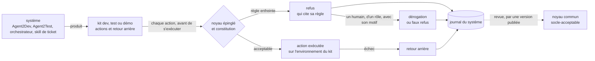

# Socle de l'acceptable, version 1.0.0

Ce socle est le modèle de l'acceptable du troisième couplage du troisième ordre, celui des valeurs (`EVOLUTION.md`, section 10) : ce que tous les systèmes du dépôt refusent, explicite, versionné et épinglé, au lieu de listes éparses et figées dans chaque constitution. Il est référencé par les quatre systèmes qui prévoient de l'appliquer, `agent2dev`, `agent2test`, `orchestrateur-c7e` et `generateur-skill-ticket`, à des dimensions réservées ; il sera inclus à l'identique, à une version épinglée, dans chaque système dont la dimension deviendra active. Un système ne retire ni n'affaiblit jamais une règle du socle : sa constitution peut seulement en ajouter.

Les identifiants du socle commencent par `SA` (`SA2.INV-1`), pour ne jamais se confondre avec ceux d'une spécification, qui commencent par `D`, ni avec ceux des deux autres socles, `SC` pour le socle back-front et `SO` pour le socle d'observation.

## 1. Vue d'ensemble



Le noyau ne remplace aucune constitution : chacune l'inclut et y ajoute ses propres règles. Il ne s'applique pas par lui-même : il dit à la garde d'un système, et au kit qui exécutera ses actions, ce qui se refuse et pourquoi.

## 2. Registre des dimensions du socle

| ID | Dimension | Statut 1.0.0 |
|---|---|---|
| SA1 | Intentions refusées : ce qu'une demande ne peut pas viser | active |
| SA2 | Actions interdites, et le retour arrière des actions d'un kit | active |
| SA3 | Écritures interdites : ce qu'un agent ne modifie jamais, et rien avant la validation humaine | active |
| SA4 | Secrets : ce qui ne s'écrit nulle part | active |
| SA5 | Leçons interdites : ce qu'un système n'apprend pas | active |
| SA6 | Application : confrontation avant l'action, refus, dérogations, faux refus | active |
| SA7 | Épinglage par les constitutions, et révision du noyau | active |

## 3. Vocabulaire

| Terme | Sens |
|---|---|
| Action à effet extérieur | toute action d'un agent qui change autre chose que sa propre mémoire de travail : écrire un fichier, une base ou un ticket, lancer un programme, pousser un commit, déployer |
| Kit | le livrable par lequel un système écrit : Agent2Dev produit le kit dev, Agent2Test le kit test ; un kit démo complète la famille. Un kit porte ses actions et leur retour arrière ; il s'applique, par l'hôte d'IA, sur l'environnement de son nom, dev, test ou démo, jamais en production ; son application confronte chaque action au noyau épinglé et à la constitution du système avant de l'exécuter. En 1.0, ce contrat n'est pas décrit (point d'extension E1) : aucun kit n'exécute d'action |
| Garde | le contrôle d'un système qui confronte une demande ou une action avant son exécution, sans kit : garde de périmètre, garde d'écriture, contrôle des leçons du binôme |
| Refus | une demande ou une action arrêtée avant son exécution parce qu'elle enfreint une règle ; il cite sa règle |
| Dérogation | la décision d'un humain, d'un rôle nommé, de laisser passer une action refusée, avec son motif, qui reste dans l'instance |
| Faux refus | un refus qu'un humain juge infondé, la règle ne visant pas cette action ; il signale une règle trop large |
| Retour arrière | l'action inverse, préparée avant l'action, qui la défait |

## 4. SA1 : intentions refusées

### 4.1 Règles

- Une demande se confronte, à son entrée, aux intentions refusées du noyau et de la constitution du système, avant tout traitement.
- Intentions refusées du noyau, hors d'un kit : `deployer`, `administrer`, un environnement, et `ecrire-en-base`. Dans un kit, ces actions visent l'environnement du kit, et seulement lui ; aucun kit n'atteint la production.
- Une constitution en refuse davantage : Agent2Dev refuse aussi de démarrer ou d'arrêter l'application, de lancer un batch et d'écrire dans Jira (`agent2dev:D1.INV-5`) ; Agent2Test refuse toute demande qui n'est pas de tester, et de modifier du code (`agent2test:D1.INV-5`).
- Tant que le contrat des kits n'est pas décrit (point d'extension E1), ces intentions sont refusées en toutes circonstances, comme dans les constitutions d'aujourd'hui.

### 4.2 Invariants

- **SA1.INV-1** : une demande de déployer ou d'administrer un environnement, ou d'écrire dans une base de données, hors d'un kit dev, test ou démo, est refusée « hors périmètre », avant tout traitement ; aucun kit n'atteint la production. Contrôle : scénario du système, une demande « redémarrer l'application en recette » refusée, comme NO9 d'Agent2Dev.

## 5. SA2 : actions interdites

### 5.1 Règles

- Programmes interdits hors d'un kit : `docker`, `kubectl`, `oc`, `helm`, `ansible`, `ansible-playbook`, `catalina.sh`, `startup.sh`, `shutdown.sh`. Arguments interdits hors d'un kit : `spring-boot:run`, `spring-boot:start`, `cargo:run`, `cargo:deploy`, `tomcat7:run`, `jetty:run`, `deploy`, `exec:java`. Ce sont ceux de la constitution d'Agent2Dev, qui deviennent communs.
- Git, partout, kit compris : aucun push forcé, ni `--force` ni `--force-with-lease` ; aucune réécriture d'un historique publié ; aucun contournement d'un hook, `--no-verify`. Une constitution peut interdire davantage : l'IA de l'orchestrateur ne pousse, ne fusionne, ne rebase ni ne pose de tag (`orchestrateur-c7e:D4.INV-3`) ; le kit d'agents parallèles refuse tout push qui réécrit une branche distante (`agents-paralleles-gitlab:D2.INV-5`).
- Retour arrière : une action d'un kit ne s'exécute qu'avec son retour arrière préparé, et vérifié quand il peut l'être, comme le déploiement, l'annulation puis le redéploiement d'un changeset sur une copie de la base de référence, que demande le référentiel des méso-contrats de l'orchestrateur. Un échec se défait par le retour arrière, qui se journalise.

### 5.2 Invariants

- **SA2.INV-1** : aucun agent ne lance, hors d'un kit, un programme de déploiement ou d'orchestration d'environnement, ni une commande qui démarre ou déploie l'application. Contrôle : garde des commandes du système, un programme ou un argument de la liste refusé.
- **SA2.INV-2** : aucun agent, kit compris, ne pousse en force, ne réécrit un historique publié ni ne contourne un hook. Contrôle : garde du système et hooks du dépôt du projet.
- **SA2.INV-3** : une action dans un kit ne s'exécute qu'avec son retour arrière préparé ; un échec se défait par lui, et le retour arrière se journalise. Contrôle : contrat des kits (point d'extension E1), dès qu'il est décrit.

## 6. SA3 : écritures interdites

### 6.1 Règles

- Lieux interdits à tout agent, kit compris : la constitution de son système, les sources du système lui-même, ses fiches, la configuration humaine, la transmission de son skill. Chaque constitution donne leurs chemins, et en ajoute : Agent2Dev, les schémas et les profils ratifiés ; Agent2Test, les migrations (`agent2dev:D1.INV-6`, `agent2test:D1.INV-6`). Une écriture refusée porte l'erreur `ECRITURE_INTERDITE`.
- Aucune écriture dans un projet, code, schéma ou configuration, avant qu'un humain ait validé ce qui sera fait : la fiche de l'orchestrateur (`orchestrateur-c7e:D3.INV-1`), le point de validation du binôme. Un kit ne se produit et ne s'applique qu'après cette validation.

### 6.2 Invariants

- **SA3.INV-1** : aucun agent, même dans un kit, n'écrit dans la constitution de son système, dans les sources du système lui-même, dans ses fiches, dans la configuration humaine ni dans la transmission de son skill. Contrôle : garde d'écriture du système, une écriture dans chaque lieu refusée `ECRITURE_INTERDITE`.
- **SA3.INV-2** : aucune écriture dans un projet, code, schéma ou configuration, avant qu'un humain ait validé ce qui sera fait ; un kit ne se produit et ne s'applique qu'après cette validation. Contrôle : scénario du système, une écriture tentée avant la validation refusée.

## 7. SA4 : secrets

### 7.1 Règles

- Un secret est un jeton, un mot de passe, une clé, un certificat, ou un fichier qui en contient. Motifs de fichiers secrets du noyau, ceux des hooks du kit d'agents parallèles : `.env`, `id_rsa*`, `*.pem`, `*.key`, `*.p12`, `*.jks` ; un modèle sans valeur, comme `.env.example`, n'en est pas un.
- Un secret n'entre dans aucun journal, livrable, kit, commit ni export, ni dans une URL (`socle-back-front:SC4.INV-1`, `agents-paralleles-gitlab:D2.INV-3`) ; une URL de dépôt distant qui en porte se signale (`agents-paralleles-gitlab:D3.INV-4`). Ce qui sort d'une instance vers le milieu commun reste minimisé (`socle-observation:SO3.INV-1`).

### 7.2 Invariants

- **SA4.INV-1** : aucun secret, jeton, mot de passe, clé ou certificat n'entre dans un journal, un livrable, un kit, un commit, un export ni une URL. Contrôle : recherche des motifs de secrets dans ce que le système écrit, et hooks du dépôt du projet.

## 8. SA5 : leçons interdites

### 8.1 Règles

- Une leçon, apprise d'une correction humaine, se confronte avant d'être proposée aux motifs du noyau et de la constitution ; une leçon qui correspond à un motif est refusée par contrôle, avec la règle qu'elle contredirait, et n'est pas proposée (`agent2dev:D15.INV-3`, scénario AP6).
- Motifs du noyau : désactiver ou isoler un test ; sauter, passer ou valider d'office un point de contrôle ou de validation ; pousser en force ou contourner un hook ; démarrer ou déployer l'application hors d'un kit ; tronquer ou résumer le skill.
- Agent2Test n'a pas encore de liste de leçons interdites : le noyau lui en donne une, quand sa dimension deviendra active.

### 8.2 Invariants

- **SA5.INV-1** : aucune leçon ne s'apprend qui désactiverait un test, sauterait un point de contrôle ou de validation, contournerait une règle du noyau ou tronquerait le skill : elle est refusée par contrôle, avec la règle qu'elle contredirait. Contrôle : scénario du système, la consigne « ajouter @Disabled au test instable » refusée, comme AP6 d'Agent2Dev.

## 9. SA6 : application

### 9.1 Règles

- Toute action à effet extérieur se confronte, avant son exécution, à la version épinglée du noyau et de la constitution du système : par le kit qui l'exécute, ou, sans kit, par la garde du système. Un système qui ne refuse que par sa consigne, sans garde ni kit, applique le noyau par sa consigne et le déclare dans ses limites.
- Un refus cite sa règle : un invariant du noyau, `socle-acceptable:SA1.INV-1`, ou de la constitution du système.
- Seul un humain déroge : d'un rôle nommé, développeur ou référent, avec son motif, que garde l'instance ; aucun agent ne déroge, à une règle du noyau ni à une autre.
- Un refus qu'un humain lève comme infondé est un faux refus, consigné avec sa règle : il signale une règle trop large, que la revue du noyau examine.
- Refus, dérogations, faux refus et retours arrière se tiennent dans le journal du système. Leur export vers le milieu commun attend sa correspondance dans le socle d'observation (point d'extension E2).

### 9.2 Invariants

- **SA6.INV-1** : toute action à effet extérieur est confrontée, avant son exécution, à la version épinglée du noyau et de la constitution du système, par le kit qui l'exécute ou, sans kit, par la garde du système ; un refus cite sa règle. Contrôle : scénarios du système, chaque refus avec sa règle.
- **SA6.INV-2** : seul un humain déroge, d'un rôle nommé et avec son motif ; un refus levé comme infondé est un faux refus, consigné avec sa règle ; refus, dérogations, faux refus et retours arrière se journalisent. Contrôle : journal du système après une dérogation et un faux refus.

## 10. SA7 : épinglage et révision

### 10.1 Règles

- Une constitution épingle le noyau par le nom et la version du socle, et par l'empreinte SHA-256 du bloc `noyau` (section 11), sérialisé en JSON canonique, clés triées, sans espace ; elle en reprend toutes les entrées, et peut en ajouter.
- Elle n'en retire ni n'en affaiblit aucune : chacune de ses listes contient celle du noyau, et une entrée du noyau marquée `horsKit` ne devient pas permise hors d'un kit.
- Le noyau ne change que par une version de ce socle, publiée par un humain, par pull request ; aucun agent ne le modifie. Une règle de sûreté ne s'affaiblit jamais : une version qui retirerait ou affaiblirait une entrée du noyau est refusée. La procédure de révision par au moins deux sujets distincts, nourrie des refus, des dérogations et des faux refus de plusieurs instances, attend le jalon J5 du passage au troisième ordre.

### 10.2 Invariants

- **SA7.INV-1** : une constitution inclut tout le noyau, à une version épinglée par son empreinte, et n'en retire ni n'en affaiblit aucune règle ; elle peut en ajouter. Contrôle : au démarrage du système, l'empreinte du bloc épinglé, et chaque entrée du noyau présente dans la constitution.
- **SA7.INV-2** : le noyau ne change que par une version de ce socle publiée par un humain ; aucun agent ne le modifie, et aucune règle de sûreté ne s'affaiblit. Contrôle : vérificateur du dépôt, bloc `noyau` au schéma fermé ; revue de la pull request.

## 11. Le noyau, lisible par machine

Le bloc `noyau` est la forme que reprennent les constitutions : chaque entrée cite la règle qu'elle applique, `regle`, un invariant de ce socle ; `horsKit` marque une entrée qui ne vaut que hors d'un kit. Une constitution y ajoute ses entrées, avec ses propres règles.

```json
{
  "schema": "socle-acceptable.noyau/1",
  "intentionsRefusees": [
    { "intention": "deployer", "horsKit": true, "regle": "SA1.INV-1" },
    { "intention": "administrer", "horsKit": true, "regle": "SA1.INV-1" },
    { "intention": "ecrire-en-base", "horsKit": true, "regle": "SA1.INV-1" }
  ],
  "programmesInterdits": [
    { "programme": "docker", "horsKit": true, "regle": "SA2.INV-1" },
    { "programme": "kubectl", "horsKit": true, "regle": "SA2.INV-1" },
    { "programme": "oc", "horsKit": true, "regle": "SA2.INV-1" },
    { "programme": "helm", "horsKit": true, "regle": "SA2.INV-1" },
    { "programme": "ansible", "horsKit": true, "regle": "SA2.INV-1" },
    { "programme": "ansible-playbook", "horsKit": true, "regle": "SA2.INV-1" },
    { "programme": "catalina.sh", "horsKit": true, "regle": "SA2.INV-1" },
    { "programme": "startup.sh", "horsKit": true, "regle": "SA2.INV-1" },
    { "programme": "shutdown.sh", "horsKit": true, "regle": "SA2.INV-1" }
  ],
  "argumentsInterdits": [
    { "argument": "spring-boot:run", "horsKit": true, "regle": "SA2.INV-1" },
    { "argument": "spring-boot:start", "horsKit": true, "regle": "SA2.INV-1" },
    { "argument": "cargo:run", "horsKit": true, "regle": "SA2.INV-1" },
    { "argument": "cargo:deploy", "horsKit": true, "regle": "SA2.INV-1" },
    { "argument": "tomcat7:run", "horsKit": true, "regle": "SA2.INV-1" },
    { "argument": "jetty:run", "horsKit": true, "regle": "SA2.INV-1" },
    { "argument": "deploy", "horsKit": true, "regle": "SA2.INV-1" },
    { "argument": "exec:java", "horsKit": true, "regle": "SA2.INV-1" },
    { "argument": "--force", "regle": "SA2.INV-2" },
    { "argument": "--force-with-lease", "regle": "SA2.INV-2" },
    { "argument": "--no-verify", "regle": "SA2.INV-2" }
  ],
  "ecrituresInterdites": [
    { "lieu": "constitution", "regle": "SA3.INV-1" },
    { "lieu": "sources-du-systeme", "regle": "SA3.INV-1" },
    { "lieu": "fiches", "regle": "SA3.INV-1" },
    { "lieu": "configuration-humaine", "regle": "SA3.INV-1" },
    { "lieu": "transmission-du-skill", "regle": "SA3.INV-1" }
  ],
  "secrets": [
    { "motif": "(^|/)(\\.env|id_rsa[^/]*|[^/]*\\.(pem|key|p12|jks))$", "regle": "SA4.INV-1" }
  ],
  "leconsInterdites": [
    { "motif": "@Disabled|\\b[fx](it|describe)\\(|\\.only\\(", "regle": "SA5.INV-1" },
    { "motif": "(sauter|passer|ignorer|valider d'office) (le |la |les )?(point|question|validation|contrôle)", "regle": "SA5.INV-1" },
    { "motif": "--force|--no-verify", "regle": "SA2.INV-2" },
    { "motif": "spring-boot:run|démarrer l'application|déployer l'application", "regle": "SA2.INV-1" },
    { "motif": "tronquer|résumer (le |la )?(skill|méthode|section)", "regle": "SA5.INV-1" }
  ]
}
```

Le vérificateur du dépôt contrôle ce bloc : un JSON au schéma fermé `socle-acceptable.noyau/1`, six listes non vides, des entrées aux seules clés de leur liste, sans doublon, des motifs qui sont des expressions régulières valides, et des règles qui sont des invariants de ce socle.

## 12. Points d'extension

Réservés en 1.0 :

- **E1** : kits d'écriture. Le contrat des kits est posé par SA1.INV-1, SA2.INV-1, SA2.INV-3, SA3.INV-2 et SA6.INV-1 : un kit, dev, test ou démo, porte ses actions et leur retour arrière, s'applique par l'hôte d'IA sur l'environnement de son nom, jamais en production, confronte chaque action au noyau avant de l'exécuter et journalise ce qu'il refuse et ce qu'il défait. En 1.0, ce contrat n'est pas décrit : aucun kit n'exécute d'action, et ce qui ne se fait que dans un kit reste refusé. Le skill racine du générateur de skills de ticket écrit déjà, à la clôture d'un arbre, trois manifestes de kits, dev, test et démo (`generateur-skill-ticket:D4.INV-2`) : ils recensent ce que l'arbre a produit, sans retour arrière ni confrontation au noyau. La description des kits, le kit dev que produit Agent2Dev, le kit test que produit Agent2Test et le kit démo, dira comment ces manifestes la rejoignent, et rendra possibles les actions réservées aux kits sans changer aucune règle du noyau.
- **E2** : export des refus. Refus, dérogations, faux refus et retours arrière s'exporteront dans l'enveloppe du socle d'observation, selon une correspondance que donnera une version de ce socle-là, avec l'invariant cité ; l'observatoire les confrontera comme tout invariant du dépôt. En 1.0, rien ne s'exporte.

## 13. Règles d'évolution du socle

- Le socle suit le contrat de version d'`EVOLUTION.md` à la racine du dépôt.
- Tant que sa dimension de l'acceptable est réservée, un système référence le socle dans son `manifest.json` (champ `references`) ; quand elle devient active, il l'épingle (champ `shared`), et l'outil d'assemblage l'inclut dans sa transmission.
- Une entrée ajoutée au noyau, ou une règle de plus, fait une version mineure ; chaque système l'adopte en montant sa constitution. Une entrée retirée, ou une règle affaiblie, est interdite : elle ne se propose pas.
- La description des kits, au point E1, ne change aucune règle : elle rend possible, dans un kit, ce que les règles réservent aux kits.

## 14. Journal de révision

**1.0.0** (2026-11-24) : première version, jalon J3a du passage au troisième ordre (`EVOLUTION.md`, section 10), qui ouvre le couplage des valeurs. Dimensions SA1 à SA7 actives : le noyau commun de ce que tous les systèmes refusent, en cinq familles, intentions refusées, actions interdites, écritures interdites, secrets, leçons interdites, chaque règle un invariant que cite le refus ; écriture par les kits dev, test et démo, avec retour arrière ; application, refus, dérogations et faux refus ; épinglage par les constitutions, sans retrait ni affaiblissement ; révision par une version publiée par un humain. Bloc `noyau` au schéma `socle-acceptable.noyau/1`. Invariants SA1.INV-1 à SA7.INV-2, douze. Référencé par `agent2dev` 1.2.0, `agent2test` 1.4.0, `orchestrateur-c7e` 3.8.0 et `generateur-skill-ticket` 1.4.0, à des dimensions réservées : aucun système ne l'applique encore. Décisions ratifiées avant la rédaction : spécification non transmissible, préfixe `SA` (A1) ; noyau commun, constitutions autour (R6, A2) ; chaque règle un invariant (A3) ; quatre systèmes (A4) ; kits produits par le binôme (A5) ; règles écrites « hors d'un kit » dès cette version (A6).
