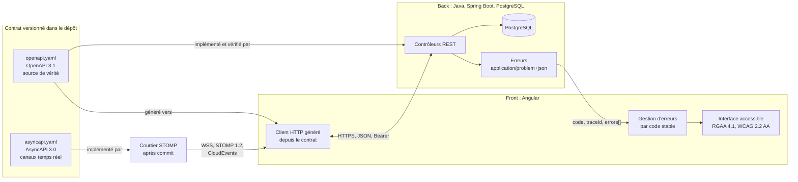

# Socle commun back-front, version 1.1.0

Ce socle définit ce que le back et le front doivent respecter **ensemble**. Il est inclus à l'identique dans chaque skill qui en dépend (`java`, `angular`, `analyse-projet`, `sonarqube`, `agent-tdd-jira`, `orchestrateur-c7e`), à une version épinglée. Un skill ne redéfinit jamais une règle du socle : il peut seulement la préciser pour sa technologie.

Les identifiants du socle commencent par `SC` (`SC2.INV-1`), pour ne jamais se confondre avec ceux d'un skill, qui commencent par `D` suivi du numéro de dimension.

## 1. Vue d'ensemble



## 2. Registre des dimensions du socle

| ID | Dimension | Statut 1.1.0 |
|---|---|---|
| SC1 | Contrat d'API OpenAPI | active |
| SC2 | Erreurs RFC 9457 | active |
| SC3 | Formats de données et pagination | active |
| SC4 | Sécurité de la frontière | active |
| SC5 | Traçabilité | active |
| SC6 | Accessibilité et messages | active |
| SC7 | Événements temps réel vers le front (WebSocket STOMP) ; SSE et messages entre services réservés | active |

## 3. SC1 : contrat d'API

### 3.1 Règles

- Le contrat est un fichier **OpenAPI 3.1** versionné dans le dépôt (par défaut `api/openapi.yaml`). Il est la source de vérité de la frontière.
- Le back l'implémente. Un test du back compare le contrat exposé par l'application (par exemple via springdoc) au fichier du dépôt, et échoue en cas d'écart.
- Le front ne code jamais un appel HTTP à la main pour un endpoint du contrat. Il utilise le client généré depuis le contrat, et la génération fait partie du build.
- Préfixe de version dans l'URL : `/api/v1/...`. Ressources au pluriel, en kebab-case : `/api/v1/purchase-orders/{id}`.
- Propriétés JSON en camelCase. Valeurs d'énumération en MAJUSCULES_SOULIGNÉES (`IN_PROGRESS`).
- Chaque opération a un `operationId` unique et stable : il devient le nom de méthode du client généré.

### 3.2 Compatibilité

| Changement | Autorisé dans `v1` publiée ? |
|---|---|
| Ajouter un endpoint | oui |
| Ajouter un champ optionnel en réponse | oui |
| Ajouter un paramètre optionnel en entrée | oui |
| Ajouter une valeur d'énumération en réponse | non, sauf si le contrat déclare l'énumération extensible et que le front gère une valeur inconnue |
| Renommer ou supprimer un champ, un endpoint, une valeur | non : nouvelle version `v2` |
| Rendre obligatoire un champ d'entrée | non : nouvelle version `v2` |
| Changer le type ou le format d'un champ | non : nouvelle version `v2` |

Un endpoint retiré passe d'abord par l'état déprécié (`deprecated: true` dans le contrat, en-tête `Deprecation` en réponse) pendant au moins une version de livraison.

### 3.3 Invariants

- **SC1.INV-1** : tout endpoint exposé par le back figure dans le contrat, et tout endpoint du contrat est implémenté. Contrôle : test de conformité du contrat côté back.
- **SC1.INV-2** : aucun changement cassant n'est introduit dans une version d'API publiée. Contrôle : comparaison du contrat avec sa version précédente (outil de diff OpenAPI en CI, ou revue).
- **SC1.INV-3** : le front n'appelle les endpoints du contrat qu'au travers du client généré. Contrôle : recherche d'URL `/api/` codées en dur dans le front, hors client généré.

## 4. SC2 : erreurs

### 4.1 Format

Toute réponse d'erreur 4xx ou 5xx a le type `application/problem+json` (RFC 9457), avec les membres standard et trois extensions :

```json
{
  "type": "https://errors.example.org/validation",
  "title": "Requête invalide",
  "status": 400,
  "detail": "La commande contient 2 erreurs.",
  "instance": "/api/v1/purchase-orders",
  "code": "VALIDATION_FAILED",
  "traceId": "4bf92f3577b34da6a3ce929d0e0e4736",
  "errors": [
    { "field": "lines[0].quantity", "code": "MIN", "message": "doit être supérieur ou égal à 1" },
    { "field": "deliveryDate", "code": "FUTURE", "message": "doit être une date future" }
  ]
}
```

| Membre | Rôle | Stabilité |
|---|---|---|
| `type` | URI qui identifie la catégorie d'erreur | stable |
| `title`, `detail` | texte lisible, destiné à un humain | **non stable** : ne jamais s'en servir dans la logique |
| `status` | code HTTP | stable |
| `code` | code machine de l'erreur, en MAJUSCULES | stable, fait partie du contrat |
| `traceId` | identifiant de trace (SC5) | présent sur toute erreur |
| `errors[]` | erreurs de validation champ par champ | présent pour les erreurs de validation |

### 4.2 Codes HTTP

| Situation | Statut | `code` (exemples) |
|---|---|---|
| Corps ou paramètres invalides | 400 | `VALIDATION_FAILED`, `MALFORMED_REQUEST` |
| Non authentifié | 401 | `UNAUTHENTICATED` |
| Authentifié mais non autorisé | 403 | `FORBIDDEN` |
| Ressource absente | 404 | `NOT_FOUND` |
| Conflit de version (verrou optimiste) | 409 | `CONCURRENT_MODIFICATION` |
| Règle métier violée | 422 | code métier propre, par exemple `ORDER_ALREADY_SHIPPED` |
| Erreur inattendue | 500 | `INTERNAL_ERROR`, sans détail technique |

### 4.3 Invariants

- **SC2.INV-1** : toute réponse 4xx ou 5xx du back est en `application/problem+json`, avec `code` et `traceId`. Contrôle : tests d'API sur un cas de chaque statut.
- **SC2.INV-2** : le front ne fonde aucune décision sur `title` ou `detail`. Il décide sur `status` et `code`. Contrôle : revue et tests du gestionnaire d'erreurs.
- **SC2.INV-3** : une erreur 500 ne révèle ni trace de pile, ni requête SQL, ni nom de classe. Contrôle : test d'API provoquant une exception non gérée.

## 5. SC3 : formats de données et pagination

| Donnée | Format JSON | Côté Java | Côté TypeScript |
|---|---|---|---|
| Instant | chaîne ISO 8601 avec fuseau, `2026-10-16T10:15:30Z` | `Instant` ou `OffsetDateTime` | `string`, converti en `Date` au plus près de l'affichage |
| Date calendaire | `2026-10-16` | `LocalDate` | `string` |
| Montant | chaîne décimale `"1234.50"` ou entier en unités mineures, au choix du contrat, jamais flottant | `BigDecimal` ou `long` | `string` ou `number` entier |
| Identifiant | chaîne opaque (UUID recommandé) | `UUID` | `string` |
| Énumération | chaîne en MAJUSCULES | `enum` | union de littéraux générée |
| Absence de valeur | champ absent ou `null`, défini par le contrat pour chaque champ | `Optional` en retour de méthode seulement | `T \| null` ou `T \| undefined`, selon le contrat |

Pagination :

- requête : `?page=0&size=20&sort=createdAt,desc` (pages numérotées à partir de 0, `size` borné côté back, 100 au maximum par défaut) ;
- réponse :

```json
{
  "content": [ { "id": "..." } ],
  "page": { "size": 20, "number": 0, "totalElements": 134, "totalPages": 7 }
}
```

Invariants :

- **SC3.INV-1** : aucune date-heure ne circule sans fuseau. Contrôle : schéma du contrat (`format: date-time`) et tests de sérialisation.
- **SC3.INV-2** : aucun montant n'est représenté en virgule flottante, ni en JSON, ni en Java, ni en base. Contrôle : revue du contrat et recherche de `double`, `float` sur les champs monétaires.
- **SC3.INV-3** : toute liste potentiellement non bornée est paginée, avec une taille maximale imposée par le back. Contrôle : revue des endpoints de collection.

## 6. SC4 : sécurité de la frontière

- Authentification par jeton porteur (`Authorization: Bearer ...`) émis par un fournisseur d'identité OAuth 2.1 / OpenID Connect ; le back est un serveur de ressources qui valide le jeton. Si le projet utilise des cookies de session, la protection CSRF est obligatoire des deux côtés.
- Le front ne contient aucun secret : ni clé d'API privée, ni secret client. Toute configuration du front est publique par nature.
- Aucun jeton ni donnée personnelle dans une URL (paramètre de requête ou chemin), car les URL finissent dans les journaux.
- CORS : liste explicite d'origines par environnement. Jamais `*` quand les identifiants sont autorisés.
- 401 signifie « pas ou plus authentifié » : le front relance l'authentification. 403 signifie « authentifié mais refusé » : le front informe, sans relancer.
- L'autorisation est toujours vérifiée par le back. Masquer un bouton dans le front n'est pas une mesure de sécurité.

Invariants :

- **SC4.INV-1** : aucun secret ni jeton dans le code du front, dans une URL ou dans un journal. Contrôle : recherche de motifs de secrets et revue de la configuration de journalisation.
- **SC4.INV-2** : chaque endpoint non public est protégé par une règle d'autorisation côté back. Contrôle : test d'accès anonyme refusé sur chaque endpoint protégé.
- **SC4.INV-3** : CORS n'autorise jamais `*` avec identifiants. Contrôle : revue de la configuration CORS par environnement.

## 7. SC5 : traçabilité

- Le back propage le contexte W3C Trace Context (`traceparent`) et attache l'identifiant de trace à chaque ligne de journal.
- Chaque Problem Details porte `traceId` (SC2). Le front l'affiche dans le message d'erreur, sous une forme copiable, pour que l'utilisateur puisse le transmettre au support.
- Les journaux ne contiennent ni jeton, ni mot de passe, ni donnée personnelle non nécessaire.

Invariant :

- **SC5.INV-1** : toute erreur 5xx est journalisée côté back avec son `traceId`, et le même `traceId` est renvoyé au front. Contrôle : test d'API et vérification du journal capturé.

## 8. SC6 : accessibilité et messages

- Le front respecte le RGAA 4.1 et le WCAG 2.2 niveau AA.
- Les messages affichés à l'utilisateur sont localisés côté front à partir de `code` et, pour la validation, de `errors[].code`. Le `detail` du back sert de repli seulement.
- Une erreur de validation est associée au champ concerné (programmatiquement, pas seulement visuellement) et annoncée aux technologies d'assistance.
- Le back accepte l'en-tête `Accept-Language` et rédige `title` et `detail` en français par défaut.

Invariants :

- **SC6.INV-1** : chaque erreur de validation renvoyée par le back est rattachée au champ correspondant dans le formulaire du front. Contrôle : test de composant avec une réponse 400 simulée.
- **SC6.INV-2** : aucune information n'est transmise par la couleur seule. Contrôle : revue RGAA (critère 3.1) et tests automatisés d'accessibilité.

## 9. SC7 : événements temps réel

Active depuis 1.1.0, pour un seul usage : tenir le front à jour des changements d'une ressource, par WebSocket et STOMP 1.2. Le serveur publie, le client s'abonne. Les autres canaux asynchrones (SSE, messages entre services, commandes envoyées par le client sur le canal) restent réservés : un skill qui en introduit un le signale comme écart au socle.

### 9.1 Contrat

- Les canaux sont décrits dans un fichier **AsyncAPI 3.0** versionné dans le dépôt (par défaut `api/asyncapi.yaml`), à côté du contrat OpenAPI. Les schémas des données y sont des références aux schémas du contrat OpenAPI : le front réutilise les types générés.
- Point de connexion : `/api/ws`. Destinations : `/topic/v1/<ressources>/{id}/<sous-ressource>`, en kebab-case, versionnées comme l'API REST et soumises aux mêmes règles de compatibilité (§ 3.2).
- Chaque canal a son **instantané** : l'opération REST qui renvoie l'état courant de la ressource. Sa réponse porte l'en-tête `ETag`, égal à la dernière séquence publiée sur le canal (`"42"`).

### 9.2 Enveloppe d'événement

Chaque message est un événement **CloudEvents 1.0**, au format JSON structuré :

```json
{
  "specversion": "1.0",
  "id": "5f1c0e7a-2b8d-4f0e-9a51-1d2c3b4a5e6f",
  "source": "/api/v1/commandes/7d0e…/lignes",
  "type": "ligne-commande.creee.v1",
  "subject": "7d0e…",
  "time": "2026-11-01T21:30:12Z",
  "sequence": "43",
  "traceparent": "00-4bf92f3577b34da6a3ce929d0e0e4736-00f067aa0ba902b7-01",
  "datacontenttype": "application/json",
  "data": { }
}
```

- `type` : `<ressource>.<évènement>.v<n>`, en minuscules, l'évènement au participe passé (`creee`, `modifiee`, `supprimee`).
- `time` : instant ISO 8601 avec fuseau (SC3).
- `sequence` : extension CloudEvents, entier croissant par canal, sérialisé en chaîne.
- `traceparent` : extension CloudEvents de traçage distribué, contexte W3C de la transaction qui a produit l'événement (SC5).
- `data` : schéma déclaré au contrat AsyncAPI ; pour une suppression, l'identifiant seul.

### 9.3 Publication

- Un événement n'est publié qu'après la validation de la transaction qui l'a produit (côté Spring : écouteur `@TransactionalEventListener` en phase `AFTER_COMMIT`). Une transaction annulée ne publie rien.
- Courtier : le courtier simple en mémoire pour une seule instance du back ; au-delà, un relais vers un courtier STOMP externe (RabbitMQ par exemple). Le fichier d'invariants du projet dit lequel.

### 9.4 Côté client : abonnement et reprise

- Le client se connecte, **s'abonne d'abord**, puis lit l'instantané ; il ignore tout événement de séquence inférieure ou égale à l'`ETag` de l'instantané, et applique les autres dans l'ordre des séquences.
- Un trou dans les séquences (événement manquant) ou une reconnexion déclenche une nouvelle lecture de l'instantané.
- Battements STOMP à 10 secondes dans les deux sens ; reconnexion avec attente exponentielle de 1 à 30 secondes, avec un aléa.
- Sur une collection paginée (SC3), le client applique l'événement aux pages chargées si l'élément y tombe selon le tri ; sinon il signale qu'il y a du nouveau, sans recharger de lui-même.

### 9.5 Sécurité, erreurs et accessibilité

- Connexion en `wss://` seulement, depuis une origine de la liste explicite (SC4) ; jamais `*`.
- Le jeton porteur passe dans l'en-tête `Authorization` de la trame STOMP `CONNECT`, jamais dans l'URL de connexion (SC4.INV-1). À son expiration, le serveur ferme la session ; le client se reconnecte avec un jeton renouvelé.
- Chaque `SUBSCRIBE` vérifie le droit de lecture de la ressource, avec la même règle que son opération REST de lecture.
- Un refus ou une erreur se rend par une trame STOMP `ERROR`, dont le corps est un Problem Details (`application/problem+json`, SC2) avec `status`, `code` et `traceId`.
- Une mise à jour reçue en temps réel est annoncée aux technologies d'assistance par une région `aria-live="polite"`, sans déplacer le focus ; plusieurs mises à jour rapprochées s'annoncent en un seul message (SC6).

### 9.6 Invariants

- **SC7.INV-1** : tout canal temps réel figure au contrat AsyncAPI du dépôt, avec son instantané REST ; aucun autre canal asynchrone n'est introduit sans être signalé comme écart au socle. Contrôle : test qui compare les destinations publiées par l'application au contrat.
- **SC7.INV-2** : chaque événement suit l'enveloppe CloudEvents du socle : `time` avec fuseau, `sequence` croissante par canal, `traceparent`, `data` conforme au schéma du contrat. Contrôle : test de sérialisation et validation contre le contrat.
- **SC7.INV-3** : un événement n'est publié qu'après la validation de la transaction qui l'a produit. Contrôle : test d'intégration où la transaction est annulée et aucun message n'est reçu.
- **SC7.INV-4** : le client reste juste après une déconnexion, un doublon ou un trou : abonnement avant l'instantané, événements de séquence inférieure ou égale à l'`ETag` ignorés, instantané relu à chaque trou ou reconnexion. Contrôle : test du service client avec déconnexion, doublon et trou simulés.
- **SC7.INV-5** : aucun jeton dans l'URL de connexion ; chaque abonnement vérifie le droit de lecture de la ressource ; origines explicites. Contrôle : test d'abonnement refusé (`ERROR` avec un Problem Details 403) et test de connexion depuis une origine non autorisée.
- **SC7.INV-6** : toute mise à jour reçue en temps réel est annoncée par une région `aria-live="polite"`, sans déplacer le focus. Contrôle : test de composant et revue RGAA (critère 7.5).

## 10. Règles d'évolution du socle

- Le socle suit le contrat de version de `EVOLUTION.md` à la racine du dépôt.
- Un skill épingle une version du socle dans son `manifest.json` (champ `shared`). L'outil d'assemblage refuse une transmission si la version épinglée ne correspond pas au socle du dépôt.
- Un changement cassant du socle (invariant renforcé, format modifié) passe en version majeure. Chaque skill dépendant décide alors explicitement de monter de version.

## 11. Journal de révision

**1.0.0** (2026-10-16) : première version. Dimensions SC1 à SC6 actives, SC7 réservée. Archive : `archives/SKILL-v1.0.0.md`.

**1.0.1** (2026-10-21) : correctif. Les skills qui incluent le socle sont désignés sans le préfixe `expert-`, retiré de tous les skills du dépôt : `java`, `angular`, `analyse-projet`, auxquels s'ajoutent `sonarqube` et `agent-tdd-jira`, qui l'incluent aussi et manquaient à la liste. Aucune dimension ni aucun invariant modifié. Motif : une nouvelle notion d'expertise sera définie ensuite.

**1.1.0** (2026-11-01) : dimension SC7 active, les événements temps réel vers le front, à la demande du développeur pour la catégorie M04 de `orchestrateur-c7e` (une liste servie par son URI existante, tenue à jour en temps réel). WebSocket et STOMP 1.2, contrat AsyncAPI 3.0 dont les schémas renvoient au contrat OpenAPI, enveloppe CloudEvents 1.0 avec `sequence` et `traceparent`, publication après commit, reprise par instantané REST et `ETag`, sécurité de la connexion et de chaque abonnement, erreurs en Problem Details, annonce `aria-live`. SSE, messages entre services et commandes du client restent réservés. Invariants SC7.INV-1 à SC7.INV-6 ; aucun invariant de SC1 à SC6 modifié. `orchestrateur-c7e` ajouté à la liste des skills qui incluent le socle. Archive : `archives/SKILL-v1.0.1.md`.
