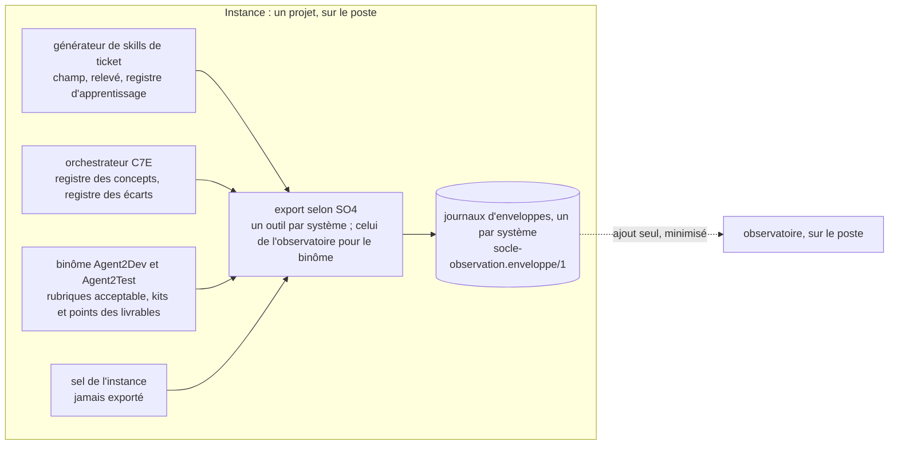

# Socle d'observation, version 1.4.0

Ce socle est le milieu commun du premier couplage du troisième ordre, entre systèmes (`EVOLUTION.md`, section 10.3) : chaque système de second ordre du dépôt y rend observables ses observations, ses propositions, ses décisions et ses écarts, dans une même enveloppe, sans changer ses propres formats. Un système dont la dimension d'export est active l'inclut à l'identique, à une version épinglée ; un système dont l'export est encore réservé le référence. En 1.4.0, `generateur-skill-ticket` et `orchestrateur-c7e` l'incluent et exportent leurs observations ; `observatoire` l'inclut, relève les journaux d'enveloppes de tous les systèmes, et exporte pour le binôme Agent2Dev et Agent2Test, dont le code se construit hors du dépôt, les refus, les kits et les décisions aux points de validation de leurs livrables. Un système ne redéfinit jamais une règle du socle : il peut seulement la préciser pour ses propres formats.

Les identifiants du socle commencent par `SO` (`SO3.INV-1`), pour ne jamais se confondre avec ceux d'une spécification, qui commencent par `D`, ni avec ceux du socle back-front, qui commencent par `SC`, ni avec ceux du socle de l'acceptable, qui commencent par `SA`.

Les invariants du socle sont en vigueur dans un système dès que sa dimension d'export est active et que ses tests les prouvent : dans le générateur de skills de ticket depuis sa version 1.3.0, dans l'orchestrateur C7E depuis sa version 3.7.0, et dans l'export du binôme de l'observatoire depuis sa version 1.2.0.

## 1. Vue d'ensemble



Les formats sources restent ce qu'ils sont, là où ils sont : l'export les traduit, il ne les remplace pas.

## 2. Registre des dimensions du socle

| ID | Dimension | Statut 1.4.0 |
|---|---|---|
| SO1 | Enveloppe : schéma fermé, ordres et niveaux | active |
| SO2 | Chaînage : journal en ajout seul | active |
| SO3 | Minimisation : ce qui peut sortir d'une instance | active |
| SO4 | Correspondances avec les formats du générateur, de l'orchestrateur et du binôme | active |

## 3. SO1 : enveloppe

### 3.1 Schéma

Une enveloppe par ligne, au format `socle-observation.enveloppe/1` :

```json
{
  "schema": "socle-observation.enveloppe/1",
  "numero": 12,
  "date": "2026-11-24T09:00:00Z",
  "systeme": { "nom": "generateur-skill-ticket", "version": "1.3.0" },
  "instance": "9f2c…",
  "ordre": "OC2",
  "niveau": "N2",
  "type": "proposition",
  "motif": "possibilite-inconnue",
  "sujet": "observateur-N2",
  "source": { "format": "skill-ticket.observation/1", "journal": "5e0d…", "numero": 7 },
  "precedent": "4b1e…",
  "nature": "proposition",
  "profondeur": "meso-contrats",
  "cible": "instance",
  "ancre": { "nature": "noeud", "ref": "c07a…" },
  "preuve": { "nature": "enregistrements", "ref": "5" }
}
```

| Champ | Requis | Valeurs |
|---|---|---|
| `schema` | oui | `socle-observation.enveloppe/1` |
| `numero` | oui | entier, 1 pour la première ligne, puis consécutif |
| `date` | oui | UTC, `AAAA-MM-JJTHH:MM:SSZ`, jamais antérieure à celle de la ligne précédente |
| `systeme` | oui | `{ nom, version }` : la spécification qui exporte, à sa version |
| `instance` | oui | empreinte du sel de l'instance (section 5) |
| `ordre` | oui | `OC1`, `OC2`, `OC3` |
| `niveau` | oui | `N1`, `N2`, `N3`, `humain` |
| `type` | oui | `observation`, `proposition`, `decision`, `refus`, `derogation`, `ecart` |
| `motif` | oui | minuscules et tirets (`possibilite-inconnue`), le même pour un même écart d'une instance à l'autre |
| `sujet` | oui | un rôle : `developpeur`, `referent`, `testeur`, `agent:<spécification>`, `observateur-N2`, `observateur-N3` |
| `source` | oui | `{ format, journal, numero }` : le format source ; le journal source, empreinte salée de sa clé, présent pour un format qui tient plusieurs journaux dans une instance, comme le champ d'observation du générateur, un par ticket, absent pour un format à journal unique ; le numéro de l'enregistrement traduit dans ce journal |
| `precedent` | oui | empreinte de la ligne précédente, `null` pour la première (section 4) |
| `nature` | non | valeur de la liste fermée du format source : verdict d'une observation, nature d'un retour ou d'un relevé, statut d'un concept |
| `profondeur` | non | `macro`, `meso-contrats`, `meso-composants`, `micro` |
| `cible` | non | `instance` (ce qui relève du projet) ou `specification` (ce qui relève d'une spécification du dépôt) |
| `invariant` | non | identifiant d'un invariant d'une spécification du dépôt, préfixé par son nom (`orchestrateur-c7e:D6.INV-3`, `socle-acceptable:SA2.INV-1`) |
| `ancre` | non | `{ nature, ref }` ; nature : `noeud`, `critere`, `ca`, `scenario`, `fichier`, `commit`, `contrat`, `option`, `ticket`, `concept`, `kit` |
| `preuve` | non | `{ nature, ref }` ; nature : `test`, `commande`, `commit`, `fichier`, `enregistrements`, `rapport`, `champ`, `arbre` |
| `decision` | non | `{ valeur, vise }` : `retenue`, `refusee` ou `amendee`, et le numéro de l'enveloppe visée : une proposition, ou le refus auquel répond une dérogation ou un faux refus (section 6.5) |
| `mesure` | non | `{ nom, valeur }` : une mesure que définit une correspondance, son nom en minuscules et tirets, sa valeur un entier positif ou nul, calculé à la source (section 6.7) |

Le type `refus` appartient au modèle de l'acceptable, couplage 3 du troisième ordre : seule la correspondance des rubriques `acceptable` du binôme le produit (section 6.5), avec les dérogations et les faux refus qui y répondent. La clé `cible: specification` désigne ce qui doit pouvoir remonter jusqu'au dépôt.

### 3.2 Ordres et niveaux

Chaque enveloppe porte l'ordre cybernétique de la boucle qui l'a produite et le niveau de l'observateur, au sens d'`EVOLUTION.md`, section 10 :

| Niveau | Ordre | Exemples |
|---|---|---|
| `N1` | `OC1` | verdict conforme ou écart sur le travail ; désaccord entre deux nœuds |
| `N2`, `N3` | `OC2` | proposition d'adaptation de la méthode ; examen d'une proposition ; mise en veille d'un motif |
| `humain` | celui de la boucle où la personne intervient | correction ou ratification d'un travail (`OC1`) ; décision sur une proposition de méthode (`OC2`) |

L'ordre `OC3` est réservé aux enregistrements de l'écosystème, que tiendra l'observatoire du dépôt : aucun système ne l'émet.

### 3.3 Invariants

- **SO1.INV-1** : une observation qui sort d'un système le fait dans une enveloppe `socle-observation.enveloppe/1`, au schéma fermé ; un champ inconnu, une valeur hors liste ou un champ requis absent la fait refuser, et rien n'est écrit. Contrôle : test de l'export du système, sur des enveloppes mal formées.
- **SO1.INV-2** : chaque enveloppe déclare son ordre et son niveau selon la table de la section 3.2 : le niveau `N1` avec l'ordre `OC1`, les niveaux `N2` et `N3` avec l'ordre `OC2` ; aucun niveau ne dépasse `N3`, et aucun système n'émet l'ordre `OC3`. Contrôle : test de l'export, sur chaque type d'enregistrement source.

## 4. SO2 : chaînage

### 4.1 Règles

- Un journal d'enveloppes est un fichier JSONL tenu par le système qui exporte, à l'emplacement que fixe sa dimension d'export, un par instance.
- Chaque ligne est l'enveloppe sous sa forme canonique : les champs dans l'ordre du tableau de la section 3.1, ceux des objets imbriqués dans l'ordre où ils y sont décrits, sans espace, encodée en UTF-8. C'est la règle du champ d'observation du générateur.
- `precedent` est l'empreinte SHA-256, en 64 caractères hexadécimaux minuscules, de la ligne précédente telle qu'elle est écrite ; `null` pour la première.
- La tête du journal, fichier tenu à côté de lui, porte l'empreinte de sa dernière ligne : une dernière ligne réécrite ou supprimée, que le chaînage seul ne relève pas, s'y relève.
- Seul l'export du système écrit le journal et sa tête ; il les vérifie avant chaque ajout.

### 4.2 Invariants

- **SO2.INV-1** : un journal d'enveloppes est en ajout seul : chaque ligne porte son numéro, consécutif, sa date en UTC, jamais antérieure à la précédente, et l'empreinte de la ligne précédente sous sa forme canonique ; une ligne réécrite, insérée ou supprimée se relève, et un journal rompu refuse tout ajout. Contrôle : test de l'export sur un journal altéré à la main.

## 5. SO3 : minimisation

### 5.1 Règles

- **Sel de l'instance** : un secret aléatoire de 32 octets, tiré à la première exportation, gardé dans l'instance par le système qui exporte, jamais exporté ni versionné. Il s'écrit en 64 caractères hexadécimaux minuscules, et c'est sous cette forme qu'il entre dans les empreintes.
- **Instance** : `instance` est l'empreinte SHA-256 du sel ; deux systèmes d'une même instance qui partagent son sel la désignent de la même façon.
- **Références** : toute référence propre à l'instance (clé de ticket, nœud, critère, scénario, chemin, commit, nom) sort sous la forme de son empreinte salée, SHA-256 du sel suivi de `:` et de la référence. Un numéro d'enregistrement d'un journal de l'instance n'en est pas une, et sort tel quel ; une liste de numéros sort sans espace, séparée par des virgules. Seul un identifiant défini par une spécification du dépôt sort en clair : un invariant, un concept du registre de départ de l'orchestrateur, une catégorie de méso-contrat.
- **Texte** : aucun texte libre ne sort. Résumés, commentaires, constats, raisons, contenus de retour et propositions rédigées restent dans l'instance, où l'enveloppe les retrouve par sa `source`.
- **Personnes** : le sujet est un rôle ; le nom d'un relecteur, d'un développeur, d'un testeur ou d'un référent reste dans l'instance.
- **Mesures** : une mesure n'est qu'un entier, sous un nom que définit une correspondance ; elle ne porte ni texte, ni référence, ni nom, et ne se rapporte jamais à une personne nommée : son sujet reste un rôle.

### 5.2 Invariants

- **SO3.INV-1** : aucune enveloppe ne porte de texte libre, ni code, ni texte de ticket, ni commentaire, ni secret : seulement un motif en minuscules et tirets, des valeurs de listes fermées, des numéros, des mesures entières sous un nom que définit une correspondance, des identifiants définis par une spécification du dépôt et des empreintes. Contrôle : test de l'export, qui confronte chaque enveloppe produite à cette liste.
- **SO3.INV-2** : aucune enveloppe ne nomme une personne, un client ou un projet : l'instance se désigne par l'empreinte de son sel, le sujet par un rôle, et toute référence propre à l'instance par son empreinte salée ; le sel ne sort jamais. Contrôle : test de l'export sur des sources qui portent noms, clés et chemins.

## 6. SO4 : correspondances

Une correspondance dit comment un enregistrement d'un format source devient une enveloppe. Les empreintes salées de la section 5 s'appliquent partout où une référence de l'instance apparaît ; elles ne sont pas répétées dans les tableaux.

La date d'une enveloppe est celle de l'enregistrement qu'elle traduit, pour un événement du registre des concepts celle du commit qui le porte, pour un refus, une réponse, une étape d'un kit ou un point de validation du binôme celle que porte sa rubrique, ou celle de la ligne précédente du journal si elle est plus récente : un enregistrement exporté après d'autres, plus récents, par exemple venu d'une branche fusionnée plus tard, prend la date de la dernière enveloppe, et le journal reste dans l'ordre du temps. Un export fusionne par date les enregistrements nouveaux de ses journaux sources, sans jamais changer leur ordre dans un même journal ; à date égale, le journal que le système range le premier passe d'abord. Une preuve ne garde que sa nature et sa référence : tout autre champ, comme un extrait, reste dans l'instance.

### 6.1 Générateur : champ d'observation `skill-ticket.observation/1`

| Enregistrement source | `type` | `ordre`, `niveau` | `nature` | `motif` | `sujet` |
|---|---|---|---|---|---|
| `observation`, ordre 1, `conforme` | `observation` | `OC1`, `N1` | `conforme` | le motif de l'enregistrement, sinon `conforme` | `agent:generateur-skill-ticket` |
| `observation`, ordre 1, `ecart` | `ecart` | `OC1`, `N1` | `ecart` | le motif de l'enregistrement, sinon `ecart` | `agent:generateur-skill-ticket` |
| `observation`, ordre 2 | `proposition`, ou `observation` pour `conforme` | `OC2`, `N2` | le verdict | le motif de l'enregistrement | `observateur-N2` |
| `observation`, ordre 3 | `observation` | `OC2`, `N3` | le verdict : `fondee`, `infondee`, `veille`, `bilan` | le motif examiné, sinon le verdict | `observateur-N3` |
| `retour`, `correction` | `observation` | `OC1`, `humain` | `correction` | le motif de la correction | `developpeur` |
| `retour`, `choix` | `decision` | `OC2`, `humain` sur une proposition d'ordre 2, sinon `OC1`, `humain` | `choix` | le motif de la proposition visée, sinon `choix` | `developpeur` |
| `retour`, `ratification` | `decision` | `OC1`, `humain` | `ratification` | `ratifie`, ou `non-ratifie` | `developpeur` |
| `ecart` | `ecart` | `OC1`, `N1` | `desaccord` pour un désaccord entre nœuds, sinon `ecart` | `desaccord-entre-noeuds`, sinon `ecart-invariant-projet` | `agent:generateur-skill-ticket` |

- Un projet a un champ par ticket : chaque enveloppe du champ porte `source.journal`, l'empreinte salée de la clé du ticket, le nom de son dossier sous `docs/demandes/`, même quand le projet n'a encore qu'un ticket.
- Un enregistrement `action` n'est pas traduit : c'est un travail, non une observation.
- `ancre` reprend l'ancre de l'enregistrement ; un retour qui vise une action, correction ou choix entre ses options, prend celle de l'action. `preuve` reprend sa preuve.
- `decision` porte la décision d'un choix sur une proposition d'ordre 2 : `retenue` ou `refusee`, et le numéro de l'enveloppe de la proposition.
- `profondeur` se déduit de l'ancre, selon la règle du module `apprentissage` du générateur : critère et critère d'acceptation en `macro`, contrat et option en `meso-contrats`, nœud et scénario en `meso-composants`, fichier et commit en `micro`.
- Un désaccord entre nœuds porte `invariant` : `orchestrateur-c7e:D6.INV-3`.
- `cible` vaut `instance`.

### 6.2 Générateur : registre d'apprentissage `generateur.apprentissage/1`

| Enregistrement source | `type` | `ordre`, `niveau` | `nature` | `motif`, `profondeur` | `cible` | `sujet` |
|---|---|---|---|---|---|---|
| `releve` | `observation` | `OC2`, `N2` | la nature de l'entrée (`possibilite-inconnue`, `categorie-inadaptee`…) | ceux de l'entrée | `specification` pour la cible `generateur`, `instance` pour `referentiel` | `agent:generateur-skill-ticket` |
| `proposition` | `proposition` | `OC2`, `N2` | `recurrence` | ceux de la proposition | comme ci-dessus | `agent:generateur-skill-ticket` |
| `decision` | `decision` | `OC2`, `humain` | `decision` | ceux de la proposition visée | celle de la proposition visée | `developpeur` |

Le registre est le seul journal de son format dans une instance : ses enveloppes n'ont pas de `source.journal`. L'ancre d'un relevé est le ticket (`ticket`) ; sa preuve garde sa nature (`fichier`, `champ`, `commit`, `commande`, `arbre`). Une proposition porte en preuve les numéros des relevés qui la fondent (`enregistrements`) ; une décision porte `decision`, avec le numéro de l'enveloppe de la proposition visée. La raison d'une décision et le nom de qui l'a prise restent dans le registre.

### 6.3 Orchestrateur : registre des concepts `docs/c7e/concepts.json`

Le registre est un fichier, non un journal : ses événements se constatent entre deux versions commitées du fichier.

| Événement | `type` | `ordre`, `niveau` | `nature` | `motif` | `sujet` |
|---|---|---|---|---|---|
| entrée ajoutée au statut `proposed` | `proposition` | `OC2`, `N2` si elle cite l'observation qui la fonde, sinon `OC2`, `humain` | `proposed` | `concept-` suivi du domaine de l'identifiant, en minuscules et tirets | `agent:orchestrateur-c7e`, ou `developpeur` |
| promotion à `experimental` ou à `validated` | `decision` | `OC2`, `humain` | le nouveau statut | celui de l'entrée | `referent` |
| retrait d'une entrée | `decision` | `OC2`, `humain` | `retire` | celui de l'entrée | `referent` |

L'ancre est le concept (`concept`) : en clair pour un concept du registre de départ, par son empreinte salée pour les autres. Une promotion porte `decision` avec la valeur `retenue`, un retrait avec la valeur `refusee`. `cible` vaut `instance`.

### 6.4 Orchestrateur : registre des écarts `docs/c7e/registre-ecarts.md`

| Ligne source | `type` | `ordre`, `niveau` | `nature` | `motif` | `sujet` |
|---|---|---|---|---|---|
| décision « respecter » | `ecart` | `OC1`, `N1` | `respecter` | `ecart-` suivi de l'invariant concerné en minuscules et tirets, sinon `ecart-invariant-projet` | `agent:orchestrateur-c7e` |
| dérogation validée par un nom | `derogation` | `OC1`, `humain` | `derogation` | comme ci-dessus | `referent` |

L'ancre est le ticket (`ticket`). `invariant` porte l'invariant concerné quand c'est un invariant d'une spécification du dépôt, préfixé par son nom ; un invariant du projet reste dans l'instance. Le nom qui valide une dérogation n'en sort pas. `cible` vaut `instance`.

### 6.5 Binôme : rubriques `acceptable` de `agent2dev.livrable/1` et `agent2test.journal-de-tests/1`

Le binôme n'a pas d'outil dans le dépôt, qui tient sa spécification et ses formats, pas son code : l'outil d'export du binôme, que porte l'observatoire (`observatoire`, module `export-binome`), traduit pour lui la rubrique `acceptable` d'un livrable d'Agent2Dev ou d'un journal de tests d'Agent2Test que le développeur lui désigne. Chaque refus de la rubrique est un enregistrement, et chaque réponse à un refus en est un autre.

| Enregistrement source | `type` | `ordre`, `niveau` | `nature` | `motif` | `sujet` | `decision` |
|---|---|---|---|---|---|---|
| refus | `refus` | `OC1`, `N1` | la garde : `perimetre`, `ecriture`, `commandes`, `lecons` | `refus-` suivi de la garde | `agent:agent2dev`, ou `agent:agent2test` | — |
| réponse `deroger` | `derogation` | `OC1`, `humain` | `derogation` | celui du refus visé | le rôle qui répond | `amendee`, et le numéro de l'enveloppe du refus |
| réponse `faux-refus` | `decision` | `OC1`, `humain` | `faux-refus` | celui du refus visé | le rôle qui répond | `refusee`, et le numéro de l'enveloppe du refus |

- `systeme` est le système qui a produit l'enregistrement, `agent2dev` ou `agent2test`, à la version de spécification que porte la source (`versions.specification`) : l'outil de l'observatoire exporte pour lui, sans se substituer à lui.
- `date` est celle que la rubrique porte pour le refus ou pour la réponse, l'horodatage de sa ligne de journal à la seconde, bornée par la ligne précédente du journal d'enveloppes comme partout.
- Un projet a un livrable par demande, et un journal de tests par campagne : chaque enveloppe porte `source.journal`, l'empreinte salée de la clé de la demande pour un livrable, de l'identifiant de la campagne pour un journal de tests ; `source.numero` est le numéro `n` de l'enregistrement, celui de sa ligne dans le journal du système. Les enregistrements d'une même source s'exportent dans l'ordre de leur numéro ; plusieurs sources d'un même système se fusionnent par date, et, à date égale, celle dont la clé vient la première dans l'ordre des points de code passe d'abord.
- `ancre` est la demande (`ticket`), par l'empreinte salée de sa clé, `demande.cle`.
- `invariant` est la première règle que cite le refus, celle du noyau quand il en cite une, préfixée par la spécification qui la définit : `SA` par `socle-acceptable`, `D` par le système qui refuse, `SC` par `socle-back-front`, `SO` par `socle-observation` ; une règle déjà préfixée garde son préfixe. Une réponse porte l'invariant de son refus.
- `cible` vaut `specification` : un refus éprouve une règle du dépôt.
- Le rôle qui répond est le sujet : `developpeur` ou `referent` pour Agent2Dev ; `testeur`, ou `referent` pour le référent qualité, pour Agent2Test.
- Une dérogation porte `decision` avec la valeur `amendee` : le refus reste fondé, et l'action passe une fois ; un faux refus, avec la valeur `refusee` : le refus est déclaré infondé, et l'action reste refusée.
- L'objet refusé ne sort pas : la règle le désigne, et un objet propre à une constitution est une référence de l'instance. Le motif d'une réponse, et le nom de qui l'a donnée, restent dans le journal du système.
- Les enveloppes s'écrivent dans le projet de l'application, un journal par système, `docs/c7e/observations-agent2dev.jsonl` et `docs/c7e/observations-agent2test.jsonl`, sous le sel de son instance : les refus d'Agent2Test, écrits dans son propre projet, relèvent de l'instance de l'application qu'il teste.
- Une réponse s'exporte quand elle paraît dans la rubrique : un refus exporté sans réponse garde son enveloppe, et celle de sa réponse s'ajoute plus tard.

### 6.6 Binôme : rubriques `kits` de `agent2dev.livrable/1` et `agent2test.journal-de-tests/1`

L'outil d'export du binôme traduit de même la rubrique `kits` (socle de l'acceptable, section 11 ; `agent2dev` et `agent2test`, module `kit`). Chaque étape d'un kit est un enregistrement, à sa ligne de journal : la remise, la validation, l'application, ou son échec, et le retour arrière.

| Enregistrement source | `type` | `ordre`, `niveau` | `nature` | `motif` | `sujet` | `decision` |
|---|---|---|---|---|---|---|
| remise | `observation` | `OC1`, `N1` | `remis` | `kit-` suivi de l'environnement | `agent:agent2dev`, ou `agent:agent2test` | — |
| validation | `decision` | `OC1`, `humain` | `validation` | celui de la remise | le rôle qui valide | `retenue`, et le numéro de l'enveloppe de la remise |
| application | `observation` | `OC1`, `humain` | `applique`, ou `echec` | celui de la remise | le rôle qui déclare | — |
| retour arrière | `observation` | `OC1`, `humain` | `retour-arriere` | celui de la remise | le rôle qui déclare | — |

- `motif` : `kit-dev` pour un kit dev, `kit-test` pour un kit test ; le même pour chaque étape d'un kit.
- `ancre` est le kit : `{ "nature": "kit", "ref": … }`, l'empreinte salée de l'empreinte de son patch ; elle relie les étapes d'un même kit d'une enveloppe à l'autre.
- `systeme`, `date` et `source` suivent la section 6.5 : chaque étape porte le numéro `n` et la date de sa ligne de journal ; les refus et les étapes d'une même source s'exportent ensemble, dans l'ordre de leur numéro.
- `cible` vaut `instance`, et aucune enveloppe de kit ne porte d'`invariant` : une application n'éprouve aucune règle ; un kit refusé à sa confrontation n'est pas remis, et son refus passe par la rubrique `acceptable`.
- Un échec, déclaré « échec, retour arrière fait », est un seul enregistrement, de nature `echec` : le retour arrière que la fabrication a fait y est compris, et ne fait pas d'autre enveloppe.
- Le sujet est le rôle que porte la rubrique : `developpeur` pour Agent2Dev ; `testeur` ou `developpeur` pour Agent2Test.
- Ni le scénario, ni la campagne, ni l'empreinte du patch, ni le commentaire d'un échec ne sortent en clair : l'ancre et `source.journal` les désignent par leur empreinte salée.
- Une étape s'exporte quand elle paraît dans la rubrique : une remise exportée sans validation garde son enveloppe, et celles des étapes suivantes s'ajoutent plus tard ; une étape exportée ne change plus.

### 6.7 Binôme : rubrique `points` de `agent2dev.livrable/1`

L'outil d'export du binôme traduit aussi la rubrique `points` d'un livrable d'Agent2Dev (`agent2dev`, module `journal`, section 4.1) : chaque présentation d'un point de validation, V0 à V5, est un enregistrement, et sa décision en est un autre. Ils portent deux signaux du deuxième couplage du troisième ordre (`EVOLUTION.md`, section 10.6) : les décisions du point V2, sur les critères et les scénarios, et les délais de décision.

| Enregistrement source | `type` | `ordre`, `niveau` | `nature` | `motif` | `sujet` | `decision` | `mesure` |
|---|---|---|---|---|---|---|---|
| présentation | `observation` | `OC1`, `N1` | `presente` | `point-` suivi du point, en minuscules : `point-v2` | `agent:agent2dev` | — | — |
| décision | `decision` | `OC1`, `humain` | la valeur de la décision : `valider`, `corriger`… | celui de la présentation | le rôle qui décide | `retenue`, `amendee` ou `refusee`, et le numéro de l'enveloppe de la présentation | `delai-decision`, en secondes |

- La valeur d'une décision donne celle de `decision` : `retenue` pour `valider`, `confirmer`, `choisir` et `accepter` ; `amendee` pour `corriger`, `repondre`, `ajuster` et `recalculer` ; `refusee` pour `rejeter`.
- `mesure` vaut `{ "nom": "delai-decision", "valeur": … }` : le délai de la présentation à la décision, en secondes entières, calculé sur les dates que porte la rubrique. La date d'une enveloppe peut être avancée pour garder le journal dans l'ordre du temps (section 6) ; le délai, calculé à la source, ne l'est jamais.
- `systeme`, `date` et `source` suivent la section 6.5 ; `ancre` est la demande (`ticket`), par l'empreinte salée de sa clé ; `cible` vaut `instance`, et aucune enveloppe de point ne porte d'`invariant` : une décision n'éprouve aucune règle.
- Le sujet est le rôle que porte la rubrique, `developpeur` ; ni le canal, ni le commentaire, ni le nom de qui décide ne sortent.
- Une présentation s'exporte quand elle paraît dans la rubrique : exportée sans décision, elle garde son enveloppe, et celle de sa décision s'ajoute plus tard ; une étape exportée ne change plus.

### 6.8 Invariants

- **SO4.INV-1** : une correspondance traduit un format source sans le modifier : il garde ses champs, sa version et son emplacement, et chaque enveloppe désigne sans ambiguïté l'enregistrement dont elle provient, par son format, son numéro et, pour un format qui tient plusieurs journaux dans une instance, son journal. Contrôle : test de l'export, qui compare les sources avant et après, sur une instance à deux journaux du même format.
- **SO4.INV-2** : la même entrée source, avec le même sel d'instance, donne la même enveloppe, octet pour octet. Contrôle : test de l'export rejoué deux fois sur les exemples du système.

## 7. Règles d'évolution du socle

- Le socle suit le contrat de version d'`EVOLUTION.md` à la racine du dépôt.
- Tant que sa dimension d'export est réservée, un système référence le socle dans son `manifest.json` (champ `references`) ; quand elle devient active, il l'épingle en plus (champ `shared`), et l'outil d'assemblage l'inclut dans sa transmission.
- La correspondance d'un nouveau format ou d'un nouveau système, ou une valeur ajoutée à une liste fermée, fait une version mineure. Un champ requis ajouté, une valeur retirée ou une règle de minimisation relâchée font une version majeure ; chaque système dépendant décide alors explicitement de monter.
- Une règle de minimisation ne se relâche jamais pour faciliter un export : elle ne peut que se renforcer.

## 8. Journal de révision

**1.0.0** (2026-11-24) : première version, jalon J1 du passage au troisième ordre (`EVOLUTION.md`, section 10). Dimensions SO1 à SO4 actives : enveloppe `socle-observation.enveloppe/1` au schéma fermé, ordres et niveaux, journal en ajout seul et chaîné, minimisation par sel d'instance et empreintes salées, correspondances avec le champ et le registre d'apprentissage du générateur, le registre des concepts et le registre des écarts de l'orchestrateur. Invariants SO1.INV-1 à SO4.INV-2. Référencé par `orchestrateur-c7e` 3.6.0 et `generateur-skill-ticket` 1.2.0, à des dimensions réservées : aucun système ne l'applique encore. Décisions ratifiées avant la rédaction : spécification non transmissible (R4) ; préfixe `SO`, enveloppe sans texte libre, référence sans inclusion tant que les dimensions sont réservées (P1 à P3).

**1.1.0** (2026-11-24) : jalon J1b, export du générateur activé. Lacune corrigée : un projet a un champ d'observation par ticket, numéroté à partir de 1 dans chacun ; le format et le numéro ne désignaient donc pas un enregistrement unique. Champ facultatif `source.journal`, empreinte salée de la clé du journal source, présent pour un format qui tient plusieurs journaux dans une instance ; SO4.INV-1 renforcé : l'enveloppe désigne sans ambiguïté l'enregistrement dont elle provient. Précisions : forme du sel dans les empreintes ; tête du journal, qui relève une dernière ligne réécrite ou supprimée, comme celle du champ du générateur ; date d'une enveloppe et fusion des journaux sources à l'export ; liste de numéros sans espace ; une preuve ne garde que sa nature et sa référence ; motif d'une ratification (`ratifie`, `non-ratifie`) ; ancre d'un retour sur une action ; journal d'une enveloppe du champ ; preuve d'une proposition et décision du registre d'apprentissage. Inclus par `generateur-skill-ticket` 1.3.0, dont la dimension D9 devient active ; référencé par `orchestrateur-c7e` 3.6.1, dont la dimension D12 reste réservée. Décision ratifiée avant la rédaction : `source.journal` facultatif, version mineure (Q1). Archive : `archives/SKILL-v1.0.0.md`.

**1.2.0** (2026-11-25) : jalon J3c du passage au troisième ordre (`EVOLUTION.md`, section 10), export des refus du binôme. Correspondance nouvelle, section 6.5 : la rubrique `acceptable` des livrables d'Agent2Dev (`agent2dev.livrable/1`) et des journaux de tests d'Agent2Test (`agent2test.journal-de-tests/1`) ; un refus devient une enveloppe `refus`, une dérogation une enveloppe `derogation`, un faux refus une décision, qui visent l'enveloppe du refus, avec les valeurs `amendee` et `refusee` ; l'invariant cité sort préfixé, dont le préfixe `SA` du socle de l'acceptable ; aucune enveloppe ne porte l'objet refusé ni le motif d'une réponse. Le type `refus` est produit ; `decision.vise` désigne aussi le refus auquel une réponse répond ; valeur ajoutée au sujet, `testeur`. Dimension SO4 étendue au binôme ; invariants inchangés, leur section devenue 6.6. Précisions : la date d'un refus ou d'une réponse est celle de sa rubrique ; les systèmes qui incluent le socle, et depuis quelle version ses invariants y sont en vigueur. Inclus par `generateur-skill-ticket` 1.4.2, `orchestrateur-c7e` 3.8.2 et `observatoire` 1.2.0, dont l'outil d'export du binôme applique la correspondance. Décisions ratifiées avant la rédaction : plan du jalon J3c, X1 à X3 et X5. Archive : `archives/SKILL-v1.1.0.md`.

**1.3.0** (2026-11-25) : jalon J3e du passage au troisième ordre (`EVOLUTION.md`, section 10), export des kits du binôme. Correspondance nouvelle, section 6.6 : la rubrique `kits` des livrables d'Agent2Dev et des journaux de tests d'Agent2Test ; la remise, la validation, l'application ou son échec, et le retour arrière d'un kit font chacun une enveloppe, motif `kit-dev` ou `kit-test`, reliées par l'ancre de nature `kit`, valeur ajoutée à sa liste fermée ; la validation vise l'enveloppe de la remise, valeur `retenue` ; un échec, une seule enveloppe ; aucun invariant, `cible` `instance`. Invariants inchangés, leur section devenue 6.7. Décisions ratifiées avant la rédaction : plan du jalon J3e, Y1 à Y3.

**1.4.0** (2026-11-25) : jalon J4 réduit du passage au troisième ordre (`EVOLUTION.md`, section 10), les signaux du deuxième couplage. Champ facultatif `mesure`, `{ nom, valeur }` : une mesure que définit une correspondance, son nom en minuscules et tirets, sa valeur un entier positif ou nul, calculé à la source ; la date d'une enveloppe pouvant être avancée pour garder le journal dans l'ordre du temps, une durée ne se déduit pas des dates. Règle de minimisation des mesures ajoutée, et SO3.INV-1 précisé : une mesure entière est un nombre, comme un numéro ; elle ne porte ni texte, ni référence, ni nom, et son sujet reste un rôle ; rien de la minimisation ne se relâche. Correspondance nouvelle, section 6.7 : la rubrique `points` des livrables d'Agent2Dev ; la présentation d'un point de validation, une observation de nature `presente`, et sa décision, qui la vise, avec la valeur `retenue`, `amendee` ou `refusee` et le délai de décision en secondes, motif `point-` suivi du point ; aucun invariant, `cible` `instance`. Invariants en section 6.8. Décisions ratifiées avant la rédaction : plan du jalon J4 réduit, Z1 à Z5. Archive : `archives/SKILL-v1.3.0.md`.
