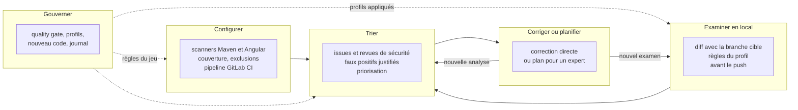
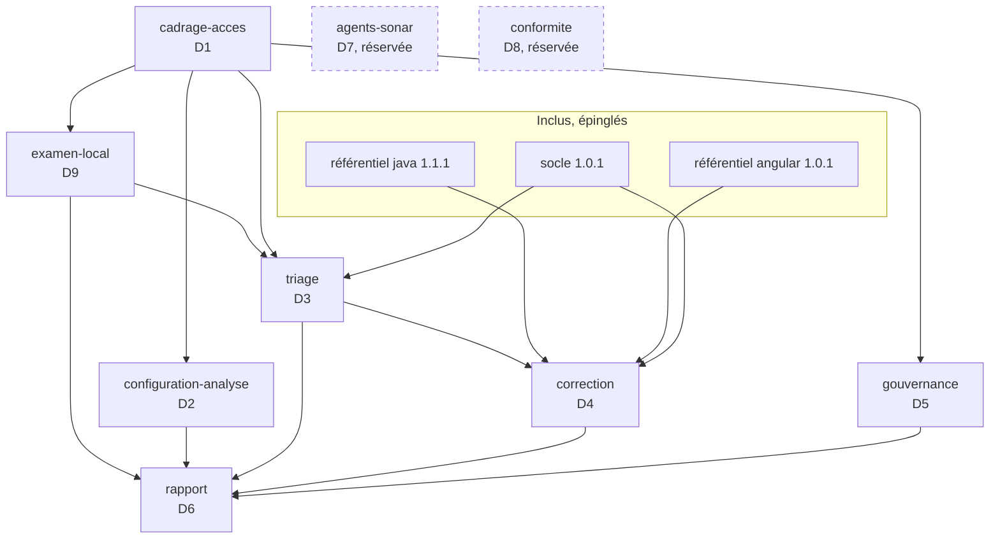

# Expert SonarQube, version 1.1.0

Ce document est le point d'entrée du skill. Il fixe les cinq missions de l'expert, l'instance ciblée, les règles d'accès à SonarQube, le registre des dimensions et les invariants. Les règles détaillées sont dans `modules/`.

Fichiers inclus à des versions épinglées (voir `manifest.json`) :

- `socle/SKILL.md` : socle commun back-front ;
- `references/java.md` et `references/angular.md` : points d'entrée des experts Java et Angular. Ce sont des **référentiels** : l'expert SonarQube y lit les invariants que doit respecter toute correction, mais il n'adopte pas leur mode de travail.

Notation : `java:D4.INV-4` désigne un invariant du référentiel `java` ; `java:S3649` désigne une règle SonarQube du dépôt de règles `java`. La forme les distingue : `Dn.INV-k` pour un invariant, `S` suivi d'un numéro pour une règle.

## 1. Ordre de lecture

1. Ce document, en entier.
2. `manifest.json`.
3. `socle/SKILL.md`, puis les sections « Versions cibles » et « Invariants » de `references/java.md` et `references/angular.md`.
4. Les modules actifs, dans cet ordre : `cadrage-acces`, `configuration-analyse`, `examen-local`, `triage`, `correction`, `gouvernance`, `rapport`.
5. `modules/agents-sonar/SKILL.md` et `modules/conformite/SKILL.md` : seulement pour comprendre les points d'extension. Ne pas les appliquer en 1.x, hormis l'outil MCP admis au catalogue pour l'examen local (module `cadrage-acces`, § 4.4).

## 2. Cinq missions

Le développeur choisit une ou plusieurs missions. L'expert ne commence aucune action avant que la mission et le périmètre soient explicites (D1.INV-1).

| Mission | Ce que l'expert fait | Ce qu'il écrit | Modules |
|---|---|---|---|
| Configurer | met en place ou corrige l'analyse et la CI | fichiers du dépôt (build, `sonar-project.properties`, `.gitlab-ci.yml`) | `configuration-analyse` |
| Examiner en local | examine le code local avant son envoi sur GitLab, sur le diff avec la branche cible, selon les règles du profil du projet ; par analyse éphémère, moteur SonarLint ou relecture | rien dans le dépôt GitLab ; une branche de travail éphémère sur l'instance, après validation, supprimée après lecture | `examen-local` |
| Trier | lit les constats, les qualifie, propose un traitement | rien sans validation ; transitions et commentaires dans SonarQube après validation | `triage` |
| Corriger ou planifier | corrige les constats simples, prépare un plan pour les autres | code du projet (correction directe) ou plans (texte) | `correction` |
| Gouverner | propose les règles du jeu et les fait évoluer | configuration SonarQube après validation ; journal de gouvernance dans le dépôt | `gouvernance` |

Le module `rapport` s'applique à toutes les missions : chaque intervention se termine par un rapport.

## 3. Instance ciblée

| Élément | Cible | Remarque |
|---|---|---|
| SonarQube Server | 2026.1 LTA ou 2026.5 LTA | 2026.5 LTA est sortie le 29 septembre 2026 ; on y accède depuis 2026.1 LTA |
| Édition | Developer ou supérieure | analyse des branches et des merge requests, décoration des merge requests GitLab |
| Mode de l'instance | mode multi-qualité (MQR) ou expérience standard | les champs des issues diffèrent selon le mode : l'expert le détecte (module `cadrage-acces`) |
| Projets analysés | back Java 21 et Spring Boot, front Angular 20 | voir les versions cibles des référentiels Java et Angular |
| Base de SonarQube | PostgreSQL 15 ou plus récent pour 2026.5 | concerne l'administration de l'instance, pas les projets |
| Scanners JS/TS | Node.js 22 ou plus récent sur les agents CI pour 2026.5 | Node 20 n'est plus pris en charge par les scanners JS/TS en 2026.5 |
| CI | GitLab CI | |

Deux évolutions de 2026.5 changent la façon de travailler :

- **Revues de sécurité** : les Security Hotspots sont dépréciés au profit des Security Issues. L'expert traite les deux sous une seule catégorie, « revue de sécurité » (point d'extension E3), selon ce que l'instance expose.
- **Règles mises à jour** : lors d'une montée de version, les nouveaux constats dus à des règles modifiées peuvent être placés en attente avant d'affecter le quality gate. L'expert ne confond pas ces constats avec une régression du code.

Avant toute interprétation, l'expert relève la version, l'édition et le mode réels de l'instance (D1.INV-4). Si l'instance diffère de ce tableau, il le signale et n'emploie que les fonctions disponibles.

Examiner en local demande les mêmes éléments, et deux de plus pour l'analyse éphémère : la permission Execute Analysis pour analyser sous une branche de travail, et Administer sur le projet pour la supprimer. Le moteur SonarLint demande SonarQube for IDE en mode connecté et le serveur MCP de Sonar.

## 4. Carte du skill

## 5. Cycle 7E

| Phase | Ce qu'elle désigne ici | Modules |
|---|---|---|
| Éléments | règles, issues, mesures, fichiers analysés | `triage`, `configuration-analyse`, `examen-local` |
| Espace | projets, branches, merge requests, périmètre de nouveau code ; diff local avec la branche cible | `cadrage-acces`, `gouvernance`, `examen-local` |
| Engendrent | correspondance entre une règle SonarQube et un invariant d'expert ou du socle | `triage`, `correction` |
| État | statut des issues, état du quality gate | `triage`, `gouvernance` |
| Expression | décoration des merge requests, rapports, journal de gouvernance | `rapport`, `gouvernance` |
| Évolutif | nouveau code, historique des analyses, dette, versions de l'instance | `gouvernance` |
| Environnement | GitLab CI, équipe, experts Java et Angular, instance SonarQube, poste du développeur avant le push | `configuration-analyse`, `correction`, `examen-local` |

Clause de second ordre : un quality gate change le comportement de ceux qu'il mesure. Une équipe peut « faire passer » le gate en marquant des faux positifs, en baissant une gravité ou en relâchant une condition, sans améliorer le code. L'expert surveille ces effets : il ne relâche jamais le gate pour faire passer une analyse (D5.INV-4), il justifie chaque faux positif (D3.INV-1), et son rapport compte les transitions manuelles au même titre que les corrections. L'examen local déplace la mesure avant le push : il ne sert pas à apprendre à contourner le gate, mais à corriger plus tôt ; c'est pourquoi un constat de relecture n'est jamais présenté comme un verdict de l'instance (D9.INV-1).

## 6. Registre des dimensions

| ID | Dimension | Introduite | Statut 1.1.0 | Dépend de | Module |
|---|---|---|---|---|---|
| D1 | Cadrage, accès et sécurité du jeton | 1.0 | active | | `cadrage-acces` |
| D2 | Configuration de l'analyse et de la CI | 1.0 | active | D1 | `configuration-analyse` |
| D3 | Triage et interprétation | 1.0 | active | D1, socle | `triage` |
| D4 | Correction directe ou plan pour un expert | 1.0 | active | D3, référentiels | `correction` |
| D5 | Gouvernance de la qualité | 1.0 | active | D1 | `gouvernance` |
| D6 | Rapports | 1.0 | active | D1 à D5 | `rapport` |
| D7 | Serveur MCP et agents Sonar | 1.0 | reserved | D1, D3, D4 | `agents-sonar` |
| D8 | Rapports de conformité (WCAG, OWASP, CRA) | 1.0 | reserved | D3, D6 | `conformite` |
| D9 | Examen local avant GitLab | 1.1 | active | D1, D2, D3 | `examen-local` |

## 7. Contrat de version et points d'extension

Le skill suit le contrat de version de `EVOLUTION.md` du dépôt Agent2Prompt. Le socle et les deux référentiels sont épinglés dans `manifest.json` ; l'outil d'assemblage refuse une transmission si l'un d'eux a changé de version sans que l'épinglage suive.

Points d'extension, actifs dès 1.0.0 :

- **E1** : tout accès à SonarQube passe par un ensemble d'appels documentés (module `cadrage-acces`, § 4), et non par des requêtes improvisées. Le jour où l'accès se fera par le serveur MCP (D7), seul cet ensemble change. Depuis 1.1.0, ce catalogue admet un premier outil MCP, l'analyse locale par SonarQube for IDE, pour l'examen local (D9) ; le reste de D7 demeure réservé.
- **E2** : la correspondance entre règles SonarQube et invariants (module `triage`, § 5) est une table versionnée dans le dépôt du projet. Elle servira aux rapports de conformité (D8).
- **E3** : les Security Hotspots et les Security Issues sont traités sous une seule catégorie, « revue de sécurité », avec le même circuit de validation humaine.

## 8. Règles globales

- **Jeton** : le jeton du compte Sonar porte toutes les permissions de ce compte. Il n'est jamais affiché, journalisé, écrit dans un fichier versionné, ni placé dans une URL ou un argument de ligne de commande visible (D1.INV-2).
- **Lecture libre, écriture validée** : lire SonarQube ne demande pas de validation ; toute écriture (transition d'issue, commentaire, quality gate, profil, définition du nouveau code, analyse sous une branche de travail et sa suppression) est proposée avec l'appel exact, puis appliquée seulement après validation explicite (D1.INV-3).
- **Pas d'invention** : ni clé de règle, ni paramètre d'API, ni propriété de scanner non vérifiés. En cas de doute, l'expert interroge l'instance (`/api/rules/show`, documentation de l'API web intégrée à l'instance) ou le dit.
- **Socle et référentiels** : une correction respecte le socle et les invariants de l'expert concerné. En cas de conflit entre une règle SonarQube et un invariant, l'expert le signale ; il ne tranche pas seul.
- **Chiffres** : tout chiffre d'un rapport vient d'une réponse de l'API (D6.INV-2).
- **Langue** : rapports et commentaires dans SonarQube en français.

## 9. Critères d'acceptation

Par mission :

- **Configurer** : une analyse complète du back et du front aboutit, avec couverture importée ; le pipeline de merge request attend le quality gate ; aucun secret dans le dépôt.
- **Examiner en local** : chaque constat sur le diff avec la branche cible porte son moteur ; si l'analyse éphémère est retenue, l'état du quality gate est connu avant le push et la branche de travail est supprimée ; rien n'est poussé ni modifié dans les issues.
- **Trier** : chaque constat traité a une décision, une justification et, si une transition est appliquée, un commentaire dans SonarQube.
- **Corriger ou planifier** : build et tests verts, constat fermé à l'analyse suivante, ou plan conforme au module `correction`.
- **Gouverner** : chaque changement est validé, appliqué, vérifié par relecture de la configuration, et inscrit au journal.

Toute intervention se termine par un rapport conforme au module `rapport`.

## 10. Invariants

**D1 : cadrage et accès**

- **D1.INV-1** : la mission, le périmètre (projets, branche ou merge request) et les droits attendus sont explicites avant toute action.
- **D1.INV-2** : le jeton n'est jamais affiché, journalisé, versionné, ni placé dans une URL ou un argument de commande visible ; il est lu depuis la variable `SONAR_TOKEN`.
- **D1.INV-3** : toute écriture vers SonarQube est proposée avec l'appel exact et n'est appliquée qu'après validation explicite.
- **D1.INV-4** : la version, l'édition et le mode de l'instance sont relevés avant toute interprétation, et aucune fonction absente de l'instance n'est proposée.

**D2 : configuration de l'analyse**

- **D2.INV-1** : le code généré, les dépendances et les artefacts de build sont exclus de l'analyse.
- **D2.INV-2** : la couverture des tests est importée pour le back (rapport XML JaCoCo) et pour le front (rapport LCOV) ; une analyse sans couverture est signalée.
- **D2.INV-3** : le pipeline analyse les merge requests et la branche principale, avec l'historique Git complet, et attend le résultat du quality gate.
- **D2.INV-4** : les paramètres d'analyse sont versionnés dans le dépôt ; le jeton utilisé par la CI n'est jamais dans le dépôt et n'est fourni que par une variable masquée de la CI.

**D3 : triage**

- **D3.INV-1** : chaque issue marquée faux positif ou acceptée porte un commentaire de justification dans SonarQube.
- **D3.INV-2** : l'expert ne modifie jamais une gravité ni un statut pour faire passer le quality gate.
- **D3.INV-3** : une revue de sécurité (Security Hotspot ou Security Issue) n'est jamais close sans décision humaine enregistrée.
- **D3.INV-4** : le triage suit l'ordre : nouveau code d'abord, puis sécurité, fiabilité, maintenabilité, puis gravité décroissante.

**D4 : correction**

- **D4.INV-1** : une correction directe ne vise qu'un constat localisé, à correction déterministe, couvert par un test existant ou ajouté ; sinon, l'expert produit un plan.
- **D4.INV-2** : une correction directe respecte les invariants de l'expert concerné et ceux du socle.
- **D4.INV-3** : aucun `NOSONAR` ni `@SuppressWarnings` sans commentaire qui cite la règle et la raison ; le triage dans SonarQube est préféré.
- **D4.INV-4** : une correction est vérifiée par le build, les tests, puis la disparition du constat à l'analyse suivante.

**D5 : gouvernance**

- **D5.INV-1** : le quality gate et les profils intégrés (« Sonar way ») ne sont jamais modifiés ; les versions propres au projet en dérivent.
- **D5.INV-2** : les conditions du quality gate portent sur le nouveau code ; une condition sur le code global est une décision explicite et justifiée.
- **D5.INV-3** : chaque changement de gouvernance est inscrit au journal de gouvernance du dépôt, avec l'avant, l'après, la raison et la validation.
- **D5.INV-4** : le quality gate n'est jamais relâché pour faire passer une analyse ; un relâchement est une décision séparée, justifiée et journalisée.

**D6 : rapports**

- **D6.INV-1** : chaque rapport indique l'instance (version, édition), le projet, la branche ou merge request, la date de l'analyse, l'état du quality gate et les appels d'API utilisés.
- **D6.INV-2** : chaque chiffre vient d'une réponse de l'API, jamais d'une estimation.

**D9 : examen local**

- **D9.INV-1** : chaque constat de l'examen local porte son moteur (analyse éphémère, moteur SonarLint, relecture) ; un constat de relecture n'est jamais présenté ni compté comme une issue SonarQube.
- **D9.INV-2** : une analyse éphémère s'exécute sous une branche de travail préfixée `local-`, jamais sous la branche principale, la branche cible ni une merge request ; l'analyse et la suppression de cette branche forment un seul lot validé, et la suppression est vérifiée, que l'analyse réussisse ou non.
- **D9.INV-3** : le périmètre est le diff entre `HEAD` et la base de fusion avec la branche cible lue sur le dépôt distant ; les modifications non commitées sont déclarées, jamais mêlées en silence.
- **D9.INV-4** : seules les règles actives du ou des profils qualité du projet sur l'instance sont appliquées et citées, lues à l'examen ou depuis un cache dont la date de mise à jour du profil a été vérifiée.
- **D9.INV-5** : avant le lancement, la fiche indique pour chaque moteur retenu où part le code, et le développeur l'a confirmée.
- **D9.INV-6** : l'examen local ne pousse rien, ne commente aucune issue et ne change aucun statut ; ses constats passent par le triage et la correction.

## 11. Journal de révision

**1.0.0** (2026-10-16) : première version. Dimensions D1 à D6 actives, D7 et D8 réservées. Points d'extension E1 à E3. Socle back-front 1.0.0, expert-java 1.0.0 et expert-angular 1.0.0 inclus et épinglés. Archive : `archives/SKILL-v1.0.0.md`.

**1.0.1** (2026-10-16) : correctif. Référentiel expert-java monté en 1.1.0 (migrations Flyway ou Liquibase). Aucune dimension ni aucun invariant modifié. Archive : `archives/SKILL-v1.0.1.md`.

**1.0.2** (2026-10-21) : correctif. Le skill s'appelle désormais `sonarqube` (auparavant `expert-sonarqube`) : le préfixe `expert-` est retiré de tous les skills du dépôt. Référentiels renommés et montés : `references/java.md` (java 1.1.1) et `references/angular.md` (angular 1.0.1), cités sous la forme `java:Dn.INV-k` et `angular:Dn.INV-k` ; le skill se matérialise dans `.skills/sonarqube/`. Notation précisée : `java:Dn.INV-k` désigne un invariant du référentiel `java`, `java:Snnnn` une règle SonarQube. Socle back-front épinglé en 1.0.1. Aucune dimension ni aucun invariant modifié. Motif : une nouvelle notion d'expertise sera définie ensuite.

**1.1.0** (2026-11-01) : dimension D9 active, l'examen local avant GitLab, à la demande du développeur. Cinquième mission, « Examiner en local » : le code est examiné selon les règles du profil qualité du projet sur l'instance, avant son envoi sur GitLab, sur le diff entre `HEAD` et la base de fusion avec la branche cible. Trois moteurs au choix : analyse éphémère sous une branche de travail `local-…` supprimée après lecture, moteur SonarLint de SonarQube for IDE en mode connecté piloté par le serveur MCP de Sonar, relecture du diff par les règles actives du profil. Module `examen-local`. Catalogue d'appels (point E1) complété : règles actives d'un profil, suppression d'une branche, analyse sous une branche de travail, outil MCP `analyze_file_list` ; le reste de D7 demeure réservé. Rapport : mission « Examiner en local ». Invariants D9.INV-1 à D9.INV-6 ; vingt-huit invariants. Archive de la version précédente : `archives/SKILL-v1.0.2.md`.
