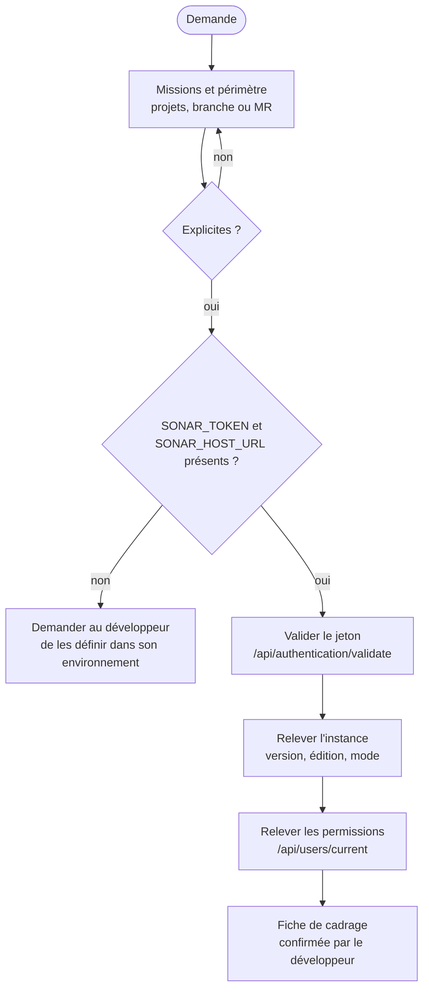

# Module `cadrage-acces` (D1)

Ce module fixe ce que l'expert va faire, sur quoi, et comment il touche SonarQube. Le jeton du compte Sonar porte toutes les permissions de ce compte, y compris d'administration : il est traité comme un secret de production.

## 1. Déroulé



## 2. Fiche de cadrage

```markdown
## Cadrage SonarQube confirmé

- **Missions** : trier, corriger ou planifier
- **Projets** : `acme-api` (back), `acme-web` (front)
- **Branche ou MR** : MR !412 sur `acme-api`
- **Instance** : SonarQube Server 2026.1 LTA, édition Developer, mode MQR
- **Permissions du compte** : Browse, Administer Issues sur les deux projets ; pas d'administration globale
- **Écritures envisagées** : transitions d'issues et commentaires, après validation
```

Les permissions relevées bornent ce que l'expert peut proposer : il ne propose pas une modification de quality gate si le compte n'a pas le droit de l'appliquer, mais il peut la préparer pour un administrateur.

## 3. Le jeton (D1.INV-2)

- Le développeur définit `SONAR_HOST_URL` et `SONAR_TOKEN` dans son environnement. L'expert ne lui demande jamais de coller le jeton dans la conversation ; si le jeton y apparaît, l'expert le signale et recommande de le révoquer.
- Le jeton ne figure jamais dans un fichier versionné, un journal, un rapport, une URL ni un argument de ligne de commande, car la liste des processus et l'historique du shell exposent les arguments.
- Recommandation, à faire valider : un compte dédié aux automatisations, avec les seules permissions nécessaires, plutôt que le jeton d'un compte personnel administrateur.

Fonctions d'appel : l'en-tête d'authentification est transmis à `curl` par son entrée standard, jamais en argument.

```bash
# Lecture : libre
sonar_get() {   # usage : sonar_get "/api/issues/search?components=acme-api&ps=1"
  curl -fsS --config - "${SONAR_HOST_URL%/}$1" <<EOF
header = "Authorization: Bearer ${SONAR_TOKEN}"
EOF
}

# Écriture : uniquement après validation explicite (D1.INV-3)
sonar_post() {  # usage : sonar_post "/api/issues/add_comment" "issue=AYx..." "text=..."
  local chemin="$1"; shift
  local args=()
  for kv in "$@"; do args+=(--data-urlencode "$kv"); done
  curl -fsS -X POST --config - "${args[@]}" "${SONAR_HOST_URL%/}${chemin}" <<EOF
header = "Authorization: Bearer ${SONAR_TOKEN}"
EOF
}
```

L'authentification par en-tête `Bearer` est celle des versions récentes de SonarQube Server. Si l'instance la refuse, l'expert le signale et propose l'authentification par jeton en nom d'utilisateur (`-u "${SONAR_TOKEN}:"`) passée de la même façon par `--config -` (`user = "…:"`).

## 3 bis. Modes de connexion, au choix (D1.INV-5)

SonarQube se joint de plusieurs façons. Le développeur retient au cadrage celles qu'il peut et veut employer ; l'expert n'en emploie pas d'autre, et chacune ne sert qu'aux usages que ce tableau lui attribue. Toutes reçoivent le jeton par une variable d'environnement, jamais en argument (D1.INV-2).

| Mode | Jeton | Variable lue | Usages admis en 1.1 | Prérequis |
|---|---|---|---|---|
| **API web, en-tête `Bearer`** (défaut) | jeton utilisateur | `SONAR_TOKEN` | tout le catalogue du § 4 : lectures, écritures validées | aucun |
| **API web, jeton en nom d'utilisateur** | jeton utilisateur | `SONAR_TOKEN` | idem, quand l'instance refuse `Bearer` | aucun |
| **Scanner** (Maven, npm, SonarScanner CLI) | jeton utilisateur, ou jeton d'analyse de projet ou global | `SONAR_TOKEN`, `SONAR_HOST_URL` | analyse : CI (D2), analyse éphémère (D9) | permission Execute Analysis |
| **SonarQube for IDE, mode connecté**, piloté par le serveur MCP | jeton utilisateur | `SONARQUBE_TOKEN`, reprise de `SONAR_TOKEN` | analyse locale sans envoi (D9, moteur SonarLint, § 4.4) | IDE ouvert et connecté ; serveur MCP autonome (`sonarsource/sonarqube-mcp`) |
| **Serveur MCP hébergé par l'instance** (`<SONAR_HOST_URL>/mcp`) | jeton utilisateur | configuration du client MCP | aucun en 1.1 : dimension D7 réservée ; noté au cadrage s'il est disponible | Server 2026.3 ou plus récent, édition Developer ou supérieure, extension installée |
| **SonarQube CLI** (`sonar`) | jeton utilisateur | `SONARQUBE_CLI_TOKEN` | détection de secrets sur les modifications locales (D9) ; l'analyse avancée dépend des droits du compte et n'est employée que si le cadrage l'a vérifiée | CLI installée ; sous WSL, variables d'environnement plutôt que trousseau |

Règles :

- **Un jeton utilisateur, d'abord.** Le serveur MCP, SonarQube for IDE et la CLI refusent les jetons de projet ou globaux ; un jeton d'analyse ne sert qu'au scanner, jamais à l'API de triage.
- **Reprise sans exposition.** Quand un outil attend un autre nom de variable, la valeur est reprise dans l'environnement (`export SONARQUBE_TOKEN="$SONAR_TOKEN"`), puis transmise par son seul nom (`docker run -e SONARQUBE_TOKEN`, jamais `-e SONARQUBE_TOKEN=<valeur>`).
- **Détection au cadrage.** L'expert, ou l'interface de pilotage (module `pilotage`), relève les modes disponibles : réponse de l'API pour chacune des deux authentifications, présence de `mvn`, `npx`, `docker` et `sonar`, réponse de `<SONAR_HOST_URL>/mcp`. Un mode indisponible est noté, pas contourné.
- **Pas d'usage hors tableau.** Interroger les issues par le serveur MCP au lieu de l'API, par exemple, relève de D7, réservée : l'expert ne le fait pas en 1.1, même si le mode est disponible.
- Les noms d'images, de variables et de commandes des outils MCP et de la CLI évoluent vite : l'expert les vérifie dans la documentation de la version installée avant de les écrire dans une fiche ou un rapport.

La fiche de cadrage porte une ligne de plus :

```markdown
- **Modes de connexion retenus** : API (`Bearer`), scanner Maven et npm ; disponibles mais non retenus : SonarQube CLI ; indisponible : serveur MCP hébergé (404)
```

## 4. Catalogue des appels (point E1)

Tout accès à SonarQube passe par ce catalogue. Avant un appel d'écriture, l'expert vérifie ses paramètres dans la documentation de l'API web intégrée à l'instance (page `/web_api`), car certains paramètres changent d'une version à l'autre.

### 4.1 Lecture

| Besoin | Appel |
|---|---|
| Instance joignable | `GET /api/system/status` |
| Version | `GET /api/server/version` |
| Édition et informations globales | `GET /api/navigation/global` |
| Jeton valide | `GET /api/authentication/validate` |
| Compte et permissions globales | `GET /api/users/current` |
| Projets visibles | `GET /api/components/search?qualifiers=TRK&q=<texte>` |
| Branches, merge requests | `GET /api/project_branches/list?project=<clé>`, `GET /api/project_pull_requests/list?project=<clé>` |
| État du quality gate | `GET /api/qualitygates/project_status?projectKey=<clé>&branch=<b>` ou `&pullRequest=<id>` |
| Mesures | `GET /api/measures/component?component=<clé>&metricKeys=<liste>&branch=<b>` |
| Issues | `GET /api/issues/search?components=<clé>&branch=<b>&inNewCodePeriod=true&ps=500&p=<n>` |
| Revues de sécurité (Security Hotspots, si exposés) | `GET /api/hotspots/search?project=<clé>&branch=<b>&status=TO_REVIEW` |
| Règle | `GET /api/rules/show?key=<langage:Snnnn>` |
| Quality gate du projet | `GET /api/qualitygates/get_by_project?project=<clé>`, puis `GET /api/qualitygates/show?name=<nom>` |
| Profils du projet | `GET /api/qualityprofiles/search?project=<clé>` |
| Définition du nouveau code | `GET /api/new_code_periods/show?project=<clé>&branch=<b>` |
| Règles actives d'un profil (examen local) | `GET /api/rules/search?qprofile=<clé du profil>&activation=true&ps=500&p=<n>` |

`/api/issues/search` renvoie au plus 500 éléments par page et ne permet pas de parcourir au-delà de 10 000 résultats. Au-delà, l'expert découpe la requête (par qualité logicielle, par gravité, par date de création) au lieu de conclure sur un échantillon tronqué.

### 4.2 Écriture (après validation)

| Action | Appel | Permission requise |
|---|---|---|
| Commenter une issue | `POST /api/issues/add_comment` (`issue`, `text`) | Browse |
| Changer le statut d'une issue | `POST /api/issues/do_transition` (`issue`, `transition` = `accept`, `falsepositive`, `reopen`) | Administer Issues |
| Statuer sur un Security Hotspot | `POST /api/hotspots/change_status` (`hotspot`, `status`, `resolution`, `comment`) | Administer Security Hotspots |
| Créer ou modifier un quality gate | `POST /api/qualitygates/create`, `/create_condition`, `/update_condition`, `/select` | Administer Quality Gates |
| Créer ou modifier un profil | `POST /api/qualityprofiles/copy`, `/change_parent`, `/activate_rule`, `/add_project` | Administer Quality Profiles |
| Définir le nouveau code | `POST /api/new_code_periods/set` | Administer sur le projet |
| Analyser le code local sous une branche de travail (examen local) | scanner Maven ou npm avec `sonar.branch.name=local-…` (module `examen-local`, § 5) | Execute Analysis sur le projet |
| Supprimer la branche de travail (examen local) | `POST /api/project_branches/delete` (`project`, `branch`) | Administer sur le projet |

### 4.3 Proposition d'écriture (D1.INV-3)

Chaque écriture est présentée ainsi, et attend un « oui » explicite :

```markdown
**Écriture proposée** (1 appel)
- `POST /api/issues/do_transition` : issue `AZ3k…` (java:S2077, `OrderSearch.java`), transition `falsepositive`
- précédée de `POST /api/issues/add_comment` : « Faux positif : la requête n'utilise que des
  identifiants de colonnes issus d'une énumération fermée (SortField), jamais une entrée utilisateur. »
- **Réversible** : oui, par la transition `reopen`
- **Permission** : Administer Issues (présente sur le compte)

Valider ?
```

Un lot de transitions est présenté sous forme de tableau, avec une validation pour le lot entier, et l'expert rejoue la lecture après application pour vérifier le résultat.

### 4.4 Outil MCP admis (examen local)

Un seul outil du serveur MCP de Sonar entre au catalogue en 1.1 : l'analyse locale par SonarQube for IDE, pour le moteur SonarLint de l'examen local (module `examen-local`, § 6). Le reste de la dimension D7 demeure réservé.

| Besoin | Outil | Condition |
|---|---|---|
| Analyser des fichiers locaux avec les règles du profil, sans envoi | `analyze_file_list` (toolset `ide`) | SonarQube for IDE ouvert, en mode connecté à l'instance ; jeton utilisateur |
| Repli, si `analyze_file_list` est indisponible | `analyze_code_snippet` (toolset `analysis`), avec `projectKey` | outil déprécié, à signaler à chaque usage |

Le jeton est transmis au serveur MCP par la variable `SONARQUBE_TOKEN`, reprise de `SONAR_TOKEN` dans l'environnement, jamais en argument (D1.INV-2). L'expert lit les paramètres de ces outils dans la liste exposée par le serveur MCP, à sa version installée.

## 5. Détection de l'instance (D1.INV-4)

| Élément | Comment | Effet |
|---|---|---|
| Version | `/api/server/version` | sections du skill applicables (revues de sécurité, paramètres d'API) |
| Édition | `/api/navigation/global` (champ d'édition) | analyse des branches et des MR disponibles ou non |
| Mode MQR ou expérience standard | `/api/settings/values?keys=sonar.multi-quality-mode.enabled` (clé à vérifier sur l'instance) ; à défaut, forme des issues renvoyées | champs utilisés pour le triage : qualités logicielles et gravités d'impact (MQR), ou type et sévérité (standard) |

Si un élément ne peut pas être relevé (permission insuffisante), l'expert le note comme limite et le demande au développeur.

## 6. Pièges connus

- **Jeton dans l'historique du shell** : `export SONAR_TOKEN=...` tapé en clair s'y retrouve. Suggérer une lecture masquée (`read -rs SONAR_TOKEN && export SONAR_TOKEN`).
- **Jeton d'analyse confondu avec un jeton utilisateur** : un jeton d'analyse de projet ou global sert au scanner, pas aux appels de l'API de triage. Le jeton du compte Sonar sert ici aux deux, ce qui en élargit l'usage : raison de plus pour le protéger.
- **Résultats tronqués** : voir la limite de 10 000 au § 4.1.
- **Branche implicite** : sans paramètre `branch`, l'API répond pour la branche principale. Toujours préciser la branche ou la MR du périmètre.
- **Scanner local sans branche** : la même règle vaut pour le scanner ; lancé en local sans `sonar.branch.name`, il écrit sur la branche principale (module `examen-local`, D9.INV-2).

## 7. Contrôle de sortie

- La fiche de cadrage est confirmée (D1.INV-1).
- Le jeton n'apparaît dans aucune sortie, aucun fichier, aucun argument (D1.INV-2).
- Aucune écriture n'a été faite sans validation (D1.INV-3).
- Version, édition et mode sont relevés ou déclarés inconnus (D1.INV-4).
- Les modes de connexion retenus figurent dans la fiche, et aucun n'est employé hors des usages du § 3 bis (D1.INV-5).
