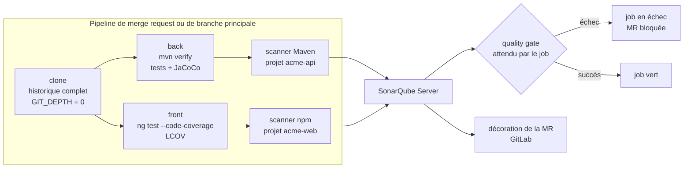

# Module `configuration-analyse` (D2)

Une analyse mal configurée produit des chiffres faux : couverture à zéro, code généré compté comme dette, nouveau code mal délimité. Ce module rend l'analyse fidèle avant que le triage ou la gouvernance ne s'appuient dessus.

## 1. Chaîne d'analyse



## 2. Back : Maven, Java 21

```xml
<properties>
  <java.version>21</java.version>
  <sonar.projectKey>acme-api</sonar.projectKey>
  <sonar.projectName>Acme API</sonar.projectName>
  <!-- D2.INV-2 : couverture -->
  <sonar.coverage.jacoco.xmlReportPaths>${project.build.directory}/site/jacoco/jacoco.xml</sonar.coverage.jacoco.xmlReportPaths>
  <!-- D2.INV-1 : code généré (client et interfaces OpenAPI, MapStruct, etc.) -->
  <sonar.exclusions>**/generated-sources/**,**/generated/**</sonar.exclusions>
  <!-- versions hors BOM centralisées (référentiel java, point E4) -->
  <jacoco.version>…</jacoco.version>
  <sonar-maven-plugin.version>…</sonar-maven-plugin.version>
</properties>

<build>
  <plugins>
    <plugin>
      <groupId>org.jacoco</groupId>
      <artifactId>jacoco-maven-plugin</artifactId>
      <version>${jacoco.version}</version>
      <executions>
        <execution><id>prepare</id><goals><goal>prepare-agent</goal></goals></execution>
        <execution><id>report</id><phase>verify</phase><goals><goal>report</goal></goals></execution>
      </executions>
    </plugin>
  </plugins>
  <pluginManagement>
    <plugins>
      <plugin>
        <groupId>org.sonarsource.scanner.maven</groupId>
        <artifactId>sonar-maven-plugin</artifactId>
        <version>${sonar-maven-plugin.version}</version>
      </plugin>
    </plugins>
  </pluginManagement>
</build>
```

Commande d'analyse :

```bash
mvn -B verify org.sonarsource.scanner.maven:sonar-maven-plugin:sonar -Dsonar.qualitygate.wait=true
```

Les versions de JaCoCo et du scanner Maven sont laissées en `…` : l'expert les choisit compatibles avec Java 21 et l'instance au moment de la configuration, et les écrit dans le compte rendu.

Points d'attention :

- **Code généré** : les plugins de génération (openapi-generator, MapStruct) ajoutent `target/generated-sources/...` aux sources compilées, et le scanner Maven les analyse. Sans exclusion, la dette et la duplication sont gonflées (D2.INV-1).
- **Exclusions de couverture** (`sonar.coverage.exclusions`) : exclure de la couverture la classe principale ou de la configuration pure est un choix de gouvernance, à proposer et à journaliser (module `gouvernance`), pas une astuce pour atteindre le seuil.
- **Projet multimodule** : le scanner s'exécute à la racine ; chaque module produit son rapport JaCoCo, ou un module dédié produit `report-aggregate`. Le chemin déclaré doit correspondre à ce qui est réellement produit.
- **Tests d'intégration** (Failsafe) : leur couverture n'est comptée que si l'agent JaCoCo les instrumente aussi et si le rapport les inclut.

## 3. Front : Angular 20

Couverture : le front doit produire un rapport LCOV.

- Avec Karma : Angular 20 ne génère plus `karma.conf.js` par défaut ; le créer avec `ng generate config karma`, puis ajouter un rapporteur LCOV :

```js
// karma.conf.js (extrait)
coverageReporter: {
  dir: require('path').join(__dirname, './coverage/acme-web'),
  subdir: '.',
  reporters: [{ type: 'html' }, { type: 'text-summary' }, { type: 'lcovonly' }],
},
```

- Avec Jest : `coverageReporters: ['lcov', 'text-summary']`.

Fichier `sonar-project.properties` à la racine du front :

```properties
sonar.projectKey=acme-web
sonar.projectName=Acme Web
sonar.sources=src
sonar.tests=src
sonar.test.inclusions=**/*.spec.ts
# D2.INV-1 : tests hors des sources, client généré, artefacts
sonar.exclusions=**/*.spec.ts,src/app/api/**,**/node_modules/**,dist/**,coverage/**
# D2.INV-2 : couverture
sonar.javascript.lcov.reportPaths=coverage/acme-web/lcov.info
```

Commandes :

```bash
npm ci
npx ng test --no-watch --code-coverage --browsers=ChromeHeadless
npx @sonar/scan -Dsonar.qualitygate.wait=true
```

`@sonar/scan` est le scanner npm de SonarSource. L'image SonarScanner CLI (`sonarsource/sonar-scanner-cli`) est une alternative ; l'expert garde celle déjà en place dans le projet.

Pour SonarQube Server 2026.5, les scanners JS/TS ne prennent plus en charge Node.js 20 : l'agent CI utilise Node.js 22 ou plus récent, compatible avec Angular 20.

## 4. Pipeline GitLab CI

```yaml
variables:
  GIT_DEPTH: "0"                                # D2.INV-3 : historique complet (blame, nouveau code)
  SONAR_USER_HOME: "${CI_PROJECT_DIR}/.sonar"

.sonar:
  stage: qualite
  cache:
    key: "sonar-${CI_JOB_NAME}"
    paths: [.sonar/cache]
  rules:
    - if: $CI_PIPELINE_SOURCE == "merge_request_event"
    - if: $CI_COMMIT_BRANCH == $CI_DEFAULT_BRANCH
  allow_failure: false                          # le quality gate bloque la MR

sonar-back:
  extends: .sonar
  image: maven:3.9-eclipse-temurin-21           # image interne (registre JFrog) à substituer
  script:
    - mvn -B verify org.sonarsource.scanner.maven:sonar-maven-plugin:sonar -Dsonar.qualitygate.wait=true

sonar-front:
  extends: .sonar
  image: <image Node 22 avec Chrome headless>   # à fournir par le projet
  script:
    - npm ci
    - npx ng test --no-watch --code-coverage --browsers=ChromeHeadless
    - npx @sonar/scan -Dsonar.qualitygate.wait=true
```

- `SONAR_HOST_URL` et `SONAR_TOKEN` sont des variables de CI **masquées** (D2.INV-4). Pour la CI, un jeton d'analyse de projet, limité à l'analyse, est préférable au jeton du compte Sonar : l'expert le recommande.
- **Variables protégées** : une variable marquée « protégée » n'est transmise qu'aux pipelines des branches et étiquettes protégées. Un pipeline de MR issu d'une branche de fonctionnalité non protégée ne la reçoit pas, et l'analyse échoue faute de jeton. L'expert expose ce compromis au développeur au lieu de le trancher seul.
- **Analyse de MR** : avec l'intégration GitLab configurée dans SonarQube (édition Developer ou supérieure), le scanner détecte la MR à partir des variables `CI_MERGE_REQUEST_*` du pipeline de MR, et SonarQube décore la MR.
- **Back et front dans le même dépôt GitLab** : deux projets SonarQube liés au même dépôt constituent un « monorepo ». La décoration des MR pour plusieurs projets d'un même dépôt relève d'une édition supérieure à Developer : l'expert le vérifie dans la documentation de l'instance et le signale avant de configurer.
- `sonar.qualitygate.wait=true` fait attendre le job jusqu'au résultat du quality gate (délai réglable par `sonar.qualitygate.timeout`, en secondes).

## 5. Vérification de la configuration

Après la première analyse, l'expert vérifie par l'API (module `cadrage-acces`, § 4) :

| Contrôle | Appel | Attendu |
|---|---|---|
| Couverture importée | `measures/component?metricKeys=coverage,new_coverage` | valeurs présentes, pas toutes à 0 (D2.INV-2) |
| Code généré exclu | `issues/search?components=<clé>&ps=1&facets=directories` ou recherche ciblée sur un fichier généré | aucun fichier généré dans les résultats (D2.INV-1) |
| Tests non comptés comme sources | `measures/component?metricKeys=ncloc` comparé à une estimation `cloc src/main` | ordre de grandeur cohérent |
| MR analysée | `project_pull_requests/list?project=<clé>` | la MR apparaît, avec son quality gate (D2.INV-3) |
| Historique complet | journal du job : absence de l'avertissement de clone superficiel | aucun avertissement |

## 6. Pièges connus

- **Clone superficiel** : GitLab clone par défaut avec une profondeur limitée. Sans `GIT_DEPTH: "0"`, l'attribution des lignes et la détection du nouveau code sont fausses.
- **Couverture à 0 %** : rapport produit après l'analyse, ou chemin déclaré différent du chemin réel. Vérifier l'ordre des commandes et le chemin.
- **Analyse Java sans compilation** : l'analyseur Java a besoin des classes compilées ; le scanner Maven le gère quand il s'exécute après `verify`.
- **Analyse dupliquée** : un job qui analyse à la fois sur `push` et sur `merge_request_event` crée deux analyses du même code. Les `rules` du § 4 l'évitent.
- **Paramètres seulement dans l'interface** : une exclusion définie dans l'interface de SonarQube et absente du dépôt n'est ni revue ni versionnée (D2.INV-4). L'interface sert aux réglages de gouvernance, le dépôt aux paramètres d'analyse.

## 7. Contrôle de sortie

- Code généré, dépendances et artefacts exclus (D2.INV-1).
- Couverture back et front importée et non nulle, ou absence signalée (D2.INV-2).
- MR et branche principale analysées, historique complet, quality gate attendu (D2.INV-3).
- Paramètres dans le dépôt, jeton uniquement en variable masquée (D2.INV-4).
