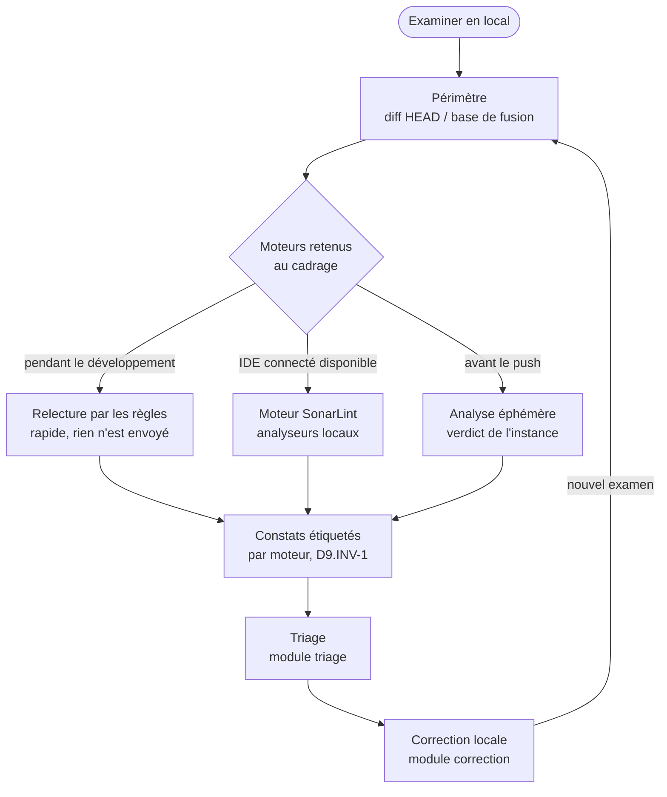

# Module `examen-local` (D9)

Examiner en local, c'est savoir ce que SonarQube dira du code **avant** qu'il parte sur GitLab, sans attendre le pipeline de merge request. L'examen porte sur ce qui partirait dans la MR : le diff entre le `HEAD` local et la base de fusion avec la branche cible (D9.INV-3). Il applique les règles du ou des profils qualité du projet sur l'instance, et rien d'autre (D9.INV-4).

L'examen se lance à la demande. Il ne pousse rien, ne commente rien, ne change le statut d'aucune issue (D9.INV-6) : il prépare le triage et la correction, qui suivent leurs propres modules et invariants.

## 1. Trois moteurs

SonarQube Server ne fournit pas d'outil officiel qui analyse un projet en local sans envoyer le code au serveur : le scanner envoie toujours son rapport. D'où trois moteurs, qui ne donnent pas la même garantie.

| Moteur | Ce qui tourne | Où part le code | Garantie | Coût |
|---|---|---|---|---|
| **Analyse éphémère** | scanner Maven ou npm, en local, sur une branche de travail `local-…` | serveur SonarQube | constats de l'instance, quality gate réel | un build, une analyse, deux écritures validées |
| **Moteur SonarLint** | analyseurs de SonarQube for IDE en mode connecté, pilotés par le serveur MCP de Sonar | nulle part : l'analyse est locale | analyseurs de Sonar, règles du profil synchronisées ; pas de quality gate | un IDE ouvert, connecté à l'instance |
| **Relecture par les règles** | l'expert relit le diff contre la liste des règles actives du profil | nulle part au-delà de la conversation avec l'expert | jugement de l'expert, guidé par les règles ; **pas un résultat Sonar** | quelques appels de lecture |



Usage recommandé, à confirmer au cadrage : relecture ou moteur SonarLint pendant le développement, pour corriger tôt et sans envoi ; analyse éphémère juste avant le push, pour connaître le verdict exact du quality gate. Le développeur peut retenir un, deux ou trois moteurs.

## 2. Cadrage propre à l'examen

En plus de la fiche du module `cadrage-acces`, l'expert relève et fait confirmer :

```markdown
## Examen local confirmé

- **Projets** : `acme-api` (back, Maven), `acme-web` (front, npm)
- **Branche cible** : `develop` (base de fusion `3f2a91c`, branche analysée sur l'instance : oui)
- **HEAD examiné** : `9c41e07`, 4 commits locaux non poussés ; modifications non commitées : aucune
- **Moteurs** : relecture par les règles, puis analyse éphémère avant le push
- **Où part le code** : relecture, nulle part ; analyse éphémère, instance SonarQube (`SONAR_HOST_URL`)
- **Profils appliqués** : « Acme way » (java), « Sonar way » (ts), mis à jour le 2026-10-28
- **Permissions requises** : Execute Analysis et Administer sur `acme-api` et `acme-web` (analyse éphémère seulement) ; présentes
```

La ligne « Où part le code » est obligatoire (D9.INV-5) : le développeur sait, avant le lancement, quel service reçoit son code.

## 3. Périmètre : le diff avec la branche cible (D9.INV-3)

```bash
CIBLE=develop                                   # confirmée au cadrage
mkdir -p .sonar-local
git fetch --quiet origin "$CIBLE"
BASE=$(git merge-base HEAD "origin/$CIBLE")
# Fichiers ajoutés, copiés, modifiés ou renommés depuis la base de fusion
git diff --name-only --diff-filter=ACMR "$BASE"...HEAD > .sonar-local/perimetre.txt
# Lignes modifiées, pour filtrer les constats au nouveau code
git diff --unified=0 "$BASE"...HEAD > .sonar-local/perimetre.diff
# Modifications non commitées : signalées, jamais mêlées en silence
git status --porcelain
```

- Le périmètre est calculé contre `origin/<cible>`, après `git fetch`, et non contre une branche locale qui peut être en retard.
- Les modifications non commitées ne sont pas dans `HEAD`. L'expert les signale et propose un commit local avant l'examen ; s'il examine l'arbre de travail tel quel, il le note dans le rapport.
- `.sonar-local/` est un dossier de travail. L'expert propose de l'ajouter à `.gitignore` s'il ne l'est pas : son contenu ne doit jamais être versionné.

## 4. Les règles du profil (D9.INV-4)

Les règles appliquées sont celles des profils associés au projet sur l'instance, jamais une liste de mémoire.

```bash
# Profils du projet, un par langage
sonar_get "/api/qualityprofiles/search?project=acme-api" \
  | jq '[.profiles[] | {key, name, language, rulesUpdatedAt}]'

# Règles actives d'un profil, page par page
sonar_get "/api/rules/search?qprofile=<clé du profil>&activation=true&ps=500&p=1" \
  | jq '{total: .total, regles: [.rules[] | {key, name, lang, impacts, severity, type}]}'

# Description d'une règle citée dans un constat
sonar_get "/api/rules/show?key=java:S2077" | jq '.rule | {key, name, htmlDesc, descriptionSections}'
```

Cache : l'expert peut garder la liste des règles actives dans `.sonar-local/regles-<clé du profil>.json`. Avant chaque examen, il relit `rulesUpdatedAt` du profil : si la date a changé, le cache est refait. Un cache dont la fraîcheur n'a pas été vérifiée n'est pas utilisé. Les noms des champs renvoyés sont à vérifier dans la documentation `/web_api` de l'instance.

## 5. Moteur 1 : analyse éphémère (D9.INV-2)

Le scanner tourne en local, sur le code local, mais sous une **branche de travail** dédiée de l'instance, jamais sous la branche principale, la branche cible ni une merge request. Sans `sonar.branch.name`, le scanner écrirait l'analyse sur la branche principale du projet et en écraserait les résultats : c'est le piège principal de ce moteur.

### 5.1 Nom de la branche de travail

```bash
LOGIN=$(sonar_get "/api/users/current" | jq -r '.login')
BRANCHE_LOCALE="local-${LOGIN}-$(git rev-parse --short=8 HEAD)"
```

Préfixe `local-`, login du compte, empreinte du `HEAD` : deux développeurs ne se marchent pas dessus, et la branche se reconnaît comme éphémère dans l'interface.

### 5.2 Lot d'écritures proposé (D1.INV-3)

L'analyse crée la branche sur l'instance, la suppression la retire : les deux forment un seul lot, validé avant le lancement.

```markdown
**Écritures proposées** (lot de 2, examen local)
1. Analyse du code local de `acme-api` sous la branche de travail `local-fgarcia-9c41e07`
   (nouveau code : référence `develop`) : crée la branche sur l'instance
2. `POST /api/project_branches/delete` : project=`acme-api`, branch=`local-fgarcia-9c41e07`,
   après lecture des constats
- **Où part le code** : instance SonarQube
- **Permissions** : Execute Analysis, Administer sur `acme-api` (présentes)
- **Réversible** : la branche de travail n'existe qu'entre 1 et 2

Valider ?
```

### 5.3 Lancement

Le jeton n'est passé ni en argument ni dans un fichier : les scanners lisent `SONAR_TOKEN` et `SONAR_HOST_URL` dans l'environnement (D1.INV-2). Le nom de branche n'est pas un secret.

```bash
# Back : tests et couverture d'abord (D2.INV-2), puis analyse sous la branche de travail
mvn -B verify org.sonarsource.scanner.maven:sonar-maven-plugin:sonar \
  -Dsonar.branch.name="$BRANCHE_LOCALE" \
  -Dsonar.newCode.referenceBranch="$CIBLE" \
  -Dsonar.qualitygate.wait=true

# Front : tests avec couverture LCOV, puis analyse
npx ng test --watch=false --code-coverage
npx @sonar/scan \
  -Dsonar.branch.name="$BRANCHE_LOCALE" \
  -Dsonar.newCode.referenceBranch="$CIBLE" \
  -Dsonar.qualitygate.wait=true
```

- `sonar.newCode.referenceBranch` fait du diff avec la branche cible le nouveau code de la branche de travail. L'expert vérifie que l'instance accepte ce paramètre d'analyse (documentation de la version) et que la branche cible y est analysée ; sinon, il le signale et filtre les constats par le périmètre du § 3.
- Aucune variable `CI_MERGE_REQUEST_*` ni propriété `sonar.pullrequest.*` ne doit être présente : le scanner croirait analyser une MR.
- Le scanner du front exige Node.js 22 ou plus récent avec l'instance 2026.5 (module `configuration-analyse`).

### 5.4 Lecture, puis suppression

```bash
sonar_get "/api/qualitygates/project_status?projectKey=acme-api&branch=$BRANCHE_LOCALE"
sonar_get "/api/issues/search?components=acme-api&branch=$BRANCHE_LOCALE&inNewCodePeriod=true&issueStatuses=OPEN,CONFIRMED&ps=500&p=1"
sonar_get "/api/hotspots/search?project=acme-api&branch=$BRANCHE_LOCALE&status=TO_REVIEW"
sonar_get "/api/measures/component?component=acme-api&branch=$BRANCHE_LOCALE&metricKeys=new_coverage,new_duplicated_lines_density"

# Écriture 2 du lot validé
sonar_post "/api/project_branches/delete" "project=acme-api" "branch=$BRANCHE_LOCALE"
# Vérification : la branche ne figure plus dans la liste
sonar_get "/api/project_branches/list?project=acme-api" | jq --arg b "$BRANCHE_LOCALE" '[.branches[] | select(.name == $b)] | length'
```

La suppression intervient même si l'analyse échoue ou si le quality gate est en erreur. Si elle échoue, l'expert le signale avec le nom de la branche restante ; la purge automatique des branches inactives de l'instance n'est pas une garantie et ne remplace pas la suppression.

## 6. Moteur 2 : SonarLint, par SonarQube for IDE

SonarQube for IDE, en **mode connecté** à l'instance, applique en local les analyseurs de Sonar avec les règles du profil du projet, sans envoyer le code au serveur. Le serveur MCP de Sonar permet à l'expert de déclencher cette analyse.

Ce moteur passe par un outil MCP : c'est un accès à SonarQube, donc il figure au catalogue du module `cadrage-acces` (§ 4.4, point E1). Le reste de la dimension D7 demeure réservé.

```bash
# Le jeton est repris de SONAR_TOKEN sans apparaître dans un argument (D1.INV-2)
export SONARQUBE_URL="$SONAR_HOST_URL"
export SONARQUBE_TOKEN="$SONAR_TOKEN"
export SONARQUBE_TOOLSETS=ide
export SONARQUBE_IDE_PORT=<port de SonarQube for IDE>
docker run -i --rm --init --pull=always --network=host \
  -e SONARQUBE_URL -e SONARQUBE_TOKEN -e SONARQUBE_TOOLSETS -e SONARQUBE_IDE_PORT \
  sonarsource/sonarqube-mcp
```

- `-e SONARQUBE_TOKEN` sans valeur transmet la variable de l'environnement au conteneur : la valeur ne figure pas dans la ligne de commande.
- `--network=host` : sous Linux, le conteneur ne joint pas sans cela le serveur intégré de SonarQube for IDE sur `localhost`.
- Le serveur MCP exige un **jeton utilisateur** ; un jeton de projet ou global ne convient pas.
- Outil utilisé : `analyze_file_list`, sur les fichiers du périmètre (§ 3). L'expert lit ses paramètres dans la liste d'outils que le serveur MCP expose, au lieu de les supposer.
- L'outil `analyze_code_snippet` du même serveur est déprécié et doit disparaître dans une version future. L'expert ne l'emploie que si `analyze_file_list` est indisponible, en le signalant, avec le paramètre `projectKey` du projet.
- Noms de l'image, des variables et des toolsets : à vérifier dans la documentation du serveur MCP à la version installée, qui évolue vite.

Limites : pas de quality gate, pas de mesure de couverture ni de duplication ; l'analyse Java de l'IDE dépend des classes compilées disponibles dans l'IDE. Un constat SonarLint confirme un problème ; l'absence de constat ne garantit pas un quality gate vert.

## 7. Moteur 3 : relecture par les règles

L'expert relit le diff du § 3 contre les règles actives des profils (§ 4), fichier par fichier, en commençant par les règles de sécurité puis de fiabilité (ordre de D3.INV-4).

- Il ne cite qu'une règle **active** dans le profil du langage concerné ; il en lit la description par `/api/rules/show` avant de la citer.
- Chaque constat porte la règle, l'emplacement, la raison et un niveau de confiance (`sûr`, `probable`, `à confirmer`).
- Un constat de relecture n'est pas une issue SonarQube (D9.INV-1) : il n'a ni clé d'issue, ni statut, ni place dans les chiffres du rapport issus de l'API (D6.INV-2). Il annonce ce que l'analyseur trouvera probablement, rien de plus.
- Les règles qui exigent une analyse de flux (injections, chemins de données entre méthodes) ou des classes compilées sont marquées `à confirmer` : la relecture les repère mal, l'analyse éphémère les tranche.

## 8. Restitution

Chaque constat porte son moteur ; les trois ne se fusionnent jamais en un seul chiffre.

```markdown
## Examen local : `acme-api`, HEAD `9c41e07` contre `develop`

- **Périmètre** : 7 fichiers, 212 lignes modifiées (base de fusion `3f2a91c`)
- **Quality gate** (analyse éphémère, branche `local-fgarcia-9c41e07`, supprimée) : ERROR
  - new_coverage 71,4 % (condition : ≥ 80 %)

| Moteur | Règle | Emplacement | Qualité / gravité | Constat | Suite |
|---|---|---|---|---|---|
| analyse éphémère | java:S2077 | `OrderSearch.java:42` | revue de sécurité | requête SQL construite par concaténation | triage, décision humaine |
| relecture (sûr) | java:S6813 | `InvoiceService.java:14` | maintenabilité / moyenne | injection par champ | correction directe |
| relecture (à confirmer) | java:S3649 | `ReportDao.java:88` | sécurité / haute | flux de données à vérifier | relancer l'analyse éphémère |
```

Le reste du rapport suit le module `rapport` (mission « Examiner en local »).

## 9. Pièges connus

- **Analyse sans branche** : un scanner lancé en local sans `sonar.branch.name` écrase l'analyse de la branche principale (D9.INV-2).
- **Branche de travail orpheline** : une suppression oubliée laisse une branche `local-…` visible de toute l'équipe et compte dans les branches de l'instance. La suppression fait partie du lot validé.
- **Base de fusion périmée** : sans `git fetch`, le diff inclut ou exclut à tort des commits de la branche cible.
- **Relecture prise pour une analyse** : « SonarQube trouve 3 problèmes » ne se dit que des constats d'un moteur Sonar ; la relecture « annonce » des constats.
- **Cache de règles périmé** : un profil modifié par la gouvernance change les règles ; le cache se vérifie avant usage (§ 4).
- **Jeton dans la commande Docker** : `-e SONARQUBE_TOKEN=<valeur>` l'expose dans la liste des processus ; seule la forme sans valeur est admise.
- **Couverture absente** : une analyse éphémère sans tests préalables met la couverture du nouveau code à zéro et fait échouer le gate à tort ; l'expert le signale (D2.INV-2).

## 10. Contrôle de sortie

- Chaque constat porte son moteur ; aucun constat de relecture n'est compté parmi les issues (D9.INV-1).
- L'analyse éphémère a tourné sous une branche `local-…`, et cette branche est supprimée, suppression vérifiée (D9.INV-2).
- Le périmètre est le diff avec la base de fusion de `origin/<cible>` ; les modifications non commitées sont déclarées (D9.INV-3).
- Les règles citées sont actives dans le profil du projet, lu à l'examen ou depuis un cache vérifié (D9.INV-4).
- La fiche indiquait, pour chaque moteur, où part le code (D9.INV-5).
- Aucun push, aucune transition, aucun commentaire n'a été fait par l'examen (D9.INV-6).
