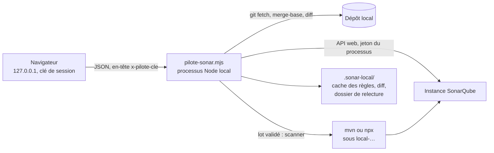

# Module `pilotage` (D10)

L'interface de pilotage met l'examen local (module `examen-local`) à portée d'un navigateur : choisir le mode de connexion, calculer le périmètre, lire les règles du profil, lancer une analyse éphémère après validation du lot d'écritures, préparer le dossier de relecture, lire les constats et le journal des appels. Elle n'ajoute aucune règle : elle applique par programme celles des modules `cadrage-acces` et `examen-local` (D10.INV-4).

Elle est facultative. L'expert peut conduire l'examen local au terminal ; l'interface sert quand le développeur préfère cliquer, ou veut un journal des appels prêt pour le rapport.

## 1. Architecture



Le jeton n'existe que dans l'environnement du processus du pilote, puis dans celui du scanner qu'il lance. Le navigateur n'en reçoit que la présence ; le journal, les erreurs et la sortie du scanner sont expurgés (D10.INV-2).

## 2. Lancer

```bash
# Dans le dépôt du projet, avec SONAR_HOST_URL et SONAR_TOKEN dans l'environnement
read -rs SONAR_TOKEN && export SONAR_TOKEN        # saisie masquée, rien dans l'historique
export SONAR_HOST_URL=https://sonar.exemple.org
node .skills/sonarqube/outils/pilote-sonar.mjs --racine . --port 8765
```

Le pilote affiche une adresse `http://127.0.0.1:8765/?cle=<clé>` : c'est la seule qui ouvre l'interface. La clé change à chaque lancement. Node 20 ou plus récent ; aucune dépendance à installer.

## 3. Écrans

| Écran | Ce qu'il fait | Appels | Règle appliquée |
|---|---|---|---|
| 1. Connexion | détecte les modes du module `cadrage-acces`, § 3 bis ; teste le mode d'API retenu, Bearer ou jeton en nom d'utilisateur ; relève version, édition, compte | `/api/authentication/validate`, `/api/server/version`, `/api/navigation/global`, `/api/users/current`, `GET <hôte>/mcp` | D1.INV-4, D1.INV-5 |
| 2. Projet et périmètre | `git fetch`, base de fusion avec `origin/<cible>`, fichiers et lignes du diff, modifications non commitées | git seulement | D9.INV-3 |
| 3. Règles du profil | profils du projet, règles actives paginées, cache invalidé par `rulesUpdatedAt` ; dossier de relecture | `/api/qualityprofiles/search`, `/api/rules/search` | D9.INV-4 |
| 4. Analyse éphémère | propose le lot de deux écritures, avec la commande exacte et l'appel de suppression ; exécute seulement après « Valider et lancer » | scanner, `/api/qualitygates/project_status`, `/api/issues/search`, `/api/hotspots/search`, `/api/project_branches/delete`, `/api/project_branches/list` | D1.INV-3, D9.INV-2, D10.INV-3 |
| 5. Moteur SonarLint | affiche la commande du serveur MCP, sans valeur de jeton | aucun | D1.INV-2 |
| 6. Constats | tableau par moteur ; constats hors périmètre comptés à part | aucun | D9.INV-1 |
| 7. Journal | méthode, chemin, statut, écriture ou non, sans jeton | aucun | D6.INV-1, D10.INV-2 |

La relecture par les règles reste le travail de l'expert : le pilote prépare `.sonar-local/relecture-<HEAD>.md`, avec le diff et les règles actives, et l'expert y répond selon le module `examen-local`, § 7.

## 4. API du pilote

Toutes les routes exigent l'en-tête `x-pilote-cle` ; la page exige le paramètre `cle`. Un en-tête `Host` autre que `127.0.0.1`, `localhost` ou `[::1]` est refusé, ce qui ferme la porte au rebond DNS (D10.INV-1).

| Route | Corps | Réponse |
|---|---|---|
| `GET /api/etat` | | modes de connexion, présence du jeton |
| `POST /api/connexion` | `{ mode: "bearer" \| "basic" }` | version, édition, login |
| `POST /api/perimetre` | `{ cible }` | base, HEAD, fichiers, lignes, non commité |
| `POST /api/regles` | `{ projet }` | profils et règles actives |
| `POST /api/relecture` | `{ projet }` | chemin du dossier de relecture |
| `POST /api/ephemere/proposer` | `{ projet, type: "maven" \| "npm" \| "personnalise", base? }` | lot : identifiant, branche, écritures exactes |
| `POST /api/ephemere/lancer` | `{ id }` | gate, constats, hors périmètre, suppression, limites |
| `GET /api/journal` | | appels à l'API |
| `GET /api/mcp` | | commande du serveur MCP |

Un lot vaut dix minutes et ne sert qu'une fois ; un identifiant inconnu, expiré ou déjà employé renvoie 409 sans rien écrire. Une commande personnalisée qui fixerait elle-même `sonar.branch.name`, une merge request ou un jeton est refusée : le pilote ajoute toujours `-Dsonar.branch.name=local-…` et `-Dsonar.newCode.referenceBranch=<cible>`, et retire de l'environnement du scanner les variables `CI_MERGE_REQUEST_*`.

## 5. Matérialiser les fichiers exécutables

Deux fichiers sont tirés des blocs annotés `<!-- fichier : chemin -->` de ce module, à l'identique, par programme plutôt qu'à la main. Depuis le dossier où le skill est matérialisé (`.skills/sonarqube/`) :

```text
node -e "const fs = require('node:fs'), path = require('node:path'), crypto = require('node:crypto'); const attendu = { 'outils/pilote-sonar.mjs': '39438776d6345d6b5e068c9a1066f071218a766626f036bc001533ccb7a52616', 'tests/pilote-sonar.test.mjs': '6ae11db5760c48cfa4864cdd0c7d210dde9fd90b8b574be99204e100a635d924' }; let ecarts = 0, vus = 0; const texte = fs.readFileSync('modules/pilotage/SKILL.md', 'utf8').replace(/\r\n/g, '\n'); for (const m of texte.matchAll(/^<\x21-- fichier : (\S+) -->\n\x60{3}[a-z]*\n([\s\S]*?)\n\x60{3}\n/gm)) { vus++; const contenu = m[2] + '\n'; fs.mkdirSync(path.dirname(m[1]), { recursive: true }); fs.writeFileSync(m[1], contenu); const conforme = crypto.createHash('sha256').update(contenu).digest('hex') === attendu[m[1]]; if (!conforme) ecarts++; console.log((conforme ? 'conforme  ' : 'ECART     ') + m[1]); } if (vus !== Object.keys(attendu).length) { console.log('fichiers trouvés : ' + vus); ecarts++; } if (ecarts > 0) process.exitCode = 1;"
```

Chaque fichier conforme est signalé `conforme` ; un écart arrête la commande avec un code non nul. Ne corrige pas un fichier en écart : signale-le au développeur.

## 6. Recette

```bash
node --test tests/pilote-sonar.test.mjs
```

Seize scénarios, P1 à P16, contre un faux SonarQube local, un dépôt git temporaire avec un `origin` nu et un faux scanner ; aucun réseau externe. La CI du dépôt Agent2Prompt la rejoue sous Linux et Windows, avec Node 20 et 22, à partir de la transmission courante.

| Scénario | Invariants |
|---|---|
| P1 nom de la branche de travail | D9.INV-2 |
| P2 deux modes d'API | D1.INV-5 |
| P3 commande de scanner refusée si elle fixe branche, MR ou jeton | D9.INV-2, D1.INV-2 |
| P4 lignes modifiées et périmètre d'un constat | D9.INV-3 |
| P5 environnement du scanner sans variables de MR | D9.INV-2 |
| P6 clé de session et Host local exigés | D10.INV-1 |
| P7 jeton absent de tout ce que reçoit le navigateur | D10.INV-2 |
| P8 connexion par l'un ou l'autre mode, relevé de l'instance | D1.INV-4, D1.INV-5 |
| P9 périmètre et non commité | D9.INV-3 |
| P10 règles actives, pagination et cache | D9.INV-4 |
| P11 rien n'est écrit sans lot valide | D10.INV-3 |
| P12 analyse éphémère complète, constats filtrés et étiquetés, suppression vérifiée | D9.INV-1, D9.INV-2, D10.INV-4 |
| P13 suppression même si le scanner échoue | D9.INV-2 |
| P14 échec de suppression rapporté | D9.INV-2 |
| P15 journal sans jeton, écriture marquée | D10.INV-2, D6.INV-1 |
| P16 dossier de relecture | D9.INV-1, D9.INV-4 |

## 7. Pièges connus

- **Proxy du poste** : un proxy HTTP défini dans l'environnement peut intercepter `127.0.0.1` pour certains outils (`curl`). Le navigateur et le pilote n'en dépendent pas ; pour un essai en ligne de commande, `curl --noproxy '*'`.
- **Clé partagée** : l'adresse avec sa clé ouvre l'interface ; ne pas la coller dans un ticket ni une conversation.
- **Analyse longue** : la requête « Valider et lancer » dure le temps du build et de l'analyse ; ne pas relancer le lot, il ne sert qu'une fois.
- **Windows** : le scanner est lancé par le shell (`mvn.cmd`, `npx.cmd`) ; la commande personnalisée suit la syntaxe de CMD.

## 8. Contrôle de sortie

- Le pilote n'a écouté que sur `127.0.0.1` et n'a servi que des requêtes portant la clé (D10.INV-1).
- Aucune réponse, aucune ligne du journal ni de la sortie du scanner ne contient le jeton (D10.INV-2).
- Chaque écriture vient d'un lot proposé puis validé, non expiré, employé une fois (D10.INV-3).
- La branche de travail est supprimée et la suppression vérifiée, ou son échec rapporté avec le nom de la branche (D10.INV-4, D9.INV-2).

## 9. Script `outils/pilote-sonar.mjs`

<!-- fichier : outils/pilote-sonar.mjs -->
```javascript
#!/usr/bin/env node
// Pilote local de l'expert SonarQube (skill sonarqube 1.1.0, module pilotage, D10).
// Interface web sur la boucle locale : modes de connexion, périmètre, règles du profil,
// analyse éphémère par lot validé, dossier de relecture, journal des appels.
// Node 20 ou plus récent, aucune dépendance. Le jeton reste dans ce processus (D10.INV-2).

import http from 'node:http';
import crypto from 'node:crypto';
import fs from 'node:fs';
import path from 'node:path';
import { spawn, execFile } from 'node:child_process';
import { pathToFileURL } from 'node:url';

export const VERSION = '1.1.0';
const LOT_DUREE_MS = 10 * 60 * 1000;
const PAGE_ISSUES = 500;
const MAX_ISSUES = 10000;

// ---------------------------------------------------------------- outils purs

/** Nom de la branche de travail : préfixe local-, login assaini, empreinte courte du HEAD (D9.INV-2). */
export function nomBrancheLocale(login, sha) {
  const l = String(login || 'inconnu').toLowerCase().replace(/[^a-z0-9]+/g, '-').replace(/^-+|-+$/g, '').slice(0, 24) || 'inconnu';
  const s = String(sha || '').toLowerCase().replace(/[^0-9a-f]/g, '').slice(0, 8);
  if (s.length < 7) throw new Error('empreinte du HEAD invalide');
  return `local-${l}-${s}`;
}

/** En-tête d'authentification selon le mode d'API retenu (cadrage-acces, § 3 bis). */
export function enteteAuth(mode, jeton) {
  if (!jeton) throw new Error('SONAR_TOKEN absent de l\'environnement');
  if (mode === 'basic') return `Basic ${Buffer.from(`${jeton}:`).toString('base64')}`;
  if (mode === 'bearer') return `Bearer ${jeton}`;
  throw new Error(`mode d'API inconnu : ${mode}`);
}

/** Refuse une commande de scanner qui choisirait elle-même la branche, une MR ou un jeton. */
export function verifierCommande(commande, jeton = process.env.SONAR_TOKEN) {
  const c = String(commande || '').trim();
  if (!c) throw new Error('commande de scanner vide');
  if (/sonar\.(branch\.name|pullrequest\.|token|login|password)/i.test(c)) {
    throw new Error('la commande ne doit fixer ni la branche, ni une merge request, ni un jeton : le pilote s\'en charge');
  }
  if (jeton && c.includes(jeton)) throw new Error('la commande contient la valeur du jeton');
  if (/[\r\n]/.test(c)) throw new Error('la commande tient sur une ligne');
  return c;
}

export const SCANNERS = {
  maven: 'mvn -B verify org.sonarsource.scanner.maven:sonar-maven-plugin:sonar -Dsonar.qualitygate.wait=true',
  npm: 'npx @sonar/scan -Dsonar.qualitygate.wait=true',
};

/** Commande complète : la base retenue, plus la branche de travail et la référence du nouveau code. */
export function commandeScanner(base, branche, cible) {
  if (!/^local-[a-z0-9-]+$/.test(branche)) throw new Error('branche de travail invalide');
  if (!/^[A-Za-z0-9._/-]+$/.test(cible)) throw new Error('branche cible invalide');
  return `${verifierCommande(base)} -Dsonar.branch.name=${branche} -Dsonar.newCode.referenceBranch=${cible}`;
}

/** Lignes modifiées par fichier, d'après un diff unifié sans contexte. */
export function analyserDiff(texte) {
  const plages = new Map();
  let courant = null;
  for (const ligne of String(texte).split('\n')) {
    const f = /^\+\+\+ (?:b\/)?(.+)$/.exec(ligne);
    if (f) { courant = f[1] === '/dev/null' ? null : f[1]; if (courant && !plages.has(courant)) plages.set(courant, []); continue; }
    const h = /^@@ -\d+(?:,\d+)? \+(\d+)(?:,(\d+))? @@/.exec(ligne);
    if (h && courant) {
      const debut = Number(h[1]); const n = h[2] === undefined ? 1 : Number(h[2]);
      if (n > 0) plages.get(courant).push([debut, debut + n - 1]);
    }
  }
  return plages;
}

/** Un constat est dans le périmètre si son fichier est modifié et, s'il a une ligne, si elle l'est aussi. */
export function dansPerimetre(plages, composant, ligne) {
  const fichier = String(composant || '').includes(':') ? composant.slice(composant.indexOf(':') + 1) : composant;
  const p = plages.get(fichier);
  if (!p) return false;
  if (!ligne) return true;
  return p.some(([a, b]) => ligne >= a && ligne <= b);
}

/** Environnement du scanner : sans variables de merge request, pour qu'il ne se croie pas en MR. */
export function environnementScanner(env = process.env) {
  const e = { ...env };
  for (const k of Object.keys(e)) if (/^CI_MERGE_REQUEST_/.test(k) || /^SONAR_PULLREQUEST/i.test(k)) delete e[k];
  return e;
}

// ---------------------------------------------------------------- accès

function executer(cmd, args, options = {}) {
  return new Promise((resolve) => {
    execFile(cmd, args, { timeout: 15000, maxBuffer: 32 * 1024 * 1024, ...options }, (err, stdout, stderr) => {
      resolve({ ok: !err, code: err ? (err.code ?? 1) : 0, stdout: String(stdout), stderr: String(stderr) });
    });
  });
}

function git(racine, ...args) { return executer('git', args, { cwd: racine }); }

export class Pilote {
  constructor({ racine = process.cwd(), env = process.env, horloge = () => Date.now() } = {}) {
    this.racine = path.resolve(racine);
    this.env = env;
    this.horloge = horloge;
    this.modeApi = 'bearer';
    this.journal = [];
    this.lots = new Map();
    this.perimetre = null;
    this.resultats = [];
  }

  get hote() { return String(this.env.SONAR_HOST_URL || '').replace(/\/+$/, ''); }
  get jeton() { return this.env.SONAR_TOKEN || ''; }

  /** Appel à l'API web ; le journal garde la méthode, le chemin et le statut, jamais le jeton (D10.INV-2). */
  async appel(chemin, { methode = 'GET', donnees = null, ecriture = false, mode = this.modeApi } = {}) {
    if (!this.hote) throw new Error('SONAR_HOST_URL absent de l\'environnement');
    const options = { method: methode, headers: { authorization: enteteAuth(mode, this.jeton), accept: 'application/json' }, signal: AbortSignal.timeout(30000) };
    if (donnees) {
      options.body = new URLSearchParams(donnees).toString();
      options.headers['content-type'] = 'application/x-www-form-urlencoded';
    }
    let statut = 0; let corps = null;
    try {
      const r = await fetch(this.hote + chemin, options);
      statut = r.status;
      const texte = await r.text();
      // Certaines routes répondent en texte brut (/api/server/version) : le texte est alors gardé tel quel.
      try { corps = texte ? JSON.parse(texte) : null; } catch { corps = texte.trim(); }
    } finally {
      this.journal.push({ date: new Date(this.horloge()).toISOString(), methode, chemin, statut, ecriture, mode });
    }
    if (statut < 200 || statut >= 300) {
      const detail = Array.isArray(corps?.errors) ? corps.errors.map((e) => e.msg).join(' ; ') : '';
      const err = new Error(`${methode} ${chemin.split('?')[0]} : HTTP ${statut}${detail ? ` (${detail})` : ''}`);
      err.statut = statut;
      throw err;
    }
    return corps;
  }

  /** Modes de connexion disponibles (cadrage-acces, § 3 bis). Le jeton n'y figure que par sa présence. */
  async modes() {
    const outil = async (cmd, args) => (await executer(cmd, args, { timeout: 8000, shell: process.platform === 'win32' })).ok;
    const [mvn, npx, docker, sonar] = await Promise.all([
      outil('mvn', ['-v']), outil('npx', ['--version']), outil('docker', ['--version']), outil('sonar', ['--version'])]);
    let mcpHeberge = 'inconnu';
    if (this.hote && this.jeton) {
      try {
        const r = await fetch(`${this.hote}/mcp`, { method: 'GET', headers: { authorization: enteteAuth('bearer', this.jeton) }, signal: AbortSignal.timeout(5000) });
        mcpHeberge = r.status === 404 ? 'absent' : `présent (HTTP ${r.status})`;
      } catch { mcpHeberge = 'injoignable'; }
    }
    return {
      version: VERSION,
      hote: this.hote || null,
      jetonPresent: Boolean(this.jeton),
      modeApi: this.modeApi,
      modes: [
        { id: 'bearer', libelle: 'API web, en-tête Bearer', usage: 'catalogue complet', disponible: Boolean(this.hote && this.jeton) },
        { id: 'basic', libelle: 'API web, jeton en nom d\'utilisateur', usage: 'catalogue complet, si Bearer est refusé', disponible: Boolean(this.hote && this.jeton) },
        { id: 'scanner-maven', libelle: 'Scanner Maven', usage: 'analyse éphémère du back', disponible: mvn },
        { id: 'scanner-npm', libelle: 'Scanner npm (@sonar/scan)', usage: 'analyse éphémère du front', disponible: npx },
        { id: 'mcp-ide', libelle: 'SonarQube for IDE par le serveur MCP autonome', usage: 'moteur SonarLint, sans envoi', disponible: docker, note: 'IDE connecté requis, non détectable ici' },
        { id: 'mcp-heberge', libelle: 'Serveur MCP hébergé par l\'instance', usage: 'aucun en 1.1 (D7 réservée)', disponible: mcpHeberge.startsWith('présent'), note: mcpHeberge },
        { id: 'cli', libelle: 'SonarQube CLI (sonar)', usage: 'détection de secrets locale', disponible: sonar },
      ],
    };
  }

  /** Teste un mode d'API et relève l'instance (D1.INV-4) ; le mode retenu sert ensuite à tous les appels. */
  async connexion(mode) {
    if (!['bearer', 'basic'].includes(mode)) throw new Error('mode d\'API : bearer ou basic');
    const valide = await this.appel('/api/authentication/validate', { mode });
    if (!valide?.valid) throw new Error('jeton refusé par l\'instance');
    const [version, global, utilisateur] = await Promise.all([
      this.appel('/api/server/version', { mode }).catch(() => null),
      this.appel('/api/navigation/global', { mode }).catch(() => null),
      this.appel('/api/users/current', { mode }),
    ]);
    this.modeApi = mode;
    this.login = utilisateur?.login;
    return { mode, version: version ?? 'inconnue', edition: global?.edition ?? 'inconnue', login: utilisateur?.login, permissions: utilisateur?.permissions?.global ?? [] };
  }

  /** Périmètre : diff entre HEAD et la base de fusion avec origin/<cible> (D9.INV-3). */
  async calculerPerimetre(cible) {
    if (!/^[A-Za-z0-9._/-]+$/.test(cible || '')) throw new Error('branche cible invalide');
    const fetchR = await git(this.racine, 'fetch', '--quiet', 'origin', cible);
    if (!fetchR.ok) throw new Error(`git fetch origin ${cible} : ${fetchR.stderr.trim()}`);
    const base = (await git(this.racine, 'merge-base', 'HEAD', `origin/${cible}`)).stdout.trim();
    if (!base) throw new Error(`aucune base de fusion avec origin/${cible}`);
    const head = (await git(this.racine, 'rev-parse', 'HEAD')).stdout.trim();
    const fichiers = (await git(this.racine, 'diff', '--name-only', '--diff-filter=ACMR', `${base}...HEAD`)).stdout.split('\n').filter(Boolean);
    const diff = (await git(this.racine, 'diff', '--unified=0', `${base}...HEAD`)).stdout;
    const nonCommite = (await git(this.racine, 'status', '--porcelain')).stdout.split('\n').filter((l) => l && !/^\?\? \.sonar-local\//.test(l));
    const plages = analyserDiff(diff);
    const lignes = [...plages.values()].reduce((n, p) => n + p.reduce((m, [a, b]) => m + b - a + 1, 0), 0);
    fs.mkdirSync(path.join(this.racine, '.sonar-local'), { recursive: true });
    fs.writeFileSync(path.join(this.racine, '.sonar-local', 'perimetre.diff'), diff);
    const gitignore = fs.existsSync(path.join(this.racine, '.gitignore')) ? fs.readFileSync(path.join(this.racine, '.gitignore'), 'utf8') : '';
    this.perimetre = { cible, base, head, fichiers, plages, diff };
    return { cible, base, head, fichiers, lignes, nonCommite, sonarLocalIgnore: /^\/?\.sonar-local\/?\s*$/m.test(gitignore) };
  }

  /** Règles actives des profils du projet, avec un cache invalidé par rulesUpdatedAt (D9.INV-4). */
  async regles(projet) {
    if (!projet) throw new Error('clé de projet requise');
    const profils = (await this.appel(`/api/qualityprofiles/search?project=${encodeURIComponent(projet)}`))?.profiles ?? [];
    const dossier = path.join(this.racine, '.sonar-local');
    fs.mkdirSync(dossier, { recursive: true });
    const sortie = [];
    for (const p of profils) {
      const cache = path.join(dossier, `regles-${p.key.replace(/[^A-Za-z0-9_-]/g, '_')}.json`);
      let lu = null;
      if (fs.existsSync(cache)) { try { lu = JSON.parse(fs.readFileSync(cache, 'utf8')); } catch { lu = null; } }
      if (lu && lu.rulesUpdatedAt === p.rulesUpdatedAt) { sortie.push({ ...lu, depuisCache: true }); continue; }
      const regles = [];
      for (let page = 1; ; page++) {
        const r = await this.appel(`/api/rules/search?qprofile=${encodeURIComponent(p.key)}&activation=true&ps=500&p=${page}`);
        for (const x of r?.rules ?? []) regles.push({ key: x.key, name: x.name, lang: x.lang, severity: x.severity, type: x.type, impacts: x.impacts });
        if (!r?.rules?.length || regles.length >= (r.total ?? r.paging?.total ?? 0)) break;
      }
      const entree = { key: p.key, name: p.name, language: p.language, rulesUpdatedAt: p.rulesUpdatedAt, regles };
      fs.writeFileSync(cache, JSON.stringify(entree, null, 1));
      sortie.push({ ...entree, depuisCache: false });
    }
    return sortie;
  }

  /** Propose le lot d'écritures de l'analyse éphémère, sans rien exécuter (D1.INV-3, D10.INV-3). */
  async proposerEphemere({ projet, type = 'maven', base: baseLibre }) {
    if (!this.perimetre) throw new Error('calculer d\'abord le périmètre');
    if (!projet) throw new Error('clé de projet requise');
    const base = type === 'personnalise' ? baseLibre : SCANNERS[type];
    if (!base) throw new Error(`type de scanner inconnu : ${type}`);
    const login = this.login || (await this.appel('/api/users/current'))?.login;
    const branche = nomBrancheLocale(login, this.perimetre.head);
    const commande = commandeScanner(base, branche, this.perimetre.cible);
    const id = crypto.randomBytes(12).toString('hex');
    const lot = {
      id, projet, branche, commande, cible: this.perimetre.cible, expire: this.horloge() + LOT_DUREE_MS,
      ecritures: [
        { ordre: 1, action: `analyse du code local de ${projet} sous la branche de travail ${branche}`, appel: commande },
        { ordre: 2, action: 'suppression de la branche de travail, après lecture', appel: `POST /api/project_branches/delete project=${projet} branch=${branche}` },
      ],
      ouPartLeCode: 'instance SonarQube',
      permissions: ['Execute Analysis', 'Administer sur le projet'],
    };
    this.lots.set(id, lot);
    const { expire, ...visible } = lot;
    return { ...visible, expireDans: Math.round(LOT_DUREE_MS / 60000) + ' min' };
  }

  /** Exécute un lot validé : analyse, lecture, puis suppression vérifiée, même en cas d'échec (D9.INV-2). */
  async lancerEphemere(id) {
    const lot = this.lots.get(id);
    if (!lot) { const e = new Error('aucun lot validé sous cet identifiant'); e.statut = 409; throw e; }
    this.lots.delete(id);
    if (this.horloge() > lot.expire) { const e = new Error('lot expiré : le proposer à nouveau'); e.statut = 409; throw e; }
    const rapport = { branche: lot.branche, scanner: null, qualityGate: null, constats: [], horsPerimetre: 0, suppression: null, limites: [] };
    try {
      rapport.scanner = await this.#scanner(lot.commande);
      if (rapport.scanner.code !== 0) rapport.limites.push(`scanner en échec (code ${rapport.scanner.code})`);
      else {
        const b = encodeURIComponent(lot.branche); const p = encodeURIComponent(lot.projet);
        const gate = await this.appel(`/api/qualitygates/project_status?projectKey=${p}&branch=${b}`).catch((e) => { rapport.limites.push(e.message); return null; });
        rapport.qualityGate = gate?.projectStatus ?? null;
        const issues = [];
        for (let page = 1; page * PAGE_ISSUES <= MAX_ISSUES; page++) {
          const r = await this.appel(`/api/issues/search?components=${p}&branch=${b}&inNewCodePeriod=true&issueStatuses=OPEN,CONFIRMED&ps=${PAGE_ISSUES}&p=${page}`);
          issues.push(...(r?.issues ?? []));
          if (!r?.issues?.length || issues.length >= (r.total ?? r.paging?.total ?? 0)) break;
          if (page * PAGE_ISSUES >= MAX_ISSUES) rapport.limites.push('plus de 10 000 constats : découper la requête');
        }
        const hotspots = await this.appel(`/api/hotspots/search?project=${p}&branch=${b}&status=TO_REVIEW`)
          .then((r) => r?.hotspots ?? []).catch(() => { rapport.limites.push('revues de sécurité non lues'); return []; });
        for (const i of issues) {
          if (!dansPerimetre(this.perimetre.plages, i.component, i.line)) { rapport.horsPerimetre++; continue; }
          rapport.constats.push({ moteur: 'analyse éphémère', cle: i.key, regle: i.rule, composant: i.component, ligne: i.line ?? null, message: i.message, impacts: i.impacts ?? null, severite: i.severity ?? null, type: i.type ?? null });
        }
        for (const h of hotspots) {
          if (!dansPerimetre(this.perimetre.plages, h.component, h.line)) { rapport.horsPerimetre++; continue; }
          rapport.constats.push({ moteur: 'analyse éphémère', cle: h.key, regle: h.ruleKey, composant: h.component, ligne: h.line ?? null, message: h.message, revueSecurite: true });
        }
      }
    } finally {
      rapport.suppression = await this.#supprimer(lot.projet, lot.branche);
    }
    this.resultats = rapport.constats;
    return rapport;
  }

  async #supprimer(projet, branche) {
    try {
      await this.appel('/api/project_branches/delete', { methode: 'POST', donnees: { project: projet, branch: branche }, ecriture: true });
    } catch (e) {
      if (e.statut !== 404) return { faite: false, verifiee: false, detail: e.message };
    }
    try {
      const liste = await this.appel(`/api/project_branches/list?project=${encodeURIComponent(projet)}`);
      const reste = (liste?.branches ?? []).some((x) => x.name === branche);
      return { faite: !reste, verifiee: true, detail: reste ? `la branche ${branche} reste sur l'instance` : 'branche absente de la liste' };
    } catch (e) {
      return { faite: true, verifiee: false, detail: `vérification impossible : ${e.message}` };
    }
  }

  #scanner(commande) {
    return new Promise((resolve) => {
      const enfant = spawn(commande, { cwd: this.racine, env: environnementScanner(this.env), shell: true });
      let sortie = '';
      const garder = (d) => { sortie = (sortie + d).slice(-20000); };
      enfant.stdout.on('data', garder);
      enfant.stderr.on('data', garder);
      enfant.on('error', (e) => resolve({ code: 127, sortie: String(e.message) }));
      enfant.on('close', (code) => resolve({ code: code ?? 1, sortie: this.jeton ? sortie.split(this.jeton).join('***') : sortie }));
    });
  }

  /** Dossier de relecture : diff et règles actives, pour le moteur de relecture de l'expert (D9, § 7). */
  async dossierRelecture(projet) {
    if (!this.perimetre) throw new Error('calculer d\'abord le périmètre');
    const profils = await this.regles(projet);
    const lignes = [
      `# Dossier de relecture : ${projet}, HEAD ${this.perimetre.head.slice(0, 8)} contre ${this.perimetre.cible}`, '',
      `- Base de fusion : ${this.perimetre.base.slice(0, 8)}`,
      `- Fichiers : ${this.perimetre.fichiers.length}`,
      '- Moteur : relecture par les règles. Les constats qui en sortent ne sont pas des issues SonarQube (D9.INV-1).', '',
      '## Règles actives des profils du projet', '',
    ];
    for (const p of profils) {
      lignes.push(`### ${p.name} (${p.language}), mis à jour le ${p.rulesUpdatedAt ?? 'inconnu'}`, '');
      for (const r of p.regles) lignes.push(`- \`${r.key}\` : ${r.name}`);
      lignes.push('');
    }
    lignes.push('## Diff', '', '```diff', this.perimetre.diff.trimEnd(), '```', '');
    const fichier = path.join(this.racine, '.sonar-local', `relecture-${this.perimetre.head.slice(0, 8)}.md`);
    fs.writeFileSync(fichier, lignes.join('\n'));
    return { fichier: path.relative(this.racine, fichier), regles: profils.reduce((n, p) => n + p.regles.length, 0) };
  }

  commandeMcp() {
    return [
      'export SONARQUBE_URL="$SONAR_HOST_URL"',
      'export SONARQUBE_TOKEN="$SONAR_TOKEN"',
      'export SONARQUBE_TOOLSETS=ide',
      'export SONARQUBE_IDE_PORT=<port de SonarQube for IDE>',
      'docker run -i --rm --init --pull=always --network=host \\',
      '  -e SONARQUBE_URL -e SONARQUBE_TOKEN -e SONARQUBE_TOOLSETS -e SONARQUBE_IDE_PORT \\',
      '  sonarsource/sonarqube-mcp',
    ].join('\n');
  }
}

// ---------------------------------------------------------------- serveur

const PAGE = String.raw`<!doctype html>
<html lang="fr"><head><meta charset="utf-8"><meta name="viewport" content="width=device-width, initial-scale=1">
<title>Pilote SonarQube</title>
<style>
:root{--fond:#f6f7f5;--carte:#fff;--encre:#1b2430;--doux:#59636e;--ligne:#d3d8dc;--accent:#155e8b;--ok:#2b6b3f;--ko:#9a3412}
@media (prefers-color-scheme:dark){:root{--fond:#12171d;--carte:#1a2129;--encre:#e5e9ed;--doux:#9aa6b2;--ligne:#2e3842;--accent:#7fb6dc;--ok:#8fd0a3;--ko:#f0a372}}
*{box-sizing:border-box}body{margin:0;background:var(--fond);color:var(--encre);font:15px/1.5 system-ui,sans-serif}
main{max-width:1080px;margin:0 auto;padding:20px 16px 60px}h1{font-size:1.6rem;margin:0 0 4px}h2{font-size:1.15rem;margin:0 0 10px}
p.sous{color:var(--doux);margin:0 0 18px}section{background:var(--carte);border:1px solid var(--ligne);border-radius:8px;padding:16px;margin-bottom:16px}
label{display:block;font-weight:600;margin:8px 0 4px}input,select{font:inherit;padding:7px 9px;border:1px solid var(--ligne);border-radius:5px;background:var(--fond);color:var(--encre);width:100%;max-width:420px}
button{font:inherit;font-weight:600;padding:7px 13px;border-radius:5px;border:1px solid var(--accent);background:var(--accent);color:var(--carte);cursor:pointer;margin:10px 8px 0 0}
button.second{background:transparent;color:var(--accent)}button:disabled{opacity:.5;cursor:default}
:focus-visible{outline:3px solid var(--accent);outline-offset:2px}
table{border-collapse:collapse;width:100%;font-size:.92rem;margin-top:8px}th,td{border-bottom:1px solid var(--ligne);padding:6px 8px;text-align:left;vertical-align:top}
caption{text-align:left;font-weight:600;padding:4px 0}code,pre{font-family:ui-monospace,Consolas,monospace;font-size:.88rem}
pre{background:var(--fond);border:1px solid var(--ligne);border-radius:5px;padding:10px;overflow:auto;white-space:pre-wrap}
.ok{color:var(--ok);font-weight:600}.ko{color:var(--ko);font-weight:600}.etat{min-height:1.4em;margin-top:8px}
.lot{border:2px solid var(--ko);border-radius:6px;padding:12px;margin-top:10px}
</style></head><body><main>
<h1>Pilote SonarQube</h1>
<p class="sous">Examen local avant GitLab — le jeton reste dans le processus du pilote ; ce navigateur n'en connaît que la présence.</p>

<section aria-labelledby="t-co"><h2 id="t-co">1. Connexion</h2>
<div id="instance"></div>
<table><caption>Modes de connexion détectés</caption><thead><tr><th scope="col">Mode</th><th scope="col">Usage admis</th><th scope="col">Disponible</th></tr></thead><tbody id="modes"></tbody></table>
<label for="modeApi">Mode d'API retenu</label>
<select id="modeApi"><option value="bearer">API web, en-tête Bearer</option><option value="basic">API web, jeton en nom d'utilisateur</option></select>
<button id="bConnexion">Tester la connexion</button>
<div class="etat" id="eConnexion" role="status" aria-live="polite"></div></section>

<section aria-labelledby="t-pe"><h2 id="t-pe">2. Projet et périmètre</h2>
<label for="projet">Clé du projet SonarQube</label><input id="projet" autocomplete="off" placeholder="acme-api">
<label for="cible">Branche cible</label><input id="cible" autocomplete="off" value="develop">
<button id="bPerimetre">Calculer le diff</button>
<div class="etat" id="ePerimetre" role="status" aria-live="polite"></div></section>

<section aria-labelledby="t-re"><h2 id="t-re">3. Règles du profil</h2>
<button id="bRegles">Lire les règles actives</button><button id="bRelecture" class="second">Préparer le dossier de relecture</button>
<div class="etat" id="eRegles" role="status" aria-live="polite"></div></section>

<section aria-labelledby="t-ep"><h2 id="t-ep">4. Analyse éphémère</h2>
<label for="scanner">Scanner</label>
<select id="scanner"><option value="maven">Maven (back)</option><option value="npm">npm, @sonar/scan (front)</option><option value="personnalise">Commande personnalisée</option></select>
<label for="baseLibre">Commande personnalisée, sans branche ni jeton</label><input id="baseLibre" autocomplete="off" disabled>
<button id="bProposer">Proposer le lot</button>
<div id="lot"></div>
<div class="etat" id="eEphemere" role="status" aria-live="polite"></div></section>

<section aria-labelledby="t-sl"><h2 id="t-sl">5. Moteur SonarLint</h2>
<p>SonarQube for IDE, en mode connecté, analyse en local sans envoi. Lancer le serveur MCP de Sonar dans un terminal, puis demander à l'expert d'appeler <code>analyze_file_list</code> sur les fichiers du périmètre.</p>
<pre id="mcp"></pre></section>

<section aria-labelledby="t-rs"><h2 id="t-rs">6. Constats</h2><div id="constats"><p>Aucun constat pour l'instant.</p></div></section>

<section aria-labelledby="t-jo"><h2 id="t-jo">7. Journal des appels</h2><button id="bJournal" class="second">Rafraîchir</button>
<table><caption>Appels à l'API, sans jeton</caption><thead><tr><th scope="col">Date</th><th scope="col">Méthode</th><th scope="col">Chemin</th><th scope="col">Statut</th><th scope="col">Écriture</th></tr></thead><tbody id="journal"></tbody></table></section>
</main>
<script>
const CLE = '__CLE__';
const $ = (id) => document.getElementById(id);
const txt = (s) => String(s ?? '').replace(/[&<>"]/g, (c) => ({ '&': '&amp;', '<': '&lt;', '>': '&gt;', '"': '&quot;' }[c]));
async function api(chemin, corps) {
  const r = await fetch(chemin, { method: corps ? 'POST' : 'GET', headers: { 'x-pilote-cle': CLE, 'content-type': 'application/json' }, body: corps ? JSON.stringify(corps) : undefined });
  const d = await r.json().catch(() => ({}));
  if (!r.ok) throw new Error(d.erreur || ('HTTP ' + r.status));
  return d;
}
function etat(id, html, ko) { $(id).innerHTML = '<span class="' + (ko ? 'ko' : 'ok') + '">' + html + '</span>'; }
async function charger() {
  const e = await api('/api/etat');
  $('instance').innerHTML = '<p>Instance : <code>' + txt(e.hote || 'SONAR_HOST_URL absent') + '</code> — jeton : ' + (e.jetonPresent ? '<span class="ok">présent</span>' : '<span class="ko">absent</span>') + '</p>';
  $('modes').innerHTML = e.modes.map((m) => '<tr><td>' + txt(m.libelle) + '</td><td>' + txt(m.usage) + (m.note ? '<br><small>' + txt(m.note) + '</small>' : '') + '</td><td>' + (m.disponible ? '<span class="ok">oui</span>' : '<span class="ko">non</span>') + '</td></tr>').join('');
  $('mcp').textContent = (await api('/api/mcp')).commande;
}
$('bConnexion').onclick = async () => { try { const c = await api('/api/connexion', { mode: $('modeApi').value }); etat('eConnexion', 'Connecté : SonarQube ' + txt(c.version) + ', édition ' + txt(c.edition) + ', compte ' + txt(c.login)); } catch (e) { etat('eConnexion', txt(e.message), true); } };
$('bPerimetre').onclick = async () => { try { const p = await api('/api/perimetre', { cible: $('cible').value.trim() }); etat('ePerimetre', p.fichiers.length + ' fichier(s), ' + p.lignes + ' ligne(s) modifiée(s) ; base ' + txt(p.base.slice(0, 8)) + ', HEAD ' + txt(p.head.slice(0, 8)) + (p.nonCommite.length ? ' — <span class="ko">' + p.nonCommite.length + ' modification(s) non commitée(s), hors examen</span>' : '') + (p.sonarLocalIgnore ? '' : ' — ajouter .sonar-local/ au .gitignore')); } catch (e) { etat('ePerimetre', txt(e.message), true); } };
$('bRegles').onclick = async () => { try { const r = await api('/api/regles', { projet: $('projet').value.trim() }); etat('eRegles', r.map((p) => txt(p.name) + ' (' + txt(p.language) + ') : ' + p.regles.length + ' règles' + (p.depuisCache ? ', depuis le cache vérifié' : '')).join(' ; ') || 'aucun profil'); } catch (e) { etat('eRegles', txt(e.message), true); } };
$('bRelecture').onclick = async () => { try { const r = await api('/api/relecture', { projet: $('projet').value.trim() }); etat('eRegles', 'Dossier écrit : <code>' + txt(r.fichier) + '</code> (' + r.regles + ' règles) — à remettre à l\'expert'); } catch (e) { etat('eRegles', txt(e.message), true); } };
$('scanner').onchange = () => { $('baseLibre').disabled = $('scanner').value !== 'personnalise'; };
$('bProposer').onclick = async () => {
  try {
    const l = await api('/api/ephemere/proposer', { projet: $('projet').value.trim(), type: $('scanner').value, base: $('baseLibre').value });
    $('lot').innerHTML = '<div class="lot" role="group" aria-labelledby="t-lot"><h3 id="t-lot">Écritures proposées (lot de ' + l.ecritures.length + ')</h3><ol>' + l.ecritures.map((x) => '<li>' + txt(x.action) + '<pre>' + txt(x.appel) + '</pre></li>').join('') + '</ol><p>Où part le code : <strong>' + txt(l.ouPartLeCode) + '</strong> — permissions : ' + txt(l.permissions.join(', ')) + ' — valable ' + txt(l.expireDans) + '.</p><button id="bValider">Valider et lancer</button><button id="bAnnuler" class="second">Annuler</button></div>';
    $('bAnnuler').onclick = () => { $('lot').innerHTML = ''; };
    $('bValider').onclick = async () => {
      $('bValider').disabled = true; etat('eEphemere', 'Analyse en cours…');
      try {
        const r = await api('/api/ephemere/lancer', { id: l.id });
        $('lot').innerHTML = '';
        const g = r.qualityGate ? r.qualityGate.status : 'non lu';
        etat('eEphemere', 'Quality gate : ' + txt(g) + ' — ' + r.constats.length + ' constat(s) dans le périmètre, ' + r.horsPerimetre + ' hors périmètre — branche ' + txt(r.branche) + ' : ' + (r.suppression.faite ? 'supprimée' : 'NON supprimée') + (r.suppression.verifiee ? ', vérifié' : ', non vérifié') + (r.limites.length ? ' — limites : ' + txt(r.limites.join(' ; ')) : ''), g !== 'OK' || !r.suppression.faite);
        afficherConstats(r.constats);
      } catch (e) { etat('eEphemere', txt(e.message), true); }
    };
  } catch (e) { etat('eEphemere', txt(e.message), true); }
};
function afficherConstats(c) {
  if (!c.length) { $('constats').innerHTML = '<p>Aucun constat dans le périmètre.</p>'; return; }
  $('constats').innerHTML = '<table><caption>Constats par moteur</caption><thead><tr><th scope="col">Moteur</th><th scope="col">Règle</th><th scope="col">Emplacement</th><th scope="col">Constat</th></tr></thead><tbody>' + c.map((x) => '<tr><td>' + txt(x.moteur) + (x.revueSecurite ? '<br><small>revue de sécurité</small>' : '') + '</td><td><code>' + txt(x.regle) + '</code></td><td><code>' + txt(String(x.composant).split(':').slice(1).join(':')) + (x.ligne ? ':' + x.ligne : '') + '</code></td><td>' + txt(x.message) + '</td></tr>').join('') + '</tbody></table>';
}
$('bJournal').onclick = async () => { const j = await api('/api/journal'); $('journal').innerHTML = j.map((x) => '<tr><td>' + txt(x.date) + '</td><td>' + txt(x.methode) + '</td><td><code>' + txt(x.chemin) + '</code></td><td>' + x.statut + '</td><td>' + (x.ecriture ? '<span class="ko">oui</span>' : 'non') + '</td></tr>').join(''); };
charger().catch((e) => etat('eConnexion', txt(e.message), true));
</script></body></html>`;

function lireCorps(req) {
  return new Promise((resolve, reject) => {
    let d = '';
    req.on('data', (c) => { d += c; if (d.length > 1e6) { reject(new Error('requête trop grande')); req.destroy(); } });
    req.on('end', () => { try { resolve(d ? JSON.parse(d) : {}); } catch { reject(new Error('JSON invalide')); } });
  });
}

/** Serveur du pilote : boucle locale, clé de session, en-tête Host local (D10.INV-1). */
export function creerServeur(pilote, { cle = crypto.randomBytes(18).toString('hex') } = {}) {
  const envoyer = (res, code, objet, type = 'application/json; charset=utf-8') => {
    const corps = type.startsWith('application/json') ? JSON.stringify(objet) : objet;
    res.writeHead(code, { 'content-type': type, 'cache-control': 'no-store', 'x-content-type-options': 'nosniff', 'referrer-policy': 'no-referrer' });
    res.end(corps);
  };
  const serveur = http.createServer(async (req, res) => {
    try {
      const hote = String(req.headers.host || '').replace(/:\d+$/, '');
      if (!['127.0.0.1', 'localhost', '[::1]'].includes(hote)) return envoyer(res, 403, { erreur: 'hôte refusé' });
      const url = new URL(req.url, 'http://127.0.0.1');
      if (req.method === 'GET' && url.pathname === '/') {
        if (url.searchParams.get('cle') !== cle) return envoyer(res, 403, 'clé de session absente ou fausse', 'text/plain; charset=utf-8');
        return envoyer(res, 200, PAGE.replace('__CLE__', cle), 'text/html; charset=utf-8');
      }
      if (req.headers['x-pilote-cle'] !== cle) return envoyer(res, 403, { erreur: 'clé de session absente ou fausse' });
      const corps = req.method === 'POST' ? await lireCorps(req) : {};
      const routes = {
        'GET /api/etat': () => pilote.modes(),
        'GET /api/journal': () => pilote.journal,
        'GET /api/mcp': () => ({ commande: pilote.commandeMcp() }),
        'POST /api/connexion': () => pilote.connexion(corps.mode),
        'POST /api/perimetre': () => pilote.calculerPerimetre(corps.cible),
        'POST /api/regles': () => pilote.regles(corps.projet),
        'POST /api/relecture': () => pilote.dossierRelecture(corps.projet),
        'POST /api/ephemere/proposer': () => pilote.proposerEphemere(corps),
        'POST /api/ephemere/lancer': () => pilote.lancerEphemere(corps.id),
      };
      const route = routes[`${req.method} ${url.pathname}`];
      if (!route) return envoyer(res, 404, { erreur: 'route inconnue' });
      return envoyer(res, 200, await route());
    } catch (e) {
      const msg = pilote.jeton ? String(e.message).split(pilote.jeton).join('***') : String(e.message);
      return envoyer(res, e.statut === 409 ? 409 : 400, { erreur: msg });
    }
  });
  return { serveur, cle };
}

// ---------------------------------------------------------------- ligne de commande

async function principal(argv) {
  const opt = { port: 8765, racine: process.cwd() };
  for (let i = 0; i < argv.length; i++) {
    if (argv[i] === '--port') opt.port = Number(argv[++i]);
    else if (argv[i] === '--racine') opt.racine = argv[++i];
    else if (argv[i] === '--version') { console.log(VERSION); return; }
    else { console.error(`option inconnue : ${argv[i]}\nusage : node pilote-sonar.mjs [--port 8765] [--racine <dépôt>]`); process.exitCode = 2; return; }
  }
  if (!fs.existsSync(path.join(opt.racine, '.git'))) { console.error(`${opt.racine} n'est pas la racine d'un dépôt git`); process.exitCode = 2; return; }
  const pilote = new Pilote({ racine: opt.racine });
  const { serveur, cle } = creerServeur(pilote);
  serveur.listen(opt.port, '127.0.0.1', () => {
    console.log(`Pilote SonarQube ${VERSION} — dépôt ${pilote.racine}`);
    console.log(`Instance : ${pilote.hote || 'SONAR_HOST_URL absent'} ; jeton : ${pilote.jeton ? 'présent' : 'absent'}`);
    console.log(`Ouvrir : http://127.0.0.1:${serveur.address().port}/?cle=${cle}`);
  });
}

if (process.argv[1] && import.meta.url === pathToFileURL(path.resolve(process.argv[1])).href) {
  principal(process.argv.slice(2));
}
```

## 10. Recette `tests/pilote-sonar.test.mjs`

<!-- fichier : tests/pilote-sonar.test.mjs -->
```javascript
// Recette du pilote SonarQube (skill sonarqube 1.1.0, module pilotage, D10).
// Faux SonarQube local, dépôt git temporaire avec un origin nu, faux scanner : aucun réseau externe.
// Lancer : node --test tests/pilote-sonar.test.mjs

import { test, before, after } from 'node:test';
import assert from 'node:assert/strict';
import http from 'node:http';
import fs from 'node:fs';
import os from 'node:os';
import path from 'node:path';
import { execFileSync } from 'node:child_process';
import {
  Pilote, creerServeur, nomBrancheLocale, enteteAuth, verifierCommande, commandeScanner,
  analyserDiff, dansPerimetre, environnementScanner,
} from '../outils/pilote-sonar.mjs';

const JETON = 'squ_jeton-de-recette-0123456789';
const tmp = fs.mkdtempSync(path.join(os.tmpdir(), 'pilote-sonar-'));
const depot = path.join(tmp, 'depot');
const trace = path.join(tmp, 'scanner.json');
const fauxScanner = path.join(tmp, 'faux-scanner.mjs');
let sonar; let hote;
const etat = { branches: new Set(['main', 'develop']), refuserBearer: false, rulesUpdatedAt: '2026-10-28T10:00:00+0000', reglesLues: 0, supprimerEchoue: false };

function g(...args) { return execFileSync('git', args, { cwd: depot, encoding: 'utf8' }); }

before(async () => {
  // Dépôt : develop sur origin, puis une branche locale avec deux commits non poussés et un fichier non commité.
  execFileSync('git', ['init', '--bare', '-q', path.join(tmp, 'origin.git')]);
  fs.mkdirSync(depot);
  g('init', '-q', '-b', 'develop');
  g('config', 'user.email', 'recette@exemple.org'); g('config', 'user.name', 'Recette'); g('config', 'core.autocrlf', 'false');
  g('remote', 'add', 'origin', path.join(tmp, 'origin.git'));
  fs.mkdirSync(path.join(depot, 'src'));
  fs.writeFileSync(path.join(depot, 'src', 'A.java'), 'class A {\n  int a = 1;\n  int b = 2;\n}\n');
  fs.writeFileSync(path.join(depot, '.gitignore'), '.sonar-local/\n');
  g('add', '.'); g('commit', '-q', '-m', 'base'); g('push', '-q', 'origin', 'develop');
  g('checkout', '-q', '-b', 'feature');
  fs.writeFileSync(path.join(depot, 'src', 'A.java'), 'class A {\n  int a = 10;\n  int b = 2;\n}\n');
  g('commit', '-q', '-am', 'modifie A');
  fs.writeFileSync(path.join(depot, 'src', 'B.java'), 'class B {\n  void f() {}\n}\n');
  g('add', '.'); g('commit', '-q', '-m', 'ajoute B');
  fs.writeFileSync(path.join(depot, 'brouillon.txt'), 'non commité\n');

  // Faux scanner : consigne ses arguments et son environnement, sort avec le code demandé.
  fs.writeFileSync(fauxScanner, `import fs from 'node:fs';
fs.writeFileSync(${JSON.stringify(trace)}, JSON.stringify({ args: process.argv.slice(2), mr: Object.keys(process.env).filter((k) => k.startsWith('CI_MERGE_REQUEST_')), jeton: Boolean(process.env.SONAR_TOKEN) }));
const b = process.argv.find((a) => a.startsWith('-Dsonar.branch.name='));
if (b) await fetch(process.env.SONAR_HOST_URL + '/faux/creer-branche?b=' + encodeURIComponent(b.split('=')[1]));
console.log('analyse terminée, jeton ' + process.env.SONAR_TOKEN);
process.exit(Number(process.env.FAUX_CODE || 0));
`);

  // Faux SonarQube.
  sonar = http.createServer((req, res) => {
    const url = new URL(req.url, 'http://x');
    const auth = req.headers.authorization || '';
    const json = (code, o) => { res.writeHead(code, { 'content-type': 'application/json' }); res.end(JSON.stringify(o)); };
    if (url.pathname === '/faux/creer-branche') { etat.branches.add(url.searchParams.get('b')); return json(200, {}); }
    const bearer = auth === `Bearer ${JETON}` && !etat.refuserBearer;
    const basic = auth === `Basic ${Buffer.from(`${JETON}:`).toString('base64')}`;
    if (url.pathname === '/mcp') return json(404, {});
    if (!bearer && !basic) return json(401, { errors: [{ msg: 'non authentifié' }] });
    const p = url.pathname;
    if (p === '/api/authentication/validate') return json(200, { valid: true });
    if (p === '/api/server/version') { res.writeHead(200, { 'content-type': 'text/plain' }); return res.end('2026.5.0.12345'); }
    if (p === '/api/navigation/global') return json(200, { edition: 'developer' });
    if (p === '/api/users/current') return json(200, { login: 'F.Garcia', permissions: { global: ['scan'] } });
    if (p === '/api/qualityprofiles/search') return json(200, { profiles: [{ key: 'AYprof-java', name: 'Acme way', language: 'java', rulesUpdatedAt: etat.rulesUpdatedAt }] });
    if (p === '/api/rules/search') {
      etat.reglesLues++;
      const page = Number(url.searchParams.get('p'));
      const toutes = [{ key: 'java:S6813', name: 'Injection par champ', lang: 'java' }, { key: 'java:S2077', name: 'Requête SQL formatée', lang: 'java' }, { key: 'java:S1481', name: 'Variable locale inutilisée', lang: 'java' }];
      const ps = 2;
      return json(200, { total: toutes.length, rules: toutes.slice((page - 1) * ps, page * ps) });
    }
    if (p === '/api/qualitygates/project_status') return json(200, { projectStatus: { status: 'ERROR', conditions: [{ metricKey: 'new_coverage', status: 'ERROR', actualValue: '71.4', errorThreshold: '80' }] } });
    if (p === '/api/issues/search') {
      if (!etat.branches.has(url.searchParams.get('branch'))) return json(404, { errors: [{ msg: 'branche inconnue' }] });
      return json(200, { total: 3, issues: [
        { key: 'AZ1', rule: 'java:S1481', component: 'acme-api:src/A.java', line: 2, message: 'variable inutilisée', severity: 'MINOR' },
        { key: 'AZ2', rule: 'java:S1481', component: 'acme-api:src/A.java', line: 3, message: 'ligne non modifiée', severity: 'MINOR' },
        { key: 'AZ3', rule: 'java:S6813', component: 'acme-api:src/B.java', line: 2, message: 'injection par champ', severity: 'MAJOR' },
      ] });
    }
    if (p === '/api/hotspots/search') return json(404, { errors: [{ msg: 'déprécié' }] });
    if (p === '/api/project_branches/delete' && req.method === 'POST') {
      let corps = ''; req.on('data', (c) => { corps += c; });
      req.on('end', () => {
        const b = new URLSearchParams(corps).get('branch');
        if (etat.supprimerEchoue) return json(500, { errors: [{ msg: 'panne' }] });
        etat.branches.delete(b); return json(200, {});
      });
      return undefined;
    }
    if (p === '/api/project_branches/list') return json(200, { branches: [...etat.branches].map((name) => ({ name })) });
    return json(404, { errors: [{ msg: `route inconnue ${p}` }] });
  });
  await new Promise((r) => sonar.listen(0, '127.0.0.1', r));
  hote = `http://127.0.0.1:${sonar.address().port}`;
});

after(() => { sonar.close(); fs.rmSync(tmp, { recursive: true, force: true }); });

const env = (extra = {}) => ({ ...process.env, SONAR_HOST_URL: hote, SONAR_TOKEN: JETON, CI_MERGE_REQUEST_IID: '412', ...extra });

/** Un pilote servi sur un port libre ; renvoie un client qui porte la clé de session. */
async function demarrer(extra) {
  const pilote = new Pilote({ racine: depot, env: env(extra) });
  const { serveur, cle } = creerServeur(pilote);
  await new Promise((r) => serveur.listen(0, '127.0.0.1', r));
  const base = `http://127.0.0.1:${serveur.address().port}`;
  const appel = async (chemin, corps, { avecCle = true, hoteEntete } = {}) => {
    const headers = { 'content-type': 'application/json' };
    if (avecCle) headers['x-pilote-cle'] = cle;
    if (hoteEntete) headers.host = hoteEntete;
    const r = await new Promise((resolve, reject) => {
      const u = new URL(base + chemin);
      const req = http.request({ hostname: u.hostname, port: u.port, path: u.pathname + u.search, method: corps ? 'POST' : 'GET', headers }, (rep) => {
        let d = ''; rep.on('data', (c) => { d += c; }); rep.on('end', () => resolve({ status: rep.statusCode, texte: d }));
      });
      req.on('error', reject);
      if (corps) req.write(JSON.stringify(corps));
      req.end();
    });
    let json = null; try { json = JSON.parse(r.texte); } catch { /* page HTML */ }
    return { ...r, json };
  };
  return { pilote, cle, appel, fermer: () => serveur.close() };
}

test('P1 : branche de travail préfixée local-, login assaini, empreinte courte (D9.INV-2)', () => {
  assert.equal(nomBrancheLocale('F.Garcia', '9c41e07ab12'), 'local-f-garcia-9c41e07a');
  assert.match(nomBrancheLocale('', 'abcdef1234'), /^local-inconnu-abcdef12$/);
  assert.throws(() => nomBrancheLocale('x', 'zz'));
});

test('P2 : deux modes d\'API, Bearer ou jeton en nom d\'utilisateur (D1.INV-5)', () => {
  assert.equal(enteteAuth('bearer', 'abc'), 'Bearer abc');
  assert.equal(enteteAuth('basic', 'abc'), `Basic ${Buffer.from('abc:').toString('base64')}`);
  assert.throws(() => enteteAuth('mcp', 'abc'));
  assert.throws(() => enteteAuth('bearer', ''));
});

test('P3 : une commande de scanner ne fixe ni branche, ni MR, ni jeton (D9.INV-2, D1.INV-2)', () => {
  assert.throws(() => verifierCommande('mvn sonar:sonar -Dsonar.branch.name=main'));
  assert.throws(() => verifierCommande('npx @sonar/scan -Dsonar.pullrequest.key=4'));
  assert.throws(() => verifierCommande('npx @sonar/scan -Dsonar.token=x'));
  assert.throws(() => verifierCommande(`npx @sonar/scan -Dx=${JETON}`, JETON));
  const c = commandeScanner('npx @sonar/scan', 'local-f-12345678', 'develop');
  assert.match(c, /-Dsonar\.branch\.name=local-f-12345678 -Dsonar\.newCode\.referenceBranch=develop$/);
  assert.throws(() => commandeScanner('npx @sonar/scan', 'main', 'develop'));
});

test('P4 : lignes modifiées et périmètre d\'un constat (D9.INV-3)', () => {
  const plages = analyserDiff('+++ b/src/A.java\n@@ -2 +2 @@\n+++ b/src/B.java\n@@ -0,0 +1,3 @@\n+++ /dev/null\n@@ -1,2 +0,0 @@\n');
  assert.deepEqual(plages.get('src/A.java'), [[2, 2]]);
  assert.deepEqual(plages.get('src/B.java'), [[1, 3]]);
  assert.equal(dansPerimetre(plages, 'acme-api:src/A.java', 2), true);
  assert.equal(dansPerimetre(plages, 'acme-api:src/A.java', 3), false);
  assert.equal(dansPerimetre(plages, 'acme-api:src/B.java', null), true);
  assert.equal(dansPerimetre(plages, 'acme-api:src/C.java', 1), false);
});

test('P5 : l\'environnement du scanner ne contient aucune variable de merge request', () => {
  const e = environnementScanner({ CI_MERGE_REQUEST_IID: '1', CI_MERGE_REQUEST_TARGET_BRANCH_NAME: 'main', SONAR_TOKEN: 't', PATH: '/bin' });
  assert.deepEqual(Object.keys(e).sort(), ['PATH', 'SONAR_TOKEN']);
});

test('P6 : la page et l\'API exigent la clé de session et un Host local (D10.INV-1)', async () => {
  const s = await demarrer();
  try {
    assert.equal((await s.appel('/')).status, 403);
    assert.equal((await s.appel(`/?cle=${s.cle}`)).status, 200);
    assert.equal((await s.appel('/api/etat', null, { avecCle: false })).status, 403);
    assert.equal((await s.appel('/api/etat', null, { hoteEntete: 'attaquant.exemple:80' })).status, 403);
  } finally { s.fermer(); }
});

test('P7 : le jeton ne parvient jamais au navigateur (D10.INV-2)', async () => {
  const s = await demarrer();
  try {
    const page = await s.appel(`/?cle=${s.cle}`);
    const etatJ = await s.appel('/api/etat');
    assert.equal(etatJ.json.jetonPresent, true);
    assert.equal(etatJ.json.modes.find((m) => m.id === 'mcp-heberge').note, 'absent');
    for (const r of [page, etatJ, await s.appel('/api/mcp')]) assert.equal(r.texte.includes(JETON), false);
    assert.match((await s.appel('/api/mcp')).json.commande, /-e SONARQUBE_TOKEN /);
  } finally { s.fermer(); }
});

test('P8 : connexion par l\'un ou l\'autre mode d\'API ; le mode retenu sert ensuite (D1.INV-4, D1.INV-5)', async () => {
  const s = await demarrer();
  try {
    const c = await s.appel('/api/connexion', { mode: 'bearer' });
    assert.equal(c.status, 200);
    assert.equal(c.json.version, '2026.5.0.12345');
    assert.equal(c.json.edition, 'developer');
    etat.refuserBearer = true;
    assert.equal((await s.appel('/api/connexion', { mode: 'bearer' })).status, 400);
    assert.equal((await s.appel('/api/connexion', { mode: 'basic' })).status, 200);
    assert.equal(s.pilote.modeApi, 'basic');
    assert.equal((await s.appel('/api/connexion', { mode: 'mcp' })).status, 400);
  } finally { etat.refuserBearer = false; s.fermer(); }
});

test('P9 : périmètre = diff avec la base de fusion de origin/<cible> ; non commité déclaré (D9.INV-3)', async () => {
  const s = await demarrer();
  try {
    const r = await s.appel('/api/perimetre', { cible: 'develop' });
    assert.equal(r.status, 200, r.texte);
    assert.deepEqual(r.json.fichiers.sort(), ['src/A.java', 'src/B.java']);
    assert.equal(r.json.lignes, 4);
    assert.deepEqual(r.json.nonCommite, ['?? brouillon.txt']);
    assert.equal(r.json.sonarLocalIgnore, true);
    assert.equal(r.json.head, g('rev-parse', 'HEAD').trim());
    assert.equal((await s.appel('/api/perimetre', { cible: 'develop; rm -rf /' })).status, 400);
  } finally { s.fermer(); }
});

test('P10 : règles actives paginées, cache réutilisé tant que le profil ne change pas (D9.INV-4)', async () => {
  const s = await demarrer();
  try {
    etat.reglesLues = 0;
    fs.rmSync(path.join(depot, '.sonar-local'), { recursive: true, force: true });
    const r1 = await s.appel('/api/regles', { projet: 'acme-api' });
    assert.equal(r1.json[0].regles.length, 3);
    assert.equal(r1.json[0].depuisCache, false);
    assert.equal(etat.reglesLues, 2);
    const r2 = await s.appel('/api/regles', { projet: 'acme-api' });
    assert.equal(r2.json[0].depuisCache, true);
    assert.equal(etat.reglesLues, 2);
    etat.rulesUpdatedAt = '2026-11-01T09:00:00+0000';
    const r3 = await s.appel('/api/regles', { projet: 'acme-api' });
    assert.equal(r3.json[0].depuisCache, false);
  } finally { s.fermer(); }
});

test('P11 : rien n\'est écrit sans lot proposé, validé et non expiré (D10.INV-3)', async () => {
  const s = await demarrer();
  try {
    assert.equal((await s.appel('/api/ephemere/lancer', { id: 'inconnu' })).status, 409);
    await s.appel('/api/perimetre', { cible: 'develop' });
    let maintenant = Date.now();
    s.pilote.horloge = () => maintenant;
    const lot = (await s.appel('/api/ephemere/proposer', { projet: 'acme-api', type: 'personnalise', base: `node "${fauxScanner}"` })).json;
    assert.equal(lot.ecritures.length, 2);
    assert.match(lot.ecritures[1].appel, /^POST \/api\/project_branches\/delete /);
    maintenant += 11 * 60 * 1000;
    fs.rmSync(trace, { force: true });
    assert.equal((await s.appel('/api/ephemere/lancer', { id: lot.id })).status, 409);
    assert.equal(fs.existsSync(trace), false, 'le scanner ne doit pas avoir tourné');
    assert.equal(s.pilote.journal.filter((x) => x.ecriture).length, 0);
  } finally { s.fermer(); }
});

test('P12 : analyse éphémère sous local-, constats filtrés et étiquetés, branche supprimée et vérifiée (D9.INV-1, D9.INV-2, D10.INV-4)', async () => {
  const s = await demarrer();
  try {
    await s.appel('/api/connexion', { mode: 'bearer' });
    await s.appel('/api/perimetre', { cible: 'develop' });
    const lot = (await s.appel('/api/ephemere/proposer', { projet: 'acme-api', type: 'personnalise', base: `node "${fauxScanner}"` })).json;
    assert.match(lot.branche, /^local-f-garcia-[0-9a-f]{8}$/);
    const r = await s.appel('/api/ephemere/lancer', { id: lot.id });
    assert.equal(r.status, 200, r.texte);
    const t = JSON.parse(fs.readFileSync(trace, 'utf8'));
    assert.ok(t.args.includes(`-Dsonar.branch.name=${lot.branche}`));
    assert.ok(t.args.includes('-Dsonar.newCode.referenceBranch=develop'));
    assert.deepEqual(t.mr, []);
    assert.equal(t.jeton, true);
    assert.equal(r.json.qualityGate.status, 'ERROR');
    assert.deepEqual(r.json.constats.map((c) => c.cle).sort(), ['AZ1', 'AZ3']);
    assert.equal(r.json.horsPerimetre, 1);
    assert.ok(r.json.constats.every((c) => c.moteur === 'analyse éphémère'));
    assert.deepEqual(r.json.suppression, { faite: true, verifiee: true, detail: 'branche absente de la liste' });
    assert.equal(etat.branches.has(lot.branche), false);
    assert.equal(r.texte.includes(JETON), false, 'la sortie du scanner est expurgée');
    assert.equal((await s.appel('/api/ephemere/lancer', { id: lot.id })).status, 409, 'un lot ne sert qu\'une fois');
  } finally { s.fermer(); }
});

test('P13 : la branche est supprimée même si le scanner échoue (D9.INV-2)', async () => {
  const s = await demarrer({ FAUX_CODE: '3' });
  try {
    await s.appel('/api/perimetre', { cible: 'develop' });
    const lot = (await s.appel('/api/ephemere/proposer', { projet: 'acme-api', type: 'personnalise', base: `node "${fauxScanner}"` })).json;
    const r = await s.appel('/api/ephemere/lancer', { id: lot.id });
    assert.equal(r.status, 200);
    assert.equal(r.json.scanner.code, 3);
    assert.ok(r.json.limites.some((l) => l.includes('scanner en échec')));
    assert.equal(r.json.suppression.faite, true);
    assert.equal(etat.branches.has(lot.branche), false);
  } finally { s.fermer(); }
});

test('P14 : un échec de suppression est rapporté avec le nom de la branche restante', async () => {
  const s = await demarrer();
  try {
    etat.supprimerEchoue = true;
    await s.appel('/api/perimetre', { cible: 'develop' });
    const lot = (await s.appel('/api/ephemere/proposer', { projet: 'acme-api', type: 'personnalise', base: `node "${fauxScanner}"` })).json;
    const r = await s.appel('/api/ephemere/lancer', { id: lot.id });
    assert.equal(r.json.suppression.faite, false);
    assert.match(r.json.suppression.detail, /HTTP 500/);
  } finally { etat.supprimerEchoue = false; etat.branches.clear(); etat.branches.add('main'); etat.branches.add('develop'); s.fermer(); }
});

test('P15 : journal sans jeton, écritures marquées (D10.INV-2, D6.INV-1)', async () => {
  const s = await demarrer();
  try {
    await s.appel('/api/perimetre', { cible: 'develop' });
    const lot = (await s.appel('/api/ephemere/proposer', { projet: 'acme-api', type: 'personnalise', base: `node "${fauxScanner}"` })).json;
    await s.appel('/api/ephemere/lancer', { id: lot.id });
    const j = await s.appel('/api/journal');
    assert.equal(j.texte.includes(JETON), false);
    const ecritures = j.json.filter((x) => x.ecriture);
    assert.equal(ecritures.length, 1);
    assert.equal(ecritures[0].chemin, '/api/project_branches/delete');
    assert.equal(ecritures[0].methode, 'POST');
  } finally { s.fermer(); }
});

test('P16 : dossier de relecture avec règles actives et diff, dans .sonar-local (D9.INV-1, D9.INV-4)', async () => {
  const s = await demarrer();
  try {
    await s.appel('/api/perimetre', { cible: 'develop' });
    const r = await s.appel('/api/relecture', { projet: 'acme-api' });
    assert.equal(r.status, 200, r.texte);
    assert.match(r.json.fichier, /^\.sonar-local[\\/]relecture-[0-9a-f]{8}\.md$/);
    const texte = fs.readFileSync(path.join(depot, r.json.fichier), 'utf8');
    assert.match(texte, /`java:S6813`/);
    assert.match(texte, /ne sont pas des issues SonarQube/);
    assert.match(texte, /\+  int a = 10;/);
    assert.equal(g('status', '--porcelain').includes('.sonar-local'), false);
  } finally { s.fermer(); }
});
```
