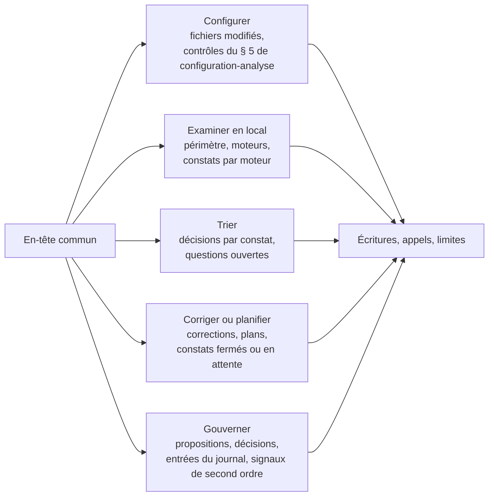

# Module `rapport` (D6)

Chaque intervention se termine par un rapport. Il doit permettre à un tiers de refaire les mêmes lectures et d'obtenir les mêmes chiffres (D6.INV-1, D6.INV-2).

## 1. En-tête commun

```markdown
# Rapport SonarQube : <mission(s)> sur <projet(s)>

- **Instance** : SonarQube Server <version>, édition <édition>, mode <MQR | standard>
- **Projet(s)** : `acme-api`, `acme-web`
- **Branche ou MR** : MR !412
- **Analyse de référence** : <date et heure de la dernière analyse, depuis l'API>
- **Quality gate** : <OK | ERROR> (<nom du gate>)
- **Compte utilisé** : compte Sonar du développeur (permissions : <liste>)
- **Écritures effectuées** : <nombre>, détaillées en § « Écritures »
```

## 2. Contenu par mission



### Examiner en local

- en-tête : `HEAD` examiné, branche cible et base de fusion, modifications non commitées éventuelles, moteurs retenus et où est parti le code ;
- si l'analyse éphémère a tourné : nom de la branche de travail, état du quality gate et mesures du nouveau code lus sur cette branche, confirmation de sa suppression ;
- tableau des constats avec une colonne **Moteur** (module `examen-local`, § 8) ; les constats de relecture portent leur niveau de confiance et ne figurent dans aucun total issu de l'API (D9.INV-1, D6.INV-2).

### Trier

| Clé | Règle | Emplacement | Qualité / gravité | Décision | Justification ou question | Invariant |
|---|---|---|---|---|---|---|
| AZ3k… | java:S6813 | `InvoiceService.java:14` | maintenabilité / moyenne | corriger (directe) | — | `java:D1.INV-3` |
| AZ3m… | java:S2077 | `OrderSearch.java:42` | revue de sécurité | décision humaine requise | analyse préparée, voir annexe | `java:D4.INV-4` |

### Corriger ou planifier

- corrections directes : constat, commit, test, état après analyse (fermé, ou en attente de la prochaine analyse) ;
- plans : identifiant, destinataire, constats couverts.

### Gouverner

- propositions et décisions (identifiants `G-nn` du journal) ;
- signaux de second ordre de la période (module `gouvernance`, § 6).

## 3. Écritures

Chaque écriture effectuée, avec sa validation :

| Appel | Paramètres (sans jeton) | Validé par | Résultat |
|---|---|---|---|
| `POST /api/issues/add_comment` | issue=AZ3n…, texte en annexe | <nom> | 200 |
| `POST /api/issues/do_transition` | issue=AZ3n…, transition=falsepositive | <nom> | 200 |

## 4. Appels de lecture et limites

- Liste des appels de lecture qui fondent les chiffres du rapport (chemin et paramètres, jamais le jeton).
- Limites : permissions manquantes, résultats tronqués, analyse non relancée après correction.

## 5. Pièges connus

- **Chiffre de mémoire** : « la couverture est d'environ 70 % » n'est pas admis ; seul le chiffre lu dans `measures/component` l'est (D6.INV-2).
- **Rapport sans branche** : un chiffre de la branche principale présenté comme celui de la MR fausse la décision.
- **Jeton dans les annexes** : les commandes recopiées en annexe ne contiennent jamais la valeur de `SONAR_TOKEN`.

## 6. Contrôle de sortie

- L'en-tête est complet (D6.INV-1).
- Chaque chiffre renvoie à un appel listé (D6.INV-2).
- Chaque écriture listée a sa validation.
- Aucune valeur de jeton dans le rapport.
