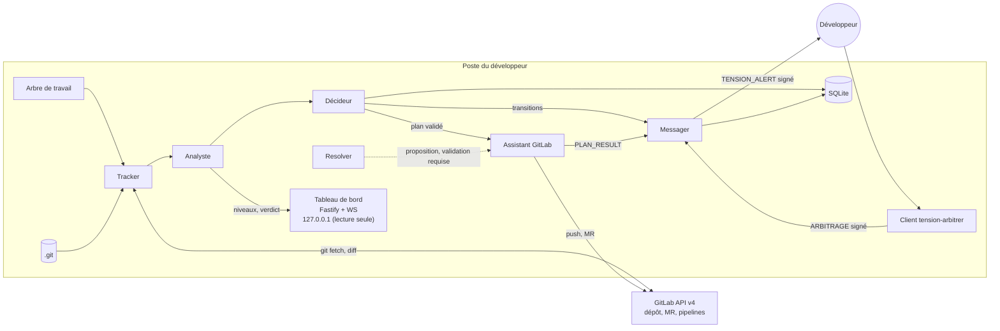
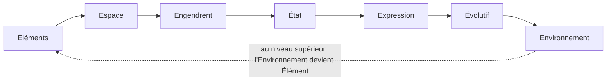

# Tension Dashboard & Assistant GitLab, spécification 2.2.0

Ce document est le point d'entrée du package. Il donne la vue d'ensemble, l'ordre de lecture, le registre des dimensions et les règles communes à tous les modules. Les détails techniques sont dans `modules/`. Le fichier `manifest.json` déclare quels modules sont actifs.

Versions antérieures : `archives/SKILL-v2.1.0.md` (monolithe) et `archives/SKILL-v2.0.0.md`.

## 1. Ordre de lecture

1. Ce document, sections 2 à 10.
2. `manifest.json` : modules actifs et réservés.
3. Les modules actifs, dans cet ordre :
   1. `modules/tension/SKILL.md` : calcul du delta, chevauchement, conflit, classes.
   2. `modules/etats/SKILL.md` : machine d'états et bornes de configuration.
   3. `modules/verdict-journal/SKILL.md` : journal, schéma SQLite, verdict de fenêtre.
   4. `modules/messagerie/SKILL.md` : enveloppe signée, client d'arbitrage.
   5. `modules/dashboard/SKILL.md` : tableau de bord en lecture seule.
   6. `modules/effecteur-gitlab/SKILL.md` : plan d'exécution, garde-fous, GitLab.
4. `regulation-inter-agents.md` : seulement pour comprendre les points d'extension. Ne pas l'implémenter en 2.x.

## 2. Mode de travail pour l'IA qui produit le code

1. Lisez tous les modules actifs avant d'écrire la moindre ligne de code.
2. Proposez le plan de fichiers et listez les choix non couverts par la spécification. Attendez la validation du développeur.
3. Implémentez par étapes : noyau pur (`tension`, `etats`), puis base et journal (`verdict-journal`), puis messagerie et client d'arbitrage, puis tableau de bord, puis effecteur GitLab. Chaque étape doit passer ses tests avant la suivante.
4. En cas d'ambiguïté, posez une question. N'inventez ni champ, ni endpoint, ni comportement absent de la spécification.
5. Les identifiants de code sont en anglais. Les commentaires, les messages destinés au développeur et les journaux sont en français.
6. Chaque module et chaque test cite l'invariant qu'il vérifie, par exemple `// D2.INV-1`. Un invariant sans test n'est pas implémenté.
7. N'implémentez aucun module au statut `reserved` dans `manifest.json`.

## 3. Objectif et carte du système

Le développeur voit en temps réel les fichiers sous tension entre ses modifications locales et la branche distante. Pour chaque fichier : le niveau de tension, le delta en caractères de chaque côté, la chronologie et une recommandation. Il choisit ainsi le meilleur moment pour pousser.

L'agent ne pousse jamais seul vers une branche partagée. Il exécute uniquement des plans validés.

## 4. Cycle 7E

L'énoncé de l'Axiome 7E est : « Les Éléments dans l'Espace Engendrent un État d'Expression Évolutif de l'Environnement ». Chaque phase correspond à un composant, à des tests et à des dimensions du registre.

| Phase | Rôle dans le système | Module | Dimensions |
|---|---|---|---|
| Éléments | fichiers, hunks, classes de fichiers | `tension` | D1 |
| Espace | ancêtre commun B, arbre de travail, `origin` | `tension` | D1 |
| Engendrent | chevauchement, conflit | `tension` | D1 |
| État | niveau par fichier, machine d'états, bornes | `etats` | D2 |
| Expression | alertes signées, arbitrage, tableau de bord | `messagerie`, `dashboard` | D3, D7 |
| Évolutif | horodatages, volatilité, verdict, journal | `verdict-journal` | D5, D6 |
| Environnement | GitLab, pipelines, autres développeurs | `effecteur-gitlab` | D4 |

Récursion : chaque phase peut devenir un cycle à son propre niveau. Le premier niveau à implémenter est le fichier. Les niveaux du dépôt et de la chaîne d'agents relèvent de la version 3.0 (dimensions D8 à D10).

Clause de second ordre : le tableau de bord influence le comportement du développeur. Le journal enregistre donc le verdict affiché et l'action choisie, au même niveau que les événements Git (D5.INV-1).

## 5. Registre des dimensions

Une dimension est un axe de la spécification, avec ses invariants et ses tests. Le statut indique si elle est implémentée dans la version courante.

| ID | Dimension | Introduite | Statut 2.2.0 | Dépend de | Module |
|---|---|---|---|---|---|
| D1 | Tension par fichier (Δ, chevauchement, conflit) | 1.0 | active | | `tension` |
| D2 | Machine d'états et bornes de configuration | 1.0 | active | D1 | `etats` |
| D3 | Messagerie signée et tableau de bord en lecture seule | 1.0 | active | D2 | `messagerie`, `dashboard` |
| D4 | Effecteur GitLab à garde-fous | 2.0 | active | D2, D6 | `effecteur-gitlab` |
| D5 | Verdict de fenêtre et clause de second ordre | 2.0 | active | D1, D2, D6 | `verdict-journal` |
| D6 | Journal en ajout seul et rejeu déterministe | 2.0 | active | | `verdict-journal` |
| D7 | Arbitrage humain par client signé | 2.1 | active | D3, D6 | `messagerie` |
| D8 | Communication directe inter-agents | 3.0 | reserved | D3, D6 | `regulation-inter-agents` |
| D9 | Régulation de second niveau (méta-niveau) | 3.0 | reserved | D6, D8 | `regulation-inter-agents` |
| D10 | Rapport de couplage et gestion des interblocages | 3.0 | reserved | D6, D8 | `regulation-inter-agents` |

Statuts : `active` (implémentée et testée), `reserved` (points d'extension posés, fonctionnalité absente), `superseded` (remplacée ; la version de remplacement est indiquée).

## 6. Contrat de version et points d'extension

### 6.1 Contrat

1. Chaque version déclare son numéro dans le frontmatter de ce document et dans `manifest.json`. Elle ajoute une entrée à la section 10.
2. Une version ajoute au moins une dimension ou un point d'extension. Sinon, c'est un correctif : seul le numéro de patch change.
3. Une dimension `reserved` ne passe à `active` que si ses invariants ont des tests dans la suite de la version.
4. Une dimension `active` ne sort du registre qu'en passant à `superseded`, avec la version de remplacement et une section de migration.
5. Un invariant ne s'affaiblit jamais. Il peut être remplacé par un invariant plus fort, signalé dans la section 10.
6. Le schéma SQLite évolue uniquement par migrations numérotées. Une migration publiée n'est jamais modifiée. Tant qu'aucune base n'a appliqué la migration 1, elle peut encore être complétée. Ce cas est signalé dans la section 10.
7. Chaque événement du journal porte `spec_version`. Un journal écrit dans une version reste rejouable dans toute version de la même famille majeure.
8. Avant de publier une nouvelle version, la précédente est archivée dans `archives/SKILL-vX.Y.Z.md`. Une archive n'est jamais éditée.

### 6.2 Points d'extension

Un point d'extension n'est pas une fonctionnalité. En 2.x, il n'a qu'un test qui prouve qu'il est inerte. La version 3.0 l'activera sans réécrire le code existant.

- **E1** : `journal.actor` est un ensemble ouvert. En 2.x, seules les valeurs `tracker`, `analyst`, `decider`, `messenger`, `assistant` et `developer` sont écrites. Les valeurs `meta` et `agent` sont réservées à D8 et D9, et refusées en écriture.
- **E2** : l'enveloppe signée réserve les champs `to` et `thread`. En 2.x, un message qui les porte est rejeté et journalisé `UNSUPPORTED_FIELD`.
- **E3** : la table `rules` est créée vide par la migration 1 et n'est lue par aucun composant en 2.x.
- **E4** : `src/core/bounds.js` déclare les bornes dans le code. Aucune source de configuration ne peut les modifier.
- **E5** : le dossier `reports/` est réservé à D10. Il n'est pas créé en 2.x.
- **E6** : le chargement des modules est piloté par `manifest.json`. Un module absent du manifeste, ou au statut `reserved`, n'est jamais chargé en 2.x.

## 7. Règles globales

- **Secrets** : `TENSION_HMAC_SECRET` et les tokens GitLab viennent de l'environnement ou d'un fichier en permissions 600. Ils n'apparaissent jamais dans le dépôt, dans `config.json`, dans les journaux, dans les messages ou dans les URL.
- **Réseau** : le tableau de bord et l'écoute des messages se font sur `127.0.0.1` par défaut. Les tests n'accèdent à aucun réseau.
- **Écriture** : seul l'effecteur écrit dans Git ou GitLab, et seulement à partir d'un plan validé. Le tracker ne modifie ni l'arbre de travail ni les branches locales. Seul `git fetch` met à jour les refs de suivi.
- **Journal** : chaque événement est en ajout seul, horodaté, versionné (`spec_version`) et tenu à jour sans lire l'horloge au moment du rejeu.
- **Langue** : identifiants en anglais ; commentaires, messages au développeur et journaux en français.

## 8. Critères d'acceptation globaux

- `npm test` passe, sans accès réseau.
- Chaque invariant de la section 9 apparaît dans au moins un test. Un script vérifie cette correspondance.
- `tension.js` n'importe ni `fs`, ni `child_process`, ni module réseau.
- Le serveur n'écoute que sur `127.0.0.1` par défaut.
- Aucun secret n'apparaît dans les journaux, les messages, le dépôt ou les URL.
- Aucun `--force` ni `--force-with-lease` dans le code de l'effecteur.
- Le mode dry-run est le défaut de l'effecteur.
- Le journal est en ajout seul, imposé par triggers.
- Un module `reserved` n'est pas chargé.

## 9. Invariants

Chaque invariant est vérifié par au moins un test de son module.

- **D1.INV-1** : un fichier modifié d'un seul côté est `mono_cote`, quel que soit son Δ, sauf `generated` (`exclu`).
- **D1.INV-2** : sans chevauchement ni conflit, un fichier n'est jamais `critique`, sauf `binary` ou `sensitive`.
- **D1.INV-3** : un fichier `binary` ou `sensitive` modifié des deux côtés est toujours `critique`.
- **D2.INV-1** : toute transition absente de la table du module `etats` est refusée et journalisée.
- **D2.INV-2** : un fichier `gelé` ne change d'état que par ARBITRAGE ou REMIND.
- **D2.INV-3** : une valeur de configuration hors bornes empêche le démarrage.
- **D3.INV-1** : un message dont la signature, l'horodatage ou le nonce est invalide n'a aucun effet.
- **D3.INV-2** : aucun secret n'apparaît dans les messages, les journaux ou le dépôt.
- **D3.INV-3** : le tableau de bord n'expose aucune route d'écriture.
- **D4.INV-1** : aucun commit déjà présent sur `origin` n'est réécrit.
- **D4.INV-2** : aucun fichier `gelé` n'est modifié par l'effecteur, ni dans l'arbre, ni dans les commits rejoués.
- **D4.INV-3** : la procédure 2.x n'emploie ni `--force` ni `--force-with-lease`.
- **D4.INV-4** : sans `--execute`, l'effecteur n'écrit rien.
- **D5.INV-1** : chaque verdict affiché et chaque action du développeur sont journalisés.
- **D6.INV-1** : la table `journal` n'accepte ni UPDATE ni DELETE.
- **D6.INV-2** : le rejeu d'un même journal produit exactement le même état final.
- **D7.INV-1** : aucun arbitrage n'est appliqué sans événement `DEV_ACTION` signé correspondant.

## 10. Journal de révision

**2.0.0** : spécification monolithique de l'agent, de l'effecteur GitLab et du tableau de bord. Archive : `archives/SKILL-v2.0.0.md`.

**2.1.0** : registre des dimensions D1 à D10, contrat de version, invariants `Dn.INV-k`, points d'extension E1 à E5, client d'arbitrage (D7), corrections du stash sur fichiers gelés, du statut du tracker, du seuil de volatilité paramétré, de `testCmd` sans shell et de la persistance des relances. Archive : `archives/SKILL-v2.1.0.md`.

**2.2.0** : passage en package modulaire avec `manifest.json` et modules par dimension. Ajout de schémas Mermaid (architecture, cycle 7E, machine d'états, séquences HMAC et GitLab, modèle de données). Ajout du point d'extension E6. Corrections :

- C12, confirmation de fusion : la version 2.1.0 imposait un `confirm_token` à usage unique sans lieu de stockage. La table `confirm_tokens` est ajoutée à la migration 1. Cette migration n'ayant encore été appliquée nulle part, elle peut être complétée (section 6.1, règle 6).
- C13, `merge-tree` : les noms de fichiers en conflit s'obtiennent avec `--name-only`. La disponibilité de cette option doit être vérifiée sur la version de Git installée.
- C14, détection des renommages : `git diff` est appelé avec `--no-renames` pour que les chemins de fichiers restent stables.
- C15, binaires : un fichier binaire est détecté par `git diff --numstat` (colonnes `-` et `-`), et non par heuristique sur le contenu.
- C16, canonicalisation : la sérialisation canonique suit RFC 8785 (JCS) de préférence. Une implémentation maison est acceptée si elle est testée contre des vecteurs de référence.
- C17, notation des scénarios : ceux de l'effecteur s'appellent G1 à G10. Le préfixe E désigne désormais uniquement les points d'extension, pour éviter toute confusion.
- C18, catalogue du journal : ajout de `EXECUTION_REFUSED` (refus de l'étape 0 ou d'une garde) et de `PIPELINE_RETRY` (compteur de relances lu dans le journal).
