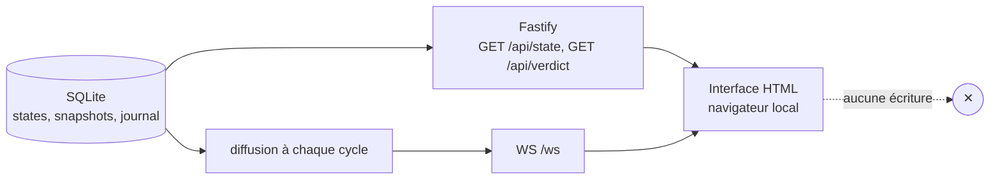

# Module `dashboard` (D3, volet tableau de bord)

Ce module présente l'état du système au développeur. Il ne calcule rien et n'écrit rien. Toute donnée affichée vient de la base ou de l'analyste.

Phase 7E couverte : Expression (côté visuel).

## 1. Principes

- **Lecture seule** : aucune route d'écriture (D3.INV-3). Les arbitrages passent par le client signé du module `messagerie`.
- **Aucun calcul** : le tableau de bord ne lance ni `git`, ni calcul de delta. Il consomme les états et les snapshots déjà produits.
- **Local par défaut** : écoute sur `127.0.0.1`. Un autre hôte exige une variable explicite `DASHBOARD_HOST`, et un avertissement dans le journal.
- **Accessible** : l'interface respecte les exigences RGAA 4.1 et WCAG 2.2 que le projet vise. La couleur n'est jamais le seul support d'information (critère 1.4.1).

## 2. Architecture



## 3. Routes et messages

| Méthode | Chemin | Rôle | Corps |
|---|---|---|---|
| GET | `/api/state` | état courant de chaque fichier | liste de `{file, state, level, deltaLocal, deltaRemote, since}` |
| GET | `/api/verdict` | verdict de fenêtre et séquence | `{verdict, sequence, computedAt}` |
| WS | `/ws` | diffusion à chaque cycle | `{type: "state", payload: ...}` ou `{type: "verdict", payload: ...}` |
| POST, PUT, PATCH, DELETE | toute route | refus | `405 Method Not Allowed`, aucun effet |

Exemple de message WebSocket :

```json
{
  "type": "state",
  "payload": {
    "file": "src/agents/orchestrator.ts",
    "state": "gelé",
    "level": "critique",
    "deltaLocal": { "insertions": 180, "suppressions": 40 },
    "deltaRemote": { "insertions": 210, "suppressions": 30 },
    "since": "2026-10-15T23:10:00Z"
  }
}
```

## 4. Mise en page

```text
VERDICT : 🔴 Attendre     calculé à 23:14:02     tStabMin = 10 min
Séquence : 1 intégrer le distant, 2 stable et mono_cote, 3 modéré, 4 critique

Niveau     Fichier                 Δ local      Δ distant    Dernier    Action
🔴 CRIT    src/agents/orch.ts      +180 −40     +210 −30     23:10      Arbitrage requis
🟡 MOD     src/api/routes.ts       +12 −3       +8 −1        22:40      Synchroniser
🟢 STAB    README.md               +4 −0        +0 −0        22:10      Pousser
⚪ EXCL    dist/bundle.js          —            —            —          Exclu
```

Le schéma ci-dessus est une maquette textuelle. La mise en page réelle est libre, à condition de respecter les colonnes obligatoires de la section 4 et l'accessibilité de la section 5.

Colonnes obligatoires : niveau, fichier, Δ local, Δ distant, dernière modification de chaque côté, volatilité (commits distants sur 24 h), recommandation, état de la machine.

## 5. Accessibilité

- **Niveau** : pictogramme, libellé textuel et couleur. Jamais la couleur seule (1.4.1).
- **Contraste** : 4,5:1 minimum pour le texte, 3:1 pour les pictogrammes et les contours (1.4.3, 1.4.11). Les trois couleurs doivent être vérifiées à la fois sur fond clair et sur fond sombre.
- **Clavier** : le tableau est navigable aux flèches, chaque ligne est atteignable au Tab, et le focus est visible (2.4.7).
- **Tableau** : `<table>` avec `<caption>`, `<th scope="col">`, et un résumé du niveau par ligne lu par les lecteurs d'écran.
- **Mises à jour** : les changements de niveau sont annoncés par une région `aria-live="polite"`, pas `assertive`, pour ne pas interrompre la lecture. Une alerte critique est annoncée une seule fois.
- **Mouvement** : pas d'animation au rafraîchissement, ou désactivée si `prefers-reduced-motion` est actif (2.3.3).

## 6. Pièges connus

- **Dépendance à l'analyste** : si l'analyste est en retard, le tableau affiche l'horodatage de son dernier calcul. Il ne l'efface jamais. Un indicateur « données anciennes » apparaît au-delà de deux cycles.
- **Reconnexion WebSocket** : après une coupure, le client redemande `/api/state` avant de recevoir les messages suivants, pour ne pas afficher un état partiel.
- **Données sensibles** : les noms de fichiers et les deltas exposés sont des informations de travail. L'écoute locale et l'absence de route d'écriture limitent l'exposition. Ne jamais afficher de contenu de fichier, seulement des métadonnées.
- **Fuseau horaire** : les horodatages sont stockés en UTC et affichés dans le fuseau du poste.

## 7. Tests (scénarios de rejeu)

| # | Situation | Attendu | Invariant |
|---|---|---|---|
| M6 | `POST`, `PUT`, `PATCH`, `DELETE` sur n'importe quelle route | `405`, aucune écriture en base | D3.INV-3 |
| B1 | `GET /api/state` après un cycle | liste conforme à la table `states` | |
| B2 | message WebSocket après un changement de niveau | un seul message `state` pour ce changement | |
| B3 | serveur démarré sans `DASHBOARD_HOST` | écoute sur `127.0.0.1` uniquement | |
| B4 | `DASHBOARD_HOST` = `0.0.0.0` | avertissement journalisé | |
| B5 | rendu d'un niveau en noir et blanc | le libellé et le pictogramme suffisent à lire le niveau | |
| B6 | fichier de niveau `critique` | annonce `aria-live="polite"` une seule fois | |

## 8. Fichiers à produire

- `src/dashboard/server.js` : création de l'application Fastify, routes, WebSocket.
- `src/dashboard/views/` : interface, sans dépendance de rendu lourde.
- `src/dashboard/serialize.js` : conversion des lignes de base en objets d'affichage, sans I/O.
- `test/dashboard.test.js` : routes, WebSocket sur un port aléatoire local, refus des écritures.
