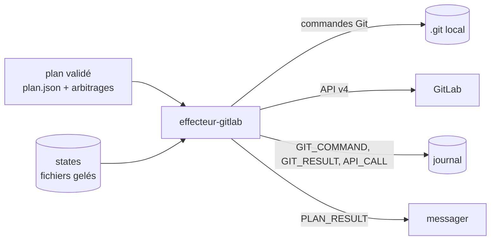
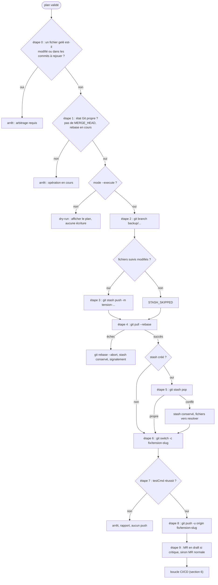
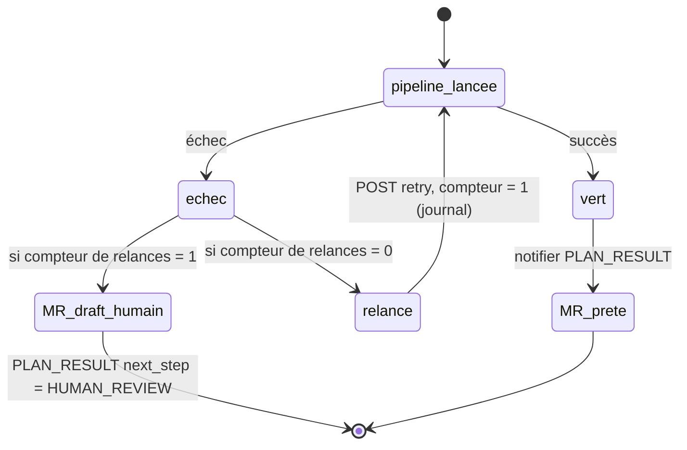

# Module `effecteur-gitlab` (D4)

Ce module est le seul autorisé à écrire dans Git ou GitLab. Il n'agit qu'à partir d'un plan validé par le développeur, ou par une règle explicitement configurée. Par défaut, il ne fait rien : c'est le mode dry-run.

Phase 7E couverte : Environnement.

## 1. Rôle dans le système



## 2. Séquence d'exécution



Le diagramme montre le chemin complet. Chaque étape journalise sa commande avant exécution, puis son résultat.

### 2.1 Détail des étapes

| Étape | Commande ou action | Garde | Écrit |
|---|---|---|---|
| 0 | calcul des fichiers gelés touchés | D4.INV-2 | rien |
| 1 | `git status --porcelain`, présence de `.git/MERGE_HEAD`, `rebase-merge`, `rebase-apply` | arbre et état Git | rien |
| 2 | `git branch backup/<branche>-<horodatage>` au SHA courant | sauvegarde avant toute écriture | une référence |
| 3 | `git stash push -m tension-<horodatage>` si des fichiers suivis sont modifiés | sinon `STASH_SKIPPED` | un stash |
| 4 | `git pull --rebase <remote> <branche>` | échec : `git rebase --abort`, pas de force | l'historique local |
| 5 | `git stash pop` si un stash existe | conflit : le stash n'est jamais supprimé | l'arbre |
| 6 | `git switch -c fix/tension-<slug>` depuis HEAD | pas de branche partagée | une branche |
| 7 | `testCmd` (liste d'arguments, sans shell) | doit réussir | rien |
| 8 | `git push -u <remote> fix/tension-<slug>` | branche nouvelle, donc sans force | le distant |
| 9 | `POST /projects/:id/merge_requests` | `Draft:` si un fichier était critique | GitLab |

### 2.2 Étape 0 : pré-vérification (détail)

```
gelés     = { fichiers avec states.state = 'gelé' }
arbre     = git status --porcelain (fichiers suivis)
base      = git merge-base HEAD <remote>/<branche>
rejoues   = git diff --name-only <base>..HEAD

si (gelés ∩ arbre) ≠ ∅  ou  (gelés ∩ rejoues) ≠ ∅ :
  refuser, afficher la liste, journaliser EXECUTION_REFUSED
```

Pourquoi cette étape existe : `git pull --rebase` exige un arbre propre, donc le stash porte sur tous les fichiers suivis modifiés. Un fichier gelé ne peut pas être protégé par un stash partiel. Il doit donc être bloqué en amont, et l'arbitrage doit être rendu avant toute exécution.

## 3. Garde-fous

- **Commits déjà publiés** : pour chaque commit de `git rev-list <remote>/<branche>..HEAD`, vérifier `git branch -r --contains <sha>`. Si ce commit est présent sur une autre branche distante, arrêter : il serait réécrit alors qu'il est partagé (D4.INV-1).
- **Branches protégées** : aucune fusion automatique dans `main`, `develop` ou toute branche protégée. La liste est lue dans la configuration.
- **Aucun force** : la procédure 2.x n'emploie ni `--force` ni `--force-with-lease`. Une branche nouvelle n'en a pas besoin (D4.INV-3). Le code est scanné pour le vérifier (G7).
- **Dry-run par défaut** : sans `--execute`, l'effecteur affiche le plan et n'écrit rien (D4.INV-4).
- **Journal avant exécution** : chaque commande est écrite dans le journal avant son lancement, avec ses arguments.
- **Restauration documentée** : la sortie indique la commande de restauration. Elle n'est jamais exécutée par l'agent.
- **Secrets** : aucun token dans une URL de dépôt. Utiliser un credential helper ou un en-tête HTTP `PRIVATE-TOKEN`.
- **Stash conservé** : un stash qui subsiste après un conflit n'est jamais effacé automatiquement.
- **Test avant push** : `testCmd` doit réussir avant l'étape 8.

### 3.1 Interdits (liste fermée)

| Interdit | Raison |
|---|---|
| `git push --force` et `--force-with-lease` | réécriture distante (D4.INV-3) |
| réécrire un commit présent sur une autre branche distante | commit partagé (D4.INV-1) |
| écrire sur un fichier au statut `gelé` | arbitrage non rendu (D4.INV-2) |
| `git stash drop` ou `git stash clear` par l'agent | perte possible de travail |
| `git reset --hard` par l'agent | perte possible de travail |
| fusion automatique dans une branche protégée | risque de régression partagée |
| `shell: true` pour `testCmd` | injection de commande |

## 4. Boucle CI/CD



- **Une seule relance**, et son compteur est lu dans le journal avant toute décision. Un redémarrage ne remet pas le compteur à zéro (scénario G5).
- **Aucun merge automatique**, jamais. Même une MR verte reste à la main du développeur.
- **MR en draft** si un fichier du plan était `critique` ou si la pipeline reste en échec.

## 5. API GitLab v4

| Opération | Méthode et chemin | Corps ou paramètres |
|---|---|---|
| Créer la MR | `POST /projects/:id/merge_requests` | `source_branch`, `target_branch`, `title` (préfixe `Draft:` si draft) |
| Lister les pipelines | `GET /projects/:id/merge_requests/:iid/pipelines` | |
| Relancer | `POST /projects/:id/pipelines/:pipeline_id/retry` | aucun |

Variables : `GITLAB_URL`, `GITLAB_PROJECT_ID`.

Tokens séparés :

- **Tracker** : `GITLAB_TOKEN_READ`, portée `read_repository`.
- **Effecteur** : `GITLAB_TOKEN_WRITE`, portées `api` et `write_repository`, expiration 30 jours.

Un token ne sort jamais du module. L'appel `API_CALL` journalise la méthode et le chemin, sans l'en-tête d'authentification.

## 6. Dry-run : exemple de sortie

```
MODE DRY-RUN (aucune écriture). Pour exécuter : --execute
Plan : fix/tension-orchestrator-delta, depuis main
  [0] pré-vérification ..................... OK (aucun fichier gelé touché)
  [1] état Git ............................. OK
  [2] git branch backup/feature-x-20261016T0014 (SHA a1b2c3d)
  [3] git stash push -m tension-20261016T0014 (3 fichiers suivis)
  [4] git pull --rebase origin feature-x
  [5] git stash pop
  [6] git switch -c fix/tension-orchestrator-delta
  [7] npm test (liste d'arguments, sans shell)
  [8] git push -u origin fix/tension-orchestrator-delta
  [9] MR draft : non (aucun fichier critique)
Restauration si nécessaire : git reset --hard backup/feature-x-20261016T0014
  (à exécuter par le développeur uniquement)
```

## 7. Rétro-signalement

```json
{
  "event": "PLAN_RESULT",
  "branch": "fix/tension-orchestrator-delta",
  "mr_iid": 42,
  "mr_state": "draft",
  "pipeline_status": "failed",
  "retries": 1,
  "next_step": "HUMAN_REVIEW"
}
```

Valeurs de `next_step` : `NONE` (MR prête), `HUMAN_REVIEW` (échec persistant). Aucune autre valeur n'est définie en 2.x.

## 8. Pièges connus

- **Conflit au pop après un rebase réussi** : le stash est conservé, et les fichiers en conflit passent au resolver. L'effecteur ne tente pas de les résoudre lui-même.
- **Fichiers non suivis** : ils ne sont pas stashés. Si le rebase les heurte, Git refuse, et l'effecteur s'arrête sans rien toucher.
- **Relance du compteur** : un redémarrage sans lecture du journal permettrait une relance infinie. Le compteur doit toujours être relu.
- **Branche déjà existante** : `git switch -c fix/tension-<slug>` échoue si la branche existe. L'effecteur doit alors arrêter, et ne jamais la supprimer.
- **Shell et arguments** : `testCmd` en liste d'arguments évite les injections. Ne jamais concaténer de chaîne pour construire la commande.

## 9. Tests (scénarios de rejeu)

| # | Situation | Attendu | Invariant |
|---|---|---|---|
| G1 | fichier gelé modifié dans l'arbre | refus à l'étape 0, aucune commande d'écriture | D4.INV-2 |
| G2 | plan valide, sans `--execute` | plan affiché, aucune écriture | D4.INV-4 |
| G3 | commit de la plage présent sur une autre branche distante | arrêt, aucune réécriture | D4.INV-1 |
| G4 | arbre propre | `STASH_SKIPPED`, aucun stash créé | |
| G5 | un échec de pipeline déjà relancé (compteur à 1 dans le journal), puis redémarrage | aucune seconde relance | |
| G6 | conflit au `stash pop` | stash conservé, fichiers transmis au resolver | |
| G7 | analyse statique du code de l'effecteur | aucune occurrence de `--force` ni `--force-with-lease` | D4.INV-3 |
| G8 | fichier `generated` en conflit au rebase | traitement par régénération signalé, jamais fusion manuelle | |
| G9 | `testCmd` en chaîne au lieu d'une liste | refus au démarrage | D2.INV-3 |
| G10 | branche `fix/tension-...` déjà existante | arrêt, la branche n'est pas supprimée | |

Chaque scénario utilise un dépôt temporaire, créé par le test, avec un remote local (chemin de fichier). Aucun test n'accède à GitLab réel : l'API est simulée.

## 10. Fichiers à produire

- `src/assistant/gitlab.js` : orchestration des étapes, dry-run, journalisation.
- `src/assistant/git-ops.js` : fonctions Git d'écriture, une par commande, avec garde.
- `src/assistant/gitlab-api.js` : client API v4, sans logs de token.
- `src/assistant/guards.js` : pré-vérification (étape 0), commits publiés, branches protégées.
- `test/effecteur.test.js`, `test/guards.test.js`, `test/static-scan.test.js` (G7).
