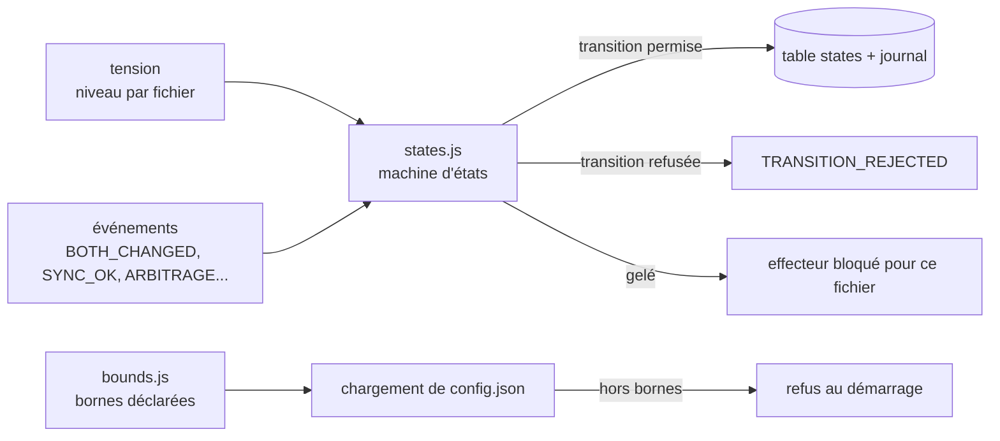
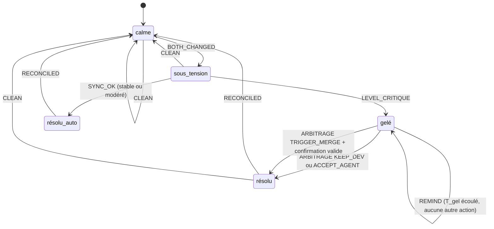

# Module `etats` (D2)

Ce module répond à deux questions : dans quel état se trouve chaque fichier, et quelles transitions sont permises. Il vérifie aussi que la configuration reste dans les bornes autorisées.

Phase 7E couverte : État.

## 1. Vue d'ensemble



## 2. Machine d'états par fichier



Note sur le diagramme : `CLEAN` est valable depuis tous les états. Il est omis sur les autres arcs pour la lisibilité, et doit être implémenté comme une transition générique.

### 2.1 Table des transitions

| De | Événement | Garde | Vers | Action |
|---|---|---|---|---|
| calme | BOTH_CHANGED | aucune | sous_tension | journaliser |
| sous_tension | LEVEL_CRITIQUE | niveau = critique | gelé | geler le fichier pour l'effecteur, émettre `TENSION_ALERT` |
| sous_tension | SYNC_OK | niveau ∈ {stable, modere} | résolu_auto | journaliser |
| résolu_auto | RECONCILED | aucune | calme | journaliser |
| gelé | ARBITRAGE | choix ∈ {KEEP_DEV, ACCEPT_AGENT} | résolu | appliquer le choix, lever le gel |
| gelé | ARBITRAGE | choix = TRIGGER_MERGE et confirmation valide | résolu | lancer le resolver dans une branche temporaire |
| gelé | REMIND | `tGelMin` écoulé | gelé | émettre un rappel, rien d'autre |
| résolu | RECONCILED | aucune | calme | journaliser |
| tout état | CLEAN | fichier identique des deux côtés | calme | journaliser |

Toute combinaison absente de la table est refusée : journaliser `TRANSITION_REJECTED` avec l'état, l'événement et le fichier, puis ne rien modifier (D2.INV-1).

### 2.2 Règles du gel

- **Par fichier** : le gel ne touche jamais les autres fichiers. Un fichier gelé ne bloque pas le travail sur les autres.
- **Persistant** : l'état `gelé` est écrit dans la table `states` dans la même transaction que son événement. Un redémarrage ne lève pas le gel.
- **Sans transition automatique** : un fichier gelé ne change d'état que par ARBITRAGE (D2.INV-2). Le rappel `REMIND` reste dans le même état. Il ne lève jamais le gel.
- **Protégé en aval** : l'effecteur consulte cette table avant toute opération (module `effecteur-gitlab`, D4.INV-2).

## 3. Bornes de configuration

Les bornes sont déclarées dans le code, dans `src/core/bounds.js` (point d'extension E4). Aucune source de configuration ne peut les modifier.

```js
// src/core/bounds.js — déclarées dans le code, jamais lues depuis la configuration
export const BOUNDS = Object.freeze({
  seuil:            { min: 150, max: 500, defaut: 300 },
  tStabMin:         { min: 5,   max: 30,  defaut: 10 },
  tGelMin:          { min: 15,  max: 120, defaut: 30 },
  tVolatileH:       { min: 6,   max: 72,  defaut: 24 },
  fetchIntervalSec: { min: 30,  max: 300, defaut: 60 },
});
```

Validation au chargement :

```
pour chaque clé k de BOUNDS :
  si config[k] est absent → utiliser defaut
  sinon si config[k] n'est pas un entier, ou hors [min, max] → ERREUR_CONFIG, arrêt au démarrage
journaliser CONFIG_LOADED avec les valeurs retenues
```

Une valeur hors bornes empêche le démarrage (D2.INV-3). Le message d'erreur indique la clé, la valeur reçue et les bornes.

Pour `testCmd`, la validation vérifie qu'il s'agit d'une liste de chaînes. Une chaîne seule est refusée (D2.INV-3). Le module `effecteur-gitlab` l'exécute sans shell.

## 4. Pièges connus

- **Gel perdu au redémarrage** : si `states` n'est pas persisté avant l'envoi de `TENSION_ALERT`, un redémarrage peut réémettre l'alerte ou lever le gel. Écrire d'abord, émettre ensuite.
- **Doubles événements** : un même `BOTH_CHANGED` reçu deux fois ne doit pas produire deux transitions. Le module traite les événements de façon idempotente, à partir de l'identifiant d'événement.
- **Transitions concurrentes** : deux événements sur le même fichier doivent être sérialisés. Une transaction SQLite par événement suffit en mono-poste.
- **Bornes et valeurs par défaut** : la valeur par défaut doit toujours appartenir à l'intervalle borné. Un test le vérifie pour chaque clé.

## 5. Tests (scénarios de rejeu)

### 5.1 Scénarios de transitions

| # | Séquence d'événements | État final | Invariant |
|---|---|---|---|
| T1 | BOTH_CHANGED, LEVEL_CRITIQUE, ARBITRAGE KEEP_DEV, puis RECONCILED | calme | |
| T2 | BOTH_CHANGED, SYNC_OK, RECONCILED | calme | |
| T3 | BOTH_CHANGED, LEVEL_CRITIQUE, REMIND | gelé (inchangé) | D2.INV-2 |
| T4 | ARBITRAGE sans BOTH_CHANGED préalable | refusé, `TRANSITION_REJECTED` | D2.INV-1 |
| T5 | ARBITRAGE TRIGGER_MERGE sans confirmation | refusé | D7.INV-1 |
| T6 | BOTH_CHANGED sur un fichier déjà gelé | refusé, `TRANSITION_REJECTED` | D2.INV-1 |
| T7 | BOTH_CHANGED, LEVEL_CRITIQUE, redémarrage du processus, puis REMIND | gelé, toujours persistant | D2.INV-2 |
| T8 | BOTH_CHANGED reçu deux fois | une seule transition, une entrée de journal | |

### 5.2 Scénarios de configuration

| # | Entrée | Attendu | Invariant |
|---|---|---|---|
| C1 | `seuil` = 600 | refus au démarrage | D2.INV-3 |
| C2 | `testCmd` = `"npm test"` (chaîne) | refus au démarrage | D2.INV-3 |
| C3 | `tVolatileH` absent | valeur par défaut 24 retenue, journalisée | D2.INV-3 |
| C4 | `fetchIntervalSec` = 30 (borne basse) | accepté | D2.INV-3 |
| C5 | valeur par défaut hors de son intervalle (test sur `BOUNDS`) | échec du test | D2.INV-3 |

## 6. Fichiers à produire

- `src/core/states.js` : table des transitions, fonction `applyEvent(state, event, guards)` qui retourne la nouvelle valeur ou un refus.
- `src/core/bounds.js` : constante `BOUNDS` et `validateConfig(config)`.
- `test/states.test.js`, `test/bounds.test.js` : scénarios T1 à T8 et C1 à C5.
