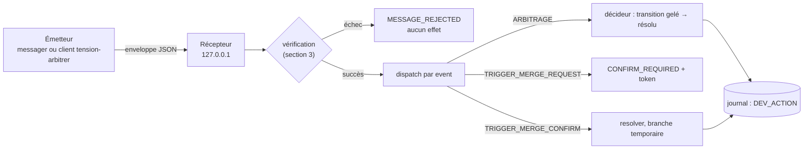
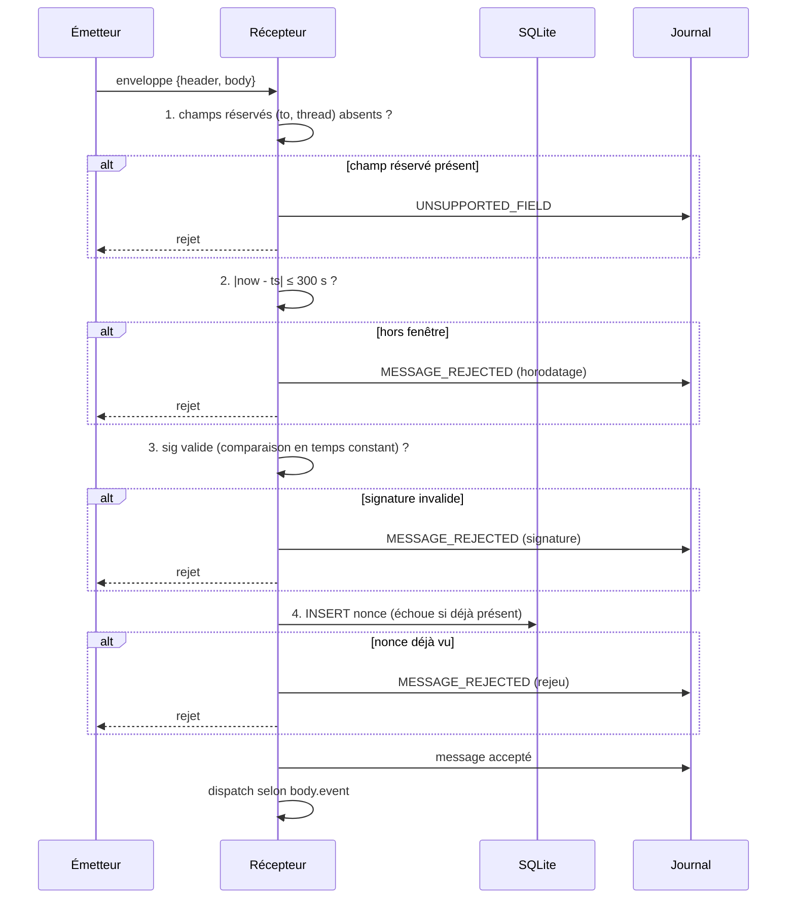
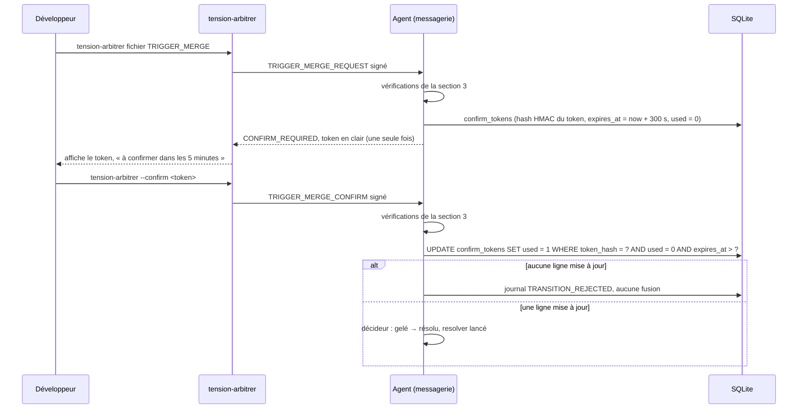

# Module `messagerie` (D3, D7)

Ce module définit comment un message entre dans le système, comment il est vérifié, et comment le développeur peut répondre à une alerte. Un message qui n'a pas passé la vérification n'a aucun effet. C'est la règle la plus importante de ce module.

Phase 7E couverte : Expression.

## 1. Vue d'ensemble



## 2. Enveloppe

```json
{
  "header": { "ts": "2026-10-15T23:10:00Z", "nonce": "b3f1c2...", "sig": "9a4e..." },
  "body": { "event": "ARBITRAGE", "file": "src/agents/orchestrator.ts", "choice": "KEEP_DEV" }
}
```

- `ts` : horodatage ISO 8601 UTC.
- `nonce` : 16 octets aléatoires, en hexadécimal, à usage unique.
- `sig` : `HMAC-SHA256(secret, canonicalJSON(body) + ts + nonce)`, en hexadécimal.
- `canonicalJSON` : RFC 8785 (JCS) de préférence. Une implémentation maison est acceptée si elle est testée contre des vecteurs de référence.
- Champs réservés en 2.x : `to` et `thread` (point E2). Un message qui les porte est rejeté.

## 3. Vérification (ordre strict)



Points à respecter :

- **Le nonce n'est inséré qu'après une signature valide.** Sinon, un émetteur non authentifié pourrait remplir la table `nonces` à volonté.
- **La comparaison de signature est en temps constant** (`crypto.timingSafeEqual`). Les deux buffers doivent avoir la même longueur. Vérifier la longueur avant la comparaison, et rejeter si elle diffère.
- **Purge des nonces** : supprimer les nonces dont `seen_at` dépasse 300 s.
- **Secret** : `TENSION_HMAC_SECRET` dans l'environnement, ou fichier en permissions 600. Le secret n'est jamais journalisé, même partiellement.

## 4. Catalogue des messages

| Événement | Sens | Corps | Effet |
|---|---|---|---|
| `TENSION_ALERT` | agent → développeur | fichier, niveau, delta, chronologie, action recommandée | notification, aucune action |
| `ARBITRAGE` | développeur → agent | `file`, `choice` ∈ {`KEEP_DEV`, `ACCEPT_AGENT`} | transition `gelé` → `résolu` |
| `TRIGGER_MERGE_REQUEST` | développeur → agent | `file` | répond `CONFIRM_REQUIRED` avec un token, aucune fusion |
| `CONFIRM_REQUIRED` | agent → développeur | `file`, `confirm_token`, `expires_in_s` = 300 | affiché une seule fois |
| `TRIGGER_MERGE_CONFIRM` | développeur → agent | `file`, `confirm_token` | seul message qui déclenche la fusion |
| `DEV_ACTION` | journal | action, fichier, verdict affiché | journalisation (D5, D7) |
| `PLAN_RESULT` | agent → développeur | section 9 du module `effecteur-gitlab` | notification |

Message entrant d'un type inconnu : rejet, `MESSAGE_REJECTED` avec le motif `UNKNOWN_EVENT`.

## 5. Confirmation de fusion à deux temps

La fusion est l'action la plus risquée du système. Elle exige deux messages distincts, séparés par une confirmation humaine.



- Le token est généré par `crypto.randomBytes(32)`. Seul son HMAC est stocké.
- Un token est à usage unique. Le second usage échoue par la condition `used = 0`.
- Un token expiré ne sert plus. Le développeur doit relancer `TRIGGER_MERGE_REQUEST`.

## 6. Client d'arbitrage `tension-arbitrer` (D7)

Le tableau de bord est en lecture seule (D3.INV-3). Le client est le seul canal par lequel le développeur répond à une alerte.

```
tension-arbitrer <fichier> KEEP_DEV
tension-arbitrer <fichier> ACCEPT_AGENT
tension-arbitrer <fichier> TRIGGER_MERGE        # affiche un token à confirmer
tension-arbitrer --confirm <token>               # exécute la fusion après confirmation
```

- Le client signe chaque message avec le même protocole que le messager (section 2).
- Il lit le secret comme le messager. Il ne l'affiche jamais, même en cas d'erreur.
- Il n'agit que sur un fichier au statut `gelé`. Sinon, il affiche le statut et n'envoie rien, pour éviter un arbitrage sur un fichier qui n'attend rien.
- Chaque commande produit un événement `DEV_ACTION` côté agent, qui contient le verdict affiché au moment de l'action (D7.INV-1, D5.INV-1).

## 7. Pièges connus

- **Rejeu entre redémarrages** : la table `nonces` doit être persistante. Un cache en mémoire permettrait de rejouer un message après un redémarrage.
- **Horloge désynchronisée** : une horloge décalée de plus de 300 s rejette tous les messages légitimes. Journaliser l'écart observé, et signaler le problème au développeur plutôt que d'élargir la fenêtre.
- **Token dans les logs** : le `confirm_token` ne doit apparaître que dans la sortie du client, jamais dans le journal.
- **Confirmation rejouée** : le même token, présenté deux fois, doit échouer la seconde fois. Ce cas est testé (M7 ci-dessous).

## 8. Tests (scénarios de rejeu)

### 8.1 Vérification des messages (D3)

| # | Entrée | Attendu | Invariant |
|---|---|---|---|
| M1 | signature altérée | rejeté, `MESSAGE_REJECTED`, aucun effet | D3.INV-1 |
| M2 | nonce déjà vu | rejeté, aucun effet | D3.INV-1 |
| M3 | horodatage à plus de 300 s | rejeté, aucun effet | D3.INV-1 |
| M4 | champ `to` présent | rejeté, `UNSUPPORTED_FIELD` | D3.INV-1 |
| M5 | le journal et les messages sont inspectés après un échec de signature | aucune valeur de `TENSION_HMAC_SECRET` | D3.INV-2 |
| M6 | nonce présenté avec une signature invalide | nonce non inséré dans `nonces` | D3.INV-1 |
| M7 | `TRIGGER_MERGE_CONFIRM` avec un token déjà utilisé | rejeté, aucune fusion | D7.INV-1 |
| M8 | `TRIGGER_MERGE_CONFIRM` après expiration du token | rejeté, aucune fusion | D7.INV-1 |

### 8.2 Client d'arbitrage (D7)

| # | Situation | Attendu | Invariant |
|---|---|---|---|
| A1 | ARBITRAGE sans signature valide | rejeté, aucun effet | D3.INV-1 |
| A2 | ARBITRAGE valide sur un fichier gelé | `DEV_ACTION` journalisé avec le verdict affiché | D7.INV-1 |
| A3 | `tension-arbitrer` sur un fichier non gelé | aucun message envoyé, statut affiché | D7.INV-1 |
| A4 | le client affiche une erreur quelconque | aucune valeur de secret dans la sortie | D3.INV-2 |

## 9. Fichiers à produire

- `src/agents/messenger.js` : réception, vérification (section 3), dispatch, émission de `TENSION_ALERT`.
- `src/core/envelope.js` : canonicalisation, calcul et vérification de la signature, sans I/O.
- `src/cli/tension-arbitrer.js` : client d'arbitrage.
- `test/messenger.test.js`, `test/envelope.test.js`, `test/arbitrer.test.js`.
