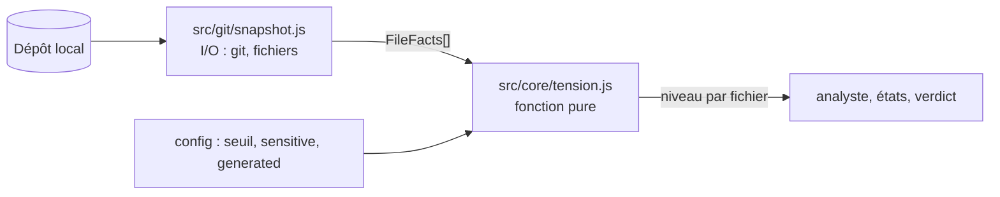
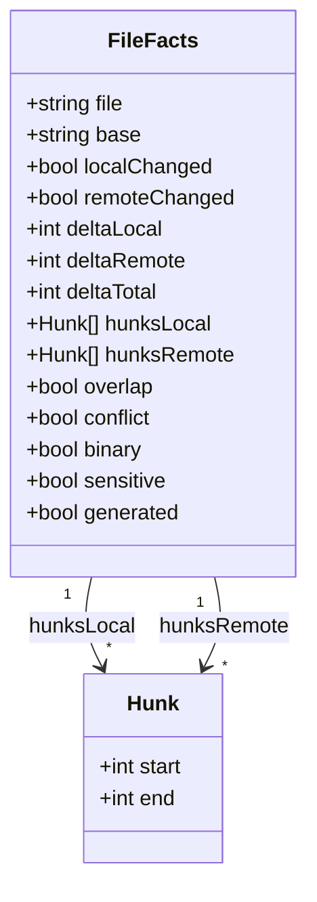
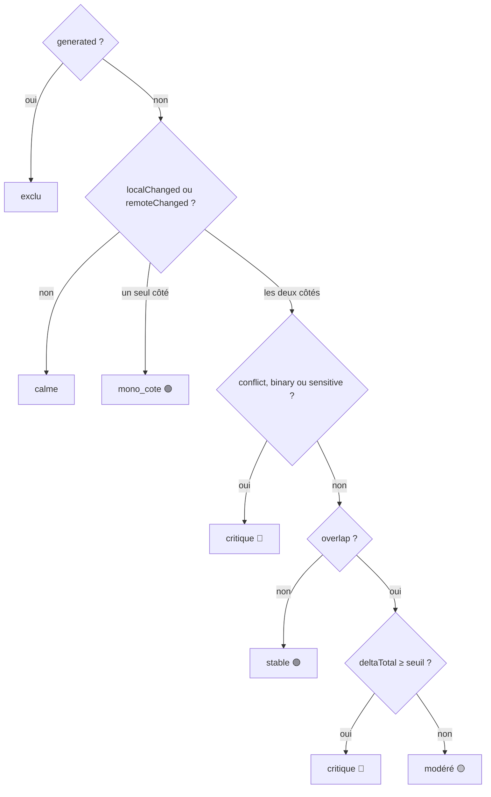

# Module `tension` (D1)

Ce module répond à une question : pour chaque fichier, qu'est-ce qui diverge entre le local et le distant, et est-ce que cela se réconcilie sans risque ?

Phases 7E couvertes : Éléments, Espace, Engendrent.

## 1. Entrées et sorties



- `snapshot.js` lit Git et le système de fichiers. Il produit des `FileFacts`.
- `tension.js` ne fait aucune entrée-sortie. Il prend des `FileFacts` et une configuration, et retourne un niveau. Il est testable sans dépôt.

## 2. Modèle de données (`FileFacts`)



| Champ | Signification |
|---|---|
| `file` | chemin relatif à la racine du dépôt |
| `base` | SHA de l'ancêtre commun B, ou `null` si le fichier est absent de B |
| `localChanged` | `git diff B` (arbre de travail, commits locaux inclus) est non vide pour ce fichier |
| `remoteChanged` | `git diff B origin/<branche>` est non vide pour ce fichier |
| `deltaLocal`, `deltaRemote` | caractères insérés plus supprimés, mesurés depuis B |
| `deltaTotal` | `deltaLocal + deltaRemote` |
| `hunksLocal`, `hunksRemote` | intervalles de lignes exprimés dans les coordonnées de B |
| `overlap` | au moins un hunk local chevauche un hunk distant |
| `conflict` | `git merge-tree` signale ce fichier en conflit |
| `binary`, `sensitive`, `generated` | classes issues de la configuration et de Git |

## 3. Calcul du delta

### 3.1 Algorithme

```
entrée : B (SHA), côté ∈ {local, remote}
1. diff = git diff --no-color --no-renames --no-ext-diff -U0 B [origin/<branche>]
   (sans origin/<branche> pour le côté local : la comparaison se fait avec l'arbre de travail)
2. pour chaque fichier de diff :
   a. si git diff --numstat indique "-" "-" → binary = vrai, delta = 0, passer au suivant
   b. pour chaque ligne du corps du hunk :
      - ignorer les lignes qui commencent par "+++", "---" ou "\"
      - si la ligne commence par "+" ou "-" : compter len([...ligne[1:-1]]) caractères
        (points de code Unicode, sans le signe ni le caractère de fin de ligne)
   c. delta_côté = somme des comptes de tous les hunks
   d. pour chaque en-tête @@ -a,b +c,d @@ : produire un intervalle sur B (voir 3.2)
```

### 3.2 Intervalles de hunks

- En-tête `@@ -a,b +c,d @@` :
  - si `b > 0` : intervalle `[a, a + b − 1]` ;
  - si `b = 0` (insertion pure après la ligne `a`) : intervalle `[a, a + 1]`.
- Deux intervalles X et Y se chevauchent si `X.start ≤ Y.end + 1` et `Y.start ≤ X.end + 1`. Les hunks adjacents comptent donc comme chevauchement, comme pour Git.

Cas de test :

| Hunk A | Hunk B | Résultat | Raison |
|---|---|---|---|
| `[1,3]` | `[4,5]` | chevauchement | adjacents |
| `[1,3]` | `[5,6]` | pas de chevauchement | ligne 4 libre |
| insertion après 3, soit `[3,4]` | `[6,8]` | pas de chevauchement | |

### 3.3 Exemple travaillé

Diff local sur `src/a.ts` (une ligne remplacée, une ligne ajoutée) :

```diff
@@ -10,2 +10,3 @@
-const a = 1;
+const a = 2;
+const b = 3;
```

- Intervalle sur B : `b = 2`, donc `[10, 10 + 2 − 1] = [10, 11]`.
- Caractères : `const a = 1;` compte 12, `const a = 2;` compte 12, `const b = 3;` compte 12.
- `deltaLocal` = 12 (supprimé) + 12 (ajouté) + 12 (ajouté) = **36**.

Ce cas est une vérification unitaire : le module doit retourner exactement 36 et l'intervalle `[10, 11]`.

## 4. Calcul de la tension

### 4.1 Conflit

```bash
git merge-tree --write-tree --name-only <local> <remote>
# code 0 : fusion propre
# code 1 : conflits, les noms des fichiers conflictuels suivent l'identifiant d'arbre
```

- `conflict` vaut vrai si le fichier figure dans la liste.
- Un conflit modify/delete compte comme conflit.
- Vérifier la présence de `--name-only` avec `git merge-tree -h` sur la version installée. Si l'option manque, extraire les noms depuis la sortie complète et le documenter.

### 4.2 Chevauchement

- `overlap` est calculé à partir des hunks, sans appel à Git. C'est une estimation rapide.
- `merge-tree` fait foi pour `conflict`. Le chevauchement sert à classer les fichiers qui fusionnent proprement.

## 5. Classes de fichiers

Configuration (globs, évalués avant tout calcul) :

- `generated` : lock files, `dist/**`. Exclus du delta et de l'affichage de tension.
- `binary` : détecté par `--numstat`. Aucun delta en caractères.
- `sensitive` : migrations, configuration de sécurité, secrets de déploiement. Toute tension est critique.

## 6. Niveaux de tension

`classify(file, config)` est une fonction pure. Les règles s'évaluent dans cet ordre, et la première qui correspond l'emporte.



| Ordre | Condition | Niveau | Invariant |
|---|---|---|---|
| 1 | `generated` | `exclu` | D1.INV-1 |
| 2 | ni local ni distant modifié | `calme` | |
| 3 | un seul côté modifié, y compris `sensitive` | `mono_cote` | D1.INV-1 |
| 4 | `conflict`, `binary` ou `sensitive` (les deux côtés modifiés) | `critique` | D1.INV-3 |
| 5 | pas de chevauchement | `stable`, quel que soit le delta | D1.INV-2 |
| 6 | `deltaTotal ≥ seuil` (300 par défaut) | `critique` | |
| 7 | sinon | `modere` | |

Un fichier de 1 000 caractères modifié dans une zone sans chevauchement reste stable. L'indicateur de volume s'affiche, mais aucune alerte n'est émise.

## 7. Pièges connus

- **Fichier `generated` en conflit** : il est exclu du calcul, mais Git le signale au rebase. L'effecteur doit alors le traiter par régénération, jamais par fusion manuelle. Ce cas doit figurer dans les tests de l'effecteur.
- **Renommages** : sans `--no-renames`, un fichier renommé peut apparaître sous deux chemins et fausser le calcul (C14).
- **Fin de ligne** : un changement de fins de ligne (CRLF/LF) produit un delta énorme pour un contenu inchangé. Prévoir un test, et signaler ce cas au développeur plutôt que de le classer critique silencieusement.
- **Encodage** : compter en points de code Unicode (`[...s].length`), pas en octets ni en unités UTF-16.
- **Chemins** : `git diff` peut quoter les chemins contenant des caractères spéciaux. Utiliser `-z` ou `core.quotePath=false` et normaliser.
- **Fichier absent de B** : `base` vaut `null`. Le delta est alors la totalité du fichier, et le chevauchement est faux par définition. Un fichier nouveau des deux côtés est un conflit potentiel, à traiter comme `critique` par la règle 4 si `merge-tree` le signale.

## 8. Tests (scénarios de rejeu)

| # | Entrée | Attendu | Invariant |
|---|---|---|---|
| 1 | `generated`, modifié des deux côtés | `exclu` | D1.INV-1 |
| 2 | rien modifié | `calme` | |
| 3 | un seul côté, 1 000 caractères | `mono_cote` | D1.INV-1 |
| 4 | deux côtés, pas de chevauchement, Δ 800 | `stable` | D1.INV-2 |
| 5 | deux côtés, chevauchement, Δ 120, fusion propre | `modere` | |
| 6 | deux côtés, chevauchement, Δ 340, fusion propre | `critique` | |
| 7 | deux côtés, conflit, Δ 10 | `critique` | |
| 8 | `binary`, deux côtés | `critique` | D1.INV-3 |
| 9 | `sensitive`, deux côtés, pas de chevauchement | `critique` | D1.INV-3 |
| 10 | chevauchement, Δ = 300 exactement, fusion propre | `critique` | |
| 11 | chevauchement, Δ = 299, fusion propre | `modere` | |
| 12 | `sensitive`, un seul côté modifié | `mono_cote` | D1.INV-1 |
| 13 | exemple travaillé de la section 3.3 | Δ = 36, intervalle `[10, 11]` | |
| 14 | paires de hunks de la section 3.2 | chevauchement, pas de chevauchement, pas de chevauchement | |

Chaque test de `tension.js` est unitaire et sans I/O. Les scénarios 13 et 14 testent aussi `snapshot.js` sur un dépôt temporaire créé par le test.

## 9. Fichiers à produire

- `src/core/model.js` : types `FileFacts`, `Hunk`, énumérations des niveaux.
- `src/core/tension.js` : `classify`, `overlaps`, sans I/O.
- `src/git/snapshot.js` : appels Git, lecture des `FileFacts`, création de dépôts temporaires pour les tests.
- `test/tension.test.js`, `test/snapshot.test.js` : `node:test`, aucun réseau.
