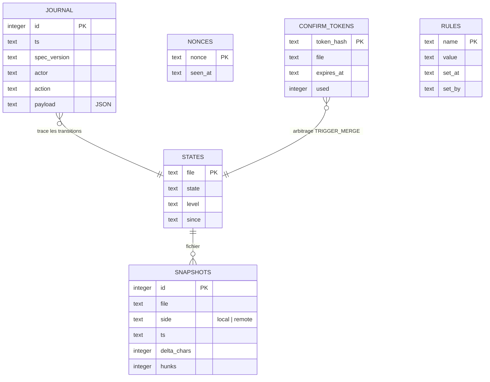
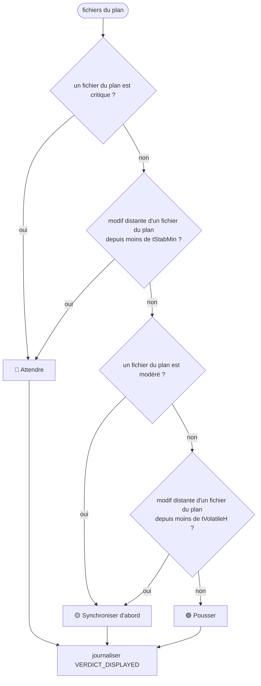

# Module `verdict-journal` (D5, D6)

Ce module tient deux rôles. Il persiste tout ce qui s'est passé, dans un journal qui ne s'efface jamais. Il calcule aussi le verdict affiché au développeur : c'est la sortie visible qui influence son choix, donc qui doit être journalisée (clause de second ordre).

Phases 7E couvertes : Évolutif, et l'Expression du verdict.

## 1. Modèle de données



`RULES` est réservée à la dimension D9 et reste vide en 2.x (point E3).

## 2. Migrations

Version de schéma : `PRAGMA user_version`.

```
au démarrage :
  v = PRAGMA user_version
  pour chaque migration m (numérotée) avec m > v, dans l'ordre :
    BEGIN;
    exécuter le SQL de m;
    PRAGMA user_version = m;
    COMMIT;
```

Une migration publiée n'est jamais modifiée. Une évolution future ajoute une migration 2, 3, etc. Tant que la migration 1 n'a été appliquée nulle part, elle peut être complétée (section 6.1, règle 6 du point d'entrée).

### 2.1 Migration 1 (base 2.2.0)

```sql
CREATE TABLE snapshots (
  id INTEGER PRIMARY KEY,
  file TEXT NOT NULL,
  side TEXT NOT NULL CHECK (side IN ('local', 'remote')),
  ts TEXT NOT NULL,
  delta_chars INTEGER NOT NULL,
  hunks INTEGER NOT NULL
);

CREATE TABLE states (
  file TEXT PRIMARY KEY,
  state TEXT NOT NULL,
  level TEXT NOT NULL,
  since TEXT NOT NULL
);

CREATE TABLE journal (
  id INTEGER PRIMARY KEY,
  ts TEXT NOT NULL,
  spec_version TEXT NOT NULL,
  actor TEXT NOT NULL,   -- ensemble ouvert, point E1 du point d'entrée
  action TEXT NOT NULL,
  payload TEXT NOT NULL  -- JSON
);

CREATE TRIGGER journal_no_update BEFORE UPDATE ON journal
BEGIN SELECT RAISE(ABORT, 'journal en ajout seul'); END;

CREATE TRIGGER journal_no_delete BEFORE DELETE ON journal
BEGIN SELECT RAISE(ABORT, 'journal en ajout seul'); END;

CREATE TABLE nonces (
  nonce TEXT PRIMARY KEY,
  seen_at TEXT NOT NULL
);

CREATE TABLE confirm_tokens (
  token_hash TEXT PRIMARY KEY,  -- HMAC-SHA256 du jeton : le jeton clair n'est jamais stocké
  file TEXT NOT NULL,
  expires_at TEXT NOT NULL,
  used INTEGER NOT NULL DEFAULT 0 CHECK (used IN (0, 1))
);

CREATE TABLE rules (            -- réservée à D9 : créée vide, jamais lue en 2.x (point E3)
  name TEXT PRIMARY KEY,
  value TEXT NOT NULL,
  set_at TEXT NOT NULL,
  set_by TEXT NOT NULL
);
```

### 2.2 Ce que garantissent les triggers

- `journal` refuse tout `UPDATE` et tout `DELETE`, quel que soit le code qui l'appelle (D6.INV-1). La garantie ne repose pas sur une convention.
- Une correction se fait par un nouvel événement, par exemple `CORRECTION` avec `payload.refers_to`. Elle ne modifie jamais l'ancienne ligne.

## 3. Catalogue des événements

| Action | Acteur | Déclenchement | Payload minimal |
|---|---|---|---|
| `CONFIG_LOADED` | `tracker` | démarrage | valeurs retenues, clés par défaut |
| `GIT_COMMAND` | `assistant` | avant chaque commande Git d'écriture | commande, arguments, branche |
| `GIT_RESULT` | `assistant` | après chaque commande Git | code de sortie, durée |
| `API_CALL` | `assistant` | avant chaque appel GitLab | méthode, chemin, sans token |
| `BOTH_CHANGED` | `analyst` | fichier modifié des deux côtés | fichier, niveaux |
| `TRANSITION_REJECTED` | `decider` | transition hors table | état, événement, fichier |
| `TENSION_ALERT` | `messenger` | passage à critique | enveloppe signée |
| `VERDICT_DISPLAYED` | `analyst` | verdict affiché | verdict, fichiers du plan, horodatages |
| `DEV_ACTION` | `developer` | action choisie par le développeur | action, fichier, verdict affiché |
| `MESSAGE_REJECTED` | `messenger` | signature, horodatage ou nonce invalide | motif, sans contenu sensible |
| `UNSUPPORTED_FIELD` | `messenger` | champ `to` ou `thread` présent (E2) | nom du champ |
| `STASH_SKIPPED` | `assistant` | arbre propre, aucun stash | |
| `PLAN_RESULT` | `assistant` | fin de plan | branche, MR, pipeline, relances |
| `EXECUTION_REFUSED` | `assistant` | étape 0 ou garde en échec | fichiers gelés touchés, motif |
| `PIPELINE_RETRY` | `assistant` | relance d'une pipeline (une seule en 2.x) | `pipeline_id`, compteur après relance |

Un acteur hors de cette liste est refusé en écriture (E1).

## 4. Verdict de fenêtre de push

Entrée : les fichiers du plan, dans `plan.json` (`{"files": [...], "branch": "..."}`), ou à défaut les fichiers de `git status --porcelain`.



Séquence affichée, dans cet ordre : intégrer le distant, traiter les fichiers `stable` et `mono_cote`, traiter les `modere`, traiter les `critique` après arbitrage.

Le verdict est recalculé à chaque cycle de surveillance. Chaque changement de verdict produit un `VERDICT_DISPLAYED`. Un verdict identique au précédent n'est pas réémis, afin de ne pas noyer le journal.

## 5. Rejeu déterministe

Le rejeu reconstruit l'état final à partir du journal seul.

```
fonction replay(evenements) :
  etat = état initial vide
  pour chaque ev dans evenements (ordre de id) :
    si ev.action est une transition :
      etat = applyEvent(etat, ev)   // fonction pure, sans horloge
    sinon :
      ignorer pour l'état, conserver pour l'historique
  retourner etat
```

Règles :

- le rejeu ne lit jamais l'horloge : `ts` est une donnée de l'événement ;
- le rejeu ne fait aucun appel réseau, aucune commande Git ;
- le rejeu ne modifie pas la table `journal` (D6.INV-1) ;
- deux rejeux successifs du même journal produisent le même état (D6.INV-2).

## 6. Pièges connus

- **Journal trop bavard** : les verdicts identiques répétés saturent la base. Ne journaliser que les changements, comme indiqué en section 4.
- **Secrets dans le payload** : `API_CALL` et `GIT_COMMAND` ne contiennent jamais le token ni l'URL avec identifiants (section 7 du point d'entrée).
- **Horloge dans le rejeu** : un `Date.now()` dans `applyEvent` rend le rejeu non déterministe. Le lint doit l'interdire dans `src/core/`.
- **Confirm token** : stocker le jeton en clair permettrait à quiconque lit la base de fusionner. Stocker son HMAC, et comparer en temps constant (`crypto.timingSafeEqual`).
- **Purge des nonces** : la purge doit être au moins aussi longue que la fenêtre de 300 s, sinon un message ancien pourrait être rejoué.

## 7. Tests (scénarios de rejeu)

### 7.1 Journal et rejeu (D6)

| # | Situation | Attendu | Invariant |
|---|---|---|---|
| J1 | `UPDATE` sur `journal` | refusé par trigger | D6.INV-1 |
| J2 | `DELETE` sur `journal` | refusé par trigger | D6.INV-1 |
| J3 | rejeu deux fois du même journal | mêmes transitions, même état final | D6.INV-2 |
| J4 | événement avec un acteur `meta` en 2.x | refusé en écriture | E1 |
| J5 | migration 1 appliquée sur base vide, puis relancée | `user_version` = 1, aucune modification au second passage | |

### 7.2 Verdict (D5)

| # | Plan | Historique distant | Attendu | Invariant |
|---|---|---|---|---|
| V1 | un fichier critique | aucun | 🔴 | D5.INV-1 |
| V2 | fichier du plan modifié à distance il y a 5 min | récent | 🔴 | D5.INV-1 |
| V3 | fichier `modere` | distant il y a 2 h | 🟡 | D5.INV-1 |
| V4 | fichiers `stable` seulement | aucun depuis 24 h | 🟢 | D5.INV-1 |
| V5 | changement de verdict | n'importe lequel | `VERDICT_DISPLAYED` journalisé une fois | D5.INV-1 |
| V6 | verdict identique deux cycles de suite | aucun | une seule entrée journalisée | |

## 8. Fichiers à produire

- `src/store/schema.js` : migrations numérotées, application via `PRAGMA user_version`.
- `src/store/journal.js` : écriture seule, lecture pour le rejeu.
- `src/core/verdict.js` : calcul du verdict à partir des niveaux, sans I/O.
- `src/core/replay.js` : `replay(evenements)`, pure.
- `test/schema.test.js`, `test/verdict.test.js`, `test/replay.test.js`.
