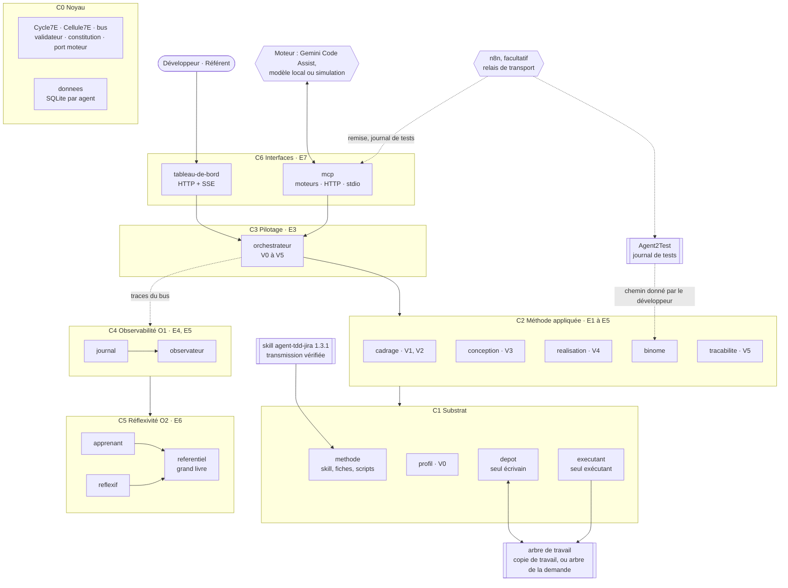
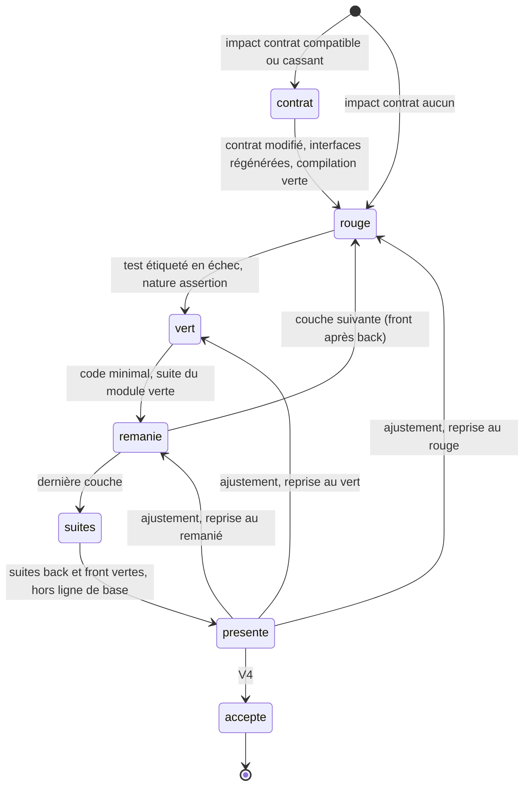
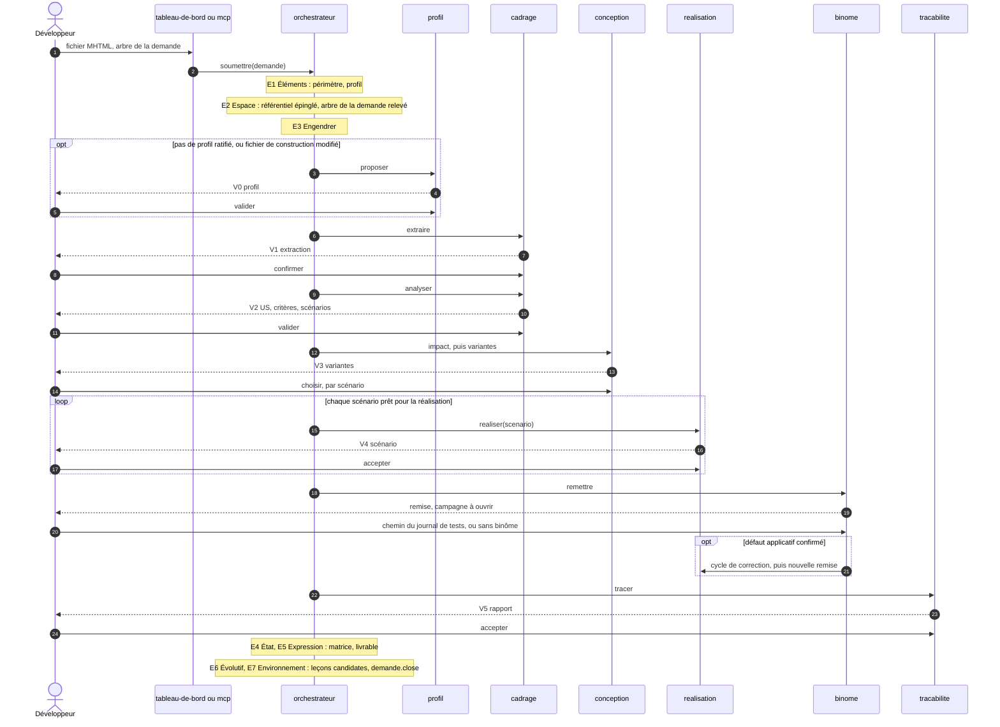
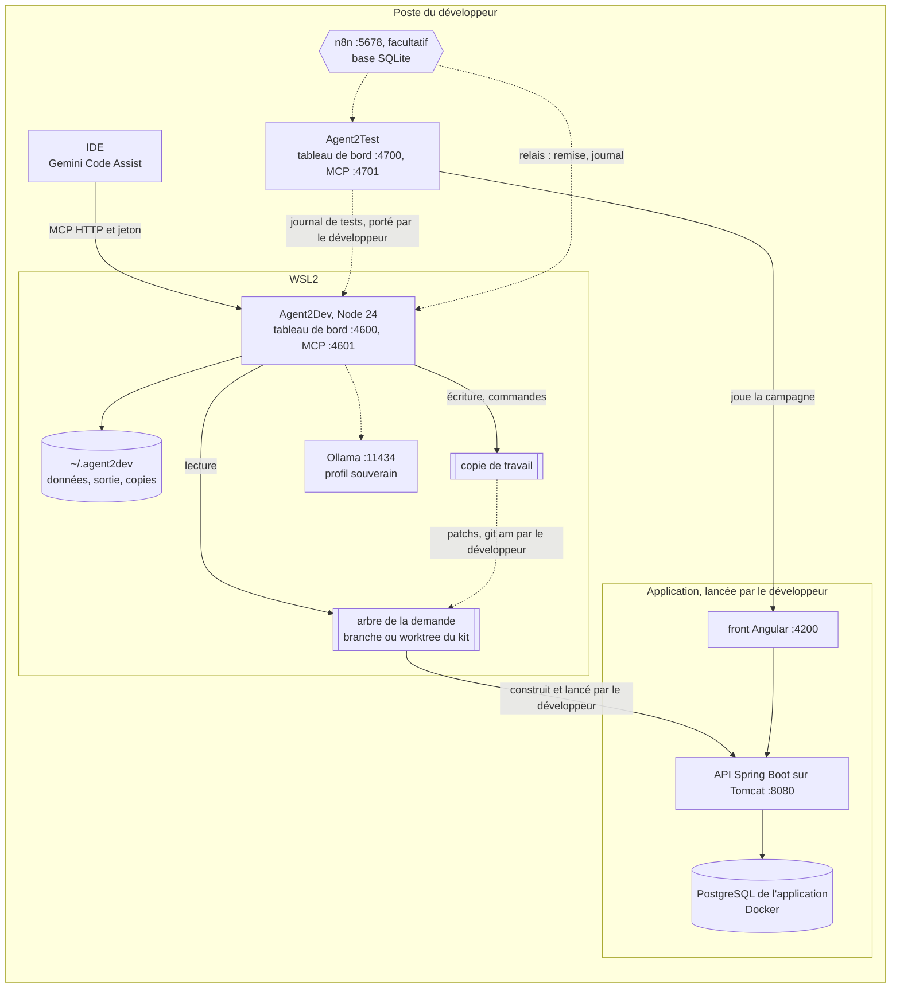
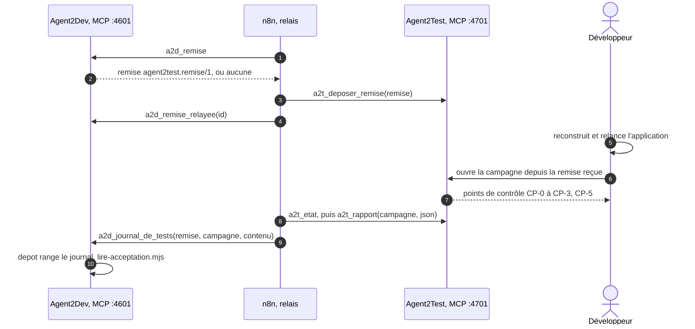

# Agent2Dev : spécification 1.0.0, transmission texte

Ce texte contient à la fois la consigne de travail et la spécification complète. Il n'y a aucune pièce jointe. La spécification est découpée en fichiers, chacun délimité ainsi :

    <<<FICHIER chemin/relatif>>>
    ...contenu exact du fichier...
    <<<FIN chemin/relatif>>>

---

Tu vas construire Agent2Dev, le système de développement décrit par cette spécification. La spécification fait foi. Si tu relèves un écart ou une ambiguïté, signale-le au développeur. Ne corrige pas la spécification toi-même.

## Étape 0 : matérialiser la spécification

1. Crée le dossier `agent2dev/` à la racine du dépôt Agent2Dev (ou à l'emplacement que le développeur indique). À sa racine, crée le dossier `spec/`.
2. Pour chaque bloc `<<<FICHIER chemin>>>` … `<<<FIN chemin>>>`, crée le fichier `spec/chemin` avec le contenu exact compris entre les deux lignes délimitrices. Ces deux lignes ne font pas partie du fichier. Ne reformule rien, ne traduis rien, ne complète rien.
3. Si tu disposes d'un shell, vérifie chaque fichier avec `sha256sum -c` contre la table d'intégrité en fin de texte, depuis `spec/`. Signale tout écart avant de continuer.
4. Le dossier `archives/` n'est pas transmis. Ne le recrée pas.
5. Demande au développeur la transmission du skill agent-tdd-jira 1.3.1 (`transmissions/agent-tdd-jira-1.3.1.md` du dépôt Agent2Prompt). Place-la telle quelle dans `test/fixtures/methode/`. C'est la méthode qu'Agent2Dev charge, et le jeu d'essai du module `methode`. Ne la recopie nulle part ailleurs.

Les chemins internes à la spécification (`modules/...`, `SKILL.md`) sont relatifs à `spec/`. Les fichiers de code (`src/...`, `test/...`, `fiches/...`, `schemas/...`, `constitution/...`, `configuration/...`) se placent à la racine d'`agent2dev/`, à côté de `spec/`.

Le dossier `agents-modif/` du même dépôt est la lignée d'Agent2Dev. Tu peux le lire pour ses idées (bus, agent générique, vérification « avant / après », observant, apprenant) ; tu ne le modifies pas.

## Étape 1 : lecture, sans écrire de code

1. Lis `spec/SKILL.md` en entier, puis `spec/manifest.json`.
2. Lis les modules actifs dans l'ordre de `SKILL.md`, section 1.
3. Ne lis `spec/modules/memoire/SKILL.md` et `spec/modules/autonomie/SKILL.md` que pour comprendre les points d'extension E3 et E4. Ne les implémente pas : leur statut est `reserved`.

## Étape 2 : plan, sans code

Soumets au développeur :

- l'arborescence des fichiers à créer, en reprenant la section « Fichiers à produire » de chaque module ;
- les choix techniques que la spécification ne couvre pas ;
- tes questions.

Attends la validation du développeur avant d'écrire la moindre ligne de code.

## Étape 3 : implémentation par lots

Après validation, implémente dans cet ordre. Chaque lot passe ses tests, en simulation et sans réseau, avant le suivant, et se termine par un point de validation du développeur. Un lot qui a besoin d'un module d'un lot suivant s'appuie sur sa simulation, déclarée par le même contrat de bus.

1. Noyau : `noyau` (D1).
2. Données, journal, référentiel et méthode : `donnees`, `journal`, `referentiel`, `methode` (D2, D13, D17, D3).
3. Substrat : `profil`, `depot`, `executant` (D4, D5, D6).
4. Cadrage et orchestration : `cadrage`, `orchestrateur` (D7, D12).
5. Conception et réalisation : `conception`, `realisation` (D8, D9).
6. Binôme et traçabilité : `binome`, `tracabilite` (D10, D11).
7. Premier et second ordre : `observateur`, `apprenant`, `reflexif` (D14, D15, D16).
8. Interfaces : `mcp`, `tableau-de-bord`, `relais` (D18, D19, D23).
9. Exploitation : `exploitation` (D20) et le guide de démarrage.

## Étape 4 : recette

Vérifie les critères d'acceptation globaux de `SKILL.md`, section 9, puis rends compte au développeur : invariants couverts, scénarios passés, écarts, questions ouvertes.

## Règles qui ne se négocient pas

- La méthode est le skill agent-tdd-jira 1.3.1, lu depuis sa transmission vérifiée : Agent2Dev n'en réécrit rien, et n'en recopie rien dans son code.
- Sans l'autorisation d'écrire le code, qui n'est pas donnée par défaut, Agent2Dev n'écrit rien dans l'arbre du développeur, hors des fichiers de travail que le kit exclut du dépôt : il travaille dans une copie de travail et remet un patch par scénario accepté, que le développeur applique lui-même.
- Seul le `depot` écrit dans un arbre du projet ; il ne pousse jamais et, dans l'arbre du développeur, ne fusionne pas, ne rebase pas et ne change pas de branche.
- Seules s'exécutent les commandes du profil ratifié et les scripts du skill, sans shell. Agent2Dev ne démarre, n'arrête ni ne déploie l'application, et ne lance aucun batch.
- Le moteur ne produit que des données validées ; aucun code, aucune commande ni aucun chemin qu'il produit n'est exécuté tel quel.
- Aucun code de production avant un test étiqueté qui échoue pour la raison attendue.
- Aucun point de validation n'est sauté, supprimé ou décidé par le système.
- Le journal et le grand livre sont en ajout seul.
- Tout s'exécute en local ; les interfaces n'écoutent que sur `127.0.0.1`.
- n8n est facultatif : rien ne doit en dépendre. Il ne porte que la remise et le journal de tests, et ne décide rien.
- N'implémente aucun module au statut `reserved`.

Commence par l'étape 0, puis l'étape 1, puis l'étape 2.

---

# Spécification

<<<FICHIER manifest.json>>>
{
  "name": "agent2dev",
  "version": "1.0.0",
  "specSchema": 1,
  "language": "fr",
  "description": "Agent2Dev : système multi-agents de développement qui applique le skill agent-tdd-jira comme méthode, de la demande Jira en MHTML jusqu'au rapport, en cycle TDD scénario par scénario et en binôme avec Agent2Test ; le moteur rédige, des agents déterministes écrivent et exécutent, le développeur valide à chaque point ; journal chaîné, apprentissage sous gouvernance, exécution locale.",
  "entry": "SKILL.md",
  "runtime": {
    "node": ">=22.13, 24 recommandé",
    "git": ">=2.30"
  },
  "targets": {
    "application": "back Java 21 et Spring Boot 3.5 construit par Maven, front Angular 20, PostgreSQL en Docker, Liquibase au démarrage ; application lancée par le développeur sur Tomcat en local",
    "methode": "skill agent-tdd-jira 1.3.1, lu depuis sa transmission vérifiée",
    "moteur": "Gemini Code Assist par MCP, modèle local compatible OpenAI, ou simulation",
    "stockage": "un fichier SQLite par agent, par node:sqlite, dès le départ",
    "profil": "local",
    "relais": "n8n facultatif, en relais de transport, sur 127.0.0.1, base SQLite"
  },
  "references": [
    { "name": "agent-tdd-jira", "version": "1.3.1" },
    { "name": "agent2test", "version": "1.1.0" }
  ],
  "modules": [
    { "id": "noyau", "path": "modules/noyau/SKILL.md", "dimensions": ["D1"], "status": "active" },
    { "id": "donnees", "path": "modules/donnees/SKILL.md", "dimensions": ["D2"], "status": "active" },
    { "id": "methode", "path": "modules/methode/SKILL.md", "dimensions": ["D3"], "status": "active" },
    { "id": "profil", "path": "modules/profil/SKILL.md", "dimensions": ["D4"], "status": "active" },
    { "id": "depot", "path": "modules/depot/SKILL.md", "dimensions": ["D5"], "status": "active" },
    { "id": "executant", "path": "modules/executant/SKILL.md", "dimensions": ["D6"], "status": "active" },
    { "id": "cadrage", "path": "modules/cadrage/SKILL.md", "dimensions": ["D7"], "status": "active" },
    { "id": "conception", "path": "modules/conception/SKILL.md", "dimensions": ["D8"], "status": "active" },
    { "id": "realisation", "path": "modules/realisation/SKILL.md", "dimensions": ["D9"], "status": "active" },
    { "id": "binome", "path": "modules/binome/SKILL.md", "dimensions": ["D10"], "status": "active" },
    { "id": "tracabilite", "path": "modules/tracabilite/SKILL.md", "dimensions": ["D11"], "status": "active" },
    { "id": "orchestrateur", "path": "modules/orchestrateur/SKILL.md", "dimensions": ["D12"], "status": "active" },
    { "id": "journal", "path": "modules/journal/SKILL.md", "dimensions": ["D13"], "status": "active" },
    { "id": "observateur", "path": "modules/observateur/SKILL.md", "dimensions": ["D14"], "status": "active" },
    { "id": "apprenant", "path": "modules/apprenant/SKILL.md", "dimensions": ["D15"], "status": "active" },
    { "id": "reflexif", "path": "modules/reflexif/SKILL.md", "dimensions": ["D16"], "status": "active" },
    { "id": "referentiel", "path": "modules/referentiel/SKILL.md", "dimensions": ["D17"], "status": "active" },
    { "id": "mcp", "path": "modules/mcp/SKILL.md", "dimensions": ["D18"], "status": "active" },
    { "id": "tableau-de-bord", "path": "modules/tableau-de-bord/SKILL.md", "dimensions": ["D19"], "status": "active" },
    { "id": "exploitation", "path": "modules/exploitation/SKILL.md", "dimensions": ["D20"], "status": "active" },
    { "id": "relais", "path": "modules/relais/SKILL.md", "dimensions": ["D23"], "status": "active" },
    { "id": "memoire", "path": "modules/memoire/SKILL.md", "dimensions": ["D21"], "status": "reserved" },
    { "id": "autonomie", "path": "modules/autonomie/SKILL.md", "dimensions": ["D22"], "status": "reserved" }
  ],
  "extensionPoints": ["E1", "E2", "E3", "E4"],
  "previousVersions": []
}
<<<FIN manifest.json>>>

<<<FICHIER SKILL.md>>>
---
name: agent2dev
description: Construire Agent2Dev, système multi-agents de développement qui applique le skill agent-tdd-jira comme méthode. D'une demande Jira exportée en MHTML, il tire les US et leurs critères d'acceptation, les scénarios Gherkin, les variantes, puis réalise chaque scénario en cycle TDD et trace la demande jusqu'aux commits, en binôme avec Agent2Test. Le moteur rédige, des agents déterministes écrivent et exécutent, le développeur valide à chaque point ; un journal chaîné et un apprentissage sous gouvernance en font un système de second ordre. Exécution locale.
version: 1.0.0
---

# Agent2Dev, spécification 1.0.0

Ce document est le point d'entrée du package. Il donne le principe, la carte du système, les points de validation, le registre des dimensions, les règles communes et les invariants. Les détails techniques sont dans `modules/`. Le fichier `manifest.json` déclare quels modules sont actifs.

La spécification reprend la conception d'Agent2Dev de l'étape 1 (cadrage et architecture, version 0.3.0 ratifiée le 4 octobre 2026) et sa lignée `agents-modif`, adaptées aux décisions du 21 octobre 2026 : le skill agent-tdd-jira devient la méthode d'Agent2Dev, tout reste local et s'enchaîne à la main, le développeur lance lui-même l'application. La section 11 en donne la filiation.

## 1. Ordre de lecture

1. Ce document, sections 2 à 12.
2. `manifest.json` : modules actifs et réservés.
3. Les modules actifs, dans cet ordre :
   1. `noyau` : cycle 7E, bus, contrats, validateur, constitution, port moteur.
   2. `donnees` : un fichier SQLite par agent.
   3. `journal` : journal chaîné, livrable de demande.
   4. `referentiel` : fiches, règles, épinglage, grand livre.
   5. `methode` : le skill, ses fiches et ses scripts.
   6. `profil` : profil du projet, point V0.
   7. `depot` : seul écrivain du projet.
   8. `executant` : seul exécutant de commandes.
   9. `cadrage` : extraction et analyse, points V1 et V2.
   10. `conception` : impact et variantes, point V3.
   11. `realisation` : cycle TDD par scénario, point V4.
   12. `binome` : remise à Agent2Test, lecture du journal de tests, corrections.
   13. `tracabilite` : matrice, rapport, projet de commentaire Jira, point V5.
   14. `orchestrateur` : parcours d'une demande, file, arrêt d'urgence.
   15. `observateur` : mesures et alertes.
   16. `apprenant`, `reflexif` : leçons candidates, mesures de second ordre.
   17. `mcp` : moteurs et serveur MCP.
   18. `relais` : relais du binôme par n8n, facultatif.
   19. `tableau-de-bord` : IHM par rôle.
   20. `exploitation` : installation et lancement sur le poste.
4. `modules/memoire/SKILL.md` et `modules/autonomie/SKILL.md` : seulement pour comprendre les points d'extension E3 et E4. Ne pas les implémenter en 1.x.

## 2. Mode de travail pour l'IA qui produit le code

1. Lisez tous les modules actifs avant d'écrire la moindre ligne de code.
2. Proposez le plan de fichiers, en reprenant la section « Fichiers à produire » de chaque module, et listez les choix que la spécification ne couvre pas. Attendez la validation du développeur.
3. Implémentez par lots, dans l'ordre de l'en-tête de transmission. Chaque lot doit passer ses tests, en simulation, avant le suivant.
4. En cas d'ambiguïté, posez une question. N'inventez ni action, ni champ, ni schéma, ni comportement absent de la spécification.
5. Les identifiants de code sont sans accents. Les commentaires, les textes de l'IHM, les messages et les journaux sont en français.
6. Chaque test cite l'invariant ou le scénario qu'il vérifie, par exemple `// D9.INV-2, RE3`. Un invariant sans test n'est pas implémenté.
7. N'implémentez aucun module au statut `reserved` dans `manifest.json`, sauf les tests d'inertie de ses points d'extension.
8. La méthode n'est pas recopiée dans le code : Agent2Dev la lit dans la transmission du skill agent-tdd-jira 1.3.1 (module `methode`). Ce que dit le skill, le code ne le redit pas.

## 3. Objectif et principe

Pour une demande Jira, Agent2Dev applique la méthode du skill agent-tdd-jira : extraction, US et critères d'acceptation, scénarios Gherkin, impact, variantes, cycle TDD scénario par scénario, acceptation en binôme avec Agent2Test, traçabilité. Le développeur valide chaque étape. Agent2Dev rend la méthode reproductible, observable et perfectible : chaque pas est journalisé, chaque correction du développeur peut devenir une leçon, et aucune leçon n'agit sans ratification.

**Le skill fixe la méthode, le moteur rédige, les agents déterministes agissent, le développeur valide.**

- Le skill agent-tdd-jira 1.3.1 est lu depuis sa transmission, vérifiée par sa table d'intégrité. Agent2Dev ne le réécrit jamais : les consignes de ses fiches en citent les sections telles quelles.
- Le moteur (Gemini Code Assist par défaut, tout LLM par le port moteur) ne produit que des données : le contenu de `us.md` et du fichier Gherkin, la fiche d'impact, les variantes, les modifications de tests et de code, le rapport et le projet de commentaire Jira. Chaque sortie est validée contre un schéma fermé et des contrôles nommés. Le moteur n'écrit aucun fichier et n'exécute rien.
- Trois agents déterministes agissent, chacun seul dans son domaine : `depot` écrit et tient git dans l'arbre de travail de la demande, `executant` y exécute les commandes du profil ratifié et les scripts du skill, `methode` fournit le skill.
- L'écriture du code se règle dans la configuration humaine. Sans autorisation, ce qui est le défaut, l'arbre de travail est une copie de travail du dépôt, dans les données d'Agent2Dev : il y écrit, y teste, et remet au développeur un patch par scénario accepté, que celui-ci applique lui-même. Avec l'autorisation, l'arbre de travail est l'arbre de la demande : la branche du développeur, ou le worktree du kit en mode parallèle.
- Le développeur valide aux points V0 à V5 (section 5). Rien ne passe un point sans sa réponse explicite.
- Agent2Test juge l'acceptation, dans son propre projet, sur une campagne que le développeur ouvre à la main. Agent2Dev ne se note pas lui-même : il lit le journal de tests avec le script du skill.
- n8n est facultatif : activé, il porte la remise vers Agent2Test et le journal de tests vers Agent2Dev, par leurs serveurs MCP, et rien d'autre. Sans lui, le développeur porte ces fichiers à la main.

Chaîne de traçabilité, celle du skill :

`demande Jira → US → critères d'acceptation → scénarios Gherkin → variantes → tests → code → commits → verdicts d'Agent2Test par critère → rapport`



Toutes les flèches passent par le bus ; aucun agent n'importe un autre agent.

Une responsabilité, un seul lieu :

| Responsabilité | Lieu unique |
|---|---|
| lire le skill, composer une fiche, fournir un script du skill | `methode` |
| proposer et tenir le profil du projet | `profil` |
| écrire dans l'arbre de travail et dans le dossier de travail de la demande, chercher, lire l'état git, commiter, former les patchs | `depot` |
| exécuter une commande du profil ou un script du skill | `executant` |
| appeler un LLM | port moteur du noyau, par les fiches |
| valider une sortie | validateur du noyau |
| dérouler un cycle | `Cycle7E` du noyau |
| décider de la suite d'une demande | `orchestrateur` |
| lire un journal de tests d'Agent2Test | `binome`, par le script du skill |
| porter la remise et le journal de tests entre les têtes | le développeur, ou n8n en relais (`relais`) |
| écrire le journal | `journal` |
| versionner une fiche ou une règle | `referentiel` |

## 4. Cycle 7E

L'énoncé de l'Axiome 7E : « Les Éléments dans l'Espace Engendrent un État d'Expression Évolutif de l'Environnement ». Agent2Dev l'applique à quatre échelles, avec une seule classe de cycle, `Cycle7E`, récursive (D1.INV-1).

| Phase | Opération | Pas | Scénario | Demande | Système |
|---|---|---|---|---|---|
| E1 Éléments | recenser | consigne du pas, fichiers visés, sortie attendue | scénario, critères, variante choisie | fichier MHTML, arbre de la demande, profil du projet | fiches, règles, constitution, skill |
| E2 Espace | situer | contenu courant des fichiers, fiche composée, leçons épinglées | tests existants, ligne de base, copie mise à jour | arbre de la demande, arbre de travail, référentiel épinglé | file des demandes |
| E3 Engendrer | produire | rédaction, validation, écriture, commande | pas : contrat, rouge, vert, remanié, suites | V0, cadrage, conception, cycles de scénarios, acceptation en binôme, traçabilité et V5 | cycles de demandes |
| E4 État | constater | résultat de la commande contre l'attendu | suites vertes, présentation V4 | matrice des critères | métriques de fonctionnement (O1) |
| E5 Expression | exprimer | ligne de journal, diff | présentation V4, commit, patch | rapport, livrable de demande | tableau de bord |
| E6 Évolutif | ajuster | nouvel essai dans le budget | ajustement demandé à V4, correction d'un défaut | réponses aux questions, leçons candidates | réflexivité (O2) |
| E7 Environnement | coupler | résultat remonté au scénario | résultat remonté à la demande | rapport, patchs et projet de commentaire Jira remis au développeur ; clôture versée au système | gouvernance humaine |

Règle de récursion : l'E3 d'une échelle est la suite des cycles complets de l'échelle inférieure, et l'E7 de chaque cycle inférieur alimente l'E4 de l'échelle supérieure.

Chaque agent traite chaque message comme un cycle 7E, par sa classe de base `Cellule7E` : valider l'entrée (E1), charger fiche et règles épinglées (E2), agir (E3), valider la sortie (E4), répondre (E5), corriger dans son budget de premier ordre (E6), remettre la trace au bus (E7). Un agent déterministe laisse vides les phases sans objet.

Clause de second ordre : Agent2Dev applique une méthode écrite par d'autres, et s'observe en l'appliquant. Le premier ordre (O1, `journal`, `observateur`) constate son fonctionnement ; le second ordre (O2, `apprenant`, `reflexif`, `referentiel`) juge ses manières de rédiger et d'apprendre, propose, et ne décide jamais seul. Agent2Test, qui lui est extérieur, constate ce que le code fait ; le développeur arbitre. La régression s'arrête à la constitution, au skill et à la gouvernance humaine : ce que le système ne peut pas changer de lui-même rend ses observations comparables dans le temps.

## 5. Points de validation

Les points V1 à V5 sont ceux du skill, appliqués tels quels. Agent2Dev ajoute V0, qui formalise le démarrage du skill (profil du projet, versions réelles, mode d'authentification), et CP-4, la gouvernance de ses propres règles, numérotée comme dans Agent2Test.

| Point | Moment | Qui décide | Décisions | Ce qui attend |
|---|---|---|---|---|
| V0 Profil | premier usage d'un projet ; fichier de construction modifié depuis la ratification | développeur | valider · corriger, commentaire obligatoire · rejeter | toute commande dans le projet |
| V1 Extraction | après l'extraction du MHTML | développeur | confirmer · corriger, avec les compléments | l'analyse |
| V2 US, critères, scénarios | après l'analyse et le script de contrôle des critères | développeur | valider · répondre aux questions · corriger, commentaire obligatoire · rejeter la demande | l'impact |
| V3 Variantes | après l'impact et les variantes | développeur | choisir une variante back et une variante front par scénario · corriger, commentaire obligatoire | la réalisation |
| V4 Scénario | après le cycle d'un scénario, suites vertes | développeur | accepter : patch remis, ou commit dans l'arbre de la demande si l'écriture est autorisée et que le développeur le veut · ajuster, commentaire obligatoire | le scénario suivant |
| V5 Rapport | après la traçabilité | développeur | accepter · corriger, commentaire obligatoire · recalculer, après un patch appliqué | la clôture de la demande |
| CP-4 Gouvernance | proposition de leçon ou de règle | référent, depuis le tableau de bord seulement | ratifier · amender · refuser | rien : asynchrone, effet à la demande suivante |

Entre V4 et V5, l'acceptation en binôme n'est pas un point de validation : le développeur ouvre la campagne d'Agent2Test, puis donne à Agent2Dev le chemin du journal, ou déclare la demande sans binôme (module `binome`). Avec le relais n8n, la remise et le journal circulent sans lui ; il ouvre toujours la campagne lui-même (module `relais`). Chaque point attend une décision explicite ; aucun n'est décidé par le système (D12.INV-1).

## 6. Registre des dimensions

| ID | Dimension | Introduite | Statut 1.0.0 | Dépend de | Module |
|---|---|---|---|---|---|
| D1 | Noyau 7E, bus et constitution | 1.0 | active | | `noyau` |
| D2 | Données par agent, en SQLite | 1.0 | active | D1 | `donnees` |
| D3 | Méthode : skill agent-tdd-jira, fiches et scripts | 1.0 | active | D1, D2 | `methode` |
| D4 | Profil du projet | 1.0 | active | D1, D3 | `profil` |
| D5 | Écriture dans le projet | 1.0 | active | D1, D4 | `depot` |
| D6 | Exécution des commandes | 1.0 | active | D1, D4 | `executant` |
| D7 | Cadrage : extraction et analyse | 1.0 | active | D3, D5, D6 | `cadrage` |
| D8 | Conception : impact et variantes | 1.0 | active | D3, D5, D7 | `conception` |
| D9 | Réalisation en cycle TDD | 1.0 | active | D3, D5, D6, D8 | `realisation` |
| D10 | Binôme avec Agent2Test | 1.0 | active | D3, D5, D6, D9 | `binome` |
| D11 | Traçabilité et rapport | 1.0 | active | D3, D5, D6, D9, D10 | `tracabilite` |
| D12 | Orchestration et points de validation | 1.0 | active | D1, D7 à D11, D13, D17 | `orchestrateur` |
| D13 | Journal et livrable de demande | 1.0 | active | D1, D2 | `journal` |
| D14 | Observabilité de premier ordre | 1.0 | active | D13 | `observateur` |
| D15 | Apprentissage | 1.0 | active | D12, D13, D17 | `apprenant` |
| D16 | Réflexivité de second ordre | 1.0 | active | D14, D15, D17 | `reflexif` |
| D17 | Référentiel, versions et grand livre | 1.0 | active | D1, D2, D3 | `referentiel` |
| D18 | Moteurs et serveur MCP | 1.0 | active | D1, D12 | `mcp` |
| D19 | Tableau de bord par rôle | 1.0 | active | D12, D13, D14, D17 | `tableau-de-bord` |
| D20 | Exploitation locale | 1.0 | active | D2, D3, D4 | `exploitation` |
| D21 | Mémoire et recherche sur le code et les demandes passées | 1.0 | reserved | D2, D3, D8 | `memoire` |
| D22 | Autonomie par point de validation | 1.0 | reserved | D12 | `autonomie` |
| D23 | Relais du binôme par n8n, facultatif | 1.0 | active | D10, D18 | `relais` |

Statuts : `active` (implémentée et testée), `reserved` (points d'extension posés, fonctionnalité absente), `superseded` (remplacée ; la version de remplacement est indiquée).

## 7. Contrat de version et points d'extension

### 7.1 Contrat

1. Chaque version déclare son numéro dans le frontmatter de ce document et dans `manifest.json`, et ajoute une entrée à la section 12.
2. Une version mineure ajoute au moins une dimension ou un point d'extension. Sinon, c'est un correctif : seul le numéro de patch change.
3. Une dimension `reserved` ne passe à `active` que si ses invariants ont des tests dans la suite de la version.
4. Une dimension `active` ne sort du registre qu'en passant à `superseded`, avec la version de remplacement et une section de migration.
5. Un invariant ne s'affaiblit jamais. Il peut être remplacé par un invariant plus fort, signalé dans la section 12.
6. La version du skill appliqué est épinglée dans `manifest.json` (références) et dans la configuration humaine. Une nouvelle version du skill appelle une nouvelle version d'Agent2Dev, qui en revoit la table de correspondance (module `methode`).
7. Chaque ligne du journal porte la version de spécification qui l'a produite. Un journal écrit dans une version reste lisible dans toute version de la même famille majeure.
8. Avant de publier une nouvelle version, la précédente est archivée dans `archives/SKILL-vX.Y.Z.md`. Une archive n'est jamais éditée.

### 7.2 Points d'extension

Un point d'extension n'est pas une fonctionnalité. En 1.x, il n'a qu'un test qui prouve qu'il est inerte.

- **E1** : le port moteur accepte de nouveaux adaptateurs par version ; en 1.0.0 : `simulation`, `externe` (Gemini Code Assist par MCP) et `compatible-openai`. Un adaptateur inconnu est refusé au démarrage.
- **E2** : la méthode est désignée par le nom, la version et la transmission d'un skill dans la configuration humaine. En 1.0.0, seul agent-tdd-jira 1.3.1 est pris en charge ; un autre skill ou une autre version est refusé au démarrage avec le motif « méthode non prise en charge ».
- **E3** : l'action `memoire.rechercher` existe et rend une liste vide ; chaque fiche a un emplacement « fragments », vide en 1.0.0. La mémoire sur le code et les demandes passées est réservée à D21.
- **E4** : chaque point de validation V0 à V5 porte, dans la configuration humaine, un champ `regime`, qui vaut `presenter` ; toute autre valeur est refusée au démarrage. L'autonomie par point est réservée à D22, et suppose une version du skill qui la permette ; CP-4 n'a pas de régime, et reste toujours une décision humaine.

## 8. Règles globales

- **Périmètre** : Agent2Dev traite une demande Jira déjà rédigée, exportée en MHTML, pour un projet dont le profil est ratifié. Il ne rédige pas la demande, ne démarre, n'arrête ni ne déploie l'application, ne lance aucun batch, n'écrit ni en base ni dans Jira.
- **Méthode** : le skill agent-tdd-jira 1.3.1 fait foi pour la méthode. Agent2Dev le lit depuis sa transmission, vérifiée, et n'en change rien.
- **Projet séparé** : Agent2Dev est un projet à part. L'arbre de la demande est la branche de travail du développeur, ou le worktree que le kit `agents-paralleles-gitlab` a créé en mode parallèle.
- **Écriture du code** : sans l'autorisation de la configuration humaine, Agent2Dev n'écrit rien dans l'arbre de la demande, hors des fichiers de travail que le kit exclut du dépôt ; il écrit et teste dans une copie de travail, et remet un patch par scénario accepté. Avec l'autorisation, le seul `depot` écrit dans l'arbre de la demande.
- **Git** : dans l'arbre de la demande, Agent2Dev commite après V4 si l'écriture est autorisée et que le développeur l'accepte, au format du skill ; il ne fusionne pas, ne rebase pas, ne change pas de branche. Dans la copie de travail, chaque scénario accepté est commité pour former son patch. Agent2Dev ne pousse jamais.
- **Local** : en 1.0.0, tout s'exécute sur le poste du développeur. Les interfaces n'écoutent que sur `127.0.0.1`.
- **Relais n8n** : facultatif et désactivé par défaut. n8n ne porte que la remise et le journal de tests, par les serveurs MCP des deux têtes ; il ne décide rien, n'ouvre aucune campagne et n'écrit aucun fichier. Agent2Dev n'en dépend jamais.
- **Secrets** : les jetons des interfaces et la configuration des moteurs viennent de fichiers hors dépôt, en mode 0600, ou de l'environnement. Les fichiers de secrets du projet sont exclus de toute lecture. Aucun secret n'apparaît dans le journal, les messages, les commits ni le contexte transmis au moteur.
- **Configuration humaine** : un fichier `humaine.json`, lu au démarrage et jamais écrit par le système, fixe la transmission du skill et sa version, l'autorisation d'écrire le code, le moteur et son autorisation, le régime des points, les utilisateurs et leurs rôles, les instances et leurs ports, les seuils d'alerte et l'activation du relais n8n (module `exploitation`, section 4).
- **Langue** : identifiants de code sans accents ; textes de l'IHM, messages, journal et livrables en français.
- **Node** : Node 24 recommandé, Node 22.13 au minimum, pour `node:sqlite` ; aucune dépendance d'exécution.

## 9. Critères d'acceptation globaux

- `npm test` passe sans accès réseau, en simulation : moteur `simulation`, projet de démonstration dont les commandes de construction et de test sont simulées, journal de tests d'Agent2Test simulé.
- Chaque invariant de la section 10 apparaît dans au moins un test. Un script vérifie cette correspondance.
- Sur l'exemple ECR-77 du skill, une demande simulée va du fichier MHTML au point V5, et s'arrête à chaque point de validation. Elle produit ce que le skill attend : `demande.json`, `us.md` et le fichier Gherkin sans écart au script de contrôle, `suivi.md`, des tests étiquetés, un commit par scénario accepté, et son patch en copie de travail, la matrice, le rapport et le projet de commentaire Jira.
- Un journal de tests simulé qui porte un défaut applicatif confirmé rouvre son scénario ; un second journal, sur le code corrigé, donne « conforme ».
- Sans autorisation d'écrire le code, une demande simulée ne modifie aucun fichier de l'arbre du développeur et remet, pour chaque scénario accepté, un patch qui s'y applique par `git am` ; avec l'autorisation, elle écrit dans l'arbre de la demande.
- Avec le relais activé, un client MCP simulé au rôle `relais` porte la remise et le journal de tests : la demande suit le même parcours qu'à la main, chaque décision reste au développeur, et Agent2Dev n'ouvre aucune connexion sortante. Relais désactivé, rien ne change.
- Une écriture dans l'arbre de travail faite hors du `depot` est détectée, et la demande s'arrête.
- Une commande absente du profil, une commande de démarrage de l'application et un batch sont refusés.
- Une altération du journal est détectée, et la première ligne rompue est nommée.
- Aucun module `reserved` n'est chargé ; chaque point d'extension a son test d'inertie.
- Le guide de démarrage suffit, seul, à installer et lancer Agent2Dev sur le poste du développeur.

## 10. Invariants

Chaque invariant est vérifié par au moins un test. Les invariants du skill, cités avec le préfixe `agent-tdd-jira:`, s'appliquent en plus : Agent2Dev les rend vérifiables, il ne les remplace pas.

**D1 : noyau**

- **D1.INV-1** : le cycle 7E se déroule en sept phases, dans l'ordre, aux quatre échelles Système, Demande, Scénario et Pas ; l'E3 d'une échelle est la suite des cycles de l'échelle inférieure, et l'E7 d'un cycle enfant est versé à l'E4 de son parent.
- **D1.INV-2** : tout appel ou événement que son contrat ne déclare pas est refusé par le bus ; aucun agent n'importe le code d'un autre agent.
- **D1.INV-3** : le moteur ne produit que des données ; une sortie qui s'écarte de son schéma fermé ou échoue à un contrôle nommé n'est jamais consommée.
- **D1.INV-4** : la constitution est vérifiée par son empreinte au démarrage ; modifiée ou non publiée, Agent2Dev ne démarre pas ; sa publication est une commande humaine.
- **D1.INV-5** : Agent2Dev ne traite qu'une demande Jira exportée en MHTML, pour le projet d'un profil ratifié ; toute intention de démarrer, d'arrêter ou de déployer l'application, de lancer un batch, d'administrer un environnement, d'écrire en base ou dans Jira est refusée avec le motif « hors périmètre ».
- **D1.INV-6** : aucun agent n'écrit la constitution, le code ou les schémas d'Agent2Dev, la configuration humaine ni la transmission du skill, et aucun ne réécrit un profil ratifié : le `profil` en crée seulement une version nouvelle, à la décision V0.

**D2 : données**

- **D2.INV-1** : chaque fichier de données a un seul agent propriétaire ; un agent lit les données d'un autre par une action du bus, jamais par le fichier.
- **D2.INV-2** : les données d'un agent sont dans son seul fichier SQLite, ouvert par `node:sqlite` dès le premier enregistrement ; chaque écriture est une transaction, et un arrêt du processus, même brutal, ne laisse aucun enregistrement partiel.
- **D2.INV-3** : le journal et le grand livre sont en ajout seul : aucune action ne modifie ni ne supprime un enregistrement, et toute purge est une commande humaine, journalisée.

**D3 : méthode**

- **D3.INV-1** : le skill n'est lu que depuis sa transmission, à la version épinglée par la configuration humaine, chaque fichier conforme à sa table d'intégrité ; à défaut, Agent2Dev ne démarre pas (`agent-tdd-jira:D9.INV-6`).
- **D3.INV-2** : les consignes d'une fiche reprennent les sections du skill telles quelles : rien n'y est réécrit, résumé, traduit ni complété, hors des leçons ratifiées, ajoutées à part.
- **D3.INV-3** : les trois scripts du skill sont extraits tels quels de leur module et exécutés par l'`executant` ; ni Agent2Dev ni le moteur n'en écrivent d'autre version.
- **D3.INV-4** : chaque module actif du skill est appliqué par au moins une étape d'Agent2Dev, selon la table de correspondance, vérifiée au démarrage contre le manifeste du skill.
- **D3.INV-5** : un prompt composé qui dépasse le plafond de contexte n'est jamais tronqué : le pas s'arrête et se présente au développeur.

**D4 : profil**

- **D4.INV-1** : aucune commande ne s'exécute dans un projet sans profil ratifié en V0 ; un fichier de construction modifié depuis la ratification rouvre V0.
- **D4.INV-2** : chaque valeur du profil cite le fichier du projet dont elle vient, ou porte la marque « à renseigner », qui empêche la ratification.
- **D4.INV-3** : les versions réelles du projet sont comparées aux cibles du skill (Java 21, Spring Boot 3.5, Angular 20) ; chaque écart est présenté en V0, avec la question de la suite à donner.
- **D4.INV-4** : un profil qui contient une commande de démarrage, d'arrêt ou de déploiement de l'application, ou de lancement d'un batch, est refusé, à la proposition comme à la ratification.

**D5 : dépôt**

- **D5.INV-1** : seul le `depot` écrit dans un arbre du projet, et seulement dans l'arbre de travail de la demande et, en mode parallèle, dans le dossier `travail/` de son worktree, sous leur racine, hors des fichiers protégés (`.git`, secrets, CI, fichiers du kit) ; un chemin qui sort de la racine, y compris par lien symbolique, est refusé.
- **D5.INV-2** : une modification ne s'applique que si chaque bloc « avant » apparaît exactement une fois dans le fichier courant ; sinon rien n'est appliqué, et l'écart revient au moteur dans son budget.
- **D5.INV-3** : toute écriture dans l'arbre de travail qui ne vient pas du `depot`, par l'IDE ou par un autre outil, est détectée avant le pas suivant et arrête la demande jusqu'à la décision du développeur.
- **D5.INV-4** : dans l'arbre de la demande, un commit n'est fait qu'après l'acceptation du scénario à V4, si le développeur l'accepte, avec le message `<CLÉ> Snn : …`, ou `<CLÉ> : …` hors scénario, et le `depot` ne fusionne pas, ne rebase pas, ne change pas de branche et ne réécrit aucun historique (`agent-tdd-jira:D9.INV-2`) ; dans la copie de travail, chaque scénario accepté est commité avec ce message pour former son patch ; le `depot` ne pousse jamais.
- **D5.INV-5** : une dépendance nouvelle, une modification de la chaîne de construction, la modification d'un test existant ou la suppression d'un fichier attend une validation explicite du développeur avant d'être appliquée (`agent-tdd-jira:D5.INV-6`).
- **D5.INV-6** : un changeset de migration existant n'est jamais modifié ni supprimé ; un schéma évolue par un changeset nouveau.
- **D5.INV-7** : sans l'autorisation d'écrire le code, donnée dans la configuration humaine, l'arbre de travail est une copie de travail : Agent2Dev n'écrit rien dans l'arbre de la demande, hors des fichiers de travail que le kit exclut du dépôt, et remet pour chaque scénario accepté un patch que le développeur applique lui-même.

**D6 : exécution**

- **D6.INV-1** : seules s'exécutent les commandes nommées du profil ratifié, les trois scripts du skill et les commandes git de la liste fermée du `depot`, en vecteur d'arguments, sans shell, avec leur répertoire et leur délai, dans l'arbre de travail ; dans l'arbre de la demande, sans autorisation d'écrire le code, seuls s'exécutent les scripts du skill qui lisent, `controler-criteres` et `lire-acceptation` ; les seuls paramètres substitués sont un identifiant de scénario validé par motif et des chemins sous la racine de l'arbre ou sous les données d'Agent2Dev.
- **D6.INV-2** : aucune commande ne démarre, n'arrête ni ne déploie l'application, ni ne lance un batch (`agent-tdd-jira:D7.INV-4`).
- **D6.INV-3** : la sortie d'une commande est masquée et bornée avant d'être journalisée ou transmise au moteur ; les échecs de compilation et de test reviennent structurés : fichier, ligne, test, message.
- **D6.INV-4** : les échecs présents avant le premier scénario forment la ligne de base de la demande ; ils ne sont imputés à aucun scénario et figurent au rapport.

**D7 : cadrage**

- **D7.INV-1** : la demande est extraite par le script du skill, jamais par le moteur ; le fichier MHTML n'est jamais modifié, et l'extraction est confirmée à V1 avant toute analyse (`agent-tdd-jira:D1.INV-1`, `agent-tdd-jira:D1.INV-2`).
- **D7.INV-2** : `us.md` et le fichier Gherkin ne sont présentés à V2 qu'après `controler-criteres.mjs` ; chaque écart du script est corrigé dans le budget du moteur, ou présenté comme écart.
- **D7.INV-3** : une question soulevée par l'analyse n'est jamais tranchée par le système : elle attend la réponse du développeur à V2 (`agent-tdd-jira:D2.INV-2`).
- **D7.INV-4** : après V2, `us.md` et le fichier Gherkin ne changent que par une nouvelle validation V2.

**D8 : conception**

- **D8.INV-1** : chaque élément de la fiche d'impact cite un fichier et une ligne trouvés par une recherche du `depot` ; un élément sans résultat de recherche est un écart (`agent-tdd-jira:D3.INV-1`).
- **D8.INV-2** : aucune réalisation ne commence avant que le développeur ait choisi à V3 une variante back et une variante front par scénario, et que le `depot` ait consigné ce choix dans `suivi.md` (`agent-tdd-jira:D4.INV-3`).
- **D8.INV-3** : une variante qui viole un invariant d'un référentiel ou du socle n'est jamais présentée comme recommandée ; un contrôle nommé le vérifie sur la sortie de la fiche (`agent-tdd-jira:D4.INV-2`).

**D9 : réalisation**

- **D9.INV-1** : un seul scénario est réalisé à la fois, et le suivant attend l'acceptation du précédent à V4 (`agent-tdd-jira:D5.INV-4`).
- **D9.INV-2** : aucun code de production n'est appliqué pour un scénario avant que l'`executant` ait constaté l'échec d'un test étiqueté de ce scénario pour la raison attendue : une assertion, pas une erreur de compilation ni de configuration ; seule une signature minimale, sans logique, peut précéder ce constat quand le test ne compile pas (`agent-tdd-jira:D5.INV-1`).
- **D9.INV-3** : un scénario n'est présenté à V4 qu'après les suites complètes back et front vertes, ligne de base exclue, constatées par l'`executant`.
- **D9.INV-4** : aucun pas n'affaiblit les tests : retirer un test ou une assertion, ajouter `@Disabled`, `fit`, `fdescribe` ou `xit` est refusé par contrôle nommé.
- **D9.INV-5** : quand un scénario touche le contrat d'API, le pas `contrat` précède les tests du back, puis ceux du front (`agent-tdd-jira:D5.INV-5`).
- **D9.INV-6** : la présentation V4 est rendue depuis le journal, au format du skill : rouge avec son message d'échec, vert, remanié, suites, fichiers, commit proposé.

**D10 : binôme**

- **D10.INV-1** : la remise n'a lieu qu'arbre de la demande propre, `controler-criteres.mjs` sans écart et, sans autorisation d'écrire le code, chaque patch remis présent dans l'arbre de la demande ; elle cite le commit et le plan tels quels (`agent-tdd-jira:D7.INV-1`).
- **D10.INV-2** : le verdict de chaque critère est celui que rend `lire-acceptation.mjs` sur le journal de tests, jamais une lecture du moteur (`agent-tdd-jira:D7.INV-3`).
- **D10.INV-3** : seul un défaut que le script déclare confirmé, avec un cycle de correction, rouvre un scénario, dans le budget de corrections par scénario ; tout autre défaut est présenté au développeur (`agent-tdd-jira:D7.INV-2`).
- **D10.INV-4** : Agent2Dev n'écrit rien dans le projet Agent2Test, ne conteste ni ne réécrit un verdict, et n'ouvre aucune campagne : le développeur ouvre chaque campagne à la main (`agent-tdd-jira:D7.INV-4`).

**D11 : traçabilité**

- **D11.INV-1** : la matrice est construite par les recherches du `depot` et par les scripts du skill, jamais de mémoire (`agent-tdd-jira:D6.INV-1`, `agent-tdd-jira:D10.INV-7`).
- **D11.INV-2** : Agent2Dev n'écrit jamais dans Jira : le projet de commentaire est remis au développeur (`agent-tdd-jira:D6.INV-3`).
- **D11.INV-3** : V5 n'est présentée qu'avec chaque critère dans la matrice, son état de réalisation et son verdict d'acceptation, ou « non joué » avec sa raison (`agent-tdd-jira:D7.INV-3`).

**D12 : orchestration**

- **D12.INV-1** : aucun point de validation n'est sauté, supprimé ni décidé par le système ; aucune étape ne consomme une sortie qui attend une décision.
- **D12.INV-2** : une instance d'Agent2Dev porte une demande à la fois ; les suivantes attendent en file.
- **D12.INV-3** : un pas qui épuise son budget s'arrête et se présente au développeur ; aucune boucle ne se relance sans budget.
- **D12.INV-4** : l'arrêt d'urgence est lu entre deux pas ; la reprise est une décision humaine ; après un redémarrage du processus, la demande reprend au début du pas interrompu.
- **D12.INV-5** : chaque décision enregistre sa cible, son auteur, son canal, sa date et son commentaire ; une correction ou un ajustement exige un commentaire.

**D13 : journal**

- **D13.INV-1** : le journal est en ajout seul et chaîné par empreintes SHA-256 ; `verifierChaine` nomme la première ligne rompue ou manquante.
- **D13.INV-2** : chaque ligne porte son échelle et sa phase : une demande se relit comme un arbre 7E, de la demande au pas.
- **D13.INV-3** : le livrable de demande est une projection du journal, en Markdown et en JSON, depuis la même source.
- **D13.INV-4** : toute production du moteur porte l'adaptateur et le nom du moteur, la fiche et sa version composée, l'empreinte du prompt et la décision qui l'a validée.

**D14 : observabilité**

- **D14.INV-1** : l'observateur ne produit que des mesures et des alertes ; il n'agit sur aucun cycle.
- **D14.INV-2** : chaque mesure se recalcule depuis le journal, à l'identique.
- **D14.INV-3** : une mesure qui franchit un seuil de la configuration humaine lève une alerte, journalisée et affichée.

**D15 : apprentissage**

- **D15.INV-1** : chaque correction ou ajustement commenté à V2, V3, V4 ou V5, et chaque défaut confirmé par Agent2Test après une acceptation V4, produit une leçon candidate, liée à sa fiche, à son moteur et à sa source.
- **D15.INV-2** : une leçon n'a d'effet qu'après ratification en CP-4, depuis le tableau de bord, et seulement pour le moteur sur lequel elle a été apprise.
- **D15.INV-3** : une leçon qui contredit une règle du skill ou de la constitution est refusée par contrôle nommé avant d'être proposée.

**D16 : réflexivité**

- **D16.INV-1** : une leçon ou une règle dont l'effet mesuré dégrade le taux d'acceptation au-delà de la marge, sur la fenêtre et après l'exposition minimale, est suspendue par le système seul ; il n'adopte jamais seul une règle nouvelle et n'élargit aucune borne.
- **D16.INV-2** : le taux de défauts confirmés par Agent2Test après une acceptation V4 est mesuré par fiche et par moteur ; sa hausse lève une alerte au référent.
- **D16.INV-3** : les dérives qui contourneraient la méthode (rouge pour une mauvaise raison, tests modifiés au vert, lignes par pas en hausse) sont mesurées, et lèvent une alerte au référent.

**D17 : référentiel**

- **D17.INV-1** : chaque demande s'exécute avec le référentiel épinglé à son E2 ; une règle ratifiée ne s'applique qu'aux demandes suivantes.
- **D17.INV-2** : le grand livre est en ajout seul et chaîné ; il inscrit chaque constitution publiée, ratification, refus, suspension et retour arrière.
- **D17.INV-3** : les règles modifiables se limitent à la liste fermée de la constitution, chacune dans ses bornes ; une valeur hors bornes est refusée.
- **D17.INV-4** : les pouvoirs sont séparés : proposer (`apprenant`, `reflexif`), ratifier (un humain, en CP-4, hors du canal MCP), appliquer (`referentiel`), mesurer (`reflexif`).
- **D17.INV-5** : chaque fiche porte une version composée, fiche, skill et leçons ; le prompt de toute sortie du moteur se reconstitue à partir du journal, et son empreinte égale celle du journal.

**D18 : moteurs et MCP**

- **D18.INV-1** : les interfaces n'écoutent que sur `127.0.0.1` ; le serveur MCP exige un jeton porteur et refuse un en-tête `Origin` non autorisé.
- **D18.INV-2** : une décision CP-4 reçue par le canal MCP est refusée ; une décision V relayée porte l'auteur humain du jeton et obéit aux droits de ses rôles.
- **D18.INV-3** : aucun contenu du projet ne part vers un moteur externe tant que la configuration humaine ne porte pas l'autorisation de l'envoyer.
- **D18.INV-4** : le contexte transmis au moteur se limite au pas, est borné et masqué : aucune valeur de secret, aucun jeton, aucun fichier exclu par le profil.
- **D18.INV-5** : changer d'adaptateur ne change que la configuration ; un adaptateur inconnu est refusé au démarrage ; chaque appel est journalisé.
- **D18.INV-6** : avec le profil souverain, aucune connexion sortante n'est ouverte, hors celle du moteur local.

**D19 : tableau de bord**

- **D19.INV-1** : les décisions suivent les rôles : développeur pour V0 à V5, référent pour CP-4.
- **D19.INV-2** : chaque point présente l'objet à décider avec ses preuves, côte à côte : extraction, fichiers et écarts du script, fiche d'impact et variantes, diff et sorties de commande, matrice et rapport.
- **D19.INV-3** : l'interface s'utilise au clavier et au lecteur d'écran ; aucun rafraîchissement automatique ne démarre sans demande.

**D20 : exploitation**

- **D20.INV-1** : Agent2Dev n'a aucune dépendance d'exécution : modules natifs de Node seulement, `node:sqlite` compris.
- **D20.INV-2** : la configuration humaine et les secrets vivent hors du dépôt d'Agent2Dev et du projet, et ne sont jamais écrits par le système.
- **D20.INV-3** : tout s'exécute en local, sur le poste du développeur.

**D23 : relais n8n**

- **D23.INV-1** : Agent2Dev ne dépend jamais du relais n8n : désactivé par défaut, le binôme se fait à la main, à l'identique ; activé, c'est le relais qui appelle le serveur MCP, et Agent2Dev n'ouvre aucune connexion vers n8n ni vers Agent2Test.
- **D23.INV-2** : un jeton au rôle `relais` n'atteint que `a2d_remise`, `a2d_remise_relayee` et `a2d_journal_de_tests` ; toute décision, rédaction, soumission de demande, suspension ou reprise lui est refusée.
- **D23.INV-3** : un journal de tests reçu du relais l'est par son contenu, jamais par un chemin ; le `depot` le range dans le dossier de travail de la demande, et `lire-acceptation.mjs` le lit comme un journal déposé à la main.
- **D23.INV-4** : la configuration fournie pour n8n le fait écouter sur `127.0.0.1` seulement, avec sa base SQLite, sans télémétrie ni appel sortant ; son workflow n'appelle que les outils du rôle `relais` des deux têtes, et ses fichiers ne contiennent aucun jeton.

## 11. Filiation

### 11.1 Avec la conception de l'étape 1

La conception d'Agent2Dev de l'étape 1 (`00-cadrage.md` et `01-architecture.md`, version 0.3.0 ratifiée le 4 octobre 2026, dépôt Agent2Dev) reste la source des choix d'architecture : noyau 7E, agent générique piloté par des fiches, `depot` seul écrivain, séparation des deux ordres, gouvernance des leçons. Ses invariants I1 à I15 deviennent des invariants de dimension :

| Étape 1 | Spécification |
|---|---|
| I1 cycle 7E | D1.INV-1 |
| I2 périmètre | D1.INV-5 |
| I3 écriture confinée | D5.INV-1, D5.INV-4, D5.INV-7, D1.INV-6 |
| I4 le moteur ne produit que des données | D1.INV-3, D5.INV-2 |
| I5 pas de livraison sans preuve | D9.INV-3, D10.INV-2 |
| I6 verdict jamais réécrit, contestation tranchée par une personne | D10.INV-4 |
| I7 journal et grand livre en ajout seul | D2.INV-3, D13.INV-1, D17.INV-2 |
| I8 points de contrôle intangibles | D12.INV-1 |
| I9 auto-modification asymétrique | D16.INV-1 |
| I10 séparation des pouvoirs | D17.INV-4, D18.INV-2 |
| I11 secrets | D6.INV-3, D18.INV-4 |
| I12 contexte minimisé | D3.INV-5, D18.INV-4, D18.INV-6 |
| I13 actions bornées | D6.INV-1, D6.INV-2 |
| I14 origine des productions du moteur | D13.INV-4 |
| I15 oracle | D7.INV-4, D5.INV-5, D5.INV-6 |

Ce qui change par rapport à l'étape 1 :

| Point de l'étape 1 | Décision du 21 octobre 2026 | Effet dans la spécification |
|---|---|---|
| sept fiches : analyse, cahier, scénarios, préconisation, plan de réalisation, développement, diagnostic | Agent2Dev reste la tête de développement et applique agent-tdd-jira comme méthode | huit fiches calées sur le skill : `analyse`, `impact`, `variantes`, `contrat`, `rouge`, `vert`, `remanie`, `rapport` ; consignes tirées du skill (module `methode`) |
| demande en texte libre | l'export MHTML reste la règle | extraction par le script du skill, V1 (module `cadrage`) |
| remplacements « avant / après » par tâche, tests unitaires secondaires | méthode TDD du skill | un test rouge étiqueté précède tout code (D9.INV-2) ; le « avant / après » reste le format d'écriture du `depot` |
| option B : agent `exploitant`, instance dédiée sous Docker, sonde, instantanés de base | l'équipe déploie à la main ; application sur Tomcat en local | `exploitant` remplacé par `executant`, limité à la compilation, aux tests et aux scripts du skill (D6.INV-2) |
| module `liaison`, protocole `binome-7e/1`, couplage par n8n | enchaînement à la main ; n8n facultatif, en relais de transport | remise et lecture du journal par fichiers et par le script du skill (module `binome`) ; avec le relais, n8n porte la remise et le journal par les serveurs MCP, sans enveloppe ni décision (D23) |
| plan de tests projeté au format de l'annexe A | Agent2Test lit les fichiers d'agent-tdd-jira | aucune projection : `us.md` et le fichier Gherkin tels quels (D10.INV-1) |
| contestation argumentée par Agent2Dev, tranchée en CP-5 | désaccord remonté au développeur | D10.INV-4 |
| arbre de travail et branche `a2d/<demande>` créés par Agent2Dev, poussée vers un Gitea local | GitLab de la mission ; seule la partie locale est concernée ; écriture du code en option, à autoriser | par défaut, copie de travail et branche `a2d/<CLÉ>` dans les données d'Agent2Dev, un patch par scénario accepté (D5.INV-7) ; sur autorisation, écriture dans l'arbre de la demande, commit après V4 ; aucune poussée (D5.INV-4) |
| CP-0 à CP-6, autonomie par défaut (`differe`) | points de validation toujours présentés | V0 à V5 et CP-4 (section 5), décidés dans le tableau de bord ou par MCP, jamais par n8n ; autonomie réservée à D22 |
| adaptateurs `gemini-cli` (défaut), `externe`, `compatible-openai`, `anthropic`, `simulation` | même moteur que pour Agent2Test | `externe` (défaut), `compatible-openai`, `simulation` (point E1) |
| stockage JSON, puis SQLite au-delà de 250 Ko | SQLite dès le départ, pour les deux têtes | un fichier SQLite par agent dès le premier enregistrement, sans phase JSON (D2.INV-2) |
| mémoire et recherche hybride sur le code | — | réservée à D21 (point E3) |
| plusieurs demandes actives, verrou d'instance | une demande à la fois ; parallélisme par le kit | une instance par demande, une instance par worktree en mode parallèle (D12.INV-2) |
| AI Act | mis de côté | hors périmètre ; restent l'origine des productions (D13.INV-4) et la gouvernance (D17) |

### 11.2 Avec agents-modif

| agents-modif | Agent2Dev 1.0.0 |
|---|---|
| `bus`, `Agent` | bus et `Cellule7E` du noyau, contrats déclarés |
| `AgentGenerique` et quatre fiches | une classe, huit fiches composées à partir du skill |
| `depot` : explorer, vérifier « avant / après », appliquer sur une copie | `depot` : chercher, vérifier « avant / après », écrire dans une copie de travail, ou dans l'arbre de la demande sur autorisation, commiter, former les patchs |
| `orchestrateur`, `ordonnanceur` | un seul `orchestrateur`, `Cycle7E` récursif |
| `observant` | `observateur` (O1) et `reflexif` (O2), séparés |
| `apprenant` | `apprenant`, leçons par moteur, ratification en CP-4 |
| `journal`, une ligne JSON par trace | `journal` chaîné, échelle et phase sur chaque ligne |
| `tableau-de-bord` | `tableau-de-bord` par rôle |
| moteurs `simulation` et `claude` | adaptateurs `simulation`, `externe`, `compatible-openai` |
| `AUTO=1` | supprimé : aucun point n'est validé par le système |

`agents-modif/` reste en place jusqu'à la recette d'Agent2Dev 1.0.0, puis est retiré.

## 12. Journal de révision

**1.0.0** (2026-10-22) : première version, tirée de la conception de l'étape 1 (version 0.3.0 du 4 octobre 2026) et des décisions du 21 octobre 2026. Méthode : skill agent-tdd-jira 1.3.1, lu depuis sa transmission vérifiée. Binôme : journal de tests d'agent2test 1.1.0, lu par le script du skill. Dimensions D1 à D20 et D23 actives, D21 (mémoire) et D22 (autonomie) réservées. Points d'extension E1 à E4. Moteur : Gemini Code Assist par MCP, modèle local compatible OpenAI ou simulation. Stockage : un fichier SQLite par agent, dès le départ. Écriture du code en option : sans autorisation, copie de travail et un patch par scénario accepté ; avec, écriture dans l'arbre de la demande. Relais n8n facultatif (D23), qui ne porte que la remise et le journal de tests. Amendements du développeur à la ratification du 21 octobre 2026 : SQLite dès le départ, pour Agent2Dev comme pour Agent2Test (agent2test 1.1.0) ; n8n facultatif, en relais de transport seulement, sur sa base SQLite.
<<<FIN SKILL.md>>>

<<<FICHIER modules/noyau/SKILL.md>>>
---
name: noyau
description: Noyau immuable d'Agent2Dev (cycle 7E récursif aux échelles Système, Demande, Scénario et Pas, cellule 7E de chaque agent, bus à contrats déclarés, validateur de schémas fermés et de contrôles nommés, constitution vérifiée par empreinte au démarrage, port moteur, garde de périmètre et garde d'écriture des fichiers d'Agent2Dev). À lire en premier ; à implémenter au lot 1.
dimensions: [D1]
status: active
---

# Module `noyau` (D1)

Le noyau est une bibliothèque, pas un agent. Tous les agents en héritent ; aucun ne le modifie. Il ne dépend d'aucun autre module. Il suit la même forme que le noyau d'Agent2Test (`agent2test:D1.INV-1`), pour que les deux têtes se lisent de la même façon ; il n'en partage aucun code.

## 1. Cycle 7E (D1.INV-1)

Une seule classe, `Cycle7E`, sert aux quatre échelles. Une échelle est une spécialisation, pas un module.

```js
class Cycle7E {
  constructor({ echelle, contexte, journal }) {}
  async elements(entree) {}     // E1 : recenser, valider, figer pour le cycle
  async espace(elements) {}     // E2 : situer (fichiers, fiche composée, règles épinglées)
  async engendrer(espace) {}    // E3 : produire ; à l'échelle n, déroule les cycles de l'échelle n − 1
  async etat(produits) {}       // E4 : constater par rapport à l'attendu
  async expression(etat) {}     // E5 : rendre lisible et opposable
  async evolutif(expression) {} // E6 : ajuster dans le budget du premier ordre
  async environnement(bilan) {} // E7 : remonter au niveau englobant
  async derouler(entree) {}     // enchaîne E1 à E7 et journalise chaque phase
}
```

| Échelle | Classe | Instanciée par | E3 |
|---|---|---|---|
| Système | `CycleSysteme` | `orchestrateur` | cycles de demandes, un à la fois |
| Demande | `CycleDemande` | `orchestrateur` | V0, V1, V2, impact, V3, cycles de scénarios, acceptation, V5 |
| Scénario | `CycleScenario` | `realisation` | pas `contrat`, `rouge`, `vert`, `remanie`, puis suites et V4 |
| Pas | `CyclePas` | agent de l'étape | rédaction par le moteur, validation, écriture par le `depot`, commande par l'`executant` |

Règles :

- `derouler` appelle les sept méthodes dans l'ordre. Une phase sans objet s'exécute quand même et se journalise `vide` ; aucune phase n'est sautée.
- Une erreur levée en E3 ne rompt pas le cycle : E4 constate l'erreur, E5 l'exprime, E6 décide d'un nouvel essai dans le budget, E7 remonte le résultat.
- La valeur rendue par l'E7 d'un cycle enfant est versée à l'E4 du cycle parent.
- Chaque phase écrit une ligne de journal avec `echelle`, `phase`, durée et identifiant du cycle parent.
- Un point de validation est une attente dans l'E3 de la demande : le cycle s'y arrête jusqu'à la décision, puis reprend (module `orchestrateur`).

## 2. Cellule 7E

`Cellule7E` est la classe de base de chaque agent. Chaque message reçu est un cycle :

| E1 | E2 | E3 | E4 | E5 | E6 | E7 |
|---|---|---|---|---|---|---|
| valider l'entrée contre le contrat | charger fiche et règles épinglées | agir : moteur, écriture, commande | valider la sortie : schéma, contrôles nommés | répondre, publier | corriger dans le budget | remettre la trace au bus |

La trace porte le vecteur des sept durées, en millisecondes. Un agent déterministe laisse vides E2 et E6 s'ils sont sans objet ; la forme ne change pas.

## 3. Bus (D1.INV-2)

```js
bus.demander(cible, action, charge, contexte, { delaiMs }) // appel nommé : réponse, trace, délai de garde
bus.publier(type, charge, contexte)                        // événement sans réponse
bus.tracer(fn)                                             // reçoit chaque appel terminé, succès ou échec
bus.abonner(fn)                                            // reçoit chaque événement
```

Contexte propagé : `{ correlation, demande, scenario, echelle, phase, parent, appelant }`. `parent` construit l'arbre des traces.

Chaque agent déclare son contrat au démarrage :

```js
export const contrat = {
  agent: 'depot',
  actions: {
    appliquer: { entree: 'depot.appliquer.entree', sortie: 'depot.appliquer.sortie' },
    chercher: { entree: 'depot.chercher.entree', sortie: 'depot.chercher.sortie' }
  },
  evenements: ['depot.ecrit', 'depot.ecriture_etrangere'],
  appelle: ['journal.ecrire']
};
```

- Le bus refuse un appel vers une action non déclarée, un appel que l'appelant n'a pas déclaré dans `appelle`, et un événement non déclaré. Le refus est une erreur nommée, `APPEL_NON_DECLARE`, journalisée.
- Les entrées et sorties sont validées par le validateur contre les schémas nommés du contrat.
- Délai de garde par défaut : 30 secondes ; une commande de l'`executant` porte le délai de son profil. Au-delà, le bus rend `DELAI_DEPASSE`.
- Le bus tient le graphe des appels effectifs ; l'`observateur` s'en sert.
- Un agent ne reçoit qu'une poignée vers le bus. Aucun fichier de `src/agents/<a>/` n'importe un fichier de `src/agents/<b>/` ; un test le vérifie sur les sources.

## 4. Validateur (D1.INV-3)

Le validateur est écrit dans le noyau, sans dépendance : il couvre le sous-ensemble de JSON Schema employé par la spécification (`type`, `properties`, `required`, `additionalProperties: false`, `enum`, `const`, `pattern`, `items`, `minItems`, `maxItems`, `minimum`, `maximum`, `oneOf`). Tous les schémas sont fermés : `additionalProperties` vaut `false` partout.

Les contrôles nommés complètent les schémas, par exemple `realisation.test-etiquete` ou `depot.chemin-sous-racine`. Chacun est une fonction pure, enregistrée sous son nom, qui rend une liste d'écarts.

Le résultat est une liste d'écarts `{ chemin, regle, message }`. Une liste non vide interdit de consommer la sortie : l'agent la renvoie au moteur dans son budget (E6), ou présente l'échec au développeur.

## 5. Constitution (D1.INV-4, D1.INV-6)

`constitution/constitution.json` est le point fixe du système :

```json
{
  "version": "1.0.0",
  "methode": { "skill": "agent-tdd-jira", "version": "1.3.1" },
  "invariants": ["D1.INV-1", "D1.INV-2"],
  "points": ["V0", "V1", "V2", "V3", "V4", "V5", "CP-4"],
  "reglesModifiables": [
    { "regle": "budget.tentativesSortie", "bornes": { "min": 1, "max": 3 } },
    { "regle": "budget.tentativesPas", "bornes": { "min": 1, "max": 5 } }
  ],
  "metaCriteres": { "fenetre": 10, "expositionMin": 3, "marge": 15 },
  "intentionsRefusees": ["demarrer", "arreter", "deployer", "batch", "administrer", "ecrire-en-base", "ecrire-dans-jira"],
  "commandes": {
    "noms": ["compiler-back", "tester-back", "tester-scenario-back", "installer-front", "compiler-front", "tester-front", "tester-scenario-front", "linter-front", "regenerer-contrat"],
    "programmesInterdits": ["docker", "kubectl", "oc", "helm", "ansible", "ansible-playbook", "catalina.sh", "startup.sh", "shutdown.sh"],
    "argumentsInterdits": ["spring-boot:run", "spring-boot:start", "cargo:run", "cargo:deploy", "tomcat7:run", "jetty:run", "deploy", "exec:java"]
  }
}
```

La liste complète des règles modifiables et de leurs bornes est au module `referentiel`, section 4 ; la constitution la recopie. Elle porte aussi la liste fermée des motifs de leçons interdites (module `apprenant`, section 2).

- L'empreinte est le SHA-256 de la constitution sérialisée en JSON canonique (clés triées, sans espace).
- Au démarrage, le noyau compare cette empreinte à la dernière entrée `constitution.publiee` du grand livre. Un écart, ou l'absence d'entrée, empêche le démarrage avec le message « constitution non publiée ou modifiée : publier par `npm run constitution:publier` ».
- La publication est une commande humaine, hors du bus : `npm run constitution:publier` inscrit l'empreinte au grand livre. Aucun agent ne l'appelle.

Garde d'écriture des fichiers d'Agent2Dev : le noyau expose `ecriture.autoriser(chemin, agent)`. Seuls sont permis :

- le dossier de données de l'agent (module `donnees`) ;
- pour le seul `journal`, le livrable, dans le dossier de sortie de la demande ;
- pour le seul `depot`, le dossier de travail de la demande (scripts extraits, `demande.json` et ses compléments, `impact.txt`, journaux de tests reçus du relais, patchs, rapport, projet de commentaire) et le dossier des copies de travail ;
- pour le seul `profil`, la création d'une version nouvelle de profil ratifié, à la décision V0 ; un profil ratifié n'est jamais réécrit.

Les autres agents rédigent ou calculent ces contenus, et les remettent au `depot` par le bus.

Toute autre écriture, et en particulier `constitution/`, `src/`, `schemas/`, `fiches/`, la configuration humaine, un profil ratifié existant et la transmission du skill, est refusée avec l'erreur `ECRITURE_INTERDITE`. L'écriture dans un arbre du projet, copie de travail comprise, relève du seul `depot`, avec ses propres gardes (module `depot`).

## 6. Port moteur

```js
moteur.completer({ systeme, message, schema, fiche, version }) // → { texte, usage, moteur }
```

Le noyau définit l'interface et choisit l'adaptateur d'après la configuration ; les adaptateurs sont au module `mcp`. La sortie `texte` est toujours analysée en JSON puis passée au validateur avant usage (D1.INV-3). Agent2Dev ne donne au moteur aucun accès au projet, au bus ni à un outil : il lui transmet un prompt et en reçoit un texte. L'agent de l'IDE garde ses propres accès à l'espace de travail du développeur ; `GEMINI.md` et la configuration de l'IDE les restreignent (module `mcp`, section 6), et le `depot` détecte toute écriture qui ne vient pas de lui (D5.INV-3).

## 7. Garde de périmètre (D1.INV-5)

`perimetre.verifier(demande)` est appelé par l'`orchestrateur` quand une demande entre :

- l'entrée doit être un fichier MHTML d'une demande Jira, et le projet visé doit avoir un profil ratifié, ou passer d'abord par V0 ;
- le texte extrait est confronté aux intentions refusées de la constitution : une demande dont l'objet est de démarrer, d'arrêter ou de déployer l'application, de lancer un batch, d'administrer un environnement, d'écrire en base ou dans Jira est refusée avec le motif « hors périmètre ». Une demande qui modifie du code est le cas nominal.

Le refus est présenté au développeur ; la demande ne démarre pas.

## 8. Pièges connus

- **Orchestrateur par échelle** : il n'y en a qu'un ; une échelle est une spécialisation de `Cycle7E`.
- **Phase sautée sur erreur** : une erreur en E3 se traite en E4 et E6, pas par un `return` anticipé.
- **Validateur indulgent** : un champ inconnu est un écart, jamais un champ ignoré.
- **Publication automatique de la constitution** : jamais au démarrage, jamais par un agent.
- **Moteur outillé** : un adaptateur ne donne au moteur aucun outil de lecture, d'écriture ni d'exécution ; il ne passe qu'un prompt.

## 9. Tests (scénarios)

| Scénario | Vérifie | Cas |
|---|---|---|
| NO1 | D1.INV-1 | un cycle à quatre échelles journalise sept phases par échelle, dans l'ordre, l'E7 de l'enfant versé à l'E4 du parent |
| NO2 | D1.INV-1 | une erreur levée en E3 produit quand même E4 à E7, et une phase sans objet se journalise `vide` |
| NO3 | D1.INV-2 | un appel vers une action non déclarée est refusé `APPEL_NON_DECLARE` et journalisé |
| NO4 | D1.INV-2 | un appel non déclaré dans `appelle` est refusé ; un événement non déclaré est refusé |
| NO5 | D1.INV-2 | aucun fichier de `src/agents/<a>/` n'importe `src/agents/<b>/` (analyse des sources) |
| NO6 | D1.INV-3 | une sortie du moteur avec un champ inconnu, ou un contrôle nommé en échec, n'est pas consommée et ses écarts sont listés |
| NO7 | D1.INV-4 | une constitution modifiée d'un caractère empêche le démarrage avec le message prévu |
| NO8 | D1.INV-4 | sans entrée `constitution.publiee` au grand livre, le démarrage est refusé |
| NO9 | D1.INV-5 | une demande « redémarrer l'application en recette » est refusée « hors périmètre » ; une demande d'évolution de code est acceptée |
| NO10 | D1.INV-5 | un fichier qui n'est pas un MHTML de Jira est refusé à l'entrée |
| NO11 | D1.INV-6 | une tentative d'écriture d'un agent dans `constitution/`, dans la configuration humaine ou dans la transmission du skill est refusée `ECRITURE_INTERDITE` |
| NO12 | D1.INV-6 | le `profil` crée `v2.json` à une ratification ; une réécriture de `v1.json`, ou une écriture d'un autre agent sous `profils/`, est refusée `ECRITURE_INTERDITE` |

## 10. Fichiers à produire

- `src/noyau/cycle7e.js`, `src/noyau/echelles.js`, `src/noyau/cellule7e.js`
- `src/noyau/bus.js`, `src/noyau/contrats.js`
- `src/noyau/validateur.js`, `src/noyau/controles.js`, `schemas/` (un fichier par schéma nommé)
- `src/noyau/constitution.js`, `constitution/constitution.json`, `scripts/publier-constitution.js`
- `src/noyau/moteur.js` (interface et choix de l'adaptateur)
- `src/noyau/perimetre.js`, `src/noyau/ecriture.js`
- `test/noyau/*.test.js`
<<<FIN modules/noyau/SKILL.md>>>

<<<FICHIER modules/donnees/SKILL.md>>>
---
name: donnees
description: Stockage d'Agent2Dev (port de stockage du noyau, un fichier SQLite par agent propriétaire dès le premier enregistrement par le module intégré node:sqlite, journal WAL et synchronisation complète, chaque écriture dans une transaction, documents JSON validés par la base, collections en ajout seul protégées par déclencheurs, accès d'un agent aux données d'un autre par le bus seulement, migrations numérotées, export en lecture seule, purge par commande humaine, copie de travail comprise). À implémenter au lot 2.
dimensions: [D2]
status: active
---

# Module `donnees` (D2)

Agent2Dev garde ses données hors du projet de l'application et hors de son propre dépôt, dans le dossier de données de l'instance (`~/.agent2dev/donnees/` par défaut, module `exploitation`). Le module fournit le port de stockage du noyau ; chaque agent l'ouvre pour lui-même, sur son propre fichier SQLite.

## 1. Port de stockage (D2.INV-1)

```js
const s = stockage.ouvrir(contexte);       // l'agent propriétaire est l'appelant du contexte
await s.lire(collection, id);              // un document, ou null
await s.ecrire(collection, id, document);  // crée ou remplace un document (collections modifiables)
await s.ajouter(collection, enregistrement); // ajoute en fin (collections en ajout seul)
await s.lister(collection, filtre);        // documents filtrés par champs égaux
await s.compter(collection);
```

- Un agent n'ouvre que son propre fichier. Ouvrir celui d'un autre est refusé avec l'erreur `DONNEES_D_UN_AUTRE_AGENT` ; un agent lit les données d'un autre par une action déclarée de cet agent, sur le bus.
- Le port n'expose aucune requête SQL : les agents n'en écrivent pas. Ses requêtes sont fixes, dans `src/noyau/stockage/`, et aucune n'emploie `ATTACH`, `DETACH` ni une instruction `PRAGMA` qui modifierait le schéma : la connexion d'un agent n'atteint jamais le fichier d'un autre.
- Chaque collection est déclarée par son agent, avec sa nature : `modifiable` ou `ajout-seul`. Le journal du module `journal`, le grand livre du `referentiel` et les décisions de l'`orchestrateur` sont `ajout-seul`.

| Agent | Collections principales |
|---|---|
| `orchestrateur` | demandes, points, décisions (ajout seul), budgets consommés |
| `profil` | profils proposés |
| `depot` | écritures appliquées et contenus antérieurs, états git relevés, commits, copies de travail et patchs remis |
| `executant` | exécutions (commande, code de retour, durée, sortie bornée et masquée), lignes de base |
| `methode` | transmission vérifiée, empreintes, scripts extraits, fiches composées |
| `binome` | remises, journaux de tests reçus et leurs lectures |
| `journal` | lignes chaînées (ajout seul) |
| `observateur` | séries de mesures, alertes |
| `apprenant` | leçons, expositions |
| `reflexif` | mesures d'effet, propositions |
| `referentiel` | versions de fiches et de règles, épinglages, grand livre (ajout seul) |

## 2. Un fichier SQLite par agent (D2.INV-2)

- Dès son premier enregistrement, un agent écrit dans `donnees/<agent>.sqlite`, par le module intégré `node:sqlite` (`DatabaseSync`) : aucune dépendance, aucun serveur, aucun port.
- À l'ouverture, le port règle `journal_mode = WAL`, `synchronous = FULL` et `foreign_keys = ON`, et vérifie `integrity_check` ; un fichier qui échoue empêche le démarrage, avec le nom de l'agent.
- Une collection est une table : `id` en clé, `doc` en texte JSON contraint par `CHECK (json_valid(doc))`, horodatage et version de spécification ; les filtres de `lister` passent par `json_extract`, sur des index déclarés par l'agent.
- Chaque écriture du port est une transaction (`BEGIN IMMEDIATE` … `COMMIT`) : un arrêt du processus, même brutal, ne laisse aucun enregistrement partiel, et un pas du `depot` ou une ligne du journal est écrit d'un tenant ou pas du tout.
- Le schéma de chaque fichier évolue par migrations numérotées, `migrations/<agent>/NNN-nom.sql`, appliquées au démarrage dans l'ordre ; une table `migrations` garde le numéro, le nom et l'empreinte de chacune, et une migration appliquée dont le fichier a changé empêche le démarrage.
- Lisibilité : `npm run donnees:exporter -- --agent <agent> [--collection <nom>]` rend une collection en JSON Lines, sans rien modifier. Une instance ne lit jamais de fichiers JSON comme source de données.

## 3. Ajout seul (D2.INV-3)

- Une collection `ajout-seul` n'expose ni `ecrire` ni suppression, et sa table porte deux déclencheurs qui refusent `UPDATE` et `DELETE` :

```sql
CREATE TRIGGER journal_sans_modification BEFORE UPDATE ON journal BEGIN SELECT RAISE(ABORT, 'ajout seul'); END;
CREATE TRIGGER journal_sans_suppression BEFORE DELETE ON journal BEGIN SELECT RAISE(ABORT, 'ajout seul'); END;
```

- Une altération faite hors du port, par un outil SQLite par exemple, se détecte par la chaîne d'empreintes (module `journal`, module `referentiel`).
- La purge est une commande humaine, hors du bus : `npm run donnees:purger -- --demande ECR-77` retire les données de travail, la copie de travail et la sortie d'une demande close, puis compacte les fichiers par `VACUUM`. Elle ne touche jamais au journal, au grand livre, ni à l'arbre de la demande, et s'inscrit au journal (`donnees.purge`). Une demande dont des patchs n'ont pas été appliqués est purgée seulement si la commande porte `--patchs-non-appliques`.

## 4. Pièges connus

- **Lecture croisée par le fichier** : un agent qui ouvre le fichier d'un autre contourne son contrat ; le port le refuse, et le test des sources le détecte.
- **Une base pour tous** : un seul fichier partagé ruinerait D2.INV-1 ; chaque agent a le sien, et le port ne les attache jamais l'un à l'autre.
- **Transaction oubliée** : une suite d'écritures hors transaction laisserait un pas à moitié écrit ; le port n'écrit qu'en transaction.
- **`node:sqlite` sous drapeau** : avant Node 22.13, le module demande `--experimental-sqlite` ; Agent2Dev exige Node 22.13 au minimum (module `exploitation`).

## 5. Tests (scénarios)

| Scénario | Vérifie | Cas |
|---|---|---|
| DO1 | D2.INV-1 | l'`apprenant` qui ouvre le stockage de l'`orchestrateur` est refusé `DONNEES_D_UN_AUTRE_AGENT` |
| DO2 | D2.INV-1 | aucun fichier de `src/agents/<a>/` n'ouvre un fichier `.sqlite`, et aucune requête du port n'emploie `ATTACH` ni `DETACH` (analyse des sources) |
| DO3 | D2.INV-2 | le premier enregistrement d'un agent crée `donnees/<agent>.sqlite`, en mode WAL ; aucun fichier JSON de données n'est écrit |
| DO4 | D2.INV-2 | un processus tué au milieu d'une transaction de 50 000 enregistrements ne laisse, à la réouverture, aucun de ces enregistrements, et `integrity_check` rend `ok` |
| DO5 | D2.INV-3 | sur une collection en ajout seul, `ecrire` n'existe pas, et un `UPDATE` ou un `DELETE` lancé par un outil SQLite lève « ajout seul » |
| DO6 | D2.INV-3 | la purge d'une demande close retire sa sortie, sa copie de travail et ses données de travail, garde le journal et le grand livre, et s'inscrit au journal |
| DO7 | D2.INV-3 | la purge d'une demande dont un patch n'est pas appliqué est refusée sans `--patchs-non-appliques` |
| DO8 | D2.INV-2 | une migration appliquée dont le fichier a changé empêche le démarrage ; un document JSON invalide est refusé par la base |

## 6. Fichiers à produire

- `src/noyau/stockage/port.js`, `src/noyau/stockage/sqlite.js`, `src/noyau/stockage/migrations.js`
- `migrations/<agent>/001-initial.sql`, une par agent propriétaire
- `scripts/purger-donnees.js`, `scripts/exporter-donnees.js`
- `test/donnees/*.test.js`
<<<FIN modules/donnees/SKILL.md>>>

<<<FICHIER modules/methode/SKILL.md>>>
---
name: methode
description: La méthode d'Agent2Dev, le skill agent-tdd-jira 1.3.1 (lecture de sa transmission, vérification par sa table d'intégrité, version épinglée, table de correspondance entre ses modules et les étapes d'Agent2Dev vérifiée au démarrage, fiches composées à partir de ses sections citées telles quelles, plafond de contexte sans troncature, extraction de ses trois scripts). À implémenter au lot 2.
dimensions: [D3]
status: active
---

# Module `methode` (D3)

`methode` est le seul lecteur du skill. Il le charge une fois au démarrage, depuis sa transmission, et le sert aux autres agents : sections pour les fiches, scripts pour l'`executant`. Il ne l'interprète pas, ne le résume pas et n'en change rien.

## 1. Lire la transmission (D3.INV-1, point E2)

La configuration humaine désigne la méthode :

```json
{ "methode": { "skill": "agent-tdd-jira", "version": "1.3.1", "transmission": "/home/fred/agent2prompt/transmissions/agent-tdd-jira-1.3.1.md" } }
```

Au démarrage, `methode.charger()` :

1. refuse un autre skill ou une autre version que agent-tdd-jira 1.3.1, avec le motif « méthode non prise en charge » (point E2) ;
2. lit la transmission en octets bruts et vérifie que son titre annonce la version épinglée (`… : skill 1.3.1, transmission texte`) ;
3. découpe les blocs de fichiers, ouverts par une ligne `^<{3}FICHIER (.+)>{3}$` et fermés par la ligne `^<{3}FIN \1>{3}$` du même chemin, comme l'en-tête de la transmission les décrit : le contenu d'un fichier est exactement le texte compris entre les deux lignes délimitrices ;
4. relit la table d'intégrité de fin de texte, une ligne `empreinte  chemin` par fichier, et vérifie que chaque fichier a sa ligne, que chaque ligne a son fichier, et que le SHA-256 de chaque contenu égale son empreinte ;
5. vérifie que le `manifest.json` reconstitué porte le nom et la version épinglés.

Un seul écart empêche le démarrage, avec le message « méthode non vérifiée : <écart> ». Le résultat est un skill en mémoire, en lecture seule : `methode.fichier(chemin)` et `methode.section(chemin, numero)`. En mode parallèle, c'est aussi la vérification du skill partagé que le kit demande (`agent-tdd-jira:D9.INV-6`).

## 2. Table de correspondance (D3.INV-4)

| Module du skill | Appliqué par | Moment |
|---|---|---|
| point d'entrée `SKILL.md` : règles globales (§ 7), critères d'acceptation (§ 8), invariants (§ 9) | toutes les fiches | chaque pas cognitif |
| `ingestion-jira` | `cadrage`, script `extraire-jira.mjs` | V1 |
| `us-criteres` | fiche `analyse`, script `controler-criteres.mjs` | V2, puis V5 |
| `analyse-demande` | fiche `analyse` | V2 |
| `impact` | fiche `impact`, recherches du `depot` | avant V3 |
| `variantes` | fiche `variantes` | V3 |
| `cycle-tdd` | fiches `contrat`, `rouge`, `vert`, `remanie` ; présentation du `realisation` | V4 |
| `binome-agent2test` | `binome`, script `lire-acceptation.mjs` | acceptation |
| `tracabilite` | `tracabilite`, fiche `rapport` | V5 |
| `parallele` | `depot`, `orchestrateur` | en mode parallèle |
| `socle/SKILL.md`, `references/java.md` et `references/angular.md`, sections « Versions cibles » et « Invariants » | fiches `variantes`, `contrat`, `rouge`, `vert`, `remanie` | V3, V4 |

Au démarrage, `methode` confronte cette table au `manifest.json` du skill : chaque module `active` du skill doit y figurer, et aucun module `reserved` (en 1.3.1, `connecteur-jira`) ne doit y figurer. Un écart empêche le démarrage avec le motif « table de correspondance incomplète : <module> ».

## 3. Fiches (D3.INV-2)

Une fiche est un fichier JSON de `fiches/`, versionné par le `referentiel`. Huit fiches en 1.0.0 : `analyse`, `impact`, `variantes`, `contrat`, `rouge`, `vert`, `remanie`, `rapport`. Leurs schémas de sortie sont dans les modules qui les emploient.

```json
{
  "code": "analyse",
  "version": "1.0.0",
  "agent": "cadrage",
  "role": "Tu rédiges, pour Agent2Dev, le contenu de us.md et du fichier Gherkin d'une demande, en appliquant les sections du skill ci-dessous. Tu rends seulement le JSON du schéma de sortie.",
  "skill": [
    { "fichier": "SKILL.md", "sections": ["7", "9"] },
    { "fichier": "modules/us-criteres/SKILL.md", "sections": ["1", "2", "3", "4", "5", "6"] },
    { "fichier": "modules/analyse-demande/SKILL.md", "sections": ["2", "3", "4", "5", "6", "8"] }
  ],
  "entrees": ["demande", "reponses", "correction", "ecarts"],
  "schema": "fiche.analyse.sortie",
  "controles": ["analyse.chemins-de-la-demande", "analyse.questions-numerotees"],
  "fragments": []
}
```

- Une section est désignée par son numéro : elle va de son titre `## N.` au titre de niveau 2 suivant, blocs de code compris. Une ligne `## ` à l'intérieur d'un bloc de code n'est pas un titre : les exemples de `us.md`, du résumé V1 et de la présentation V4 en contiennent. Une section introuvable empêche le démarrage.
- `role` cadre la sortie ; il ne redit pas la méthode. Les consignes de méthode sont les sections citées, et elles seules.
- Les leçons ratifiées pour la fiche et le moteur s'ajoutent dans une partie distincte du prompt, marquée « Leçons ratifiées » ; elles ne s'insèrent jamais dans le texte du skill (module `apprenant`).
- `fragments` est l'emplacement de la mémoire, vide en 1.0.0 (point E3).

## 4. Composer un prompt (D3.INV-5)

```text
<role de la fiche>

## Méthode : agent-tdd-jira 1.3.1, sections citées telles quelles
<fichier> § <n>
<texte de la section>
…

## Leçons ratifiées pour cette fiche et ce moteur
<leçons, ou « aucune »>

## Sortie attendue
<schéma JSON fermé>
```

Le message porte les entrées du pas, en JSON : extraits de `demande.json`, contenu courant des fichiers visés, décisions et commentaires du développeur, écarts d'un essai précédent. Il passe par le masque du noyau ; le texte du skill n'est pas masqué, il ne contient aucun secret.

- Version composée : `<fiche>@<version>+agent-tdd-jira@1.3.1+L<n>`, où `n` compte les leçons actives injectées.
- L'empreinte SHA-256 du prompt rendu est journalisée avec la version composée (D17.INV-5, module `referentiel`).
- Si le prompt et le message dépassent le plafond de contexte (`contexte.plafond`, 60 000 caractères par défaut), la fiche n'est pas envoyée, ni tronquée : le pas s'arrête et se présente au développeur, avec la taille de chaque partie. Le développeur peut réduire les fichiers visés ou relever le plafond par CP-4, dans ses bornes.

## 5. Scripts du skill (D3.INV-3)

| Script | Module du skill | Section | Bloc |
|---|---|---|---|
| `extraire-jira.mjs` | `ingestion-jira` | 3 | premier bloc `js` |
| `controler-criteres.mjs` | `us-criteres` | 7 | premier bloc `js` |
| `lire-acceptation.mjs` | `binome-agent2test` | 6 | premier bloc `js` |

- `methode.script(nom)` extrait le bloc tel quel et vérifie que sa ligne `// Usage : node <nom>` le nomme ; le `depot` l'écrit dans le dossier d'outils de la demande : `<sortie>/<CLÉ>/outils/` hors mode parallèle, `travail/outils/` en mode parallèle (`agent-tdd-jira:D9.INV-1`).
- L'empreinte de chaque script extrait est enregistrée. L'`executant` la vérifie avant chaque exécution ; un script modifié n'est pas lancé.
- Aucun autre script n'est écrit : ni Agent2Dev ni le moteur n'en réécrivent une version, même corrigée. Un défaut d'un script se signale au développeur, et se corrige par une version du skill.

## 6. Pièges connus

- **Résumer le skill pour tenir dans le plafond** : interdit ; on réduit les entrées du pas, pas la méthode.
- **Lire le skill depuis un dossier matérialisé à la main** : la transmission seule est vérifiable d'un tenant ; un dossier `.skills/` peut avoir été retouché.
- **Section citée par son titre** : les titres peuvent changer d'une version à l'autre ; le numéro et la version épinglée suffisent, et le démarrage vérifie leur existence.
- **Script repris de mémoire** : le moteur connaît peut-être un script voisin ; seul le bloc du module fait foi.

## 7. Tests (scénarios)

Jeu d'essai : `test/fixtures/methode/agent-tdd-jira-1.3.1.md`, la transmission publiée, et des copies altérées.

| Scénario | Vérifie | Cas |
|---|---|---|
| ME1 | D3.INV-1 | la transmission publiée se charge : 16 fichiers, chaque empreinte conforme, version 1.3.1 |
| ME2 | D3.INV-1 | un caractère changé dans un module empêche le démarrage « méthode non vérifiée » et nomme le fichier |
| ME3 | D3.INV-1 | une ligne de table d'intégrité sans fichier, ou un fichier sans ligne, empêche le démarrage |
| ME4 | point E2 | `agent-tdd-jira` 1.2.2 ou un autre skill est refusé « méthode non prise en charge » |
| ME5 | D3.INV-4 | la table de correspondance couvre tous les modules actifs du skill ; un module actif retiré de la table empêche le démarrage |
| ME6 | D3.INV-2 | le prompt composé de la fiche `analyse` contient chaque section citée octet pour octet, et les leçons dans leur seule partie |
| ME7 | D3.INV-2 | une section citée introuvable empêche le démarrage |
| ME8 | D3.INV-5 | un prompt au-delà du plafond n'est pas envoyé ; le pas s'arrête et présente la taille de chaque partie |
| ME9 | D3.INV-3 | les trois scripts extraits sont identiques aux blocs de leurs modules ; un script modifié après extraction n'est pas lancé |
| ME10 | point E3 | l'emplacement `fragments` de chaque fiche est vide, et `memoire.rechercher` rend une liste vide |
| ME11 | D3.INV-2 | la section 3 de `us-criteres`, dont l'exemple porte des lignes `## ` dans un bloc de code, est citée en entier, jusqu'au titre `## 4.` |

## 8. Fichiers à produire

- `src/agents/methode/agent.js`, `src/agents/methode/transmission.js`, `src/agents/methode/correspondance.js`
- `src/agents/methode/composer.js`, `src/agents/methode/scripts.js`
- `fiches/analyse.json`, `fiches/impact.json`, `fiches/variantes.json`, `fiches/contrat.json`, `fiches/rouge.json`, `fiches/vert.json`, `fiches/remanie.json`, `fiches/rapport.json`
- `test/methode/*.test.js`, `test/fixtures/methode/`
<<<FIN modules/methode/SKILL.md>>>

<<<FICHIER modules/profil/SKILL.md>>>
---
name: profil
description: Profil du projet de l'application et point V0 (proposition à partir des fichiers de construction avec la source de chaque valeur, versions réelles comparées aux cibles du skill, mode d'authentification, liste fermée des commandes en vecteurs d'arguments, fichiers exclus et protégés, fichiers locaux de la copie de travail, empreintes des fichiers de construction, ratification par le développeur, refus de toute commande de démarrage, de déploiement ou de batch, plateforme d'exécution). À implémenter au lot 3.
dimensions: [D4]
status: active
---

# Module `profil` (D4)

Le profil décrit le projet de l'application tel qu'Agent2Dev le traite : où il est, ce qu'il contient, quelles commandes vérifient le code. C'est l'étape « démarrage » du skill, formalisée : le skill demande l'accès au code, ses versions réelles et le mode d'authentification avant toute réalisation ; Agent2Dev les relève lui-même, et le développeur les valide en V0. Le profil appartient au développeur : le module le propose, le développeur le ratifie, et aucun agent ne l'écrit ensuite (D1.INV-6).

## 1. Quand V0 s'ouvre (D4.INV-1)

- À la première demande d'un projet, avant toute commande dans ce projet.
- Au début d'une demande, si l'empreinte d'un fichier de construction diffère de celle du profil ratifié : `pom.xml`, `mvnw`, `package.json`, `package-lock.json`, `angular.json`, le changelog maître de Liquibase.
- Sur demande du développeur, depuis le tableau de bord.

Les modifications qu'une demande fait elle-même, validées en cours de route (module `depot`, section 6), ne rouvrent pas V0 pendant cette demande ; elles le rouvrent à la suivante, si le développeur les a gardées.

## 2. Proposition (D4.INV-2, D4.INV-3)

`profil.proposer(racine)` lit, en lecture seule, par les recherches du `depot` :

| Valeur | Lue dans |
|---|---|
| version de Java | `pom.xml` (`maven.compiler.release`, `java.version`) |
| version de Spring Boot | `pom.xml` (parent `spring-boot-starter-parent`, ou nomenclature importée) |
| outil de migration | `pom.xml` et changelog Liquibase, ou scripts Flyway |
| version d'Angular | `package.json` (`@angular/core`) |
| outil de tests du front | `angular.json` (cible `test`), `package.json` (Karma ou Jest) |
| contrat d'API et sa génération | `api/openapi.yaml`, extension `openapi-generator` du `pom.xml` ou script du `package.json` |
| branche de base | configuration git du dépôt, à confirmer |
| fichiers locaux de la copie de travail | aucun par défaut ; le développeur en ajoute en V0, chacun par son chemin dans le projet |

Chaque valeur cite son fichier et sa ligne ; une valeur introuvable porte la marque « à renseigner ». Le mode d'authentification de l'application (jeton porteur ou cookie de session) ne se lit pas toujours dans le code : il est proposé s'il se déduit d'un intercepteur ou de la configuration de sécurité, avec sa source, et sinon demandé.

Les versions réelles sont comparées aux cibles du skill, données à la section 3 de son point d'entrée : Java 21, Spring Boot 3.5, Angular 20. Chaque écart est présenté en V0 avec la question « comment procéder ? » ; le développeur répond, et sa réponse est consignée au profil.

```json
{
  "projet": { "nom": "cockpit-ca", "racine": "/home/fred/projets/cockpit-ca", "brancheDeBase": "develop", "mode": "normal" },
  "versions": {
    "java": { "valeur": "21", "source": "back/pom.xml:18", "cible": "21" },
    "springBoot": { "valeur": "3.5.6", "source": "back/pom.xml:9", "cible": "3.5" },
    "angular": { "valeur": "20.3.1", "source": "front/package.json:14", "cible": "20" }
  },
  "migrations": { "outil": "liquibase", "source": "back/src/main/resources/db/changelog/db.changelog-master.yaml" },
  "front": { "outilTests": "karma", "source": "front/angular.json:72" },
  "authentification": { "valeur": "à renseigner", "options": ["jeton porteur", "cookie de session"] },
  "commandes": {
    "compiler-back": { "argv": ["./mvnw", "-q", "-DskipTests", "compile"], "cwd": "back", "delaiS": 600, "source": "back/mvnw" },
    "tester-back": { "argv": ["./mvnw", "-q", "verify"], "cwd": "back", "delaiS": 1800, "source": "back/pom.xml" },
    "tester-scenario-back": { "argv": ["./mvnw", "-q", "-Dgroups={scenario}", "test"], "cwd": "back", "delaiS": 900, "source": "back/pom.xml" },
    "installer-front": { "argv": ["npm", "ci", "--prefer-offline", "--no-audit", "--no-fund"], "cwd": "front", "delaiS": 1200, "source": "front/package-lock.json" },
    "compiler-front": { "argv": ["npx", "ng", "build", "--configuration", "development"], "cwd": "front", "delaiS": 900, "source": "front/angular.json" },
    "tester-front": { "argv": ["npx", "ng", "test", "--watch=false", "--browsers=ChromeHeadless"], "cwd": "front", "delaiS": 1200, "source": "front/package.json:9" },
    "tester-scenario-front": { "argv": ["npx", "ng", "test", "--watch=false", "--browsers=ChromeHeadless", "--include={fichiersTest}"], "cwd": "front", "delaiS": 900, "source": "front/angular.json:72" },
    "linter-front": { "argv": ["npx", "ng", "lint"], "cwd": "front", "delaiS": 600, "source": "front/angular.json:80" }
  },
  "copie": { "fichiersLocaux": [] },
  "exclusions": ["**/.env*", "**/*secret*", "**/*.pem", "**/*.key", "**/*.p12", "**/*.jks"],
  "proteges": [".git/**", ".gitlab-ci.yml", ".githooks/**", "regles-gitlab.txt"],
  "empreintes": { "back/pom.xml": "<sha256>", "front/package.json": "<sha256>", "front/angular.json": "<sha256>" }
}
```

- `mode` vaut `normal` ou `parallele` : en mode parallèle, la racine est le worktree que le kit a créé pour la demande, et les règles du module `parallele` du skill s'ajoutent (module `depot`).
- Les noms de commandes forment la liste fermée de la constitution. Une commande sans objet dans le projet (pas de contrat généré, par exemple) est absente, jamais inventée.
- `installer-front` installe les dépendances du front dans la copie de travail, qui n'a pas de `node_modules` (module `depot`, section 2). Avec l'autorisation d'écrire le code, elle ne sert que si le développeur la demande.
- `copie.fichiersLocaux` liste les fichiers non suivis que les tests exigent, recopiés dans la copie de travail. Un fichier exclu comme secret ne peut pas y figurer.
- Les seuls emplacements substitués sont `{scenario}`, un identifiant de scénario validé par motif, et `{fichiersTest}`, des chemins de fichiers de test sous la racine (D6.INV-1, module `executant`).

## 3. Commandes refusées (D4.INV-4)

Une commande dont le programme figure dans `commandes.programmesInterdits` de la constitution, ou dont un argument contient un motif de `commandes.argumentsInterdits`, est refusée dès la proposition, et le profil ne peut pas être ratifié tant qu'elle y figure. Sont ainsi exclus le démarrage de l'application (`spring-boot:run`, scripts de Tomcat), son déploiement (`deploy`, `kubectl`, `oc`, `helm`, `ansible`), la base ou les conteneurs (`docker`), et les batchs lancés par `exec:java`. C'est le développeur qui lance l'application et les batchs (`agent-tdd-jira:D7.INV-4`).

## 4. Plateforme

Les commandes s'exécutent sans shell (D6.INV-1). Sous Windows, les enveloppes `mvnw.cmd` et `ng.cmd` ne se lancent qu'à travers `cmd.exe` : Agent2Dev refuse donc de ratifier un profil sous Windows natif, avec le motif « exécuter Agent2Dev sous WSL2 », et le guide l'installe dans WSL2, projet dans le système de fichiers de WSL2 (module `exploitation`).

## 5. Ratification

V0 présente le profil proposé, ses sources, ses marques « à renseigner », les écarts de versions et les commandes. Le développeur valide, corrige (commentaire obligatoire) ou rejette. Chaque ratification crée une version nouvelle, `profils/<projet>/v<n>.json` du dossier de configuration, avec l'auteur, la date et le commentaire ; la version la plus haute fait foi. Le `profil` crée ce fichier et ne le réécrit jamais ; aucun autre agent n'y touche (D1.INV-6).

## 6. Pièges connus

- **Profil deviné** : une commande absente du projet n'est pas inventée ; elle manque, et ce qui en dépend se présente au développeur.
- **Commande de confort** : « lancer l'application pour vérifier » n'est jamais une commande du profil ; la vérification de bout en bout est le rôle d'Agent2Test.
- **`npm test` en mode veille** : un exécuteur de tests qui attend des modifications ne rend jamais la main ; la commande porte `--watch=false`, et son délai l'arrête sinon.

## 7. Tests (scénarios)

| Scénario | Vérifie | Cas |
|---|---|---|
| PF1 | D4.INV-1 | sans profil ratifié, une commande demandée par un pas est refusée et V0 s'ouvre |
| PF2 | D4.INV-1 | un `pom.xml` modifié depuis la ratification rouvre V0 au début de la demande suivante |
| PF3 | D4.INV-2 | sur le projet de démonstration, chaque valeur proposée cite fichier et ligne ; le mode d'authentification absent est « à renseigner » et bloque la ratification |
| PF4 | D4.INV-3 | Spring Boot 3.4 dans le `pom.xml` est présenté comme écart à la cible 3.5, avec sa question |
| PF5 | D4.INV-4 | une commande `./mvnw spring-boot:run` ou `docker compose up` est refusée à la proposition comme à la ratification |
| PF6 | D4.INV-4 | une commande `./mvnw exec:java` est refusée |
| PF7 | D4.INV-2 | un projet sans contrat généré n'a pas de commande `regenerer-contrat`, et aucune n'est inventée |
| PF8 | D6.INV-1 | sous Windows natif, la ratification est refusée « exécuter Agent2Dev sous WSL2 » |
| PF9 | D5.INV-1 | un `copie.fichiersLocaux` qui contient `.env.local`, exclu comme secret, empêche la ratification |

## 8. Fichiers à produire

- `src/agents/profil/agent.js`, `src/agents/profil/proposer.js`, `src/agents/profil/versions.js`, `src/agents/profil/commandes.js`
- `schemas/profil.json`
- `test/profil/*.test.js`, `test/fixtures/projet/` (projet de démonstration Java et Angular, sources et fichiers de construction seulement)
<<<FIN modules/profil/SKILL.md>>>

<<<FICHIER modules/depot/SKILL.md>>>
---
name: depot
description: Seul écrivain d'Agent2Dev dans un arbre du projet (arbre de travail de la demande, copie de travail par défaut ou arbre de la demande sur autorisation, copie clonée depuis l'arbre de la demande et mise à jour sans le toucher, un patch par commit de la copie, présence des patchs vérifiée, fichiers exclus et protégés, modifications « avant / après » appliquées d'un tenant, détection de toute écriture étrangère, recherches en lecture seule, liste fermée des commandes git par arbre, commit au format du skill et règles des hooks du kit, jamais de poussée, validations explicites, changesets existants intouchables, garde statique, mode parallèle). À implémenter au lot 3.
dimensions: [D5]
status: active
---

# Module `depot` (D5)

Le `depot` est le seul agent qui écrit dans un arbre du projet : il y cherche, y écrit, y lit l'état git, y commite et en tire les patchs. Il reprend la vérification « avant / après » d'`agents-modif`, qui appliquait déjà ses modifications sur une copie.

## 1. Deux arbres (D5.INV-1, D5.INV-7)

| Arbre | Ce que c'est | Ce qu'Agent2Dev y fait |
|---|---|---|
| arbre de la demande | la branche de travail du développeur, ou, en mode parallèle, le worktree que le kit a créé pour la demande | lire ; écrire, seulement si la configuration humaine autorise l'écriture du code |
| copie de travail | un clone local de l'arbre de la demande, dans `<copies>/<CLÉ>/`, sur une branche `a2d/<CLÉ>` propre à la copie | écrire, compiler, tester, commiter, former les patchs |

L'arbre de travail est celui où le `depot` écrit et où l'`executant` lance les commandes du profil. La configuration humaine en décide (module `exploitation`) :

```json
{ "ecritureCode": { "autorisee": false, "reference": "", "par": "" } }
```

- `autorisee` vaut `false` par défaut : l'arbre de travail est la copie de travail, et Agent2Dev n'écrit rien dans l'arbre de la demande, hors des fichiers de travail que le kit exclut du dépôt (`travail/`, en mode parallèle).
- `autorisee` vaut `true`, avec la référence de l'autorisation et son auteur : l'arbre de travail est l'arbre de la demande. Sans référence ni auteur, Agent2Dev ne démarre pas.
- Le mode est fixé à l'entrée de la demande, et figure au livrable : un changement de la configuration humaine ne vaut que pour les demandes suivantes.

Dans l'un et l'autre :

- chaque chemin est résolu par `realpath` ; un chemin qui sort de la racine de l'arbre, y compris par lien symbolique, est refusé `DEPOT_HORS_RACINE` ;
- les fichiers exclus du profil (secrets) ne sont ni lus ni écrits ; les fichiers protégés (`.git/`, CI, hooks et règles du kit) ne sont jamais écrits : `DEPOT_FICHIER_PROTEGE` ;
- les fichiers de travail de la demande (`demande.json`, images, scripts du skill, `impact.txt`, patchs, rapport) vont dans son dossier de travail : `<sortie>/<CLÉ>/` hors mode parallèle ; en mode parallèle, `travail/` du worktree, selon la disposition du skill (`agent-tdd-jira:D9.INV-1`).

`<sortie>` et `<copies>` sont les dossiers de l'instance, `~/.agent2dev/sortie/` et `~/.agent2dev/copies/` par défaut (module `exploitation`, section 2).

## 2. Copie de travail (D5.INV-7)

**Création.** Après V1, avant la première écriture de la demande :

1. `git clone --local --no-hardlinks <arbre de la demande> <copies>/<CLÉ>`, puis, dans la copie, `git switch -c a2d/<CLÉ>` : la copie part du commit courant de l'arbre de la demande ;
2. les fichiers non suivis que le profil déclare nécessaires aux tests (`copie.fichiersLocaux`, module `profil`) sont recopiés, sauf s'ils sont exclus comme secrets ; ils ne sont jamais indexés (section 7) ;
3. l'`executant` lance `installer-front` dans la copie, si le profil la porte.

Les modifications non commitées de l'arbre de la demande ne sont pas dans la copie : la réalisation les signale au développeur avant le premier scénario.

En mode parallèle, la copie est clonée depuis le worktree de la demande. C'est un dépôt à part, dans les données d'Agent2Dev, et non un worktree du projet : `git worktree` reste interdit (`agent-tdd-jira:D9.INV-2`), et, dans le dépôt du projet, Agent2Dev n'écrit que dans le worktree de sa demande, sous `travail/` (`agent-tdd-jira:D9.INV-1`).

**Patchs.** Chaque commit de la copie (section 7) devient un patch : `git format-patch -1 --stdout <commit>`, rangé dans `<dossier de travail>/patchs/<nnn>-<objet>.patch`, où `nnn` est son rang de remise (`001`, `002`…) et `objet` vaut `Snn`, `Snn-correction` ou `demande` pour un commit hors scénario. Le développeur les applique lui-même, dans l'ordre, dans l'arbre de la demande :

```bash
git am -3 ~/.agent2dev/sortie/ECR-77/patchs/*.patch
```

`git am` garde le message `<CLÉ> Snn : …` et passe un patch déjà appliqué (« No changes -- Patch already applied. ») : la commande se relance sans risque. Le développeur peut appliquer les patchs au fil des acceptations, ou en une fois avant la remise : la mise à jour de la copie s'accommode des deux.

**Mise à jour.** Avant chaque scénario, avant la remise à Agent2Test et avant V5, dans la copie seulement :

1. `git fetch origin HEAD`, qui rapporte le commit courant de l'arbre de la demande, même sur une tête détachée ; le `depot` vérifie que `FETCH_HEAD` égale le commit que `rev-parse HEAD` relève dans l'arbre de la demande, puis lance `git rebase <ce commit>` : les patchs que le développeur a appliqués sortent de la branche `a2d/<CLÉ>`, les autres sont rejoués par-dessus ;
2. un conflit annule le rebase (`git rebase --abort`) et se présente au développeur, avec les commits en cause ;
3. si l'arbre de la copie diffère, après la mise à jour, de ce qu'il était avant, l'arbre de la demande a apporté autre chose que les patchs : les suites sont relancées avant la suite du travail, et toute régression est signalée (`agent-tdd-jira:D9.INV-7`).

**Présence des patchs** (D10.INV-1). Après une mise à jour, les commits qui restent sur `a2d/<CLÉ>` au-delà du commit de l'arbre de la demande sont les patchs non appliqués : `depot.patchsManquants()` les nomme. Quand des patchs manquent à la remise, ou après un conflit, le développeur choisit :

- **appliquer** les patchs manquants lui-même, puis relancer la vérification ;
- **mon arbre fait foi**, commentaire obligatoire : la copie est recréée depuis son commit, comme à sa création (le `depot` supprime `<copies>/<CLÉ>/`, clone de nouveau, et l'`executant` relance `installer-front`) ; les patchs remis restent dans le dossier de travail, le choix est journalisé avec les patchs qu'il écarte, et les suites sont relancées.

La copie reste jusqu'à la purge de la demande (module `donnees`, section 3).

## 3. Modifications (D5.INV-2)

Toute écriture vient d'une sortie validée d'une fiche, ou d'un rendu déterministe d'Agent2Dev (le choix de variantes dans `suivi.md`, par exemple) :

```json
{
  "modifications": [
    { "fichier": "back/src/main/java/fr/exemple/feedback/FeedbackCsv.java", "avant": "    return lignes;\n", "apres": "    return BOM + String.join(\";\", lignes);\n" },
    { "creer": "back/src/test/java/fr/exemple/feedback/FeedbackCsvTest.java", "contenu": "…" },
    { "supprimer": "front/src/app/features/feedback/ancien-export.ts", "motif": "remplacé par feedback-export.ts" }
  ]
}
```

- Chaque bloc `avant` doit apparaître exactement une fois dans le contenu courant du fichier ; un fichier à créer ne doit pas exister ; un fichier à supprimer doit exister.
- Les documents de la demande, sous `docs/demandes/<CLÉ>/` seulement (`us.md`, le fichier Gherkin, `suivi.md`), se réécrivent en entier : `{ "remplacer": "docs/demandes/ECR-77/us.md", "contenu": "…" }`. Ailleurs, `remplacer` est refusé.
- Après V2, `us.md` et le fichier Gherkin ne s'écrivent plus que dans une nouvelle analyse, qui repasse par V2 (D7.INV-4).
- Toutes les vérifications passent d'abord, puis toutes les écritures : un pas s'applique d'un tenant ou pas du tout. Une écriture qui échoue en cours de route restaure les fichiers déjà touchés.
- Avant d'écrire, le `depot` garde dans ses données le contenu antérieur de chaque fichier du pas. Si le processus s'arrête au milieu d'un pas, il les restaure à la reprise, et le pas repart de son début (D12.INV-4).
- Un écart (bloc absent ou ambigu, fichier présent ou absent) n'applique rien et revient au moteur avec le contenu courant, dans le budget du pas (`budget.tentativesSortie`).
- Le `depot` publie `depot.ecrit` avec l'arbre, la liste des fichiers et l'empreinte de chacun après écriture.

## 4. Écriture étrangère (D5.INV-3)

Avant et après chacun de ses pas, le `depot` relève l'état de l'arbre de travail : `git --no-optional-locks status --porcelain=v1 -z --untracked-files=all` et l'empreinte de chaque fichier modifié ou nouveau. L'option `--no-optional-locks` empêche git de réécrire son index au passage.

Entre deux pas, l'état attendu est l'état précédent, plus les écritures du `depot`. Toute autre différence (un fichier modifié par l'IDE, par l'agent de l'IDE, par le développeur ou par un autre outil) publie `depot.ecriture_etrangere` avec les fichiers en cause. L'`orchestrateur` arrête la demande et présente l'écart ; le développeur décide :

- **intégrer** : la modification devient la sienne, elle figure au livrable comme telle, et la demande reprend ;
- **retirer** : il la retire lui-même, puis la demande reprend après un nouveau relevé.

Le `depot` ne défait jamais lui-même une modification qu'il n'a pas faite. Quand l'arbre de travail est la copie, ce que le développeur fait dans son arbre ne relève pas de cette détection : il le retrouve à la mise à jour (section 2). Quand l'écriture est autorisée, un arbre de la demande propre dont le commit a changé entre deux scénarios est une synchronisation ou un commit du développeur, pas une écriture étrangère : les suites sont relancées avant le scénario suivant, et toute régression est signalée (`agent-tdd-jira:D9.INV-7`). Pendant un scénario, le même changement est une écriture étrangère.

## 5. Recherches et git

```js
depot.chercher({ arbre, motif, inclure, exclure, max })   // → [{ fichier, ligne, texte }]
depot.etat({ arbre })                                      // fichiers modifiés, nouveaux, supprimés ; commit HEAD ; branche
depot.journal({ arbre, grep })                             // commits dont le message correspond
depot.diff({ arbre, depuis, jusqua })                      // diff entre deux commits
depot.patchsManquants()                                    // commits de la copie absents de l'arbre de la demande
```

- `chercher` parcourt les fichiers sous la racine de l'arbre, hors exclusions, hors `.git/` et hors sorties de construction (`target/`, `node_modules/`, `dist/`, `.angular/`). C'est l'équivalent, sans shell, des recherches du skill (`grep -rn …`, modules `impact` et `tracabilite`). Les recherches de la conception se font dans l'arbre de travail.
- Commandes git de la liste fermée (D6.INV-1), en vecteur d'arguments, sans shell :

| Arbre | Commandes permises |
|---|---|
| arbre de la demande | `status`, `log`, `diff` entre deux commits, `show`, `rev-parse`, toutes précédées de `--no-optional-locks` ; si l'écriture est autorisée, aussi `add -- <fichiers>` et `commit -m <message>` |
| copie de travail | les mêmes, plus `clone --local --no-hardlinks` depuis l'arbre de la demande, `switch -c a2d/<CLÉ>`, `fetch origin HEAD`, `rebase <commit>`, `rebase --abort`, `format-patch -1 --stdout <commit>` |

- Dans l'arbre de la demande, `diff` ne compare que deux commits : comparée à l'index ou aux fichiers, la commande peut réécrire l'index, même avec `--no-optional-locks`.
- Jamais, dans aucun arbre : `push`, `merge`, `reset --hard`, `stash drop`, `stash clear`, `branch -D`, `worktree`, `config`, `-c`, `--no-verify`, `--force`, `--force-with-lease`. Dans l'arbre de la demande, jamais non plus `rebase`, `switch` ni `checkout <branche>` : la synchronisation et la branche appartiennent au développeur (`agent-tdd-jira:D9.INV-2`).

## 6. Validations explicites (D5.INV-5, D5.INV-6)

Avant d'appliquer, le `depot` passe les contrôles nommés suivants sur les modifications du pas :

| Contrôle | Ce qu'il détecte | Suite |
|---|---|---|
| `depot.dependance-nouvelle` | dépendance ajoutée ou montée dans `pom.xml` ou `package.json` | question au développeur ; rien n'est appliqué avant sa réponse |
| `depot.chaine-de-construction` | extension Maven, script de `package.json`, `angular.json`, enveloppe `mvnw`, configuration de tests | question au développeur |
| `depot.test-existant` | modification d'un test qui existait avant la demande | question au développeur |
| `depot.suppression` | toute suppression de fichier | question au développeur |
| `depot.changeset-existant` | modification ou suppression d'un changeset de migration existant | refus, sans question (D5.INV-6) |
| `depot.garde-statique` | `Runtime.exec`, `ProcessBuilder`, `child_process`, `eval`, `new Function`, origine réseau non déclarée | avertissement `attention`, présenté à V4 |

Une question de validation n'est pas un point du skill : c'est une attente du pas, que le développeur tranche (« autoriser » ou « refuser », commentaire obligatoire pour refuser), et que le journal consigne comme une décision (D12.INV-5). Le refus revient au moteur comme écart. Les contrôles valent dans la copie comme dans l'arbre de la demande : un patch ne porte que ce que le développeur a déjà autorisé.

## 7. Commits (D5.INV-4)

- Le `depot` indexe les seuls fichiers écrits pour le commit (`git add -- <fichiers>`, jamais `-A`), puis commite avec le message proposé, vérifié par le motif du kit : `^<CLÉ> S\d{2} : .+` pour un scénario, `^<CLÉ> : .+` hors scénario (`agent-tdd-jira:D9.INV-3`).
- Dans la copie de travail, chaque scénario accepté à V4 est commité, pour former son patch. Dans l'arbre de la demande, quand l'écriture est autorisée, le commit n'a lieu qu'après V4, et seulement si le développeur a coché « commiter ».
- Le premier commit de la demande porte aussi `docs/demandes/<CLÉ>/us.md`, le fichier Gherkin et `suivi.md` (skill, module `cycle-tdd`, section 7).
- Hors scénario, par exemple pour la correction d'une régression d'une autre demande (module `binome`, section 5), le message porte la clé seule : `<CLÉ> : …`.
- Les hooks du kit ne s'appliquent pas dans la copie, et `git am` ne lance ni `pre-commit` ni `commit-msg`. Le `depot` vérifie donc lui-même, sur chaque commit de la copie, ce que ces hooks vérifieraient : le motif du message, et qu'aucun fichier indexé ne correspond à l'expression des fichiers interdits du kit, `(^|/)(\.env|id_rsa[^/]*|[^/]*\.(pem|key|p12|jks|mht|mhtml))$|^(\.skills|travail)/` (`agents-paralleles-gitlab:D2.INV-2`, `agents-paralleles-gitlab:D2.INV-3`). La branche sur laquelle le patch s'applique reste celle que le développeur a extraite.
- Un refus d'un hook du kit (« REFUS : … ») arrête l'action : le `depot` le cite au développeur et ne le contourne jamais (`agent-tdd-jira:D9.INV-4`).
- Le `depot` ne pousse jamais, en aucun mode, depuis aucun arbre : la publication appartient au développeur.

## 8. Pièges connus

- **`git add -A`** : il indexerait les fichiers du développeur et les fichiers de travail ; on indexe la liste exacte du commit.
- **Construire dans l'arbre de la demande sans autorisation** : `./mvnw verify` y écrirait `target/` ; sans autorisation, toute commande du profil tourne dans la copie.
- **Copie sans les fichiers locaux** : une configuration non suivie, nécessaire aux tests, manque au clone ; le profil la déclare, et la ratification en V0 la valide.
- **Husky au `npm ci`** : il écrirait `core.hooksPath` ; l'environnement de l'`executant` porte `HUSKY=0` (module `executant`).
- **Patch réécrit par le développeur** : le rebase de la copie bute sur lui ; le conflit se présente, et le développeur tranche.
- **Bloc « avant » trop court** : une ligne `}` apparaît partout ; la vérification d'unicité le refuse, le moteur doit citer un bloc plus large.
- **Défaire une écriture étrangère** : jamais par le système ; c'est peut-être le travail du développeur.
- **Fins de ligne** : un fichier en CRLF reste en CRLF ; la comparaison des blocs se fait sur le contenu tel qu'il est lu, sans conversion.

## 9. Tests (scénarios)

Les essais de la copie de travail portent sur un vrai dépôt git du projet de démonstration, créé par le test, avec un worktree pour le mode parallèle.

| Scénario | Vérifie | Cas |
|---|---|---|
| DP1 | D5.INV-1 | `../secret.txt` et un lien symbolique vers l'extérieur sont refusés `DEPOT_HORS_RACINE` ; `.gitlab-ci.yml` est refusé `DEPOT_FICHIER_PROTEGE` |
| DP2 | D5.INV-1 | un fichier exclu du profil (`.env`) n'est ni lu par `chercher`, ni écrit, ni recopié dans la copie |
| DP3 | D5.INV-2 | un bloc « avant » présent deux fois n'applique rien ; l'écart revient au moteur avec le contenu courant |
| DP4 | D5.INV-2 | un pas à trois modifications dont la troisième échoue laisse les trois fichiers inchangés |
| DP5 | D5.INV-3 | un fichier de l'arbre de travail modifié par un autre processus entre deux pas publie `depot.ecriture_etrangere` et arrête la demande |
| DP6 | D5.INV-3 | après « intégrer », la demande reprend et le livrable mentionne la modification du développeur |
| DP7 | D5.INV-4 | écriture autorisée : sans la case « commiter » à V4, aucun commit ; avec elle, un commit `ECR-77 S01 : …` qui ne contient que les fichiers du scénario |
| DP8 | D5.INV-4 | `push` et `worktree` sont refusés dans les deux arbres ; `rebase`, `switch` et un `diff` comparé aux fichiers sont refusés dans l'arbre de la demande |
| DP9 | D5.INV-4 | écriture autorisée, en mode parallèle : un refus « REFUS : » du hook `commit-msg` arrête l'action, et le message est présenté tel quel |
| DP10 | D5.INV-5 | une dépendance ajoutée au `pom.xml` attend l'autorisation ; refusée, elle revient au moteur comme écart |
| DP11 | D5.INV-5 | la modification d'un test existant et une suppression attendent l'autorisation |
| DP12 | D5.INV-6 | la modification d'un changeset Liquibase existant est refusée sans question ; un changeset nouveau passe |
| DP13 | D5.INV-1 | en mode parallèle, `demande.json`, les scripts et les patchs vont dans `travail/`, et rien d'autre n'est écrit dans le worktree |
| DP14 | D5.INV-7 | sans autorisation, une demande simulée de deux scénarios laisse l'arbre de la demande identique octet pour octet, `.git` compris, même avec une modification non commitée du développeur, et remet deux patchs |
| DP15 | D5.INV-7 | les deux patchs s'appliquent par `git am -3`, dans l'ordre, avec leurs messages `ECR-77 S01 : …` et `ECR-77 S02 : …` ; relancée, la commande ne change rien |
| DP16 | D5.INV-7 | après l'application de S01 seul et un commit du développeur, la mise à jour retire S01 de la copie, rejoue S02, relance les suites, et `patchsManquants` nomme S02 |
| DP17 | D5.INV-7 | un patch réécrit par le développeur fait échouer le rebase : la copie reste intacte, le conflit se présente ; « mon arbre fait foi » recrée la copie et journalise le patch écarté |
| DP18 | D5.INV-4 | un commit de la copie dont le message est hors motif, ou qui indexe `travail/ECR-77/demande.json` ou `.env`, est refusé avant de former un patch |
| DP19 | D5.INV-7 | `ecritureCode.autorisee` à `true` sans référence ni auteur empêche le démarrage |
| DP20 | D5.INV-2 | un processus arrêté entre deux écritures d'un pas retrouve, à la reprise, les fichiers dans leur état d'avant le pas |
| DP21 | D5.INV-7 | une demande ouverte sans autorisation, reprise après un redémarrage avec `autorisee` à `true`, reste en copie de travail ; la demande suivante écrit dans l'arbre de la demande |

## 10. Fichiers à produire

- `src/agents/depot/agent.js`, `src/agents/depot/arbres.js`, `src/agents/depot/copie.js`, `src/agents/depot/patchs.js`
- `src/agents/depot/confinement.js`, `src/agents/depot/modifications.js`, `src/agents/depot/etat.js`
- `src/agents/depot/recherche.js`, `src/agents/depot/git.js`, `src/agents/depot/controles.js`
- `schemas/modifications.json`
- `test/depot/*.test.js`, `test/fixtures/projet/` (dépôt git créé par les tests)
<<<FIN modules/depot/SKILL.md>>>

<<<FICHIER modules/executant/SKILL.md>>>
---
name: executant
description: Seul exécutant des commandes du projet (liste fermée des commandes du profil ratifié et des trois scripts du skill, répertoire de chaque commande dans l'arbre de travail ou, pour les scripts qui lisent, dans l'arbre de la demande, vecteurs d'arguments sans shell, substitutions validées par motif, environnement réduit, délais et arrêt de toute l'arborescence, refus du démarrage et du déploiement de l'application et des batchs, sorties masquées et bornées, échecs structurés lus dans les rapports JUnit et dans la sortie, nature de chaque échec, ligne de base de la demande, régressions après une mise à jour de la copie). À implémenter au lot 3.
dimensions: [D6]
status: active
---

# Module `executant` (D6)

L'`executant` remplace l'`exploitant` de l'étape 1, sans son option B : il compile, lance les tests et les scripts du skill, et rien d'autre. Il ne démarre, n'arrête ni ne déploie l'application, et ne lance aucun batch : c'est le développeur qui le fait (`agent-tdd-jira:D7.INV-4`).

## 1. Liste fermée (D6.INV-1, D6.INV-2)

| Nom | Origine | Exemple |
|---|---|---|
| `compiler-back`, `tester-back`, `tester-scenario-back` | profil ratifié | `./mvnw -q -Dgroups={scenario} test` |
| `installer-front` | profil ratifié, s'il y a un front | `npm ci --prefer-offline --no-audit --no-fund` |
| `compiler-front`, `tester-front`, `tester-scenario-front`, `linter-front` | profil ratifié | `npx ng test --watch=false --include={fichiersTest}` |
| `regenerer-contrat` | profil ratifié, s'il existe | `./mvnw -q generate-sources` |
| `extraire-jira` | script du skill | `node <outils>/extraire-jira.mjs <demande.mhtml> --sortie <travail>/demande.json --images <travail>/images` |
| `controler-criteres` | script du skill | `node <outils>/controler-criteres.mjs docs/demandes/<CLÉ> [--depuis <commit>]` |
| `lire-acceptation` | script du skill | `node <outils>/lire-acceptation.mjs docs/demandes/<CLÉ> <journal>` |

Les commandes git du `depot` sont l'autre partie de la liste fermée (module `depot`, section 5) ; elles suivent les mêmes règles d'exécution.

- Une commande s'exécute par `execFile`, jamais par un shell : `{ shell: false }`, le programme en premier élément du vecteur. Les scripts du skill s'exécutent avec le Node d'Agent2Dev (`process.execPath`), après vérification de leur empreinte (module `methode`, section 5).
- Les seuls emplacements substitués sont `{scenario}`, validé par le motif `^[A-Z][A-Z0-9_]+-\d+-S\d{2,}(#\d+)?$`, `{fichiersTest}`, des chemins de tests sous la racine de l'arbre de travail que le `depot` a écrits pour le scénario, et, pour les scripts, des chemins sous la racine de l'arbre ou sous les données d'Agent2Dev, et un commit relevé par le `depot`. Aucune valeur produite par le moteur n'entre dans un vecteur d'arguments.
- Le contrôle des programmes et arguments interdits de la constitution s'applique encore à l'exécution, même sur un profil ratifié : une commande qui démarrerait l'application, la déploierait ou lancerait un batch est refusée `COMMANDE_INTERDITE`, et le refus est présenté au développeur.
- L'environnement transmis est réduit : `PATH`, `HOME`, `LANG`, `JAVA_HOME`, `MAVEN_OPTS`, `CHROME_BIN` et les variables que le profil déclare, plus `HUSKY=0`, qui empêche Husky de réécrire `core.hooksPath` pendant `installer-front`, comme le recommande le kit `agents-paralleles-gitlab`, et `GIT_OPTIONAL_LOCKS=0`, qui empêche git de réécrire l'index quand un script relève l'état. Aucun jeton ni secret d'Agent2Dev n'y figure.
- Chaque commande a son délai (profil). Au-delà, l'`executant` arrête toute l'arborescence des processus lancés, `SIGTERM` puis `SIGKILL` après 10 secondes, et rend `DELAI_DEPASSE`.

## 2. Répertoires (D6.INV-1)

| Commande | Répertoire |
|---|---|
| commandes du profil | l'arbre de travail, sous le `cwd` que le profil leur donne (`back`, `front`) |
| `extraire-jira` | le dossier de travail de la demande (module `depot`, section 1) |
| `controler-criteres` | la racine de l'arbre de travail ; à la remise et avant V5, celle de l'arbre de la demande, qui porte les patchs appliqués |
| `lire-acceptation` | la racine de l'arbre de la demande, où se trouve le commit de la campagne |

Sans autorisation d'écrire le code, rien d'autre ne s'exécute dans l'arbre de la demande : ni compilation, ni test, ni installation. Les deux scripts qui s'y exécutent ne font que lire, et leurs commandes git ne réécrivent pas l'index.

## 3. Résultat (D6.INV-3)

```json
{
  "commande": "tester-scenario-back",
  "arbre": "copie",
  "argv": ["./mvnw", "-q", "-Dgroups=ECR-77-S02", "test"],
  "code": 1,
  "dureeMs": 48210,
  "echecs": [
    { "nature": "assertion", "test": "FeedbackCsvTest.exportCommenceParLeBomEtUtiliseLePointVirgule",
      "fichier": "back/src/test/java/fr/exemple/feedback/FeedbackCsvTest.java", "ligne": 42,
      "message": "Expecting actual: [] to start with: [-17, -69, -65]" }
  ],
  "sortieBornee": "…",
  "empreinteSortie": "<sha256>"
}
```

- **Masquage** : la sortie passe par le masque du noyau (valeurs de `password`, `secret`, `token`, en-têtes `Authorization`, clés privées) avant d'être journalisée, présentée ou transmise au moteur.
- **Borne** : la sortie gardée en clair se limite aux 2 000 premiers et aux 20 000 derniers caractères ; l'empreinte porte sur la sortie complète, masquée.
- **Échecs structurés** : pour le back, les rapports JUnit XML de Surefire (`target/surefire-reports/*.xml`) sont lus en priorité, puis la sortie de Maven pour les erreurs de compilation (`[ERROR] <fichier>:[ligne,colonne] …`) ; pour le front, la sortie de l'exécuteur de tests (Karma et Jasmine, ou Jest) et les erreurs TypeScript (`error TS…`, fichier et ligne).
- **Nature d'un échec** :

| Nature | Signal | Ce qu'en fait le `realisation` |
|---|---|---|
| `assertion` | échec d'assertion : `AssertionFailedError`, `AssertionError`, `Expected … to be …`, `expect(…).toBe(…)` | rouge valable, si le test porte l'étiquette du scénario |
| `compilation` | erreur du compilateur Java ou TypeScript | pas de rouge valable : signature minimale, puis nouvel essai (skill, `cycle-tdd`, section 3) |
| `erreur` | exception hors assertion, configuration, contexte Spring qui ne démarre pas | pas de rouge valable : écart rendu au moteur |
| `delai` | délai dépassé | écart présenté au développeur |

## 4. Ligne de base et régressions (D6.INV-4)

Avant le premier scénario d'une demande, l'`executant` lance `tester-back` et `tester-front` une fois dans l'arbre de travail, sur l'état du projet à l'entrée de la demande. Les tests en échec forment la ligne de base : ils ne sont imputés à aucun scénario, ne bloquent pas un vert, et figurent au rapport final avec la mention « échec antérieur à la demande ». Un test de la ligne de base qui devient vert pendant la demande est signalé ; un test qui passe au rouge est imputé au scénario en cours.

Après une mise à jour de la copie qui change son arbre (module `depot`, section 2), les suites sont relancées avant la suite du travail : un test qui passe alors au rouge est une régression venue de l'arbre de la demande. Elle est signalée au développeur, n'est imputée à aucun scénario, et rien ne reprend avant sa décision (`agent-tdd-jira:D9.INV-7`).

## 5. Pièges connus

- **`.cmd` sous Windows** : ils exigent un shell ; Agent2Dev s'exécute sous WSL2 (module `profil`, section 4).
- **Lire le seul code de retour** : `mvn` rend 1 pour une compilation ratée comme pour un test rouge ; seule la nature de l'échec dit si le rouge est valable.
- **Processus orphelins** : un navigateur sans tête lancé par Karma survit à son parent ; l'arrêt vise l'arborescence entière.
- **Substitution d'un texte du moteur** : un nom de test proposé par le moteur ne va jamais dans un argument ; on sélectionne par étiquette de scénario ou par chemin de fichier écrit par le `depot`.
- **`npm ci` hors ligne** : `--prefer-offline` s'appuie sur le cache du développeur ; un paquet absent du cache est demandé au registre que le développeur a configuré, comme pour son propre `npm ci`.

## 6. Tests (scénarios)

Les tests s'appuient sur des outils simulés du projet de démonstration (`test/fixtures/projet/outils-simules/`) : des scripts Node qui imitent `mvnw`, `npm` et `ng`, sorties et rapports Surefire compris, selon un fichier de scénario.

| Scénario | Vérifie | Cas |
|---|---|---|
| EX1 | D6.INV-1 | une commande absente du profil est refusée ; une commande du profil s'exécute sans shell, avec son répertoire |
| EX2 | D6.INV-1 | `{scenario}` qui vaut `ECR-77-S01; rm -rf /` est refusé par le motif ; aucun texte du moteur n'entre dans un argument |
| EX3 | D6.INV-1 | un script du skill dont l'empreinte a changé depuis son extraction n'est pas lancé |
| EX4 | D6.INV-2 | `./mvnw spring-boot:run` ajouté à la main au profil ratifié est refusé `COMMANDE_INTERDITE` à l'exécution |
| EX5 | D6.INV-3 | une sortie qui contient `password=secret` et un en-tête `Authorization` est masquée dans le journal et dans le message au moteur |
| EX6 | D6.INV-3 | un rapport Surefire en échec d'assertion donne `nature: assertion`, test, fichier, ligne et message ; une erreur `cannot find symbol` donne `compilation` |
| EX7 | D6.INV-3 | un échec Karma `Expected false to be true.` donne `assertion`, avec fichier et ligne du test |
| EX8 | D6.INV-3 | une commande qui dépasse son délai est arrêtée avec ses processus enfants et rend `DELAI_DEPASSE` |
| EX9 | D6.INV-4 | un test en échec avant la demande entre dans la ligne de base, ne bloque pas un vert et figure au rapport |
| EX10 | D6.INV-4 | un test qui passe au rouge pendant la demande est imputé au scénario en cours |
| EX11 | D6.INV-1 | sans autorisation d'écrire le code, `tester-back` demandé dans l'arbre de la demande est refusé ; `controler-criteres` et `lire-acceptation` y sont lancés, et l'arbre reste identique |
| EX12 | D6.INV-1 | l'environnement d'`installer-front` porte `HUSKY=0` et `GIT_OPTIONAL_LOCKS=0`, et aucune variable des secrets d'Agent2Dev |
| EX13 | D6.INV-4 | un test qui passe au rouge après une mise à jour de la copie est présenté comme régression, sans être imputé à un scénario |

## 7. Fichiers à produire

- `src/agents/executant/agent.js`, `src/agents/executant/commandes.js`, `src/agents/executant/processus.js`, `src/agents/executant/repertoires.js`
- `src/agents/executant/lecteurs/{surefire,maven,karma,jest,typescript}.js`, `src/agents/executant/ligne-de-base.js`
- `schemas/resultat-commande.json`
- `test/executant/*.test.js`, `test/fixtures/projet/outils-simules/`
<<<FIN modules/executant/SKILL.md>>>

<<<FICHIER modules/cadrage/SKILL.md>>>
---
name: cadrage
description: Extraction et analyse d'une demande, points V1 et V2 (extraction du MHTML par le script du skill, résumé V1 rendu depuis demande.json, compléments du développeur avec leur provenance, fiche analyse qui rédige us.md et le fichier Gherkin, écriture par le depot, contrôle par controler-criteres.mjs, questions jamais tranchées par le système, critères prêts pour la réalisation, plan figé après V2). À implémenter au lot 4.
dimensions: [D7]
status: active
---

# Module `cadrage` (D7)

Le cadrage applique les modules `ingestion-jira`, `us-criteres` et `analyse-demande` du skill. Il ne redit pas leurs règles : il les fait appliquer par le script d'extraction, par la fiche `analyse` et par le script de contrôle, puis présente leurs résultats au développeur.

## 1. Extraction et V1 (D7.INV-1)

1. Le développeur donne le fichier MHTML de la demande, enregistré après avoir déplié tous les commentaires (skill, `ingestion-jira`, section 2). En mode parallèle, il le dépose dans `travail/<CLÉ>.mhtml`.
2. L'`executant` lance `extraire-jira` : `demande.json` et les images vont dans le dossier de travail de la demande. Le MHTML est lu en lecture seule ; son empreinte figure dans `demande.json` (`agent-tdd-jira:D1.INV-1`).
3. Le `cadrage` rend le résumé V1 depuis `demande.json`, sans moteur, au format du skill (`ingestion-jira`, section 6) : titre, description, commentaires avec auteurs et dates, pièces incluses et pièces mentionnées absentes, limites, empreinte de la source. En mode parallèle, une clé extraite qui n'est pas celle du worktree est présentée comme écart : les hooks du kit tirent la clé du nom du worktree.
4. V1 : le développeur confirme, ou corrige. Une correction apporte des compléments (un commentaire replié, un champ personnalisé, une pièce jointe) : le `depot` les ajoute à `demande.json` sous `complements`, chacun avec sa provenance (« réponse du développeur, V1 »), comme le skill le prévoit pour une correction manuelle (`ingestion-jira`, section 4), et le résumé est présenté de nouveau (`agent-tdd-jira:D1.INV-2`).

En 1.0.0, le moteur ne reçoit pas les images : V1 les liste, et la limite « images non lues par le moteur » est déclarée.

## 2. Analyse et V2 (D7.INV-2, D7.INV-3)

La fiche `analyse` (module `methode`, section 3) rédige `us.md` et le fichier Gherkin, en appliquant les sections citées de `us-criteres` et d'`analyse-demande`. Sortie, schéma `fiche.analyse.sortie` :

```json
{
  "fichiers": [
    { "chemin": "docs/demandes/ECR-77/us.md", "contenu": "…" },
    { "chemin": "docs/demandes/ECR-77/ECR-77.feature", "contenu": "…" }
  ],
  "questions": [
    { "id": "Q1", "titre": "comportement au-delà de 10 000 lignes", "exigence": "EX-04", "constat": "…",
      "options": [{ "code": "A", "texte": "exporter les 10 000 premières lignes et prévenir l'utilisateur" }, { "code": "B", "texte": "refuser l'export et demander d'affiner le filtre" }],
      "impact": "ECR-77-S03 reste en attente" }
  ],
  "propositions": ["ECR-77-CA04", "ECR-77-S04"]
}
```

Contrôles nommés :

- `analyse.chemins-de-la-demande` : exactement deux fichiers, `us.md` et `<CLÉ>.feature`, sous `docs/demandes/<CLÉ>/` ;
- `analyse.questions-numerotees` : identifiants `Qn` uniques ; chaque critère « en attente de Qn » de `us.md` cite une question de la sortie ;
- `analyse.questions-sans-reponse-inventee` : une question ouverte à la présentation précédente ne disparaît que si le développeur y a répondu ; une option n'est jamais marquée retenue par le moteur (`agent-tdd-jira:D2.INV-2`).

Déroulé :

1. le `depot` écrit les deux fichiers dans l'arbre de travail (`remplacer` sous `docs/demandes/<CLÉ>/`) ; sans autorisation d'écrire le code, il crée d'abord la copie de travail (module `depot`, section 2) ;
2. l'`executant` lance `controler-criteres` sur `docs/demandes/<CLÉ>`, à la racine de l'arbre de travail, avec `--depuis` le commit qui a ajouté `us.md` quand il existe, pour vérifier qu'aucun identifiant n'a disparu ni changé d'US (skill, `us-criteres`, section 7) ;
3. si le script signale des écarts, ils reviennent au moteur, avec la sortie du script, dans le budget du pas (`budget.tentativesPas`) ; au-delà, le pas s'arrête et V2 présente les écarts restants comme tels ;
4. V2 présente, côte à côte, `us.md`, le tableau des exigences, les questions, le fichier Gherkin et la sortie du script, avec sa ligne « prêts pour la réalisation » (skill, `us-criteres`, sections 6 et 7, et `analyse-demande`, section 7).

Décisions à V2 :

| Décision | Suite |
|---|---|
| valider | le plan est figé (section 3) ; la conception part pour les critères prêts |
| répondre aux questions | les réponses (code d'option ou texte) entrent dans la fiche ; nouvelle analyse, nouveau V2 |
| corriger, commentaire obligatoire | le commentaire entre dans la fiche ; nouvelle analyse, nouveau V2 |
| rejeter la demande | la demande est close « rejetée » ; rien n'est réalisé |

Un critère dont une question reste ouverte n'entre pas en réalisation (`agent-tdd-jira:D10.INV-6`). Le développeur peut répondre plus tard, depuis le tableau de bord : la réponse ouvre une nouvelle analyse à la fin du scénario en cours, jamais au milieu d'un cycle.

## 3. Plan figé (D7.INV-4)

Après V2, le `cadrage` enregistre l'empreinte de `us.md` et du fichier Gherkin. Le `depot` refuse d'écrire ces deux fichiers hors d'une nouvelle analyse, qui repasse par V2. Une modification venue d'ailleurs est une écriture étrangère (module `depot`, section 4). C'est ce plan, tel quel, qu'Agent2Test recevra (module `binome`).

## 4. Pièges connus

- **Extraire par le moteur** : le moteur lirait le MHTML autrement que le script ; seul le script extrait, et le moteur ne reçoit que `demande.json`.
- **Questions résolues en silence** : une option « évidente » choisie par le moteur reste une question ; le contrôle nommé le détecte.
- **Re-analyse au milieu d'un scénario** : une réponse tardive attend la fin du cycle en cours.

## 5. Tests (scénarios)

| Scénario | Vérifie | Cas |
|---|---|---|
| CD1 | D7.INV-1 | le MHTML de l'exemple ECR-77 est extrait par le script ; son empreinte est inchangée après l'extraction et figure dans `demande.json` |
| CD2 | D7.INV-1 | le résumé V1 est rendu sans moteur, au format du skill ; aucune analyse ne démarre avant la confirmation |
| CD3 | D7.INV-1 | un complément donné à V1 entre dans `demande.json` avec sa provenance, et le MHTML reste intact |
| CD4 | D7.INV-2 | une sortie dont `us.md` a un critère sans scénario revient au moteur avec la sortie du script ; corrigée, elle passe à V2 |
| CD5 | D7.INV-2 | des écarts qui persistent au-delà du budget sont présentés à V2 comme écarts |
| CD6 | D7.INV-3 | une sortie qui fait disparaître Q1 sans réponse du développeur est refusée par `analyse.questions-sans-reponse-inventee` |
| CD7 | D7.INV-3 | après la réponse « A » à Q1, la nouvelle analyse passe CA03 au statut validé, et V2 est présenté de nouveau |
| CD8 | D7.INV-4 | après V2, une écriture du `depot` dans `us.md` hors d'une nouvelle analyse est refusée |
| CD9 | D7.INV-2 | sur l'exemple ECR-77, la sortie simulée donne « prêts pour la réalisation : CA01, CA02, CA04 ; en attente : CA03 (Q1) » |
| CD10 | D7.INV-1 | en mode parallèle, un fichier MHTML d'ECR-78 déposé dans le worktree `ECR-77` est présenté comme écart à V1 |
| CD11 | D7.INV-2 | une nouvelle analyse après le premier commit lance `controler-criteres` avec `--depuis` ; un critère renuméroté y est un écart |

## 6. Fichiers à produire

- `src/agents/cadrage/agent.js`, `src/agents/cadrage/extraction.js`, `src/agents/cadrage/analyse.js`, `src/agents/cadrage/presentation.js`
- `schemas/fiche.analyse.sortie.json`
- `test/cadrage/*.test.js`, `test/fixtures/demandes/ECR-77.mhtml`, `test/fixtures/moteur/analyse/`
<<<FIN modules/cadrage/SKILL.md>>>

<<<FICHIER modules/conception/SKILL.md>>>
---
name: conception
description: Impact et variantes, point V3 (recherches proposées par le moteur et exécutées par le depot, fiche d'impact dont chaque élément cite un fichier et une ligne trouvés, impact sur le contrat qualifié, impact.txt en mode parallèle, fiche variantes avec invariants engagés, aucune variante non conforme recommandée, choix du développeur consigné dans suivi.md avant toute réalisation). À implémenter au lot 5.
dimensions: [D8]
status: active
---

# Module `conception` (D8)

La conception applique les modules `impact` et `variantes` du skill, pour chaque scénario dont les critères sont prêts pour la réalisation (sortie de `controler-criteres`, module `cadrage`).

## 1. Impact (D8.INV-1)

Le pas `impact` se fait en deux temps.

**Recherches.** La fiche `impact` propose les recherches utiles à chaque scénario, comme le skill les décrit (`impact`, section 2) : points d'API, services, routes, composants, tests existants.

```json
{ "recherches": [
  { "id": "R1", "scenario": "ECR-77-S01", "motif": "@(Get|Post)Mapping\\(.*feedbacks", "inclure": "back/src/main/java/**/*.java", "raison": "point d'API de la liste" },
  { "id": "R2", "scenario": "ECR-77-S01", "motif": "path: 'retours'", "inclure": "front/src/app/**/*.ts", "raison": "route de la liste" }
] }
```

Le `depot` les exécute dans l'arbre de travail (`depot.chercher`) : un motif est une expression régulière de 200 caractères au plus, exécutée avec un délai ; 20 recherches par scénario au plus, 50 résultats par recherche. Les résultats, fichier, ligne et texte, sont numérotés `R1.1`, `R1.2`…

**Fiche d'impact.** Avec ces résultats, la fiche rédige l'impact de chaque scénario, au format du skill (`impact`, section 3) :

```json
{ "scenarios": [
  { "scenario": "ECR-77-S01",
    "elements": [
      { "couche": "Back", "element": "FeedbackController", "reference": "R1.1", "nature": "à étendre" },
      { "couche": "Front", "element": "page liste", "reference": "R2.1", "nature": "à étendre (bouton)" },
      { "couche": "Contrat", "element": "export CSV", "reference": null, "nature": "à créer : exportFeedbacks, text/csv" }
    ],
    "contrat": "compatible", "migrations": "aucune",
    "risques": ["le filtrage est en mémoire au-delà de 1 000 lignes (R4.2)"] }
] }
```

- `impact.references-trouvees` : chaque élément existant cite un résultat de recherche ; seul un élément « à créer » peut ne rien citer. Un fichier cité qui n'est pas dans les résultats est un écart (`agent-tdd-jira:D3.INV-1`).
- `impact.contrat-qualifie` : `contrat` vaut `aucun`, `compatible` ou `cassant` pour chaque scénario (`agent-tdd-jira:D3.INV-2`).
- En mode parallèle, le `depot` écrit aussi `travail/<CLÉ>/impact.txt` dans le worktree, même en copie de travail, un chemin relatif par ligne, à partir des fichiers cités : c'est ce que lit `agt collisions`. La fiche signale ceux qui relèvent d'un point chaud (`agent-tdd-jira:D9.INV-5`).

## 2. Variantes et V3 (D8.INV-2, D8.INV-3)

La fiche `variantes` applique le module `variantes` du skill, avec les sections « Versions cibles » et « Invariants » des référentiels Java et Angular et le socle (module `methode`, section 2).

```json
{ "scenarios": [
  { "scenario": "ECR-77-S01",
    "back": [
      { "code": "B1", "resume": "endpoint dédié qui réutilise le filtrage", "invariants": ["java:D3.INV-1", "socle-back-front:SC1.INV-2"], "violations": [], "effort": "M" },
      { "code": "B2", "resume": "génération asynchrone et téléchargement différé", "invariants": ["java:D3.INV-1"], "violations": [], "effort": "L" }
    ],
    "front": [
      { "code": "F1", "resume": "bouton dans la barre d'outils, téléchargement par Blob", "invariants": ["angular:D3.INV-1"], "violations": [], "effort": "S" }
    ],
    "nonConcerne": [],
    "recommandation": { "back": "B1", "front": "F1", "motif": "le volume tient sous la limite de 10 000 lignes" } }
] }
```

Contrôles nommés :

- `variantes.au-moins-deux` : au moins deux variantes par couche concernée, ou une seule avec la justification de son unicité ; une couche absente figure dans `nonConcerne` avec sa raison (`agent-tdd-jira:D4.INV-1`) ;
- `variantes.invariants-connus` : chaque invariant cité existe dans les référentiels ou le socle inclus dans la transmission du skill, qu'il soit écrit comme dans le skill (`java:Dn.INV-k`, `SCn.INV-k`) ou préfixé du nom du socle (`socle-back-front:SCn.INV-k`) ;
- `variantes.recommandation-conforme` : la variante recommandée n'a aucune violation (`agent-tdd-jira:D4.INV-2`).

V3 présente, scénario par scénario, la fiche d'impact et les variantes. Le développeur choisit une variante back et une variante front, ou « non concerné », pour chaque scénario, ou corrige, avec un commentaire qui entre dans une nouvelle rédaction.

Après V3, le `depot` consigne le choix dans `docs/demandes/<CLÉ>/suivi.md`, dans l'arbre de travail, au format du skill (`variantes`, section 5) : un tableau daté, scénario, back, front, écart au référentiel, validé par. Le `realisation` ne démarre aucun scénario sans cette ligne (`agent-tdd-jira:D4.INV-3`).

## 3. Pièges connus

- **Recherche écartée parce qu'elle ne trouve rien** : un résultat vide est une information ; l'élément devient « à créer », ou la question va au développeur.
- **Variantes de façade** : deux variantes qui ne diffèrent que par un nom ne passent pas `variantes.au-moins-deux` ; le contrôle compare aussi leurs résumés.
- **Choix implicite** : la recommandation n'est jamais un choix ; seule la décision V3 en est un.

## 4. Tests (scénarios)

| Scénario | Vérifie | Cas |
|---|---|---|
| CO1 | D8.INV-1 | une fiche d'impact qui cite un fichier absent des résultats de recherche est refusée par `impact.references-trouvees` |
| CO2 | D8.INV-1 | un motif de plus de 200 caractères, ou une recherche au-delà du délai, est refusé sans bloquer les autres |
| CO3 | D8.INV-1 | en mode parallèle, `travail/ECR-77/impact.txt` liste les fichiers cités, un par ligne |
| CO4 | D8.INV-3 | une recommandation dont la variante porte une violation est refusée par `variantes.recommandation-conforme` |
| CO5 | D8.INV-3 | un invariant cité qui n'existe pas dans les référentiels du skill est refusé par `variantes.invariants-connus` |
| CO6 | D8.INV-2 | sans décision V3, aucun scénario ne démarre ; après la décision, `suivi.md` porte la ligne du choix au format du skill |
| CO7 | D8.INV-2 | un scénario d'un critère en attente de Q1 ne reçoit pas de variante à choisir |
| CO8 | D8.INV-1 | un scénario dont l'impact sur le contrat n'est pas qualifié est refusé par `impact.contrat-qualifie` |

## 5. Fichiers à produire

- `src/agents/conception/agent.js`, `src/agents/conception/impact.js`, `src/agents/conception/variantes.js`, `src/agents/conception/suivi.js`
- `schemas/fiche.impact.recherches.json`, `schemas/fiche.impact.sortie.json`, `schemas/fiche.variantes.sortie.json`
- `test/conception/*.test.js`, `test/fixtures/moteur/impact/`, `test/fixtures/moteur/variantes/`
<<<FIN modules/conception/SKILL.md>>>

<<<FICHIER modules/realisation/SKILL.md>>>
---
name: realisation
description: Réalisation d'un scénario en cycle TDD, point V4 (un scénario à la fois dans l'arbre de travail, pas contrat puis rouge, vert, remanié par couche, test étiqueté en échec pour la raison attendue constaté par l'executant, signature minimale sur erreur de compilation, test qui passe du premier coup et contre-épreuve, vert sans toucher aux tests, remanié sans affaiblir les tests, suites complètes vertes hors ligne de base, présentation V4 rendue depuis le journal au format du skill, patch remis ou commit selon l'autorisation d'écrire le code, ajustement, cycle de correction d'un défaut confirmé). À implémenter au lot 5.
dimensions: [D9]
status: active
---

# Module `realisation` (D9)

Le `realisation` applique le module `cycle-tdd` du skill à chaque scénario retenu en V3, dans l'ordre du fichier Gherkin. Il instancie le cycle de l'échelle Scénario ; chaque pas est un cycle de l'échelle Pas.

## 1. Cycle d'un scénario (D9.INV-1, D9.INV-5)



- Un seul scénario est en cours ; le suivant attend son acceptation à V4 (`agent-tdd-jira:D5.INV-4`).
- Tout se passe dans l'arbre de travail : la copie de travail par défaut, l'arbre de la demande si l'écriture du code est autorisée (module `depot`, section 1). Avant chaque scénario, la copie est mise à jour (module `depot`, section 2) ; avant le premier, le développeur est prévenu des modifications non commitées de son arbre, qui ne sont pas dans la copie.
- Les couches suivent les étiquettes `@back` et `@front` du scénario et la variante choisie ; le back précède le front.
- Quand l'impact sur le contrat n'est pas `aucun`, le pas `contrat` vient d'abord : la fiche `contrat` modifie `api/openapi.yaml`, puis l'`executant` lance `regenerer-contrat` et `compiler-back` (`agent-tdd-jira:D5.INV-5`).

## 2. Rouge (D9.INV-2)

La fiche `rouge` applique `cycle-tdd`, section 3, avec les invariants de tests des référentiels. Sortie :

```json
{
  "modifications": [ { "creer": "back/src/test/java/fr/exemple/feedback/FeedbackCsvTest.java", "contenu": "…" } ],
  "tests": [ { "fichier": "back/src/test/java/fr/exemple/feedback/FeedbackCsvTest.java", "nom": "exportCommenceParLeBomEtUtiliseLePointVirgule" } ],
  "raisonAttendue": "le fichier ne commence pas encore par la marque d'ordre des octets"
}
```

- `rouge.fichiers-de-test` : seuls des fichiers de test sont touchés (`src/test/**`, `*.spec.ts`).
- `realisation.test-etiquete` : chaque test nouveau porte l'étiquette du scénario : `@Tag("ECR-77-S02")` et `@DisplayName` en JUnit, libellé du `describe` côté front (`agent-tdd-jira:D6.INV-2`).
- L'`executant` lance `tester-scenario-back` (`{scenario}`) ou `tester-scenario-front` (`{fichiersTest}`). Le rouge est valable si un test étiqueté du scénario échoue avec la nature `assertion`, et si aucun autre test hors ligne de base n'échoue. Le message d'échec est gardé pour la présentation V4.

| Résultat | Suite |
|---|---|
| échec `assertion` du test étiqueté | rouge valable, passage au vert |
| échec `compilation` | sous-pas `signature` : la fiche `rouge` crée la signature minimale demandée par le compilateur, puis l'`executant` relance |
| échec `erreur` ou `delai` | écart rendu au moteur, dans le budget du pas |
| test vert du premier coup | question au développeur (section 3) |

Une signature minimale est contrôlée par `realisation.signature-minimale` : déclarations seulement, chaque corps de méthode réduit au retour d'une valeur vide (`return null;`, collection vide, `0`, `false`, chaîne vide, `undefined`), ou vide pour une méthode sans résultat, comme le skill le décrit (`cycle-tdd`, section 3). Aucun autre code de production ne précède le rouge.

## 3. Test qui passe du premier coup

Le skill le signale : soit le comportement existe déjà, soit le test ne teste rien (`cycle-tdd`, section 8). Le pas s'arrête et le développeur choisit :

- **contre-épreuve** : la fiche `rouge` propose une modification temporaire du code qui devrait faire échouer le test ; le `depot` l'applique, l'`executant` lance le test, le `depot` restaure le fichier. Si le test échoue alors avec la nature `assertion`, la contre-épreuve tient lieu de rouge, et la présentation V4 le dit ;
- **réécrire le test**, avec un commentaire ;
- **scénario déjà réalisé** : le scénario passe aux suites, sans vert ni remanié, et la présentation V4 le mentionne.

## 4. Vert

La fiche `vert` applique `cycle-tdd`, section 4, et les invariants des référentiels. Elle ne touche aucun fichier de test (`vert.sans-test`). Le nombre de lignes modifiées par pas est borné (`taille.lignesParPas`, 200 par défaut), comme le nombre de fichiers touchés par le scénario (`taille.fichiersParScenario`, 25 par défaut) : au-delà, le pas s'arrête, et la question de découper le scénario va au développeur (`cycle-tdd`, section 8, « gros pas » ; module `orchestrateur`, section 3).

L'`executant` lance le test du scénario, puis la suite du module concerné (`tester-back` ou `tester-front`). Le vert est constaté quand ils passent, hors ligne de base. Sinon, les échecs structurés reviennent au moteur, dans le budget du pas (`budget.tentativesPas`).

## 5. Remanié (D9.INV-4)

La fiche `remanie` applique `cycle-tdd`, section 5, et propose le message de commit (`commitPropose`, au format `<CLÉ> Snn : …`). Elle peut remanier le code et les tests, sans les affaiblir. `realisation.tests-non-affaiblis` compare chaque fichier de test avant et après : nombre de tests et d'assertions non diminué, aucun `@Disabled`, `fit`, `fdescribe`, `xit`, `xdescribe` ni `.only` ajouté. Le même contrôle s'applique à tout pas.

## 6. Suites et V4 (D9.INV-3, D9.INV-6)

Après la dernière couche, l'`executant` lance `tester-back`, `tester-front` et `linter-front`, selon les couches du projet. Le scénario n'est présenté qu'avec les trois verts, hors ligne de base.

La présentation est rendue depuis le journal, sans moteur, au format du skill (`cycle-tdd`, section 6) :

```markdown
## @ECR-77-S02 : encodage et séparateur du fichier

- **Critère d'acceptation** : ECR-77-CA02
- **Variante** : B1 (front non concerné)
- **Rouge** : `FeedbackCsvTest.exportCommenceParLeBomEtUtiliseLePointVirgule` en échec :
  « Expecting actual: [] to start with: [-17, -69, -65] »
- **Vert** : `FeedbackCsv.write` écrit le BOM puis les lignes séparées par « ; »
- **Remanié** : constantes extraites, `FeedbackRow` en record ; suite verte
- **Suites** : back `./mvnw verify` vert (412 tests) ; front non concerné
- **Fichiers** : FeedbackCsv.java, FeedbackRow.java, FeedbackCsvTest.java
- **Commit proposé** : « ECR-77 S02 : BOM UTF-8 et séparateur point-virgule »

Accepter ce scénario et passer au suivant ?
```

Agent2Dev y joint le diff du scénario, les avertissements de la garde statique, les validations déjà données et les essais consommés.

| Décision à V4 | Copie de travail, par défaut | Écriture du code autorisée |
|---|---|---|
| accepter | le `depot` commite le scénario dans la copie et remet son patch (module `depot`, sections 2 et 7) ; le tableau de bord donne son chemin et la commande `git am -3` ; scénario suivant | case « commiter » cochée : le `depot` commite dans l'arbre de la demande ; sinon, le commit reste au développeur ; scénario suivant |
| ajuster, commentaire obligatoire | le développeur désigne le pas de reprise : `contrat` s'il y en a un, `rouge` (par défaut), `vert` ou `remanie` ; le cycle reprend à ce pas, sur l'état courant du scénario, avec le commentaire en entrée de sa fiche | même suite |

Un commit par scénario : le commit par phase, que le skill accepte quand le développeur le préfère (`cycle-tdd`, section 7), n'est pas proposé en 1.0.0.

## 7. Cycle de correction

Un défaut applicatif confirmé par Agent2Test (module `binome`) rouvre son scénario au rouge. La fiche `rouge` reçoit le défaut : critère, étape échouée, attendu, signaux, et les preuves que le développeur a fournies. Le test rouge doit reproduire le défaut à la couche où il se trouve (skill, `binome-agent2test`, section 7). La présentation V4 porte l'en-tête « correction, campagne <campagne> », et le commit proposé cite la campagne : `ECR-77 S04 : correction, … (Agent2Test C-20261021-001)`. En copie de travail, son patch porte l'objet `S04-correction`.

## 8. Pièges connus

- **Rouge de compilation pris pour un rouge** : la nature de l'échec, pas le code de retour, décide.
- **Test retouché au vert** : interdit par `vert.sans-test` ; c'est la dérive que le `reflexif` surveille.
- **Ajustement au milieu d'un pas** : un commentaire reçu pendant un pas attend la fin de ce pas.
- **Suites lancées sur le seul scénario** : V4 exige les suites complètes.

## 9. Tests (scénarios)

| Scénario | Vérifie | Cas |
|---|---|---|
| RE1 | D9.INV-1 | le deuxième scénario ne démarre qu'après la décision V4 du premier |
| RE2 | D9.INV-2 | une modification de code de production proposée par la fiche `rouge` est refusée par `rouge.fichiers-de-test` |
| RE3 | D9.INV-2 | un échec de nature `compilation` ouvre le sous-pas `signature` ; une signature qui contient de la logique est refusée |
| RE4 | D9.INV-2 | le vert ne démarre qu'après un échec de nature `assertion` d'un test étiqueté du scénario |
| RE5 | D9.INV-2 | un test vert du premier coup ouvre la question ; la contre-épreuve applique, lance, restaure, et le fichier est identique après |
| RE6 | D9.INV-3 | un échec de `tester-front` hors ligne de base empêche la présentation V4 |
| RE7 | D9.INV-4 | un remaniement qui retire une assertion, ou ajoute `@Disabled` ou `fit`, est refusé |
| RE8 | D9.INV-4 | la fiche `vert` qui modifie un fichier de test est refusée par `vert.sans-test` |
| RE9 | D9.INV-5 | un scénario à impact « compatible » passe par le pas `contrat` avant le rouge du back |
| RE10 | D9.INV-6 | la présentation V4 de l'exemple ECR-77-S02, rendue depuis un journal simulé sans appel au moteur, est identique à l'exemple du skill (`cycle-tdd`, section 6) |
| RE11 | D9.INV-6 | « ajuster » sans pas désigné reprend le cycle au rouge, avec le commentaire en entrée de la fiche `rouge` ; avec `remanie`, il reprend au remanié, et la présentation suivante le dit |
| RE12 | D9.INV-2 | un défaut confirmé rouvre le scénario au rouge, avec le défaut en entrée de la fiche, et la présentation porte l'en-tête de correction |
| RE13 | D5.INV-7 | en copie de travail, « accepter » commite S02 dans la copie et remet `002-S02.patch` ; l'arbre de la demande est inchangé |

## 10. Fichiers à produire

- `src/agents/realisation/agent.js`, `src/agents/realisation/cycle-scenario.js`, `src/agents/realisation/pas.js`
- `src/agents/realisation/controles.js`, `src/agents/realisation/presentation.js`
- `schemas/fiche.contrat.sortie.json`, `schemas/fiche.rouge.sortie.json`, `schemas/fiche.vert.sortie.json`, `schemas/fiche.remanie.sortie.json`
- `test/realisation/*.test.js`, `test/fixtures/moteur/{contrat,rouge,vert,remanie}/`
<<<FIN modules/realisation/SKILL.md>>>

<<<FICHIER modules/binome/SKILL.md>>>
---
name: binome
description: Acceptation en binôme avec Agent2Test, à la main (remise du plan validé et commité sur l'arbre de la demande propre, patchs remis présents, attente du journal de tests dont le développeur donne le chemin ou déclaration sans binôme, lecture par lire-acceptation.mjs, verdict par critère repris du script, défauts confirmés rouverts en cycle de correction dans leur budget, défauts contestés, non confirmés, régressions et journaux non valables présentés au développeur, rien d'écrit chez Agent2Test). À implémenter au lot 6.
dimensions: [D10]
status: active
---

# Module `binome` (D10)

Le `binome` applique le module `binome-agent2test` du skill. Agent2Test (spécification `agent2test` 1.1.0) est la tête de test ; Agent2Dev est la tête de développement ; le développeur fait le lien. Les deux têtes ne s'appellent jamais : elles échangent des fichiers, que le développeur porte, ou le relais n8n quand il est activé (module `relais`).

## 1. Remise (D10.INV-1)

Quand tous les scénarios prêts pour la réalisation sont acceptés à V4 :

1. en copie de travail, le `depot` met la copie à jour, puis vérifie la présence des patchs : la remise attend que chaque patch remis soit dans l'arbre de la demande, ou que le développeur ait déclaré que son arbre fait foi (module `depot`, section 2). Si la mise à jour a changé l'arbre de la copie, les suites sont relancées avant la remise (module `executant`, section 4) ;
2. le `depot` relève l'état de l'arbre de la demande : aucun fichier suivi modifié. Sinon, la remise attend que le développeur commite lui-même ; le `depot` ne commite après coup aucun scénario qu'il n'a pas commité à son V4 ;
3. l'`executant` lance `controler-criteres` dans l'arbre de la demande : aucun écart ;
4. le `binome` rend la remise au format du skill (`binome-agent2test`, section 4), sans moteur : commit de l'arbre de la demande, fichiers du plan, critères et leurs statuts, scénarios jouables prévus et non jouables avec leur motif, préalables de batch, plage de changements depuis la branche de base.

C'est l'arbre de la demande que le développeur construit et lance pour la campagne : la remise ne cite jamais la copie de travail. Avec le relais n8n, la même remise se lit aussi au format `agent2test.remise/1`, par l'outil `a2d_remise` (module `relais`).

La liste des jouables se déduit des étiquettes, selon les règles du skill (`binome-agent2test`, section 3) : `@back` sans `@front`, `@en-attente`, `@propose`, `@redemarrage` et `@ecriture-base` rendent un scénario non jouable ; `@role-<nom>` et `@batch-<nom>` sont rappelés. C'est une prévision : Agent2Test décide (`agent2test:D3.INV-5`).

## 2. Attente du journal

La demande passe à l'état « attente du journal de tests ». Le développeur redémarre l'application sur le Tomcat local, ouvre la campagne d'Agent2Test, la conduit à ses points de contrôle, puis donne à Agent2Dev le chemin du journal (`rapports/<campagne>/journal-de-tests.json`), depuis le tableau de bord ou par l'outil MCP `a2d_journal_de_tests`. Il peut aussi déclarer la demande « sans binôme ».

- En mode parallèle, le journal est déposé dans `travail/<CLÉ>/acceptation/`, et Agent2Dev refuse un chemin hors de ce dossier (skill, `binome-agent2test`, section 9).
- Avec le relais n8n, le journal arrive par son contenu : le `depot` le range dans `acceptation/<campagne>.json` du dossier de travail, et la lecture qui suit est la même (module `relais`, section 4).
- Agent2Dev n'ouvre aucune campagne, n'appelle pas Agent2Test et n'écrit rien dans son projet (D10.INV-4).

## 3. Lecture du journal (D10.INV-2)

L'`executant` lance `lire-acceptation` dans l'arbre de la demande, sur `docs/demandes/<CLÉ>` et le journal donné. Le `binome` lit la sortie ligne à ligne, de façon déterministe :

| Ligne de la sortie | Ce qu'en fait le `binome` |
|---|---|
| `<CLÉ>-CAnn \| <acceptation> \| …` | l'acceptation du critère, reprise telle quelle pour la matrice (module `tracabilite`) |
| `DÉFAUT  <scénario> (…) : défaut applicatif confirmé en CP-3 ; cycle de correction (D7.INV-2)` | défaut à corriger (section 4) |
| tout autre `DÉFAUT` : contesté, non confirmé, journal incohérent, à rejouer | présenté au développeur (section 5) |
| `RÉGRESSION  <scénario> …` | présentée au développeur (section 5) |
| `ÉCART  …` | présenté au développeur, avec le journal |

Code de sortie : 0, verdicts valables pour le plan et le code courants ; 1, verdicts à ne pas reporter tels quels, présentés avec leur raison ; 2, erreur d'usage ou de format, présentée telle quelle.

Le moteur ne lit jamais le journal pour en tirer un verdict. Pour un défaut confirmé, le `binome` extrait du JSON l'entrée du scénario (étapes, signaux, preuves) et la passe à la fiche `rouge` ; il n'en tire aucun verdict.

## 4. Défauts confirmés (D10.INV-3)

- Chaque défaut que le script déclare confirmé, avec un cycle de correction, rouvre son scénario au rouge (module `realisation`, section 7), dans le budget `budget.correctionsParScenario` (3 par défaut). Au-delà, le défaut est présenté au développeur.
- Les corrections se font une à une, dans l'ordre du fichier Gherkin, chacune jusqu'à son acceptation à V4, dans l'arbre de travail ; en copie de travail, chacune remet son patch, d'objet `Snn-correction`.
- Après la dernière correction, nouvelle remise (section 1), qui attend à son tour la présence des patchs. Le journal précédent ne vaut plus pour le code corrigé : le script le dit (« code modifié depuis la campagne »), et le développeur rejoue la campagne.

## 5. Ce qui va au développeur (D10.INV-4)

Un défaut contesté ou non confirmé, une régression d'une autre demande, un journal provisoire, incohérent ou périmé : le `binome` les présente, avec la ligne du script et, s'il y en a, ce qu'il constate de son côté (test vert du scénario, étape ambiguë, rôle de la session). Il ne conteste ni ne réécrit aucun verdict (`agent-tdd-jira:D7.INV-4`). Le développeur choisit :

| Décision | Suite |
|---|---|
| corriger quand même | cycle de correction, compté dans le budget du scénario |
| rejouer | nouvelle attente du journal |
| question sur le scénario | nouvelle analyse, qui repasse par V2 |
| corriger la régression dans la demande | cycle TDD dont le test rouge porte l'étiquette du scénario d'origine ; commit à clé seule `<CLÉ> : régression <scénario>, …`, et, en copie de travail, patch d'objet `demande` |
| passer au rapport | V5, avec les verdicts que le script a rendus |

Sans binôme, chaque critère porte « non joué (pas de campagne Agent2Test) », et la demande passe au rapport.

## 6. Pièges connus

- **Remise sur un arbre modifié** : le verdict ne se rattacherait à aucun commit ; la remise attend.
- **Remise sans les patchs** : la campagne jouerait un code qui n'a pas les scénarios ; la remise attend leur présence dans l'arbre de la demande.
- **Lire le verdict dans le JSON** : le script fait foi ; une lecture parallèle finirait par diverger.
- **Corriger un défaut présumé** : seul un défaut confirmé, sans désaccord, ouvre un cycle de lui-même.

## 7. Tests (scénarios)

Jeux d'essai : le journal d'exemple de la spécification d'Agent2Test (module `journal`), empreintes calculées sur le projet de démonstration, et ses variantes.

| Scénario | Vérifie | Cas |
|---|---|---|
| BI1 | D10.INV-1 | avec un fichier suivi modifié, la remise attend ; arbre propre et script sans écart, elle est rendue au format du skill, sans moteur |
| BI2 | D10.INV-1 | la remise de l'exemple ECR-77 prévoit S01 et S04 jouables, S02 limité au back et S03 en attente de Q1 |
| BI3 | D10.INV-2 | sur le journal d'exemple, l'acceptation de chaque critère est la ligne du script, reprise telle quelle |
| BI4 | D10.INV-2 | un journal dont le code a changé depuis la campagne donne « non joué », présenté avec sa raison |
| BI5 | D10.INV-3 | le défaut confirmé de S04 rouvre S04 au rouge, avec l'étape 3 et ses signaux en entrée de la fiche |
| BI6 | D10.INV-3 | au-delà de trois corrections du même scénario, le défaut est présenté au développeur |
| BI7 | D10.INV-3 | un défaut contesté en CP-3 n'ouvre aucun cycle et va au développeur |
| BI8 | D10.INV-4 | une régression sur `ECR-12-S03` est présentée ; « corriger » ouvre un cycle dont le test porte l'étiquette `ECR-12-S03` |
| BI9 | D10.INV-4 | aucun fichier n'est écrit hors du projet de l'application et des données d'Agent2Dev ; aucune connexion vers Agent2Test |
| BI10 | D10.INV-4 | en mode parallèle, un journal hors de `travail/ECR-77/acceptation/` est refusé |
| BI11 | D10.INV-2 | « sans binôme » donne « non joué (pas de campagne Agent2Test) » pour chaque critère |
| BI12 | D10.INV-1 | en copie de travail, un patch non appliqué empêche la remise, qui le nomme ; une fois appliqué par `git am`, la remise cite le commit de l'arbre de la demande |

## 8. Fichiers à produire

- `src/agents/binome/agent.js`, `src/agents/binome/remise.js`, `src/agents/binome/lecture.js`, `src/agents/binome/defauts.js`
- `test/binome/*.test.js`, `test/fixtures/journaux/`
<<<FIN modules/binome/SKILL.md>>>

<<<FICHIER modules/tracabilite/SKILL.md>>>
---
name: tracabilite
description: Traçabilité, rapport et point V5 (matrice construite dans l'arbre de la demande par les recherches du depot et les scripts du skill, jamais de mémoire, patchs manquants nommés, état de réalisation et verdict d'acceptation de chaque critère, matrice incomplète jamais présentée, rapport final rendu depuis le journal au format du skill, projet de commentaire Jira rédigé par la fiche rapport et contrôlé, remis au développeur et jamais publié, rapport.md en mode parallèle). À implémenter au lot 6.
dimensions: [D11]
status: active
---

# Module `tracabilite` (D11)

Le `tracabilite` applique le module `tracabilite` du skill : il construit la matrice, rend le rapport final, fait rédiger le projet de commentaire Jira, puis présente le tout à V5. Il répond à la question du skill : chaque élément de la demande est-il réalisé, testé et livré, et où ?

## 1. Arbre lu (D11.INV-1)

La matrice décrit ce que le développeur publiera : elle se construit dans l'arbre de la demande, jamais dans la copie de travail.

- En copie de travail, le `depot` met d'abord la copie à jour et nomme les patchs manquants (module `depot`, section 2). Un scénario dont le patch n'est pas appliqué figure dans la matrice avec le statut « non réalisé : patch remis, non appliqué », et le nom du patch.
- Le plan, `us.md` et le fichier Gherkin, se lit aussi dans l'arbre de la demande. En copie de travail, s'il n'y est pas encore, parce que le premier patch n'est pas appliqué, il se lit dans la copie, où son empreinte est restée celle de V2 (module `cadrage`, section 3), et la matrice le dit.
- Avec l'autorisation d'écrire le code, l'arbre de la demande est l'arbre de travail ; un scénario accepté sans commit figure avec le statut « réalisé, non commité ».

## 2. Recherches et scripts (D11.INV-1)

Les recherches du skill (`tracabilite`, section 2) se font sans shell, par le `depot` et l'`executant` :

| Recherche du skill | Équivalent d'Agent2Dev |
|---|---|
| `grep -n '@ECR-77-S' docs/demandes/ECR-77/ECR-77.feature` | `depot.chercher({ arbre: "demande", motif: "@ECR-77-S\\d{2,}", inclure: "docs/demandes/ECR-77/ECR-77.feature" })` |
| `grep -rn '@Tag("ECR-77-S' src/test/java` | `depot.chercher({ arbre: "demande", motif: "@Tag\\(\"ECR-77-S\\d{2,}", inclure: "**/src/test/java/**/*.java" })` |
| `grep -rn "describe('ECR-77-S" src/app --include=*.spec.ts` | `depot.chercher({ arbre: "demande", motif: "describe\\(['\"]ECR-77-S\\d{2,}", inclure: "**/*.spec.ts" })` |
| `git log --oneline --grep='^ECR-77 '` | `depot.journal({ arbre: "demande", grep: "^ECR-77 " })` |
| `controler-criteres.mjs` avec `--depuis` le commit d'ajout de `us.md` | l'`executant`, à la racine de l'arbre où le plan est lu ; le commit est trouvé par `depot.journal` |
| `lire-acceptation.mjs` sur le journal de la dernière campagne | l'`executant`, dans l'arbre de la demande (module `binome`, section 3) |

- Les US, les critères, leurs statuts et les exigences se lisent dans `us.md`, au format du skill (`us-criteres`, section 3) ; les étiquettes de chaque scénario, dans le fichier Gherkin ; les variantes, dans les décisions V3 du journal.
- Rien ne vient d'une lecture du moteur ni de la mémoire d'une étape précédente : la matrice est recalculée à chaque présentation (`agent-tdd-jira:D6.INV-1`, `agent-tdd-jira:D10.INV-7`).

## 3. Matrice (D11.INV-3)

Les colonnes sont celles du skill (`tracabilite`, section 3) : US, CA, exigences, scénario, variante, tests back, tests front, commit, statut, acceptation.

- **Commit** : les commits de l'arbre de la demande dont le message commence par `<CLÉ> Snn : ` ; en copie de travail, ce sont ceux que `git am` a créés chez le développeur, pas ceux de la copie.
- **Statut** : `réalisé` ; `réalisé, corrigé après la campagne <campagne>` ; `réalisé, non commité` ; `non réalisé : <raison>` (en attente de Qn, retiré, budget épuisé, patch remis, non appliqué, patch écarté par le développeur avec sa décision).
- **Acceptation** : la ligne du critère dans la sortie de `lire-acceptation.mjs`, reprise telle quelle ; sans binôme, « non joué (pas de campagne Agent2Test) » (`agent-tdd-jira:D7.INV-3`).

Contrôle nommé `tracabilite.matrice-complete`, d'après le skill : une exigence sans CA ni scénario, un CA sans scénario, un scénario validé sans test ni statut, ou un critère sans acceptation rend la matrice incomplète. Une matrice incomplète n'est pas présentée à V5 : ses trous vont au développeur, qui rouvre un scénario (ajustement, module `realisation`) ou une analyse (nouveau V2).

## 4. Rapport final

Le rapport est rendu sans moteur, depuis le journal, la matrice et les sorties des scripts, au format du skill (`tracabilite`, section 4) : demande et empreinte de la source, critères et scénarios par statut, suites, acceptation, écarts à la demande, écarts aux référentiels, questions ouvertes, ligne de base (module `executant`, section 4).

- **Suites** : les dernières suites lancées. En copie de travail, ce sont celles de la copie mise à jour sur le commit de l'arbre de la demande : quand tous les patchs sont appliqués, les deux arbres portent les mêmes fichiers suivis, et une mise à jour qui change la copie relance les suites.
- **Écarts aux référentiels** : les choix de V3 que `suivi.md` consigne avec un écart.
- **Écarts à la demande** : les critères retirés ou non réalisés, les scénarios proposés et validés, les écritures étrangères intégrées.
- Le `depot` écrit le rapport dans `<dossier de travail>/rapport.md` : en mode parallèle, `travail/<CLÉ>/rapport.md`, que le développeur reprend dans sa merge request (skill, `parallele`, section 8).

## 5. Projet de commentaire Jira (D11.INV-2)

La fiche `rapport` rédige le projet de commentaire, en appliquant la section 5 du module `tracabilite` du skill. Entrées : la matrice, le rapport, le titre de la demande et sa branche, les questions ouvertes et leurs options. Sortie, schéma `fiche.rapport.sortie` :

```json
{ "commentaire": "Réalisation ECR-77 (branche feature/ECR-77-export-csv)\n\nCritères d'acceptation remplis :\n- CA01 …" }
```

Contrôles nommés :

- `rapport.criteres-et-etats` : chaque critère de la matrice est cité, sous son identifiant court (`CA01`), avec l'état que la matrice lui donne ; aucun critère n'est ajouté ;
- `rapport.commits-de-la-matrice` : les commits cités sont ceux de la matrice ;
- `rapport.sans-classes` : aucun nom de fichier, de classe ni de test cité par la matrice ; le destinataire est l'auteur de la demande ;
- `rapport.sans-donnee-sensible` : le masque du noyau n'y trouve rien, et aucune adresse électronique absente de `demande.json` n'y figure.

Agent2Dev n'écrit jamais dans Jira et n'ouvre aucune connexion vers Jira : le `depot` écrit le projet de commentaire dans `<dossier de travail>/commentaire-jira.txt`, et le développeur le publie lui-même (`agent-tdd-jira:D6.INV-3`).

## 6. V5

V5 présente, côte à côte, la matrice, le rapport et le projet de commentaire, avec les patchs manquants s'il y en a (D19.INV-2).

| Décision | Suite |
|---|---|
| accepter | la demande est close « acceptée » ; le rapport, le projet de commentaire et le livrable de demande (module `journal`) sont remis |
| corriger, commentaire obligatoire | la matrice et le rapport sont recalculés ; le commentaire entre dans la fiche `rapport`, qui rédige de nouveau le projet de commentaire ; nouveau V5 |
| recalculer | après un patch appliqué ou un commit du développeur : la matrice, le rapport et le projet de commentaire sont refaits ; nouveau V5 |

## 7. Pièges connus

- **Matrice de la copie** : elle montrerait des commits que le développeur n'a pas ; seul l'arbre de la demande compte.
- **Matrice gardée d'une présentation à l'autre** : elle se recalcule, sinon un patch appliqué entre-temps n'y paraît pas.
- **Commentaire Jira technique** : le contrôle `rapport.sans-classes` le refuse ; on parle en critères et en comportements.
- **Verdict reformulé** : la colonne « Acceptation » est la ligne du script, mot pour mot.

## 8. Tests (scénarios)

| Scénario | Vérifie | Cas |
|---|---|---|
| TR1 | D11.INV-1 | sur l'exemple ECR-77, la matrice se construit par les recherches du `depot` et les deux scripts, dans l'arbre de la demande, sans appel au moteur |
| TR2 | D11.INV-1 | en copie de travail, S02 non appliqué figure « non réalisé : patch remis, non appliqué (002-S02.patch) » ; après `git am`, il figure « réalisé » avec le commit du développeur |
| TR3 | D11.INV-1 | un test sans étiquette n'apparaît pas dans la matrice, et le trou est signalé |
| TR4 | D11.INV-3 | la colonne « Acceptation » reprend la sortie de `lire-acceptation.mjs` mot pour mot ; sans binôme, chaque critère porte « non joué (pas de campagne Agent2Test) » |
| TR5 | D11.INV-3 | une matrice où un CA n'a pas de scénario n'est pas présentée à V5 ; le trou va au développeur |
| TR6 | D11.INV-2 | aucune connexion n'est ouverte vers Jira ; le projet de commentaire est un fichier du dossier de travail |
| TR7 | D11.INV-2 | un projet de commentaire qui cite `FeedbackCsv` est refusé par `rapport.sans-classes` ; un projet qui omet CA02 est refusé par `rapport.criteres-et-etats` |
| TR8 | D13.INV-3 | le rapport final de l'exemple est rendu depuis le journal, sans moteur, au format du skill |
| TR9 | D5.INV-1 | en mode parallèle, le rapport va dans `travail/ECR-77/rapport.md`, et rien d'autre n'est écrit dans le worktree |
| TR10 | D11.INV-3 | « corriger » à V5 recalcule la matrice et fait rédiger de nouveau le projet de commentaire, avec le commentaire en entrée ; « recalculer », après `git am` de S02, fait passer S02 à « réalisé » |
| TR11 | D11.INV-1 | en copie de travail, sans le premier patch appliqué, le plan se lit dans la copie, son empreinte est celle de V2, et la matrice le signale |

## 9. Fichiers à produire

- `src/agents/tracabilite/agent.js`, `src/agents/tracabilite/matrice.js`, `src/agents/tracabilite/lecture-plan.js`
- `src/agents/tracabilite/rapport.js`, `src/agents/tracabilite/commentaire.js`
- `schemas/fiche.rapport.sortie.json`
- `test/tracabilite/*.test.js`, `test/fixtures/moteur/rapport/`
<<<FIN modules/tracabilite/SKILL.md>>>

<<<FICHIER modules/orchestrateur/SKILL.md>>>
---
name: orchestrateur
description: Pilotage d'Agent2Dev (cycles 7E des échelles Système et Demande, parcours d'une demande du fichier MHTML à la clôture, points V0 à V5 toujours présentés au régime presenter, attentes du développeur hors des points, décisions tracées sur l'objet présenté, une demande à la fois par instance et file d'attente, budgets et arrêt à leur épuisement, arrêt d'urgence, reprise au début du pas après un redémarrage, synchronisation annoncée). À implémenter au lot 4.
dimensions: [D12]
status: active
---

# Module `orchestrateur` (D12)

L'`orchestrateur` déroule les cycles des échelles Système et Demande avec la seule classe `Cycle7E` du noyau ; le `realisation` déroule ceux des échelles Scénario et Pas. Il tient la file, les points de validation, les attentes et les budgets. Il ne rédige, n'écrit et n'exécute rien.

## 1. Parcours d'une demande



À l'E2, l'orchestrateur demande `referentiel.epingler(demande)` : toute la demande lit fiches et règles à travers cet instantané (D17.INV-1).

| État | Il en sort |
|---|---|
| `en-file` | quand l'instance est libre |
| `profil` | à la décision V0 |
| `extraction` | à la confirmation V1 |
| `analyse` | à la validation V2, ou au rejet de la demande |
| `conception` | à la décision V3 de chaque scénario |
| `realisation` | à l'acceptation V4 du dernier scénario prêt |
| `remise` | quand la remise est rendue |
| `attente-journal` | quand le développeur donne le chemin du journal de tests, que le relais n8n en transmet le contenu, ou que la demande est déclarée sans binôme |
| `correction` | à l'acceptation V4 de la dernière correction, vers une nouvelle remise |
| `tracabilite` | à l'acceptation V5 |
| `suspendue` | à la reprise, décision humaine |
| `close` | jamais : `acceptee`, `rejetee` ou `abandonnee` |

## 2. Points de validation (D12.INV-1, point E4)

- Un point ouvert met la demande en attente ; l'événement `point.ouvert` alerte le tableau de bord et le MCP.
- Chaque point porte `regime: "presenter"` (point E4) : il est présenté chaque fois, même quand rien n'a changé depuis la présentation précédente, et aucun délai ne le valide par défaut. Une configuration qui donne un autre régime est refusée au démarrage.
- Aucune étape ne consomme une sortie qui attend une décision : l'analyse attend V1, la conception attend V2, la réalisation attend V3 et la ligne de `suivi.md`, le scénario suivant attend V4, la clôture attend V5.
- Un point qui présente plusieurs éléments reçoit une décision par élément : V3, une par scénario.

## 3. Attentes hors des points

Certaines situations arrêtent le pas en cours sans être des points du skill. Elles s'ouvrent comme un point, avec leurs décisions, et se journalisent de même (D12.INV-5) :

| Attente | Ouverte par | Décisions |
|---|---|---|
| validation explicite | `depot` | autoriser · refuser, commentaire obligatoire |
| écriture étrangère | `depot` | intégrer · retirer |
| patchs manquants à la remise, conflit de mise à jour de la copie | `depot` | appliquer les patchs manquants, puis vérifier de nouveau · mon arbre fait foi, commentaire obligatoire |
| refus d'un garde-fou du kit | `depot` | corriger selon la règle · suspendre |
| régression après une mise à jour ou une synchronisation | `executant` | corriger dans la demande, comme un ajustement · continuer, la régression va au rapport · suspendre |
| test vert du premier coup | `realisation` | contre-épreuve · réécrire le test, commentaire obligatoire · scénario déjà réalisé |
| gros pas | `realisation` | découper le scénario, par une nouvelle analyse et V2 · garder le pas, commentaire obligatoire |
| budget épuisé | l'agent du pas | relancer avec un budget neuf, commentaire obligatoire · abandonner la demande |
| plafond de contexte | `methode` | réduire les fichiers visés · abandonner ; relever le plafond passe par CP-4 |
| défaut non confirmé, régression d'une autre demande | `binome` | décisions du module `binome`, section 5 |

## 4. Décisions (D12.INV-5)

```json
{
  "id": "DEC-118", "demande": "ECR-77", "point": "V4", "cible": "ECR-77-S02", "decision": "accepter",
  "auteur": "fred", "canal": "tableau-de-bord", "date": "2026-10-21T14:02:11Z", "commentaire": "",
  "regime": "presenter", "objet": "<sha256 de la présentation décidée>"
}
```

- La cible est un scénario, un critère, une question, un patch, un fichier, une commande ou la demande.
- Une correction, un ajustement, un refus de validation, « mon arbre fait foi », un pas gardé au-delà de sa taille, un budget neuf et un abandon exigent un commentaire ; sans lui, la décision est refusée `COMMENTAIRE_OBLIGATOIRE`.
- `objet` est l'empreinte de ce qui a été présenté. Si l'objet a changé entre la présentation et la décision, la décision est refusée `OBJET_PERIME`, et le point est présenté de nouveau.
- Les décisions sont en ajout seul (module `donnees`). Le canal est `tableau-de-bord` ou `mcp` ; une décision CP-4 ne vient que du tableau de bord (D18.INV-2).

## 5. Une demande à la fois (D12.INV-2)

- Une instance porte une demande à la fois. Une demande soumise pendant qu'une autre est ouverte attend en file, dans l'ordre d'arrivée ; le développeur peut la retirer de la file.
- L'attente du journal de tests occupe l'instance. Pour mener une autre demande en parallèle, le développeur lance une autre instance, dans le worktree de cette demande (module `exploitation`, section 3).

## 6. Budgets (D12.INV-3)

| Budget | Règle | Défaut | Portée |
|---|---|---|---|
| sorties non conformes renvoyées au moteur | `budget.tentativesSortie` | 2 | un appel de fiche |
| essais d'un pas : rouge, vert, écarts du script | `budget.tentativesPas` | 3 | un pas |
| corrections après un défaut confirmé | `budget.correctionsParScenario` | 3 | un scénario |
| travail du système sur une demande | `duree.demande` | 4 heures, attentes du développeur exclues | une demande |

Un budget épuisé arrête le pas et ouvre l'attente « budget épuisé » ; aucune boucle ne se relance seule. Les budgets consommés sont journalisés et figurent au livrable. Les valeurs se lisent dans l'instantané épinglé (module `referentiel`, section 4).

## 7. Arrêt d'urgence et reprise (D12.INV-4)

- `suspendre(demande)`, depuis le tableau de bord ou le MCP, lève un drapeau lu entre deux pas : le pas en cours se termine, puis la demande passe à l'état `suspendue`. Avec l'option « arrêter maintenant », la commande en cours est arrêtée avec son arborescence, et le pas interrompu reprendra à son début.
- `reprendre(demande)` est une décision humaine, journalisée.
- L'état de chaque cycle est écrit à chaque fin de phase. Après un redémarrage du processus, une demande en cours reprend au début du pas interrompu : le `depot` restaure d'abord les fichiers que ce pas avait écrits (module `depot`, section 3), et le passage interrompu reste au journal.

## 8. Synchronisation annoncée

Entre deux scénarios, le développeur peut annoncer une synchronisation de son arbre (`agt sync`, ou un commit) depuis le tableau de bord. La mise à jour de la copie, ou le relevé de l'arbre de la demande si l'écriture est autorisée, et les suites se lancent tout de suite, sans attendre le scénario suivant (`agent-tdd-jira:D9.INV-7`). Pendant un scénario, l'annonce attend la décision V4.

## 9. Actions et événements

| Action | Rôle |
|---|---|
| `soumettre(demande)` | entrée d'une demande : fichier MHTML, arbre de la demande, mode ; périmètre vérifié (D1.INV-5) |
| `decider(point, decision)` | décision humaine sur un point ou une attente |
| `suspendre(demande, options)`, `reprendre(demande)` | arrêt d'urgence, reprise |
| `synchronisation(demande)` | synchronisation annoncée |
| `retirer(demande)` | retire une demande de la file |
| `abandonner(demande)` | clôt la demande « abandonnée », commentaire obligatoire |
| `etat(demande)` | état, pas courant, point ou attente ouverts, budgets consommés |

Événements : `point.ouvert`, `point.decide`, `attente.ouverte`, `demande.suspendue`, `demande.reprise`, `demande.close`.

## 10. Pièges connus

- **Point validé à l'expiration d'un délai** : jamais ; un point attend sa décision.
- **Décision sur une présentation périmée** : elle porterait sur un autre objet que celui que le développeur a vu ; `OBJET_PERIME`.
- **Rejeu partiel après redémarrage** : le pas repart de son début, fichiers restaurés, pas de la commande interrompue.
- **Orchestrateur qui agit** : il n'écrit dans aucun arbre et ne lance aucune commande ; il demande au `depot` et à l'`executant`.

## 11. Tests (scénarios)

| Scénario | Vérifie | Cas |
|---|---|---|
| OR1 | D12.INV-1 | l'analyse ne démarre pas avant la confirmation V1, ni la conception avant V2 |
| OR2 | D12.INV-1 | un point dont la présentation n'a pas changé est présenté quand même ; aucun délai ne le valide |
| OR3 | point E4 | un `regime` autre que `presenter` dans la configuration humaine est refusé au démarrage |
| OR4 | D12.INV-1 | V3 attend une décision par scénario ; un scénario sans décision ne démarre pas |
| OR5 | D12.INV-2 | une seconde demande soumise attend en file ; retirée, elle n'est jamais traitée |
| OR6 | D12.INV-3 | trois rouges non valables épuisent `budget.tentativesPas` : le pas s'arrête, l'attente « budget épuisé » s'ouvre, et rien ne se relance sans décision |
| OR7 | D12.INV-4 | un arrêt d'urgence pendant une commande suspend la demande à la fin du pas ; « arrêter maintenant » arrête la commande et ses processus enfants |
| OR8 | D12.INV-4 | un processus arrêté après l'écriture d'un pas, avant sa fin, reprend au début de ce pas, fichiers restaurés ; le journal garde le passage interrompu |
| OR9 | D12.INV-4 | sans décision de reprise, une demande suspendue ne reprend pas, même après un redémarrage |
| OR10 | D12.INV-5 | chaque décision enregistre cible, auteur, canal, date, commentaire et objet ; un ajustement sans commentaire est refusé `COMMENTAIRE_OBLIGATOIRE` |
| OR11 | D12.INV-5 | une décision envoyée après un changement de l'objet présenté est refusée `OBJET_PERIME`, et le point est présenté de nouveau |
| OR12 | D1.INV-5 | une demande hors périmètre est refusée à la soumission, avant V0 |
| OR13 | D1.INV-1 | une demande simulée complète journalise les sept phases aux échelles Système et Demande |
| OR14 | D6.INV-4 | une synchronisation annoncée entre deux scénarios relance les suites ; une régression ouvre son attente, sans être imputée au scénario suivant |
| OR15 | D6.INV-1 | l'orchestrateur ne lance aucune commande et n'écrit dans aucun arbre (analyse des sources : ni `child_process`, ni écriture de fichier) |

## 12. Fichiers à produire

- `src/agents/orchestrateur/agent.js`, `src/agents/orchestrateur/systeme.js`, `src/agents/orchestrateur/demande.js`
- `src/agents/orchestrateur/points.js`, `src/agents/orchestrateur/attentes.js`, `src/agents/orchestrateur/decisions.js`
- `src/agents/orchestrateur/file.js`, `src/agents/orchestrateur/budgets.js`, `src/agents/orchestrateur/reprise.js`
- `schemas/decision.json`
- `test/orchestrateur/*.test.js`
<<<FIN modules/orchestrateur/SKILL.md>>>

<<<FICHIER modules/journal/SKILL.md>>>
---
name: journal
description: Journal d'Agent2Dev et livrable de demande (lignes en ajout seul chaînées par empreintes SHA-256, version de spécification, échelle et phase 7E sur chaque ligne, arbre de la demande au pas, vérification de la chaîne au démarrage et avant chaque livrable, origine de chaque production du moteur rattachée à sa décision, livrable en JSON et en Markdown projeté d'une seule source, provisoire avant la clôture, empreinte de fin de chaîne). À implémenter au lot 2.
dimensions: [D13]
status: active
---

# Module `journal` (D13)

`journal` consigne tout ce qui se passe dans une instance, et projette le livrable de chaque demande. C'est le seul agent qui écrit le journal ; il suit la forme du journal d'Agent2Test, sans en partager le code.

## 1. Ligne de journal (D13.INV-1, D13.INV-2)

```json
{
  "n": 2041,
  "horodatage": "2026-10-21T14:02:11.482Z",
  "specVersion": "1.0.0",
  "instance": "principale",
  "demande": "ECR-77",
  "correlation": "5d1e…",
  "parent": "9b07…",
  "echelle": "Pas",
  "phase": "E3",
  "agent": "executant",
  "type": "commande.executee",
  "charge": { "scenario": "ECR-77-S02", "pas": "rouge", "commande": "tester-scenario-back", "arbre": "copie", "code": 1, "nature": "assertion" },
  "empreintePrecedente": "<sha256 de la ligne n - 1>",
  "empreinte": "<sha256>"
}
```

- `empreinte` est le SHA-256 de `empreintePrecedente` suivi du JSON canonique de la ligne sans son champ `empreinte`. La première ligne prend 64 zéros pour empreinte précédente.
- Chaque ligne porte la version de spécification qui l'a produite, son échelle (`Systeme`, `Demande`, `Scenario`, `Pas`) et sa phase (`E1` à `E7`) : une demande se relit comme un arbre 7E, de la demande au pas.
- La charge passe par le masque du noyau avant écriture : aucun secret, aucun jeton, aucun contenu de fichier exclu.
- La ligne s'écrit dans une transaction du fichier SQLite du `journal` ; deux déclencheurs y refusent `UPDATE` et `DELETE` (module `donnees`, section 3).

`verifierChaine({ depuis, jusqua })` recalcule les empreintes et rend `{ intacte: true }` ou `{ intacte: false, premiereLigneRompue: n }`. Il détecte aussi une ligne supprimée, par la rupture du numéro `n`. La chaîne est vérifiée au démarrage et avant chaque livrable : une rupture lève l'alerte critique `journal.chaine_rompue`, et le livrable porte la mention « chaîne rompue à la ligne n ».

## 2. Actions

| Action | Rôle |
|---|---|
| `ecrire(ligne)` | ajoute une ligne ; appelée par le bus pour chaque trace et chaque événement |
| `consulter(filtre)` | lit des lignes, filtrées par demande, scénario, échelle, phase, agent, type |
| `arbre(demande)` | rend l'arbre 7E de la demande : demande, scénarios, pas, avec leurs phases |
| `livrable(demande, format)` | projette le livrable : `json` ou `markdown` |
| `verifierChaine(intervalle)` | vérifie la chaîne |

## 3. Productions du moteur (D13.INV-4)

Chaque sortie du moteur reçoit un identifiant, `P-<n>`. Sa ligne, de type `moteur.production`, porte l'adaptateur et le nom du moteur, la fiche et sa version composée (module `methode`, section 4), l'empreinte du prompt rendu, celle du texte reçu, et le résultat de la validation.

La décision qui l'a validée s'y rattache par une ligne `production.decidee`, qui cite la production et la décision : la décision V du point qui a présenté la production, ou, pour une sortie refusée par le validateur, ce refus. Une production n'est jamais consommée sans validation (D1.INV-3) ; au livrable, chacune paraît avec sa décision.

## 4. Livrable de demande (D13.INV-3)

Une seule source, la projection JSON, de format `agent2dev.livrable/1` ; le Markdown en dérive. Rubriques :

1. en-tête : clé, titre, empreinte du fichier MHTML, instance, versions épinglées (spécification, skill et empreinte de sa transmission, référentiel `R-<n>`, constitution), moteur, autorisations (écriture du code, moteur externe), mode, arbre de la demande (chemin, branche, commit de départ) ;
2. profil : version ratifiée, écarts de versions et réponses ;
3. points, attentes et décisions : cible, décision, auteur, canal, date, commentaire ;
4. scénarios : pas par pas, avec le message du rouge, les essais consommés, les suites, le commit et, en copie de travail, le patch ;
5. acceptation : remises, campagnes lues, lignes du script, corrections ;
6. matrice, rapport et projet de commentaire Jira (module `tracabilite`) ;
7. productions du moteur, avec leur décision ;
8. ligne de base, régressions, écritures étrangères intégrées, budgets consommés ;
9. empreinte de fin de chaîne.

```json
{
  "format": "agent2dev.livrable/1",
  "demande": { "cle": "ECR-77", "titre": "Export des retours d'expérience en CSV", "source": "<sha256 du MHTML>" },
  "versions": { "specification": "1.0.0", "skill": "agent-tdd-jira 1.3.1", "transmission": "<sha256>", "referentiel": "R-4", "constitution": "<sha256>" },
  "autorisations": { "ecritureCode": false, "moteurExterne": true },
  "arbre": { "mode": "normal", "branche": "feature/ECR-77-export-csv", "commitDepart": "<sha1>" },
  "scenarios": [
    { "id": "ECR-77-S02", "statut": "accepté", "rouge": "Expecting actual: [] to start with: [-17, -69, -65]", "essais": { "rouge": 1, "vert": 2 },
      "suites": { "back": "vert", "front": "non concerné" }, "patch": "002-S02.patch", "commit": "<sha1 dans l'arbre de la demande>" }
  ],
  "productions": [{ "id": "P-12", "fiche": "vert@1.0.0+agent-tdd-jira@1.3.1+L1", "moteur": "gemini", "adaptateur": "externe", "empreintePrompt": "<sha256>", "decision": "DEC-118" }],
  "empreinteFin": "<sha256>"
}
```

- Le livrable va dans `<sortie>/<CLÉ>/livrable.json` et `livrable.md`.
- `empreinteFin` est l'empreinte de la ligne `demande.close` ; un livrable rendu avant la clôture porte la mention « provisoire » et aucune empreinte de fin.
- Le Markdown reprend les rubriques dans l'ordre, la matrice en tableau, et marque chaque contenu rédigé par le moteur « produit par <moteur>, fiche <fiche> ».

## 5. Pièges connus

- **Horloge relue au rejeu** : l'horodatage est écrit une fois ; la vérification ne relit jamais l'horloge.
- **Empreinte sur un JSON non canonique** : l'ordre des clés change l'empreinte ; le JSON canonique trie les clés.
- **Ligne corrigée après coup** : on ajoute une ligne, on n'en réécrit jamais ; une décision rattachée plus tard à une production est une ligne nouvelle.
- **Sortie de commande complète** : seule la sortie bornée et masquée entre au journal (module `executant`, section 3).

## 6. Tests (scénarios)

| Scénario | Vérifie | Cas |
|---|---|---|
| JO1 | D13.INV-1 | trois lignes écrites forment une chaîne intacte ; chaque ligne porte sa version de spécification |
| JO2 | D13.INV-1 | une ligne modifiée à la main par un outil SQLite, déclencheurs retirés, est détectée, et `premiereLigneRompue` la nomme |
| JO3 | D13.INV-1 | une ligne supprimée est détectée par la rupture de `n` ; au démarrage, l'alerte `journal.chaine_rompue` part |
| JO4 | D13.INV-2 | chaque ligne d'une demande simulée porte échelle et phase ; `arbre(demande)` la reconstruit de la demande au pas |
| JO5 | D13.INV-3 | le livrable JSON et le livrable Markdown sortent de la même projection : mêmes scénarios, mêmes décisions, mêmes verdicts |
| JO6 | D13.INV-3 | avant `demande.close`, le livrable est « provisoire » ; après, `empreinteFin` égale l'empreinte de la ligne de clôture |
| JO7 | D13.INV-4 | chaque production du moteur du livrable porte adaptateur, moteur, fiche, version composée, empreinte du prompt et décision |
| JO8 | D13.INV-4 | une sortie refusée par le validateur garde sa ligne `moteur.production`, rattachée à son refus |

## 7. Fichiers à produire

- `src/agents/journal/agent.js`, `src/agents/journal/chaine.js`, `src/agents/journal/arbre.js`
- `src/agents/journal/livrable.js`, `src/agents/journal/formats/{json,markdown}.js`
- `schemas/ligne-journal.json`, `schemas/livrable.json`
- `test/journal/*.test.js`
<<<FIN modules/journal/SKILL.md>>>

<<<FICHIER modules/observateur/SKILL.md>>>
---
name: observateur
description: Observabilité de premier ordre d'Agent2Dev (traces de chaque appel du bus avec corrélation, parent, demande, échelle, phase et vecteur des sept durées, contrôle de l'ordre E1 à E7 à chaque échelle, mesures par agent, pas, scénario, demande, fiche, moteur, point et copie de travail, toutes recalculables depuis le journal, alertes sur les seuils de la configuration humaine, qualification humaine des alertes, aucune action sur les cycles). À implémenter au lot 7.
dimensions: [D14]
status: active
---

# Module `observateur` (D14)

Le premier ordre répond à la question : le système fait-il ce qu'il doit ? L'`observateur` mesure le fonctionnement d'Agent2Dev et alerte. Il n'agit sur aucun cycle, et ignore l'existence du second ordre.

## 1. Traces

Le bus remet chaque appel terminé, succès ou échec, par `bus.tracer`. Chaque trace porte :

```json
{ "correlation": "5d1e…", "parent": "9b07…", "demande": "ECR-77", "echelle": "Pas", "phase": "E3",
  "appelant": "realisation", "cible": "executant", "action": "lancer", "statut": "succes",
  "durees": { "E1": 1, "E2": 4, "E3": 48210, "E4": 2, "E5": 1, "E6": 0, "E7": 1 } }
```

L'arbre des traces d'une demande se reconstruit par `parent`, de la demande jusqu'au pas, et se déplie au tableau de bord.

## 2. Ordre des phases

À la clôture de chaque cycle, l'`observateur` vérifie au journal que les sept phases de son échelle figurent dans l'ordre E1 à E7. Une phase manquante ou déplacée lève l'alerte `violation.cycle7e`, qui cite D1.INV-1, l'échelle et le cycle.

## 3. Mesures (D14.INV-2)

| Portée | Indicateurs |
|---|---|
| agent, phase, échelle | volume, durée p50 et p95, taux d'erreur |
| pas | essais consommés, sorties renvoyées pour non-conformité, lignes modifiées |
| scénario | rouges non valables et leur nature, contre-épreuves, ajustements à V4, fichiers touchés |
| demande | scénarios acceptés au premier passage à V4, défauts confirmés par Agent2Test, régressions, budgets consommés, temps de travail du système et temps d'attente des décisions |
| appel au moteur | jetons, durée, renvois, par fiche et par moteur |
| point de validation | part des décisions qui valident, corrigent ou ajustent ; délai de décision |
| copie de travail | patchs remis, appliqués, en attente ; conflits de mise à jour |

Chaque mesure est une fonction du journal seul : `mesures(filtre)` la calcule depuis ses lignes. Les séries que l'`observateur` garde ne sont qu'un cache : recalculées depuis le journal, elles sont identiques.

## 4. Alertes (D14.INV-3)

Les seuils sont dans la configuration humaine, que l'`observateur` lit sans la modifier :

```json
{ "alertes": { "seuils": { "pas.essais.p95": 3, "scenario.rougesNonValables.taux": 0.2, "demande.defautsConfirmes": 1, "point.delaiDecision.heures": 24, "copie.patchsEnAttente": 5 } } }
```

- Une mesure qui franchit son seuil lève l'événement `alerte` : il est journalisé, et atteint le tableau de bord en direct (flux SSE).
- L'alerte reste visible jusqu'à sa qualification par un humain, « pertinente » ou « non pertinente » ; la qualification est journalisée, l'alerte n'est jamais effacée.
- Une alerte n'arrête rien : seul un humain suspend une demande.

## 5. Aucune action sur les cycles (D14.INV-1)

- Le contrat de l'`observateur` ne déclare qu'un appel, `journal.consulter`, et deux événements, `alerte` et `mesure.calculee`. Il n'appelle ni l'`orchestrateur`, ni un agent d'étape, ni le second ordre.
- Le second ordre lit les mesures par l'action `mesures(filtre)` ; jamais l'inverse.
- Un test lit le graphe des appels effectifs du bus après une demande complète et vérifie qu'aucune arête ne part de l'`observateur` vers un autre agent que le `journal`.

## 6. Actions et événements

| Action | Rôle |
|---|---|
| `mesures(filtre)` | séries et agrégats, par portée |
| `arbre(demande)` | arbre des traces |
| `qualifier(alerte, avis)` | qualification humaine d'une alerte, relayée par le tableau de bord |

Événements : `alerte`, `mesure.calculee`.

## 7. Tests (scénarios)

| Scénario | Vérifie | Cas |
|---|---|---|
| OB1 | D14.INV-1 | après une demande simulée complète, le graphe des appels ne contient aucune arête de l'`observateur` vers un autre agent que le `journal` |
| OB2 | D14.INV-1 | une alerte levée pendant une demande ne la suspend pas ; la demande continue jusqu'à la décision d'un humain |
| OB3 | D1.INV-1 | un cycle simulé qui saute E5 lève `violation.cycle7e` en citant D1.INV-1 |
| OB4 | D14.INV-2 | chaque mesure d'une demande simulée, recalculée depuis le seul journal, est identique à la série gardée |
| OB5 | D14.INV-2 | l'arbre d'une demande se déplie de la demande jusqu'au pas |
| OB6 | D14.INV-3 | un taux de rouges non valables au-delà de son seuil lève une alerte, journalisée et reçue par le flux SSE du tableau de bord |
| OB7 | D14.INV-3 | une alerte qualifiée « non pertinente » reste au journal avec sa qualification |

## 8. Fichiers à produire

- `src/agents/observateur/agent.js`, `src/agents/observateur/traces.js`, `src/agents/observateur/mesures.js`, `src/agents/observateur/alertes.js`
- `test/observateur/*.test.js`
<<<FIN modules/observateur/SKILL.md>>>

<<<FICHIER modules/apprenant/SKILL.md>>>
---
name: apprenant
description: Apprentissage sous gouvernance (leçons candidates tirées de chaque correction ou ajustement commenté à V2, V3, V4 ou V5 et de chaque défaut confirmé par Agent2Test après une acceptation V4, liées à leur fiche, à leur moteur et à leur source, consigne reprise du commentaire humain sans moteur, contrôle des motifs interdits de la constitution avant toute proposition, ratification en CP-4 avant tout effet, leçon valable pour le seul moteur où elle a été apprise). Second ordre, à implémenter au lot 7.
dimensions: [D15]
status: active
---

# Module `apprenant` (D15)

L'`apprenant` transforme les corrections du développeur et les défauts qu'Agent2Test confirme en leçons candidates. Il propose ; il n'applique rien. Une leçon ne touche jamais le texte du skill : ratifiée, elle s'ajoute dans la partie « Leçons ratifiées » du prompt de sa fiche (module `methode`, section 3).

## 1. Sources des leçons (D15.INV-1)

| Source | Fiche visée |
|---|---|
| correction commentée à V2 | `analyse` |
| correction commentée à V3 | `impact` ou `variantes`, selon la partie visée par le commentaire |
| ajustement commenté à V4 | la fiche du pas de reprise que le développeur désigne (`contrat`, `rouge`, `vert`, `remanie`, module `realisation`, section 6) ; sans désignation, `rouge` |
| correction commentée à V5 | `rapport` |
| défaut applicatif confirmé par Agent2Test sur un scénario déjà accepté à V4 | `rouge` : le test n'a pas vu le défaut |

V0 et V1 ne produisent pas de leçon : le profil et l'extraction ne passent pas par le moteur.

```json
{
  "id": "L-7",
  "fiche": "rouge",
  "moteur": "gemini",
  "source": { "point": "V4", "demande": "ECR-77", "cible": "ECR-77-S02", "decision": "DEC-118", "auteur": "fred",
              "commentaire": "le test doit vérifier les trois octets du BOM, pas seulement le premier caractère" },
  "consigne": "le test doit vérifier les trois octets du BOM, pas seulement le premier caractère",
  "statut": "candidate"
}
```

- La consigne reprend le commentaire du développeur tel quel ; pour un défaut confirmé, elle reprend le critère, l'étape échouée et son attendu, tirés de l'entrée du scénario dans le journal de tests. Aucun moteur ne la rédige : le référent peut l'amender en CP-4.
- La leçon est liée à sa fiche, à son moteur, celui qui a produit la sortie corrigée, et à sa source.
- L'événement `lecon.candidate` la porte au tableau de bord, vue gouvernance.

## 2. Contrôle avant proposition (D15.INV-3)

Le contrôle nommé `apprenant.lecon-compatible` confronte la consigne à la liste fermée `leconsInterdites` de la constitution. Chaque motif y est lié à la règle que la leçon contredirait :

```json
{ "leconsInterdites": [
  { "motif": "\\bpush\\b|--force|--no-verify", "regle": "D5.INV-4" },
  { "motif": "@Disabled|\\b[fx](it|describe)\\(|\\.only\\(", "regle": "D9.INV-4" },
  { "motif": "sans (écrire )?(de )?test|code avant le test", "regle": "agent-tdd-jira:D5.INV-1" },
  { "motif": "(sauter|passer|ignorer|valider d'office) (le |la |les )?(V[0-5]|point|question)", "regle": "D12.INV-1" },
  { "motif": "spring-boot:run|démarrer l'application|lancer le batch", "regle": "D6.INV-2" },
  { "motif": "tronquer|résumer (le |la )?(skill|méthode|section)", "regle": "D3.INV-5" }
] }
```

Une leçon qui correspond à un motif n'est pas proposée : elle est consignée « refusée par contrôle », avec le motif et la règle. Le référent reste juge, en CP-4, de ce que la liste ne voit pas.

## 3. Ratification (D15.INV-2)

- Une leçon n'agit qu'après sa ratification en CP-4 par le référent, depuis le tableau de bord ; le `referentiel` l'applique et crée la version composée suivante de sa fiche (D17.INV-5). Elle vaut à partir de la demande suivante (D17.INV-1).
- Une leçon ratifiée ne vaut que pour le moteur sur lequel elle a été apprise. L'étendre à un autre moteur est une ratification distincte, qui crée une leçon sœur rattachée à l'autre moteur.
- Une leçon refusée est conservée avec le motif du refus ; elle n'a aucun effet.

## 4. Actions et événements

| Action | Rôle |
|---|---|
| `lecons(filtre)` | leçons par fiche, moteur, statut |

Événement : `lecon.candidate`.

## 5. Pièges connus

- **Leçon tirée d'une validation sans commentaire** : il n'y a rien à apprendre ; seules les corrections et les ajustements commentés en produisent.
- **Leçon appliquée « en attendant »** : aucune leçon n'agit avant CP-4.
- **Leçon reformulée par le moteur** : elle dirait autre chose que le développeur ; la consigne reste ses mots, que seul le référent amende.

## 6. Tests (scénarios)

| Scénario | Vérifie | Cas |
|---|---|---|
| AP1 | D15.INV-1 | un ajustement commenté à V4, avec reprise au pas `vert`, crée une leçon candidate liée à la fiche `vert`, au moteur et à la décision |
| AP2 | D15.INV-1 | une validation sans commentaire ne crée aucune leçon ; une correction à V1 non plus |
| AP3 | D15.INV-1 | un défaut confirmé par Agent2Test sur S04, déjà accepté à V4, crée une leçon candidate pour `rouge`, avec la campagne pour source |
| AP4 | D15.INV-2 | une leçon candidate n'apparaît dans aucune fiche composée avant CP-4 ; ratifiée pendant une demande, elle agit à partir de la suivante |
| AP5 | D15.INV-2 | une leçon ratifiée pour `gemini` n'entre pas dans la fiche composée pour un modèle local ; son extension est une ratification distincte |
| AP6 | D15.INV-3 | la consigne « ajouter @Disabled au test instable » est refusée par `apprenant.lecon-compatible`, avec la règle D9.INV-4, et n'est pas proposée |

## 7. Fichiers à produire

- `src/agents/apprenant/agent.js`, `src/agents/apprenant/lecons.js`, `src/agents/apprenant/compatibilite.js`
- `test/apprenant/*.test.js`
<<<FIN modules/apprenant/SKILL.md>>>

<<<FICHIER modules/reflexif/SKILL.md>>>
---
name: reflexif
description: Réflexivité de second ordre (effet mesuré de chaque leçon et de chaque règle adoptée sur le taux d'acceptation de son point, suspension autonome de ce qui le dégrade au-delà de la marge, jamais d'adoption ni d'élargissement, échappements mesurés par fiche et par moteur à partir des défauts confirmés par Agent2Test, dérives qui contourneraient la méthode, accord entre contrôles nommés et décisions humaines, propositions de recalibrage bornées et complètes, lecture seule du premier ordre, observation du reflexif lui-même). À implémenter au lot 7.
dimensions: [D16]
status: active
---

# Module `reflexif` (D16)

Le second ordre répond à la question : les manières de rédiger et d'apprendre d'Agent2Dev sont-elles justes ? Le `reflexif` mesure, propose et peut suspendre ; il n'adopte jamais rien seul. Agent2Test, extérieur au système, lui fournit sa mesure la plus sûre : les défauts qu'il confirme après une acceptation V4.

## 1. Mesures

| Objet observé | Mesure |
|---|---|
| chaque leçon et chaque règle adoptée | effet sur le taux d'acceptation de son point, avant et après adoption |
| chaque fiche, par version et par moteur | taux d'acceptation au premier passage (V2, V3, V4, V5) ; taux d'échappements (section 3) |
| contrôles nommés | accord avec la décision humaine : un contrôle qui passe quand le développeur corrige, ou qui refuse ce que le développeur aurait accepté, est déclaré mal calibré |
| dérives de méthode | rouges non valables, tentatives refusées par `vert.sans-test` et `realisation.tests-non-affaiblis`, lignes par pas et fichiers par scénario (section 4) |
| le `reflexif` lui-même | part de ses suspensions confirmées ou levées par le référent ; part de ses propositions ratifiées ; effets mesurés après adoption |

Le taux d'acceptation d'un point, pour une fiche et un moteur, est la part des décisions qui valident sans correction ni ajustement. Méta-critères, fixés par la constitution : une mesure n'est produite qu'à partir de 3 expositions, sur une fenêtre de 10 décisions ; la marge est de 15 points de taux.

## 2. Suspension autonome (D16.INV-1)

- Quand une leçon ou une règle active fait baisser le taux d'acceptation de son point de plus de la marge, sur la fenêtre et après l'exposition minimale, le `reflexif` demande `referentiel.revenir(element)` : la leçon est suspendue, ou la règle revient à sa dernière valeur ratifiée. Le grand livre l'inscrit avec son motif et ses mesures, et l'effet vaut à partir de la demande suivante (D17.INV-1).
- C'est la seule évolution que le système fasse seul, parce qu'elle va dans le sens sûr. Il n'adopte aucune règle nouvelle, n'élargit aucune borne, n'active aucune leçon et ne touche à aucun point de validation.
- Le référent voit chaque suspension dans la vue gouvernance ; la lever est une ratification, en CP-4.

## 3. Échappements (D16.INV-2)

- Un échappement est un défaut applicatif qu'Agent2Test confirme, d'après la sortie de `lire-acceptation.mjs`, sur un scénario déjà accepté à V4.
- Il est imputé aux fiches qui ont produit les tests et le code du scénario (`rouge`, `vert`, `remanie`, et `contrat` s'il y a lieu), à leur version et à leur moteur.
- Le taux d'échappements se mesure par fiche et par moteur, sur la fenêtre ; une hausse au-delà de la marge lève `alerte.echappements` au référent, avec les scénarios et les campagnes en cause.

## 4. Dérives de méthode (D16.INV-3)

Un système qui apprend à passer ses points peut apprendre à contourner la méthode. Les invariants D9.INV-2 et D9.INV-4 et les contrôles nommés les bloquent déjà ; le `reflexif` en mesure les tentatives, par fiche et par moteur :

| Dérive | Mesure |
|---|---|
| rouge pour une mauvaise raison | part des rouges de nature `compilation` ou `erreur`, contre-épreuves |
| tests retouchés au vert | refus de `vert.sans-test` |
| tests affaiblis | refus de `realisation.tests-non-affaiblis` |
| pas qui grossissent | lignes par pas et fichiers par scénario, p50 et p95 |

Une hausse au-delà de la marge lève `alerte.derive` au référent, avec la mesure et ses preuves (références au journal).

## 5. Propositions

```json
{
  "id": "PR-3",
  "regle": "taille.lignesParPas",
  "echelle": "Pas",
  "phase": "E3",
  "valeurActuelle": 200,
  "valeurProposee": 150,
  "preuves": ["journal:20411", "journal:20877"],
  "effetAttendu": "des pas plus petits, là où les échappements suivent des verts de plus de 150 lignes",
  "bornes": { "min": 20, "max": 1000 }
}
```

- Une proposition nomme la règle, l'échelle et la phase touchées, la valeur actuelle, la valeur proposée, ses preuves et l'effet attendu.
- Elle ne vise qu'une règle de la liste fermée, dans ses bornes (D17.INV-3). Sinon, elle n'est pas émise.
- Elle part au tableau de bord, vue gouvernance, par l'événement `proposition.recalibrage`, et attend CP-4 (D17.INV-4).

## 6. Lecture seule du premier ordre

Le `reflexif` lit le journal, les mesures de l'`observateur` et les décisions ; il n'écrit que ses propres données. Son contrat ne déclare aucune action d'écriture vers le `journal`, hors ses événements, ni vers l'`observateur`, l'`orchestrateur` ou un agent d'étape.

## 7. Actions et événements

| Action | Rôle |
|---|---|
| `bilan(filtre)` | effets, taux, échappements, dérives, accord des contrôles, propositions |

Événements : `proposition.recalibrage`, `suspension`, `alerte.echappements`, `alerte.derive`.

## 8. Tests (scénarios)

| Scénario | Vérifie | Cas |
|---|---|---|
| RX1 | D16.INV-1 | après 3 expositions, une leçon qui fait baisser l'acceptation à V4 de 20 points sur la fenêtre est suspendue seule, avec son motif au grand livre ; avant 3 expositions, rien n'est mesuré |
| RX2 | D16.INV-1 | une leçon suspendue sort de la fiche composée à la demande suivante ; la demande en cours garde son instantané |
| RX3 | D16.INV-1 | aucune action du `reflexif` n'adopte une règle, n'élargit une borne, n'active une leçon ni ne modifie un point (contrat et analyse des appels) |
| RX4 | D16.INV-2 | un défaut confirmé sur un scénario accepté à V4 compte comme échappement pour `rouge`, `vert` et `remanie` et leur moteur ; leur hausse lève `alerte.echappements` |
| RX5 | D16.INV-3 | des lignes par pas en hausse et des refus répétés de `vert.sans-test` lèvent `alerte.derive`, avec leurs preuves |
| RX6 | D16.INV-3 | le contrat du `reflexif` ne déclare aucune écriture vers le `journal`, l'`observateur` ou l'`orchestrateur` |
| RX7 | D17.INV-3 | une proposition hors bornes n'est pas émise ; une proposition émise porte tous ses champs |

## 9. Fichiers à produire

- `src/agents/reflexif/agent.js`, `src/agents/reflexif/effets.js`, `src/agents/reflexif/echappements.js`
- `src/agents/reflexif/derives.js`, `src/agents/reflexif/accord.js`, `src/agents/reflexif/propositions.js`
- `test/reflexif/*.test.js`
<<<FIN modules/reflexif/SKILL.md>>>

<<<FICHIER modules/referentiel/SKILL.md>>>
---
name: referentiel
description: Référentiel d'Agent2Dev (huit fiches versionnées, leçons ratifiées en surcouche par moteur, version composée fiche, skill et leçons, reconstitution du prompt à l'identique, liste fermée des règles modifiables et de leurs bornes, épinglage par demande, application des seules décisions CP-4 du référent, retour arrière, grand livre en ajout seul chaîné par empreintes). À implémenter au lot 2.
dimensions: [D17]
status: active
---

# Module `referentiel` (D17)

Le `referentiel` est la mémoire procédurale et réflexive d'Agent2Dev : ce qui règle le comportement des agents, et l'histoire de chaque changement. Il applique ; il ne propose ni ne décide. La méthode n'en fait pas partie : le skill est épinglé par la configuration humaine et lu par le module `methode`.

## 1. Fiches et versions composées (D17.INV-5)

- Huit fiches, une par usage du moteur : `fiches/analyse.json`, `impact.json`, `variantes.json`, `contrat.json`, `rouge.json`, `vert.json`, `remanie.json`, `rapport.json` (module `methode`, section 3). Elles vivent dans git et ne changent que par une version publiée, écrite par un humain ; leur publication s'inscrit au grand livre (`fiche.publiee`).
- Les leçons ratifiées sont des surcouches, rangées dans les données du `referentiel`, rattachées à une fiche et à un moteur (D15.INV-2).
- Version composée : `<fiche>@<version>+agent-tdd-jira@1.3.1+L<n>`, où `n` compte les leçons actives pour ce moteur, par exemple `rouge@1.0.0+agent-tdd-jira@1.3.1+L1`.
- `fiche(code, moteur)` rend la fiche composée : la fiche de base, puis les leçons actives du moteur, dans l'ordre de ratification.
- `reconstituer(production)` refait le prompt d'une production du moteur à partir du journal : version composée, sections du skill lues dans la transmission vérifiée, identifiants des leçons, entrées du pas. Son empreinte doit égaler celle que le journal a gardée (module `journal`, section 3).

## 2. Épinglage (D17.INV-1)

- À l'E2 de chaque demande, `epingler(demande)` fige un instantané : versions composées des fiches, valeurs des règles, empreinte de la constitution, skill et empreinte de sa transmission. L'instantané reçoit un identifiant, `R-<n>`, et s'inscrit au grand livre (`epinglage`).
- Tous les agents lisent fiches et règles à travers l'instantané de leur demande, jamais l'état courant.
- Une règle ou une leçon ratifiée pendant une demande prend effet à la demande suivante ; l'instantané en cours ne change pas.

## 3. Pouvoirs (D17.INV-4)

| Pouvoir | Qui | Comment |
|---|---|---|
| proposer | `apprenant`, `reflexif` | événements `lecon.candidate`, `proposition.recalibrage` |
| ratifier | un humain, au rôle référent | CP-4, depuis le tableau de bord seulement : ratifier, amender dans les bornes, refuser |
| appliquer | `referentiel` | `appliquer(decision)` |
| mesurer | `reflexif` | effets mesurés après adoption |

`appliquer(decision)` vérifie que la décision vient du point CP-4, du canal `tableau-de-bord` et d'un utilisateur au rôle référent ; sinon, il la refuse `DECISION_IRRECEVABLE`. Le canal MCP ne peut jamais porter une décision CP-4 (D18.INV-2).

## 4. Règles modifiables (D17.INV-3)

Liste fermée, recopiée dans la constitution. Une valeur hors de ses bornes est refusée, en CP-4 comme à l'application.

| Règle | Défaut | Bornes |
|---|---|---|
| `budget.tentativesSortie` | 2 | de 1 à 3 |
| `budget.tentativesPas` | 3 | de 1 à 5 |
| `budget.correctionsParScenario` | 3 | de 1 à 5 |
| `taille.lignesParPas` | 200 | de 20 à 1 000 |
| `taille.fichiersParScenario` | 25 | de 1 à 50 |
| `contexte.plafond` | 60 000 caractères | de 8 000 au plafond que la configuration déclare pour le moteur |
| `duree.demande` | 4 heures | de 30 minutes à 24 heures |
| `fiches.lecons` | aucune | une leçon passe le contrôle `apprenant.lecon-compatible` et vaut pour un moteur |

Hors de cette liste, rien n'est modifiable par le système : code, constitution, skill et transmission, schémas, points de validation et leur régime, contrôles nommés, listes fermées des commandes, profils, configuration humaine, méta-critères du second ordre (D1.INV-6).

Valeurs fixées par la configuration humaine, que le système lit sans les modifier : seuils d'alerte, ports, autorisations, activation du relais n8n. Méta-critères, fixés par la constitution : fenêtre de 10 décisions, exposition minimale de 3, marge de 15 points.

## 5. Grand livre (D17.INV-2)

- Collection en ajout seul du `referentiel`, chaînée comme le journal (module `journal`, section 1).
- Types d'entrée : `constitution.publiee`, `fiche.publiee`, `lecon.ratifiee`, `lecon.refusee`, `lecon.suspendue`, `regle.ratifiee`, `regle.refusee`, `retour.arriere`, `epinglage`.
- Chaque entrée porte sa cause, ses preuves (références au journal), l'auteur de la ratification et, plus tard, l'effet mesuré, ajouté par une entrée nouvelle, jamais par modification.

`revenir(element)` suspend une leçon ou rend à une règle sa dernière valeur ratifiée, à la demande du `reflexif` (D16.INV-1), et inscrit `lecon.suspendue` ou `retour.arriere`. C'est la seule évolution que le système fasse seul.

## 6. Pièges connus

- **Lecture de l'état courant en cours de demande** : toute lecture passe par l'instantané épinglé.
- **Version composée sans moteur** : une leçon apprise sur Gemini ne figure pas dans la fiche composée pour un modèle local.
- **Effet noté en modifiant une entrée** : l'effet est une entrée nouvelle.
- **Plafond relevé au-delà du moteur** : `contexte.plafond` ne dépasse jamais le plafond que la configuration déclare pour le moteur.

## 7. Tests (scénarios)

| Scénario | Vérifie | Cas |
|---|---|---|
| RF1 | D17.INV-1 | une règle ratifiée pendant une demande ne change pas ses valeurs ; la demande suivante l'applique |
| RF2 | D17.INV-2 | ratification, refus, suspension et retour arrière s'inscrivent au grand livre ; la chaîne reste intacte |
| RF3 | D17.INV-2 | une entrée modifiée à la main rompt la chaîne du grand livre, et la vérification nomme la première entrée rompue |
| RF4 | D17.INV-3 | `taille.lignesParPas` à 2 000 est refusé ; `contexte.plafond` au-delà du plafond du moteur est refusé |
| RF5 | D17.INV-3 | une proposition qui touche une règle absente de la liste fermée est refusée |
| RF6 | D17.INV-4 | une décision CP-4 venue du canal MCP, ou d'un utilisateur sans le rôle référent, est refusée `DECISION_IRRECEVABLE` |
| RF7 | D17.INV-5 | pour une production journalisée, `reconstituer` redonne un prompt de même empreinte |
| RF8 | D17.INV-5 | une leçon ratifiée crée une version composée nouvelle, `+L<n+1>`, pour son seul moteur |
| RF9 | D1.INV-4 | `npm run constitution:publier` inscrit `constitution.publiee` ; aucun agent ne l'appelle (analyse des sources) |

## 8. Fichiers à produire

- `src/agents/referentiel/agent.js`, `src/agents/referentiel/fiches.js`, `src/agents/referentiel/regles.js`
- `src/agents/referentiel/epinglage.js`, `src/agents/referentiel/grand-livre.js`, `src/agents/referentiel/reconstitution.js`
- `test/referentiel/*.test.js`
<<<FIN modules/referentiel/SKILL.md>>>

<<<FICHIER modules/mcp/SKILL.md>>>
---
name: mcp
description: Moteurs et serveur MCP d'Agent2Dev (adaptateurs du port moteur simulation, externe par MCP pour Gemini Code Assist et compatible OpenAI pour un modèle local, autorisation humaine avant tout envoi de contenu du projet hors du poste, outils a2d_*, transport HTTP local sans session, à jeton porteur et contrôle d'origine, pont stdio, outils du relais n8n, refus des décisions CP-4, décisions relayées au nom de l'humain du jeton, contexte limité au pas, borné et masqué, journalisation de chaque appel, profil souverain sans connexion sortante, settings.json et GEMINI.md fournis). À implémenter au lot 8.
dimensions: [D18]
status: active
---

# Module `mcp` (D18)

Ce module porte les adaptateurs du port moteur défini par le noyau, et le serveur MCP par lequel Gemini Code Assist rédige pour Agent2Dev depuis l'IDE. Le moteur rédige ; il ne décide, n'écrit et n'exécute rien. Le même moteur sert Agent2Test, avec les mêmes adaptateurs.

## 1. Adaptateurs du port moteur (point E1, D18.INV-5)

| Adaptateur | Principe | Usage |
|---|---|---|
| `simulation` | réponses déterministes par fiche, lues dans `test/fixtures/moteur/<fiche>/` ; pannes et sorties non conformes programmables | tests, démonstrations |
| `externe` | Gemini Code Assist, en mode agent, par MCP : Agent2Dev expose la rédaction attendue comme une tâche ; Gemini la prend par `a2d_tache_suivante` et rend sa sortie par `a2d_soumettre` | défaut |
| `compatible-openai` | serveur exposant `/v1/chat/completions` (Ollama, vLLM), sur `127.0.0.1` par défaut | profil souverain |

- Le choix se fait dans la configuration humaine (`moteur.adaptateur`), sans modification de code. Un adaptateur inconnu est refusé au démarrage (point E1).
- La configuration déclare aussi le plafond de contexte du moteur (`moteur.plafondContexte`), borne haute de la règle `contexte.plafond` (module `referentiel`, section 4).
- Chaque appel est journalisé (module `journal`, section 3) : fiche et version composée, adaptateur et nom du moteur, empreinte du prompt rendu, usage (jetons, durée), résultat de la validation.
- Avec l'adaptateur `externe`, une rédaction attend que Gemini la soumette : l'attente ne consomme pas le budget `duree.demande`, et le tableau de bord affiche « rédaction attendue de Gemini ».

## 2. Autorisation du moteur externe (D18.INV-3)

Le contenu du projet (extraits de code, demande, US, critères, scénarios, sorties de commandes) ne part vers un moteur hors du poste que si la configuration humaine porte :

```json
{ "moteur": { "adaptateur": "externe", "nom": "gemini", "plafondContexte": 120000,
  "autorisationExterne": { "accordee": true, "reference": "<référence de la décision DSI et RSSI>", "par": "fred" } } }
```

- Sans cette autorisation, `a2d_tache_suivante` ne rend aucune tâche de rédaction ; il rend le motif « moteur externe non autorisé ». Les étapes sans moteur continuent (V0, V1) ; les autres attendent un moteur autorisé, local ou externe.
- Un adaptateur `compatible-openai` dont l'adresse n'est pas sur `127.0.0.1` est un moteur externe : il exige la même autorisation.
- Cette autorisation est distincte de celle d'écrire le code (module `depot`, section 1) : l'une n'entraîne pas l'autre.

## 3. Outils MCP

| Outil | Rôle |
|---|---|
| `a2d_soumettre_demande` | soumet une demande : chemin du fichier MHTML, arbre de la demande, mode |
| `a2d_tache_suivante` | rend la prochaine rédaction attendue (rôle, sections citées du skill, leçons ratifiées, schéma de sortie, entrées du pas), ou le point à présenter au développeur |
| `a2d_soumettre` | soumet une sortie ; rend les écarts de validation, ou l'acceptation |
| `a2d_decider` | relaie la décision explicite du développeur sur un point V0 à V5 ou une attente |
| `a2d_journal_de_tests` | donne le chemin du journal de tests d'Agent2Test, ou déclare la demande sans binôme (module `binome`, section 2) ; au rôle `relais`, transmet le journal par son contenu (module `relais`) |
| `a2d_remise`, `a2d_remise_relayee` | réservés au rôle `relais` : lecture de la remise courante, accusé de son dépôt chez Agent2Test (module `relais`) |
| `a2d_suspendre`, `a2d_reprendre` | arrêt d'urgence ; reprise, décision humaine relayée |
| `a2d_etat`, `a2d_journal`, `a2d_livrable`, `a2d_patchs` | lecture seule ; `a2d_patchs` liste les patchs remis, leur état et la commande `git am -3` |

- Une décision CP-4 reçue par `a2d_decider` est refusée `CP4_HORS_TABLEAU_DE_BORD` (D18.INV-2). L'arrêt d'urgence reste permis : il va dans le sens sûr.
- `a2d_soumettre` passe la sortie au validateur du noyau ; en cas d'écart, la réponse liste les écarts, et la boucle reprend dans le budget `budget.tentativesSortie`. Au-delà, le pas s'arrête et l'attente « budget épuisé » s'ouvre (module `orchestrateur`, section 3).

## 4. Transports (D18.INV-1, D18.INV-2)

- **HTTP en flux**, par défaut : `http://127.0.0.1:4601/mcp`, protocole JSON-RPC 2.0 de MCP (`initialize`, `tools/list`, `tools/call`), avec la révision du protocole négociée à l'initialisation, au moins celle qui définit le transport HTTP en flux. Écoute sur `127.0.0.1` seulement ; le port est celui de l'instance (module `exploitation`, section 3).
- Chaque requête exige l'en-tête `Authorization: Bearer <jeton>` ; le jeton est lu dans un fichier hors dépôt, en mode 0600. Une requête dont l'en-tête `Origin` est présent et absent de la liste autorisée est refusée, contre le rebond DNS ; la liste porte l'origine du tableau de bord de l'instance, et celles que la configuration humaine ajoute (`origines`).
- Le jeton est attaché à un utilisateur de la configuration humaine : les décisions relayées par `a2d_decider` portent cet auteur et le canal `mcp`, et obéissent aux droits de ses rôles (module `tableau-de-bord`, section 2).
- **stdio**, en repli : `node bin/mcp-stdio.js` est un pont qui passe chaque message au serveur HTTP de l'instance, avec le jeton lu dans l'environnement. Le pont n'ouvre aucune demande et ne garde aucun état.
- Le serveur ne tient pas de session : il ne pose pas d'en-tête `Mcp-Session-Id`, et traite chaque requête seule, avec son jeton. Un client qui commence par `initialize` est servi de même ; le relais n8n poste directement ses `tools/call`.
- Le protocole est écrit dans le module, sans dépendance ajoutée.

## 5. Contexte transmis (D18.INV-4)

- Ne part que ce que le pas utilise : les sections citées du skill, les leçons actives de la fiche pour ce moteur, la demande extraite ou ses extraits, le contenu courant des fichiers visés, les décisions et commentaires du développeur, les écarts d'un essai précédent.
- Le contexte est borné par `contexte.plafond` et jamais tronqué : au-delà, le pas s'arrête (D3.INV-5).
- Il passe par le masque du noyau : aucune valeur de secret, aucun jeton, aucun en-tête `Authorization`, aucun contenu d'un fichier exclu par le profil.

## 6. Configuration fournie

- `configuration/gemini/settings.json` : le serveur `agent2dev` dans la clé `mcpServers`, en HTTP (`httpUrl`, en-tête `Authorization` tiré d'une variable d'environnement) et en stdio (`command`) ; et la liste `tools.exclude`, qui retire à l'agent de l'IDE ses outils d'écriture et de commande (`write_file`, `replace`, `run_shell_command`), quand la version de l'IDE la prend en compte.
- `GEMINI.md` : Gemini prend les tâches et soumet ses sorties par les outils `a2d_*` ; il ne modifie aucun fichier du projet ni de la copie de travail et ne lance aucune commande, ce que font le `depot` et l'`executant` ; il ne tranche aucun point à la place du développeur, ne relaie une décision que si le développeur l'a donnée explicitement dans la conversation, et ne soumet jamais de décision CP-4.

Si l'agent de l'IDE écrit quand même dans l'arbre de travail, le `depot` le détecte comme écriture étrangère (D5.INV-3).

## 7. Profil souverain (D18.INV-6)

Avec `moteur.adaptateur = compatible-openai` sur `127.0.0.1`, une demande complète n'ouvre, depuis le processus d'Agent2Dev, aucune connexion sortante autre que vers le moteur local. Un test l'établit en interceptant `fetch`, `http.request` et `net.connect`, et en refusant tout autre hôte. Les commandes du profil gardent l'accès que le développeur leur a configuré, vers ses registres Maven et npm : elles ne transmettent pas le code.

## 8. Pièges connus

- **Décision « suggérée » par Gemini et relayée** : `GEMINI.md` l'interdit, et la décision porte l'auteur humain du jeton.
- **Jeton dans l'URL** : jamais ; il passe par l'en-tête.
- **Gemini qui corrige le fichier lui-même** : il n'a pas à le faire ; sa sortie passe par `a2d_soumettre`, et le `depot` l'applique après validation.
- **Modèle local exposé sur le réseau** : une adresse hors de `127.0.0.1` fait du moteur un moteur externe.

## 9. Tests (scénarios)

| Scénario | Vérifie | Cas |
|---|---|---|
| MC1 | D18.INV-1 | une requête sans jeton, ou avec un jeton faux, est refusée ; le serveur n'écoute pas sur une autre interface que `127.0.0.1` |
| MC2 | D18.INV-1 | une requête avec un en-tête `Origin` non autorisé est refusée |
| MC3 | D18.INV-2 | `a2d_decider` sur CP-4 est refusé `CP4_HORS_TABLEAU_DE_BORD` ; `a2d_suspendre` est accepté |
| MC4 | D18.INV-2 | une décision V4 relayée porte l'auteur du jeton et le canal `mcp` ; un jeton d'utilisateur sans le rôle développeur est refusé `DROIT_INSUFFISANT` |
| MC5 | D18.INV-3 | sans autorisation externe, aucune tâche de rédaction n'est rendue, et le motif est « moteur externe non autorisé » ; V1 se présente quand même |
| MC6 | D18.INV-3 | un `compatible-openai` sur une adresse hors de `127.0.0.1`, sans autorisation externe, est refusé au démarrage |
| MC7 | D18.INV-4 | le contexte rendu par `a2d_tache_suivante` est sous le plafond et ne contient ni valeur de `.env`, ni jeton, ni en-tête `Authorization` |
| MC8 | D18.INV-5 | passer de `simulation` à `compatible-openai` ne change que la configuration ; chaque appel est journalisé avec ses éléments |
| MC9 | point E1 | un adaptateur `inconnu` est refusé au démarrage |
| MC10 | D18.INV-5 | une sortie non conforme soumise par `a2d_soumettre` reçoit la liste de ses écarts ; au-delà du budget, l'attente « budget épuisé » s'ouvre |
| MC11 | D18.INV-6 | profil souverain : une demande simulée complète n'ouvre, depuis Agent2Dev, aucune connexion vers un autre hôte que le moteur local |
| MC12 | D18.INV-1 | le pont stdio expose les mêmes outils que le transport HTTP, et n'ouvre aucune demande lui-même |
| MC13 | D23.INV-1 | un `tools/call` posté sans `initialize` préalable, avec un jeton valide, est servi, et la réponse ne porte aucun en-tête `Mcp-Session-Id` |

## 10. Fichiers à produire

- `src/moteurs/simulation.js`, `src/moteurs/externe.js`, `src/moteurs/compatible-openai.js`
- `src/interfaces/mcp/serveur-http.js`, `src/interfaces/mcp/outils.js`, `src/interfaces/mcp/protocole.js`, `bin/mcp-stdio.js`
- `configuration/gemini/settings.json`, `GEMINI.md`
- `test/mcp/*.test.js`, `test/fixtures/moteur/`
<<<FIN modules/mcp/SKILL.md>>>

<<<FICHIER modules/tableau-de-bord/SKILL.md>>>
---
name: tableau-de-bord
description: Tableau de bord d'Agent2Dev (IHM HTTP et SSE sur 127.0.0.1, HTML et JavaScript natifs sans cadre, amorçage par code à usage unique et cookie de session, contrôle d'origine des requêtes qui modifient, vues développeur et gouvernance, droits de décision par rôle, CP-4 seulement ici, chaque point avec son objet et ses preuves côte à côte, vue des patchs et commande git am, arbre 7E, arrêt d'urgence, aucun rafraîchissement automatique du contenu à décider, conformité RGAA 4.1 A et AA, textes en français, notice et limites). À implémenter au lot 8.
dimensions: [D19]
status: active
---

# Module `tableau-de-bord` (D19)

L'IHM du développeur et du référent. Elle montre l'état des demandes et recueille les décisions humaines. Elle n'agit qu'en relayant ces décisions à l'`orchestrateur` et au `referentiel`.

## 1. Serveur et accès (D18.INV-1)

- HTTP sur `127.0.0.1:4600` seulement, ou le port de l'instance (module `exploitation`, section 3) ; flux SSE sur `/flux`.
- Au démarrage, le processus affiche une URL d'amorçage qui contient un code à usage unique. Ouverte dans le navigateur, elle échange ce code contre un cookie de session `HttpOnly`, `SameSite=Strict`, lié à un utilisateur de la configuration humaine. Toute autre route exige ce cookie, ou un jeton porteur pour un client local.
- Une requête qui modifie quelque chose (décision, soumission, arrêt) exige aussi un en-tête `Origin` égal à l'origine du tableau de bord.
- Le jeton porteur est lu dans un fichier hors dépôt, en mode 0600. Le code d'amorçage est tiré au démarrage, gardé en mémoire et jamais écrit.

## 2. Rôles et droits (D19.INV-1)

| Rôle | Décisions | Vues |
|---|---|---|
| développeur | V0 à V5, attentes, soumission d'une demande, journal de tests, synchronisation annoncée, reprise | demandes, points et attentes, patchs, journal en arbre 7E, livrable |
| référent | CP-4, depuis le tableau de bord seulement : ratifier, amender dans les bornes, refuser | gouvernance : leçons candidates, propositions, suspensions, grand livre, effets mesurés, échappements, dérives, alertes |
| relais | aucune | aucune vue : trois outils MCP, pour n8n (module `relais`) |

- La configuration humaine associe chaque utilisateur à un ou plusieurs rôles ; en local, une même personne peut tenir les deux.
- Une décision envoyée par un rôle qui n'y a pas droit est refusée `DROIT_INSUFFISANT`.
- L'arrêt d'urgence est accessible à tous les rôles, sur chaque page.

## 3. Écrans (D19.INV-2)

Chaque point présente ce qui est à décider, à gauche, et ses preuves, à droite :

| Point | Objet | Preuves |
|---|---|---|
| V0 | profil proposé, écarts de versions, marques « à renseigner » | fichiers et lignes cités par chaque valeur |
| V1 | résumé de l'extraction | `demande.json`, empreinte de la source, limites déclarées |
| V2 | `us.md`, tableau des exigences, questions | fichier Gherkin, sortie de `controler-criteres` et sa ligne « prêts pour la réalisation » |
| V3 | variantes par scénario, recommandation | fiche d'impact, résultats de recherche cités |
| V4 | présentation du scénario au format du skill | diff, sorties des commandes du rouge, du vert et des suites, avertissements de la garde statique |
| V5 | matrice et rapport | projet de commentaire Jira, sorties des scripts, patchs manquants |
| attente | ce qui est à trancher | preuves de l'agent qui l'a ouverte |

- Sous l'objet : les boutons de décision et le champ de commentaire, obligatoire quand la décision l'exige (module `orchestrateur`, section 4).
- **Patchs** : chaque patch remis, avec son scénario, son état (appliqué, en attente), son téléchargement, et la commande `git am -3` à copier (module `depot`, section 2).
- **Demande** : état, pas courant, arbre 7E dépliable jusqu'au pas, budgets consommés ; avec le relais n8n, l'heure du dépôt de la remise chez Agent2Test et celle de la réception du journal.
- **Gouvernance** : chaque proposition avec règle, échelle, phase, valeurs, preuves et effet attendu ; chaque leçon avec sa source ; ratifier, amender dans les bornes, refuser.
- **Notice** : mode d'emploi et limites du système. Agent2Dev ne démarre ni ne déploie l'application, ne lance aucun batch, n'écrit ni dans Jira ni en base, ne pousse rien, n'écrit pas dans l'arbre du développeur sans autorisation, et ne ratifie pas ses propres leçons.

## 4. Accessibilité (D19.INV-3)

- HTML sémantique : repères (`header`, `nav`, `main`), titres hiérarchisés, tableaux avec en-têtes, formulaires avec libellés associés, langue `fr` déclarée, titre de page propre à chaque vue, lien d'évitement.
- Tout se fait au clavier, avec un focus visible ; aucune information n'est portée par la seule couleur : un diff marque ses lignes par `+` et `-`, avec leurs numéros ; contrastes d'au moins 4,5 pour 1 pour le texte.
- Aucun rafraîchissement automatique : une mise à jour reçue par le flux SSE est annoncée dans une région `aria-live="polite"`, une alerte critique dans une région `assertive`, mais le contenu affiché ne change que quand l'utilisateur active « actualiser ». Une décision prise sur un objet qui a changé entre-temps est refusée `OBJET_PERIME` (module `orchestrateur`, section 4).
- Les contrôles automatiques sont statiques, avec `node:test` : structure des vues, libellés, langue, titres, lien d'évitement, contrastes calculés depuis les jetons de couleur. Le parcours au clavier, le lecteur d'écran et l'audit RGAA 4.1 complet, aux niveaux A et AA, se font à la recette, avec sa grille.

## 5. Langue

Les textes de l'IHM, les messages et les livrables sont en français ; les identifiants techniques restent sans accents.

## 6. Pièges connus

- **Bibliothèque d'interface** : aucune ; HTML et JavaScript natifs, pour rester sans dépendance (D20.INV-1).
- **Décision CP-4 depuis une autre vue** : le bouton n'existe que dans la vue gouvernance, pour le rôle référent.
- **Contenu qui change sous les yeux** : le développeur déciderait d'autre chose que ce qu'il a lu ; on annonce, on n'actualise qu'à sa demande.
- **Diff en couleurs seules** : illisible sans la couleur ; les signes et les numéros de ligne portent l'information.

## 7. Tests (scénarios)

| Scénario | Vérifie | Cas |
|---|---|---|
| TB1 | D18.INV-1 | le serveur n'écoute que sur `127.0.0.1` ; une route sans cookie ni jeton est refusée ; un code d'amorçage ne sert qu'une fois ; une décision sans l'en-tête `Origin` du tableau de bord est refusée |
| TB2 | D19.INV-1 | une décision CP-4 envoyée par un utilisateur au seul rôle développeur est refusée `DROIT_INSUFFISANT` ; par le référent, elle est relayée au `referentiel` |
| TB3 | D19.INV-1 | une décision V4 envoyée par un utilisateur au seul rôle référent est refusée |
| TB4 | D19.INV-2 | la vue de V2 porte `us.md`, le fichier Gherkin et la sortie du script ; celle de V4, la présentation, le diff et les sorties des commandes |
| TB5 | D19.INV-3 | chaque vue a un titre, des repères, un `h1`, des libellés de formulaire, la langue `fr` et un lien d'évitement (analyse statique) |
| TB6 | D19.INV-3 | une mise à jour reçue par le flux SSE est annoncée dans la région `aria-live` et ne remplace pas le contenu à décider ; la vue change à « actualiser » |
| TB7 | D19.INV-3 | les contrastes calculés depuis les jetons de couleur atteignent 4,5 pour 1 ; le diff marque ajouts et suppressions par leurs signes |
| TB8 | D19.INV-1 | l'arrêt d'urgence est présent et opérant sur chaque vue, pour chaque rôle |
| TB9 | D5.INV-7 | la vue des patchs liste chaque patch avec son état et la commande `git am -3` ; le téléchargement rend le fichier octet pour octet |

## 8. Fichiers à produire

- `src/interfaces/tableau-de-bord/serveur.js`, `src/interfaces/tableau-de-bord/acces.js`, `src/interfaces/tableau-de-bord/flux.js`, `src/interfaces/tableau-de-bord/vues.js`
- `public/index.html`, `public/vues/{demande,point,patchs,gouvernance,notice}.html`, `public/app.js`, `public/styles.css`
- `test/tableau-de-bord/*.test.js`, `docs/grille-rgaa.md`
<<<FIN modules/tableau-de-bord/SKILL.md>>>

<<<FICHIER modules/exploitation/SKILL.md>>>
---
name: exploitation
description: Installation et lancement d'Agent2Dev sur le poste du développeur (topologie locale sous WSL2 avec l'application lancée par le développeur, Agent2Test à côté et n8n en option, dossiers hors dépôt, instances nommées avec leurs ports et leur verrou, configuration humaine complète et contrôlée au démarrage, secrets en mode 0600, Node 22.13 au minimum et aucune dépendance d'exécution, scripts en ASCII, guide de démarrage). À implémenter au lot 9.
dimensions: [D20]
status: active
---

# Module `exploitation` (D20)

Ce module décrit le poste d'exécution et ce qu'il faut pour installer et lancer Agent2Dev, sans assistance.

## 1. Topologie locale (D20.INV-3)



- L'application, sa base et ses batchs sont lancés par le développeur ; Agent2Dev n'y touche pas (D6.INV-2).
- Agent2Dev et Agent2Test ne s'appellent pas : le développeur porte la remise et le journal de tests de l'un à l'autre (module `binome`), ou n8n le fait pour lui, s'il l'a activé (module `relais`).
- Agent2Dev tourne sous WSL2, avec le projet dans le système de fichiers de WSL2 (module `profil`, section 4). L'IDE, sous Windows ou dans WSL2, joint le serveur MCP sur `127.0.0.1`.

## 2. Dossiers (D20.INV-2)

| Chemin | Contenu | Écrit par |
|---|---|---|
| `~/.agent2dev/humaine.json` | configuration humaine (section 4) | un humain, jamais le système |
| `~/.agent2dev/profils/<projet>/v<n>.json` | profils ratifiés | le `profil`, une version nouvelle par décision V0 |
| `~/.agent2dev/secrets/<instance>/` | jetons du MCP et du tableau de bord, et celui du relais s'il est activé | le script d'installation, en mode 0600 |
| `~/.agent2dev/donnees/` | un fichier SQLite par agent (module `donnees`) | chaque agent, dans son fichier |
| `~/.agent2dev/sortie/<CLÉ>/` | dossier de travail et de sortie de la demande : outils, `demande.json`, patchs, rapport, projet de commentaire, livrable | le `depot` ; le livrable, le `journal` |
| `~/.agent2dev/copies/<CLÉ>/` | copie de travail de la demande | le `depot` |

- La configuration humaine se lit dans `~/.agent2dev/humaine.json`, ou au chemin que donne la variable `AGENT2DEV_CONFIG`. La racine des autres dossiers se règle dans la configuration (`dossiers.racine`) ; elle est créée en mode 0700. Une racine, ou une configuration, placée dans un dépôt git, celui d'Agent2Dev comme celui du projet, est refusée au démarrage.
- Ces chemins sont ceux de l'instance `principale` ; une autre instance range `donnees/`, `sortie/` et `copies/` sous `instances/<nom>/` (section 3). La configuration humaine, les profils et les secrets restent à la racine.

## 3. Instances (D12.INV-2)

Une instance porte une demande à la fois. Pour mener plusieurs demandes en parallèle, une par worktree du kit, le développeur lance une instance par demande :

```json
{ "instances": {
  "principale": { "tableauDeBord": 4600, "mcp": 4601 },
  "ECR-77": { "tableauDeBord": 4610, "mcp": 4611 }
} }
```

- `npm start` lance l'instance `principale` ; `npm start -- --instance ECR-77`, une autre. Une instance absente de la configuration humaine, ou dont les jetons n'ont pas été créés par `scripts/installer.sh --instance <nom>`, est refusée au démarrage.
- Chaque instance a ses données, son journal, son référentiel et ses jetons. Elle pose un verrou, `<dossier de l'instance>/verrou`, avec le numéro de son processus ; un second processus sur la même instance est refusé `INSTANCE_DEJA_LANCEE`, et un verrou dont le processus n'existe plus est repris.
- Les instances ne partagent que la configuration humaine et les profils ratifiés. En 1.0.0, une leçon ratifiée dans une instance n'agit que dans celle-ci.

## 4. Configuration humaine (D20.INV-2)

```json
{
  "methode": { "skill": "agent-tdd-jira", "version": "1.3.1", "transmission": "/home/fred/agent2prompt/transmissions/agent-tdd-jira-1.3.1.md" },
  "ecritureCode": { "autorisee": false, "reference": "", "par": "" },
  "moteur": { "adaptateur": "externe", "nom": "gemini", "plafondContexte": 120000,
              "autorisationExterne": { "accordee": true, "reference": "<décision DSI et RSSI>", "par": "fred" } },
  "points": { "V0": { "regime": "presenter" }, "V1": { "regime": "presenter" }, "V2": { "regime": "presenter" },
              "V3": { "regime": "presenter" }, "V4": { "regime": "presenter" }, "V5": { "regime": "presenter" } },
  "utilisateurs": [ { "id": "fred", "roles": ["developpeur", "referent"] } ],
  "instances": { "principale": { "tableauDeBord": 4600, "mcp": 4601 } },
  "relais": { "actif": false },
  "origines": [],
  "alertes": { "seuils": { "pas.essais.p95": 3, "scenario.rougesNonValables.taux": 0.2, "demande.defautsConfirmes": 1 } },
  "dossiers": { "racine": "~/.agent2dev" }
}
```

Au démarrage, Agent2Dev lit ce fichier et le contrôle ; il ne l'écrit jamais (D1.INV-6), et une modification prend effet au démarrage suivant. Chaque écart arrête le démarrage avec son motif :

- méthode autre qu'agent-tdd-jira 1.3.1, ou transmission non vérifiée (point E2, module `methode`) ;
- adaptateur inconnu (point E1), moteur hors du poste sans autorisation externe (module `mcp`, section 2) ;
- régime d'un point autre que `presenter` (point E4) ;
- `ecritureCode.autorisee` à `true` sans référence ni auteur (module `depot`, section 1) ;
- instance absente, port déjà pris ou partagé par deux instances ;
- relais activé sans utilisateur au rôle `relais`, ou cet utilisateur porteur d'un autre rôle (module `relais`, section 1) ;
- racine des dossiers dans un dépôt.

## 5. Commandes

| Commande | Rôle |
|---|---|
| `scripts/installer.sh [--instance <nom>] [--relais]` | contrôle Node et git, crée la racine en mode 0700, copie `configuration/humaine.exemple.json` s'il n'y a pas de configuration, crée les jetons de l'instance en mode 0600, et celui du relais avec `--relais`, puis invite à publier la constitution |
| `npm start [-- --instance <nom>]` | démarre les agents, le tableau de bord et le serveur MCP ; affiche l'URL d'amorçage |
| `npm test` | lance la suite, en simulation, sans réseau (`node --test`) |
| `npm run constitution:publier [-- --instance <nom>]` | commande humaine : inscrit l'empreinte de la constitution au grand livre de l'instance (module `noyau`, section 5) |
| `npm run donnees:purger -- --demande <CLÉ> [--instance <nom>]` | commande humaine : purge d'une demande close (module `donnees`, section 3) |

Aucune installation de paquets n'est nécessaire : Agent2Dev n'a aucune dépendance (section 6). Les scripts sont en ASCII pur.

## 6. Contraintes d'exécution (D20.INV-1, D20.INV-3)

- Au démarrage, une version de Node antérieure à 22.13 arrête Agent2Dev avec le message « Node 22.13 ou plus récent requis (24 recommandé) » ; une version de git antérieure à 2.30, avec « git 2.30 ou plus récent requis ».
- `package.json` ne déclare ni `dependencies` ni `devDependencies` : modules natifs de Node seulement, `node:sqlite` et `node:test` compris. Un test vérifie que chaque import est un module `node:` ou un chemin relatif.
- Sous Windows natif, le démarrage est refusé avec le motif « exécuter Agent2Dev sous WSL2 ».
- Tout s'exécute sur le poste : les interfaces n'écoutent que sur `127.0.0.1`, et aucun moteur hors du poste n'est joint sans autorisation (module `mcp`, section 2).
- n8n n'est pas une dépendance : Agent2Dev s'installe, démarre et passe ses tests sans lui ; sa composition est fournie à part (module `relais`, section 6).

## 7. Guide de démarrage

`GUIDE.md` suffit, seul, à installer et lancer Agent2Dev : prérequis (WSL2, Node 24, git) ; installation ; configuration humaine (transmission du skill, écriture du code, moteur et autorisation) ; publication de la constitution ; configuration de Gemini Code Assist (`configuration/gemini/settings.json`, `GEMINI.md`) ; première demande sur l'exemple ECR-77, de V0 à V5 ; application des patchs par `git am -3` ; binôme avec Agent2Test, à la main, puis avec le relais n8n en option ; mode parallèle avec le kit et une instance par worktree ; arrêt et purge.

## 8. Tests (scénarios)

| Scénario | Vérifie | Cas |
|---|---|---|
| IN1 | D20.INV-1 | le contrôle de version, appelé avec `22.12.0`, refuse le démarrage avec le message prévu ; avec `22.13.0` et `24.0.0`, il l'accepte |
| IN2 | D20.INV-1 | `package.json` ne déclare aucune dépendance, et chaque import des sources est un module `node:` ou un chemin relatif (analyse des sources) |
| IN3 | D20.INV-2 | une racine des dossiers placée dans un dépôt git, celui d'Agent2Dev ou celui du projet de démonstration, est refusée au démarrage, comme une configuration humaine que `AGENT2DEV_CONFIG` y désigne |
| IN4 | D20.INV-2 | aucun agent n'écrit `humaine.json` ni un fichier de `secrets/` (garde d'écriture et analyse des sources) ; les secrets sont en mode 0600, la racine en 0700 |
| IN5 | D20.INV-3 | toutes les interfaces de deux instances écoutent sur `127.0.0.1`, chacune sur ses ports ; deux instances qui déclarent le même port sont refusées |
| IN6 | D12.INV-2 | un second processus sur la même instance est refusé `INSTANCE_DEJA_LANCEE` ; une instance non déclarée est refusée ; un verrou orphelin est repris |
| IN7 | D20.INV-3 | sous `process.platform === "win32"`, le démarrage est refusé « exécuter Agent2Dev sous WSL2 » |
| IN8 | D20.INV-1 | les scripts ne contiennent que des caractères ASCII |
| IN9 | D23.INV-1 | relais activé sans utilisateur au rôle `relais` : le démarrage est refusé avec son motif ; relais désactivé, aucun jeton de relais n'est créé ni lu |

## 9. Fichiers à produire

- `package.json`, `scripts/installer.sh`
- `src/demarrage.js` (contrôles de version, de plateforme et de configuration), `src/instances.js`
- `configuration/humaine.exemple.json`, `GUIDE.md`
- `test/exploitation/*.test.js`
<<<FIN modules/exploitation/SKILL.md>>>

<<<FICHIER modules/relais/SKILL.md>>>
---
name: relais
description: Relais du binôme par n8n, facultatif et désactivé par défaut (transport seulement de la remise vers Agent2Test et du journal de tests vers Agent2Dev, par les serveurs MCP des deux têtes, rôle relais limité à trois outils, journal reçu par son contenu et rangé par le depot, aucune décision, aucune ouverture de campagne, aucun fichier, aucune connexion sortante d'Agent2Dev, workflow et composition n8n fournis sur 127.0.0.1 avec base SQLite et sans télémétrie, binôme à la main inchangé sans lui). À implémenter au lot 8.
dimensions: [D23]
status: active
---

# Module `relais` (D23)

Sans relais, le développeur porte les fichiers entre les deux têtes : il ouvre la campagne d'Agent2Test à partir de la remise, puis donne à Agent2Dev le chemin du journal de tests (module `binome`). Le relais n8n, facultatif, porte ces deux objets à sa place. Il ne décide rien : le développeur valide toujours ses points, redémarre l'application et ouvre la campagne lui-même. Agent2Dev ne dépend jamais de lui (D23.INV-1).

## 1. Activation

Le relais est désactivé par défaut. Pour l'activer, le développeur :

1. porte `"relais": { "actif": true }` dans la configuration humaine, et un utilisateur `relais`, au seul rôle `relais` ;
2. crée son jeton par `scripts/installer.sh --relais [--instance <nom>]`, dans `secrets/<instance>/relais.jeton`, en mode 0600 ;
3. recopie ce jeton dans le magasin d'identifiants de n8n, sous le nom `agent2dev-relais`, avec celui d'Agent2Test (`agent2test-relais`).

Relais désactivé, aucun jeton au rôle `relais` n'est accepté.

## 2. Ce que porte le relais



- La remise est celle du module `binome`, section 1, au format `agent2test.remise/1` que définit la spécification agent2test (module `relais`, section 3) : identifiant, date, demande, racine, plan (adaptateur, dossier, sources et leurs empreintes), commit, plage de changements, critères et leurs statuts, scénarios jouables et non jouables avec leur motif, rôles requis, préalables. Agent2Test la refuse si elle n'est pas conforme, et la tient pour périmée si, à l'ouverture de la campagne, le commit ou une source a changé.
- Le journal de tests est celui qu'Agent2Test rend au format `agent2test.journal-de-tests/1` ; le relais le transmet tel quel.

## 3. Outils du rôle `relais` (D23.INV-2)

| Outil | Rôle |
|---|---|
| `a2d_remise` | lecture : la remise courante de la demande, avec son identifiant (`R-<CLÉ>-<n>`) et son état de relais, ou aucune |
| `a2d_remise_relayee(id)` | consigne au journal que la remise a été déposée chez Agent2Test ; le tableau de bord l'affiche |
| `a2d_journal_de_tests({ remise, campagne, contenu })` | transmet un journal de tests par son contenu |

Tout autre outil est refusé à ce rôle `DROIT_INSUFFISANT`, et en particulier `a2d_decider`, `a2d_soumettre`, `a2d_suspendre`, `a2d_reprendre` et `a2d_soumettre_demande` : aucune décision, aucune rédaction, aucun arrêt ni reprise ne passe par le relais.

## 4. Journal reçu (D23.INV-3)

- Le journal arrive par son contenu, jamais par un chemin. Agent2Dev vérifie que la remise citée est la remise courante de la demande, que le format est `agent2test.journal-de-tests/1` et que `demande.cle` est la clé de la demande ; sinon, il le refuse avec son motif.
- Le `depot` le range dans le dossier de travail : `<sortie>/<CLÉ>/acceptation/<campagne>.json` ; en mode parallèle, `travail/<CLÉ>/acceptation/<campagne>.json`, comme le skill le prévoit pour un journal déposé (`binome-agent2test`, section 9).
- L'`executant` lance `lire-acceptation.mjs` sur ce fichier, comme sur un journal déposé à la main : la suite est celle du module `binome`, sections 3 à 5.
- Un même journal transmis deux fois ne produit qu'une lecture : la campagne est déjà connue, et le doublon est consigné sans effet.

## 5. Workflow fourni

`configuration/n8n/relais-binome.json` est le workflow à importer dans n8n. Deux flux, chacun déclenché par minuterie, chaque minute :

1. **remise** : `a2d_remise` sur Agent2Dev ; s'il y a une remise non relayée, `a2t_deposer_remise` sur Agent2Test, puis `a2d_remise_relayee` ;
2. **journal** : `a2t_etat` sur Agent2Test ; pour chaque campagne close issue d'une remise et pas encore relayée, `a2t_rapport` au format `json`, puis `a2d_journal_de_tests` sur Agent2Dev.

- Chaque appel est un nœud HTTP qui poste un `tools/call` JSON-RPC sur `http://127.0.0.1:4601/mcp` ou `http://127.0.0.1:4701/mcp`, avec l'identifiant d'en-tête de n8n. Le serveur MCP n'exige pas de session (module `mcp`, section 4).
- Le workflow ne contient aucun jeton, aucun autre nœud qui joigne le réseau, et aucun appel hors des outils du rôle `relais` des deux têtes.
- Une instance d'Agent2Dev par worktree (module `exploitation`, section 3) : une copie du workflow par instance, avec son port.

## 6. n8n sur le poste (D23.INV-4)

n8n ne fait partie ni d'Agent2Dev ni d'Agent2Test : il est publié sous la Sustainable Use License, qui permet l'usage interne mais n'est pas une licence open source. L'installer est le choix du développeur et de son organisation. `configuration/n8n/compose.yaml` le lance ainsi, sous Docker Engine dans WSL2, ou à l'identique par `npx n8n` :

- image `docker.n8n.io/n8nio/n8n` à une version épinglée, réseau de l'hôte, `N8N_LISTEN_ADDRESS=127.0.0.1`, `N8N_PORT=5678` ;
- base SQLite, celle de n8n par défaut : `DB_TYPE=sqlite`, `DB_SQLITE_POOL_SIZE=1` pour le mode WAL, volume `/home/node/.n8n` ; aucun conteneur Postgres ;
- aucun appel sortant : `N8N_DIAGNOSTICS_ENABLED=false`, `N8N_VERSION_NOTIFICATIONS_ENABLED=false`, `N8N_TEMPLATES_ENABLED=false`, `N8N_PERSONALIZATION_ENABLED=false`, `N8N_HIRING_BANNER_ENABLED=false`.

## 7. Ce que le relais ne fait jamais

- décider un point, une attente, ou CP-4 ;
- ouvrir une campagne d'Agent2Test : la remise déposée attend qu'un humain l'ouvre (spécification agent2test, module `relais`) ;
- écrire un fichier, dans un arbre du projet ou ailleurs : le `depot` range le journal ;
- joindre un hôte autre que `127.0.0.1`.

## 8. Pièges connus

- **Relais pris pour un décideur** : un workflow modifié qui appelle `a2d_decider` reçoit `DROIT_INSUFFISANT` ; le rôle fait la limite, pas le workflow.
- **Chemin au lieu du contenu** : il obligerait Agent2Dev à lire hors de son dossier de travail ; refusé.
- **Journal provisoire** : relayé avant la clôture de la campagne, il est lu comme tel, et `lire-acceptation.mjs` le dit.
- **Minuterie trop rapide** : une minute suffit ; le relais ne remplace pas le temps que prend la campagne.

## 9. Tests (scénarios)

Les tests jouent le relais par un client MCP simulé, au rôle `relais`, contre Agent2Dev et un Agent2Test simulé ; n8n n'est pas nécessaire.

| Scénario | Vérifie | Cas |
|---|---|---|
| RL1 | D23.INV-1 | relais désactivé : une demande simulée va jusqu'à V5 par le binôme à la main, à l'identique, et un jeton au rôle `relais` est refusé |
| RL2 | D23.INV-1 | relais activé : pendant une demande simulée complète, Agent2Dev n'ouvre aucune connexion sortante (`fetch`, `http.request` et `net.connect` interceptés) |
| RL3 | D23.INV-2 | un jeton au rôle `relais` qui appelle `a2d_decider`, `a2d_soumettre`, `a2d_suspendre` ou `a2d_reprendre` est refusé `DROIT_INSUFFISANT` |
| RL4 | D23.INV-2 | pour l'exemple ECR-77, `a2d_remise` rend la remise d'exemple de la spécification agent2test (module `relais`, section 3), champ pour champ, empreintes et commit calculés sur le projet de démonstration, avec les jouables de la remise du tableau de bord |
| RL5 | D23.INV-3 | un journal reçu par son contenu est rangé dans `acceptation/<campagne>.json`, `travail/ECR-77/acceptation/` en mode parallèle, et donne la même lecture que ce journal déposé à la main |
| RL6 | D23.INV-3 | un chemin donné au lieu du contenu, un journal d'une autre demande, ou d'une remise dépassée, est refusé avec son motif |
| RL7 | D23.INV-3 | un même journal transmis deux fois ne produit qu'une lecture |
| RL8 | D23.INV-4 | la composition et le workflow fournis : écoute sur `127.0.0.1`, base SQLite, télémétrie, notifications et modèles coupés, appels limités à `127.0.0.1` et aux outils du rôle `relais`, aucun jeton dans les fichiers (analyse statique) |

## 10. Fichiers à produire

- `src/interfaces/mcp/relais.js`
- `configuration/n8n/relais-binome.json`, `configuration/n8n/compose.yaml`
- `test/relais/*.test.js`
<<<FIN modules/relais/SKILL.md>>>

<<<FICHIER modules/memoire/SKILL.md>>>
---
name: memoire
description: Dimension réservée D21, mémoire et recherche sur le code et les demandes passées (fragments du projet, des demandes closes, des fiches d'impact et des variantes retenues, recherche lexicale sans dépendance et vecteurs en option par un modèle local, filtrage par épinglage, masquage avant injection). Ne pas implémenter en 1.x ; lire seulement pour comprendre le point d'extension E3.
dimensions: [D21]
status: reserved
---

# Module `memoire` (D21, réservé)

Statut : `reserved`. En 1.0.0, les fiches ne reçoivent que les entrées de leur pas : la demande, le contenu courant des fichiers visés, les décisions du développeur et les résultats des recherches du `depot`.

## 1. Pourquoi cette dimension existe

La conception de l'étape 1 prévoyait une mémoire et une recherche hybride sur le code. Deux usages l'appellent : retrouver, pour l'impact d'une demande, ce que des demandes passées ont touché dans les mêmes fichiers ; et rappeler aux variantes les choix déjà retenus pour un problème voisin. Le skill ne la demande pas : ses recherches sont des `grep` en lecture seule, que le `depot` rend déjà.

## 2. Principe prévu

- Fragments tirés du projet (code, contrat, migrations), des demandes closes (livrables, fiches d'impact, variantes retenues, défauts confirmés) et de leurs décisions.
- Recherche plein texte par FTS5, dans le fichier SQLite de la mémoire (`unicode61 remove_diacritics 2`, classement `bm25`) ; vecteurs en option, par un modèle de plongement local (adaptateur `compatible-openai`), rangés avec leurs fragments et comparés en JavaScript, jamais calculés par un moteur externe sans autorisation.
- Seuls les fragments des versions de l'instantané épinglé de la demande sont rendus ; ils sont masqués comme le contexte transmis au moteur (D18.INV-4), et leurs identifiants sont journalisés avec l'appel.
- Un fragment n'est jamais une preuve : un élément d'impact cite toujours un résultat de recherche du `depot` (D8.INV-1).

## 3. Ce que prépare le point d'extension

| Point | Règle active en 1.x |
|---|---|
| E3 | l'action `memoire.rechercher` existe et rend une liste vide ; l'emplacement `fragments` de chaque fiche est vide |

## 4. Test d'inertie en 1.x

Le scénario ME10 du module `methode`.
<<<FIN modules/memoire/SKILL.md>>>

<<<FICHIER modules/autonomie/SKILL.md>>>
---
name: autonomie
description: Dimension réservée D22, autonomie par point de validation (régimes autres que presenter, fixés par l'humain point par point, présentation des seuls écarts, garde-fous et retour au régime presenter). Ne pas implémenter en 1.x ; lire seulement pour comprendre le point d'extension E4.
dimensions: [D22]
status: reserved
---

# Module `autonomie` (D22, réservé)

Statut : `reserved`. En 1.0.0, chaque point V0 à V5 est présenté au développeur et attend sa décision explicite, comme le skill l'exige (`agent-tdd-jira:D2.INV-5`, `agent-tdd-jira:D5.INV-4`).

## 1. Pourquoi cette dimension existe

La conception de l'étape 1 donnait à chaque point de contrôle un niveau d'autonomie, avec `differe` par défaut. Les décisions du 21 octobre 2026 l'ont écarté : le skill agent-tdd-jira fait de chaque point une validation explicite. La dimension garde la place d'une autonomie future, si une version du skill la permet un jour pour certains points.

## 2. Principe prévu

- Le régime de chaque point se fixe dans la configuration humaine, point par point ; le système ne le change jamais.
- Un régime `ecarts` ne présenterait que ce qui diffère d'un objet déjà validé ; un point sans rien de nouveau ne s'ouvrirait pas, sans être sauté pour autant.
- Toute alerte du premier ordre, tout échappement confirmé par Agent2Test et toute dérive de méthode ramèneraient le point au régime `presenter`.
- CP-4 resterait hors de portée : la gouvernance du système n'est jamais autonome (D17.INV-4).

## 3. Ce que prépare le point d'extension

| Point | Règle active en 1.x |
|---|---|
| E4 | chaque point V0 à V5 porte `regime: "presenter"` ; toute autre valeur est refusée au démarrage |

## 4. Tests d'inertie en 1.x

Les scénarios OR2 et OR3 du module `orchestrateur`.
<<<FIN modules/autonomie/SKILL.md>>>

---

# Table d'intégrité (sha256)

Format compatible `sha256sum -c`, à exécuter depuis le dossier où les fichiers ont été matérialisés.

    f6b4a3aa8b8b12e60a497895d32647c5363c0d33075157c27821ba8429d8c833  manifest.json
    a2e3c1310bb679df9200ab149aef559c53984bd5452b06db1e9e5007476d9ee4  SKILL.md
    ab80c8f8b1499c7b904af3c80cf60ce6b26f2b2cb1afea9b5dfc986f3d690db1  modules/noyau/SKILL.md
    1dc6259c935b3b1173cc7f9457b82ea9029ee6572dd66bab2717838e1f46e010  modules/donnees/SKILL.md
    afbc404b383bddf125702e4f500217ef394d5afbc9c6e97c543d3d3a8a5c18a1  modules/methode/SKILL.md
    88c25b9bff769465d5eddb4b20f49726ec683dd069e6699c684d6dd0c1d7e342  modules/profil/SKILL.md
    a9784b40fad13ec3d40620b33209ab8eec6f3bbb9e8dd021771b5d8108f72f79  modules/depot/SKILL.md
    025cd449fe07d4e51b1493348d566f4fd89d5d818f36569c25fe113954d88330  modules/executant/SKILL.md
    dddc64a6648c77113b2d81f82e55e71d52c5080156d88d309b2a1a66cf7c0ce8  modules/cadrage/SKILL.md
    804be6c588c5b762b18f961fe7404c4ce57ad094a316c0697a17d80b229adffa  modules/conception/SKILL.md
    3ebac4fc6c290ce5bfc3ae851155c620303e15941afadb9bb5abf575ccaaab0e  modules/realisation/SKILL.md
    ef61efa33cdda963ad2e4513be78efffc677426a480deaee5e9e3a8b193050f7  modules/binome/SKILL.md
    20521e22d454a2573f7cd50fa8322255b1f36fa7ba0e6e9b61426fc6e64017d8  modules/tracabilite/SKILL.md
    97f35d86868839467fcb6ddef94c71e6ff52ee116855635a59c94460493bae9b  modules/orchestrateur/SKILL.md
    309d768c6d3580e260a37c38f96eebd1334f9b471fe5383b6b060c2688c728bc  modules/journal/SKILL.md
    27dce789379a60b456ff833c24dd2c8258266b888d80f8a911412d69802d388c  modules/observateur/SKILL.md
    6e79e96e1bc460f1aabb800dc6a3593b06c24cf9b1c270e742d7a45713a45a96  modules/apprenant/SKILL.md
    1da5abc90616e42805887234f2145816441c7cb5957b259132fbb4744fe82e70  modules/reflexif/SKILL.md
    bc869999d483177c98081e19d80e951feba06ef1efee820d53416e684e32afc4  modules/referentiel/SKILL.md
    6fbcc17192cf85a7eaad63aa7f726fed82968006bbab19395e7ac07129c74027  modules/mcp/SKILL.md
    d4054637357ec91551b7beb69f7a17bacbdc829e5b82b6e07938a6f7c11bbecc  modules/tableau-de-bord/SKILL.md
    18242d5dbb05d2c566854c237e265609beb03a00cf71297b44650a2483e11c7f  modules/exploitation/SKILL.md
    a2477dd4dfec4930d517ba4ffabffae185c26cc6e1f4d30aae1f4db02705a561  modules/relais/SKILL.md
    dae0b01a133c4c012163e9b82e1220644325d81033e978063b07f010ff2073de  modules/memoire/SKILL.md
    c4cb3870507d9323bd9fa73a417dfe710076713e43e6ceb13db1c65f0353976b  modules/autonomie/SKILL.md
