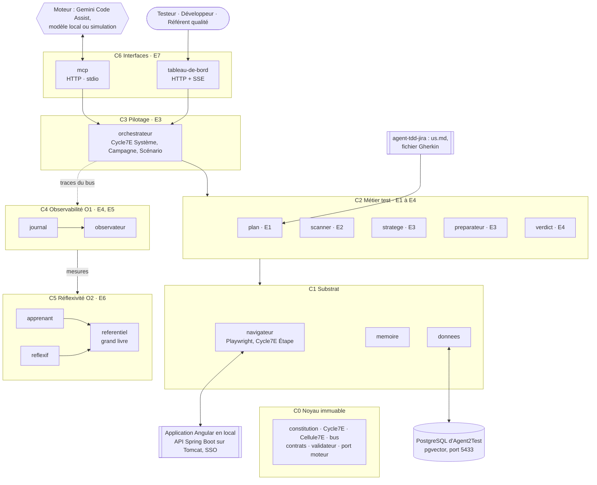
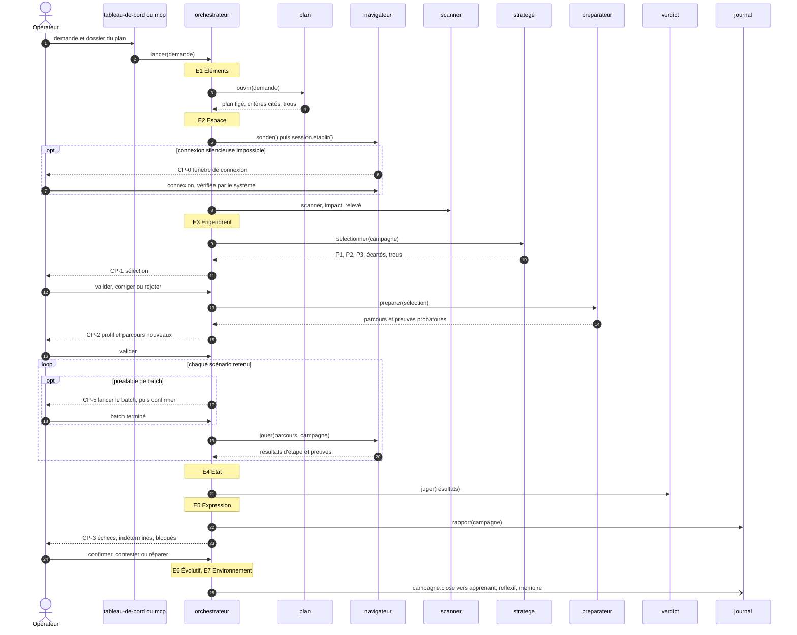
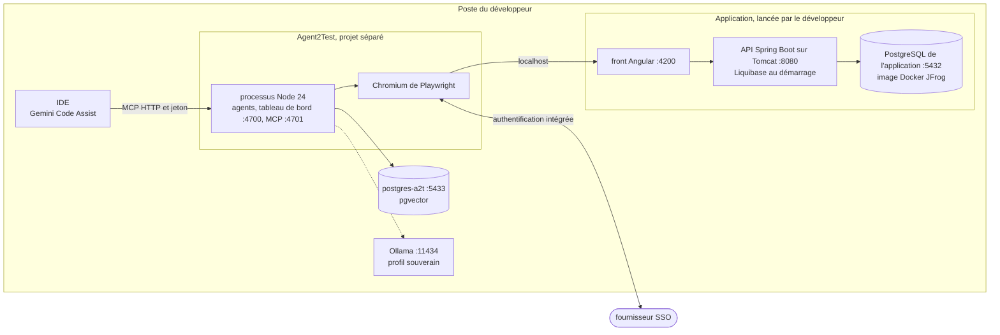

# Agent2Test : spécification 1.0.0, transmission texte

Ce texte contient à la fois la consigne de travail et la spécification complète. Il n'y a aucune pièce jointe. La spécification est découpée en fichiers, chacun délimité ainsi :

    <<<FICHIER chemin/relatif>>>
    ...contenu exact du fichier...
    <<<FIN chemin/relatif>>>

---

Tu vas construire Agent2Test, le système de tests décrit par cette spécification, dans un projet séparé de l'application qu'il teste. La spécification fait foi. Si tu relèves un écart ou une ambiguïté, signale-le au développeur. Ne corrige pas la spécification toi-même.

## Étape 0 : matérialiser la spécification

1. Crée un projet vide `agent2test/`, hors du dépôt de l'application (ou à l'emplacement que le développeur indique). À sa racine, crée le dossier `spec/`.
2. Pour chaque bloc `<<<FICHIER chemin>>>` … `<<<FIN chemin>>>`, crée le fichier `spec/chemin` avec le contenu exact compris entre les deux lignes délimitrices. Ces deux lignes ne font pas partie du fichier. Ne reformule rien, ne traduis rien, ne complète rien.
3. Si tu disposes d'un shell, vérifie chaque fichier avec `sha256sum -c` contre la table d'intégrité en fin de texte, depuis `spec/`. Signale tout écart avant de continuer.
4. Le dossier `archives/` n'est pas transmis. Ne le recrée pas.

Les chemins internes à la spécification (`modules/...`, `SKILL.md`) sont relatifs à `spec/`. Les fichiers de code (`src/...`, `test/...`, `fiches/...`, `configuration/...`) se placent à la racine du projet, à côté de `spec/`.

## Étape 1 : lecture, sans écrire de code

1. Lis `spec/SKILL.md` en entier, puis `spec/manifest.json`.
2. Lis les modules actifs dans l'ordre de `SKILL.md`, section 1.
3. Ne lis `spec/modules/accessibilite/SKILL.md` et `spec/modules/profil-recette/SKILL.md` que pour comprendre les points d'extension E2 à E4. Ne les implémente pas : leur statut est `reserved`.

## Étape 2 : plan, sans code

Soumets au développeur :

- l'arborescence des fichiers à créer, en reprenant la section « Fichiers à produire » de chaque module ;
- les choix techniques que la spécification ne couvre pas ;
- tes questions.

Attends la validation du développeur avant d'écrire la moindre ligne de code.

## Étape 3 : implémentation par lots

Après validation, implémente dans cet ordre. Chaque lot passe ses tests, en simulation et sans réseau, avant le suivant, et se termine par un point de validation du développeur. Un lot qui a besoin d'un module d'un lot suivant s'appuie sur sa simulation, déclarée par le même contrat de bus.

1. Noyau : `noyau` (D1).
2. Données, journal et référentiel : `donnees`, `journal`, `referentiel` (D2, D10, D15).
3. Plan, mémoire et cartographie : `plan`, `memoire`, `scanner` (D3, D12, D5).
4. Exécution : `navigateur`, `preparateur`, `verdict`, `orchestrateur` (D4, D7, D8, D9).
5. Sélection : `stratege` (D6).
6. Premier et second ordre : `observateur`, `apprenant`, `reflexif` (D11, D13, D14).
7. Interfaces : `mcp`, `tableau-de-bord` (D16, D17).
8. Exploitation : `exploitation` (D18) et le guide de démarrage.

## Étape 4 : recette

Vérifie les critères d'acceptation globaux de `SKILL.md`, section 9, puis rends compte au développeur : invariants couverts, scénarios passés, écarts, questions ouvertes.

## Règles qui ne se négocient pas

- L'application testée n'est jamais modifiée : ses sources sont lues, jamais écrites. Agent2Test ne la démarre, ne l'arrête ni ne la déploie, et ne lance aucun batch.
- Agent2Test ne rédige ni ne corrige aucune US, aucun critère, aucun scénario.
- Aucun identifiant SSO n'est détenu, saisi ni journalisé.
- Le moteur ne produit que des données validées ; aucun code produit par le moteur n'est exécuté ni injecté dans une page.
- Aucun point de contrôle n'est sauté, supprimé ou validé par le système.
- Aucun verdict sans preuve ; aucun verdict réécrit.
- Le journal et le grand livre sont en ajout seul.
- Tout s'exécute en local ; les interfaces n'écoutent que sur `127.0.0.1`.
- N'implémente aucun module au statut `reserved`.

Commence par l'étape 0, puis l'étape 1, puis l'étape 2.

---

# Spécification

<<<FICHIER manifest.json>>>
{
  "name": "agent2test",
  "version": "1.0.0",
  "specSchema": 1,
  "language": "fr",
  "description": "Agent2Test : système multi-agents qui choisit, prépare, exécute et journalise les tests essentiels d'une application Angular pour une demande, en pilotant Playwright comme une bibliothèque depuis Node, dans un projet séparé de l'application ; plan importé d'agent-tdd-jira, verdict par critère d'acceptation, points de contrôle humains, cybernétique de premier et de second ordre, exécution locale.",
  "entry": "SKILL.md",
  "runtime": {
    "node": ">=22",
    "playwright": ">=1.63",
    "postgresql": ">=17, image pgvector"
  },
  "targets": {
    "application": "front Angular 20, API Spring Boot 3.5 sur Tomcat en local, PostgreSQL de l'application en Docker, Liquibase au démarrage",
    "plan": "us.md et fichier Gherkin d'agent-tdd-jira, ou convention de l'annexe A",
    "moteur": "Gemini Code Assist par MCP, modèle local compatible OpenAI, ou simulation",
    "profil": "local"
  },
  "references": [
    { "name": "agent-tdd-jira", "version": "1.3.0" }
  ],
  "modules": [
    { "id": "noyau", "path": "modules/noyau/SKILL.md", "dimensions": ["D1"], "status": "active" },
    { "id": "donnees", "path": "modules/donnees/SKILL.md", "dimensions": ["D2"], "status": "active" },
    { "id": "plan", "path": "modules/plan/SKILL.md", "dimensions": ["D3"], "status": "active" },
    { "id": "navigateur", "path": "modules/navigateur/SKILL.md", "dimensions": ["D4"], "status": "active" },
    { "id": "scanner", "path": "modules/scanner/SKILL.md", "dimensions": ["D5"], "status": "active" },
    { "id": "stratege", "path": "modules/stratege/SKILL.md", "dimensions": ["D6"], "status": "active" },
    { "id": "preparateur", "path": "modules/preparateur/SKILL.md", "dimensions": ["D7"], "status": "active" },
    { "id": "verdict", "path": "modules/verdict/SKILL.md", "dimensions": ["D8"], "status": "active" },
    { "id": "orchestrateur", "path": "modules/orchestrateur/SKILL.md", "dimensions": ["D9"], "status": "active" },
    { "id": "journal", "path": "modules/journal/SKILL.md", "dimensions": ["D10"], "status": "active" },
    { "id": "observateur", "path": "modules/observateur/SKILL.md", "dimensions": ["D11"], "status": "active" },
    { "id": "memoire", "path": "modules/memoire/SKILL.md", "dimensions": ["D12"], "status": "active" },
    { "id": "apprenant", "path": "modules/apprenant/SKILL.md", "dimensions": ["D13"], "status": "active" },
    { "id": "reflexif", "path": "modules/reflexif/SKILL.md", "dimensions": ["D14"], "status": "active" },
    { "id": "referentiel", "path": "modules/referentiel/SKILL.md", "dimensions": ["D15"], "status": "active" },
    { "id": "mcp", "path": "modules/mcp/SKILL.md", "dimensions": ["D16"], "status": "active" },
    { "id": "tableau-de-bord", "path": "modules/tableau-de-bord/SKILL.md", "dimensions": ["D17"], "status": "active" },
    { "id": "exploitation", "path": "modules/exploitation/SKILL.md", "dimensions": ["D18"], "status": "active" },
    { "id": "accessibilite", "path": "modules/accessibilite/SKILL.md", "dimensions": ["D19"], "status": "reserved" },
    { "id": "profil-recette", "path": "modules/profil-recette/SKILL.md", "dimensions": ["D20"], "status": "reserved" }
  ],
  "extensionPoints": ["E1", "E2", "E3", "E4", "E5"],
  "previousVersions": []
}
<<<FIN manifest.json>>>

<<<FICHIER SKILL.md>>>
---
name: agent2test
description: Construire Agent2Test, système multi-agents qui choisit, prépare, exécute et journalise les tests essentiels d'une application Angular pour une demande donnée. Playwright y est piloté comme une bibliothèque depuis Node, dans un projet séparé de l'application ; le plan vient d'agent-tdd-jira (US, critères d'acceptation numérotés, scénarios Gherkin), chaque critère reçoit un verdict prouvé, l'humain ratifie aux points de contrôle, et le système observe et fait évoluer ses propres règles sous gouvernance. Exécution locale.
version: 1.0.0
---

# Agent2Test, spécification 1.0.0

Ce document est le point d'entrée du package. Il donne le principe, la carte du système, les points de contrôle, le registre des dimensions, les règles communes et les invariants. Les détails techniques sont dans `modules/`. Le fichier `manifest.json` déclare quels modules sont actifs.

La spécification reprend le dossier de conception d'Agent2Test (cadrage, architecture globale et cahier des charges du 25 septembre 2026), adapté aux décisions du 21 octobre 2026 : exécution locale, plan produit par agent-tdd-jira, connexion SSO silencieuse, batchs lancés par le développeur. La section 11 en donne la filiation.

## 1. Ordre de lecture

1. Ce document, sections 2 à 12.
2. `manifest.json` : modules actifs et réservés.
3. Les modules actifs, dans cet ordre :
   1. `noyau` : cycle 7E, bus, contrats, validateur, constitution, port moteur.
   2. `donnees` : PostgreSQL, un schéma et un rôle par agent, contrats nommés.
   3. `journal` : journal chaîné, journal de tests.
   4. `referentiel` : fiches, règles, épinglage, grand livre.
   5. `plan` : import du plan, demande, campagne.
   6. `memoire` : recherche hybride.
   7. `navigateur` : Playwright, session, origines, preuves.
   8. `scanner` : cartographie des sources et des écrans.
   9. `stratege` : sélection des tests essentiels.
   10. `preparateur` : profil d'environnement, parcours, exécution probatoire, réparation.
   11. `verdict` : statuts, causes présumées, preuves.
   12. `orchestrateur` : campagne, file, points de contrôle.
   13. `observateur` : métriques, alertes, traces.
   14. `apprenant`, `reflexif` : leçons candidates, mesures de second ordre, recalibrage.
   15. `mcp` : moteurs et serveur MCP.
   16. `tableau-de-bord` : IHM par rôle.
   17. `exploitation` : installation et lancement sur le poste.
4. `modules/accessibilite/SKILL.md` et `modules/profil-recette/SKILL.md` : seulement pour comprendre les points d'extension E2 à E4. Ne pas les implémenter en 1.x.

## 2. Mode de travail pour l'IA qui produit le code

1. Lisez tous les modules actifs avant d'écrire la moindre ligne de code.
2. Proposez le plan de fichiers, en reprenant la section « Fichiers à produire » de chaque module, et listez les choix que la spécification ne couvre pas. Attendez la validation du développeur.
3. Implémentez par lots, dans l'ordre de l'en-tête de transmission. Chaque lot doit passer ses tests, en simulation, avant le suivant.
4. En cas d'ambiguïté, posez une question. N'inventez ni action, ni champ, ni schéma, ni comportement absent de la spécification.
5. Les identifiants de code sont sans accents. Les commentaires, les textes de l'IHM, les messages et les journaux sont en français.
6. Chaque test cite l'invariant ou le scénario qu'il vérifie, par exemple `// D8.INV-1, VE3`. Un invariant sans test n'est pas implémenté.
7. N'implémentez aucun module au statut `reserved` dans `manifest.json`, sauf les tests d'inertie de ses points d'extension.

## 3. Objectif et principe

Pour une demande donnée, Agent2Test désigne les tests essentiels parmi les scénarios existants, les rend exécutables, les exécute sur l'application en marche sous contrôle humain, et produit un journal de tests opposable. Il ne modifie jamais l'application et n'adopte jamais seul une règle nouvelle.

**Le moteur conçoit, le noyau exécute, l'humain ratifie.**

- Le moteur (Gemini Code Assist par défaut, tout LLM par le port moteur) ne produit que des données : une sélection argumentée, des parcours, des réparations, des leçons candidates. Chaque sortie est validée contre un schéma fermé et des contrôles nommés.
- Seuls des agents déterministes agissent : `navigateur` sur l'IHM, `donnees` sur PostgreSQL. Le moteur n'a accès ni au navigateur ni à la base.
- Un parcours ratifié se rejoue sans moteur. Le moteur intervient à la conception et à la réparation, jamais pendant l'exécution : un verdict qui ne se reproduit pas ne prouve rien.
- L'humain ratifie aux points de contrôle CP-0 à CP-5 (section 5). Entre deux points, les agents avancent seuls.

Chaîne de traçabilité, depuis agent-tdd-jira :

`demande Jira → US → critères d'acceptation → scénarios Gherkin → parcours → exécutions → verdicts par critère → journal de tests`



Toutes les flèches passent par le bus ; aucun agent n'importe un autre agent. Les agents cognitifs, qui appellent le port moteur, sont `stratege` et `preparateur`, et en option `scanner` et `apprenant`.

| Responsabilité | Lieu unique |
|---|---|
| lire le code source de l'application | `scanner` |
| lire les fichiers du plan (`us.md`, fichier Gherkin, annexe A) | `plan` |
| piloter un navigateur | `navigateur` |
| accéder à PostgreSQL | `donnees` |
| appeler un moteur | port moteur du noyau, par les agents cognitifs |
| valider une sortie | validateur du noyau |
| dérouler un cycle | `Cycle7E` du noyau |
| écrire le journal | `journal` |
| stocker des vecteurs | `memoire`, dans la même base |
| versionner une règle ou une fiche | `referentiel` |

## 4. Cycle 7E

L'énoncé de l'Axiome 7E : « Les Éléments dans l'Espace Engendrent un État d'Expression Évolutif de l'Environnement ». Agent2Test l'applique à quatre échelles, avec une seule classe de cycle, `Cycle7E`, récursive (D1.INV-1).

| Phase | Opération | Étape | Scénario | Campagne | Système |
|---|---|---|---|---|---|
| E1 Éléments | recenser | action, cible, valeur | étapes, données, critères couverts | demande, US, critères, scénarios | fiches, règles, seuils, constitution |
| E2 Espace | situer | page courante, résolution de la cible | session, URL d'entrée, données préfixées | carte, mémoire, référentiel épinglé | file des campagnes, verrous |
| E3 Engendrent | produire | acte Playwright | cycles d'étapes | sélection, parcours, cycles de scénarios | cycles de campagnes |
| E4 État | constater | observation contre assertion | verdict par critère | matrice critères × verdicts | métriques de fonctionnement (O1) |
| E5 Expression | exprimer | ligne de journal, preuve | compte rendu de scénario | journal de tests | tableaux de bord |
| E6 Évolutif | ajuster | attente, alternative déclarée | nouvel essai, soupçon d'instabilité | réparation, leçons candidates | réflexivité (O2) |
| E7 Environnement | coupler | résultat remonté au scénario | résultat remonté à la campagne | rapport aux équipes, mémoire | gouvernance humaine |

Règle de récursion : l'E3 d'une échelle est la suite des cycles complets de l'échelle inférieure, et l'E7 de chaque cycle inférieur alimente l'E4 de l'échelle supérieure.

Chaque agent traite chaque message comme un cycle 7E, par sa classe de base `Cellule7E` : valider l'entrée (E1), charger fiche, mémoire et règles épinglées (E2), agir (E3), valider la sortie (E4), répondre (E5), corriger dans son budget de premier ordre (E6), remettre la trace au bus (E7). Un agent déterministe laisse vides les phases sans objet.

Clause de second ordre : Agent2Test observe une application et s'observe lui-même. Le premier ordre (O1, `journal`, `observateur`) constate son fonctionnement ; le second ordre (O2, `apprenant`, `reflexif`, `referentiel`) juge ses manières de juger et d'apprendre, propose, et ne décide jamais seul. La régression s'arrête à la constitution et à la gouvernance humaine : ce que le système ne peut pas changer de lui-même rend ses observations comparables dans le temps.

## 5. Points de contrôle

| CP | Moment | Qui décide | Décisions | Ce qui attend |
|---|---|---|---|---|
| CP-0 Session | la connexion silencieuse a échoué, ou la session a expiré pendant un scénario | l'opérateur | se connecter dans la fenêtre ouverte ; le système vérifie seul la session obtenue | tout accès à l'IHM |
| CP-1 Sélection | après la sélection (E3 de la campagne) | testeur | valider · corriger, commentaire obligatoire · rejeter | la préparation |
| CP-2 Mise en place | profil d'environnement au premier passage ; parcours nouveaux ou modifiés, après exécution probatoire | testeur ou développeur | valider · corriger · rejeter | leur exécution en campagne |
| CP-3 Verdicts | après E4, pour les échecs, les indéterminés et les scénarios bloqués | testeur | confirmer · contester, le désaccord est consigné à côté du verdict · demander une réparation | la clôture |
| CP-4 Gouvernance | proposition de règle : leçon, recalibrage, quarantaine | référent qualité, depuis le tableau de bord seulement | ratifier · amender · refuser | rien : asynchrone, effet à la campagne suivante |
| CP-5 Préalable | avant de jouer un scénario qui exige un batch Java | développeur | batch lancé et terminé · scénario non joué, avec son motif | ce scénario |

Un parcours ratifié et inchangé ne repasse pas par CP-2. Le niveau d'autonomie de chaque point, présenter tout ou présenter l'écart seulement, est fixé par la configuration humaine, que le système ne peut pas modifier (D9.INV-1).

## 6. Registre des dimensions

| ID | Dimension | Introduite | Statut 1.0.0 | Dépend de | Module |
|---|---|---|---|---|---|
| D1 | Noyau 7E, bus et constitution | 1.0 | active | | `noyau` |
| D2 | Données isolées par agent | 1.0 | active | D1 | `donnees` |
| D3 | Plan canonique et demande | 1.0 | active | D1, D2 | `plan` |
| D4 | Navigateur, session et preuves | 1.0 | active | D1 | `navigateur` |
| D5 | Cartographie de l'application | 1.0 | active | D2, D4 | `scanner` |
| D6 | Sélection des tests essentiels | 1.0 | active | D3, D5, D12 | `stratege` |
| D7 | Préparation des parcours | 1.0 | active | D4, D5, D6 | `preparateur` |
| D8 | Verdicts et causes présumées | 1.0 | active | D4, D7 | `verdict` |
| D9 | Orchestration et points de contrôle | 1.0 | active | D1, D3 à D8 | `orchestrateur` |
| D10 | Journal et journal de tests | 1.0 | active | D1, D2 | `journal` |
| D11 | Observabilité de premier ordre | 1.0 | active | D10 | `observateur` |
| D12 | Mémoire et recherche hybride | 1.0 | active | D2, D3, D5 | `memoire` |
| D13 | Apprentissage | 1.0 | active | D9, D10, D15 | `apprenant` |
| D14 | Réflexivité de second ordre | 1.0 | active | D11, D13, D15 | `reflexif` |
| D15 | Référentiel, versions et grand livre | 1.0 | active | D1, D2 | `referentiel` |
| D16 | Moteurs et serveur MCP | 1.0 | active | D1, D9 | `mcp` |
| D17 | Tableau de bord par rôle | 1.0 | active | D9, D10, D11 | `tableau-de-bord` |
| D18 | Exploitation locale | 1.0 | active | D2, D4 | `exploitation` |
| D19 | Accessibilité des parcours (axe) | 1.0 | reserved | D4, D7, D8 | `accessibilite` |
| D20 | Profil recette et conteneur | 1.0 | reserved | D4, D18 | `profil-recette` |

Statuts : `active` (implémentée et testée), `reserved` (points d'extension posés, fonctionnalité absente), `superseded` (remplacée ; la version de remplacement est indiquée).

## 7. Contrat de version et points d'extension

### 7.1 Contrat

1. Chaque version déclare son numéro dans le frontmatter de ce document et dans `manifest.json`, et ajoute une entrée à la section 12.
2. Une version mineure ajoute au moins une dimension ou un point d'extension. Sinon, c'est un correctif : seul le numéro de patch change.
3. Une dimension `reserved` ne passe à `active` que si ses invariants ont des tests dans la suite de la version.
4. Une dimension `active` ne sort du registre qu'en passant à `superseded`, avec la version de remplacement et une section de migration.
5. Un invariant ne s'affaiblit jamais. Il peut être remplacé par un invariant plus fort, signalé dans la section 12.
6. Les schémas PostgreSQL évoluent uniquement par migrations numérotées ; une migration appliquée quelque part n'est jamais modifiée.
7. Chaque ligne du journal porte la version de spécification qui l'a produite. Un journal écrit dans une version reste lisible dans toute version de la même famille majeure.
8. Avant de publier une nouvelle version, la précédente est archivée dans `archives/SKILL-vX.Y.Z.md`. Une archive n'est jamais éditée.

### 7.2 Points d'extension

Un point d'extension n'est pas une fonctionnalité. En 1.x, il n'a qu'un test qui prouve qu'il est inerte.

- **E1** : les adaptateurs d'entrée du plan forment un ensemble ouvert. En 1.0.0, seuls `agent-tdd-jira` et `annexe-a` existent ; tout autre format est refusé avec le motif « format d'entrée non pris en charge ».
- **E2** : le jeu d'actions des parcours réserve l'action `auditer`, destinée à l'accessibilité (D19). En 1.0.0, un parcours qui l'emploie est rejeté par le validateur avec le motif « action réservée ».
- **E3** : les profils d'environnement réservent `recette` et `conteneur` (D20). En 1.0.0, un profil de ce type est refusé au démarrage avec le motif « profil réservé ».
- **E4** : la stratégie de session `etat`, une session importée pour un navigateur sans tête, est réservée à D20 ; en 1.0.0, elle est refusée au démarrage.
- **E5** : le port moteur accepte de nouveaux adaptateurs par version ; en 1.0.0 : `simulation`, `externe` (MCP) et `compatible-openai`. Un adaptateur inconnu est refusé au démarrage.

## 8. Règles globales

- **Périmètre** : Agent2Test n'agit que pour tester. Il ne modifie jamais l'application ni ses sources, qu'il lit seulement ; il ne démarre, n'arrête ni ne déploie l'application et ne lance aucun batch. Il ne rédige ni ne corrige le plan de tests.
- **Projet séparé** : Agent2Test est un projet à part, hors du dépôt de l'application. Il lit le dossier `docs/demandes/<CLÉ>/` et les sources du projet de l'application en lecture seule, à l'emplacement que la configuration désigne.
- **Local** : en 1.0.0, tout s'exécute sur le poste du développeur, contre l'application lancée en local. Les interfaces n'écoutent que sur `127.0.0.1`.
- **Secrets** : aucun identifiant SSO n'est détenu. La session, les jetons des interfaces et la configuration des moteurs viennent de fichiers hors dépôt, en mode 0600, ou de l'environnement ; ils n'apparaissent jamais dans le journal, les preuves, les messages ni le contexte transmis au moteur.
- **Données de test** : toute donnée créée par un parcours porte le préfixe `A2T-<campagne>-`. La base de l'application n'est pas touchée.
- **Configuration humaine** : un fichier `configuration/humaine.json`, lu au démarrage et jamais écrit par le système, fixe l'autonomie des points de contrôle, les origines autorisées, l'autorisation du moteur externe, l'oracle SQL, les rôles des utilisateurs d'Agent2Test et les rôles de l'application que porte la session.
- **Langue** : identifiants de code sans accents ; textes de l'IHM, messages, journal et journal de tests en français.
- **Node** : Node 24 recommandé, Node 22 au minimum ; deux dépendances d'exécution seulement, `playwright` et `pg`.

## 9. Critères d'acceptation globaux

- `npm test` passe sans accès réseau, en simulation : moteur `simulation`, application de démonstration servie sur `127.0.0.1` par les tests, fournisseur SSO simulé.
- Chaque invariant de la section 10 apparaît dans au moins un test. Un script vérifie cette correspondance.
- Sur l'application cible, une campagne va de la demande au journal de tests sans intervention hors des points de contrôle.
- Le rejeu d'un parcours ratifié, application inchangée, donne le même verdict.
- En simulation, chaque défaut injecté reçoit la cause attendue : cible obsolète, session expirée, défaut applicatif, instabilité, application injoignable.
- Une altération du journal faite en base est détectée et la première ligne rompue est nommée.
- Aucun module `reserved` n'est chargé ; chaque point d'extension a son test d'inertie.
- Le guide de démarrage suffit, seul, à installer et lancer le kit sur le poste du développeur.
- Le journal de tests JSON de l'exemple ECR-77 respecte le contrat de lecture d'agent-tdd-jira 1.3.0 (module `journal`, section 3) : sources du plan et leurs empreintes, état git à l'ouverture, verdicts de la liste fermée, cible de chaque décision.

## 10. Invariants

Chaque invariant est vérifié par au moins un test de son module.

**D1 : noyau**

- **D1.INV-1** : chaque cycle déroule les sept phases E1 à E7, dans l'ordre, à chacune des quatre échelles (Système, Campagne, Scénario, Étape) ; l'E3 d'une échelle est la suite des cycles complets de l'échelle inférieure, et chaque ligne de journal porte son échelle et sa phase.
- **D1.INV-2** : les agents ne communiquent que par le bus ; le bus refuse tout appel ou événement absent du contrat déclaré de l'agent, et aucun agent n'importe un autre agent.
- **D1.INV-3** : toute sortie du moteur est validée contre un schéma fermé et des contrôles nommés avant d'être consommée ; une sortie non conforme n'est jamais utilisée.
- **D1.INV-4** : au démarrage, une constitution dont l'empreinte SHA-256 diffère de celle inscrite au grand livre empêche le démarrage, avec un message explicite.
- **D1.INV-5** : toute demande étrangère aux tests (modifier le code, déployer, administrer) est refusée avec le motif « hors périmètre ».
- **D1.INV-6** : aucune action d'agent n'écrit la constitution, le code, les schémas du journal ou du grand livre, ni la configuration humaine.

**D2 : données**

- **D2.INV-1** : chaque agent propriétaire a son schéma et son rôle PostgreSQL ; une écriture d'un agent dans le schéma d'un autre est refusée par la base elle-même.
- **D2.INV-2** : seuls des contrats nommés s'exécutent ; une requête SQL libre est refusée.
- **D2.INV-3** : la base de l'application n'est jamais accédée, sauf par l'oracle en lecture seule, activé explicitement dans la configuration humaine et limité à des contrats de lecture nommés.
- **D2.INV-4** : les preuves sont purgées au-delà de leur durée de conservation ; le journal garde leurs empreintes.

**D3 : plan**

- **D3.INV-1** : le système ne rédige ni ne corrige aucune US, aucun critère, aucun scénario ; un critère qu'aucun scénario ne couvre est marqué « trou de couverture », et aucun scénario n'est créé pour lui.
- **D3.INV-2** : chaque US, critère et scénario a un identifiant canonique unique ; deux éléments de même identifiant bloquent l'import, et le message cite leurs deux emplacements.
- **D3.INV-3** : un scénario dont un prérequis sort du périmètre (redémarrage, écriture directe en base) est marqué « non automatisable » avec son motif ; un prérequis de batch Java devient un préalable confié au développeur (CP-5).
- **D3.INV-4** : le plan est versionné : réimporter des sources inchangées ne crée aucune version, une source modifiée en crée une nouvelle, et la précédente reste consultable.
- **D3.INV-5** : seul un scénario validé, qui illustre au moins un critère validé, est jouable ; un scénario proposé non validé, en attente d'une question, limité au back, ou qui exige un rôle que la session n'a pas, est « non jouable », avec son motif.
- **D3.INV-6** : un critère cité par la demande et absent du plan est signalé avant la sélection.

**D4 : navigateur**

- **D4.INV-1** : seul `navigateur` pilote Playwright ; aucun autre module n'ouvre de navigateur.
- **D4.INV-2** : le navigateur ne charge que les origines déclarées au profil ; une navigation vers une autre origine est bloquée avant chargement, et le journal indique l'origine visée.
- **D4.INV-3** : le système ne détient aucun identifiant SSO et ne saisit rien dans les pages du fournisseur SSO ; la session est un secret local (fichier hors dépôt, mode 0600), jamais journalisée ni transmise au moteur, et les traces conservées sont expurgées des en-têtes `Authorization`, `Cookie` et `Set-Cookie`.
- **D4.INV-4** : seules les actions du jeu fermé s'exécutent ; aucun code produit par le moteur n'atteint la page, ni par script, ni par évaluation.
- **D4.INV-5** : une étape n'attend que des états, dans un délai borné ; aucune étape n'attend une durée fixe.
- **D4.INV-6** : une étape de mutation exécutée n'est jamais rejouée ; une étape `verifier`, ou une étape dont l'action n'a pas eu lieu, est retentée deux fois au plus, et un succès au réessai classe l'étape `INSTABILITE`, jamais « réussie ».
- **D4.INV-7** : la session s'établit d'abord sans action humaine, par la stratégie configurée ; si cela échoue, CP-0 s'ouvre, et seul le système le ferme, après avoir atteint seul une page protégée.

**D5 : cartographie**

- **D5.INV-1** : le scan ne crée, ne modifie ni ne supprime aucun fichier du projet de l'application, et refuse toute lecture hors de sa racine.
- **D5.INV-2** : le relevé des écrans en marche ne joue que des navigations : aucun clic, aucune saisie, aucune soumission.
- **D5.INV-3** : chaque élément interactif sans nom accessible figure dans la liste des fragilités de ciblage.
- **D5.INV-4** : pour un fichier modifié, l'impact renvoie chaque écran atteint avec le chemin qui le justifie : fichier, point d'API, service, composant, route.
- **D5.INV-5** : un second scan sans fichier modifié ne réanalyse aucun fichier.

**D6 : sélection**

- **D6.INV-1** : le palier P1 contient tous les scénarios jouables qui couvrent un critère cité par la demande ; la règle est revérifiée après la revue du moteur.
- **D6.INV-2** : le palier P3 contient tous les scénarios jouables déclarés « socle ».
- **D6.INV-3** : chaque scénario retenu ou écarté porte un motif d'une phrase, et chaque score du palier P2 se lit décomposé facteur par facteur.
- **D6.INV-4** : aucune préparation ne démarre avant la décision en CP-1 ; une correction en CP-1 exige un commentaire.
- **D6.INV-5** : sans moteur disponible, la sélection déterministe est présentée seule, avec la marque « sans revue du moteur ».

**D7 : préparation**

- **D7.INV-1** : un parcours est une donnée conforme au schéma des parcours ; une action hors du jeu fermé, ou une donnée non conforme, est rejetée avant toute exécution.
- **D7.INV-2** : chaque critère couvert par un parcours est porté par au moins une étape `verifier`.
- **D7.INV-3** : toute valeur saisie par une étape de mutation porte le préfixe `A2T-<campagne>-` ; une étape de suppression dont la cible ne porte pas ce préfixe n'est pas jouée et bloque le scénario jusqu'à la décision en CP-3.
- **D7.INV-4** : chaque parcours porte son origine : moteur, fiche et version composée, empreinte du prompt, ratificateur.
- **D7.INV-5** : un profil d'environnement ou un parcours n'est exécuté en campagne qu'une fois ratifié en CP-2 ; toute modification, réparation comprise, crée une version nouvelle soumise à CP-2.
- **D7.INV-6** : les budgets sont bornés : 3 renvois au moteur pour une sortie non conforme, 2 réparations par parcours et par campagne ; au-delà, l'échec est présenté au point de contrôle.
- **D7.INV-7** : les cibles suivent l'ordre fixé (rôle et nom accessible, libellé, identifiant de test, texte, texte indicatif, CSS) ; une cible CSS porte un motif et figure parmi les fragilités de ciblage.

**D8 : verdicts**

- **D8.INV-1** : pas de verdict sans preuve : un critère dont une preuve manque est « non vérifié », jamais « conforme » ; « conforme » et « non conforme » dérivent des critères d'acceptation, jamais du code.
- **D8.INV-2** : un verdict n'est jamais réécrit ; un désaccord humain est consigné à côté.
- **D8.INV-3** : chaque échec reçoit une cause de la liste fermée (`DEFAUT_APPLICATIF`, `DEFAUT_PARCOURS`, `SESSION_EXPIREE`, `ENVIRONNEMENT`, `INSTABILITE`, `INDETERMINE`) et cite les signaux qui la fondent.
- **D8.INV-4** : chaque verdict porte l'empreinte SHA-256 de ses preuves.
- **D8.INV-5** : une session expirée n'impute aucun échec : après CP-0, le scénario est rejoué depuis son début.

**D9 : orchestration**

- **D9.INV-1** : aucun point de contrôle n'est supprimé, sauté ou validé par le système ; aucune phase ne consomme une sortie non ratifiée, et le niveau d'autonomie de chaque point se lit dans la configuration humaine.
- **D9.INV-2** : chaque décision enregistre son auteur, son canal, sa date et son commentaire.
- **D9.INV-3** : avant le premier scénario, une sonde vérifie que l'application répond ; sinon, la campagne est refusée avec ce motif.
- **D9.INV-4** : une seule campagne s'exécute à la fois sur une application cible ; les autres attendent en file.
- **D9.INV-5** : l'arrêt d'urgence suspend la campagne au plus tard à la fin de l'étape en cours.
- **D9.INV-6** : après un redémarrage du processus, la campagne reprend au début du scénario interrompu, sans perte de journal.
- **D9.INV-7** : Agent2Test ne démarre, n'arrête ni ne déploie l'application, et ne lance aucun batch ; un scénario à préalable de batch attend en CP-5 que le développeur l'ait lancé et l'ait déclaré terminé.

**D10 : journal**

- **D10.INV-1** : le journal est en ajout seul, imposé par les droits de la base, et chaîné par empreintes ; `verifierChaine` détecte une altération faite en base par un compte privilégié et nomme la première ligne rompue.
- **D10.INV-2** : le journal de tests d'une campagne est produit en Markdown, JSON, JUnit XML et HTML à partir de la même source, et sa matrice critères × verdicts couvre tous les critères de la demande, trous de couverture compris.
- **D10.INV-3** : tout contenu produit par le moteur est marqué comme tel dans le journal de tests, avec moteur, fiche et version.
- **D10.INV-4** : l'empreinte de fin de chaîne du journal de tests est celle du journal à la clôture de la campagne.

**D11 : observabilité**

- **D11.INV-1** : chaque appel entre agents produit une trace portant corrélation, parent, échelle, phase et vecteur des sept durées.
- **D11.INV-2** : pour chaque campagne, toute échelle dont les sept phases ne figurent pas dans l'ordre au journal est signalée comme violation de D1.INV-1.
- **D11.INV-3** : aucun module du premier ordre n'appelle un module du second ordre ; le graphe des appels du bus le vérifie.
- **D11.INV-4** : une dérive d'indicateur au-delà de son seuil lève une alerte visible au tableau de bord.

**D12 : mémoire**

- **D12.INV-1** : la recherche fonctionne par le plein texte seul ; avec un modèle de plongement local, plein texte et vecteurs sont fusionnés par rang réciproque.
- **D12.INV-2** : tout fragment injecté dans une consigne appartient aux versions épinglées de la campagne, et ses identifiants sont journalisés avec l'appel au moteur.
- **D12.INV-3** : avant injection, les secrets, adresses électroniques et noms de personnes déclarés sont masqués, et un fragment trop long est tronqué avec la marque « tronqué ».

**D13 : apprentissage**

- **D13.INV-1** : chaque correction ou rejet commenté en CP-1, CP-2 ou CP-3 produit une leçon candidate, liée à sa fiche, à son moteur et à sa décision source.
- **D13.INV-2** : aucune leçon n'entre dans une fiche avant sa ratification en CP-4.
- **D13.INV-3** : une leçon ratifiée ne s'applique qu'au moteur sur lequel elle a été apprise ; l'étendre à un autre moteur est une ratification distincte.

**D14 : réflexivité**

- **D14.INV-1** : pour chaque contrôle automatique, l'accord avec les décisions humaines est mesuré par fiche, version et moteur dès l'exposition minimale, et la précision des alertes O1 est mesurée à partir de leur qualification par l'opérateur.
- **D14.INV-2** : le système revient seul au dernier état ratifié quand une leçon ou un recalibrage dégrade sa mesure au-delà de la marge ; il n'adopte jamais seul une règle nouvelle, n'élargit aucune borne et n'assouplit aucun point de contrôle.
- **D14.INV-3** : un écart entre la répartition des causes présumées et les reclassements humains en CP-3 lève une alerte au référent qualité.
- **D14.INV-4** : chaque proposition nomme la règle, l'échelle et la phase touchées, la valeur actuelle, la valeur proposée, les preuves et l'effet attendu, et reste dans les bornes de la constitution.
- **D14.INV-5** : le second ordre lit le premier ordre et ne l'écrit jamais.

**D15 : référentiel**

- **D15.INV-1** : chaque campagne s'exécute avec le référentiel épinglé à son E2 ; une règle ratifiée ne s'applique qu'à partir de la campagne suivante.
- **D15.INV-2** : le grand livre est en ajout seul et chaîné par empreintes ; il inscrit chaque version publiée de la constitution, chaque ratification, refus, suspension et retour arrière.
- **D15.INV-3** : chaque fiche porte une version composée ; pour toute sortie du moteur, le prompt se reconstitue à partir de la fiche, de sa version et des fragments journalisés, et son empreinte égale celle du journal.
- **D15.INV-4** : les pouvoirs sont séparés : proposer (`apprenant`, `reflexif`), ratifier (un humain, en CP-4, hors du canal MCP), appliquer (`referentiel`), mesurer (`reflexif`).
- **D15.INV-5** : les règles modifiables se limitent à la liste fermée de la constitution, chacune dans ses bornes ; une valeur hors bornes est refusée.

**D16 : moteurs et MCP**

- **D16.INV-1** : le serveur MCP n'écoute que sur `127.0.0.1` ; une requête HTTP sans jeton valide, ou venant d'une origine non autorisée, est refusée.
- **D16.INV-2** : une décision CP-4 reçue par le canal MCP est refusée ; l'arrêt d'urgence y reste permis.
- **D16.INV-3** : le contexte transmis au moteur, par MCP ou par un autre adaptateur, est minimisé, borné et masqué ; aucun secret ni identifiant n'y figure.
- **D16.INV-4** : changer de moteur ne demande aucune modification de code ; chaque appel au moteur est journalisé avec fiche et version composée, moteur, empreinte du prompt, fragments injectés et usage.
- **D16.INV-5** : aucun contenu du projet de l'application n'est transmis à un moteur externe tant que la configuration humaine ne porte pas l'autorisation de l'envoyer.
- **D16.INV-6** : avec le profil souverain, une campagne complète aboutit sans autre connexion sortante que vers l'application cible et son fournisseur SSO.

**D17 : tableau de bord**

- **D17.INV-1** : le tableau de bord n'écoute que sur `127.0.0.1` et exige un jeton porteur.
- **D17.INV-2** : les droits de décision suivent les rôles : testeur (CP-0 à CP-3), développeur (CP-2, CP-5), référent qualité (CP-4, seulement depuis le tableau de bord).
- **D17.INV-3** : l'IHM ne présente aucune non-conformité RGAA 4.1 de niveau A ou AA.
- **D17.INV-4** : les textes de l'IHM, les messages et le journal de tests sont en français.

**D18 : exploitation**

- **D18.INV-1** : sous une version de Node antérieure à 22, le kit refuse de démarrer avec un message explicite.
- **D18.INV-2** : le kit n'a que deux dépendances d'exécution, `playwright` et `pg`, épinglées par un fichier de verrouillage et installées par `npm ci` ; toutes ses dépendances et images sont sous licence open source.
- **D18.INV-3** : le PostgreSQL d'Agent2Test écoute sur le port 5433 et n'est jamais celui de l'application.
- **D18.INV-4** : seul le profil d'environnement `local` est accepté ; un profil `recette` ou `conteneur` est refusé tant que la dimension D20 est réservée.

## 11. Filiation avec le dossier de conception

Le dossier du dépôt Agent2Test (`00-cadrage.md`, `01-architecture.md`, `02-cahier-des-charges.md`) reste la source des choix. Ses invariants I1 à I15 deviennent des invariants de dimension ; ses décisions d'architecture, notées ici DA1 à DA20 pour ne pas les confondre avec les dimensions, sont reprises dans les modules.

| Dossier | Spécification |
|---|---|
| I1 cycle 7E | D1.INV-1, D11.INV-2 |
| I2 périmètre | D1.INV-5 |
| I3 application jamais modifiée | D5.INV-1, section 8 |
| I4 le moteur ne produit que des données | D1.INV-3, D4.INV-4, D7.INV-1 |
| I5 pas de verdict sans preuve | D8.INV-1 |
| I6 verdict jamais réécrit | D8.INV-2 |
| I7 journal et grand livre en ajout seul | D10.INV-1, D15.INV-2 |
| I8 points de contrôle intangibles | D9.INV-1 |
| I9 auto-modification asymétrique | D13.INV-2, D14.INV-2 |
| I10 séparation des pouvoirs | D15.INV-4, D16.INV-2 |
| I11 aucun identifiant SSO détenu | D4.INV-3 |
| I12 origines déclarées, contexte minimisé | D4.INV-2, D12.INV-3, D16.INV-3 |
| I13 écritures préfixées, aucune requête libre | D2.INV-2, D7.INV-3 |
| I14 origine des productions du moteur | D7.INV-4, D10.INV-3 |
| I15 paliers obligatoires de sélection | D6.INV-1, D6.INV-2 |

Ce qui change par rapport au dossier :

| Point du dossier | Décision du 21 octobre 2026 | Effet dans la spécification |
|---|---|---|
| H1 : plan en Markdown ou sortie JSON d'Agent2Dev | Agent2Dev applique agent-tdd-jira | adaptateur `agent-tdd-jira` (us.md, fichier Gherkin), annexe A en second format (E1) |
| Décision 8 du cahier : chaîne sans Gherkin | « critères d'acceptation puis Gherkin, toujours » | les étapes Gherkin tiennent lieu du texte libre des scénarios (module `plan`) |
| H2 : application lancée, sondée | application sur Tomcat en local, lancée par le développeur | D9.INV-3, D9.INV-7 |
| H3 : connexion SSO humaine | connexion SSO réglée automatiquement sur le poste | stratégie `integree` par défaut, CP-0 en repli (D4.INV-7) |
| CA-1.5 : batch non automatisable | batch lancé par le développeur à un point de contrôle | point CP-5 (D3.INV-3, D9.INV-7) |
| H9 : pas de test d'accessibilité | accessibilité réservée | dimension D19, point d'extension E2 |
| CA-9.4, profil conteneur : recette | tout reste en local | dimension D20, points d'extension E3 et E4, D18.INV-4 |
| T1 : envoi des sources à Gemini | à autoriser par la DSI et le RSSI | D16.INV-5 |
| H12, US-29 : AI Act | mis de côté | hors périmètre ; restent l'origine des productions (D10.INV-3) et la conservation des preuves (D2.INV-4) |
| absent du dossier : rôle de l'application exigé par un scénario | proposé pour le binôme, à ratifier : la session SSO du poste porte des rôles déclarés par un humain | étiquette `@role-<nom>`, configuration `session.roles`, scénario non jouable si le rôle manque (D3.INV-5) |
| absent du dossier : lecture du journal par l'agent de développement | proposé pour le binôme, à ratifier | contrat de lecture du journal JSON : sources du plan et leurs empreintes, état git relevé à l'ouverture, cible de chaque décision (module `journal`) |

Les valeurs par défaut H14 à H19 du cahier (budgets, conservation, langue, méta-critères, réparations) sont reprises dans la constitution, au module `referentiel`.

## 12. Journal de révision

**1.0.0** (2026-10-21) : première version, tirée du dossier de conception d'Agent2Test et des décisions du 21 octobre 2026. Dimensions D1 à D18 actives, D19 (accessibilité) et D20 (profil recette et conteneur) réservées. Points d'extension E1 à E5. Entrée : us.md et fichier Gherkin d'agent-tdd-jira 1.3.0, qui la référence en retour pour le travail en binôme (sa dimension D7) ; le journal de tests JSON porte ce que lit agent-tdd-jira : sources du plan et leurs empreintes, état git de la racine relevé à l'ouverture, cible de chaque décision et de chaque désaccord. Un scénario qui exige un rôle absent de la session est non jouable.
<<<FIN SKILL.md>>>

<<<FICHIER modules/noyau/SKILL.md>>>
---
name: noyau
description: Noyau immuable d'Agent2Test (cycle 7E récursif à quatre échelles, cellule 7E de chaque agent, bus à contrats déclarés, validateur de schémas fermés et de contrôles nommés, constitution vérifiée par empreinte au démarrage, port moteur, garde de périmètre et garde d'écriture). À lire en premier ; à implémenter au lot 1.
dimensions: [D1]
status: active
---

# Module `noyau` (D1)

Le noyau est une bibliothèque, pas un agent. Tous les agents en héritent ; aucun ne le modifie. Il ne dépend d'aucun autre module.

## 1. Cycle 7E (D1.INV-1)

Une seule classe, `Cycle7E`, sert aux quatre échelles. Une échelle est une spécialisation, pas un module.

```js
class Cycle7E {
  constructor({ echelle, contexte, journal }) {}
  async elements(entree) {}     // E1 : recenser, valider, figer pour le cycle
  async espace(elements) {}     // E2 : situer (carte, session, mémoire, règles épinglées)
  async engendrer(espace) {}    // E3 : produire ; à l'échelle n, déroule les cycles de l'échelle n − 1
  async etat(produits) {}       // E4 : constater par rapport à l'attendu
  async expression(etat) {}     // E5 : rendre lisible et opposable
  async evolutif(expression) {} // E6 : ajuster dans le budget du premier ordre
  async environnement(bilan) {} // E7 : remonter au niveau englobant
  async derouler(entree) {}     // enchaîne E1 à E7 et journalise chaque phase
}
```

| Échelle | Classe | Instanciée par | E3 |
|---|---|---|---|
| Système | `CycleSysteme` | `orchestrateur` | cycles de campagnes |
| Campagne | `CycleCampagne` | `orchestrateur` | sélection, parcours, cycles de scénarios |
| Scénario | `CycleScenario` | `orchestrateur` | cycles d'étapes |
| Étape | `CycleEtape` | `navigateur` | acte Playwright |

Règles :

- `derouler` appelle les sept méthodes dans l'ordre. Une phase sans objet s'exécute quand même et se journalise `vide` ; aucune phase n'est sautée.
- Une erreur levée en E3 ne rompt pas le cycle : E4 constate l'erreur, E5 l'exprime, E6 décide d'un nouvel essai dans le budget, E7 remonte le résultat.
- La valeur rendue par l'E7 d'un cycle enfant est versée à l'E4 du cycle parent.
- Chaque phase écrit une ligne de journal avec `echelle`, `phase`, durée et identifiant du cycle parent.

## 2. Cellule 7E

`Cellule7E` est la classe de base de chaque agent. Chaque message reçu est un cycle :

| E1 | E2 | E3 | E4 | E5 | E6 | E7 |
|---|---|---|---|---|---|---|
| valider l'entrée contre le contrat | charger fiche, mémoire et règles épinglées | agir : outil, moteur, contrat SQL | valider la sortie : schéma, contrôles nommés | répondre, publier | corriger dans le budget | remettre la trace au bus |

La trace porte le vecteur des sept durées, en millisecondes. Un agent déterministe laisse vides E2 et E6 s'ils sont sans objet ; la forme ne change pas.

## 3. Bus (D1.INV-2)

```js
bus.demander(cible, action, charge, contexte, { delaiMs }) // appel nommé : réponse, trace, délai de garde
bus.publier(type, charge, contexte)                        // événement sans réponse
bus.tracer(fn)                                             // reçoit chaque appel terminé, succès ou échec
bus.abonner(fn)                                            // reçoit chaque événement
```

Contexte propagé : `{ correlation, campagne, echelle, phase, parent, appelant }`. `parent` construit l'arbre des traces ; `appelant` permet à `donnees` de choisir le rôle PostgreSQL.

Chaque agent déclare son contrat au démarrage :

```js
export const contrat = {
  agent: 'verdict',
  actions: {
    juger: { entree: 'verdict.juger.entree', sortie: 'verdict.juger.sortie' }
  },
  evenements: ['verdict.rendu'],
  appelle: ['journal.ecrire', 'donnees.executer']
};
```

- Le bus refuse un appel vers une action non déclarée, un appel que l'appelant n'a pas déclaré dans `appelle`, et un événement non déclaré. Le refus est une erreur nommée, `APPEL_NON_DECLARE`, journalisée.
- Les entrées et sorties sont validées par le validateur contre les schémas nommés du contrat.
- Délai de garde par défaut : 30 secondes ; une action le dépasse, le bus rend `DELAI_DEPASSE`.
- Le bus tient le graphe des appels effectifs ; `observateur` s'en sert pour D11.INV-3.
- Un agent ne reçoit qu'une poignée vers le bus. Aucun fichier de `src/agents/<a>/` n'importe un fichier de `src/agents/<b>/` ; un test le vérifie sur les sources.

## 4. Validateur (D1.INV-3)

Le validateur est écrit dans le noyau, sans dépendance : il couvre le sous-ensemble de JSON Schema employé par la spécification (`type`, `properties`, `required`, `additionalProperties: false`, `enum`, `const`, `pattern`, `items`, `minItems`, `maxItems`, `minimum`, `maximum`, `oneOf`). Tous les schémas sont fermés : `additionalProperties` vaut `false` partout.

Les contrôles nommés complètent les schémas, par exemple `parcours.verifier-par-critere` ou `parcours.prefixe-mutation`. Chacun est une fonction pure, enregistrée sous son nom.

Le résultat est une liste d'écarts `{ chemin, regle, message }`. Une liste non vide interdit de consommer la sortie : l'agent la renvoie au moteur dans son budget (E6), ou présente l'échec au point de contrôle.

## 5. Constitution (D1.INV-4, D1.INV-6)

`constitution/constitution.json` est le point fixe du système :

```json
{
  "version": "1.0.0",
  "invariants": ["D1.INV-1", "D1.INV-2"],
  "pointsDeControle": ["CP-0", "CP-1", "CP-2", "CP-3", "CP-4", "CP-5"],
  "reglesModifiables": [
    { "regle": "selection.poids", "bornes": { "min": 0, "max": 1 } },
    { "regle": "budget.reessaiEtape", "bornes": { "min": 0, "max": 2 } }
  ],
  "metaCriteres": { "fenetre": 10, "expositionMin": 3, "marge": 15 }
}
```

La liste complète des règles modifiables et de leurs bornes est au module `referentiel`, section 4 ; la constitution la recopie.

- L'empreinte est le SHA-256 de la constitution sérialisée en JSON canonique (clés triées, sans espace).
- Au démarrage, le noyau compare cette empreinte à la dernière entrée `constitution.publiee` du grand livre. Un écart, ou l'absence d'entrée, empêche le démarrage avec le message « constitution non publiée ou modifiée : publier par `npm run constitution:publier` ».
- La publication est une commande humaine, hors du bus : `npm run constitution:publier` inscrit l'empreinte au grand livre. Aucun agent ne l'appelle.

Garde d'écriture : le noyau expose `ecriture.autoriser(chemin, agent)`. Seuls sont permis le dossier des preuves (`navigateur`, `journal`), le fichier de session (`navigateur`) et les exports du journal de tests (`journal`). Toute autre écriture, et en particulier `constitution/`, `src/`, `migrations/`, `fiches/` et `configuration/`, est refusée avec l'erreur `ECRITURE_INTERDITE`.

## 6. Port moteur

```js
moteur.completer({ systeme, message, schema, fiche, version }) // → { texte, usage }
```

Le noyau définit l'interface et choisit l'adaptateur d'après la configuration ; les adaptateurs sont au module `mcp`. La sortie `texte` est toujours analysée en JSON puis passée au validateur avant usage (D1.INV-3).

## 7. Garde de périmètre (D1.INV-5)

`perimetre.verifier(demande)` est appelé par `plan` à l'ouverture d'une campagne. Une demande est refusée avec le motif « hors périmètre » quand son objet n'est pas de tester, ou quand son texte demande de modifier du code, de déployer, d'administrer ou d'écrire en base. La liste des intentions refusées est dans la constitution.

## 8. Pièges connus

- **Orchestrateur par échelle** : il n'y en a qu'un ; une échelle est une spécialisation de `Cycle7E`.
- **Phase sautée sur erreur** : une erreur en E3 se traite en E4 et E6, pas par un `return` anticipé.
- **Validateur indulgent** : un champ inconnu est un écart, jamais un champ ignoré.
- **Publication automatique de la constitution** : jamais au démarrage, jamais par un agent.

## 9. Tests (scénarios)

| Scénario | Vérifie | Cas |
|---|---|---|
| NO1 | D1.INV-1 | un cycle à deux échelles journalise sept phases par échelle, dans l'ordre, l'E7 de l'enfant versé à l'E4 du parent |
| NO2 | D1.INV-1 | une erreur levée en E3 produit quand même E4 à E7, et une phase sans objet se journalise `vide` |
| NO3 | D1.INV-2 | un appel vers une action non déclarée est refusé `APPEL_NON_DECLARE` et journalisé |
| NO4 | D1.INV-2 | un appel non déclaré dans `appelle` est refusé ; un événement non déclaré est refusé |
| NO5 | D1.INV-2 | aucun fichier de `src/agents/<a>/` n'importe `src/agents/<b>/` (analyse des sources) |
| NO6 | D1.INV-3 | une sortie du moteur avec un champ inconnu, ou un contrôle nommé en échec, n'est pas consommée et ses écarts sont listés |
| NO7 | D1.INV-4 | une constitution modifiée d'un caractère empêche le démarrage avec le message prévu |
| NO8 | D1.INV-4 | sans entrée `constitution.publiee` au grand livre, le démarrage est refusé |
| NO9 | D1.INV-5 | une demande « corriger le code du composant » est refusée « hors périmètre » ; une demande de test est acceptée |
| NO10 | D1.INV-6 | une tentative d'écriture d'un agent dans `constitution/` ou `configuration/` est refusée `ECRITURE_INTERDITE` |

## 10. Fichiers à produire

- `src/noyau/cycle7e.js`, `src/noyau/echelles.js`, `src/noyau/cellule7e.js`
- `src/noyau/bus.js`, `src/noyau/contrats.js`
- `src/noyau/validateur.js`, `src/noyau/controles.js`, `schemas/` (un fichier par schéma nommé)
- `src/noyau/constitution.js`, `constitution/constitution.json`, `scripts/publier-constitution.js`
- `src/noyau/moteur.js` (interface et choix de l'adaptateur)
- `src/noyau/perimetre.js`, `src/noyau/ecriture.js`
- `test/noyau/*.test.js`
<<<FIN modules/noyau/SKILL.md>>>

<<<FICHIER modules/donnees/SKILL.md>>>
---
name: donnees
description: Données d'Agent2Test dans PostgreSQL sous Docker (image pgvector, base agent2test sur le port 5433, un schéma et un rôle par agent propriétaire, droits en ajout seul pour journal et grand livre, contrats nommés au lieu de SQL libre, migrations numérotées, oracle en lecture seule sur la base de l'application désactivé par défaut, purge des preuves). À implémenter au lot 2.
dimensions: [D2]
status: active
---

# Module `donnees` (D2)

`donnees` est le seul accès à PostgreSQL. Il tient un pool de connexions par rôle et choisit le rôle d'après le champ `appelant` du contexte de bus.

## 1. Base et schémas (D2.INV-1)

Une instance PostgreSQL 17 ou plus récente, image pgvector, en conteneur, port 5433 (module `exploitation`). Une base `agent2test`. Un schéma et un rôle par agent propriétaire :

| Schéma | Rôle propriétaire | Contenu principal |
|---|---|---|
| `plan` | `a2t_plan` | sources, versions du plan, US, critères, scénarios, demandes, campagnes du plan |
| `scan` | `a2t_scanner` | relevés, écrans, éléments, routes, points d'API, empreintes de fichiers |
| `strategie` | `a2t_stratege` | sélections, éléments retenus et écartés, motifs, scores |
| `preparation` | `a2t_preparateur` | profils d'environnement, parcours versionnés, résolutions, réparations |
| `execution` | `a2t_navigateur` | exécutions, résultats d'étape, preuves (chemin et empreinte), métadonnées de session, jamais le secret |
| `verdict` | `a2t_verdict` | verdicts, causes, empreintes, désaccords |
| `orchestration` | `a2t_orchestrateur` | campagnes, cycles, points de contrôle, décisions, file, verrous |
| `journal` | `a2t_journal` | lignes chaînées |
| `observation` | `a2t_observateur` | séries de mesures, alertes |
| `apprentissage` | `a2t_apprenant` | leçons, expositions |
| `reflexion` | `a2t_reflexif` | mesures d'accord, propositions, évaluations des observateurs |
| `referentiel` | `a2t_referentiel` | fiches, règles, versions, épinglages, grand livre |
| `memoire` | `a2t_memoire` | documents, fragments, `tsvector` français, vecteurs |

- Chaque rôle n'a de droits d'écriture que sur son schéma. Un agent qui tente d'écrire ailleurs reçoit le refus de la base elle-même, pas d'un contrôle applicatif.
- Les lectures croisées passent par une action de l'agent propriétaire, sur le bus ; aucun rôle n'a de droit de lecture sur le schéma d'un autre.
- `journal.lignes` et `referentiel.grand_livre` n'accordent à leur rôle que `INSERT` et `SELECT` : ni `UPDATE`, ni `DELETE`, ni `TRUNCATE`. Un déclencheur refuse en plus toute mise à jour.

## 2. Contrats nommés (D2.INV-2)

```js
await bus.demander('donnees', 'executer', { contrat: 'verdict.inserer', parametres: { ... } }, contexte);
```

- Chaque contrat est déclaré dans `src/donnees/contrats/<schema>.js` : nom, rôle, texte SQL paramétré, schéma des paramètres, nature (`lecture` ou `ecriture`).
- Un contrat inconnu, ou appelé par un agent qui n'est pas son propriétaire, est refusé `CONTRAT_INCONNU` ou `CONTRAT_INTERDIT`.
- Aucune action n'accepte de texte SQL en paramètre. Les paramètres passent par les marqueurs `$1, $2…` du pilote `pg`, jamais par concaténation.

## 3. Migrations

- `migrations/NNN-nom.sql`, numérotées, appliquées dans l'ordre par `npm run migrer` avec le rôle d'administration, jamais par un agent.
- Une table `public.migrations` enregistre numéro, nom et empreinte de chaque migration appliquée ; une migration appliquée dont le fichier a changé empêche le démarrage.

## 4. Base de l'application (D2.INV-3)

La base de l'application n'est pas touchée. L'oracle SQL en lecture seule reste possible, à trois conditions :

1. la configuration humaine porte `oracle: { actif: true, dsn: "<référence au fichier de secret>" }` ;
2. la connexion se fait avec un compte de lecture seule et `default_transaction_read_only = on` ;
3. seuls des contrats de lecture nommés, déclarés par les scénarios dans le profil d'environnement et ratifiés en CP-2, s'exécutent.

Sans ces trois conditions, toute demande à l'oracle est refusée `ORACLE_INACTIF`.

## 5. Conservation (D2.INV-4)

- Les preuves (captures, traces, instantanés) sont des fichiers ; leur chemin et leur empreinte SHA-256 sont en base.
- Durée de conservation par défaut : 30 jours, fixée par la configuration humaine (`conservation.preuvesJours`) ; le système ne la modifie pas.
- `npm run purger` supprime les fichiers échus et inscrit au journal une ligne `preuve.purgee` par fichier, avec son empreinte ; l'empreinte reste en base.
- Le journal et le grand livre sont conservés sans limite.

## 6. Pièges connus

- **Rôle unique de confort** : un seul rôle pour tous les agents ruine D2.INV-1 ; les tests se connectent avec chaque rôle.
- **SQL dynamique** : un nom de colonne choisi par paramètre est du SQL libre ; il passe par un contrat distinct.
- **Base de l'application par défaut** : le DSN de l'application ne figure dans aucune configuration tant que l'oracle est inactif.

## 7. Tests (scénarios)

| Scénario | Vérifie | Cas |
|---|---|---|
| BD1 | D2.INV-1 | le rôle `a2t_verdict` qui écrit dans `plan` reçoit le refus de PostgreSQL |
| BD2 | D2.INV-1 | le rôle `a2t_journal` ne peut ni mettre à jour ni supprimer une ligne du journal |
| BD3 | D2.INV-2 | un contrat inconnu est refusé `CONTRAT_INCONNU` ; un contrat appelé par un autre agent est refusé `CONTRAT_INTERDIT` |
| BD4 | D2.INV-2 | aucune action n'accepte de SQL en paramètre (analyse des contrats déclarés) |
| BD5 | D2.INV-3 | une demande à l'oracle sans configuration humaine est refusée `ORACLE_INACTIF` |
| BD6 | D2.INV-3 | avec l'oracle actif, une écriture est refusée par la transaction en lecture seule |
| BD7 | D2.INV-4 | une preuve de 31 jours est purgée, son empreinte reste en base et une ligne `preuve.purgee` est écrite |

Les tests emploient une base PostgreSQL de test démarrée par `docker compose` ; en son absence, les tests BD sont signalés comme non exécutés, jamais comme réussis.

## 8. Fichiers à produire

- `src/donnees/agent.js`, `src/donnees/pools.js`, `src/donnees/oracle.js`
- `src/donnees/contrats/<schema>.js` (un fichier par schéma)
- `migrations/001-schemas-et-roles.sql`, puis une migration par schéma
- `scripts/migrer.js`, `scripts/purger.js`
- `test/donnees/*.test.js`
<<<FIN modules/donnees/SKILL.md>>>

<<<FICHIER modules/plan/SKILL.md>>>
---
name: plan
description: Import du plan de tests et ouverture d'une campagne (adaptateur agent-tdd-jira pour us.md et le fichier Gherkin avec leurs étiquettes, adaptateur de la convention de l'annexe A, plan canonique versionné, empreintes des sources, identifiants uniques, marques orphelin, trou de couverture, non jouable et non automatisable, préalable de batch, rôle requis et rôles de la session, demande et critères cités, état git relevé à l'ouverture). À implémenter au lot 3.
dimensions: [D3]
status: active
---

# Module `plan` (D3)

`plan` transforme les fichiers du plan en un plan canonique, et ouvre la partie « éléments » (E1) d'une campagne. Il ne rédige rien : ce qu'il ne trouve pas, il le signale (D3.INV-1).

`plan` ne lit que les fichiers du plan que la demande désigne, en lecture seule, dans la racine du projet de l'application, avec le même confinement que le `scanner` : aucun chemin hors de la racine, même par lien symbolique. Le code source de l'application reste réservé au `scanner`.

## 1. Adaptateurs d'entrée (point E1)

### 1.1 `agent-tdd-jira`

Source : le dossier `docs/demandes/<CLÉ>/` du projet de l'application, produit par agent-tdd-jira 1.3.0 (`agent-tdd-jira:D10.INV-5`, `agent-tdd-jira:D7.INV-1`).

`us.md` :

- une section `## <CLÉ>-USnn : titre` ouvre une US ; la phrase « En tant que … » la décrit ;
- le tableau `| CA | Énoncé | Origine | Provenance | Statut | Scénarios |` donne ses critères ;
- statuts : `validé`, `à valider`, `en attente de Qn`, `retiré : <raison>` ;
- la section `## Exigences` est versée en mémoire comme contexte, sans autre effet.

`<CLÉ>.feature` :

| Élément Gherkin | Élément canonique |
|---|---|
| `Scénario:` ou `Exemple:` | scénario |
| `Plan du scénario:` et `Exemples:` | un scénario par ligne d'exemple, identifiant `<CLÉ>-Snn#k`, valeurs substituées |
| étapes `Étant donné`, `Quand`, `Alors`, `Et`, `Mais` | étapes en texte libre, dans l'ordre ; celles du `Contexte:` sont placées en tête de chaque scénario |
| `@<CLÉ>-Snn` | identifiant du scénario |
| `@<CLÉ>-CAnn` | critères couverts |
| `@front`, `@back` | couches touchées |
| `@socle` | scénario du socle (palier P3) |
| `@criticite-haute`, `@criticite-moyenne`, `@criticite-basse` | criticité ; moyenne par défaut |
| `@role-<nom>` | rôle de l'application requis par le scénario, nommé comme elle le nomme |
| `@batch-<nom>` | préalable : batch Java `<nom>`, lancé par le développeur en CP-5 |
| `@redemarrage`, `@ecriture-base` | prérequis hors périmètre |
| `@en-attente`, `@propose` | états d'agent-tdd-jira |

Une étiquette portée par la ligne `Fonctionnalité:` vaut pour chacun de ses scénarios, comme `@role-LECTEUR` dans l'exemple ECR-77. Une étiquette absente de ce tableau, comme `@<CLÉ>` sur la fonctionnalité, est conservée sans effet.

Identifiants canoniques : ceux d'agent-tdd-jira, tels quels, puisqu'ils portent déjà la clé de la demande (`ECR-77-US01`, `ECR-77-CA02`, `ECR-77-S03`).

### 1.2 `annexe-a`

La convention de l'annexe A du cahier des charges d'Agent2Test : frontmatter `espace`, titres `US-<n> —`, critères `CA-<n>.<m> :`, scénarios `S-<n>.<k> —` avec les lignes `Couvre :`, `Criticité :`, `Socle :` et `Prérequis :` (`batch <nom>`, `redémarrage` ou `écriture en base`), puis la liste numérotée des étapes. Identifiant canonique : `<espace>/<code>`. Le contenu des blocs de code est ignoré.

### 1.3 Autres formats

Tout autre format est refusé avec le motif « format d'entrée non pris en charge » (point E1).

## 2. Jouabilité et marques (D3.INV-1, D3.INV-3, D3.INV-5)

| Situation | Marque | Effet |
|---|---|---|
| critère qu'aucun scénario ne couvre | trou de couverture | signalé ; aucun scénario n'est créé |
| scénario qui ne couvre aucun critère existant | orphelin | importé, non jouable |
| scénario `@propose` | non jouable : proposé, non validé | aucun parcours |
| scénario `@en-attente`, ou dont tous les critères sont en attente | non jouable : en attente de Qn | aucun parcours |
| scénario `@back` sans `@front` | non jouable : limité au back | ses critères restent « non vérifiés » par Agent2Test ; les tests d'agent-tdd-jira les couvrent |
| scénario dont aucun critère n'est `validé` | non jouable : critère non validé | aucun parcours |
| critère `retiré` | retiré | hors de la demande ; mentionné, sans verdict |
| `@redemarrage`, `@ecriture-base`, `Prérequis : redémarrage` ou `écriture en base` | non automatisable, avec son motif | jamais joué |
| `@batch-<nom>`, `Prérequis : batch <nom>` | préalable de batch | jouable ; CP-5 s'ouvre avant le scénario (D9.INV-7) |
| `@role-<nom>`, dont le rôle manque aux rôles de la session déclarés par la configuration humaine (`session.roles`) | non jouable : rôle <nom> absent de la session | évalué à l'ouverture de la campagne ; ses critères restent « non vérifiés » |

Est jouable un scénario qui n'a aucune des marques bloquantes ci-dessus et qui illustre au moins un critère validé.

## 3. Plan canonique

```json
{
  "version": "P-14",
  "sources": [{ "chemin": "docs/demandes/ECR-77/us.md", "empreinte": "<sha256>" }, { "chemin": "docs/demandes/ECR-77/ECR-77.feature", "empreinte": "<sha256>" }],
  "us": [{ "id": "ECR-77-US01", "titre": "exporter la liste des retours d'expérience", "description": "En tant qu'utilisateur…", "source": "us.md:3" }],
  "criteres": [{ "id": "ECR-77-CA01", "us": "ECR-77-US01", "texte": "le fichier contient…", "statut": "validé", "source": "us.md:10" }],
  "scenarios": [{
    "id": "ECR-77-S01", "titre": "Exporter la liste filtrée", "couvre": ["ECR-77-CA01"],
    "etapes": ["je suis connecté avec le rôle \"LECTEUR\"", "la liste filtrée affiche 3 retours d'expérience", "je demande l'export CSV de la liste",
      "je reçois un fichier \"retours-experience.csv\"", "il contient 1 ligne d'en-tête et 3 lignes de données"],
    "couches": ["back", "front"], "criticite": "moyenne", "socle": false, "prealables": [], "roles": ["LECTEUR"],
    "jouable": true, "marques": [], "source": "ECR-77.feature:14"
  }],
  "trous": []
}
```

Chaque élément garde sa source, fichier et ligne. Le chemin d'une source est relatif à la racine du projet de l'application, avec `/` pour séparateur ; son empreinte est le SHA-256 de son contenu brut, en hexadécimal, celui que donne `sha256sum`.

## 4. Identifiants et versions (D3.INV-2, D3.INV-4)

- Deux éléments de même identifiant canonique bloquent l'import ; le message cite les deux emplacements, fichier et ligne.
- La version du plan est l'empreinte de l'ensemble des sources, triées par chemin. Sources inchangées : aucune version nouvelle. Source modifiée : version nouvelle `P-<n+1>` ; les précédentes restent consultables.

## 5. Demande et campagne (D3.INV-6)

```js
await bus.demander('plan', 'ouvrir', {
  demande: { cle: 'ECR-77', texte: 'Export des retours d’expérience en CSV' },
  sources: { adaptateur: 'agent-tdd-jira', dossier: 'docs/demandes/ECR-77' },
  changements: { git: 'origin/develop...HEAD' }
}, contexte);
```

- `perimetre.verifier(demande)` du noyau s'applique d'abord (D1.INV-5).
- Critères cités : pour l'adaptateur `agent-tdd-jira`, tous les critères non retirés de `us.md` ; pour l'annexe A, ceux que la demande énumère. Un critère cité absent du plan est signalé avant la sélection, avec l'événement `plan.critere_absent`.
- `changements` : une liste de fichiers modifiés, ou une plage git lue par le `scanner` ; elle alimente l'impact (module `scanner`).
- Rôles : un scénario `@role-<nom>` dont le rôle manque à `session.roles` de la configuration humaine est non jouable pour la campagne, motif « rôle <nom> absent de la session ». Le système ne déduit jamais les rôles de la session : un humain les déclare.
- La campagne retient, à son ouverture, la version du plan, les empreintes de ses sources et l'état git de la racine relevé par le `scanner` : commit `HEAD` et fichiers suivis modifiés. Une modification ultérieure des sources ne change ni sa sélection ni ses verdicts (D3.INV-4).

## 6. Actions et événements

| Action | Rôle |
|---|---|
| `importer(sources)` | importe et versionne ; rend le plan canonique et ses marques |
| `ouvrir(demande)` | vérifie le périmètre, fige la version et l'état git, rend critères cités, trous, absents et scénarios non jouables faute de rôle |
| `plan(campagne)` | plan figé de la campagne |
| `criteres(filtre)` | critères et leurs scénarios |

Événements : `plan.importe`, `plan.trou_couverture`, `plan.critere_absent`.

## 7. Pièges connus

- **Combler un trou** : jamais de scénario créé, même évident.
- **Gherkin réécrit** : les étapes sont recopiées ; le préparateur s'en sert telles quelles.
- **Critère « à valider » joué** : seul un critère validé rend un scénario jouable.
- **Scénario `@back` joué par l'IHM** : il n'a pas de parcours ; ses critères sont « non vérifiés » côté Agent2Test.
- **Rôle supposé** : jouer un scénario `@role-ADMIN` avec une session qui n'a que le rôle LECTEUR produirait un faux défaut applicatif ; la jouabilité se décide à l'ouverture, d'après `session.roles`.

## 8. Tests (scénarios)

| Scénario | Vérifie | Cas |
|---|---|---|
| PL1 | D3.INV-1 | un critère sans scénario est marqué trou de couverture et aucun scénario n'est créé |
| PL2 | D3.INV-2 | deux scénarios `@ECR-77-S02` bloquent l'import ; le message cite les deux lignes |
| PL3 | D3.INV-3 | `@batch-remplissage-modules` donne un préalable de batch ; `@redemarrage` donne « non automatisable » avec son motif |
| PL4 | D3.INV-4 | réimporter des sources inchangées ne crée aucune version ; modifier `us.md` crée `P-<n+1>`, la précédente reste lisible |
| PL5 | D3.INV-5 | un scénario `@propose`, un scénario `@en-attente` et un scénario `@back` seul sont non jouables, chacun avec son motif |
| PL6 | D3.INV-5 | un scénario dont le seul critère est « à valider » est non jouable |
| PL7 | D3.INV-6 | une demande qui cite `ECR-77-CA09`, absent de `us.md`, lève `plan.critere_absent` avant la sélection |
| PL8 | D3.INV-1 | l'exemple ECR-77 d'agent-tdd-jira donne 1 US, 4 critères, 4 scénarios, les étapes du Contexte en tête de chacun, et le rôle LECTEUR requis par chacun |
| PL9 | D3.INV-2 | un `Plan du scénario` à deux lignes d'exemples donne `<CLÉ>-Snn#1` et `#2`, valeurs substituées |
| PL10 | point E1 | un fichier CSV est refusé « format d'entrée non pris en charge » |
| PL11 | D3.INV-1 | le fichier de l'annexe A du cahier d'Agent2Test s'importe tel quel, identifiants `<espace>/<code>` |
| PL12 | D1.INV-5 | une demande « déployer en recette » est refusée « hors périmètre » à l'ouverture |
| PL13 | D3.INV-5 | avec `session.roles` limité à `LECTEUR`, un scénario `@role-ADMIN` est non jouable, motif « rôle ADMIN absent de la session » ; `@role-LECTEUR` porté par la fonctionnalité rend chacun de ses scénarios dépendant de ce rôle |
| PL14 | D3.INV-4 | les empreintes des sources sont celles de `sha256sum` ; l'ouverture retient le commit et les fichiers suivis modifiés relevés par le `scanner` |

## 9. Fichiers à produire

- `src/agents/plan/agent.js`, `src/agents/plan/canonique.js`, `src/agents/plan/versions.js`
- `src/agents/plan/adaptateurs/agent-tdd-jira.js`, `src/agents/plan/adaptateurs/annexe-a.js`, `src/agents/plan/gherkin.js`
- `schemas/plan-canonique.json`
- `test/plan/*.test.js`, `test/fixtures/plans/ECR-77/` (us.md et fichier Gherkin de l'exemple d'agent-tdd-jira)
<<<FIN modules/plan/SKILL.md>>>

<<<FICHIER modules/navigateur/SKILL.md>>>
---
name: navigateur
description: Seul propriétaire de Playwright, piloté comme une bibliothèque depuis Node (session SSO réglée automatiquement par authentification intégrée, CP-0 en repli, aucun identifiant détenu, origines autorisées bloquées avant chargement, jeu d'actions fermé sans évaluation de code, attentes par état, réessais bornés sans rejeu des mutations, preuves masquées et expurgées, instantanés ARIA, désignation interactive, sonde, monde simulé pour les tests). À implémenter au lot 4.
dimensions: [D4]
status: active
---

# Module `navigateur` (D4)

Le `navigateur` est le seul module qui ouvre un navigateur (D4.INV-1). Il importe `chromium` du paquet `playwright` et pilote la bibliothèque directement : ni fichier `.spec.ts`, ni exécuteur `@playwright/test`. Il instancie le cycle de l'échelle Étape (module `noyau`).

## 1. Session (D4.INV-3, D4.INV-7)

| Stratégie | Principe | Statut 1.0.0 |
|---|---|---|
| `integree` (défaut) | contexte persistant dans un profil dédié ; Chromium lancé avec `--auth-server-allowlist` et `--auth-negotiate-delegate-allowlist` sur les domaines SSO de la configuration humaine : l'authentification intégrée du poste, ou la session déjà ouverte chez le fournisseur, connecte sans action humaine | active |
| `profil` | contexte persistant ; l'opérateur se connecte une fois en CP-0, puis le cookie du fournisseur rend les reconnexions silencieuses | active |
| `cdp` | rattachement à un Chrome déjà ouvert et connecté (`chromium.connectOverCDP` sur `127.0.0.1`) | active |
| `etat` | session importée pour un navigateur sans tête | réservée à D20 (point E4) : refusée au démarrage |

- `session.verifier()` ouvre l'URL protégée du profil. Une redirection vers l'origine du fournisseur SSO signifie une session absente ou expirée.
- `session.etablir()` applique la stratégie configurée. Si la page protégée n'est pas atteinte sans action humaine, CP-0 s'ouvre : fenêtre visible, le système n'y saisit rien. Il ne ferme CP-0 qu'après avoir atteint seul la page protégée.
- Avec la stratégie `integree`, le processus Node et Chromium tournent sur le système où l'authentification intégrée du poste fonctionne, sous Windows en général (module `exploitation`).
- Les rôles de l'application que porte la session sont déclarés par un humain dans la configuration (`session.roles`) : le système ne les déduit pas de la session. Le `plan` s'en sert pour la jouabilité des scénarios `@role-<nom>` (D3.INV-5).
- Le profil de session vit hors du projet et du dépôt, dans le dossier que fixe la configuration humaine, en mode 0700 pour le dossier et 0600 pour les fichiers. Son contenu n'est jamais lu par un autre module, jamais journalisé, jamais transmis au moteur.

## 2. Origines (D4.INV-2)

- Le profil d'environnement déclare les origines autorisées : celle de l'application, celle de son API, celle du fournisseur SSO.
- `context.route('**/*', …)` laisse passer une requête vers une origine autorisée et interrompt toute autre requête avant chargement (`route.abort('blockedbyclient')`).
- Une navigation bloquée fait échouer l'étape ; le journal porte l'événement `origine.bloquee` avec l'origine visée.

## 3. Jeu d'actions fermé (D4.INV-4, D4.INV-5)

| Action | Effet | Champs |
|---|---|---|
| `naviguer` | aller à une URL relative à l'URL de base | `url` |
| `cliquer` | cliquer la cible | `cible`, `mutation` facultatif |
| `saisir` | remplir un champ | `cible`, `valeur` |
| `choisir` | choisir une option | `cible`, `valeur` |
| `cocher` | cocher ou décocher | `cible`, `valeur` booléenne |
| `survoler` | survoler la cible | `cible` |
| `touche` | presser une touche | `touche` |
| `televerser` | téléverser un fichier de `test/donnees/` | `cible`, `fichier` |
| `attendre` | attendre un état : `visible`, `masque`, `actif`, `inactif`, `url`, `texte` | `cible` ou `url`, `etat` |
| `verifier` | constater un attendu : `contient`, `visible`, `valeur`, `nombre`, `url`, `actif` | `critere`, `cible`, `attendu` |
| `auditer` | réservée à l'accessibilité (D19, point E2) | rejetée en 1.0.0 |

Résolution d'une cible, dans l'ordre des stratégies du profil : `getByRole(role, { name })`, `getByLabel`, `getByTestId` (attribut d'identifiant de test du profil), `getByText`, `getByPlaceholder`, puis `locator(css)` en dernier recours. Les localisateurs de Playwright sont stricts : une cible ambiguë échoue au lieu de cliquer au hasard.

- Le module n'emploie ni `page.evaluate`, ni `addScriptTag`, ni `addInitScript`, ni `waitForTimeout` ; un test le vérifie sur les sources.
- `attendre` et `verifier` interrogent l'état jusqu'à son obtention, dans un délai borné : 10 secondes par défaut, 30 au plus (configuration humaine).

## 4. Étapes et réessais (D4.INV-6)

- Une étape de mutation porte `mutation` : `creation`, `modification` ou `suppression`. Une fois l'action exécutée, elle n'est jamais rejouée, même en cas d'échec de l'étape suivante.
- Une étape `verifier`, ou une étape dont l'action n'a pas eu lieu (cible non encore présente), est retentée deux fois au plus (règle `budget.reessaiEtape`).
- Un succès obtenu au réessai classe l'étape `INSTABILITE`, jamais « réussie ».
- Avant de jouer une étape `suppression`, le navigateur lit le texte de l'élément résolu : s'il ne contient pas le préfixe `A2T-<campagne>-`, l'étape n'est pas jouée et le scénario est bloqué (D7.INV-3).

## 5. Preuves

- Une capture par étape `verifier` et par échec, avec les zones sensibles de l'écran masquées (option `mask`, localisateurs du profil).
- Une trace par scénario : `context.tracing.start({ screenshots: true, snapshots: true })`, puis `trace.zip`.
- Un instantané ARIA à chaque échec (`page.ariaSnapshotJSON()`).
- Les erreurs de console (`page.on('console')`, type `error`) et les réponses de statut 400 ou plus (`page.on('response')`) sont relevées et versées au résultat d'étape.
- Avant d'écrire une trace dans le dossier des preuves, le navigateur réécrit son archive : la valeur des en-têtes `Authorization`, `Cookie` et `Set-Cookie` est remplacée par `[expurgé]`. L'enregistrement HAR est désactivé par défaut ; activé, il subit la même expurgation.
- Chemins : `preuves/<campagne>/<scénario>/<n>.png`, `trace.zip`, `aria-<n>.json` ; chaque fichier a son empreinte SHA-256, enregistrée dans le schéma `execution`.

## 6. Autres actions

| Action | Rôle |
|---|---|
| `sonder()` | requête HTTP vers l'URL de base et, si le profil la déclare, vers l'URL de santé de l'API ; rend `{ repond, statut, dureeMs }` |
| `instantane(url)` | pour le `scanner` : navigation seule, instantané ARIA en JSON, capture masquée |
| `resoudre(cibles)` | pour le `preparateur` : résout des cibles dans la page courante ou un instantané |
| `jouer(parcours, mode)` | joue un parcours ; `mode` : `probatoire` ou `campagne` ; rend les résultats d'étape et les preuves |
| `designer()` | ouvre la fenêtre et laisse l'opérateur désigner un élément (`page.pickLocator()`, Playwright 1.59 ou plus récent) ; rend la cible correspondante |

Événements : `session.expiree`, `etape.jouee`, `origine.bloquee`.

## 7. Simulation

- Tests unitaires : un monde simulé remplace Playwright. Il décrit des pages par leur arbre ARIA et accepte des défauts injectés : `cible-obsolete`, `session-expiree`, `defaut-applicatif`, `instabilite`, `application-injoignable`.
- Tests d'intégration : Playwright pilote l'application de démonstration servie sur `127.0.0.1` par les tests, avec un fournisseur SSO simulé sur une autre origine. Aucun accès réseau.

## 8. Pièges connus

- **Attente d'une durée** : jamais ; un rendu Angular différé s'attend par un état.
- **Rejeu d'un clic « Enregistrer »** : une mutation exécutée ne se rejoue pas, même si la capture qui suit échoue.
- **Trace non expurgée** : l'archive de trace contient les en-têtes réseau ; elle passe par l'expurgation avant d'être gardée.
- **Identifiant saisi dans la page du fournisseur** : jamais, même en simulation.

## 9. Tests (scénarios)

| Scénario | Vérifie | Cas |
|---|---|---|
| NA1 | D4.INV-1 | seul `src/agents/navigateur/` importe `playwright` (analyse des sources) |
| NA2 | D4.INV-2 | une navigation vers une origine non déclarée est bloquée avant chargement ; le journal porte l'origine visée |
| NA3 | D4.INV-3 | après une campagne, aucun cookie ni jeton n'apparaît dans le journal, les preuves, la configuration ou les contextes du moteur |
| NA4 | D4.INV-3 | une trace conservée ne contient aucune valeur d'en-tête `Authorization`, `Cookie` ou `Set-Cookie` |
| NA5 | D4.INV-3 | le profil de session est créé hors du projet, en mode 0700, ses fichiers en 0600 |
| NA6 | D4.INV-4 | les sources du module n'emploient ni `page.evaluate`, ni `addScriptTag`, ni `addInitScript` |
| NA7 | D4.INV-5 | les sources n'emploient pas `waitForTimeout` ; un `attendre` sur un élément qui apparaît après 2 secondes réussit sans durée fixe |
| NA8 | D4.INV-6 | une étape `cliquer` de mutation exécutée n'est pas rejouée quand l'étape suivante échoue |
| NA9 | D4.INV-6 | une étape `verifier` qui échoue puis réussit au premier réessai est classée `INSTABILITE` |
| NA10 | D4.INV-7 | avec la stratégie `integree` et un fournisseur simulé qui connecte sans saisie, CP-0 ne s'ouvre pas |
| NA11 | D4.INV-7 | quand le fournisseur simulé exige une saisie, CP-0 s'ouvre ; il ne se ferme qu'après l'accès à la page protégée |
| NA12 | point E4 | la stratégie `etat` est refusée au démarrage |
| NA13 | point E2 | un parcours qui contient `auditer` n'est pas joué : « action réservée » |
| NA14 | D7.INV-3 | une étape `suppression` sur un élément sans préfixe n'est pas jouée et bloque le scénario |

## 10. Fichiers à produire

- `src/agents/navigateur/agent.js`, `src/agents/navigateur/session.js`, `src/agents/navigateur/origines.js`
- `src/agents/navigateur/actions.js`, `src/agents/navigateur/cibles.js`, `src/agents/navigateur/etape.js` (cycle Étape)
- `src/agents/navigateur/preuves.js`, `src/agents/navigateur/expurgation.js`, `src/agents/navigateur/sonde.js`
- `src/agents/navigateur/monde-simule.js`
- `test/navigateur/*.test.js`, `test/fixtures/appli-web/` (application de démonstration et fournisseur SSO simulé)
<<<FIN modules/navigateur/SKILL.md>>>

<<<FICHIER modules/scanner/SKILL.md>>>
---
name: scanner
description: Cartographie de l'application en lecture seule (routes Angular dont celles chargées à la demande, gabarits analysés par le compilateur Angular du projet, éléments interactifs avec rôle, nom accessible et identifiant de test, fragilités de ciblage, points d'API Spring appariés aux appels des services Angular, impact justifié d'un fichier modifié, état git de la racine à l'ouverture d'une campagne, scan incrémental par empreintes, relevé des écrans en marche par navigations seules). À implémenter au lot 3.
dimensions: [D5]
status: active
---

# Module `scanner` (D5)

Le `scanner` est le seul lecteur du code source de l'application. Il produit la carte applicative : ce qui existe, où, et comment l'atteindre. Il ne modifie rien.

## 1. Lecture confinée (D5.INV-1)

- La racine du projet de l'application vient du profil d'environnement. Le scanner résout chaque chemin par `realpath` et refuse, avec l'erreur `LECTURE_HORS_RACINE`, tout chemin qui en sort, y compris par lien symbolique.
- Il ouvre les fichiers en lecture seule et n'appelle aucune fonction d'écriture du système de fichiers.
- Il lit git en lecture seule, par quatre commandes et aucune autre : `git diff --name-only <plage>` et `git ls-files` pour les changements ; `git rev-parse HEAD` et `git status --porcelain --untracked-files=no` pour l'état de la racine à l'ouverture d'une campagne. Chacune est lancée avec `git --no-optional-locks`, pour que git ne réécrive pas son index au passage.

## 2. Scan statique du front

- Routes : les configurations de routes (`provideRouter`, `Routes`, `loadComponent`, `loadChildren`, gardes `canActivate`, `canMatch`), y compris les routes chargées à la demande, avec leur composant.
- Gabarits : analysés par le compilateur Angular du projet lui-même (`@angular/compiler` de son `node_modules`, fonction `parseTemplate`), qui comprend la syntaxe de contrôle `@if`, `@for` et `@switch`. TypeScript est lu par le paquet `typescript` du projet. Aucune dépendance n'est ajoutée à Agent2Test.
- Éléments interactifs : `button`, `a[href]`, `input`, `select`, `textarea`, éléments à rôle ARIA interactif. Pour chacun : rôle présumé, nom accessible (libellé associé, `aria-label`, `aria-labelledby`, texte, clé de traduction résolue dans les fichiers de traduction du profil), identifiant de test (attribut déclaré au profil, par exemple `data-testid`).
- Fragilités de ciblage : chaque élément interactif sans nom accessible y figure, avec son fichier et sa ligne (D5.INV-3).

## 3. Scan statique du back et appariement

- Points d'API : les classes `@RestController` ou `@Controller`, leur `@RequestMapping`, et les méthodes `@GetMapping`, `@PostMapping`, `@PutMapping`, `@PatchMapping`, `@DeleteMapping`, `@RequestMapping(method = …)`. Résultat : verbe, chemin complet, fichier, ligne.
- Appels du front : les appels `HttpClient` des services Angular (`get`, `post`, `put`, `patch`, `delete`, `request`), avec leur URL littérale ou gabarit.
- Appariement de chaque appel à un point d'API, avec la confiance `exacte`, `par motif` (variables de chemin) ou `non apparié`.

## 4. Impact (D5.INV-4)

`impact(changements)` rend, pour chaque fichier modifié, les écrans atteints et, pour chacun, le chemin qui le justifie :

```json
{ "fichier": "src/main/java/…/FeedbackExportController.java",
  "ecrans": [{ "route": "/retours", "chemin": ["FeedbackExportController.java", "GET /api/v1/feedbacks/export", "FeedbackService.exporter", "FeedbackListComponent", "/retours"] }] }
```

Un fichier du front mène directement au composant, puis aux routes qui l'affichent.

## 5. Scan incrémental (D5.INV-5)

Le scanner garde l'empreinte SHA-256 de chaque fichier analysé. Un second scan sans fichier modifié ne réanalyse aucun fichier et rend la carte en vigueur ; un fichier modifié est réanalysé seul, avec ce qui en dépend.

## 6. Relevé des écrans en marche (D5.INV-2)

- Le scanner demande au `navigateur` `instantane(url)` pour chaque écran impacté : navigation seule, jamais de clic, de saisie ni de soumission.
- Chaque écran relevé produit un instantané ARIA (`page.ariaSnapshotJSON()`, Playwright 1.63 ou plus récent) et une capture dont les zones sensibles du profil sont masquées.
- Tout écart entre deux relevés du même écran est signalé (`carte.ecart`).
- Le relevé s'arrête au budget de la configuration humaine (30 écrans par défaut) et liste les écrans non relevés.

## 7. Revue par le moteur, en option

Quand la configuration l'active, la fiche `scanner` propose un appariement pour les appels `non apparié`. La proposition est validée par schéma, marquée comme production du moteur, et ne remplace jamais un appariement `exacte`.

## 8. Actions et événements

| Action | Rôle |
|---|---|
| `scanner({ mode, portee })` | scan statique, complet ou incrémental ; `mode` : `statique`, `dynamique`, `complet` |
| `carte(filtre)` | carte en vigueur |
| `impact(changements)` | écrans atteints et chemins justificatifs |
| `etatGit()` | commit `HEAD` de la racine et fichiers suivis modifiés, chemins relatifs à la racine avec `/` pour séparateur ; appelé par le `plan` à l'ouverture d'une campagne |
| `configuration()` | éléments du projet utiles au profil d'environnement (URL de base, proxy, fichiers de traduction, attribut d'identifiant de test), chacun avec le fichier dont il vient |

Événements : `carte.mise_a_jour`, `carte.ecart`.

## 9. Pièges connus

- **Analyse du HTML par expressions régulières** : les blocs `@if` et `@for` la mettent en échec ; le compilateur du projet est la référence.
- **Clé de traduction non résolue** : le nom accessible est la clé, et l'élément est signalé fragile.
- **Relevé qui « explore »** : un clic pour ouvrir un menu est une action ; le relevé ne le fait pas.

## 10. Tests (scénarios)

| Scénario | Vérifie | Cas |
|---|---|---|
| CT1 | D5.INV-1 | un chemin `../secret.txt` et un lien symbolique vers l'extérieur sont refusés `LECTURE_HORS_RACINE` |
| CT2 | D5.INV-1 | après un scan complet, l'arborescence du projet de démonstration est identique, octet pour octet |
| CT3 | D5.INV-2 | le relevé d'un écran ne déclenche aucun clic, aucune saisie, aucune soumission (journal des actes du navigateur) |
| CT4 | D5.INV-3 | un bouton sans nom accessible figure dans les fragilités, avec fichier et ligne |
| CT5 | D5.INV-4 | un contrôleur Spring modifié mène à l'écran qui appelle son point d'API, avec le chemin complet |
| CT6 | D5.INV-5 | un second scan sans modification ne réanalyse aucun fichier ; une modification réanalyse ce seul fichier |
| CT7 | D5.INV-4 | une route `loadComponent` apparaît dans la carte avec son composant et ses gardes |
| CT8 | D5.INV-3 | un gabarit avec `@if`, `@for` et `@switch` est analysé sans erreur |
| CT9 | D5.INV-2 | le relevé s'arrête au budget et liste les écrans non relevés |
| CT10 | D5.INV-1 | `etatGit()` rend le commit `HEAD` et les fichiers suivis modifiés du projet de démonstration ; le journal des commandes ne montre aucune commande git hors des quatre permises |

## 11. Fichiers à produire

- `src/agents/scanner/agent.js`, `src/agents/scanner/confinement.js`
- `src/agents/scanner/front/{routes,gabarits,elements,traductions}.js`, `src/agents/scanner/back/controleurs.js`, `src/agents/scanner/appariement.js`
- `src/agents/scanner/impact.js`, `src/agents/scanner/empreintes.js`, `src/agents/scanner/releve.js`, `src/agents/scanner/git.js`
- `test/scanner/*.test.js`, `test/fixtures/appli/` (projet de démonstration Angular et Spring, sources seulement)
<<<FIN modules/scanner/SKILL.md>>>

<<<FICHIER modules/stratege/SKILL.md>>>
---
name: stratege
description: Sélection des tests essentiels d'une demande (impact déterministe par la carte, traçabilité des critères cités, score de risque explicable décomposé par facteur, revue par le moteur motivée, paliers P1 confirmation, P2 non-régression ciblée dans le budget, P3 socle, écartés motivés et trous de couverture, repli sans moteur, ratification en CP-1, mesures de précision et d'échappements). Agent cognitif, à implémenter au lot 5.
dimensions: [D6]
status: active
---

# Module `stratege` (D6)

Le `stratege` répond à la question centrale : quels scénarios jouer pour cette demande. Sa sélection est justifiable devant un développeur : chaque choix a un motif, chaque score se décompose.

## 1. Entrées

- la demande et ses critères cités (module `plan`) ;
- le plan figé de la campagne : scénarios jouables, criticité, socle ;
- la carte et l'impact des changements (module `scanner`) ;
- l'historique : derniers verdicts, instabilité, date de dernière exécution ;
- la mémoire : demandes semblables, échappements passés (module `memoire`).

## 2. Procédé en quatre temps

1. **Impact déterministe** : les fichiers modifiés mènent aux écrans par `scanner.impact` ; les scénarios qui traversent ces écrans sont candidats au palier P2.
2. **Traçabilité** : les critères cités mènent aux scénarios jouables qui les couvrent ; ils forment le palier P1 (D6.INV-1).
3. **Score de risque**, pour chaque candidat de P2 :

   score = Σ poids × facteur, pour les facteurs `impact` (écran touché directement), `voisinage` (composant ou service partagé), `criticite` (haute 1, moyenne 0,5, basse 0), `historique` (part d'échecs sur les dix derniers passages), `anciennete` (jours depuis le dernier passage, ramenés entre 0 et 1 sur 30 jours), moins `instabilite` (taux d'instabilité). Chaque facteur est entre 0 et 1 ; les poids sont des règles modifiables (module `referentiel`).
4. **Revue par le moteur** (fiche `stratege`) : elle relie la demande aux écrans quand le graphe ne suffit pas, motive chaque scénario retenu en une phrase et signale les trous de couverture. Elle peut ajouter ou retirer un scénario de P2, jamais sans motif. Après elle, P1 et P3 sont revérifiés (D6.INV-1, D6.INV-2).

## 3. Sortie

| Palier | Contenu | Règle |
|---|---|---|
| P1 Confirmation | scénarios jouables qui couvrent un critère cité | tous, obligatoirement |
| P2 Non-régression ciblée | scénarios des écrans impactés ou voisins | par score décroissant, tant que la durée estimée tient dans le budget de la configuration humaine (45 minutes par défaut) |
| P3 Socle | scénarios jouables étiquetés `@socle`, ou `Socle : oui` | toujours |
| Écartés | le reste | listés, avec leur motif |
| Trous | critères cités sans scénario jouable | listés ; jamais comblés |

La durée estimée d'un scénario est la médiane de ses trois derniers passages, ou 20 secondes par étape s'il n'a jamais été joué.

```json
{
  "campagne": "C-20261021-001",
  "revue": "gemini",
  "paliers": {
    "P1": [{ "scenario": "ECR-77-S01", "motif": "couvre ECR-77-CA01, cité par la demande" }],
    "P2": [{ "scenario": "contrats/S-12.1", "motif": "écran /retours impacté par FeedbackExportController",
             "score": 0.71, "facteurs": { "impact": 1, "voisinage": 0, "criticite": 0.5, "historique": 0.1, "anciennete": 0.4, "instabilite": 0 } }],
    "P3": [{ "scenario": "socle/S-1.1", "motif": "parcours critique du socle" }]
  },
  "ecartes": [{ "scenario": "ECR-77-S02", "motif": "non jouable : limité au back" }],
  "trous": []
}
```

Chaque élément de P1, P2, P3 et des écartés porte un motif d'une phrase ; chaque élément de P2 porte son score décomposé (D6.INV-3). Les motifs rédigés par le moteur sont marqués comme tels (D10.INV-3).

## 4. Ratification (D6.INV-4) et repli (D6.INV-5)

- La sélection ouvre CP-1. Aucune préparation ne démarre avant la décision ; une correction exige un commentaire.
- Si le moteur est indisponible ou si sa sortie reste non conforme après 3 renvois, la sélection déterministe des temps 1 à 3 est présentée seule, avec la marque « sans revue du moteur ».

## 5. Mesures

Le `reflexif` mesure, sur la durée : la précision (part des scénarios retenus qui traversent effectivement un écran impacté), les échappements (défauts trouvés plus tard par un scénario écarté, ou déclarés par un humain) et la stabilité de la sélection pour des demandes semblables. Ces mesures fondent ses propositions de recalibrage des poids.

## 6. Pièges connus

- **P1 amputé par la revue** : la revue ne peut retirer aucun scénario de P1 ni de P3 ; la revérification l'impose.
- **Budget appliqué à P1** : seul P2 est soumis au budget.
- **Score opaque** : un score sans ses facteurs est un écart.

## 7. Tests (scénarios)

| Scénario | Vérifie | Cas |
|---|---|---|
| ST1 | D6.INV-1 | une revue du moteur qui retire un scénario de P1 est corrigée : le scénario revient, et l'écart est journalisé |
| ST2 | D6.INV-1 | les scénarios non jouables d'un critère cité n'entrent pas en P1 ; le critère figure en trou si aucun n'est jouable |
| ST3 | D6.INV-2 | tous les scénarios `@socle` jouables sont en P3, même hors de l'impact |
| ST4 | D6.INV-3 | chaque scénario retenu ou écarté a un motif ; chaque score de P2 se décompose en six facteurs dont la somme pondérée redonne le score |
| ST5 | D6.INV-3 | P2 s'arrête quand la durée estimée dépasserait le budget ; les suivants sont écartés avec le motif « hors budget » |
| ST6 | D6.INV-4 | avant la décision en CP-1, aucune action `preparer` n'est appelée |
| ST7 | D6.INV-5 | moteur `simulation` configuré en panne : la sélection déterministe est présentée, marquée « sans revue du moteur » |
| ST8 | D6.INV-1 | pour l'exemple ECR-77, P1 contient S01 et S04 ; S02 (limité au back) et S03 (en attente) sont écartés avec leur motif |

## 8. Fichiers à produire

- `src/agents/stratege/agent.js`, `src/agents/stratege/impact.js`, `src/agents/stratege/score.js`, `src/agents/stratege/paliers.js`, `src/agents/stratege/revue.js`
- `schemas/selection.json`
- `test/stratege/*.test.js`
<<<FIN modules/stratege/SKILL.md>>>

<<<FICHIER modules/preparateur/SKILL.md>>>
---
name: preparateur
description: Mise en place de l'exécution (profil d'environnement proposé avec la provenance de chaque valeur et ratifié en CP-2, parcours JSON au jeu d'actions fermé produits par le moteur à partir des étapes des scénarios, contrôles nommés, préfixe des données, cibles ordonnées, origine des productions, exécution probatoire avec preuves, versions, réparation bornée avec désignation par l'opérateur). Agent cognitif, à implémenter au lot 4.
dimensions: [D7]
status: active
---

# Module `preparateur` (D7)

Le `preparateur` rend jouables les scénarios retenus. Il fait rédiger les parcours par le moteur, les valide, les essaie, et les présente à la ratification. Il ne joue rien en campagne.

## 1. Profil d'environnement (D7.INV-5)

`amorcer(projet)` propose le profil à partir de `scanner.configuration()` et de la configuration humaine :

| Champ | Exemple | Provenance |
|---|---|---|
| `profil` | `local` | constant en 1.0.0 (D18.INV-4) |
| `urlBase` | `http://localhost:4200` | `angular.json`, `proxy.conf.json` |
| `urlApi` | `http://localhost:8080` | `proxy.conf.json` |
| `urlSante` | `http://localhost:8080/actuator/health` | `application.yml`, ou « à renseigner » |
| `urlProtegee` | `/retours` | carte, première route gardée |
| `originesAutorisees` | application, API, fournisseur SSO | configuration humaine |
| `origineSso` | `https://sso.exemple.local` | configuration humaine |
| `strategieSession` | `integree` | configuration humaine |
| `attributIdentifiantTest` | `data-testid` | gabarits du projet |
| `fichiersTraduction` | `src/assets/i18n/fr.json` | `angular.json` |
| `masques` | par écran, liste de cibles à masquer | « à renseigner » |
| `racineProjet` | chemin du projet de l'application | configuration humaine |

Chaque valeur cite le fichier du projet dont elle vient, ou porte la marque « à renseigner ». Aucune campagne ne s'exécute tant que le profil n'est pas ratifié en CP-2 ; toute modification du profil crée une version nouvelle, à ratifier.

## 2. Schéma des parcours (D7.INV-1 à D7.INV-4, D7.INV-7)

```json
{
  "id": "P/ECR-77-S01",
  "version": 2,
  "scenario": "ECR-77-S01",
  "empreinteScenario": "<sha256 des étapes du scénario>",
  "criteres": ["ECR-77-CA01"],
  "origine": { "moteur": "gemini", "fiche": "preparateur@1.0.0+L2", "empreintePrompt": "<sha256>", "ratifiePar": "testeur", "ratifieLe": "2026-10-21" },
  "donnees": { "filtre": "A2T-{campagne}-export" },
  "etapes": [
    { "n": 1, "action": "naviguer", "url": "/retours" },
    { "n": 2, "action": "saisir", "cible": { "label": "Rechercher" }, "valeur": "{filtre}" },
    { "n": 3, "action": "cliquer", "cible": { "role": "button", "nom": "Exporter en CSV" } },
    { "n": 4, "action": "verifier", "critere": "ECR-77-CA01",
      "cible": { "role": "status" }, "attendu": { "contient": "retours-experience.csv" } }
  ]
}
```

Schéma fermé `schemas/parcours.json` et contrôles nommés :

| Contrôle | Règle |
|---|---|
| `parcours.actions-fermees` | chaque action appartient au jeu fermé du module `navigateur` ; `auditer` est rejetée « action réservée » (point E2) |
| `parcours.verifier-par-critere` | chaque critère de `criteres` est porté par au moins une étape `verifier` (D7.INV-2) |
| `parcours.prefixe-mutation` | dans un parcours qui comporte une mutation, toute valeur textuelle saisie commence par `A2T-{campagne}-` ; une valeur non textuelle déclare son `format` (nombre, date, option) ; la cible d'une `suppression` contient une donnée préfixée (D7.INV-3) |
| `parcours.cibles-ordonnees` | chaque cible emploie la première stratégie disponible dans l'ordre du profil ; une cible `css` porte un `motif` et entre dans les fragilités (D7.INV-7) |
| `parcours.origine` | `origine` est complet : moteur, fiche et version composée, empreinte du prompt ; `ratifiePar` et `ratifieLe` sont remplis à la ratification (D7.INV-4) |
| `parcours.urls` | chaque `naviguer` vise une URL relative à l'URL de base |

## 3. Préparer (D7.INV-6)

`preparer(selection)` traite chaque scénario retenu :

1. Un parcours ratifié dont `empreinteScenario` égale celle du scénario courant est repris tel quel ; il ne repasse pas par CP-2.
2. Sinon, le moteur rédige le parcours (fiche `preparateur`) à partir des étapes du scénario, de ses critères, de la carte des écrans concernés (instantanés ARIA), du profil et des leçons actives.
3. La sortie est validée (D1.INV-3). Une sortie non conforme revient au moteur avec la liste de ses écarts, 3 fois au plus ; au-delà, CP-2 présente l'échec.
4. Chaque cible est résolue dans la carte de l'écran attendu (`navigateur.resoudre`), ou porte la marque « non résolue ».
5. Exécution probatoire (`navigateur.jouer(parcours, 'probatoire')`) : trace et capture par étape `verifier`.
6. CP-2 présente côte à côte le parcours, son résultat probatoire et ses preuves.

Un parcours ratifié qu'on modifie devient une version nouvelle, soumise à CP-2 (D7.INV-5).

## 4. Réparer (D7.INV-6)

`reparer(parcours, diagnostic)`, déclenché par un `DEFAUT_PARCOURS` ou par une demande en CP-3 :

- part du diagnostic de l'échec et d'un relevé neuf de l'écran concerné ;
- peut s'appuyer sur la désignation de l'élément par l'opérateur (`navigateur.designer`) ; la cible est construite à partir de cette désignation ;
- fait rédiger la correction par la fiche `reparation`, la valide, l'essaie ;
- crée une version nouvelle, soumise à CP-2 ;
- 2 réparations au plus par parcours et par campagne ; au-delà, CP-3 présente le parcours « non réparé ».

## 5. Actions et événements

| Action | Rôle |
|---|---|
| `amorcer(projet)` | profil d'environnement proposé |
| `preparer(selection)` | parcours repris ou rédigés, validés, essayés |
| `reparer(parcours, diagnostic)` | version réparée |

Événements : `profil.propose`, `parcours.propose`, `parcours.non_repare`.

## 6. Pièges connus

- **Parcours écrit en code** : un parcours est une donnée ; un champ `script` est un écart.
- **Préfixe oublié dans une donnée de recherche** : sans mutation, la saisie n'a pas besoin de préfixe ; avec mutation, toute valeur textuelle en porte un.
- **Ratification implicite** : un parcours non ratifié n'est jamais joué en campagne, même s'il a réussi à l'essai.

## 7. Tests (scénarios)

| Scénario | Vérifie | Cas |
|---|---|---|
| PR1 | D7.INV-1 | un parcours avec une action `executer` est rejeté avant toute exécution |
| PR2 | D7.INV-1 | un parcours avec un champ inconnu est rejeté ; ses écarts sont listés |
| PR3 | D7.INV-2 | un parcours qui couvre deux critères mais n'en vérifie qu'un est rejeté |
| PR4 | D7.INV-3 | dans un parcours de création, une saisie « Nouveau contrat » sans préfixe est rejetée |
| PR5 | D7.INV-4 | un parcours sans empreinte de prompt est rejeté ; à la ratification, `ratifiePar` est rempli |
| PR6 | D7.INV-5 | un parcours essayé avec succès mais non ratifié n'est pas joué en campagne |
| PR7 | D7.INV-5 | un parcours ratifié et inchangé n'ouvre pas CP-2 ; une modification crée la version 3 et ouvre CP-2 |
| PR8 | D7.INV-6 | trois sorties non conformes de suite mènent CP-2 à présenter l'échec ; il n'y a pas de quatrième appel |
| PR9 | D7.INV-6 | une troisième réparation du même parcours dans la campagne est refusée ; CP-3 le présente « non réparé » |
| PR10 | D7.INV-7 | une cible CSS sans motif est rejetée ; avec un motif, elle est acceptée et entre dans les fragilités |
| PR11 | D7.INV-5 | le profil proposé cite la provenance de chaque valeur ou porte « à renseigner » ; une campagne attend sa ratification |
| PR12 | D7.INV-6 | une réparation part d'un relevé neuf de l'écran et du diagnostic, et peut reprendre la cible désignée par l'opérateur |
| PR13 | point E2 | un parcours qui contient une étape `auditer` est rejeté « action réservée » |

## 8. Fichiers à produire

- `src/agents/preparateur/agent.js`, `src/agents/preparateur/profil.js`, `src/agents/preparateur/generation.js`, `src/agents/preparateur/reparation.js`
- `schemas/parcours.json`, `schemas/profil-environnement.json`, contrôles nommés dans `src/noyau/controles.js`
- `test/preparateur/*.test.js`
<<<FIN modules/preparateur/SKILL.md>>>

<<<FICHIER modules/verdict/SKILL.md>>>
---
name: verdict
description: Jugement déterministe des résultats d'exécution (statuts d'étape, de scénario et de critère, causes présumées de la liste fermée avec leurs signaux, règles de classement ordonnées, empreintes SHA-256 des preuves, désaccords consignés à côté du verdict, session expirée sans échec imputé, défauts injectés en simulation). À implémenter au lot 4.
dimensions: [D8]
status: active
---

# Module `verdict` (D8)

Le `verdict` juge, nomme la cause présumée et scelle la preuve. Il est déterministe : il n'appelle pas le moteur.

## 1. Statuts (D8.INV-1)

| Niveau | Statuts |
|---|---|
| étape | réussie, échouée, bloquée, non jouée ; `INSTABILITE` pour un succès au réessai (D4.INV-6) |
| scénario | réussi, échoué, bloqué, non joué |
| critère | conforme, non conforme, non vérifié |

Règles du critère :

- **conforme** : chaque étape `verifier` qui le porte, dans les scénarios joués, est réussie, avec sa capture et son résultat d'étape scellés ;
- **non conforme** : au moins une étape `verifier` qui le porte a échoué avec la cause `DEFAUT_APPLICATIF` ;
- **non vérifié** : dans tous les autres cas, avec le motif : preuve manquante, cause autre qu'applicative, instabilité, scénario non jouable ou non sélectionné, trou de couverture.

Les statuts dérivent des étapes `verifier`, donc des critères d'acceptation ; ni le code de l'application ni une mesure de couverture n'entrent dans le calcul.

## 2. Causes présumées (D8.INV-3)

Règles appliquées dans cet ordre ; la première qui s'applique l'emporte.

| Ordre | Cause | Signal | Suite |
|---|---|---|---|
| 1 | `SESSION_EXPIREE` | redirection vers l'origine du fournisseur SSO pendant le scénario | CP-0, puis rejeu du scénario depuis son début ; aucun échec imputé |
| 2 | `ENVIRONNEMENT` | application injoignable, réponse 5xx hors mutation, délai réseau dépassé, origine bloquée que le parcours ne visait pas | campagne suspendue si la cause revient sur 3 scénarios de suite |
| 3 | `DEFAUT_PARCOURS` | cible introuvable ou ambiguë, donnée refusée par un message de validation du formulaire | réparation (module `preparateur`), puis CP-2 |
| 4 | `INSTABILITE` | échec puis succès au réessai, à l'identique | au-delà du seuil `instabilite.seuil`, quarantaine proposée en CP-4 |
| 5 | `DEFAUT_APPLICATIF` | cible résolue, action jouée, assertion contredite | vue développeur ; confirmation en CP-3 |
| 6 | `INDETERMINE` | aucun signal discriminant | CP-3 |

Chaque échec cite les signaux qui fondent sa cause. Les règles de classement sont modifiables sous gouvernance (règle `causes.regles`) ; les définitions de « réussi » et d'« échoué » ne le sont pas.

## 3. Sceau (D8.INV-4)

Chaque verdict porte l'empreinte SHA-256 de chacune de ses preuves (captures, trace, instantané ARIA) et celle de ses résultats d'étape sérialisés en JSON canonique. Un verdict dont une preuve est absente ou dont l'empreinte ne correspond plus fait passer le critère à « non vérifié : preuve manquante ».

## 4. Désaccords (D8.INV-2)

- En CP-3, le testeur confirme ou conteste. Une contestation crée un enregistrement `desaccord` : verdict visé, auteur, cause ou statut proposé, commentaire, date.
- Le verdict initial n'est jamais modifié ; le journal de tests présente les deux côte à côte.
- Un reclassement de cause par l'humain est un désaccord ; le `reflexif` s'en sert (D14.INV-3).

## 5. Session expirée (D8.INV-5)

Un scénario interrompu par `SESSION_EXPIREE` ne reçoit pas de verdict d'échec. L'orchestrateur ouvre CP-0, puis rejoue le scénario depuis son début ; seul le passage complet est jugé. Le journal garde le passage interrompu.

## 6. Simulation

Le monde simulé du `navigateur` injecte cinq défauts ; chacun doit recevoir sa cause : `cible-obsolete` → `DEFAUT_PARCOURS`, `session-expiree` → `SESSION_EXPIREE`, `defaut-applicatif` → `DEFAUT_APPLICATIF`, `instabilite` → `INSTABILITE`, `application-injoignable` → `ENVIRONNEMENT`.

## 7. Actions et événements

| Action | Rôle |
|---|---|
| `juger(resultats)` | statuts, causes, signaux, empreintes ; rend le verdict de chaque scénario et de chaque critère |
| `contester(verdict, desaccord)` | consigne un désaccord transmis par l'orchestrateur |

Événement : `verdict.rendu`.

## 8. Pièges connus

- **Défaut applicatif présumé d'office** : une cible introuvable est un défaut de parcours ; l'application n'est mise en cause que si l'action a eu lieu et que l'assertion est contredite.
- **« Conforme » sur un succès au réessai** : l'étape est `INSTABILITE`, et le critère « non vérifié ».
- **Verdict corrigé après contestation** : jamais ; le désaccord est consigné à côté.

## 9. Tests (scénarios)

| Scénario | Vérifie | Cas |
|---|---|---|
| VE1 | D8.INV-1 | un critère dont la capture de l'étape `verifier` manque est « non vérifié : preuve manquante » |
| VE2 | D8.INV-1 | un critère dont toutes les étapes `verifier` sont réussies et scellées est « conforme » |
| VE3 | D8.INV-1 | un critère porté par une étape `INSTABILITE` est « non vérifié : instabilité » |
| VE4 | D8.INV-2 | une contestation en CP-3 crée un désaccord ; le verdict initial reste identique, empreinte comprise |
| VE5 | D8.INV-3 | chacun des cinq défauts injectés en simulation reçoit la cause attendue, avec ses signaux |
| VE6 | D8.INV-3 | une cible introuvable donne `DEFAUT_PARCOURS`, jamais `DEFAUT_APPLICATIF` |
| VE7 | D8.INV-4 | chaque verdict porte l'empreinte de chacune de ses preuves ; une preuve altérée rend le critère « non vérifié » |
| VE8 | D8.INV-5 | un scénario interrompu par la session ne reçoit pas d'échec ; après CP-0, le passage complet est jugé |
| VE9 | D8.INV-3 | un échec sans signal discriminant est `INDETERMINE` et présenté en CP-3 |

## 10. Fichiers à produire

- `src/agents/verdict/agent.js`, `src/agents/verdict/statuts.js`, `src/agents/verdict/causes.js`, `src/agents/verdict/sceau.js`, `src/agents/verdict/desaccords.js`
- `schemas/verdict.json`
- `test/verdict/*.test.js`
<<<FIN modules/verdict/SKILL.md>>>

<<<FICHIER modules/orchestrateur/SKILL.md>>>
---
name: orchestrateur
description: Pilotage d'Agent2Test (cycles 7E des échelles Système, Campagne et Scénario, campagne nominale de la demande au journal de tests, points de contrôle CP-0 à CP-5 et leur niveau d'autonomie fixé par l'humain, décisions tracées, sonde avant exécution, file et verrou par application, arrêt d'urgence, reprise après redémarrage, préalable de batch confié au développeur). À implémenter au lot 4.
dimensions: [D9]
status: active
---

# Module `orchestrateur` (D9)

L'`orchestrateur` déroule les cycles des échelles Système, Campagne et Scénario, avec la seule classe `Cycle7E` du noyau. Il tient la file des campagnes, les verrous et les points de contrôle. Il ne juge pas et ne rédige rien.

## 1. Campagne nominale



À l'E2, l'orchestrateur demande aussi `referentiel.epingler(campagne)` : toute la campagne lit fiches et règles à travers cet instantané (D15.INV-1).

## 2. Points de contrôle (D9.INV-1, D9.INV-2)

- Un point ouvert met la campagne en attente ; l'événement `point.ouvert` alerte le tableau de bord et le MCP.
- Le niveau d'autonomie de chaque point se lit dans `configuration/humaine.json` : `tout` présente tout ; `ecarts` ne présente que ce qui est nouveau ou modifié. Quand il n'y a rien de nouveau, par exemple des parcours tous ratifiés et inchangés, le point n'a rien à présenter et ne s'ouvre pas ; ce n'est pas un point sauté.
- Aucune phase ne consomme une sortie qui attend une ratification : la préparation attend CP-1, l'exécution attend CP-2, la clôture attend CP-3.
- Chaque décision enregistre sa cible (scénario, critère, parcours ou préalable), son auteur, son canal (`tableau-de-bord` ou `mcp`), sa date et son commentaire ; un point qui présente plusieurs éléments reçoit une décision par élément. Une correction en CP-1 exige un commentaire (D6.INV-4).
- Une décision CP-4 n'est reçue que depuis le tableau de bord (D16.INV-2) ; CP-4 n'arrête aucune campagne.

## 3. Sonde, file et verrous (D9.INV-3, D9.INV-4)

- Avant le premier scénario, `navigateur.sonder()` vérifie que l'application répond. Sinon, la campagne est refusée avec le motif « application injoignable ». Agent2Test ne la démarre pas.
- Une seule campagne s'exécute à la fois sur une application cible ; le verrou porte sur l'URL de base. Les autres campagnes attendent en file, dans l'ordre d'arrivée.

## 4. Arrêt d'urgence et reprise (D9.INV-5, D9.INV-6)

- `suspendre(campagne)`, depuis le tableau de bord ou le MCP, lève un drapeau lu entre deux étapes : l'étape en cours se termine, puis la campagne passe à l'état `suspendue`. `reprendre(campagne)` est une décision humaine.
- L'état de chaque cycle est écrit à chaque fin de phase dans le schéma `orchestration`. Après un redémarrage du processus, une campagne `en cours` reprend au début du scénario interrompu ; le passage interrompu reste au journal.

## 5. Préalable de batch (D9.INV-7)

Avant de jouer un scénario qui porte un préalable `{ type: "batch", nom }` (module `plan`), l'orchestrateur ouvre CP-5 : « Lancer le batch `<nom>` sur l'application locale, puis confirmer quand il est terminé. » Le développeur répond « batch lancé et terminé » ou « scénario non joué », avec un motif. Agent2Test ne lance ni batch, ni application, ni déploiement.

## 6. Actions et événements

| Action | Rôle |
|---|---|
| `lancer(demande)` | ouvre une campagne ou la met en file |
| `decider(point, decision)` | décision humaine sur un point ouvert |
| `suspendre(campagne)`, `reprendre(campagne)` | arrêt d'urgence, reprise |
| `etat(campagne)` | état, phase courante, point ouvert |

Événements : `point.ouvert`, `point.decide`, `campagne.suspendue`, `campagne.close`.

## 7. Pièges connus

- **Point validé par défaut à l'expiration d'un délai** : jamais ; un point attend sa décision.
- **Rejeu partiel après redémarrage** : la reprise repart du début du scénario, pas de l'étape.
- **Batch lancé « pour aider »** : Agent2Test n'exécute aucune commande sur l'application.

## 8. Tests (scénarios)

| Scénario | Vérifie | Cas |
|---|---|---|
| OR1 | D9.INV-1 | une sélection non validée en CP-1 ne déclenche aucune préparation |
| OR2 | D9.INV-1 | avec l'autonomie `ecarts`, des parcours tous ratifiés et inchangés n'ouvrent pas CP-2 ; un parcours nouveau l'ouvre |
| OR3 | D9.INV-1 | aucune action du système ne modifie `configuration/humaine.json` ; le niveau lu est celui du fichier |
| OR4 | D9.INV-2 | chaque décision enregistre auteur, canal, date et commentaire ; une correction sans commentaire en CP-1 est refusée |
| OR5 | D9.INV-3 | application injoignable : la campagne est refusée avec le motif, avant tout scénario |
| OR6 | D9.INV-4 | deux campagnes sur la même application : la seconde attend en file |
| OR7 | D9.INV-5 | un arrêt d'urgence pendant une étape suspend la campagne à la fin de cette étape, pas avant |
| OR8 | D9.INV-6 | un processus arrêté au milieu d'un scénario reprend au début de ce scénario ; le journal garde le passage interrompu |
| OR9 | D9.INV-7 | un scénario `@batch-remplissage-modules` ouvre CP-5 ; il n'est joué qu'après la confirmation du développeur |
| OR10 | D9.INV-7 | aucune commande système n'est exécutée par l'orchestrateur (analyse des sources : ni `child_process` ni `exec`) |
| OR11 | D1.INV-1 | une campagne complète journalise les sept phases aux échelles Système, Campagne et Scénario |

## 9. Fichiers à produire

- `src/agents/orchestrateur/agent.js`, `src/agents/orchestrateur/campagne.js`, `src/agents/orchestrateur/scenario.js`, `src/agents/orchestrateur/systeme.js`
- `src/agents/orchestrateur/points.js`, `src/agents/orchestrateur/file.js`, `src/agents/orchestrateur/reprise.js`
- `configuration/humaine.exemple.json`
- `test/orchestrateur/*.test.js`
<<<FIN modules/orchestrateur/SKILL.md>>>

<<<FICHIER modules/journal/SKILL.md>>>
---
name: journal
description: Journal d'Agent2Test (lignes en ajout seul chaînées par empreintes SHA-256, échelle et phase 7E sur chaque ligne, vérification de la chaîne) et journal de tests d'une campagne (rubriques, matrice critères × verdicts, Markdown, JSON lu par agent-tdd-jira, JUnit XML pour GitLab CI, HTML accessible, marquage des productions du moteur, empreinte de fin de chaîne). À implémenter au lot 2.
dimensions: [D10]
status: active
---

# Module `journal` (D10)

`journal` consigne tout ce qui se passe, et projette le journal de tests d'une campagne. C'est le seul agent qui écrit le journal.

## 1. Ligne de journal (D10.INV-1)

```json
{
  "n": 1234,
  "horodatage": "2026-10-21T10:15:02.123Z",
  "specVersion": "1.0.0",
  "campagne": "C-20261021-001",
  "correlation": "8f2c…",
  "parent": "77a1…",
  "echelle": "Etape",
  "phase": "E3",
  "agent": "navigateur",
  "type": "etape.jouee",
  "charge": { "scenario": "ECR-77-S01", "etape": 4, "action": "cliquer", "resultat": "reussie" },
  "empreintePrecedente": "<sha256 de la ligne n - 1>",
  "empreinte": "<sha256>"
}
```

- `empreinte` est le SHA-256 de `empreintePrecedente` suivi du JSON canonique de la ligne sans son champ `empreinte`. La première ligne prend 64 zéros pour empreinte précédente.
- Chaque ligne porte `echelle` et `phase` (D1.INV-1).
- La charge passe par le masque du noyau avant écriture : ni session, ni jeton, ni en-tête sensible (D4.INV-3).
- Les droits SQL n'accordent que `INSERT` et `SELECT` (module `donnees`).

`verifierChaine({ depuis, jusqua })` recalcule les empreintes et rend `{ intacte: true }` ou `{ intacte: false, premiereLigneRompue: n }`. Il détecte aussi une ligne supprimée, par la rupture du numéro `n`.

## 2. Actions

| Action | Rôle |
|---|---|
| `ecrire(ligne)` | ajoute une ligne ; appelée par le bus pour chaque trace et chaque événement |
| `consulter(filtre)` | lit des lignes, filtrées par campagne, échelle, phase, agent, type |
| `rapport(campagne, format)` | projette le journal de tests : `markdown`, `json`, `junit`, `html` |
| `verifierChaine(intervalle)` | vérifie la chaîne |

## 3. Journal de tests (D10.INV-2 à D10.INV-4)

Une seule source, la projection JSON ; les trois autres formats en dérivent. Rubriques :

1. en-tête : demande, versions épinglées (spécification, plan, référentiel, empreinte de la constitution), moteur, opérateurs ;
2. sélection : paliers, motifs, scénarios écartés, trous de couverture ;
3. matrice critères × verdicts, pour tous les critères de la demande, trous compris ;
4. détail par scénario et par étape : action, cible, résultat, durée, preuve ;
5. causes présumées, décisions et désaccords humains ;
6. mesures du premier ordre de la campagne ;
7. mentions d'origine des productions du moteur ;
8. empreinte de fin de chaîne.

Format JSON, `agent2test.journal-de-tests/1`, celui que lit agent-tdd-jira (`agent-tdd-jira:D7.INV-3`) :

```json
{
  "format": "agent2test.journal-de-tests/1",
  "campagne": "C-20261021-001",
  "demande": { "cle": "ECR-77", "texte": "Export des retours d'expérience en CSV" },
  "versions": {
    "specification": "1.0.0", "plan": "P-14", "referentiel": "R-9", "constitution": "<sha256>",
    "sources": [{ "chemin": "docs/demandes/ECR-77/us.md", "empreinte": "<sha256>" }, { "chemin": "docs/demandes/ECR-77/ECR-77.feature", "empreinte": "<sha256>" }],
    "application": { "commit": "<sha1 de HEAD>", "fichiersModifies": [] }
  },
  "moteur": { "adaptateur": "externe", "nom": "gemini" },
  "selection": {
    "P1": ["ECR-77-S01", "ECR-77-S04"], "P2": [], "P3": ["socle/S-1.1"],
    "ecartes": [{ "scenario": "ECR-77-S02", "motif": "non jouable : limité au back" }, { "scenario": "ECR-77-S03", "motif": "non jouable : en attente de Q1" }],
    "trous": []
  },
  "matrice": [
    { "critere": "ECR-77-CA01", "verdict": "conforme", "scenarios": ["ECR-77-S01"], "preuves": ["<sha256>"] },
    { "critere": "ECR-77-CA02", "verdict": "non vérifié", "motif": "non jouable : limité au back" },
    { "critere": "ECR-77-CA03", "verdict": "non vérifié", "motif": "non jouable : en attente de Q1" },
    { "critere": "ECR-77-CA04", "verdict": "non conforme", "scenarios": ["ECR-77-S04"], "cause": "DEFAUT_APPLICATIF", "preuves": ["<sha256>"] }
  ],
  "scenarios": [
    { "id": "ECR-77-S01", "statut": "réussi", "etapes": [{ "n": 5, "action": "verifier", "statut": "réussie", "preuve": "preuves/C-20261021-001/ECR-77-S01/5.png" }] },
    { "id": "socle/S-1.1", "statut": "réussi", "etapes": [{ "n": 2, "action": "verifier", "statut": "réussie", "preuve": "preuves/C-20261021-001/socle-S-1.1/2.png" }] },
    { "id": "ECR-77-S04", "statut": "échoué", "cause": "DEFAUT_APPLICATIF", "signaux": ["cible résolue", "action jouée", "assertion contredite"],
      "etapes": [{ "n": 3, "action": "verifier", "statut": "échouée", "preuve": "preuves/C-20261021-001/ECR-77-S04/3.png" }],
      "trace": "preuves/C-20261021-001/ECR-77-S04/trace.zip" }
  ],
  "decisions": [{ "point": "CP-3", "cible": "ECR-77-S04", "auteur": "testeur", "canal": "tableau-de-bord", "date": "2026-10-21T10:40:00Z", "decision": "confirmer", "commentaire": "le bouton reste actif" }],
  "desaccords": [],
  "mesures": { "dureeMinutes": 6, "couvertureCriteres": 0.5 },
  "origineIA": [{ "element": "parcours P/ECR-77-S04, version 1", "moteur": "gemini", "fiche": "preparateur@1.0.0+L2", "empreintePrompt": "<sha256>", "ratifiePar": "testeur" }],
  "empreinteFin": "<sha256>"
}
```

Règles :

- La matrice a une ligne par critère de la demande. Un critère sans scénario jouable est « non vérifié », avec son motif : trou de couverture, non jouable, non sélectionné.
- `versions.sources` reprend les sources du plan figé, chemin et empreinte (module `plan`, section 3) ; `versions.application` reprend l'état git de la racine relevé à l'ouverture : `commit` et `fichiersModifies`.
- Chaque décision et chaque désaccord nomment leur `cible` : scénario, critère ou parcours. Un désaccord porte aussi son auteur, la cause ou le statut proposé (`proposition`), son commentaire et sa date (module `verdict`, section 4).
- JUnit XML : une suite par campagne, un cas par scénario joué (`name` : identifiant et titre), un `<failure>` par scénario échoué avec sa cause et le critère contredit, un `<skipped>` par scénario non joué avec son motif. GitLab CI le lit tel quel dans son rapport de tests.
- Markdown : les rubriques dans l'ordre, la matrice en tableau. HTML : la même chose, conforme aux règles d'accessibilité du module `tableau-de-bord`.
- Tout contenu produit par le moteur (motif de sélection, parcours, réparation, leçon) est marqué « produit par <moteur>, fiche <fiche> » et figure dans `origineIA` (D10.INV-3).
- `empreinteFin` est l'empreinte de la ligne `campagne.close` ; un journal de tests produit avant la clôture porte la mention « provisoire » et aucune empreinte de fin (D10.INV-4).
- Les fichiers produits vont dans `rapports/<campagne>/journal-de-tests.{md,json,xml,html}`.
- **Contrat de lecture** : agent-tdd-jira 1.3.0 lit ce JSON pour reporter un verdict par critère et corriger les défauts confirmés (`agent-tdd-jira:D7.INV-3`). Il s'appuie sur `format`, `campagne`, `demande.cle`, `versions.plan`, `versions.sources`, `versions.application`, `matrice` (critère, verdict de la liste fermée, motif, scénarios), `scenarios` (identifiant, cause, étapes), `decisions` et `desaccords` avec leur cible, et `empreinteFin`. Changer le sens ou la forme de l'un de ces champs change le format, donc son nom (`agent2test.journal-de-tests/2`).

## 4. Pièges connus

- **Horloge relue au rejeu** : l'horodatage est écrit une fois ; la vérification ne relit jamais l'horloge.
- **Empreinte sur un JSON non canonique** : l'ordre des clés change l'empreinte ; le JSON canonique trie les clés.
- **Matrice limitée aux scénarios joués** : elle porte tous les critères de la demande.

## 5. Tests (scénarios)

| Scénario | Vérifie | Cas |
|---|---|---|
| JO1 | D10.INV-1 | trois lignes écrites forment une chaîne intacte ; chaque ligne porte échelle et phase |
| JO2 | D10.INV-1 | une ligne modifiée en base par le compte d'administration est détectée, et `premiereLigneRompue` la nomme |
| JO3 | D10.INV-1 | une ligne supprimée par le compte d'administration est détectée par la rupture de `n` |
| JO4 | D10.INV-2 | les quatre formats sortent de la même projection : mêmes critères, mêmes verdicts, mêmes causes |
| JO5 | D10.INV-2 | un critère sans scénario figure dans la matrice, « non vérifié », motif « trou de couverture » |
| JO6 | D10.INV-2 | le JUnit XML d'une campagne à un échec et un scénario non joué contient un `<failure>` avec sa cause et un `<skipped>` avec son motif |
| JO7 | D10.INV-3 | un parcours produit par le moteur apparaît dans `origineIA` et porte la mention dans le Markdown |
| JO8 | D10.INV-4 | `empreinteFin` égale l'empreinte de la ligne `campagne.close` ; avant la clôture, le rapport est « provisoire » |
| JO9 | D10.INV-2 | le JSON de l'exemple ECR-77 porte les sources du plan et leurs empreintes, l'état git relevé à l'ouverture, et la cible de chaque décision et de chaque désaccord ; il se valide contre `schemas/journal-de-tests.json` |

## 6. Fichiers à produire

- `src/agents/journal/agent.js`, `src/agents/journal/chaine.js`
- `src/agents/journal/projection.js`, `src/agents/journal/formats/{markdown,json,junit,html}.js`
- `schemas/journal-de-tests.json`
- `test/journal/*.test.js`
<<<FIN modules/journal/SKILL.md>>>

<<<FICHIER modules/observateur/SKILL.md>>>
---
name: observateur
description: Observabilité de premier ordre d'Agent2Test (traces de chaque appel du bus avec corrélation, parent, échelle, phase et vecteur des sept durées, contrôle de l'ordre E1 à E7 à chaque échelle, métriques par agent, phase, échelle, scénario, campagne, moteur et point de contrôle, alertes de dérive, arbre des traces, export OTLP facultatif sans dépendance, sens des dépendances O1 vers O2 vérifié). À implémenter au lot 6.
dimensions: [D11]
status: active
---

# Module `observateur` (D11)

Le premier ordre répond à la question : le système fait-il ce qu'il doit ? L'`observateur` mesure son fonctionnement et alerte. Il ignore l'existence du second ordre.

## 1. Traces (D11.INV-1)

Le bus remet chaque appel terminé, succès ou échec, par `bus.tracer`. Chaque trace porte :

```json
{ "correlation": "8f2c…", "parent": "77a1…", "campagne": "C-20261021-001", "echelle": "Scenario", "phase": "E3",
  "appelant": "orchestrateur", "cible": "navigateur", "action": "jouer", "statut": "succes",
  "durees": { "E1": 2, "E2": 15, "E3": 4210, "E4": 3, "E5": 1, "E6": 0, "E7": 1 } }
```

L'arbre des traces d'une campagne se reconstruit par `parent`, de la campagne jusqu'à l'étape, et se déplie au tableau de bord.

## 2. Ordre des phases (D11.INV-2)

À la clôture de chaque cycle, l'`observateur` vérifie au journal que les sept phases de son échelle figurent dans l'ordre E1 à E7. Une phase manquante ou déplacée lève l'alerte `violation.cycle7e`, qui cite D1.INV-1, l'échelle et le cycle.

## 3. Métriques

| Portée | Indicateurs |
|---|---|
| agent, phase, échelle | volume, durée p50 et p95, taux d'erreur |
| scénario | taux de réussite, taux d'instabilité |
| campagne | couverture des critères, répartition des verdicts et des causes |
| appel au moteur | jetons, renvois pour non-conformité |
| point de contrôle | taux de validation, de correction, de rejet ; délai de décision |

Les indicateurs se consultent par agent, phase et échelle, et se filtrent par campagne.

## 4. Alertes (D11.INV-4)

- Chaque indicateur peut porter un seuil, déclaré dans la configuration humaine.
- Une dérive au-delà du seuil lève une alerte : l'événement `alerte` atteint le tableau de bord en direct (flux SSE), et l'alerte reste visible jusqu'à sa qualification par l'opérateur, « pertinente » ou « non pertinente ».
- Les qualifications nourrissent la mesure de précision des alertes, faite par le second ordre (D14.INV-1).

## 5. Sens des dépendances (D11.INV-3)

- Le contrat de l'`observateur` et celui du `journal` ne déclarent aucun appel vers `apprenant`, `reflexif` ou `referentiel`.
- Le second ordre lit les mesures par l'action `mesures(filtre)` ; jamais l'inverse.
- Un test lit le graphe des appels effectifs du bus après une campagne complète et vérifie qu'aucune arête ne va du premier ordre vers le second.

## 6. Export OTLP, en option

Quand la configuration l'active, les traces d'une campagne partent vers un collecteur OpenTelemetry local, au format OTLP en JSON sur HTTP, par `fetch` : aucune dépendance ajoutée. Désactivé par défaut.

## 7. Actions et événements

| Action | Rôle |
|---|---|
| `mesures(filtre)` | séries et agrégats, par portée |
| `arbre(campagne)` | arbre des traces |
| `qualifier(alerte, avis)` | qualification humaine d'une alerte, relayée par le tableau de bord |

Événement : `alerte`.

## 8. Tests (scénarios)

| Scénario | Vérifie | Cas |
|---|---|---|
| OB1 | D11.INV-1 | chaque appel d'une campagne simulée a sa trace, avec ses sept durées, sa corrélation et son parent |
| OB2 | D11.INV-2 | un cycle simulé qui saute E5 lève `violation.cycle7e` en citant D1.INV-1 |
| OB3 | D11.INV-3 | après une campagne complète, le graphe des appels ne contient aucune arête du premier ordre vers le second |
| OB4 | D11.INV-4 | un taux d'erreur au-delà de son seuil lève une alerte reçue par le flux SSE du tableau de bord |
| OB5 | D11.INV-1 | l'arbre d'une campagne se déplie de la campagne jusqu'à l'étape |
| OB6 | D11.INV-4 | une alerte qualifiée « non pertinente » est conservée avec sa qualification |

## 9. Fichiers à produire

- `src/agents/observateur/agent.js`, `src/agents/observateur/metriques.js`, `src/agents/observateur/alertes.js`, `src/agents/observateur/arbre.js`, `src/agents/observateur/otlp.js`
- `test/observateur/*.test.js`
<<<FIN modules/observateur/SKILL.md>>>

<<<FICHIER modules/memoire/SKILL.md>>>
---
name: memoire
description: Mémoire sémantique d'Agent2Test (documents et fragments tirés du plan, de la carte et des campagnes passées, plein texte PostgreSQL en configuration french, vecteurs pgvector en option avec un modèle de plongement local, fusion par rang réciproque, filtrage par épinglage, masquage et troncature avant injection, identifiants journalisés). À implémenter au lot 3.
dimensions: [D12]
status: active
---

# Module `memoire` (D12)

`memoire` sert les agents cognitifs : ce qu'ils savent du projet tient dans des fragments qu'elle retrouve, filtre et masque. Elle ne décide de rien.

## 1. Natures de mémoire

| Nature | Contenu | Propriétaire |
|---|---|---|
| épisodique | campagnes passées, verdicts, décisions, échappements | `journal`, résumés indexés ici |
| sémantique | carte, US, critères, scénarios, exigences, glossaire | `memoire`, indexés depuis `plan` et `scanner` |
| procédurale | fiches, leçons, règles | `referentiel` |
| réflexive | évolution des règles, preuves, effets | `referentiel`, grand livre |

## 2. Actions

| Action | Rôle |
|---|---|
| `indexer(documents)` | découpe en fragments d'au plus 800 caractères, calcule le `tsvector` (`french`) et, si un modèle est configuré, le vecteur ; chaque fragment porte la version de son document |
| `rechercher(requete, filtres, k)` | rend au plus `k` fragments, filtrés, masqués, avec leur identifiant |

## 3. Recherche hybride (D12.INV-1)

- Plein texte : `websearch_to_tsquery('french', requete)` classé par `ts_rank_cd`.
- Vecteurs, en option : quand la configuration désigne un modèle de plongement local (adaptateur `compatible-openai`, point d'accès `embeddings`), similarité cosinus pgvector.
- Fusion par rang réciproque : score = Σ 1 / (60 + rang) sur les deux classements.
- Sans modèle, le plein texte seul fait fonctionner le système ; aucun appel externe n'est fait pour les vecteurs.
- `k` et le seuil de similarité sont des règles modifiables (module `referentiel`, section 4).

## 4. Injection (D12.INV-2, D12.INV-3)

- `filtres.epinglage` est obligatoire pour une recherche destinée à une consigne : seuls les fragments des versions de l'instantané de la campagne sont rendus.
- Avant de rendre un fragment, la mémoire masque : jetons et mots de passe reconnus par motif, adresses électroniques, et les noms de personnes déclarés (configuration humaine, et auteurs cités dans les provenances du plan). Le masque remplace par `[masqué]`.
- Un fragment de plus de 1 200 caractères est tronqué, avec la marque `[tronqué]`.
- L'agent cognitif joint les identifiants des fragments à son appel au moteur ; le journal les garde avec l'empreinte du prompt (D15.INV-3).

## 5. Pièges connus

- **Fragment d'une version postérieure** : interdit dans une campagne en cours ; le filtre d'épinglage n'est jamais facultatif pour une consigne.
- **Nom propre laissé dans une provenance** : « commentaire 50001, Jeanne Dupont » devient « commentaire 50001, [masqué] ».
- **Base vectorielle à part** : non ; tout tient dans PostgreSQL.

## 6. Tests (scénarios)

| Scénario | Vérifie | Cas |
|---|---|---|
| ME1 | D12.INV-1 | sans modèle de plongement, une recherche rend des fragments classés par plein texte, sans appel réseau |
| ME2 | D12.INV-1 | avec un modèle simulé, plein texte et vecteurs sont fusionnés ; l'ordre suit le rang réciproque |
| ME3 | D12.INV-2 | une recherche pour une campagne épinglée sur `P-14` ne rend aucun fragment de `P-15` |
| ME4 | D12.INV-2 | les identifiants des fragments injectés figurent dans la ligne de journal de l'appel au moteur |
| ME5 | D12.INV-3 | une adresse électronique, un jeton et un nom déclaré sont masqués ; un fragment de 2 000 caractères porte `[tronqué]` |
| ME6 | D12.INV-2 | une recherche destinée à une consigne sans filtre d'épinglage est refusée |

## 7. Fichiers à produire

- `src/agents/memoire/agent.js`, `src/agents/memoire/fragments.js`, `src/agents/memoire/recherche.js`, `src/agents/memoire/masque.js`
- `migrations/` : schéma `memoire` (documents, fragments, `tsvector`, colonne `vector` facultative)
- `test/memoire/*.test.js`
<<<FIN modules/memoire/SKILL.md>>>

<<<FICHIER modules/apprenant/SKILL.md>>>
---
name: apprenant
description: Apprentissage sous gouvernance (leçons candidates tirées de chaque correction ou rejet commenté en CP-1, CP-2 ou CP-3, liées à leur fiche, à leur moteur et à leur décision source, ratification en CP-4 avant tout effet, leçon valable pour le seul moteur où elle a été apprise, rédaction facultative par le moteur). Second ordre, à implémenter au lot 6.
dimensions: [D13]
status: active
---

# Module `apprenant` (D13)

L'`apprenant` transforme les corrections humaines en leçons candidates. Il propose ; il n'applique rien.

## 1. Leçons candidates (D13.INV-1)

À chaque `point.decide` de CP-1, CP-2 ou CP-3 dont la décision est une correction ou un rejet commenté, l'`apprenant` crée une leçon candidate :

```json
{
  "id": "L-31",
  "fiche": "preparateur",
  "moteur": "gemini",
  "decisionSource": { "point": "CP-2", "campagne": "C-20261021-001", "auteur": "testeur", "commentaire": "le bouton s'appelle « Exporter en CSV », pas « Exporter »" },
  "consigne": "Pour un bouton d'export, reprendre le libellé exact de l'instantané ARIA, avec son complément.",
  "statut": "candidate",
  "origine": { "redigePar": "apprenant", "moteur": null }
}
```

- La consigne reprend le commentaire humain. Quand la configuration l'active, la fiche `apprenant` peut la reformuler ; la sortie est validée et marquée comme production du moteur.
- La leçon est liée à sa fiche, à son moteur et à sa décision source.
- L'événement `lecon.candidate` la porte au tableau de bord, vue gouvernance.

## 2. Ratification (D13.INV-2, D13.INV-3)

- Une leçon n'entre dans une fiche qu'après sa ratification en CP-4 par le référent qualité ; le `referentiel` l'applique et crée la version composée suivante (D15.INV-3).
- Une leçon ratifiée ne vaut que pour le moteur sur lequel elle a été apprise. L'étendre à un autre moteur est une ratification distincte, qui crée une leçon sœur rattachée à l'autre moteur.
- Une leçon candidate refusée est conservée avec le motif du refus ; elle n'a aucun effet.

## 3. Actions et événements

| Action | Rôle |
|---|---|
| `lecons(filtre)` | leçons par fiche, moteur, statut |

Événement : `lecon.candidate`.

## 4. Pièges connus

- **Leçon tirée d'une validation sans commentaire** : il n'y a rien à apprendre ; seules les corrections et les rejets commentés en produisent.
- **Leçon appliquée « en attendant »** : aucune leçon n'agit avant CP-4.

## 5. Tests (scénarios)

| Scénario | Vérifie | Cas |
|---|---|---|
| AP1 | D13.INV-1 | une correction commentée en CP-2 crée une leçon candidate liée à la fiche `preparateur`, au moteur et à la décision |
| AP2 | D13.INV-1 | une validation sans commentaire ne crée aucune leçon |
| AP3 | D13.INV-2 | une leçon candidate n'apparaît dans aucune fiche composée avant sa ratification en CP-4 |
| AP4 | D13.INV-3 | une leçon ratifiée pour `gemini` n'entre pas dans la fiche composée pour un modèle local ; son extension est une ratification distincte |

## 6. Fichiers à produire

- `src/agents/apprenant/agent.js`, `src/agents/apprenant/lecons.js`
- `test/apprenant/*.test.js`
<<<FIN modules/apprenant/SKILL.md>>>

<<<FICHIER modules/reflexif/SKILL.md>>>
---
name: reflexif
description: Réflexivité de second ordre (accord entre contrôles automatiques et décisions humaines par fiche, version et moteur, précision des alertes du premier ordre, suspension autonome d'une leçon ou d'un recalibrage qui dégrade la mesure, garde anti-Goodhart sur les causes reclassées, propositions de recalibrage bornées et complètes, lecture seule du premier ordre, observation du reflexif lui-même). À implémenter au lot 6.
dimensions: [D14]
status: active
---

# Module `reflexif` (D14)

Le second ordre répond à la question : les manières de juger et d'apprendre du système sont-elles justes ? Le `reflexif` mesure, propose et peut revenir en arrière ; il n'adopte jamais rien seul.

## 1. Mesures (D14.INV-1)

| Objet observé | Mesure |
|---|---|
| chaque contrôle automatique : schémas, contrôles nommés, règles de cause, poids de sélection | accord avec la décision humaine au point de contrôle, par fiche, version et moteur |
| alertes du premier ordre | précision : part des alertes qualifiées « pertinentes » ; incidents signalés par un humain sans alerte préalable |
| leçons et recalibrages adoptés | effet mesuré sur le taux de validation, avant et après |
| sélection | précision, échappements, stabilité (module `stratege`, section 5) |
| le `reflexif` lui-même | part de ses propositions ratifiées, effets mesurés après adoption |

Méta-critères, fixés par la constitution : une mesure n'est produite qu'à partir de 3 expositions ; elle porte sur une fenêtre de 10 décisions ; la marge de retrait est de 15 points de taux de validation. Un contrôle souvent contredit est déclaré mal calibré.

## 2. Retour arrière autonome (D14.INV-2)

- Quand une leçon ou un recalibrage actif fait baisser le taux de validation de plus de la marge sur la fenêtre, le `reflexif` demande `referentiel.revenir(version)` : retour au dernier état ratifié, inscrit au grand livre avec son motif.
- C'est la seule évolution qu'il fasse seul. Il n'adopte aucune règle nouvelle, n'élargit aucune borne, n'assouplit ni ne supprime aucun point de contrôle.

## 3. Garde anti-Goodhart (D14.INV-3)

Deux dérives sont attendues d'un système qui apprend : classer un défaut applicatif en défaut de parcours pour gonfler la réussite, et sélectionner moins de scénarios pour finir plus vite. La sémantique de « réussi » et d'« échoué » (D8.INV-1) et les paliers obligatoires (D6.INV-1, D6.INV-2) les bornent déjà. En plus, le `reflexif` compare la répartition des causes présumées aux reclassements humains en CP-3 : un écart au-delà de la marge lève une alerte au référent qualité.

## 4. Propositions (D14.INV-4)

```json
{
  "id": "PR-7",
  "regle": "instabilite.seuil",
  "echelle": "Scenario",
  "phase": "E6",
  "valeurActuelle": 0.10,
  "valeurProposee": 0.15,
  "preuves": ["journal:48211", "journal:48377"],
  "effetAttendu": "moins de quarantaines proposées pour des écrans à rendu différé",
  "bornes": { "min": 0.05, "max": 0.30 }
}
```

- Une proposition nomme la règle, l'échelle et la phase touchées, la valeur actuelle, la valeur proposée, ses preuves et l'effet attendu.
- Elle ne vise qu'une règle de la liste fermée, dans ses bornes (D15.INV-5). Sinon, elle n'est pas émise.
- Elle part au tableau de bord, vue gouvernance, par l'événement `proposition.recalibrage`, et attend CP-4.

## 5. Lecture seule du premier ordre (D14.INV-5)

Le `reflexif` lit le journal, les mesures de l'`observateur` et les décisions ; il n'écrit ni dans le journal du premier ordre, hors de ses propres lignes, ni dans les séries de l'`observateur`, ni dans les verdicts. Ses contrats ne déclarent aucune action d'écriture vers ces agents.

## 6. Actions et événements

| Action | Rôle |
|---|---|
| `bilan(filtre)` | mesures d'accord, effets, précision des alertes, propositions |

Événements : `proposition.recalibrage`, `retour.arriere`, `alerte.goodhart`.

## 7. Tests (scénarios)

| Scénario | Vérifie | Cas |
|---|---|---|
| RX1 | D14.INV-1 | après 3 expositions, l'accord d'un contrôle nommé est mesuré par fiche, version et moteur ; avant, aucune mesure n'est produite |
| RX2 | D14.INV-1 | la précision des alertes suit les qualifications de l'opérateur |
| RX3 | D14.INV-2 | une leçon qui fait baisser le taux de validation de 20 points sur la fenêtre est suspendue seule, avec son motif au grand livre |
| RX4 | D14.INV-2 | aucune action du `reflexif` n'adopte une règle, ne change une borne ni ne modifie un point de contrôle (contrat et analyse des appels) |
| RX5 | D14.INV-3 | des causes `DEFAUT_PARCOURS` souvent reclassées en `DEFAUT_APPLICATIF` en CP-3 lèvent `alerte.goodhart` |
| RX6 | D14.INV-4 | une proposition hors bornes n'est pas émise ; une proposition émise porte tous ses champs |
| RX7 | D14.INV-5 | le contrat du `reflexif` ne déclare aucune écriture vers `journal`, `observateur` ou `verdict` |

## 8. Fichiers à produire

- `src/agents/reflexif/agent.js`, `src/agents/reflexif/accord.js`, `src/agents/reflexif/effets.js`, `src/agents/reflexif/goodhart.js`, `src/agents/reflexif/propositions.js`
- `test/reflexif/*.test.js`
<<<FIN modules/reflexif/SKILL.md>>>

<<<FICHIER modules/referentiel/SKILL.md>>>
---
name: referentiel
description: Référentiel d'Agent2Test (fiches des agents cognitifs versionnées, leçons ratifiées en surcouche par moteur, version composée et reconstitution du prompt, liste fermée des règles modifiables et de leurs bornes, épinglage par campagne, application des seules décisions CP-4, retour arrière, grand livre en ajout seul chaîné par empreintes). À implémenter au lot 2.
dimensions: [D15]
status: active
---

# Module `referentiel` (D15)

Le `referentiel` est la mémoire procédurale et réflexive du système : ce qui règle le comportement des agents, et l'histoire de chaque changement. Il applique ; il ne propose ni ne décide.

## 1. Fiches et versions composées (D15.INV-3)

- Une fiche par usage du moteur : `fiches/stratege.md`, `fiches/preparateur.md`, `fiches/reparation.md`, `fiches/scanner.md`, `fiches/apprenant.md`. Chaque fiche porte en frontmatter `code`, `version` et `schemaSortie` (nom du schéma du noyau).
- Les fiches de base vivent dans git et ne sont modifiées que par un humain, par une nouvelle version publiée.
- Les leçons ratifiées sont des surcouches en base, rattachées à une fiche et à un moteur (D13.INV-3).
- Version composée : `<code>@<version>+L<n>`, où `n` est le nombre de leçons actives pour ce moteur, par exemple `preparateur@1.0.0+L2`.
- `fiche(code, moteur)` rend le texte composé : fiche de base, puis leçons actives du moteur, dans l'ordre de ratification.
- Pour chaque appel au moteur, le journal garde la version composée, les identifiants des fragments de mémoire injectés et l'empreinte SHA-256 du prompt rendu. `reconstituer(appel)` refait le prompt à partir de ces éléments ; son empreinte doit égaler celle du journal.

## 2. Épinglage (D15.INV-1)

- À l'E2 de chaque campagne, `epingler(campagne)` fige un instantané : versions composées des fiches, valeurs des règles, empreinte de la constitution, version du plan. L'instantané reçoit un identifiant, `R-<n>`.
- Tous les agents lisent fiches et règles à travers l'instantané de leur campagne, jamais l'état courant.
- Une règle ratifiée pendant une campagne prend effet à la campagne suivante ; l'instantané en cours ne change pas.

## 3. Pouvoirs (D15.INV-4)

| Pouvoir | Qui | Comment |
|---|---|---|
| proposer | `apprenant`, `reflexif` | événements `lecon.candidate`, `proposition.recalibrage` |
| ratifier | un humain, rôle référent qualité | CP-4, depuis le tableau de bord seulement |
| appliquer | `referentiel` | `appliquer(decision)` |
| mesurer | `reflexif` | mesures d'effet après adoption |

`appliquer(decision)` vérifie que la décision vient du point CP-4, du canal `tableau-de-bord` et d'un utilisateur au rôle référent ; sinon, il la refuse `DECISION_IRRECEVABLE`. Le canal MCP ne peut jamais porter une décision CP-4 (D16.INV-2).

## 4. Règles modifiables (D15.INV-5)

Liste fermée, recopiée dans la constitution. Une valeur hors de ses bornes est refusée, en CP-4 comme à l'application.

| Règle | Défaut | Bornes |
|---|---|---|
| `selection.poids.impact`, `.voisinage`, `.criticite`, `.historique`, `.anciennete`, `.instabilite` | 0,5 chacun | entre 0 et 1 ; les paliers P1 et P3 restent hors de portée |
| `budget.reessaiEtape` | 2 | entre 0 et 2 |
| `budget.renvoisSortie` | 3 | entre 0 et 3 |
| `instabilite.seuil` | 10 % | entre 5 % et 30 % |
| `ciblage.ordre` | rôle et nom, libellé, identifiant de test, texte, texte indicatif, CSS | permutation des cinq premières stratégies ; CSS toujours dernière |
| `memoire.k` | 6 | entre 1 et 12 |
| `memoire.seuilSimilarite` | 0,75 | entre 0,5 et 0,95 |
| `quarantaine.scenarios` | aucun | jamais un scénario du palier P1 ; un scénario en quarantaine reste joué et rapporté à part |
| `causes.regles` | table du module `verdict` | les définitions de « réussi » et d'« échoué » restent hors de portée |
| `fiches.lecons` | aucune | une leçon ne contredit pas la constitution ; elle vaut pour un moteur |

Hors de cette liste, rien n'est modifiable par le système : code, constitution, schémas du journal et du grand livre, politiques de sécurité, méta-critères du second ordre, contrats du port moteur et du MCP, configuration humaine (D1.INV-6).

Valeurs fixées par la configuration humaine, que le système lit sans les modifier : budget du palier P2 (45 minutes), budget du relevé dynamique (30 écrans), conservation des preuves (30 jours), langue (français). Méta-critères du second ordre, fixés par la constitution : fenêtre de 10 décisions, exposition minimale de 3, marge de retrait de 15 points.

## 5. Grand livre (D15.INV-2)

- Table `referentiel.grand_livre`, en ajout seul, chaînée comme le journal (module `journal`, section 1).
- Types d'entrée : `constitution.publiee`, `fiche.publiee`, `lecon.ratifiee`, `lecon.refusee`, `regle.ratifiee`, `regle.refusee`, `regle.suspendue`, `retour.arriere`, `epinglage`.
- Chaque entrée porte sa cause, ses preuves (références au journal), l'auteur de la ratification et, plus tard, l'effet mesuré, ajouté par une nouvelle entrée, jamais par modification.

`revenir(version)` restaure la dernière version ratifiée d'une règle ou d'une leçon, à la demande du `reflexif` (D14.INV-2), et inscrit `retour.arriere`. C'est la seule évolution que le système fasse seul, parce qu'elle va dans le sens sûr.

## 6. Pièges connus

- **Lecture de l'état courant en campagne** : toute lecture passe par l'instantané épinglé.
- **Version composée sans moteur** : une leçon apprise sur Gemini ne figure pas dans la fiche composée pour un modèle local.
- **Modification d'une entrée du grand livre pour y noter l'effet** : l'effet est une entrée nouvelle.

## 7. Tests (scénarios)

| Scénario | Vérifie | Cas |
|---|---|---|
| RF1 | D15.INV-1 | une règle ratifiée pendant une campagne ne change pas ses valeurs ; la campagne suivante l'applique |
| RF2 | D15.INV-2 | ratification, refus, suspension et retour arrière s'inscrivent au grand livre ; la chaîne reste intacte |
| RF3 | D15.INV-2 | une entrée modifiée en base par le compte d'administration rompt la chaîne du grand livre |
| RF4 | D15.INV-3 | pour un appel au moteur journalisé, `reconstituer` redonne un prompt de même empreinte |
| RF5 | D15.INV-3 | une leçon ratifiée crée une version composée nouvelle, `+L<n+1>`, pour son seul moteur |
| RF6 | D15.INV-4 | une décision CP-4 venue du canal MCP, ou d'un rôle testeur, est refusée `DECISION_IRRECEVABLE` |
| RF7 | D15.INV-5 | `instabilite.seuil` à 40 % est refusé ; `ciblage.ordre` qui ne met pas CSS en dernier est refusé |
| RF8 | D15.INV-5 | une proposition qui touche une règle absente de la liste fermée est refusée |

## 8. Fichiers à produire

- `src/agents/referentiel/agent.js`, `src/agents/referentiel/fiches.js`, `src/agents/referentiel/regles.js`
- `src/agents/referentiel/epinglage.js`, `src/agents/referentiel/grand-livre.js`
- `fiches/stratege.md`, `fiches/preparateur.md`, `fiches/reparation.md`, `fiches/scanner.md`, `fiches/apprenant.md`
- `test/referentiel/*.test.js`
<<<FIN modules/referentiel/SKILL.md>>>

<<<FICHIER modules/mcp/SKILL.md>>>
---
name: mcp
description: Moteurs et serveur MCP d'Agent2Test (adaptateurs du port moteur simulation, externe par MCP pour Gemini Code Assist et compatible OpenAI pour un modèle local, autorisation humaine avant tout envoi de contenu du projet à un moteur externe, outils a2t_*, transport HTTP local à jeton porteur et contrôle d'origine, stdio en repli, refus des décisions CP-4, contexte borné et masqué, journalisation de chaque appel, profil souverain sans connexion sortante, settings.json et GEMINI.md fournis). À implémenter au lot 7.
dimensions: [D16]
status: active
---

# Module `mcp` (D16)

Ce module porte les adaptateurs du port moteur défini par le noyau, et le serveur MCP par lequel Gemini Code Assist conduit une campagne depuis l'IDE. Le moteur rédige ; il ne décide jamais.

## 1. Adaptateurs du port moteur (point E5, D16.INV-4)

| Adaptateur | Principe | Usage |
|---|---|---|
| `simulation` | réponses déterministes par fiche, lues dans `test/fixtures/moteur/` ; pannes et sorties non conformes programmables | tests, démonstrations |
| `externe` | Gemini Code Assist, en mode agent, par MCP : la rédaction attend que Gemini soumette sa sortie | défaut |
| `compatible-openai` | serveur local exposant `/v1/chat/completions` et `/v1/embeddings` (Ollama, vLLM), sur `127.0.0.1` par défaut | profil souverain |

- Le choix se fait dans la configuration humaine (`moteur.adaptateur`), sans modification de code. Un adaptateur inconnu est refusé au démarrage (point E5).
- Chaque appel est journalisé avec : fiche et version composée, adaptateur et nom du moteur, empreinte SHA-256 du prompt rendu, identifiants des fragments de mémoire injectés, usage (jetons, durée).

## 2. Autorisation du moteur externe (D16.INV-5)

Le contenu du projet de l'application (extraits de code, carte, US, critères, scénarios) ne part vers un moteur externe que si la configuration humaine porte :

```json
{ "moteur": { "adaptateur": "externe", "autorisationExterne": { "accordee": true, "reference": "<référence de la décision DSI et RSSI>", "par": "développeur" } } }
```

Sans cette autorisation, `a2t_tache_suivante` ne rend aucune tâche de rédaction ; il rend le motif « moteur externe non autorisé ». La sélection se présente alors sans revue du moteur (D6.INV-5), et la préparation attend un moteur autorisé, local ou externe.

## 3. Outils MCP

| Outil | Rôle |
|---|---|
| `a2t_demarrer_campagne` | ouvre une campagne à partir d'une demande et du dossier du plan |
| `a2t_tache_suivante` | rend la prochaine rédaction attendue (rôle, consignes, leçons, schéma de sortie, contexte borné), ou le point de contrôle à présenter à l'opérateur |
| `a2t_soumettre` | soumet une sortie ; rend les écarts de validation, ou l'acceptation |
| `a2t_decider` | relaie la décision explicite de l'opérateur pour CP-0, CP-1, CP-2, CP-3 et CP-5 |
| `a2t_suspendre` | arrêt d'urgence d'une campagne |
| `a2t_etat`, `a2t_journal`, `a2t_rapport`, `a2t_carte` | lecture seule |

- Une décision CP-4 reçue par `a2t_decider` est refusée `CP4_HORS_TABLEAU_DE_BORD` (D16.INV-2). L'arrêt d'urgence reste permis : il va dans le sens sûr.
- `a2t_soumettre` passe la sortie au validateur du noyau ; en cas d'écart, la réponse liste les écarts, et la boucle reprend dans le budget de 3 renvois.

## 4. Transports (D16.INV-1)

- **HTTP en flux**, par défaut : `http://127.0.0.1:4701/mcp`, protocole JSON-RPC 2.0 de MCP (`initialize`, `tools/list`, `tools/call`), avec la révision du protocole négociée à l'initialisation, au moins celle qui définit le transport HTTP en flux. Écoute sur `127.0.0.1` seulement.
- Chaque requête exige l'en-tête `Authorization: Bearer <jeton>` ; le jeton est lu dans un fichier hors dépôt, en mode 0600. Une requête dont l'en-tête `Origin` est présent et absent de la liste autorisée est refusée, contre le rebond DNS.
- Le jeton est attaché à un utilisateur de la configuration humaine : les décisions relayées par `a2t_decider` portent cet auteur et obéissent aux droits de ses rôles (D17.INV-2).
- **stdio**, en repli, pour la parité avec Agent2Dev.
- Le protocole est écrit dans le module, sans dépendance ajoutée.

## 5. Contexte transmis (D16.INV-3)

- Seuls les éléments utiles à la tâche partent : le scénario, ses critères, les instantanés ARIA des écrans concernés, les leçons actives du moteur, les fragments retrouvés par la mémoire.
- Le contexte est borné (24 000 caractères par défaut, configuration humaine) et masqué par le masque de la mémoire (D12.INV-3) ; aucune session, aucun jeton, aucun identifiant n'y figure.

## 6. Configuration fournie

- `configuration/gemini/settings.json` : exemple de clé `mcpServers` pour Gemini Code Assist et Gemini CLI, en HTTP (`httpUrl`, en-tête `Authorization`) et en stdio (`command`).
- `GEMINI.md` : Gemini rédige et soumet ; il ne tranche aucun point de contrôle à la place de l'opérateur ; il ne relaie une décision que si l'opérateur l'a donnée explicitement dans la conversation ; il ne soumet jamais de décision CP-4.

## 7. Profil souverain (D16.INV-6)

Avec `moteur.adaptateur = compatible-openai` sur `127.0.0.1`, une campagne complète n'ouvre aucune connexion sortante autre que vers l'application cible et son fournisseur SSO. Un test l'établit en interceptant `fetch`, `http.request` et `net.connect` et en refusant tout autre hôte.

## 8. Pièges connus

- **Décision « suggérée » par Gemini et relayée** : `GEMINI.md` l'interdit, et la décision porte l'auteur humain qui l'a donnée.
- **Jeton dans l'URL** : jamais ; il passe par l'en-tête.
- **Contexte non borné** : un instantané ARIA complet de vingt écrans dépasse la borne ; on transmet les écrans de la tâche.

## 9. Tests (scénarios)

| Scénario | Vérifie | Cas |
|---|---|---|
| MC1 | D16.INV-1 | une requête sans jeton, ou avec un jeton faux, est refusée ; le serveur n'écoute pas sur une autre interface que `127.0.0.1` |
| MC2 | D16.INV-1 | une requête avec un en-tête `Origin` non autorisé est refusée |
| MC3 | D16.INV-2 | `a2t_decider` sur CP-4 est refusé `CP4_HORS_TABLEAU_DE_BORD` ; `a2t_suspendre` est accepté |
| MC4 | D16.INV-3 | le contexte rendu par `a2t_tache_suivante` est sous la borne et ne contient ni cookie, ni jeton, ni adresse électronique |
| MC5 | D16.INV-4 | passer de `simulation` à `compatible-openai` ne change que la configuration ; chaque appel est journalisé avec ses six éléments |
| MC6 | D16.INV-5 | sans autorisation externe, aucune tâche de rédaction n'est rendue, et le motif est « moteur externe non autorisé » |
| MC7 | D16.INV-6 | profil souverain : une campagne simulée complète n'ouvre aucune connexion vers un hôte non autorisé |
| MC8 | point E5 | un adaptateur `inconnu` est refusé au démarrage |
| MC9 | D16.INV-1 | le transport stdio expose les mêmes outils que le transport HTTP |
| MC10 | D16.INV-4 | une sortie non conforme soumise par `a2t_soumettre` reçoit la liste de ses écarts ; au quatrième envoi, l'échec part en CP-2 |

## 10. Fichiers à produire

- `src/moteurs/simulation.js`, `src/moteurs/externe.js`, `src/moteurs/compatible-openai.js`
- `src/interfaces/mcp/serveur-http.js`, `src/interfaces/mcp/serveur-stdio.js`, `src/interfaces/mcp/outils.js`, `src/interfaces/mcp/protocole.js`
- `configuration/gemini/settings.json`, `GEMINI.md`
- `test/mcp/*.test.js`, `test/fixtures/moteur/`
<<<FIN modules/mcp/SKILL.md>>>

<<<FICHIER modules/tableau-de-bord/SKILL.md>>>
---
name: tableau-de-bord
description: Tableau de bord d'Agent2Test (IHM HTTP et SSE sur 127.0.0.1, HTML et JavaScript natifs sans cadre, amorçage par code à usage unique et cookie de session, vues testeur, développeur et gouvernance, droits de décision par rôle, CP-4 seulement ici, points de contrôle avec preuves côte à côte, arbre 7E, arrêt d'urgence, conformité RGAA 4.1 A et AA, textes en français, notice et limites). À implémenter au lot 7.
dimensions: [D17]
status: active
---

# Module `tableau-de-bord` (D17)

L'IHM de l'opérateur. Elle montre l'état des campagnes et recueille les décisions humaines. Elle n'agit qu'en relayant ces décisions à l'`orchestrateur` et au `referentiel`.

## 1. Serveur et accès (D17.INV-1)

- HTTP sur `127.0.0.1:4700` seulement ; flux SSE sur `/flux` pour les mises à jour en direct, sans rechargement de page.
- Au démarrage, le processus affiche une URL d'amorçage qui contient un code à usage unique. Ouverte dans le navigateur, elle échange ce code contre un cookie de session `HttpOnly`, `SameSite=Strict`, lié à un utilisateur de la configuration humaine. Toute autre route exige ce cookie, ou un jeton porteur pour un client local.
- Le jeton et les codes sont lus dans des fichiers hors dépôt, en mode 0600.

## 2. Rôles et droits (D17.INV-2)

| Rôle | Décisions | Vues |
|---|---|---|
| testeur | CP-0, CP-1, CP-2, CP-3 | campagnes ; points de contrôle ; journal en arbre 7E |
| développeur | CP-2, CP-5 | défauts applicatifs présumés : étapes de reproduction, captures, trace, erreurs de console et réponses en échec |
| référent qualité | CP-4, depuis le tableau de bord seulement | gouvernance : propositions, leçons candidates, grand livre, effets mesurés, accord entre contrôles et humains, indicateurs du premier ordre |

- La configuration humaine associe chaque utilisateur à un ou plusieurs rôles ; en local, une même personne peut les tenir tous.
- Une décision envoyée par un rôle qui n'y a pas droit est refusée `DROIT_INSUFFISANT`.
- L'arrêt d'urgence est accessible à tous les rôles, sur chaque page.

## 3. Écrans

- **Point de contrôle** : ce qui est à décider, à gauche ; les preuves, à droite (parcours et résultat probatoire en CP-2, captures et trace en CP-3) ; boutons de décision et champ de commentaire, obligatoire pour une correction en CP-1.
- **Campagne** : roue 7E de la campagne, dépliable jusqu'à l'étape ; matrice critères × verdicts ; liens vers les quatre formats du journal de tests.
- **CP-5** : nom du batch à lancer, scénario concerné, boutons « batch lancé et terminé » et « scénario non joué » avec motif.
- **Gouvernance** : chaque proposition avec règle, échelle, phase, valeurs, preuves et effet attendu ; ratifier, amender dans les bornes, refuser.
- **Notice** : mode d'emploi, limites du système (ce qu'il ne fait pas : modifier l'application, la démarrer, lancer un batch, ratifier ses propres leçons).

## 4. Accessibilité (D17.INV-3)

- HTML sémantique : repères (`header`, `nav`, `main`), titres hiérarchisés, tableaux avec en-têtes, formulaires avec libellés associés, langue `fr` déclarée, titre de page propre à chaque vue, lien d'évitement.
- Tout se fait au clavier, avec un focus visible ; aucune information n'est portée par la seule couleur ; contrastes d'au moins 4,5 pour 1 pour le texte.
- Les mises à jour du flux SSE sont annoncées dans une région `aria-live="polite"` ; une alerte critique dans une région `assertive`.
- Les captures ont une alternative textuelle : scénario, étape, attendu, résultat.
- Les contrôles automatiques passent par Playwright (instantané ARIA, parcours au clavier, contrastes calculés depuis les jetons de couleur) ; l'audit RGAA 4.1 complet, aux niveaux A et AA, se fait à la recette, avec sa grille.

## 5. Langue (D17.INV-4)

Les textes de l'IHM, les messages et le journal de tests sont en français ; les identifiants techniques restent sans accents.

## 6. Pièges connus

- **Bibliothèque d'interface** : aucune ; HTML et JavaScript natifs, pour rester dans les deux dépendances d'exécution.
- **Décision CP-4 depuis une autre vue** : le bouton n'existe que dans la vue gouvernance, pour le rôle référent.
- **Flux SSE silencieux pour un lecteur d'écran** : sans région `aria-live`, une alerte en direct n'est pas perçue.

## 7. Tests (scénarios)

| Scénario | Vérifie | Cas |
|---|---|---|
| TB1 | D17.INV-1 | le serveur n'écoute que sur `127.0.0.1` ; une route sans cookie ni jeton est refusée ; un code d'amorçage ne sert qu'une fois |
| TB2 | D17.INV-2 | une décision CP-4 envoyée par un testeur est refusée `DROIT_INSUFFISANT` ; par le référent, elle est relayée au `referentiel` |
| TB3 | D17.INV-2 | le développeur confirme un CP-5 ; un testeur ne le peut pas |
| TB4 | D17.INV-3 | chaque vue a un titre, des repères, un `h1`, des libellés de formulaire (instantané ARIA par Playwright) |
| TB5 | D17.INV-3 | un parcours complet de CP-1 se fait au clavier seul, focus visible à chaque étape |
| TB6 | D17.INV-3 | une alerte reçue par le flux SSE est annoncée dans la région `aria-live` |
| TB7 | D17.INV-4 | les textes des vues, des messages et du journal de tests sont en français (liste des chaînes de l'IHM) |
| TB8 | D17.INV-2 | l'arrêt d'urgence est présent et opérant sur chaque vue, pour chaque rôle |

## 8. Fichiers à produire

- `src/interfaces/tableau-de-bord/serveur.js`, `src/interfaces/tableau-de-bord/acces.js`, `src/interfaces/tableau-de-bord/flux.js`
- `public/index.html`, `public/vues/{campagne,point,gouvernance,developpeur,notice}.html`, `public/app.js`, `public/styles.css`
- `test/tableau-de-bord/*.test.js`, `docs/grille-rgaa.md`
<<<FIN modules/tableau-de-bord/SKILL.md>>>

<<<FICHIER modules/exploitation/SKILL.md>>>
---
name: exploitation
description: Installation et lancement d'Agent2Test sur le poste du développeur (topologie locale avec l'application lancée par le développeur, processus et navigateur sur le système de la session SSO, Docker Compose pour le PostgreSQL d'Agent2Test sur 5433 et Ollama en profil souverain, scripts bash et .cmd en ASCII, Node 22 au minimum, deux dépendances épinglées, configuration humaine en lecture seule, secrets hors dépôt, profil local seul, guide de démarrage). À implémenter au lot 8.
dimensions: [D18]
status: active
---

# Module `exploitation` (D18)

Ce module décrit le poste d'exécution et ce qu'il faut pour installer et lancer le kit, sans assistance.

## 1. Topologie locale



- L'application, son PostgreSQL et ses batchs sont lancés par le développeur ; Agent2Test ne fait que les sonder (D9.INV-7).
- Le processus Node et Chromium tournent sur le système où la session SSO du poste fonctionne : sous Windows pour l'authentification intégrée. Sous WSL2, les stratégies `profil` et `cdp` restent possibles.

## 2. Services Docker Compose

| Service | Image | Port | Profil Compose |
|---|---|---|---|
| `postgres-a2t` | pgvector, PostgreSQL 17 ou plus récent (registre configurable, par exemple le miroir JFrog) | `127.0.0.1:5433` | défaut |
| `ollama` | Ollama | `127.0.0.1:11434` | `souverain` |

Le profil Compose `conteneur` n'existe pas en 1.0.0 (D20, point E3).

## 3. Scripts

- `scripts/installer.sh` et `scripts/installer.cmd`, `scripts/lancer.sh` et `scripts/lancer.cmd`, en ASCII pur.
- Installation : contrôle de Node, `npm ci`, téléchargement de Chromium par `npx playwright install chromium`, `docker compose up -d postgres-a2t`, migrations, copie de `configuration/humaine.exemple.json` vers le dossier de configuration s'il n'existe pas, puis invitation à publier la constitution (`npm run constitution:publier`, commande humaine).
- Lancement : démarrage des agents, du tableau de bord et du serveur MCP ; affichage de l'URL d'amorçage du tableau de bord.

## 4. Contraintes d'exécution (D18.INV-1 à D18.INV-4)

- Au démarrage, une version de Node antérieure à 22 arrête le kit avec le message « Node 22 ou plus récent requis (24 recommandé) ».
- `package.json` n'a que deux dépendances d'exécution, `playwright` et `pg`, à versions épinglées ; `package-lock.json` est versionné et l'installation passe par `npm ci`. `npm run licences` liste la licence de chaque dépendance et de chaque image ; toutes sont open source.
- Le PostgreSQL d'Agent2Test écoute sur 5433. La configuration refuse le port 5432 et tout DSN qui désigne la base de l'application, hors oracle (D2.INV-3).
- Seul le profil d'environnement `local` est accepté. Un profil `recette` ou `conteneur` est refusé au démarrage avec le motif « profil réservé » (point E3).

## 5. Configuration

| Fichier | Contenu | Écrit par |
|---|---|---|
| `<config>/humaine.json` | autonomie des points de contrôle ; origines autorisées ; SSO (stratégie, domaines, URL protégée, rôles de l'application que porte la session, `session.roles`) ; moteur et autorisation externe ; oracle ; utilisateurs et rôles ; seuils d'alerte ; budgets ; conservation ; racine du projet de l'application ; dossier du profil de session | un humain, jamais le système (D1.INV-6) |
| `<secrets>/` | jetons du MCP et du tableau de bord, mot de passe de `postgres-a2t`, codes d'amorçage | les scripts d'installation, en mode 0600 |

`<config>` et `<secrets>` sont hors du dépôt d'Agent2Test, par défaut dans `~/.agent2test/`. Le dépôt ne contient que `configuration/humaine.exemple.json`.

## 6. Guide de démarrage

`GUIDE.md` suffit, seul, à installer et lancer le kit : prérequis (Node, Docker, application lancée), installation, configuration humaine, publication de la constitution, première campagne sur l'exemple ECR-77, lecture du journal de tests, arrêt.

## 7. Tests (scénarios)

| Scénario | Vérifie | Cas |
|---|---|---|
| IN1 | D18.INV-1 | le contrôle de version, appelé avec `20.18.0`, refuse le démarrage avec le message prévu ; avec `22.0.0` et `24.0.0`, il l'accepte |
| IN2 | D18.INV-2 | `package.json` n'a que `playwright` et `pg` en dépendances d'exécution, à versions exactes ; `package-lock.json` existe |
| IN3 | D18.INV-2 | `npm run licences` ne relève aucune licence non open source |
| IN4 | D18.INV-3 | une configuration qui donne le port 5432 à `postgres-a2t` est refusée |
| IN5 | D18.INV-4 | un profil `recette` et un profil `conteneur` sont refusés « profil réservé » |
| IN6 | D18.INV-2 | les scripts `.cmd` et `.sh` ne contiennent que des caractères ASCII |

## 8. Fichiers à produire

- `docker-compose.yml`, `package.json`, `package-lock.json`
- `scripts/installer.sh`, `scripts/installer.cmd`, `scripts/lancer.sh`, `scripts/lancer.cmd`, `scripts/licences.js`
- `src/demarrage.js` (contrôles de version, de profil et de configuration)
- `configuration/humaine.exemple.json`, `GUIDE.md`
- `test/exploitation/*.test.js`
<<<FIN modules/exploitation/SKILL.md>>>

<<<FICHIER modules/accessibilite/SKILL.md>>>
---
name: accessibilite
description: Dimension réservée D19, accessibilité des parcours joués (contrôle axe des écrans traversés, action auditer du jeu fermé, verdict d'accessibilité par écran, lien avec la règle D6.INV-2 du skill angular). Ne pas implémenter en 1.x ; lire seulement pour comprendre le point d'extension E2.
dimensions: [D19]
status: reserved
---

# Module `accessibilite` (D19, réservé)

Statut : `reserved`. En 1.x, Agent2Test ne contrôle pas l'accessibilité des écrans qu'il traverse.

## 1. Pourquoi cette dimension existe

Le skill `angular` exige qu'aucune violation axe des niveaux WCAG A et AA ne subsiste sur les parcours couverts par les tests de bout en bout (`angular:D6.INV-2`). Ces parcours sont désormais ceux d'Agent2Test, projet séparé de l'application. Sans cette dimension, la règle n'a pas d'exécuteur.

## 2. Principe prévu

- Une action `auditer` du jeu fermé, placée par le `preparateur` après chaque `naviguer` et chaque mutation d'un parcours.
- L'audit s'exécute dans la page avec axe-core, au niveau WCAG 2.2 A et AA ; ses violations deviennent un verdict d'accessibilité par écran, distinct des verdicts des critères d'acceptation.
- axe-core serait une troisième dépendance d'exécution : l'activation passe donc par une version qui le décide explicitement (D18.INV-2 ne s'affaiblit pas : elle serait remplacée par une règle plus précise, signalée au journal de révision).

## 3. Ce que prépare le point d'extension

| Point | Règle active en 1.x |
|---|---|
| E2 | `auditer` est un nom réservé du jeu d'actions ; un parcours qui l'emploie est rejeté avec le motif « action réservée » |

## 4. Test d'inertie en 1.x

Un parcours qui contient une étape `auditer` est rejeté par le validateur et n'est pas joué (scénarios PR13 du module `preparateur` et NA13 du module `navigateur`).
<<<FIN modules/accessibilite/SKILL.md>>>

<<<FICHIER modules/profil-recette/SKILL.md>>>
---
name: profil-recette
description: Dimension réservée D20, profil recette et profil conteneur (environnement de recette partagé, navigateur sans tête dans l'image Playwright officielle, session importée par la stratégie etat, nettoyage des données préfixées, exécutions répétées). Ne pas implémenter en 1.x ; lire seulement pour comprendre les points d'extension E3 et E4.
dimensions: [D20]
status: reserved
---

# Module `profil-recette` (D20, réservé)

Statut : `reserved`. En 1.0.0, tout s'exécute en local, contre l'application lancée sur le poste du développeur ; seul l'environnement de développement est déployable par l'équipe, et il l'est à la main.

## 1. Pourquoi cette dimension existe

Le dossier de conception prévoyait que le même kit cible le développement ou la recette par simple changement de profil, et qu'un profil conteneur exécute les campagnes sans tête. Ces deux usages attendent que la recette soit accessible à Agent2Test.

## 2. Principe prévu

- Profil `recette` : URL et origines de l'environnement de recette ; données partagées, donc préfixe de campagne et parcours de nettoyage obligatoires ; une campagne à la fois.
- Profil `conteneur` : service Compose fondé sur l'image Playwright officielle, sans tête, `network_mode: host`.
- Stratégie de session `etat` : cookies, `localStorage`, IndexedDB et, si le jeton y réside, `sessionStorage`, importés depuis une session établie par l'opérateur ; même protection que le profil de session (D4.INV-3).

## 3. Ce que préparent les points d'extension

| Point | Règle active en 1.x |
|---|---|
| E3 | les profils `recette` et `conteneur` sont refusés au démarrage, motif « profil réservé » |
| E4 | la stratégie de session `etat` est refusée au démarrage |

## 4. Tests d'inertie en 1.x

Les scénarios IN5 du module `exploitation` et NA12 du module `navigateur`.
<<<FIN modules/profil-recette/SKILL.md>>>

---

# Table d'intégrité (sha256)

Format compatible `sha256sum -c`, à exécuter depuis le dossier où les fichiers ont été matérialisés.

    2097ec1c0b9ec181fa22309c8cec56db5b4cc61c70848e3b1dae9706f03fcb2b  manifest.json
    3b18ff21a8c44e849365bdee4f601cb92c40e88d8aadb55e9f5614922a20813b  SKILL.md
    13708447c95be179eea53da2b979a8bdcf48a2116a9ed04f5eb3bfa4d6bf99db  modules/noyau/SKILL.md
    caee53a1389a3bad11ff816c0f46d1a48d8adf6e4e26027207ea63d4f94e3584  modules/donnees/SKILL.md
    9e47525fe14a76a5a4f58ba815a01e5ab0cc93d7bd7f7f4f9fe9b789a42971de  modules/plan/SKILL.md
    d54d3a361a266fcc212f50df1d54f968cc68f0ad4c62cda8199af5dda819b783  modules/navigateur/SKILL.md
    5df7dfe5ab02842435855bfc8d8e3676a7d1e6fa3f08d27a08a951e8bc7a7c52  modules/scanner/SKILL.md
    1ed65bec6545f0863fc77fbd0bc3f0306335f4ba115c3554b4acb60e28005c04  modules/stratege/SKILL.md
    ab88d154e9561c19d425357495298d148dd29187dd29c1670b15b15c35abeb4a  modules/preparateur/SKILL.md
    273381c949044c125dadfaabf63499b421e74f11767ae657e27d5607bd1a89b6  modules/verdict/SKILL.md
    4afbcb95d016efbd862b49b4d08645ec23e6789a96ac223ee8157e3c8fd3f2d3  modules/orchestrateur/SKILL.md
    9be7f28fabaeb296a13369a37119dbc80eb43759d007f14da01828a8d71ba306  modules/journal/SKILL.md
    34c2283c56dc066d6de7dd97196f50e0d61ec146b0cde378d0b818057e266c21  modules/observateur/SKILL.md
    267ff0f1e23deb7431b61983a29e4ca109a409c84924a243cb4c1db3e14a088e  modules/memoire/SKILL.md
    eb8526448804b4539138491fcc5ced65767f7ba312e3019761626ed31b542366  modules/apprenant/SKILL.md
    913883cd51249b985861778ef9b9ba793e399d0747e95adac2c9bb9b4651f47b  modules/reflexif/SKILL.md
    00379703b7baca2f559cffb926b64e35fba7cfa6a6ac5c827187f71991f9578d  modules/referentiel/SKILL.md
    51f122fe7127294b41533086d45a447e229772b6736f35872355736b699be18e  modules/mcp/SKILL.md
    bbd4632937b809575dbc276d8a6b9169dc5cfa464390a54632b466324c416540  modules/tableau-de-bord/SKILL.md
    03cb65788e6b76ce8f353316fdf0bdf1ca7e8936647baa82bb9ef7c760b0027a  modules/exploitation/SKILL.md
    7cba04267d30d6737fd5d9d6fdd37f226e0218e13614b221f483c06961f3643a  modules/accessibilite/SKILL.md
    74f94b19e37c13a5c1bd4482540b6103f1e444d89a6510352e80c6474b340a13  modules/profil-recette/SKILL.md
