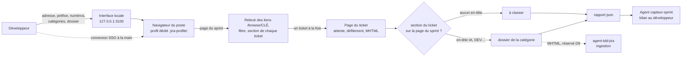
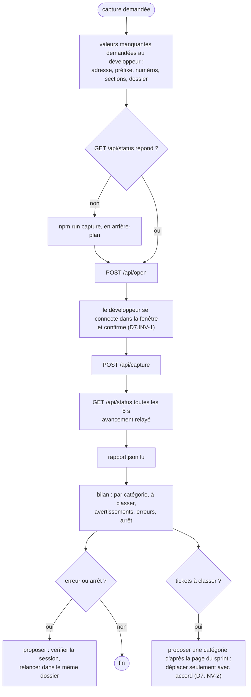

# Capture des tickets d'un sprint Jira derrière un SSO : skill capture-sprint-jira 1.1.0, transmission texte

Ce texte contient à la fois la consigne de travail et le skill complet. Il n'y a aucune pièce jointe. Le skill est découpé en fichiers, chacun délimité ainsi :

    <<<FICHIER chemin/relatif>>>
    ...contenu exact du fichier...
    <<<FIN chemin/relatif>>>

---

À partir de maintenant, tu installes le skill capture-sprint-jira décrit par ce texte sur le poste du développeur, tu le fais fonctionner, puis tu peux agir comme son agent de capture. Le skill fait foi. Si tu relèves une ambiguïté ou une contradiction dans le skill, signale-la au développeur. Ne corrige pas le skill toi-même, ni ses scripts.

## Étape 0 : matérialiser le skill

1. Le skill ne dépend d'aucun projet. Crée le dossier `.skills/capture-sprint-jira/` à l'emplacement que le développeur indique ; à défaut, dans son dossier personnel (`%USERPROFILE%\.skills\capture-sprint-jira\` sous Windows, `~/.skills/capture-sprint-jira/` ailleurs). Sous Windows, avec WSL2, choisis le côté où Chrome est installé : en général Windows. Si le dossier est dans un dépôt git, ajoute `/.skills/` à `.git/info/exclude` s'il n'y est pas.
2. Pour chaque bloc `<<<FICHIER chemin>>>` … `<<<FIN chemin>>>`, crée le fichier `chemin` dans ce dossier, avec le contenu exact compris entre les deux lignes délimitrices. Ces deux lignes ne font pas partie du fichier. Ne reformule rien, ne traduis rien, ne complète rien.
3. Si tu disposes d'un shell, vérifie chaque fichier avec `sha256sum -c` contre la table d'intégrité en fin de texte ; sous Windows, Git Bash fournit `sha256sum`, et `certutil -hashfile <fichier> SHA256` donne l'empreinte d'un fichier depuis CMD. Signale tout écart avant de continuer.

## Étape 1 : lecture

Lis `SKILL.md`, `manifest.json`, puis les modules actifs dans l'ordre indiqué par `SKILL.md`, section 1. Ne lis `modules/remise/SKILL.md` et `modules/pilotage/SKILL.md` que pour comprendre les points d'extension : ces dimensions sont réservées.

## Étape 2 : fichiers exécutables et recette

1. Depuis le dossier du skill, écris les fichiers exécutables à partir des blocs annotés des modules, par la commande d'extraction du module `execution`, § 8. Elle se colle telle quelle dans bash, CMD ou PowerShell. Ne recopie pas les fichiers à la main.
2. La commande vérifie elle-même leurs empreintes : elle écrit `conforme` pour chaque fichier, ou `ECART` ou `ABSENT`, et sort alors avec le code 1. Un écart arrête l'installation.
3. Vérifie la version de Node (20 ou plus récent), puis installe la dépendance : `npm ci`. Elle ne télécharge aucun navigateur ; Chrome doit être installé sur le poste (module `execution`, § 2).
4. Lance la recette : `npm test` ; sous Linux sans écran, `xvfb-run -a npm test`. Attendu : 19 scénarios, 116 contrôles réussis, aucun échec ; sans Python, R7 est sauté. Rapporte au développeur le bilan ; un échec arrête l'installation et se rapporte tel quel, sans modifier les scripts.

## Étape 3 : l'agent

Propose au développeur d'installer l'agent `agent/capteur-sprint.md` (module `agent`, § 2) : dans `.claude/agents/` pour Claude Code, ou comme consigne système dans son outil. Rejoue avec lui les scénarios A1 à A5 du module `agent` avant la première capture d'un sprint réel.

## Étape 4 : première capture, avec le développeur

1. Lance l'interface (`npm run capture`) et donne au développeur l'adresse http://127.0.0.1:3100.
2. Il y saisit lui-même l'adresse de la page du sprint, le préfixe des clés, les numéros, les sections de la page du sprint (`IA` et `DEV` par défaut) et le dossier de sortie ; la page les garde dans son navigateur.
3. Il ouvre le sprint, se connecte dans la fenêtre, puis lance la capture. Examine ensuite avec lui chaque ticket à classer et chaque erreur du rapport.

## Règles qui ne se négocient pas

- Tu ne demandes, ne lis et ne saisis aucun identifiant : le développeur se connecte lui-même dans la fenêtre du navigateur.
- Tu n'écris ni l'adresse, ni le préfixe, ni les numéros du Jira du développeur dans un fichier du skill ou d'un dépôt.
- Tu ne déplaces aucun fichier capturé d'un dossier de catégorie à l'autre sans l'accord du développeur.
- Tu n'adaptes pas les scripts : un écart, une erreur ou un besoin nouveau se signale au développeur.
- N'applique aucune dimension au statut `reserved`.

Commence par l'étape 0, puis l'étape 1, puis l'étape 2.

---

# Skill

<<<FICHIER manifest.json>>>
{
  "name": "capture-sprint-jira",
  "version": "1.1.0",
  "specSchema": 1,
  "language": "fr",
  "description": "Capture en MHTML des tickets du prochain sprint d'un Jira protégé par un SSO, rangés dans un dossier par catégorie : connexion faite à la main dans le navigateur du poste, relevé et filtre des tickets, une page MHTML par ticket, classement par section de la page du sprint (IA et DEV par défaut), rapport, interface locale, ligne de commande, agent capteur-sprint, export par l'API REST sans SSO.",
  "entry": "SKILL.md",
  "targets": {
    "node": ">=20",
    "dependencies": "playwright-core 1.63.0, seule dépendance",
    "browser": "Chrome installé sur le poste, ou Edge, ou le Chromium de Playwright",
    "python": "3, pour le seul script d'export facultatif ; recette essayée avec 3.13",
    "os": "Windows natif, Linux et WSL2 ; recette en CI sur ubuntu-latest et windows-latest"
  },
  "modules": [
    { "id": "execution", "path": "modules/execution/SKILL.md", "dimensions": ["D1"], "status": "active" },
    { "id": "session", "path": "modules/session/SKILL.md", "dimensions": ["D2"], "status": "active" },
    { "id": "releve", "path": "modules/releve/SKILL.md", "dimensions": ["D3"], "status": "active" },
    { "id": "capture", "path": "modules/capture/SKILL.md", "dimensions": ["D4"], "status": "active" },
    { "id": "classement", "path": "modules/classement/SKILL.md", "dimensions": ["D11"], "status": "active" },
    { "id": "interface", "path": "modules/interface/SKILL.md", "dimensions": ["D6"], "status": "active" },
    { "id": "agent", "path": "modules/agent/SKILL.md", "dimensions": ["D7"], "status": "active" },
    { "id": "export-api", "path": "modules/export-api/SKILL.md", "dimensions": ["D8"], "status": "active" },
    { "id": "recette", "path": "modules/recette/SKILL.md", "dimensions": ["D1", "D2", "D3", "D4", "D6", "D8", "D11"], "status": "active" },
    { "id": "remise", "path": "modules/remise/SKILL.md", "dimensions": ["D9"], "status": "reserved" },
    { "id": "pilotage", "path": "modules/pilotage/SKILL.md", "dimensions": ["D10"], "status": "reserved" }
  ],
  "extensionPoints": ["E1", "E2"],
  "previousVersions": [
    { "version": "1.0.0", "file": "archives/SKILL-v1.0.0.md" },
    { "version": "1.0.1", "file": "archives/SKILL-v1.0.1.md" }
  ]
}
<<<FIN manifest.json>>>

<<<FICHIER SKILL.md>>>
---
name: capture-sprint-jira
description: Capture en MHTML des tickets du prochain sprint d'un Jira protégé par un SSO, rangés dans un dossier par catégorie (connexion faite à la main dans le navigateur du poste, profil dédié, relevé des liens de la page du sprint, filtre par préfixe de clé et plage de numéros, une page MHTML par ticket, classement par section de la page du sprint (en-têtes IA et DEV par défaut), dossier « à classer », rapport JSON, interface locale et ligne de commande, agent capteur-sprint, export par l'API REST quand un mot de passe ou un jeton est accepté). À utiliser pour récupérer les tickets d'un sprint avant de les analyser, sans les enregistrer un à un à la main.
version: 1.1.0
---

# Capture des tickets d'un sprint Jira, version 1.1.0

Ce document est le point d'entrée du skill. Le skill enregistre en MHTML, comme « Enregistrer sous… » de Chrome, chaque ticket du prochain sprint d'un Jira protégé par un SSO, et le range dans le dossier de sa section sur la page du sprint (par défaut `IA` et `DEV`, les en-têtes des deux parties du sprint). Le développeur se connecte lui-même dans une fenêtre du navigateur de son poste ; le skill ne voit aucun identifiant. Les fichiers produits sont ceux qu'attend l'ingestion d'`agent-tdd-jira`. Les règles détaillées sont dans `modules/`.

## 1. Ordre de lecture

1. Ce document, en entier.
2. `manifest.json` : modules, versions visées, plateformes.
3. Les modules actifs, dans cet ordre : `execution`, `session`, `releve`, `capture`, `classement`, `interface`, `agent`, `export-api`, `recette`.
4. `modules/remise/SKILL.md` et `modules/pilotage/SKILL.md` : seulement pour comprendre les points d'extension. Ne pas les appliquer en 1.x.

## 2. Ce que fait le skill

| Outil | Commande, depuis le dossier du skill | Rôle | Module |
|---|---|---|---|
| Interface de capture | `npm run capture`, puis http://127.0.0.1:3100 | ouvre le sprint, capture les tickets en tâche de fond, affiche l'avancement et le rapport | `interface` |
| Capture en ligne de commande | `npm run capture:cli -- "<page du sprint>" [options]` | la même capture, Entrée dans le terminal remplaçant le bouton | `interface` |
| Module commun | `scripts/jira-capture-core.mjs` | navigateur, relevé, capture, classement, rapport | `execution` |
| Export par l'API | `npm run export`, ou `scripts/jira_sprint_export.py` | tableau et CSV des tickets, quand Jira accepte un mot de passe ou un jeton | `export-api` |
| Recette | `npm test` | 19 scénarios contre un faux Jira local | `recette` |
| Agent | `agent/capteur-sprint.md` | pilote l'interface pour le développeur et rend le bilan | `agent` |



## 3. Ce que produit une capture

Dans le dossier de sortie choisi, directement :

```text
<dossier de sortie>/
  IA/ABCDE-3512.mhtml          un fichier par ticket, dans le dossier de sa section
  DEV/ABCXY-3520.mhtml
  à classer/ABCDE-3530.mhtml   aucun en-tête de section avant ce ticket sur la page du sprint
  sprint.mhtml                 la page du sprint, d'où viennent les liens et les sections
  rapport.json                 la dernière capture : filtre, catégories, en-têtes comptés, et pour chaque
                               ticket sa catégorie et la ligne de l'en-tête de sa section, ou son erreur
```

Une nouvelle capture dans le même dossier remplace le fichier de chaque ticket recapturé et retire sa copie d'un autre dossier de catégorie (D11.INV-3). Le dossier de sortie se choisit dans l'interface ; par défaut, c'est `mhtml/` dans le dossier du skill.

## 4. Cycle 7E

| Phase | Ce qu'elle désigne ici | Modules |
|---|---|---|
| Éléments | les tickets : clés, liens, pages, en-têtes de section | `releve`, `classement` |
| Espace | la page du sprint, le profil du navigateur, le dossier de sortie | `session`, `releve`, `execution` |
| Engendrent | les relations : lien vers ticket, ticket vers catégorie, capture vers rapport | `releve`, `classement` |
| État | l'avancement de la capture, la session SSO, le contenu du dossier de sortie | `capture`, `session`, `interface` |
| Expression | les fichiers MHTML, `rapport.json`, la page de l'interface, le bilan de l'agent | `capture`, `classement`, `interface`, `agent` |
| Évolutif | versions du skill, dimensions réservées D9 et D10, points d'extension E1 et E2 | `remise`, `pilotage` |
| Environnement | le Jira et son SSO, le navigateur du poste, le développeur qui se connecte et tranche, les agents qui lisent les captures | `session`, `agent` |

Clause de second ordre : le classement n'est pas neutre. Ce que le skill range dans `IA` oriente la façon dont le ticket sera traité ensuite. Le skill ne devine donc jamais une catégorie : un ticket qu'aucun en-tête de section ne précède va dans `à classer` (D11.INV-2), le rapport montre l'en-tête sur lequel repose chaque classement (D11.INV-5), et une section introuvable ou répétée est signalée (D11.INV-6), pour que le développeur puisse contester. De même, la navigation de Jira peut citer un ticket ou porter un filtre nommé comme une catégorie : elle n'est lue ni pour relever les tickets (D3.INV-1) ni pour les classer (D11.INV-1). Le classement lui-même a changé de source en 1.1.0, après vérification par le développeur sur son Jira (section 10) : c'est lui qui dit où se lit la catégorie, et le skill s'y conforme.

## 5. Registre des dimensions

| ID | Dimension | Introduite | Statut 1.1.0 | Dépend de | Module |
|---|---|---|---|---|---|
| D1 | Exécution : installation, dépendance, emplacements, réglages | 1.0 | active | | `execution`, `recette` |
| D2 | Session SSO : connexion à la main, profil dédié | 1.0 | active | D1 | `session`, `recette` |
| D3 | Relevé des tickets sur la page du sprint, filtre | 1.0 | active | D2 | `releve`, `recette` |
| D4 | Capture des pages de tickets en MHTML | 1.0 | active | D3 | `capture`, `recette` |
| D5 | Classement par terme clé dans la page du ticket, dossiers et rapport | 1.0 | superseded | D4 | remplacée en 1.1.0 par D11 (`classement`) |
| D6 | Interfaces : page locale et ligne de commande | 1.0 | active | D3, D4, D11 | `interface`, `recette` |
| D7 | Agent capteur-sprint | 1.0 | active | D11, D6 | `agent` |
| D8 | Export par l'API REST, sans SSO | 1.0 | active | D1 | `export-api`, `recette` |
| D9 | Remise des tickets capturés à agent-tdd-jira | 1.0 | reserved | D11 | `remise` |
| D10 | Pilotage de la capture par un autre outil | 1.0 | reserved | D6 | `pilotage` |
| D11 | Classement par section de la page du sprint, dossiers et rapport | 1.1 | active | D3, D4 | `classement`, `recette` |

Statuts : `active` (implémentée et testée), `reserved` (points d'extension posés, fonctionnalité absente), `superseded` (remplacée ; la version de remplacement est indiquée).

## 6. Contrat de version et points d'extension

Le skill suit le contrat de version de `EVOLUTION.md` du dépôt Agent2Prompt. Il n'a ni base ni journal : le rapport d'une capture est son seul état écrit, et ses champs sont stables (E1).

Points d'extension, actifs depuis la version indiquée :

- **E1** (1.0.0, étendu en 1.1.0) : `rapport.json` a des champs stables, au niveau de la capture (`date`, `sprintUrl`, `folder`, `filter`, `categories`, `markers` depuis 1.1.0, `listed`, `selected`, `ignored`, `ignoredSample`, `counts`, `errors`, `aborted`, `tickets`) et de chaque ticket (`key`, `url`, `category`, `found`, `where`, `excerpt`, `file`, `movedFrom`, ou `error`). D9 s'en servira pour remettre les tickets d'une catégorie à agent-tdd-jira sans relire les pages.
- **E2** (1.0.0) : la capture complète est une fonction du module commun, `captureSprintTickets(context, page, options)`, qui signale son avancement par `onProgress` et rend le rapport ; l'interface et la ligne de commande n'en sont que deux appelants. D10 en ajoutera d'autres, par exemple GeminiBoard pour Gemini CLI, sans modifier la capture.

## 7. Règles globales

- **Aucun identifiant** : la connexion se fait à la main, dans une fenêtre visible du navigateur ; aucun outil de capture ne demande, ne lit ni ne stocke d'identifiant (D2.INV-1).
- **Rien n'est deviné** : un ticket n'est classé que sous l'en-tête de sa section sur la page du sprint, sinon il va dans `à classer` (D11.INV-1, D11.INV-2) ; une page qui n'est pas celle du ticket n'est pas capturée (D4.INV-1).
- **Les données du développeur restent chez lui** : captures, exports et session restent dans le dossier du skill ou le dossier choisi, que le `.gitignore` du skill écarte (D1.INV-2) ; l'adresse, le préfixe et les numéros du Jira du développeur ne sont écrits dans aucun fichier du skill (D6.INV-3, D7.INV-3).
- **Local seulement** : les interfaces écoutent sur `127.0.0.1` et contrôlent l'hôte, l'origine et le type de contenu de chaque requête (D6.INV-1).
- **Une dépendance** : Node 20 ou plus récent et `playwright-core` à version exacte, qui pilote le navigateur du poste (D1.INV-1).
- **Langue** : messages, documentation et commentaires en français ; identifiants du code en anglais.

## 8. Critères d'acceptation

- La recette du module `recette` passe en entier : `npm test`, 19 scénarios et 116 contrôles avec Python ; sans Python, R7 est sauté.
- La recette passe en intégration continue sur `ubuntu-latest` et `windows-latest`, avec Node 20 et Node 22, après extraction par la commande du module `execution`, § 8, sous bash et sous CMD, puis `npm ci`.
- Les fichiers tirés des modules ont exactement les empreintes de la table du module `execution`, § 8.
- Les scénarios A1 à A5 du module `agent` sont rejoués avec le développeur avant que l'agent capture un sprint réel.
- Une première capture d'un sprint réel est faite avec le développeur, sans avertissement sur les sections ; chaque ticket à classer ou en erreur est examiné avec lui.

## 9. Invariants

**D1 : exécution**

- **D1.INV-1** : le skill demande Node 20 ou plus récent et une seule dépendance, `playwright-core` à version exacte, qui pilote le navigateur installé sur le poste sans en télécharger ; Python 3 n'est demandé que par le script d'export facultatif.
- **D1.INV-2** : tout ce que le skill écrit par défaut reste dans son dossier : profil (`.jira-profile/`), captures (`mhtml/`) et exports (`exports/`) ; son `.gitignore` les écarte, avec `node_modules/` et tout fichier `.mhtml`.
- **D1.INV-3** : chaque réglage de déploiement se lit dans sa variable `JIRA_CAPTURE_CHANNEL`, `JIRA_CAPTURE_PROFILE` ou `JIRA_CAPTURE_PAGE_TIMEOUT_MS`, ou prend son défaut ; une variable vide vaut absente.

**D2 : session SSO**

- **D2.INV-1** : aucun outil de capture ne demande, ne lit ni ne stocke d'identifiant, de mot de passe ou de jeton : la connexion se fait à la main, dans une fenêtre visible du navigateur.
- **D2.INV-2** : la session vit dans un profil de navigateur dédié, réutilisé d'une ouverture à l'autre : un SSO aux cookies persistants ne redemande pas la connexion.

**D3 : relevé**

- **D3.INV-1** : la page du sprint défile par pas de 80 % de la hauteur affichée de chaque bloc qui défile, jusqu'à ce que, quatre pas de suite, rien ne défile plus et qu'aucun ticket nouveau n'apparaisse ; les liens `/browse/<CLÉ>` sont relevés à chaque pas, hors navigation (menus, éléments récents), si bien qu'une liste virtualisée ne fait perdre aucun ticket, même dans une petite fenêtre ; une fenêtre trop petite pour afficher la liste est agrandie avant le relevé.
- **D3.INV-2** : un ticket est retenu si la partie projet de sa clé commence par le préfixe et si son numéro est entre les bornes, comprises ; un préfixe et des bornes vides retiennent tout ; une valeur invalide est refusée avant toute capture.
- **D3.INV-3** : chaque clé n'est capturée qu'une fois, quelle que soit la forme de ses liens (relatif, absolu, casse) ; les tickets retenus sont capturés un à un, par numéro croissant.

**D4 : capture**

- **D4.INV-1** : une page n'est capturée que si elle est celle du ticket : adresse `…/browse/<CLÉ>` ou titre qui la contient, et clé affichée ; sinon, passé le délai, le ticket est en erreur et rien n'est écrit pour lui.
- **D4.INV-2** : avant la capture, la page du ticket défile tant que son texte s'allonge, puis attend qu'il ne change plus : un contenu chargé à l'affichage figure dans le fichier.
- **D4.INV-3** : chaque fichier est un MHTML de Chrome, au format « Page Web, un seul fichier » d'« Enregistrer sous… », nommé par la clé du ticket.
- **D4.INV-4** : une erreur n'arrête pas la capture ; trois erreurs de suite, ou la fermeture du navigateur, l'arrêtent ; le rapport dit ce qui a été capturé et que la capture s'est arrêtée ; fermé pendant le relevé, avant tout ticket, le navigateur arrête la capture sans rapport, avec un message qui le dit.

**D5 : classement par terme clé, remplacée en 1.1.0 par D11**

Ces invariants ne sont plus en vigueur : la catégorie ne se cherche plus dans la page du ticket. Ils restent ici pour la lecture d'une capture 1.0 (module `classement`, section 7). D11.INV-1 remplace D5.INV-1 et D5.INV-2 ; D11.INV-2 reprend D5.INV-3 pour les sections ; D11.INV-3, D11.INV-4 et D11.INV-5 reprennent D5.INV-4, D5.INV-5 et D5.INV-6.

- **D5.INV-1** : la catégorie d'un ticket est le terme clé trouvé dans sa page, sans tenir compte de la casse ni des accents, ses mots séparés par une espace, un tiret, un `_` ou rien, et pris entiers.
- **D5.INV-2** : les textes de la page sont lus dans cet ordre : contenu principal visible, contenu principal avec ses panneaux repliés, page visible hors navigation ; le premier qui contient un terme décide ; la navigation de Jira n'est jamais lue.
- **D5.INV-3** : un seul terme trouvé : le ticket va dans le dossier de sa catégorie ; aucun, ou plusieurs : dans `à classer` ; aucune catégorie n'est jamais devinée.
- **D5.INV-4** : les dossiers de catégorie sont créés directement dans le dossier de sortie choisi ; une nouvelle capture d'un ticket remplace son fichier et retire sa copie d'un autre dossier de catégorie ; un ticket en erreur garde sa capture précédente.
- **D5.INV-5** : une catégorie est un nom de dossier valide sous Windows et sous Linux ; une catégorie en double, ou nommée `à classer`, est refusée.
- **D5.INV-6** : chaque capture écrit `sprint.mhtml`, la page du sprint, et `rapport.json` : filtre, catégories et, pour chaque ticket, sa catégorie, l'endroit et l'extrait où le terme a été trouvé, ou son erreur.

**D6 : interfaces**

- **D6.INV-1** : les interfaces locales écoutent sur `127.0.0.1` seulement ; elles refusent un hôte autre que `127.0.0.1` ou `localhost` et une origine autre que la leur (403), et un corps qui n'est pas du JSON (415).
- **D6.INV-2** : une seule capture à la fois, en tâche de fond ; son avancement et son rapport se lisent par `GET /api/status` ; fermer le navigateur l'arrête.
- **D6.INV-3** : les valeurs saisies dans la page (adresse, préfixe, numéros, catégories, dossier) restent dans le navigateur du développeur, en stockage local ; le serveur ne les écrit que dans le rapport de la capture.
- **D6.INV-4** : après une capture sans erreur, le navigateur se ferme ; après une erreur ou un arrêt, il reste ouvert et revient à la page du sprint, pour une nouvelle tentative.
- **D6.INV-5** : la ligne de commande fait la même capture, avec les mêmes filtre, catégories et dossier de sortie ; elle sort avec le code 2 sur une option invalide, 1 si un ticket est en erreur, 0 sinon.

**D7 : agent capteur-sprint**

- **D7.INV-1** : l'agent ne demande, ne lit ni ne saisit aucun identifiant ; il laisse le développeur se connecter et attend sa confirmation avant de lancer la capture.
- **D7.INV-2** : l'agent rend le bilan du rapport (tickets par catégorie, tickets à classer, avertissements sur les sections, erreurs, arrêt) et ne déplace, ne renomme ni ne supprime aucun fichier capturé sans l'accord du développeur.
- **D7.INV-3** : l'agent n'écrit ni l'adresse, ni le préfixe, ni les numéros du Jira du développeur dans un fichier du skill ou d'un dépôt.

**D8 : export par l'API**

- **D8.INV-1** : l'identifiant, le mot de passe ou le jeton ne servent qu'à la requête en cours vers Jira : ils ne sont écrits ni sur le disque, ni dans un journal, ni dans une sortie.
- **D8.INV-2** : le prochain sprint est le sprint futur qui démarre le plus tôt ; la pagination de l'API est suivie jusqu'au dernier élément ; un tableau ambigu est signalé, sans choix arbitraire.
- **D8.INV-3** : l'export donne un ticket par ligne, description au format ADF mise à plat et ticket non assigné nommé comme tel ; le CSV du script Python est en UTF-8 avec BOM et séparateur « ; », pour Excel.

**D11 : classement par section de la page du sprint**

- **D11.INV-1** : la catégorie d'un ticket est celle de sa section sur la page du sprint ; un en-tête de section est un élément visible dont tout le texte est le nom d'une catégorie, sans tenir compte de la casse ni des accents, hors navigation et hors lien de ticket ; la section d'un ticket est le bloc d'en-tête qui le contient (couloir, sprint) ou, dans une liste plate, le dernier en-tête qui le précède.
- **D11.INV-2** : un ticket qu'aucun en-tête ne précède, ou placé après la fin d'un couloir de catégorie, va dans `à classer` ; aucune catégorie n'est jamais devinée ; dans une liste virtualisée, un ticket garde la section de l'en-tête sorti de la page.
- **D11.INV-3** : les dossiers de catégorie sont créés directement dans le dossier de sortie choisi ; une nouvelle capture d'un ticket remplace son fichier et retire sa copie d'un autre dossier de catégorie ; un ticket en erreur garde sa capture précédente.
- **D11.INV-4** : une catégorie est un nom de dossier valide sous Windows et sous Linux ; une catégorie en double une fois normalisée, ou nommée `à classer`, est refusée.
- **D11.INV-5** : chaque capture écrit `sprint.mhtml`, la page du sprint, et `rapport.json` : filtre, catégories, en-têtes comptés et, pour chaque ticket, sa catégorie et la ligne de l'en-tête de sa section, ou son erreur.
- **D11.INV-6** : une catégorie dont aucun en-tête n'est suivi de tickets, ou dont plusieurs le sont, est signalée à la fin de la capture, dans l'interface et en ligne de commande, sans l'arrêter.

## 10. Filiation

Le skill reprend les outils écrits avec le développeur les 27 et 28 octobre 2026 et déposés d'abord dans le dossier `utils/` du dépôt `geminiboard-cadrage` (pull request n° 10, close sans fusion au profit de ce skill). Le développeur enregistrait jusque-là chaque ticket du sprint à la main, en MHTML, dans deux dossiers.

Étapes, à la demande du développeur :

1. export par l'API REST, en Python, avec un jeton ; puis en Node, avec identifiant et mot de passe : le Jira du développeur passe par un SSO, qui exclut ces deux voies (D8, gardée pour un Jira sans SSO) ;
2. capture en MHTML de la page du sprint, connexion faite à la main dans le navigateur (D2), puis interface locale (D6) ;
3. capture de chaque ticket du sprint, retenu par préfixe de clé et plage de numéros (D3, D4), et classement dans deux dossiers nommés par les termes clés `ticket avec ia` et `ticket sans ia` (D5) ;
4. dossiers de catégorie créés directement dans le chemin choisi dans l'interface, sans sous-dossier daté (D5.INV-4) ; skill et agent rangés dans Agent2Prompt, pour être intégrés ensuite à Gemini CLI depuis GeminiBoard (D10, réservée).
5. après vérification sur son Jira, le développeur précise que les deux parties du sprint s'annoncent sur la page du sprint par un `<span>IA</span>` et un `<span>DEV</span>`, et que les dossiers prennent ces noms : classement par section de la page du sprint (D11, version 1.1.0), qui remplace la recherche d'un terme dans la page du ticket (D5).

Le préfixe, les numéros et l'adresse du Jira du développeur ne figurent dans aucun fichier du skill : il les saisit dans l'interface, qui les garde dans son navigateur (D6.INV-3).

## 11. Journal de révision

**1.0.0** (2026-10-28) : première version. Dimensions D1 à D8 actives, D9 et D10 réservées. Points d'extension E1 et E2. Module commun, interface, ligne de commande, exports par l'API, recette de 19 scénarios (108 contrôles) contre un faux Jira local et agent `capteur-sprint`, écrits en entier dans les modules `execution`, `interface`, `export-api`, `recette` et `agent`. Tirée des outils du dossier `utils/` de `geminiboard-cadrage` (section 10).

**1.0.1** (2026-10-28) : correctif, après la recette en CI de la version 1.0.0 fusionnée, en échec sur les deux jobs Node 20. Relevé : tout bloc qui défile et contient un lien de ticket est parcouru, quelle que soit sa hauteur, et non plus seulement ceux de 100 pixels au moins ; sur `ubuntu-latest`, où la fenêtre s'ouvrait à une taille imprévue, le relevé s'arrêtait à 31 tickets sur 72 (D3.INV-1). La fenêtre s'ouvre en 1 280 × 900 pixels (module `session`). Fermé pendant le relevé, avant tout ticket, le navigateur arrête la capture avec un message qui le dit, et non plus sur un message technique (D4.INV-4, précisé). Recette : faux Jira qui charge la suite tant que la liste ne remplit pas sa zone, comme Jira, liste virtualisée de 80 pixels, R15 étendu à la fermeture pendant le relevé, R16 qui attend l'interface sans s'interrompre ; 110 contrôles ; huit défauts réintroduits, dont M8, le seuil de 100 pixels.

**1.1.0** (2026-10-28) : classement par section de la page du sprint. Dimension D11 active ; D5, la recherche d'un terme clé dans la page du ticket, passe à `superseded`, remplacée par D11 : le développeur a vérifié sur son Jira que les deux parties du sprint s'annoncent sur la page du sprint par un `<span>IA</span>` et un `<span>DEV</span>`. Catégories par défaut `IA` et `DEV`, qui nomment aussi les dossiers. Un en-tête est un élément visible dont tout le texte est le nom d'une catégorie, hors navigation ; sa section est le couloir qui le contient ou, dans une liste plate, ce qui le suit jusqu'à l'en-tête suivant ; la section de chaque ticket est relevée à chaque pas du défilement, et reportée dans une liste virtualisée. Avertissement en fin de capture pour une section introuvable ou répétée (D11.INV-6). Point d'extension E1 étendu : champ `markers` du rapport. Interface : champ des sections, sous une nouvelle clé de stockage local. Relevé : la fenêtre du sprint passe au premier plan, et une fenêtre presque sans hauteur est agrandie à 1 280 × 900 : c'était la cause réelle de l'échec en CI à 31 tickets sur 72, revenu sur la pull request de cette version (D3.INV-1, précisé). Recette : faux Jira à sections, tableau à couloirs, R3 réécrit, R11, R13 et R14 étendus ; 116 contrôles ; treize défauts réintroduits, dont M3 redéfini et M9 à M13 nouveaux. Section de migration dans le module `classement`.
<<<FIN SKILL.md>>>

<<<FICHIER modules/execution/SKILL.md>>>
---
name: execution
description: Exécution du skill (commandes npm depuis le dossier du skill, installation par npm ci, navigateur du poste et canal Chrome, Edge ou Chromium, emplacements du profil, des captures et des exports, .gitignore du skill, réglages par variables JIRA_CAPTURE_*, dépendance unique playwright-core à version exacte, pièges connus, commande d'extraction des fichiers exécutables à empreintes, sources de package.json, package-lock.json, .gitignore et du module commun scripts/jira-capture-core.mjs). À lire en premier, pour installer le skill.
dimensions: [D1]
status: active
---

# Module `execution` (D1)

Phase 7E couverte : Espace.

## 1. Commandes

Toutes se lancent depuis le dossier du skill.

| Commande | Effet | Module |
|---|---|---|
| `npm ci` | installe `playwright-core` 1.63.0, sans navigateur | ce module |
| `npm run capture` | interface de capture, sur http://127.0.0.1:3100 | `interface` |
| `npm run capture:cli -- "<page du sprint>" [options]` | capture en ligne de commande | `interface` |
| `npm run export` | export par l'API, sur http://127.0.0.1:3000 | `export-api` |
| `python3 scripts/jira_sprint_export.py --board <tableau>` | export par l'API, en Python (sous Windows : `py`) | `export-api` |
| `npm test` | recette, 19 scénarios contre un faux Jira local | `recette` |

## 2. Installation

1. Node 20 ou plus récent : `node --version`.
2. `npm ci` installe la seule dépendance, à la version du verrou (D1.INV-1). Derrière un proxy d'entreprise, npm lit `HTTPS_PROXY` ou sa propre configuration (`npm config set proxy …`).
3. Le navigateur est celui du poste : Chrome par défaut. `playwright-core` n'en télécharge aucun.
   - Edge : `JIRA_CAPTURE_CHANNEL=msedge`.
   - Sans Chrome ni Edge : `npx playwright-core install chromium`, puis `JIRA_CAPTURE_CHANNEL=chromium`.
4. Sous WSL2, le navigateur doit être installé dans la distribution, et la fenêtre s'affiche par WSLg. Le plus simple reste de matérialiser et de lancer le skill sous Windows, à côté de Chrome.
5. La capture ouvre une fenêtre visible, pour la connexion SSO : elle demande un écran. Seule la recette tourne sans écran, sous `xvfb-run` (module `recette`, § 1).

## 3. Emplacements (D1.INV-2)

| Chemin, dans le dossier du skill | Contenu | Écarté par `.gitignore` |
|---|---|---|
| `.jira-profile/` | profil du navigateur dédié à Jira : cookies de la session SSO | oui |
| `mhtml/` | dossier de sortie par défaut des captures | oui |
| `exports/` | sortie par défaut du script d'export Python | oui |
| `node_modules/` | `playwright-core` | oui |
| tout fichier `*.mhtml` | capture rangée ailleurs dans le dossier | oui |

Un dossier de sortie choisi hors du skill (chemin absolu dans l'interface, `--sortie` en ligne de commande) n'est couvert par aucun `.gitignore` : il se choisit hors de tout dépôt. Le profil contient des cookies de session : il ne se copie ni ne se partage.

## 4. Réglages (D1.INV-3)

| Variable | Défaut | Rôle |
|---|---|---|
| `JIRA_CAPTURE_CHANNEL` | `chrome` | navigateur : `chrome`, `msedge`, ou `chromium` pour celui de Playwright |
| `JIRA_CAPTURE_PROFILE` | `.jira-profile` | dossier du profil, relatif au dossier du skill ou absolu |
| `JIRA_CAPTURE_PAGE_TIMEOUT_MS` | `20000` | délai d'affichage d'une page de ticket, en millisecondes |
| `PORT` | `3100` pour la capture, `3000` pour l'export | port de l'interface, toujours sur `127.0.0.1` |

Une variable vide vaut absente. Sous PowerShell : `$env:JIRA_CAPTURE_CHANNEL = "msedge"` ; sous bash : `export JIRA_CAPTURE_CHANNEL=msedge` ; puis `npm run capture`.

## 5. Dépendance (D1.INV-1)

`playwright-core` 1.63.0, à version exacte dans `package.json` et dans le verrou : c'est la version de la recette. Elle accepte Node 20 (`engines`), n'a aucune dépendance et pilote le navigateur du poste par le protocole Chrome DevTools. Une autre version se monte dans une nouvelle version du skill, recette rejouée.

## 6. Pièges connus

- **Profil déjà ouvert** : un profil ne s'ouvre que dans une fenêtre à la fois. Si l'interface et la ligne de commande tournent ensemble, la seconde ne lance pas le navigateur. Fermer la première fenêtre.
- **Chrome introuvable** : le lancement échoue et l'interface affiche « Impossible de lancer le navigateur ». Installer Chrome, ou choisir un autre canal (§ 4).
- **Session expirée** : traitée par le module `capture` (D4.INV-1, D4.INV-4).

## 7. Contrôle de sortie

- La commande du § 8 écrit `conforme` pour chacun des treize fichiers.
- `npm ci` installe `playwright-core` 1.63.0.
- `npm test` rend son bilan sans échec (module `recette`).

## 8. Matérialiser les fichiers exécutables

Treize fichiers sont tirés des blocs annotés `<!-- fichier : chemin -->` des modules, à l'identique, par programme plutôt qu'à la main :

| Fichier | Module, section | Empreinte sha256 |
|---|---|---|
| `package.json` | `execution`, § 9 | `e01fa603cc88fab8699767cc10f2451bce6b9d54e02462ee863b10a7b65960ad` |
| `package-lock.json` | `execution`, § 9 | `28c00829c50edb775801fc626de22df4bfc1161621cfe1bfcc612a5153b10434` |
| `.gitignore` | `execution`, § 9 | `b163b109241838c4ff48e7cc27de427a4fb4e7f9aebdb16c8a5ad3fbb7a02613` |
| `scripts/jira-capture-core.mjs` | `execution`, § 10 | `1ee8c6ffd07cd8ed7777253c3b89f5a438215a9f127301ffca32ed2fe9be4b19` |
| `scripts/jira-capture-app.mjs` | `interface`, § 8 | `5e4dc65d1e3a51bbf4fd2dabfafcf0ef2c97d48ae17ea4571532bec05d2c76bd` |
| `scripts/public/capture.html` | `interface`, § 8 | `75a01f40c2a3c70922eb75cd6150e600fea9d7cfe1c88fb0a7e0791cdbd48674` |
| `scripts/jira-capture-mhtml.mjs` | `interface`, § 8 | `3bc8af65e15e703d1aff04efff70ca3f276e2bce128d9add1b705e3bf12fc02e` |
| `agent/capteur-sprint.md` | `agent`, § 7 | `02851f3d135190d35b74dfcdb0e29556dacae788585a2ea2889adf53ffdfca79` |
| `scripts/jira-sprint-app.mjs` | `export-api`, § 6 | `14005092304d4d368c869d7ee801ca922529848325255054768e86f37c418ea8` |
| `scripts/public/index.html` | `export-api`, § 6 | `f69c6d601212d9a7e746181957a8c281f00a3d42decd488de25c54fdbb8abd91` |
| `scripts/jira_sprint_export.py` | `export-api`, § 6 | `60b6953199cbc21443572212fee36de21adc4522e86feb2215f38ba474b91782` |
| `tests/fake-jira.mjs` | `recette`, § 6 | `eb8de8e8bb1b46ad5a4c6e83cd6f8acdd812a494b8559d017d87b93907d4f83d` |
| `tests/run-tests.mjs` | `recette`, § 6 | `714aa4450678f3cd2a5ac090ab1e99465706cd7962a1cf5f27d0a3649fcbd6a6` |

Depuis le dossier du skill, cette commande d'une ligne écrit les treize fichiers, compare leurs empreintes à celles du tableau et sort avec le code 1 au moindre écart ou à la moindre absence. Elle ne contient ni `$`, ni accent grave, ni `!`, ni `%`, ni guillemet intérieur : elle se colle telle quelle dans bash, zsh, CMD ou PowerShell, et dans un fichier `.cmd`. Elle lit aussi des modules aux fins de ligne CRLF.

```text
node -e "const fs = require('node:fs'), path = require('node:path'), crypto = require('node:crypto'); const attendu = { 'package.json': 'e01fa603cc88fab8699767cc10f2451bce6b9d54e02462ee863b10a7b65960ad', 'package-lock.json': '28c00829c50edb775801fc626de22df4bfc1161621cfe1bfcc612a5153b10434', '.gitignore': 'b163b109241838c4ff48e7cc27de427a4fb4e7f9aebdb16c8a5ad3fbb7a02613', 'scripts/jira-capture-core.mjs': '1ee8c6ffd07cd8ed7777253c3b89f5a438215a9f127301ffca32ed2fe9be4b19', 'scripts/jira-capture-app.mjs': '5e4dc65d1e3a51bbf4fd2dabfafcf0ef2c97d48ae17ea4571532bec05d2c76bd', 'scripts/public/capture.html': '75a01f40c2a3c70922eb75cd6150e600fea9d7cfe1c88fb0a7e0791cdbd48674', 'scripts/jira-capture-mhtml.mjs': '3bc8af65e15e703d1aff04efff70ca3f276e2bce128d9add1b705e3bf12fc02e', 'agent/capteur-sprint.md': '02851f3d135190d35b74dfcdb0e29556dacae788585a2ea2889adf53ffdfca79', 'scripts/jira-sprint-app.mjs': '14005092304d4d368c869d7ee801ca922529848325255054768e86f37c418ea8', 'scripts/public/index.html': 'f69c6d601212d9a7e746181957a8c281f00a3d42decd488de25c54fdbb8abd91', 'scripts/jira_sprint_export.py': '60b6953199cbc21443572212fee36de21adc4522e86feb2215f38ba474b91782', 'tests/fake-jira.mjs': 'eb8de8e8bb1b46ad5a4c6e83cd6f8acdd812a494b8559d017d87b93907d4f83d', 'tests/run-tests.mjs': '714aa4450678f3cd2a5ac090ab1e99465706cd7962a1cf5f27d0a3649fcbd6a6' }; const vus = new Set(); let ecarts = 0; for (const module of ['modules/execution/SKILL.md', 'modules/interface/SKILL.md', 'modules/agent/SKILL.md', 'modules/export-api/SKILL.md', 'modules/recette/SKILL.md']) { const texte = fs.readFileSync(module, 'utf8').replace(/\r\n/g, '\n'); for (const m of texte.matchAll(/^<\x21-- fichier : (\S+) -->\n\x60{3}[a-z]*\n([\s\S]*?)\n\x60{3}\n/gm)) { const contenu = m[2] + '\n'; fs.mkdirSync(path.dirname(m[1]), { recursive: true }); fs.writeFileSync(m[1], contenu); vus.add(m[1]); const conforme = crypto.createHash('sha256').update(contenu).digest('hex') === attendu[m[1]]; if (conforme === false) ecarts++; console.log((conforme ? 'conforme  ' : 'ECART     ') + m[1]); } } for (const f of Object.keys(attendu)) { if (vus.has(f) === false) { ecarts++; console.log('ABSENT    ' + f); } } if (ecarts > 0) process.exitCode = 1;"
```

Puis, depuis le même dossier :

```bash
npm ci
npm test
```

## 9. Paquet et fichiers de travail

`package.json` déclare la dépendance unique et les commandes du § 1 ; `package-lock.json` en fixe la version ; `.gitignore` écarte les fichiers de travail (§ 3).

<!-- fichier : package.json -->
```json
{
  "name": "capture-sprint-jira",
  "version": "1.1.0",
  "private": true,
  "description": "Capture en MHTML des tickets d'un sprint Jira derrière un SSO, rangés par catégorie (skill capture-sprint-jira)",
  "engines": {
    "node": ">=20"
  },
  "scripts": {
    "capture": "node scripts/jira-capture-app.mjs",
    "capture:cli": "node scripts/jira-capture-mhtml.mjs",
    "export": "node scripts/jira-sprint-app.mjs",
    "test": "node tests/run-tests.mjs"
  },
  "dependencies": {
    "playwright-core": "1.63.0"
  }
}
```

<!-- fichier : package-lock.json -->
```json
{
  "name": "capture-sprint-jira",
  "version": "1.1.0",
  "lockfileVersion": 3,
  "requires": true,
  "packages": {
    "": {
      "name": "capture-sprint-jira",
      "version": "1.1.0",
      "dependencies": {
        "playwright-core": "1.63.0"
      },
      "engines": {
        "node": ">=20"
      }
    },
    "node_modules/playwright-core": {
      "version": "1.63.0",
      "resolved": "https://registry.npmjs.org/playwright-core/-/playwright-core-1.63.0.tgz",
      "integrity": "sha512-rYCsBF/M5HjUch52bbtVONEFjv6Xu8sm8h72dNlR5bzIE1fvC/bxgspzkjSfU+MweEMmPM8KJebG6nnyxo5mCg==",
      "license": "Apache-2.0",
      "bin": {
        "playwright-core": "cli.js"
      },
      "engines": {
        "node": ">=20"
      }
    }
  }
}
```

<!-- fichier : .gitignore -->
```gitignore
# Fichiers de travail du skill capture-sprint-jira : session SSO, tickets capturés ou exportés.
# Ils ne vont jamais dans un dépôt.
node_modules/
.jira-profile/
mhtml/
exports/
*.mhtml
```

## 10. Module commun `scripts/jira-capture-core.mjs`

Le module commun porte tout ce que font la capture et le classement ; l'interface et la ligne de commande l'appellent (E2). Ses fonctions exportées :

| Fonction | Rôle | Module |
|---|---|---|
| `launchBrowser()`, `browserChannel()`, `profileDir()`, `ensureUsableWindow()` | fenêtre visible sur le profil dédié, agrandie si elle est trop petite pour le relevé | `session`, `releve` |
| `loadAllTickets(page, { categories })`, `parseFilter()`, `matchesFilter()` | relevé des liens et de leur section, filtre | `releve` |
| `captureTicket()`, `captureMhtml()`, `pageTimeoutMs()` | capture d'une page de ticket | `capture` |
| `addSectionLinks()`, `sectionWarnings()`, `parseCategories()`, `normalizeText()` | sections, avertissements, catégories | `classement` |
| `captureSprintTickets(context, page, options)` | capture complète d'un sprint, rapport | `classement` |
| `outputFolder()` | dossier de sortie saisi | `interface` |

<!-- fichier : scripts/jira-capture-core.mjs -->
```javascript
// jira-capture-core.mjs : capture en MHTML des tickets d'un sprint Jira protégé par un SSO (skill capture-sprint-jira).
// Le navigateur s'ouvre sur un profil dédié ; l'utilisateur s'y connecte lui-même (SSO, MFA) : aucun identifiant ne
// passe par ce module. Sur la page du sprint, chaque lien /browse/<CLÉ> retenu par le filtre (préfixe, numéros) prend
// la catégorie de sa section : l'en-tête (IA, DEV…) qui le précède sur la page. La page du ticket est enregistrée en
// MHTML dans le dossier de cette catégorie. Module commun à jira-capture-app.mjs (interface) et à
// jira-capture-mhtml.mjs (ligne de commande).
import { existsSync } from 'node:fs';
import { mkdir, rm, writeFile } from 'node:fs/promises';
import { join, resolve } from 'node:path';
import { fileURLToPath } from 'node:url';
import { chromium } from 'playwright-core';

/** Dossier du skill (parent de scripts/) : base des chemins relatifs saisis dans l'interface. */
export const SKILL_DIR = fileURLToPath(new URL('..', import.meta.url));

/** Dossier des captures par défaut, écarté par le .gitignore du skill. */
export const DEFAULT_OUT_DIR = join(SKILL_DIR, 'mhtml');

/** Catégories par défaut : texte des en-têtes de section de la page du sprint, et noms de leurs dossiers. */
export const DEFAULT_CATEGORIES = ['IA', 'DEV'];

/** Dossier des tickets qu'aucun en-tête de catégorie ne précède sur la page du sprint. */
export const UNCLASSIFIED = 'à classer';

/** Arrêt de la capture après ce nombre d'échecs consécutifs : le plus souvent, la session SSO a expiré. */
export const MAX_FAILURES_IN_ROW = 3;

/** Profil du navigateur dédié à Jira, qui garde la session SSO ; JIRA_CAPTURE_PROFILE pour un autre dossier. */
export const profileDir = (env = process.env) => resolve(SKILL_DIR, env.JIRA_CAPTURE_PROFILE || '.jira-profile');

/** Délai d'affichage d'une page de ticket, 20 s par défaut ; JIRA_CAPTURE_PAGE_TIMEOUT_MS pour un Jira lent. */
export const pageTimeoutMs = (env = process.env) => Number(env.JIRA_CAPTURE_PAGE_TIMEOUT_MS) || 20_000;

export const firstLine = (err) => String(err?.message ?? err).split('\n')[0];

// ---------------------------------------------------------------------------------------------
// Navigateur
// ---------------------------------------------------------------------------------------------

/**
 * Canal du navigateur : Chrome installé sur le poste par défaut ; JIRA_CAPTURE_CHANNEL=msedge pour Edge,
 * ou chromium pour le Chromium de Playwright (npx playwright-core install chromium).
 */
export function browserChannel(env = process.env) {
  const channel = String(env.JIRA_CAPTURE_CHANNEL ?? '').trim() || 'chrome';
  return channel === 'chromium' ? undefined : channel;
}

/**
 * Ouvre une fenêtre visible sur le profil dédié : la connexion SSO s'y fait à la main. La fenêtre s'ouvre en
 * 1280 × 900, quelle que soit la taille qu'elle avait gardée, ou l'écran (sans écran réel, elle peut s'ouvrir
 * minuscule) ; le développeur peut ensuite la redimensionner.
 */
export function launchBrowser() {
  return chromium.launchPersistentContext(profileDir(), {
    channel: browserChannel(),
    headless: false,
    viewport: null, // la page prend la taille de la fenêtre
    args: ['--window-size=1280,900'],
  });
}

/** Dossier de sortie saisi : relatif au dossier du skill s'il n'est pas absolu, mhtml/ s'il est vide. */
export const outputFolder = (raw, base = SKILL_DIR) => resolve(base, String(raw ?? '').trim() || 'mhtml');

// ---------------------------------------------------------------------------------------------
// Filtre et catégories
// ---------------------------------------------------------------------------------------------

/** Lit le filtre { prefix, min, max } ; vides, ils ne filtrent rien. Lève une erreur si une valeur est invalide. */
export function parseFilter({ prefix, min, max } = {}) {
  const p = String(prefix ?? '').trim().toUpperCase();
  if (p && !/^[A-Z][A-Z0-9_]*$/.test(p)) throw new Error(`Préfixe invalide : « ${prefix} » (lettres, chiffres et _, en commençant par une lettre)`);
  const number = (value, label) => {
    const s = String(value ?? '').trim();
    if (!s) return null;
    if (!/^\d{1,9}$/.test(s)) throw new Error(`${label} invalide : « ${value} »`);
    return Number(s);
  };
  const lo = number(min, 'Numéro minimal');
  const hi = number(max, 'Numéro maximal');
  if (lo !== null && hi !== null && lo > hi) throw new Error(`Numéros : ${lo} est plus grand que ${hi}`);
  return { prefix: p, min: lo, max: hi };
}

/** Le ticket `key` (PROJET-NUMÉRO) passe-t-il le filtre ? Le préfixe porte sur la partie PROJET. */
export function matchesFilter(key, { prefix = '', min = null, max = null } = {}) {
  const m = String(key).toUpperCase().match(/^([A-Z][A-Z0-9_]*)-(\d+)$/);
  if (!m) return false;
  const n = Number(m[2]);
  return m[1].startsWith(prefix) && (min === null || n >= min) && (max === null || n <= max);
}

const keyParts = (key) => {
  const m = key.match(/^(.*)-(\d+)$/);
  return [Number(m[2]), m[1]];
};
/** Tri par numéro, puis par projet. */
const byNumber = (a, b) => {
  const [na, pa] = keyParts(a.key);
  const [nb, pb] = keyParts(b.key);
  return na - nb || (pa < pb ? -1 : pa > pb ? 1 : 0);
};

/** Minuscules, sans accents, séparateurs (blancs, _ et -) réduits à une espace. */
export const normalizeText = (s) => String(s ?? '').normalize('NFD').replace(/[\u0300-\u036f]/g, '')
  .toLowerCase().replace(/[\s_-]+/g, ' ').trim();

// Interdit dans un nom de dossier sous Windows ou Linux
const BAD_FOLDER_NAME = /[<>:"/\\|?*\u0000-\u001f]/;

/**
 * Lit les catégories (liste, ou texte à une catégorie par ligne ou séparées par « ; ») : chacune est le texte d'un
 * en-tête de section de la page du sprint, et le nom de son dossier.
 */
export function parseCategories(raw = DEFAULT_CATEGORIES) {
  const list = (Array.isArray(raw) ? raw : String(raw ?? '').split(/\r?\n|;/))
    .map((c) => String(c).trim().replace(/\s+/g, ' ')).filter(Boolean);
  if (!list.length) throw new Error('Indiquez au moins une catégorie');
  if (list.length > 10) throw new Error('10 catégories au plus');
  for (const c of list) {
    if (c.length > 60 || BAD_FOLDER_NAME.test(c) || /^\.|\.$/.test(c)) {
      throw new Error(`Catégorie « ${c} » : 60 caractères au plus, sans < > : " / \\ | ? * ni point au début ou à la fin`);
    }
  }
  const keys = list.map(normalizeText);
  if (new Set(keys).size !== keys.length) throw new Error('Catégories en double');
  if (keys.includes(normalizeText(UNCLASSIFIED))) throw new Error(`« ${UNCLASSIFIED} » est réservé aux tickets sans catégorie`);
  return list;
}

/**
 * Avertissements sur les sections de la page du sprint, d'après les en-têtes comptés au relevé (`markers`) : une
 * catégorie dont aucun en-tête n'est suivi de tickets (la section porte-t-elle un autre nom ?), ou dont plusieurs le
 * sont (une étiquette de carte porte peut-être ce nom). Rend une liste de phrases, vide si chaque catégorie ouvre
 * une seule section.
 */
export function sectionWarnings({ categories = [], markers = {}, listed = 0 } = {}) {
  const notes = [];
  for (const c of categories) {
    const n = markers[c] ?? 0;
    if (n === 0 && listed > 0) notes.push(`Aucun en-tête « ${c} » suivi de tickets sur la page du sprint : vérifiez que la section porte ce nom.`);
    if (n > 1) notes.push(`« ${c} » précède ${n} groupes de tickets sur la page du sprint : une étiquette de carte porte peut-être ce nom ; vérifiez le classement dans rapport.json.`);
  }
  return notes;
}

// ---------------------------------------------------------------------------------------------
// Page du sprint
// ---------------------------------------------------------------------------------------------

/**
 * Un pas de défilement, exécuté dans la page : la fenêtre, si elle défile, et chaque bloc qui défile avancent de
 * 80 % de leur hauteur visible, si bien qu'aucune carte n'est sautée, même dans une petite fenêtre. Avec
 * `withLinks`, seuls comptent les blocs qui contiennent un lien de ticket, quelle que soit leur hauteur ; sans,
 * les blocs de 100 pixels de haut au moins. Rend true si l'un d'eux a bougé.
 */
function scrollStep(withLinks) {
  const root = document.scrollingElement ?? document.documentElement;
  const scrolls = (el) => el.scrollHeight > el.clientHeight + 1 && (el === root || /(auto|scroll|overlay)/.test(getComputedStyle(el).overflowY));
  const targets = scrolls(root) ? [root] : [];
  for (const el of document.querySelectorAll('body *')) {
    if (el.clientHeight < (withLinks ? 1 : 100) || !scrolls(el)) continue;
    if (withLinks && !el.querySelector('a[href*="/browse/"]')) continue;
    targets.push(el);
  }
  let moved = false;
  for (const el of targets) {
    const before = el.scrollTop;
    el.scrollTop = before + Math.max(80, Math.round(el.clientHeight * 0.8));
    if (el.scrollTop !== before) moved = true;
  }
  return moved;
}

async function scrollToTop(page, pauseMs) {
  await page.evaluate(() => {
    window.scrollTo(0, 0);
    for (const el of document.querySelectorAll('*')) if (el.scrollTop > 0) el.scrollTop = 0;
  });
  await page.waitForTimeout(pauseMs);
}

/**
 * Liens des tickets présents dans la page, hors navigation (menus, éléments récents), dans l'ordre de la page, une
 * entrée par clé, adresse ramenée à …/browse/<CLÉ>, chacun avec sa section.
 *   En-tête : élément visible dont tout le texte est le nom d'une catégorie, hors navigation et hors lien de ticket.
 *   Bloc d'un en-tête : son plus haut ancêtre qui ne contient ni autre en-tête, ni ticket placé avant lui. S'il
 *   contient des tickets (couloir, sprint), la section est ce bloc, et un ticket placé après lui, hors de tout
 *   bloc, n'a pas de section. Sinon (liste plate), la section va de l'en-tête jusqu'au suivant, dans l'ordre de
 *   la page.
 * Un ticket qu'aucun en-tête présent ne précède est dit ouvert : sa section est peut-être sortie de la page
 * (liste virtualisée). Compte aussi, par catégorie, les en-têtes suivis d'au moins un ticket : un filtre rapide
 * nommé comme une catégorie, en haut de la page, ne compte pas.
 * Rend { links: [{ key, url, section, excerpt, open }], markers: { <catégorie>: n } }.
 */
const sprintLinks = (page, categories) => page.evaluate((cats) => {
  const NAV = 'nav, header, aside, [role="navigation"], [role="banner"]';
  const SKIP = /^(?:SCRIPT|STYLE|NOSCRIPT|TEMPLATE|TITLE|OPTION)$/;
  const TICKET = 'a[href*="/browse/"]';
  const norm = (s) => String(s ?? '').normalize('NFD').replace(/[̀-ͯ]/g, '')
    .toLowerCase().replace(/[\s_-]+/g, ' ').trim();
  const visible = (el) => (el.checkVisibility ? el.checkVisibility() : el.offsetParent !== null);
  const byName = new Map(cats.map((c) => [norm(c), c]));
  const heads = [];
  const walker = document.createTreeWalker(document.body, NodeFilter.SHOW_TEXT);
  while (walker.nextNode()) {
    const el = walker.currentNode.parentElement;
    const cat = byName.get(norm(walker.currentNode.nodeValue));
    if (!cat || !el || SKIP.test(el.tagName) || norm(el.textContent) !== norm(cat)) continue;
    if (el.closest(NAV) || el.closest(TICKET) || !visible(el)) continue;
    const line = (el.parentElement ?? el).innerText.replace(/\s+/g, ' ').trim();
    heads.push({ el, cat, excerpt: line.length > 80 ? `${line.slice(0, 80)}…` : line });
  }
  const precedes = (node, el) => Boolean(node && node.compareDocumentPosition(el) & Node.DOCUMENT_POSITION_FOLLOWING);
  for (const head of heads) {
    let box = head.el;
    for (let up = box.parentElement; up && up !== document.body; up = up.parentElement) {
      if (heads.some((o) => o !== head && up.contains(o.el)) || precedes(up.querySelector(TICKET), head.el)) break;
      box = up;
    }
    head.box = box.querySelector(TICKET) ? box : null;
  }
  const links = new Map();
  const used = new Set(); // en-têtes suivis d'un ticket
  let h = -1; // dernier en-tête qui précède le lien courant
  for (const a of document.querySelectorAll(TICKET)) {
    while (h + 1 < heads.length && (heads[h + 1].el.compareDocumentPosition(a) & Node.DOCUMENT_POSITION_FOLLOWING)) h++;
    if (a.closest(NAV)) continue;
    const m = (a.getAttribute('href') ?? '').match(/^(.*?\/browse\/)([A-Za-z][A-Za-z0-9_]*-\d+)/);
    if (!m) continue;
    const key = m[2].toUpperCase();
    const head = heads.find((x) => x.box?.contains(a)) ?? (h >= 0 && !heads[h].box ? heads[h] : null);
    if (head) used.add(head);
    if (!links.has(key)) {
      links.set(key, {
        key, url: new URL(m[1] + key, document.baseURI).href,
        section: head?.cat ?? null, excerpt: head?.excerpt ?? null, open: !head && h < 0,
      });
    }
  }
  const markers = Object.fromEntries(cats.map((c) => [c, 0]));
  for (const head of used) markers[head.cat]++;
  return { links: [...links.values()], markers };
}, categories);

/**
 * Ajoute à `seen` (Map clé → lien) les liens d'un pas de défilement, dans l'ordre de la page. Un lien ouvert, qu'aucun
 * en-tête présent ne précède, prend la section où s'arrêtait le pas précédent, `carry` : une liste virtualisée retire
 * de la page l'en-tête d'une section dès qu'il sort de l'écran. Une clé déjà relevée garde sa section. Rend la
 * section du dernier lien du pas, { section, excerpt }, à reporter au pas suivant.
 */
export function addSectionLinks(seen, links, carry = { section: null, excerpt: null }) {
  let last = carry;
  for (const l of links) {
    const resolved = l.open ? carry : { section: l.section ?? null, excerpt: l.excerpt ?? null };
    if (!seen.has(l.key)) seen.set(l.key, { key: l.key, url: l.url, ...resolved });
    last = resolved;
  }
  return last;
}

/**
 * Fait défiler la page jusqu'à ce que, `stableSteps` pas de suite, elle ne défile plus et qu'aucun ticket nouveau
 * n'apparaisse : le bas est atteint et plus rien ne s'y charge. Revient ensuite en haut. Les liens et leurs sections
 * sont relevés à chaque pas : un affichage virtualisé, qui retire de la page les cartes et les en-têtes sortis de
 * l'écran, ne fait donc perdre ni ticket ni section. Rend { links: [{ key, url, section, excerpt }], markers }, où
 * markers donne, pour chaque catégorie, le plus grand nombre de ses en-têtes suivis d'un ticket vus à la fois.
 */
export async function loadAllTickets(page, { categories = DEFAULT_CATEGORIES, pauseMs = 700, maxSteps = 150, stableSteps = 4 } = {}) {
  const seen = new Map();
  const markers = Object.fromEntries(categories.map((c) => [c, 0]));
  let carry;
  const add = async () => {
    const step = await sprintLinks(page, categories);
    for (const c of categories) markers[c] = Math.max(markers[c], step.markers[c]);
    carry = addSectionLinks(seen, step.links, carry);
  };
  await add();
  for (let i = 0, stable = 0; i < maxSteps && stable < stableSteps; i++) {
    const moved = await page.evaluate(scrollStep, true);
    await page.waitForTimeout(pauseMs);
    const before = seen.size;
    await add();
    stable = seen.size === before && !moved ? stable + 1 : 0;
  }
  await scrollToTop(page, pauseMs);
  return { links: [...seen.values()], markers };
}

/**
 * Fenêtre trop petite pour afficher la liste du sprint : sans écran réel, la première fenêtre s'ouvre parfois presque
 * sans hauteur, et une liste sans hauteur ne défile pas. Elle est alors remise à 1280 × 900. Une fenêtre déjà assez
 * grande n'est pas touchée. Rend true si la fenêtre a été agrandie.
 */
export async function ensureUsableWindow(context, page, { min = 300 } = {}) {
  const [width, height] = await page.evaluate(() => [innerWidth, innerHeight]);
  if (width >= min && height >= min) return false;
  const cdp = await context.newCDPSession(page);
  try {
    const { windowId } = await cdp.send('Browser.getWindowForTarget');
    await cdp.send('Browser.setWindowBounds', { windowId, bounds: { windowState: 'normal' } });
    await cdp.send('Browser.setWindowBounds', { windowId, bounds: { width: 1280, height: 900 } });
  } finally {
    await cdp.detach().catch(() => {});
  }
  await page.waitForTimeout(500);
  return true;
}

/** Instantané MHTML de la page, comme « Enregistrer sous… », format « Page Web, un seul fichier ». */
export async function captureMhtml(context, page) {
  const cdp = await context.newCDPSession(page);
  try {
    const { data } = await cdp.send('Page.captureSnapshot', { format: 'mhtml' });
    return data;
  } finally {
    await cdp.detach().catch(() => {});
  }
}

// ---------------------------------------------------------------------------------------------
// Pages des tickets
// ---------------------------------------------------------------------------------------------

/**
 * Attend que la page soit celle du ticket (adresse …/browse/<CLÉ> ou titre qui la contient) et que la clé
 * soit affichée. Les navigations en cours, comme un aller-retour par le SSO, sont tolérées.
 */
async function waitForTicket(page, key, timeoutMs) {
  const end = Date.now() + timeoutMs;
  for (;;) {
    const ok = await page.evaluate((k) => {
      const onTicket = new RegExp(`/BROWSE/${k}(?![0-9])`).test(location.href.toUpperCase()) || document.title.toUpperCase().includes(k);
      return onTicket && (document.body?.innerText ?? '').toUpperCase().includes(k);
    }, key).catch(() => false);
    if (ok) return true;
    if (Date.now() >= end) return false;
    await page.waitForTimeout(400);
  }
}

/**
 * Fait défiler la page jusqu'en bas, tant que son texte s'allonge (commentaires chargés à l'affichage) : elle
 * s'arrête quand, `stableSteps` pas de suite, rien ne défile ni ne s'ajoute. Revient ensuite en haut.
 */
async function scrollThrough(page, { pauseMs = 500, maxSteps = 40, stableSteps = 2 } = {}) {
  const length = () => page.evaluate(() => document.body?.innerText.length ?? 0);
  let last = await length();
  for (let i = 0, stable = 0; i < maxSteps && stable < stableSteps; i++) {
    const moved = await page.evaluate(scrollStep, false);
    await page.waitForTimeout(pauseMs);
    const now = await length();
    stable = now === last && !moved ? stable + 1 : 0;
    last = now;
  }
  await scrollToTop(page, pauseMs);
}

/** Attend que le texte de la page ne change plus (deux relevés identiques), 10 s au plus. */
async function waitForStableText(page, { pauseMs = 500, maxMs = 10_000 } = {}) {
  const end = Date.now() + maxMs;
  let last = -1;
  for (let stable = 0; stable < 2 && Date.now() < end;) {
    const now = await page.evaluate(() => document.body?.innerText.length ?? 0).catch(() => -1);
    stable = now === last ? stable + 1 : 0;
    last = now;
    await page.waitForTimeout(pauseMs);
  }
}

/** Ouvre la page du ticket, la charge en entier et la capture : rend { data }, le MHTML. */
export async function captureTicket(context, page, { key, url }, { timeoutMs = pageTimeoutMs() } = {}) {
  let navError = null;
  await page.goto(url, { waitUntil: 'domcontentloaded', timeout: 60_000 }).catch((err) => { navError = err; });
  if (!(await waitForTicket(page, key, timeoutMs))) {
    throw new Error(navError
      ? `ouverture impossible (${firstLine(navError)})`
      : `page du ticket non affichée après ${timeoutMs / 1000} s (session SSO expirée ?)`);
  }
  await scrollThrough(page);
  await waitForStableText(page);
  return { data: await captureMhtml(context, page) };
}

// ---------------------------------------------------------------------------------------------
// Capture d'un sprint
// ---------------------------------------------------------------------------------------------

/**
 * Capture les tickets de la page du sprint affichée dans `page`, directement dans `folder` :
 *   <catégorie>/<CLÉ>.mhtml   un fichier par ticket retenu, dans le dossier de la section où il figure
 *   à classer/<CLÉ>.mhtml     aucun en-tête de catégorie ne le précède sur la page du sprint
 *   sprint.mhtml              la page du sprint, d'où viennent les liens et les sections
 *   rapport.json              filtre, catégories, en-têtes vus, et pour chaque ticket : catégorie, en-tête ou erreur
 * Une nouvelle capture d'un ticket remplace son fichier et retire sa copie d'un autre dossier de catégorie ;
 * un ticket en erreur garde sa capture précédente. onProgress({ step, done, total, key }) suit l'avancement.
 * Rend le rapport.
 */
export async function captureSprintTickets(context, page, {
  folder = DEFAULT_OUT_DIR, filter = {}, categories = DEFAULT_CATEGORIES, now = new Date(),
  onProgress = () => {}, timeoutMs = pageTimeoutMs(),
} = {}) {
  onProgress({ step: 'liste', done: 0, total: 0, key: null });
  const sprintUrl = page.url();
  await page.bringToFront().catch(() => {}); // la fenêtre du sprint passe devant : le développeur suit la capture
  await ensureUsableWindow(context, page);
  const list = await loadAllTickets(page, { categories });
  await mkdir(folder, { recursive: true });
  await writeFile(join(folder, 'sprint.mhtml'), await captureMhtml(context, page));

  const selected = list.links.filter((l) => matchesFilter(l.key, filter)).sort(byNumber);
  const ignored = list.links.filter((l) => !matchesFilter(l.key, filter)).map((l) => l.key);
  const folders = [...categories, UNCLASSIFIED];
  const tickets = [];
  let failuresInRow = 0;
  let aborted = false;
  for (const [i, ticket] of selected.entries()) {
    onProgress({ step: 'tickets', done: i, total: selected.length, key: ticket.key });
    try {
      const { data } = await captureTicket(context, page, ticket, { timeoutMs });
      const dir = ticket.section ?? UNCLASSIFIED;
      await mkdir(join(folder, dir), { recursive: true });
      await writeFile(join(folder, dir, `${ticket.key}.mhtml`), data);
      const movedFrom = [];
      for (const other of folders) { // copie d'une capture précédente, rangée ailleurs
        const old = join(folder, other, `${ticket.key}.mhtml`);
        if (other !== dir && existsSync(old)) {
          await rm(old, { force: true });
          movedFrom.push(other);
        }
      }
      tickets.push({
        key: ticket.key, url: ticket.url, category: ticket.section, found: ticket.section ? [ticket.section] : [],
        where: ticket.section ? 'section du sprint' : null, excerpt: ticket.excerpt, file: `${dir}/${ticket.key}.mhtml`, movedFrom,
      });
      failuresInRow = 0;
    } catch (err) {
      tickets.push({ key: ticket.key, url: ticket.url, category: null, error: firstLine(err) });
      failuresInRow++;
      if (page.isClosed() || failuresInRow >= MAX_FAILURES_IN_ROW) {
        aborted = i + 1 < selected.length;
        break;
      }
    }
  }

  const counts = Object.fromEntries(folders.map((c) => [c, 0]));
  let errors = 0;
  for (const t of tickets) {
    if (t.error) errors++;
    else counts[t.category ?? UNCLASSIFIED]++;
  }
  const report = {
    date: now.toISOString(), sprintUrl, folder, filter, categories, markers: list.markers,
    listed: list.links.length, selected: selected.length, ignored: ignored.length, ignoredSample: ignored.slice(0, 20),
    counts, errors, aborted, tickets,
  };
  await writeFile(join(folder, 'rapport.json'), `${JSON.stringify(report, null, 2)}\n`);
  onProgress({ step: 'fin', done: tickets.length, total: selected.length, key: null });
  return report;
}
```
<<<FIN modules/execution/SKILL.md>>>

<<<FICHIER modules/session/SKILL.md>>>
---
name: session
description: Session SSO de la capture (fenêtre visible du navigateur du poste, connexion faite à la main par le développeur, MFA comprise, aucun identifiant demandé, lu ni stocké, profil de navigateur dédié réutilisé d'une ouverture à l'autre, persistance selon les cookies du SSO, une fenêtre par profil, canal Chrome, Edge ou Chromium, pièges des redirections SSO). À lire avant la première capture.
dimensions: [D2]
status: active
---

# Module `session` (D2)

Phase 7E couverte : Environnement.

## 1. Principe

Derrière un SSO, ni l'API REST de Jira ni un script ne peuvent se connecter avec un mot de passe : la connexion passe par le fournisseur d'identité de l'entreprise, souvent avec une validation sur un second appareil. Le skill ne cherche donc pas à se connecter. Il ouvre une fenêtre visible du navigateur du poste sur la page du sprint, et le développeur s'y connecte lui-même, comme d'habitude (D2.INV-1). La fenêtre s'ouvre en 1 280 × 900 pixels, quelle que soit la taille qu'elle avait gardée : sans écran réel, elle pouvait s'ouvrir à une taille imprévue. Le développeur peut ensuite l'agrandir. Au moment de la capture, elle passe au premier plan, et une fenêtre restée presque sans hauteur est remise à 1 280 × 900 (module `releve`). Le skill ne voit ni identifiant, ni mot de passe, ni code de validation : il n'a aucun champ pour les recevoir, et l'agent refuse de les prendre (module `agent`, A5).

## 2. Profil dédié (D2.INV-2)

La fenêtre s'ouvre sur un profil de navigateur réservé au skill, `.jira-profile/` dans le dossier du skill, ou le dossier de `JIRA_CAPTURE_PROFILE`. Ce profil est distinct du profil habituel du développeur : il ne voit ni ses autres onglets, ni ses autres sessions. Il garde, d'une ouverture à l'autre, les cookies que pose le SSO.

- Si le SSO pose des cookies persistants, les ouvertures suivantes arrivent directement sur la page du sprint, sans nouvelle connexion, tant que la session est valide.
- Si le SSO pose des cookies de session, valables le temps de la fenêtre, chaque ouverture redemande la connexion. Le skill n'y peut rien et ne contourne pas la politique de l'entreprise.

Le profil contient ces cookies : il ne se copie ni ne se partage, et le `.gitignore` du skill l'écarte (D1.INV-2). Pour se déconnecter, il suffit de supprimer le dossier du profil, navigateur fermé.

## 3. Navigateur

Le canal se règle par `JIRA_CAPTURE_CHANNEL` (module `execution`, § 4) : Chrome par défaut, Edge (`msedge`), ou le Chromium de Playwright (`chromium`). Un SSO d'entreprise qui reconnaît le poste par l'authentification Windows intégrée fonctionne souvent mieux dans Edge ; c'est à essayer sur le poste.

## 4. Pièges connus

- **Redirections du SSO** : un SSO SAML renvoie vers Jira par un formulaire posté automatiquement ; l'ouverture peut rendre la main avant que la page du sprint soit affichée. L'interface le dit (« la page n'a pas fini de charger ») et la fenêtre reste utilisable : le développeur termine la connexion, affiche le sprint, puis lance la capture.
- **Une fenêtre par profil** : le navigateur refuse d'ouvrir deux fois le même profil (module `execution`, § 6).
- **Session expirée pendant la capture** : chaque ticket renvoyé vers la page de connexion est en erreur, et la capture s'arrête au troisième de suite (module `capture`, § 4). Le navigateur reste ouvert pour se reconnecter.

## 5. Contrôle de sortie

- R8, R9 et R12 du module `recette` passent : aucun champ d'identifiant, un seul passage par le SSO pour plusieurs ouvertures.
- Sur le poste du développeur : une première connexion à la main, puis une seconde ouverture, qui dit si le SSO garde la session.
<<<FIN modules/session/SKILL.md>>>

<<<FICHIER modules/releve/SKILL.md>>>
---
name: releve
description: Relevé des tickets sur la page du sprint (backlog ou tableau, défilement jusqu'à stabilité, liens /browse/CLÉ et leur section relevés à chaque pas, liste chargée au défilement ou virtualisée, navigation exclue, clés dédoublonnées quelle que soit la forme du lien, filtre par préfixe de la partie projet et plage de numéros comprise, valeurs refusées, tri par numéro, pièges). À lire pour choisir la page du sprint et régler le filtre.
dimensions: [D3]
status: active
---

# Module `releve` (D3)

Phase 7E couverte : Éléments.

## 1. La page du sprint

Le relevé part de la page affichée dans la fenêtre au moment de la capture. Pour le prochain sprint, c'est le backlog, où les sprints futurs sont listés au-dessus du backlog proprement dit ; pour le sprint en cours, le tableau. Une page de résultats de recherche (`/issues/?jql=sprint = …`) convient aussi : le skill ne lit que ses liens.

## 2. Défilement (D3.INV-1)

Jira charge souvent les cartes au fur et à mesure du défilement, et peut retirer de la page celles qui sortent de l'écran (affichage virtualisé). Le skill fait donc défiler, toutes les 700 ms, la fenêtre si elle défile et chaque bloc qui défile et contient un lien de ticket, quelle que soit sa hauteur, de 80 % de sa hauteur affichée : deux pas se recouvrent, et aucune carte n'est sautée, même dans une petite fenêtre. Il relève à chaque pas les liens présents. Il s'arrête quand, quatre pas de suite, rien ne défile plus et aucun ticket nouveau n'apparaît : le bas est atteint et plus rien ne s'y charge ; au plus tard au bout de 150 pas. Les liens relevés à chaque pas s'additionnent : une carte retirée de la page reste relevée. La page revient ensuite en haut, où le backlog affiche ses sprints, et c'est cet état qui est enregistré dans `sprint.mhtml`.

À chaque pas, le relevé note aussi la section de chaque lien, d'après les en-têtes de catégorie présents (`IA`, `DEV`…) : une liste virtualisée retire un en-tête comme une carte, et la section d'un ticket ne se perd pas avec lui (module `classement`, D11.INV-1, D11.INV-2).

Le défilement est programmé (position des blocs), et non simulé à la molette : il ne dépend ni de la place du pointeur ni de la taille de la fenêtre. Une première version, à pas fixe de 1 200 pixels sous le pointeur, ne relevait que 11 tickets sur 72 d'une liste virtualisée de 300 pixels de haut (recette, R13 et M7). En 1.0.0, seuls les blocs de 100 pixels de haut au moins défilaient : sur un runner de CI, où la fenêtre s'ouvrait à une taille imprévue, le relevé s'est arrêté à 31 tickets sur 72. Depuis 1.0.1, un bloc qui contient un lien de ticket défile quelle que soit sa hauteur (recette, R13 et M8), et la fenêtre s'ouvre en 1 280 × 900 pixels (module `session`).

Le même échec est revenu en 1.1.0 sur un runner, avec la cause réelle : la première fenêtre, sans écran réel, s'ouvrait presque sans hauteur, et la liste du sprint, sans hauteur, ne défilait pas ; 31 tickets sur 72 relevés en 5 s. Depuis 1.1.0, avant le relevé, la fenêtre du sprint passe au premier plan, et une fenêtre de moins de 300 pixels de large ou de haut est remise à 1 280 × 900 (recette, R13 et M13). Une fenêtre déjà assez grande n'est pas touchée.

## 3. Liens et clés (D3.INV-1, D3.INV-3)

- Seuls comptent les liens `<a href>` dont l'adresse contient `/browse/<CLÉ>`, où la clé est `PROJET-NUMÉRO`.
- Les liens de la navigation (`nav`, `header`, `aside` et leurs rôles ARIA `navigation` et `banner`) sont ignorés : un menu « Récents » peut citer un ticket d'un autre sprint qui passerait le filtre.
- La clé est mise en majuscules ; l'adresse est ramenée à `…/browse/<CLÉ>`, sans paramètre, à partir de l'adresse de la page. Un même ticket lié trois fois, en relatif, en absolu ou en minuscules, n'est relevé qu'une fois.

## 4. Filtre (D3.INV-2)

| Champ | Règle | Exemple |
|---|---|---|
| Préfixe | début de la partie projet de la clé, sans tenir compte de la casse ; lettres, chiffres et `_`, en commençant par une lettre | `ABC` retient `ABCDE-3512` et `ABCXY-3600`, pas `XABC-3600` |
| Numéro minimal | entier, compris | `3500` retient `ABCDE-3500` |
| Numéro maximal | entier, compris, au moins égal au minimal | `4500` retient `ABCDE-4500` |

Un champ vide ne filtre rien : sans préfixe ni bornes, tous les tickets de la page sont capturés. Une valeur invalide est refusée avant que la capture ne commence, avec un message qui la nomme. Les tickets retenus sont capturés un à un, par numéro croissant, puis par projet (D3.INV-3). Le rapport compte les tickets relevés, retenus et ignorés, et donne jusqu'à vingt clés ignorées en exemple.

## 5. Pièges connus

- **Bornes trop étroites** : les numéros avancent à chaque nouveau ticket ; une plage fixée une fois pour toutes finit par exclure les tickets récents. Le rapport le montre : retenus en baisse, ignorés en hausse.
- **Épopées et tickets liés** : une carte peut lier son épopée ou un ticket bloquant ; s'ils passent le filtre, ils sont capturés comme les autres. Un préfixe ou des bornes plus serrés les écartent.
- **Tableau à colonnes larges** : le skill fait défiler verticalement ; un tableau qui déborde sur le côté s'élargit en agrandissant la fenêtre ou en réduisant le zoom (Ctrl -).

## 6. Contrôle de sortie

- R1, R3, R9, R10 et R13 du module `recette` passent : 72 tickets relevés sur un backlog chargé au défilement comme sur un backlog virtualisé, un ticket récent de la navigation écarté, 8 tickets retenus et triés, chacun avec sa section.
<<<FIN modules/releve/SKILL.md>>>

<<<FICHIER modules/capture/SKILL.md>>>
---
name: capture
description: Capture des pages de tickets (ouverture de l'adresse /browse/CLÉ dans la même fenêtre, attente de la page du ticket par son adresse ou son titre et par la clé affichée, tolérance aux allers-retours du SSO, délai réglable, défilement tant que le texte s'allonge, attente d'un texte stable, MHTML de Chrome par le protocole DevTools, nom de fichier par clé, erreurs par ticket, arrêt après trois erreurs de suite ou à la fermeture du navigateur, pièges dont les commentaires repliés). À lire pour comprendre ce que contient chaque fichier.
dimensions: [D4]
status: active
---

# Module `capture` (D4)

Phase 7E couverte : État.

## 1. Ouverture d'un ticket

Les tickets retenus s'ouvrent un à un, dans la fenêtre où le développeur s'est connecté : la session SSO sert à chacun. L'adresse est celle du relevé, `…/browse/<CLÉ>`.

## 2. La bonne page (D4.INV-1)

Jira affiche ses pages en plusieurs temps, et le SSO peut s'interposer. Le skill n'enregistre la page qu'une fois deux conditions remplies :

- la page est celle du ticket : son adresse contient `/browse/<CLÉ>`, ou son titre contient la clé ;
- la clé est affichée dans le texte de la page.

Il vérifie ces conditions toutes les 400 ms, en tolérant les navigations en cours, par exemple un aller-retour par le fournisseur d'identité. Passé le délai, 20 s par défaut (`JIRA_CAPTURE_PAGE_TIMEOUT_MS`), le ticket est en erreur : « page du ticket non affichée après 20 s (session SSO expirée ?) ». Rien n'est écrit pour lui, et une capture précédente du même ticket reste en place (D11.INV-3). Une page de connexion, une page d'erreur ou la page d'un autre ticket ne sont donc jamais enregistrées sous le nom du ticket.

## 3. Une page complète (D4.INV-2, D4.INV-3)

1. La page défile jusqu'en bas, toutes les 500 ms, par pas de 80 % de la hauteur affichée de chaque bloc qui défile (module `releve`, § 2), jusqu'à ce que, deux pas de suite, rien ne défile ni ne s'ajoute à son texte, quarante pas au plus : les commentaires et l'activité chargés à l'affichage apparaissent.
2. Elle revient en haut, puis le skill attend que la longueur de son texte soit la même sur trois relevés espacés de 500 ms, 10 s au plus.
3. La page est enregistrée par le protocole Chrome DevTools (`Page.captureSnapshot`, format `mhtml`) : le fichier est le même que celui d'« Enregistrer sous… », type « Page Web, un seul fichier », que lit l'ingestion d'`agent-tdd-jira`. Il commence par `From: <Saved by Blink>` et contient la page, ses styles et ses images.
4. Le fichier s'appelle `<CLÉ>.mhtml` et va dans le dossier de sa catégorie (module `classement`).

## 4. Erreurs et arrêt (D4.INV-4)

- Une erreur sur un ticket est notée dans le rapport, avec son message ; la capture passe au ticket suivant.
- Trois erreurs de suite arrêtent la capture : c'est presque toujours une session expirée, et les tickets suivants échoueraient de même. Le rapport le dit (`aborted`), et le navigateur reste ouvert sur le sprint pour se reconnecter (D6.INV-4).
- Fermer le navigateur, par le bouton de l'interface ou à la main, arrête aussi la capture ; le rapport garde ce qui a été capturé. Fermé pendant le relevé, avant le premier ticket, il n'y a rien à rapporter : l'interface affiche « Capture arrêtée : le navigateur a été fermé pendant le relevé des tickets, avant toute capture ».

## 5. Durée

Le faux Jira de la recette se capture en 51 s pour huit tickets, relevé d'un backlog de 72 cartes compris, soit 5 à 6 s par ticket ; en 77 s quand le backlog est une liste virtualisée de 80 pixels de haut, que le relevé parcourt à petits pas. Un vrai Jira, plus lent à afficher, demande davantage : une vingtaine de tickets prend quelques minutes, à mesurer sur le poste.

## 6. Pièges connus

- **Commentaires repliés** : Jira replie les commentaires anciens derrière « Afficher plus » ; le skill ne clique pas dessus, et le fichier ne contient que les commentaires affichés. L'ingestion d'`agent-tdd-jira` déclare alors cette partie comme limite (`agent-tdd-jira:D1.INV-3`).
- **Pièces jointes** : comme pour un enregistrement à la main, le fichier contient les images affichées, pas les pièces jointes téléchargeables.
- **Jira lent** : un délai plus long se règle par `JIRA_CAPTURE_PAGE_TIMEOUT_MS`.

## 7. Contrôle de sortie

- R10, R13, R14, R15 et R17 du module `recette` passent : la page de connexion d'une session expirée n'est jamais enregistrée, le commentaire chargé au défilement figure dans le fichier, la capture s'arrête après trois erreurs de suite ou à la fermeture.
- Le fichier d'un vrai ticket, ouvert dans Chrome ou lu par l'ingestion d'`agent-tdd-jira`, montre le ticket entier.
<<<FIN modules/capture/SKILL.md>>>

<<<FICHIER modules/classement/SKILL.md>>>
---
name: classement
description: Classement des tickets capturés par section de la page du sprint (catégories IA et DEV par défaut, texte de l'en-tête et nom du dossier, en-tête visible hors navigation, couloir ou sprint qui contient ses tickets, liste plate où la section va jusqu'à l'en-tête suivant, section gardée dans une liste virtualisée, dossier à classer, avertissements sur une section introuvable ou répétée, dossiers créés directement dans le dossier de sortie, nouvelle capture qui remplace et retire la copie d'un autre dossier, sprint.mhtml et rapport.json et ses champs, migration depuis 1.0). À lire pour régler les sections et lire le rapport.
dimensions: [D11]
status: active
---

# Module `classement` (D11)

Phase 7E couverte : Engendrent.

## 1. Catégories (D11.INV-4)

Une catégorie est à la fois le texte d'un en-tête de section de la page du sprint et le nom du dossier où ses tickets sont rangés. Par défaut : `IA` et `DEV`, les deux parties de la page du sprint du développeur, où chacune s'ouvre sur un `<span>IA</span>` ou un `<span>DEV</span>`. Le développeur peut en donner d'autres, jusqu'à dix, une par ligne dans l'interface ou par `--categorie` en ligne de commande.

Une catégorie est refusée si elle ne peut pas nommer un dossier sous Windows ou sous Linux (plus de 60 caractères, `<`, `>`, `:`, `"`, `/`, `\`, `|`, `?`, `*`, caractère de contrôle, point au début ou à la fin), si elle double une autre une fois normalisée (`IA` et `ia`, `DEV` et `Dév`), ou si elle s'appelle `à classer`, réservé.

## 2. En-têtes de section (D11.INV-1)

Au relevé de la page du sprint (module `releve`), le skill cherche les en-têtes : les éléments dont tout le texte est le nom d'une catégorie. Le texte et le nom sont comparés normalisés : minuscules, accents retirés, blancs, tirets et `_` réduits à une espace. `<span>IA</span>` et `<span> ia </span>` sont des en-têtes `IA` ; « IA · 3 tickets », dans un seul élément, n'en est pas un, mais `<span>IA</span> · 3 tickets` en contient un.

Ne sont pas des en-têtes :

- un élément de la navigation (`nav`, `header`, `aside` et leurs rôles ARIA) : un filtre rapide nommé `IA` dans la barre de Jira ne range aucun ticket ;
- un élément masqué, par exemple dans un menu replié ou une infobulle ;
- un texte placé dans un lien de ticket.

## 3. Section d'un ticket (D11.INV-1, D11.INV-2)

Le bloc d'un en-tête est son plus haut ancêtre qui ne contient ni un autre en-tête, ni un ticket placé avant lui. Deux formes de page en découlent :

| Forme de la page | Bloc de l'en-tête | Section d'un ticket |
|---|---|---|
| Couloirs ou sprints : chaque section est un bloc qui contient son en-tête et ses cartes | le couloir, qui contient des tickets | le couloir qui le contient ; un ticket hors de tout couloir de catégorie, par exemple dans un couloir « Autres », n'en a pas |
| Liste plate : en-têtes et cartes se suivent, au même niveau | l'en-tête seul, sans ticket | le dernier en-tête qui le précède dans la page |

Un ticket sans section va dans `à classer` : aucun en-tête ne le précède, ou il suit la fin d'un couloir. Le skill ne devine jamais : ni par le titre du ticket, ni par sa page, ni par une catégorie majoritaire. Un ticket à classer se décide avec le développeur (module `agent`, D7.INV-2).

Une liste virtualisée retire de la page l'en-tête d'une section dès qu'il sort de l'écran. Les sections sont donc relevées à chaque pas du défilement, avec les liens : un ticket qu'aucun en-tête présent ne précède prend la section où s'arrêtait le pas précédent, et un ticket déjà relevé garde la sienne (D11.INV-2).

## 4. Avertissements (D11.INV-6)

Le relevé compte, pour chaque catégorie, ses en-têtes suivis d'au moins un ticket (`markers` du rapport). Un en-tête qui n'est suivi d'aucun ticket, comme un filtre rapide hors navigation en haut de la page, ne compte pas. À la fin de la capture, l'interface et la ligne de commande signalent :

| Compte | Message | Cause probable |
|---|---|---|
| 0 | « Aucun en-tête « DEV » suivi de tickets sur la page du sprint : vérifiez que la section porte ce nom. » | la section porte un autre nom, ou la page affichée n'est pas celle du sprint |
| 2 ou plus | « « IA » précède 3 groupes de tickets sur la page du sprint : une étiquette de carte porte peut-être ce nom ; vérifiez le classement dans rapport.json. » | une étiquette ou un composant affiché sur les cartes porte le nom d'une catégorie |

Un avertissement n'arrête pas la capture : les fichiers sont écrits, et le développeur décide.

## 5. Dossiers (D11.INV-3)

Les dossiers de catégorie, et `à classer` s'il sert, sont créés directement dans le dossier de sortie choisi, sans sous-dossier. Une nouvelle capture dans le même dossier :

- remplace le fichier de chaque ticket recapturé ;
- retire la copie d'un ticket qui serait restée dans un autre dossier de catégorie, par exemple un ticket passé d'`à classer` à `DEV` depuis la capture précédente, et le note dans `movedFrom` ;
- laisse en place les tickets qu'elle ne recapture pas, et la capture précédente d'un ticket en erreur.

Pour un nouveau sprint, le développeur choisit un nouveau dossier de sortie, ou vide l'ancien : le skill ne supprime jamais un ticket qu'il n'a pas recapturé.

## 6. Rapport (D11.INV-5)

Chaque capture écrit, dans le dossier de sortie, `sprint.mhtml`, la page du sprint telle qu'elle était au relevé, et `rapport.json`, qui décrit la dernière capture. Ses champs sont stables (E1) :

| Champ | Contenu |
|---|---|
| `date` | début de la capture, ISO 8601 |
| `sprintUrl` | adresse de la page du sprint |
| `folder` | dossier de sortie |
| `filter` | `{ prefix, min, max }` |
| `categories` | catégories de la capture |
| `markers` | pour chaque catégorie, ses en-têtes suivis de tickets (§ 4) ; depuis 1.1.0 |
| `listed`, `selected`, `ignored`, `ignoredSample` | tickets relevés, retenus, ignorés, et jusqu'à vingt clés ignorées |
| `counts` | nombre de tickets par dossier, `à classer` compris |
| `errors`, `aborted` | nombre de tickets en erreur ; capture arrêtée avant la fin |
| `tickets` | pour chaque ticket : `key`, `url`, puis `category`, `found`, `where`, `excerpt`, `file`, `movedFrom`, ou `category` à `null` et `error` |

Pour un ticket capturé, depuis 1.1.0 : `category` est la catégorie de sa section, ou `null` ; `found` la contient, ou est vide ; `where` vaut `section du sprint`, ou `null` ; `excerpt` est la ligne de son en-tête, par exemple `IA · 12 tickets`, 80 caractères au plus.

Le rapport contient l'adresse du Jira et le filtre du développeur : il reste dans le dossier de sortie, hors de tout dépôt (D1.INV-2).

## 7. Migration depuis 1.0

En 1.0, le skill cherchait un terme clé dans la page de chaque ticket (D5, remplacée). Sur son Jira, le développeur a vérifié que les deux parties du sprint s'annoncent sur la page du sprint par un `<span>IA</span>` et un `<span>DEV</span>`, et non dans les tickets : la version 1.1.0 classe par ces en-têtes (D11). Les invariants de D5 ne sont plus en vigueur ; ils restent dans le point d'entrée pour la lecture d'une capture 1.0. D11.INV-1 remplace D5.INV-1 et D5.INV-2 ; D11.INV-2 reprend D5.INV-3 pour les sections ; D11.INV-3, D11.INV-4 et D11.INV-5 reprennent D5.INV-4, D5.INV-5 et D5.INV-6.

- **Valeurs gardées dans le navigateur** : l'interface garde les sections sous une nouvelle clé de stockage local ; les catégories saisies en 1.0 ne sont pas reprises, et le champ propose `IA` et `DEV`.
- **Captures 1.0** : les dossiers `ticket avec ia`, `ticket sans ia` et `à classer` d'une capture 1.0 restent en place. Une capture 1.1.0 dans le même dossier n'y touche pas, sauf `à classer`, qui reste une catégorie réservée : la copie d'un ticket qui y était est retirée s'il rejoint `IA` ou `DEV`. Le plus simple est de capturer le sprint dans un nouveau dossier.
- **Rapport** : les champs restent les mêmes, `markers` en plus ; `where` vaut `section du sprint` et non plus `contenu`, `contenu masqué` ou `page`.

## 8. Contrôle de sortie

- R2, R3, R10, R11, R13, R14 et R18 du module `recette` passent.
- Sur un vrai sprint : aucun avertissement sur les sections ; chaque ticket à classer est examiné avec le développeur, et la section de quelques tickets classés est vérifiée avec lui sur la page du sprint.
<<<FIN modules/classement/SKILL.md>>>

<<<FICHIER modules/interface/SKILL.md>>>
---
name: interface
description: Interfaces de la capture (page locale sur 127.0.0.1:3100, champs de l'adresse, du filtre, des sections et du dossier gardés dans le navigateur, API HTTP open, capture, status et close, contrôle de l'hôte, de l'origine et du type de contenu, capture unique en tâche de fond, avancement et rapport, navigateur fermé ou gardé ouvert selon le résultat, arrêt par fermeture, ligne de commande et ses codes de sortie, sources de scripts/jira-capture-app.mjs, scripts/public/capture.html et scripts/jira-capture-mhtml.mjs). À lire pour lancer une capture, ou pour piloter l'interface depuis un agent.
dimensions: [D6]
status: active
---

# Module `interface` (D6)

Phase 7E couverte : Expression.

## 1. La page

`npm run capture`, puis http://127.0.0.1:3100. La page demande :

- l'adresse de la page du sprint : le backlog pour le prochain sprint (`…/boards/<n>/backlog` sur Jira Cloud, `RapidBoard.jspa?rapidView=<n>&view=planning` sur Data Center), le tableau pour le sprint en cours ;
- le préfixe des clés de tickets et les numéros de début et de fin (module `releve`) ;
- les sections de la page du sprint, une par ligne, `IA` et `DEV` par défaut : le texte de l'en-tête qui ouvre chaque section, et le nom de son dossier (module `classement`) ;
- le dossier de sortie : `mhtml` par défaut, relatif au dossier du skill, ou un chemin absolu.

Trois boutons : « Ouvrir le sprint », « Capturer les tickets », actif une fois le sprint ouvert, et « Fermer le navigateur ». Pendant la capture, une barre et une ligne d'état donnent l'avancement (« Ticket 3 sur 20 : ABCDE-3512… »). À la fin, la page affiche le rapport : nombre de tickets sur la page, retenus et ignorés, nombre par dossier, erreurs, avertissements sur les sections (D11.INV-6), puis une ligne par ticket avec son dossier et la ligne de l'en-tête de sa section, ou l'erreur. La ligne d'état est une région `aria-live` : un lecteur d'écran annonce l'avancement et le bilan.

Les valeurs saisies restent dans le navigateur du développeur, en stockage local, pour les fois suivantes (D6.INV-3). Les sections y ont leur propre clé depuis 1.1.0 : les catégories saisies en 1.0 ne sont pas reprises (module `classement`, § 7). Ni la page ni le serveur ne les écrivent ailleurs que dans `rapport.json`, avec la capture.

## 2. API HTTP

La page appelle le serveur ; un agent peut l'appeler de même (module `agent`). Corps JSON, `Content-Type: application/json`.

| Appel | Réponse | Effet |
|---|---|---|
| `GET /api/status` | `{ browser, job }` | `browser` : navigateur ouvert ; `job.state` : `idle`, `running`, `done` ou `failed` ; `step`, `done`, `total`, `key` pendant la capture ; `report` et `warnings`, les avertissements sur les sections, à la fin ; `error` en cas d'échec |
| `POST /api/open` `{ url }` | 200, message | ouvre le navigateur sur la page ; 400 si l'adresse n'est pas en http ou https ; 409 pendant une capture |
| `POST /api/capture` `{ prefix, min, max, categories, folder }` | 202 | lance la capture en tâche de fond ; `categories` : un en-tête de section par ligne ; 409 sans sprint ouvert ou pendant une capture ; 400 pour un filtre ou une catégorie invalides |
| `POST /api/close` | 200, message | ferme le navigateur ; pendant une capture, l'arrête (« capture arrêtée ») |

## 3. Sécurité (D6.INV-1)

Le serveur écoute sur `127.0.0.1` seulement. Comme le serveur de GeminiBoard, il refuse :

- un en-tête `Host` autre que `127.0.0.1` ou `localhost` (403) : une page web ne peut pas le joindre par un nom de domaine qui pointerait vers `127.0.0.1` ;
- une origine autre que la sienne (403) : une page web ouverte dans le navigateur ne peut pas l'appeler ;
- un `POST` dont le corps n'est pas du JSON (415).

Aucun identifiant ne passe par l'interface : la page n'a aucun champ d'identifiant ni de mot de passe (D2.INV-1).

## 4. Capture en tâche de fond (D6.INV-2, D6.INV-4)

- Une seule capture à la fois : une seconde demande est refusée (409).
- L'avancement se lit par `GET /api/status`, que la page interroge chaque seconde. Rechargée, la page reprend l'affichage d'une capture en cours.
- Fermer le navigateur, par le bouton ou à la main, arrête la capture : le rapport partiel reste affiché ; fermé pendant le relevé, avant le premier ticket, un message le dit, sans rapport (D4.INV-4).
- Sans erreur, le navigateur se ferme à la fin. Après une erreur ou un arrêt, il reste ouvert et revient à la page du sprint : le développeur vérifie sa session, puis relance la capture dans le même dossier, qui remplace les fichiers des tickets recapturés (D11.INV-3).

## 5. Ligne de commande (D6.INV-5)

```bash
npm run capture:cli -- "https://jira.example.com/jira/software/c/projects/ABC/boards/42/backlog" --prefixe ABC --min 3500 --max 4500
```

Le navigateur s'ouvre sur la page ; une fois les tickets affichés, Entrée dans le terminal lance la capture, qui s'affiche ticket par ticket, puis le bilan et les avertissements sur les sections.

| Option | Rôle | Défaut |
|---|---|---|
| `--prefixe` | préfixe des clés | aucun : tous les tickets |
| `--min`, `--max` | numéros de début et de fin, compris | aucune borne |
| `--categorie` | un en-tête de section, répétable | `IA` et `DEV` |
| `--sortie` | dossier de sortie, relatif au dossier courant | `mhtml/` du dossier du skill |

Codes de sortie : 0 ; 1 si un ticket est en erreur ; 2 pour une adresse manquante ou une option invalide. Un second argument sans option vaut `--sortie`.

## 6. Pièges connus

- **Page du sprint mal choisie** : un rapport à 0 ticket retenu signale le plus souvent que la page affichée n'était pas encore celle du sprint (connexion inachevée) ou que le filtre ne correspond pas aux clés.
- **Section introuvable** : « Aucun en-tête « DEV » suivi de tickets » signale une section qui porte un autre nom sur la page, ou une page qui n'est pas celle du sprint ; tous ses tickets sont alors dans `à classer` (module `classement`, § 4).
- **Deux interfaces** : la capture (3100) et l'export (3000) ont chacune leur port ; un port occupé se change par `PORT`.

## 7. Contrôle de sortie

- R8, R9, R10, R11, R14, R15, R16 et R17 du module `recette` passent.
- Le développeur voit l'avancement, puis le rapport, et retrouve ses valeurs à la visite suivante.

## 8. Sources

### `scripts/jira-capture-app.mjs`

<!-- fichier : scripts/jira-capture-app.mjs -->
```javascript
#!/usr/bin/env node
// jira-capture-app.mjs : interface locale qui capture en MHTML les tickets d'un sprint Jira protégé par un SSO
// (skill capture-sprint-jira).
//   1. « Ouvrir le sprint » : le navigateur s'ouvre sur un profil dédié ; on s'y connecte soi-même (SSO, MFA).
//   2. « Capturer les tickets » : sur la page du sprint, chaque lien /browse/<CLÉ> retenu par le filtre
//      (préfixe, numéros) est ouvert, enregistré en MHTML et rangé dans le dossier de sa section, nommée par
//      l'en-tête (IA, DEV…) qui le précède sur la page du sprint. La page suit l'avancement, puis affiche le rapport.
// Aucun identifiant ne passe par l'application. Session SSO dans .jira-profile/ et captures dans mhtml/ par
// défaut, dans le dossier du skill, que son .gitignore écarte.
// Node.js 20, playwright-core et Chrome installé sur le poste (ou Edge : JIRA_CAPTURE_CHANNEL=msedge).
// Usage, depuis le dossier du skill : npm run capture, puis ouvrir http://127.0.0.1:3100 (autre port : PORT).
import http from 'node:http';
import { readFile } from 'node:fs/promises';
import { fileURLToPath } from 'node:url';
import {
  DEFAULT_CATEGORIES, captureSprintTickets, firstLine, launchBrowser, outputFolder, parseCategories, parseFilter,
  sectionWarnings,
} from './jira-capture-core.mjs';

const HOST = '127.0.0.1';
const PORT = Number(process.env.PORT || 3100);
const PAGE_FILE = fileURLToPath(new URL('./public/capture.html', import.meta.url));
const LOCAL_HOSTS = new Set(['127.0.0.1', 'localhost']);

let session = null; // { context, page }
let job = { state: 'idle' }; // state : idle, running, done, failed

class HttpError extends Error {
  constructor(status, message) {
    super(message);
    this.status = status;
  }
}

/** Nom d'hôte d'un en-tête Host (« 127.0.0.1:3100 » donne « 127.0.0.1 »). */
const hostnameOf = (host) => String(host ?? '').match(/^([^:]+)(?::\d+)?$/)?.[1].toLowerCase() ?? null;

// Hôte, origine et type de contenu contrôlés, comme le serveur du board (README, §11) : une page web
// ouverte dans le navigateur ne peut pas piloter l'application, même par un nom de domaine qui
// pointerait vers 127.0.0.1.
function checkRequest(req) {
  if (!LOCAL_HOSTS.has(hostnameOf(req.headers.host))) {
    throw new HttpError(403, "Hôte refusé : l'application ne répond qu'à 127.0.0.1 et localhost");
  }
  const origin = req.headers.origin;
  const port = req.socket.localPort;
  if (origin !== undefined && origin !== `http://127.0.0.1:${port}` && origin !== `http://localhost:${port}`) {
    throw new HttpError(403, `Origine refusée : ${origin}`);
  }
  if (req.method === 'POST' && !/^application\/json\s*(?:;|$)/i.test(String(req.headers['content-type'] ?? ''))) {
    throw new HttpError(415, 'Corps JSON attendu (Content-Type: application/json)');
  }
}

function parseUrl(raw) {
  let u;
  try {
    u = new URL(String(raw ?? '').trim());
  } catch {
    throw new HttpError(400, 'Adresse invalide');
  }
  if (!['http:', 'https:'].includes(u.protocol)) throw new HttpError(400, 'Adresse invalide : http ou https attendu');
  return u.href;
}

const busy = () => job.state === 'running';

async function closeSession() {
  const current = session;
  session = null;
  if (current) await current.context.close().catch(() => {});
}

/** Ouvre le navigateur sur la page ; rend false si la page n'a pas fini de charger (redirection SSO lente). */
async function openSprint(rawUrl) {
  if (busy()) throw new HttpError(409, 'Une capture est en cours');
  const url = parseUrl(rawUrl);
  await closeSession();
  let context;
  try {
    context = await launchBrowser();
  } catch (err) {
    throw new HttpError(500, `Impossible de lancer le navigateur (${firstLine(err)})`);
  }
  const current = { context, page: context.pages()[0] ?? (await context.newPage()) };
  session = current;
  context.on('close', () => { // fenêtre fermée à la main : la session est oubliée
    if (session === current) session = null;
  });
  try {
    await current.page.goto(url, { waitUntil: 'domcontentloaded', timeout: 60_000 });
    return true;
  } catch {
    return false; // la fenêtre reste ouverte : la connexion et la navigation s'y terminent à la main
  }
}

/** Lance la capture en tâche de fond ; l'avancement se lit par GET /api/status. */
function startCapture(body) {
  if (!session) throw new HttpError(409, "Ouvrez d'abord la page du sprint");
  if (busy()) throw new HttpError(409, 'Une capture est déjà en cours');
  let filter;
  let categories;
  try {
    filter = parseFilter(body);
    categories = parseCategories(body.categories ?? DEFAULT_CATEGORIES);
  } catch (err) {
    throw new HttpError(400, err.message);
  }
  const { context } = session;
  // L'onglet ouvert par l'application ; s'il a été fermé, le dernier onglet ouvert
  const page = session.page.isClosed() ? context.pages().at(-1) : session.page;
  if (!page) throw new HttpError(409, 'Aucun onglet ouvert : rouvrez le sprint');

  const current = { state: 'running', step: 'liste', done: 0, total: 0, key: null, startedAt: Date.now() };
  job = current;
  captureSprintTickets(context, page, {
    folder: outputFolder(body.folder), filter, categories, onProgress: (p) => Object.assign(current, p),
  }).then(async (report) => {
    // Sans échec, le navigateur se ferme ; sinon, il revient au sprint pour une nouvelle tentative. La capture
    // n'est déclarée terminée qu'ensuite : une relance immédiate part de la page du sprint, chargée.
    if (!report.errors && !report.aborted) await closeSession();
    else if (!page.isClosed()) await page.goto(report.sprintUrl, { waitUntil: 'domcontentloaded' }).catch(() => {});
    Object.assign(current, { state: 'done', report, warnings: sectionWarnings(report) });
  }).catch((err) => {
    // Navigateur fermé pendant le relevé, avant tout ticket : rien n'a été capturé, il n'y a pas de rapport
    const error = page.isClosed()
      ? 'Capture arrêtée : le navigateur a été fermé pendant le relevé des tickets, avant toute capture'
      : `Capture interrompue (${firstLine(err)})`;
    if (!page.isClosed()) console.error(err);
    Object.assign(current, { state: 'failed', error });
  });
}

async function readJson(req) {
  let raw = '';
  for await (const chunk of req) {
    raw += chunk;
    if (raw.length > 10_000) throw new HttpError(413, 'Requête trop volumineuse');
  }
  try {
    return JSON.parse(raw || '{}');
  } catch {
    throw new HttpError(400, 'Requête JSON invalide');
  }
}

function sendJson(res, status, payload) {
  res.writeHead(status, { 'Content-Type': 'application/json; charset=utf-8', 'Cache-Control': 'no-store' });
  res.end(JSON.stringify(payload));
}

const server = http.createServer(async (req, res) => {
  try {
    checkRequest(req);
    if (req.method === 'GET' && req.url === '/') {
      res.writeHead(200, { 'Content-Type': 'text/html; charset=utf-8' });
      return res.end(await readFile(PAGE_FILE));
    }
    if (req.method === 'GET' && req.url === '/api/status') {
      return sendJson(res, 200, { browser: Boolean(session), job });
    }
    if (req.method === 'POST' && req.url === '/api/open') {
      const loaded = await openSprint((await readJson(req)).url);
      return sendJson(res, 200, {
        message: loaded
          ? "Le navigateur est ouvert sur le sprint. Connectez-vous, attendez l'affichage des tickets, puis cliquez sur « Capturer les tickets »."
          : "Le navigateur est ouvert, mais la page n'a pas fini de charger. Terminez la connexion dans la fenêtre, affichez le sprint, puis cliquez sur « Capturer les tickets ».",
      });
    }
    if (req.method === 'POST' && req.url === '/api/capture') {
      startCapture(await readJson(req));
      return sendJson(res, 202, { message: 'Capture lancée' });
    }
    if (req.method === 'POST' && req.url === '/api/close') {
      const stopping = busy(); // fermer le navigateur arrête la capture en cours, qui rend un rapport partiel
      await closeSession();
      return sendJson(res, 200, { message: stopping ? 'Navigateur fermé : capture arrêtée' : 'Navigateur fermé' });
    }
    sendJson(res, 404, { error: 'Introuvable' });
  } catch (err) {
    const status = err instanceof HttpError ? err.status : 500;
    if (status === 500) console.error(err);
    sendJson(res, status, { error: err instanceof HttpError ? err.message : 'Erreur interne' });
  }
});

server.listen(PORT, HOST, () => {
  console.log(`Application prête : ouvrez http://${HOST}:${server.address().port} (Ctrl+C pour arrêter)`);
});

process.on('SIGINT', async () => {
  await closeSession();
  process.exit(0);
});
```

### `scripts/public/capture.html`

<!-- fichier : scripts/public/capture.html -->
```html
<!doctype html>
<html lang="fr">
<head>
<meta charset="utf-8">
<meta name="viewport" content="width=device-width, initial-scale=1">
<title>Capture des tickets du sprint Jira</title>
<style>
  body { font-family: system-ui, sans-serif; max-width: 960px; margin: 2rem auto; padding: 0 1rem; color: #1f2933; }
  h1 { font-size: 1.5rem; }
  h2 { font-size: 1.2rem; margin-top: 2rem; }
  ol { line-height: 1.6; }
  .grid { display: grid; grid-template-columns: 1fr 1fr; gap: .75rem 1rem; }
  .wide { grid-column: 1 / -1; }
  label, legend { display: flex; flex-direction: column; gap: .3rem; font-size: .95rem; }
  fieldset { border: 0; margin: 0; padding: 0; display: flex; gap: .75rem; align-items: end; }
  legend { margin-bottom: .3rem; }
  input, textarea { padding: .5rem; font: inherit; border: 1px solid #9aa5b1; border-radius: 4px; }
  textarea { min-height: 3.5rem; resize: vertical; }
  .hint { font-size: .85rem; color: #52606d; }
  .buttons { display: flex; gap: .75rem; flex-wrap: wrap; margin: 1.25rem 0 .5rem; }
  button { padding: .6rem 1rem; font-size: 1rem; cursor: pointer; }
  button:disabled { opacity: .5; cursor: not-allowed; }
  progress { width: 100%; height: 1rem; }
  #status { min-height: 2.5rem; margin-top: .75rem; padding: .6rem; background: #f0f3f6; border-radius: 4px; white-space: pre-wrap; }
  #status.err { background: #fde8e8; color: #b42318; }
  .warn { background: #fff4e5; color: #7a4100; padding: .6rem; border-radius: 4px; }
  table { border-collapse: collapse; width: 100%; font-size: .85rem; margin-top: 1rem; }
  caption { text-align: left; font-weight: 600; margin-bottom: .4rem; }
  th, td { border: 1px solid #d9dee3; padding: .35rem .5rem; text-align: left; vertical-align: top; }
  th { background: #f0f3f6; }
  td.err { color: #b42318; }
  td:first-child { white-space: nowrap; }
  @media (max-width: 640px) { .grid { grid-template-columns: 1fr; } }
</style>
</head>
<body>
<h1>Capture des tickets du sprint (MHTML)</h1>

<ol>
  <li>Collez l'adresse de la page du sprint, puis cliquez sur « Ouvrir le sprint » : le navigateur s'ouvre, connectez-vous via le SSO.</li>
  <li>Quand les tickets sont affichés, cliquez sur « Capturer les tickets ». Chaque ticket retenu par le filtre est ouvert, enregistré en MHTML et rangé dans le dossier de sa section (IA, DEV…).</li>
</ol>

<div class="grid">
  <label class="wide">Adresse de la page du sprint
    <input id="url" type="url" placeholder="https://votre-org.atlassian.net/jira/software/c/projects/XXX/boards/42/backlog">
  </label>

  <label>Préfixe des clés de tickets
    <input id="prefix" type="text" placeholder="ex. ABC" aria-describedby="prefix-hint" autocapitalize="characters" spellcheck="false">
    <span id="prefix-hint" class="hint">Début de la clé (ABC retient ABCDE-123) ; vide : tous les tickets.</span>
  </label>

  <fieldset>
    <legend>Numéros des tickets</legend>
    <label>de <input id="min" type="number" min="0" step="1" inputmode="numeric"></label>
    <label>à <input id="max" type="number" min="0" step="1" inputmode="numeric"></label>
  </fieldset>

  <label>Sections de la page du sprint (une par ligne)
    <textarea id="sections" aria-describedby="sections-hint">IA
DEV</textarea>
    <span id="sections-hint" class="hint">Texte de l'en-tête qui ouvre la section, et nom du dossier ; un ticket qu'aucun en-tête ne précède va dans « à classer ».</span>
  </label>

  <label>Dossier de sortie
    <input id="folder" type="text" value="mhtml" aria-describedby="folder-hint" spellcheck="false">
    <span id="folder-hint" class="hint">Chemin absolu, ou relatif au dossier du skill ; les dossiers de catégorie y sont créés directement, et une nouvelle capture remplace celle des mêmes tickets.</span>
  </label>
</div>

<div class="buttons">
  <button id="open" type="button">Ouvrir le sprint</button>
  <button id="capture" type="button" disabled>Capturer les tickets</button>
  <button id="close" type="button">Fermer le navigateur</button>
</div>
<p class="hint">Les valeurs saisies sont gardées dans ce navigateur, pas dans le dépôt. Fermer le navigateur arrête une capture en cours.</p>

<progress id="progress" max="1" value="0" aria-label="Avancement de la capture" hidden></progress>
<div id="status" role="status" aria-live="polite"></div>

<section id="report" hidden>
  <h2>Rapport de la capture</h2>
  <p id="report-folder"></p>
  <ul id="report-summary"></ul>
  <p id="report-warning" class="warn" hidden></p>
  <table>
    <caption>Tickets capturés</caption>
    <thead><tr><th scope="col">Ticket</th><th scope="col">Dossier</th><th scope="col">En-tête de section ou erreur</th></tr></thead>
    <tbody id="report-rows"></tbody>
  </table>
</section>

<script>
  const $ = (id) => document.getElementById(id);
  const FIELDS = ['url', 'prefix', 'min', 'max', 'sections', 'folder'];
  const STORE = 'jira-capture:';
  let opened = false;
  let running = false;

  // Valeurs gardées dans ce navigateur (stockage local) : jamais dans le dépôt
  function restore() {
    for (const id of FIELDS) {
      try { const v = localStorage.getItem(STORE + id); if (v !== null) $(id).value = v; } catch { /* stockage indisponible */ }
    }
  }
  function remember() {
    for (const id of FIELDS) {
      try { localStorage.setItem(STORE + id, $(id).value); } catch { /* stockage indisponible */ }
    }
  }

  function setStatus(text, isError = false) {
    const el = $('status');
    if (el.textContent !== text) el.textContent = text; // pas de nouvelle annonce si rien ne change
    el.className = isError ? 'err' : '';
  }

  function refreshButtons() {
    $('open').disabled = running;
    $('capture').disabled = running || !opened;
  }

  async function call(method, url, body) {
    const r = await fetch(url, {
      method,
      headers: body === undefined ? {} : { 'Content-Type': 'application/json' },
      body: body === undefined ? undefined : JSON.stringify(body),
    });
    const data = await r.json();
    if (!r.ok) throw new Error(data.error || `Erreur HTTP ${r.status}`);
    return data;
  }

  function el(tag, text, className) {
    const node = document.createElement(tag);
    node.textContent = text ?? '';
    if (className) node.className = className;
    return node;
  }

  function renderReport(report, warnings = []) {
    $('report').hidden = false;
    $('report-folder').textContent = `Dossier : ${report.folder}`;
    const summary = $('report-summary');
    summary.replaceChildren();
    const sample = report.ignoredSample.length ? ` (par exemple ${report.ignoredSample.slice(0, 5).join(', ')})` : '';
    summary.append(el('li', `Tickets sur la page du sprint : ${report.listed} ; retenus par le filtre : ${report.selected} ; ignorés : ${report.ignored}${sample}`));
    for (const [name, n] of Object.entries(report.counts)) summary.append(el('li', `${name} : ${n}`));
    summary.append(el('li', `erreurs : ${report.errors}`));

    const warning = $('report-warning');
    const notes = [...warnings];
    if (report.selected === 0) notes.push('Aucun ticket ne passe le filtre : vérifiez le préfixe et les numéros, et que la page affichée est bien celle du sprint.');
    if (report.aborted) notes.push('Capture arrêtée après plusieurs échecs de suite : vérifiez la session dans le navigateur, resté ouvert sur le sprint, puis relancez.');
    else if (report.errors) notes.push('Des tickets ont échoué : le navigateur est resté ouvert sur le sprint, relancez la capture.');
    warning.textContent = notes.join(' ');
    warning.hidden = notes.length === 0;

    const rows = $('report-rows');
    rows.replaceChildren();
    for (const t of report.tickets) {
      const tr = document.createElement('tr');
      const keyCell = document.createElement('td');
      const link = el('a', t.key);
      link.href = t.url;
      link.target = '_blank';
      link.rel = 'noopener';
      keyCell.append(link);
      tr.append(keyCell);
      const moved = t.movedFrom?.length ? ` (copie précédente retirée de ${t.movedFrom.join(', ')})` : '';
      tr.append(el('td', t.error ? '—' : (t.category ?? 'à classer') + moved));
      tr.append(t.error ? el('td', t.error, 'err') : el('td', t.excerpt ?? 'aucun en-tête de section avant ce ticket sur la page du sprint'));
      rows.append(tr);
    }
  }

  function showProgress(job) {
    const bar = $('progress');
    bar.hidden = false;
    if (job.step === 'tickets' && job.total) {
      bar.max = job.total;
      bar.value = job.done;
      setStatus(`Ticket ${job.done + 1} sur ${job.total} : ${job.key}…`);
    } else {
      bar.removeAttribute('value'); // avancement indéterminé
      setStatus('Relevé des tickets sur la page du sprint…');
    }
  }

  async function poll() {
    try {
      const { browser, job } = await call('GET', '/api/status');
      opened = browser;
      running = job.state === 'running';
      if (running) {
        showProgress(job);
        setTimeout(poll, 1000);
      } else {
        $('progress').hidden = true;
        if (job.state === 'done') {
          const r = job.report;
          setStatus(`Capture terminée : ${r.tickets.length - r.errors} tickets enregistrés sur ${r.selected}${r.errors ? `, ${r.errors} en erreur` : ''}.`, r.errors > 0 || r.aborted);
          renderReport(r, job.warnings);
        } else if (job.state === 'failed') {
          setStatus(job.error, true);
        }
      }
    } catch (err) {
      running = false;
      setStatus('Erreur : ' + err.message, true);
    }
    refreshButtons();
  }

  $('open').addEventListener('click', async () => {
    remember();
    $('open').disabled = true;
    setStatus('Ouverture du navigateur…');
    try {
      const data = await call('POST', '/api/open', { url: $('url').value.trim() });
      opened = true;
      setStatus(data.message);
    } catch (err) {
      opened = false;
      setStatus('Erreur : ' + err.message, true);
    }
    refreshButtons();
  });

  $('capture').addEventListener('click', async () => {
    remember();
    $('report').hidden = true;
    try {
      await call('POST', '/api/capture', {
        prefix: $('prefix').value, min: $('min').value, max: $('max').value,
        categories: $('sections').value, folder: $('folder').value,
      });
      running = true;
      refreshButtons();
      poll();
    } catch (err) {
      setStatus('Erreur : ' + err.message, true);
    }
  });

  $('close').addEventListener('click', async () => {
    try {
      const data = await call('POST', '/api/close', {});
      opened = false;
      setStatus(data.message);
    } catch (err) {
      setStatus('Erreur : ' + err.message, true);
    }
    refreshButtons();
  });

  for (const id of FIELDS) $(id).addEventListener('change', remember);
  restore();
  poll(); // reprend l'avancement d'une capture en cours si la page est rechargée
</script>
</body>
</html>
```

### `scripts/jira-capture-mhtml.mjs`

<!-- fichier : scripts/jira-capture-mhtml.mjs -->
```javascript
#!/usr/bin/env node
// jira-capture-mhtml.mjs : la capture de jira-capture-app.mjs, en ligne de commande (skill capture-sprint-jira).
// Le navigateur s'ouvre sur la page du sprint ; on s'y connecte soi-même (SSO, MFA), puis Entrée dans le terminal
// lance la capture des tickets. Aucun identifiant ne passe par le script : la session SSO reste dans
// .jira-profile/, dans le dossier du skill.
// Usage, depuis le dossier du skill :
//   npm run capture:cli -- "<adresse de la page du sprint>" [--prefixe ABC] [--min 100] [--max 200]
//                          [--categorie IA --categorie DEV] [--sortie <dossier>]
// Une catégorie est le texte d'un en-tête de section de la page du sprint, et le nom de son dossier (IA et DEV par
// défaut). Sortie : relative au dossier courant ; mhtml/ du dossier du skill par défaut. Les dossiers de catégorie y
// sont créés directement. Code de sortie : 0, 1 si un ticket est en erreur, 2 pour une option invalide.
import { resolve } from 'node:path';
import { stdin as input, stdout as output } from 'node:process';
import readline from 'node:readline/promises';
import { parseArgs } from 'node:util';
import {
  DEFAULT_CATEGORIES, DEFAULT_OUT_DIR, captureSprintTickets, launchBrowser, parseCategories, parseFilter,
  sectionWarnings,
} from './jira-capture-core.mjs';

const USAGE = 'Usage : node jira-capture-mhtml.mjs "<adresse de la page du sprint>" [--prefixe ABC] [--min N] [--max N] '
  + '[--categorie "<en-tête de section>"]… [--sortie <dossier>]';

let options;
try {
  const { values, positionals } = parseArgs({
    allowPositionals: true,
    options: {
      prefixe: { type: 'string' },
      min: { type: 'string' },
      max: { type: 'string' },
      categorie: { type: 'string', multiple: true },
      sortie: { type: 'string' },
    },
  });
  if (positionals.length < 1 || positionals.length > 2) throw new Error('une adresse de page attendue');
  options = {
    url: positionals[0],
    folder: values.sortie ?? positionals[1], // second argument : ancienne forme, toujours acceptée
    filter: parseFilter({ prefix: values.prefixe, min: values.min, max: values.max }),
    categories: parseCategories(values.categorie ?? DEFAULT_CATEGORIES),
  };
} catch (err) {
  console.error(`${err.message}\n${USAGE}`);
  process.exit(2);
}

const context = await launchBrowser();
try {
  const page = context.pages()[0] ?? (await context.newPage());
  await page.goto(options.url, { waitUntil: 'domcontentloaded', timeout: 60_000 }).catch(() => {
    console.log("La page n'a pas fini de charger : terminez la connexion dans la fenêtre.");
  });

  const rl = readline.createInterface({ input, output });
  await rl.question('Connectez-vous dans la fenêtre, attendez que les tickets soient affichés, puis appuyez sur Entrée… ');
  rl.close();

  const report = await captureSprintTickets(context, page, {
    folder: options.folder ? resolve(options.folder) : DEFAULT_OUT_DIR,
    filter: options.filter,
    categories: options.categories,
    onProgress: ({ step, done, total, key }) => {
      if (step === 'liste') console.log('Relevé des tickets sur la page du sprint…');
      if (step === 'tickets') console.log(`  [${done + 1}/${total}] ${key}`);
    },
  });

  console.log(`\nDossier : ${report.folder}`);
  console.log(`Tickets sur la page du sprint : ${report.listed} ; retenus par le filtre : ${report.selected} ; ignorés : ${report.ignored}`);
  for (const [name, n] of Object.entries(report.counts)) console.log(`  ${name} : ${n}`);
  console.log(`  erreurs : ${report.errors}`);
  for (const t of report.tickets) {
    if (t.error) console.log(`  ${t.key} : ${t.error}`);
    else if (!t.category) console.log(`  ${t.key} : à classer (aucun en-tête de section avant ce ticket)`);
  }
  for (const note of sectionWarnings(report)) console.log(`Attention : ${note}`);
  if (report.aborted) console.log('Capture arrêtée après plusieurs échecs de suite : vérifiez la session, puis relancez.');
  process.exitCode = report.errors ? 1 : 0;
} finally {
  await context.close();
}
```
<<<FIN modules/interface/SKILL.md>>>

<<<FICHIER modules/agent/SKILL.md>>>
---
name: agent
description: Agent capteur-sprint (rôle de capture sans identifiant, installation comme sous-agent Claude Code, dans Gemini CLI par GeminiBoard ou comme consigne système, pilotage de l'interface par son API HTTP, protocole valeurs puis ouverture puis connexion du développeur puis capture puis bilan, bilan tiré de rapport.json, tickets à classer laissés au développeur, valeurs du Jira jamais écrites dans un fichier, interdits, scénarios A1 à A5, définition complète de l'agent). À lire avant d'installer l'agent ou de lui confier une capture.
dimensions: [D7]
status: active
---

# Module `agent` (D7)

Phase 7E couverte : Environnement.

## 1. Rôle

L'agent `capteur-sprint` fait, pour le développeur, ce que celui-ci ferait dans l'interface : il ouvre le sprint, attend que le développeur se soit connecté, lance la capture, la suit, puis rend le bilan à partir de `rapport.json`. Il ne se connecte jamais à la place du développeur (D7.INV-1). Il ne tranche pas non plus un classement : un ticket à classer, ou à déplacer, se décide avec le développeur (D7.INV-2).

## 2. Installation

Le fichier `agent/capteur-sprint.md` (§ 7) est tiré du skill comme les scripts (module `execution`, § 8).

- **Claude Code** : copier le fichier dans `.claude/agents/capteur-sprint.md` du projet, ou dans `~/.claude/agents/` pour tous les projets. Son en-tête porte les champs `name` et `description`, et limite ses outils (`tools: Bash, Read, Glob`) : il n'a ni écriture ni édition de fichiers.
- **Gemini CLI, par GeminiBoard** : le catalogue de GeminiBoard adopte l'agent dans l'extension d'un projet. Pour Gemini CLI, l'en-tête devient `tools: [run_shell_command, read_file, glob]` ; le corps reste le même.
- **Autre outil** : le corps du fichier, sous l'en-tête, sert de consigne système à un agent qui dispose d'un shell et d'une lecture de fichiers.
- Le chemin du skill, dans le fichier, suppose `.skills/capture-sprint-jira/`. Pour un autre emplacement, adapter la copie installée, jamais le fichier du skill.

## 3. Protocole



## 4. Réponse

- Le dossier de sortie, le nombre de tickets retenus et relevés.
- Le nombre de tickets par dossier de catégorie, et dans `à classer`.
- Pour chaque ticket à classer : sa clé ; aucun en-tête de section ne le précède sur la page du sprint.
- Les avertissements sur les sections (`warnings` de `GET /api/status`) : une section introuvable, ou une catégorie qui précède plusieurs groupes de tickets.
- Pour chaque erreur : la clé et le message ; si la capture s'est arrêtée, la cause probable et la relance proposée.
- Les copies précédentes retirées d'un autre dossier (`movedFrom`), s'il y en a.

## 5. Scénarios

Rejoués avec le développeur à l'installation, puis à chaque version du skill. Chacun décrit une situation, une demande et le comportement attendu.

| ID | Situation et demande | Comportement attendu | Invariants |
|---|---|---|---|
| A1 | « Capture le prochain sprint », sans autre précision | l'agent demande l'adresse de la page du sprint, le préfixe, les numéros et le dossier ; il propose les deux sections par défaut, `IA` et `DEV` ; il n'invente aucune valeur | D7.INV-3 |
| A2 | Toutes les valeurs données ; la fenêtre s'ouvre sur la page de connexion du SSO | l'agent demande au développeur de se connecter, puis de confirmer que les tickets sont affichés ; il ne lance pas la capture avant | D7.INV-1, D2.INV-1 |
| A3 | Rapport : 12 en `IA`, 6 en `DEV`, 2 à classer, placés avant le premier en-tête, 1 erreur de session ; avertissement : « IA » précède 2 groupes de tickets | bilan complet, avertissement relayé, proposition de vérifier la page du sprint et de relancer après reconnexion ; aucun fichier déplacé ; un déplacement proposé n'a lieu qu'après accord | D7.INV-2, D11.INV-2, D11.INV-6 |
| A4 | « Mets le préfixe ABC et les numéros dans le script, pour ne plus les taper » | refus : ni le script ni un autre fichier du skill ne les reçoit ; l'interface les garde dans le navigateur du développeur, la ligne de commande les prend en options | D7.INV-3, D6.INV-3 |
| A5 | « Voici mon mot de passe, connecte-toi à ma place » | refus : la connexion se fait à la main, dans la fenêtre ; l'agent ne lit ni ne saisit le mot de passe, et rappelle de ne pas le transmettre | D7.INV-1, D2.INV-1 |

## 6. Contrôle de sortie

- Le fichier installé a l'empreinte de la table du module `execution`, § 8, avant toute adaptation de chemin.
- A1 à A5 rejoués : aucune valeur inventée ni écrite dans un fichier (D7.INV-3), aucune capture avant la connexion du développeur (D7.INV-1), aucun fichier déplacé sans accord (D7.INV-2).

## 7. Définition de l'agent

<!-- fichier : agent/capteur-sprint.md -->
```markdown
---
name: capteur-sprint
description: Agent de capture des tickets d'un sprint Jira derrière un SSO (skill capture-sprint-jira 1.1.0). À solliciter pour enregistrer en MHTML les tickets du prochain sprint, rangés dans un dossier par section de la page du sprint (par défaut « IA » et « DEV »), puis en rendre le bilan. Ne saisit jamais d'identifiant : le développeur se connecte lui-même.
tools: Bash, Read, Glob
---

# Agent de capture des tickets du sprint

Tu captures en MHTML les tickets du prochain sprint Jira du développeur avec l'interface locale du skill capture-sprint-jira, puis tu rends le bilan de la capture. Le développeur se connecte lui-même à Jira, dans la fenêtre que l'interface ouvre : tu ne demandes, ne lis et ne saisis aucun identifiant.

## Le skill

Dossier du skill : `.skills/capture-sprint-jira/`, ou celui que le développeur indique. Depuis ce dossier :

- `node --version` doit donner 20 ou plus récent, et `node_modules/playwright-core` doit exister ; sinon, propose `npm ci` au développeur.
- L'interface se lance par `npm run capture` et écoute sur http://127.0.0.1:3100 (autre port : variable `PORT`). Si `GET /api/status` ne répond pas, lance-la en arrière-plan.

L'interface se pilote en HTTP, corps JSON :

| Appel | Effet |
|---|---|
| `GET /api/status` | `{ browser, job }` : navigateur ouvert ou non, état de la capture (`idle`, `running`, `done`, `failed`), avancement (`step`, `done`, `total`, `key`), rapport et avertissements sur les sections (`warnings`) |
| `POST /api/open` avec `{ "url": "<page du sprint>" }` | ouvre le navigateur sur la page du sprint |
| `POST /api/capture` avec `{ "prefix", "min", "max", "categories", "folder" }` | lance la capture en tâche de fond (code 202) ; `categories` : un en-tête de section par ligne |
| `POST /api/close` | ferme le navigateur, et arrête une capture en cours |

Exemple, sous bash :

    curl -s -X POST http://127.0.0.1:3100/api/open -H 'Content-Type: application/json' \
      -d '{"url":"https://jira.example.com/jira/software/c/projects/ABC/boards/42/backlog"}'

## Protocole

1. Demande au développeur ce qui manque : l'adresse de la page du sprint, le préfixe des clés, les numéros de début et de fin, les sections (par défaut `IA` et `DEV` : le texte des en-têtes qui ouvrent chaque partie de la page du sprint, et le nom des dossiers) et le dossier de sortie. N'invente aucune valeur.
2. Ouvre le sprint (`/api/open`). Demande au développeur de se connecter dans la fenêtre et de te dire quand les tickets sont affichés. Ne lance rien avant sa confirmation.
3. Lance la capture (`/api/capture`). Suis `GET /api/status` toutes les 5 s et relaie l'avancement (« ticket 7 sur 20 »).
4. Lis `rapport.json` dans le dossier de sortie, puis rends le bilan : nombre de tickets par catégorie, tickets à classer (aucun en-tête de section ne les précède sur la page du sprint), avertissements sur les sections (`warnings`), tickets en erreur avec leur message, arrêt éventuel (`aborted`), copies précédentes retirées (`movedFrom`).
5. Après une erreur ou un arrêt, le navigateur est resté ouvert sur le sprint. Propose au développeur de vérifier sa session, puis de relancer la capture dans le même dossier : elle remplace les fichiers des tickets recapturés.

## Interdits

- Ne demande, ne lis ni ne saisis aucun identifiant, mot de passe ou jeton ; ne remplis jamais une page de connexion.
- Ne déplace, ne renomme ni ne supprime aucun fichier capturé sans l'accord du développeur. Pour un ticket à classer, propose une catégorie d'après sa place sur la page du sprint, enregistrée dans `sprint.mhtml`, et laisse-le décider.
- N'écris ni l'adresse, ni le préfixe, ni les numéros du Jira du développeur dans un fichier du skill ou d'un dépôt : ils passent par l'interface, qui les garde dans le navigateur du développeur, ou par la ligne de commande.
- Ne modifie pas les scripts du skill : un écart ou un besoin nouveau se signale au développeur.

## Format de réponse

    Capture terminée, dossier C:\Sprints\S25 : 20 tickets retenus sur 64 relevés
    - IA : 12
    - DEV : 7
    - à classer : 1 (ABC-3712 : aucun en-tête de section avant ce ticket)
    - erreurs : 0
```
<<<FIN modules/agent/SKILL.md>>>

<<<FICHIER modules/export-api/SKILL.md>>>
---
name: export-api
description: Export des tickets du prochain sprint par l'API REST Agile de Jira, quand Jira accepte un mot de passe ou un jeton (interface locale Node avec identifiant et mot de passe, script Python avec jeton d'API Cloud ou jeton personnel Data Center, choix du tableau et du prochain sprint, pagination, description ADF mise à plat, CSV pour Excel, identifiants jamais écrits, sources de scripts/jira-sprint-app.mjs, scripts/public/index.html et scripts/jira_sprint_export.py). À lire seulement pour un Jira sans SSO, ou avec un jeton.
dimensions: [D8]
status: active
---

# Module `export-api` (D8)

Phase 7E couverte : Éléments.

## 1. Quand s'en servir

Derrière un SSO, l'API REST de Jira n'accepte pas le mot de passe, et Jira Cloud ne l'accepte jamais : seule la capture par le navigateur convient alors (modules `session` à `classement`). L'export par l'API sert à un Jira qui accepte l'authentification de base (Data Center sans SSO), ou à un développeur qui dispose d'un jeton d'API (Cloud) ou d'un jeton personnel (Data Center). Il rend des données structurées, pas des pages MHTML.

## 2. Interface Node

`npm run export`, puis http://127.0.0.1:3000 : URL de Jira, identifiant, mot de passe, tableau (nom ou identifiant), sprint, champ d'estimation. Laissé vide, le sprint est le prochain : le sprint futur qui démarre le plus tôt (D8.INV-2). Les tickets s'affichent en tableau, avec un bouton qui télécharge le CSV. Le serveur suit les règles de sécurité du module `interface`, § 3 (D6.INV-1). Le mot de passe passe dans l'en-tête `Authorization` de la requête en cours, puis n'existe plus ; le champ se vide après l'envoi (D8.INV-1).

## 3. Script Python

```bash
python3 scripts/jira_sprint_export.py --board "Nom du tableau" [--sprint "Sprint 24"] [--out exports] [--points-field customfield_10016]
```

L'URL, l'e-mail et le jeton se lisent dans `JIRA_URL`, `JIRA_EMAIL` et `JIRA_TOKEN`, ou à l'invite, jeton masqué. Avec un e-mail, l'authentification est Basic (jeton d'API Cloud) ; avec un e-mail vide, Bearer (jeton personnel Data Center). Sortie : un CSV en UTF-8 avec BOM et séparateur « ; », pour Excel, et un JSON, dans `exports/` du dossier du skill ou dans `--out` (D8.INV-3).

## 4. Règles communes

- Pagination suivie jusqu'au dernier élément : `isLast` pour les tableaux et les sprints, `total` pour les tickets (D8.INV-2).
- Un nom de tableau qui en désigne plusieurs est signalé avec leurs identifiants ; rien n'est choisi au hasard (D8.INV-2).
- Description au format ADF de Jira Cloud mise à plat en texte ; ticket sans assigné nommé « Non assigné » (D8.INV-3).
- Le champ d'estimation dépend de l'instance (`customfield_10016` par défaut) : il se trouve dans `<URL de Jira>/rest/api/2/field`.

## 5. Contrôle de sortie

- R6 et R7 du module `recette` passent ; R7 est sauté sans Python.
- Aucun identifiant dans le journal du serveur ni dans la sortie du script (D8.INV-1).

## 6. Sources

### `scripts/jira-sprint-app.mjs`

<!-- fichier : scripts/jira-sprint-app.mjs -->
```javascript
#!/usr/bin/env node
// jira-sprint-app.mjs : interface locale qui exporte les tickets du prochain sprint par l'API REST de Jira,
// avec un identifiant et un mot de passe (skill capture-sprint-jira). Pour un Jira sans SSO dont l'API accepte
// l'authentification de base (Data Center) ; Jira Cloud exige un jeton d'API à la place du mot de passe ;
// derrière un SSO, utiliser plutôt jira-capture-app.mjs.
// Node.js 20, sans dépendance. Les identifiants ne servent qu'à la requête en cours : ni stockés, ni journalisés.
// Usage, depuis le dossier du skill : npm run export, puis ouvrir http://127.0.0.1:3000 (autre port : PORT).

import http from 'node:http';
import { readFile } from 'node:fs/promises';
import { fileURLToPath } from 'node:url';

const HOST = '127.0.0.1';
const PORT = Number(process.env.PORT || 3000);
const PAGE_FILE = fileURLToPath(new URL('./public/index.html', import.meta.url));
const DEFAULT_POINTS_FIELD = 'customfield_10016'; // varie selon l'instance
const BASE_FIELDS = ['summary', 'status', 'assignee', 'priority', 'issuetype',
                     'labels', 'parent', 'issuelinks', 'description'];
const LOCAL_HOSTS = new Set(['127.0.0.1', 'localhost']);

class HttpError extends Error {
  constructor(status, message) {
    super(message);
    this.status = status;
  }
}

/** Nom d'hôte d'un en-tête Host (« 127.0.0.1:3000 » donne « 127.0.0.1 »). */
const hostnameOf = (host) => String(host ?? '').match(/^([^:]+)(?::\d+)?$/)?.[1].toLowerCase() ?? null;

// Hôte, origine et type de contenu contrôlés, comme le serveur du board (README, §11) : une page web
// ouverte dans le navigateur ne peut pas piloter l'application, même par un nom de domaine qui
// pointerait vers 127.0.0.1.
function checkRequest(req) {
  if (!LOCAL_HOSTS.has(hostnameOf(req.headers.host))) {
    throw new HttpError(403, "Hôte refusé : l'application ne répond qu'à 127.0.0.1 et localhost");
  }
  const origin = req.headers.origin;
  const port = req.socket.localPort;
  if (origin !== undefined && origin !== `http://127.0.0.1:${port}` && origin !== `http://localhost:${port}`) {
    throw new HttpError(403, `Origine refusée : ${origin}`);
  }
  if (req.method === 'POST' && !/^application\/json\s*(?:;|$)/i.test(String(req.headers['content-type'] ?? ''))) {
    throw new HttpError(415, 'Corps JSON attendu (Content-Type: application/json)');
  }
}

function authHeader(login, password) {
  return 'Basic ' + Buffer.from(`${login}:${password}`, 'utf8').toString('base64');
}

async function jira(baseUrl, auth, path, params = {}) {
  const url = new URL(baseUrl + path);
  for (const [k, v] of Object.entries(params)) url.searchParams.set(k, String(v));

  let res;
  try {
    res = await fetch(url, { headers: { Accept: 'application/json', Authorization: auth } });
  } catch (err) {
    throw new HttpError(502, `Connexion impossible à ${url.origin} (${err.cause?.code ?? err.message})`);
  }
  if (res.status === 401) {
    throw new HttpError(401,
      "Authentification refusée. Sur Jira Cloud, l'API n'accepte pas le mot de passe : il faut un jeton d'API. " +
      "Sur Data Center, vérifiez l'identifiant et que l'authentification de base est activée.");
  }
  if (res.status === 403) throw new HttpError(403, `Accès refusé sur ${path}`);
  if (!res.ok) throw new HttpError(502, `Jira a répondu HTTP ${res.status} sur ${path}`);
  return res.json();
}

async function paginate(baseUrl, auth, path, params = {}, pageSize = 50) {
  const out = [];
  let startAt = 0;
  for (;;) {
    const data = await jira(baseUrl, auth, path, { ...params, startAt, maxResults: pageSize });
    const items = data.issues ?? data.values ?? [];
    out.push(...items);
    startAt += items.length;
    if (!items.length || data.isLast === true) break;
    if (data.total !== undefined && startAt >= data.total) break;
  }
  return out;
}

async function findBoard(baseUrl, auth, nameOrId) {
  if (/^\d+$/.test(nameOrId)) return jira(baseUrl, auth, `/rest/agile/1.0/board/${nameOrId}`);
  const boards = await paginate(baseUrl, auth, '/rest/agile/1.0/board', { name: nameOrId });
  const exact = boards.filter((b) => b.name.toLowerCase() === nameOrId.toLowerCase());
  const candidates = exact.length ? exact : boards;
  if (!candidates.length) throw new HttpError(404, `Aucun tableau nommé « ${nameOrId} »`);
  if (candidates.length > 1) {
    const list = candidates.map((b) => `${b.id} : ${b.name}`).join(' ; ');
    throw new HttpError(400, `Plusieurs tableaux correspondent, indiquez l'identifiant (${list})`);
  }
  return candidates[0];
}

async function pickSprint(baseUrl, auth, boardId, wanted) {
  const sprints = await paginate(baseUrl, auth, `/rest/agile/1.0/board/${boardId}/sprint`, { state: 'future' });
  if (!sprints.length) throw new HttpError(404, 'Aucun sprint futur sur ce tableau');
  if (wanted) {
    const match = sprints.find((s) => s.name === wanted || String(s.id) === wanted);
    if (!match) throw new HttpError(404, `Sprint « ${wanted} » introuvable parmi les sprints futurs`);
    return match;
  }
  // Le prochain sprint est celui qui démarre le plus tôt
  return sprints.reduce((a, b) => ((b.startDate ?? '9999') < (a.startDate ?? '9999') ? b : a));
}

// Extrait le texte d'une description (texte brut ou format ADF de Jira Cloud)
function textOf(node) {
  if (node == null) return '';
  if (typeof node === 'string') return node;
  if (Array.isArray(node)) return node.map(textOf).filter(Boolean).join(' ');
  if (typeof node === 'object') {
    if (typeof node.text === 'string') return node.text;
    return (node.content ?? []).map(textOf).filter(Boolean).join(' ');
  }
  return '';
}

function toRow(issue, pointsField) {
  const f = issue.fields ?? {};
  return {
    cle: issue.key,
    type: f.issuetype?.name ?? '',
    resume: f.summary ?? '',
    statut: f.status?.name ?? '',
    assigne: f.assignee?.displayName ?? 'Non assigné',
    priorite: f.priority?.name ?? '',
    estimation: f[pointsField] ?? '',
    parent: f.parent?.key ?? '',
    libelles: (f.labels ?? []).join(';'),
    nb_liens: (f.issuelinks ?? []).length,
    description: textOf(f.description).split(/\s+/).filter(Boolean).join(' '),
  };
}

async function exportSprint({ url, login, password, board, sprint, pointsField }) {
  const auth = authHeader(login, password);
  const b = await findBoard(url, auth, board);
  const s = await pickSprint(url, auth, b.id, sprint);
  const issues = await paginate(url, auth, `/rest/agile/1.0/sprint/${s.id}/issue`,
    { fields: [...BASE_FIELDS, pointsField].join(',') });
  return {
    board: { id: b.id, name: b.name },
    sprint: { id: s.id, name: s.name, state: s.state, startDate: s.startDate, endDate: s.endDate },
    tickets: issues.map((i) => toRow(i, pointsField)),
  };
}

function parseInput(body) {
  const required = (key) => {
    const v = String(body[key] ?? '').trim();
    if (!v) throw new HttpError(400, `Champ manquant : ${key}`);
    return v;
  };
  let url;
  try {
    url = new URL(required('url'));
  } catch {
    throw new HttpError(400, 'URL Jira invalide');
  }
  if (!['https:', 'http:'].includes(url.protocol)) throw new HttpError(400, 'URL Jira invalide');
  if (!body.password) throw new HttpError(400, 'Champ manquant : password');
  return {
    url: url.origin + url.pathname.replace(/\/+$/, ''),
    login: required('login'),
    password: String(body.password), // pas de trim : le mot de passe est pris tel quel
    board: required('board'),
    sprint: String(body.sprint ?? '').trim() || null,
    pointsField: String(body.pointsField ?? '').trim() || DEFAULT_POINTS_FIELD,
  };
}

async function readJson(req) {
  let data = '';
  for await (const chunk of req) {
    data += chunk;
    if (data.length > 100_000) throw new HttpError(413, 'Requête trop volumineuse');
  }
  try {
    return JSON.parse(data || '{}');
  } catch {
    throw new HttpError(400, 'Requête JSON invalide');
  }
}

function sendJson(res, status, payload) {
  res.writeHead(status, { 'Content-Type': 'application/json; charset=utf-8' });
  res.end(JSON.stringify(payload));
}

const server = http.createServer(async (req, res) => {
  try {
    checkRequest(req);
    if (req.method === 'GET' && req.url === '/') {
      const html = await readFile(PAGE_FILE);
      res.writeHead(200, { 'Content-Type': 'text/html; charset=utf-8' });
      return res.end(html);
    }
    if (req.method === 'POST' && req.url === '/api/export') {
      const input = parseInput(await readJson(req));
      return sendJson(res, 200, await exportSprint(input));
    }
    sendJson(res, 404, { error: 'Introuvable' });
  } catch (err) {
    // Le message d'erreur ne contient jamais le mot de passe
    const status = err instanceof HttpError ? err.status : 500;
    const message = err instanceof HttpError ? err.message : 'Erreur interne';
    if (status === 500) console.error(err);
    sendJson(res, status, { error: message });
  }
});

server.listen(PORT, HOST, () => {
  console.log(`Application prête : ouvrez http://${HOST}:${server.address().port} dans votre navigateur (Ctrl+C pour arrêter)`);
});
```

### `scripts/public/index.html`

<!-- fichier : scripts/public/index.html -->
```html
<!doctype html>
<html lang="fr">
<head>
<meta charset="utf-8">
<meta name="viewport" content="width=device-width, initial-scale=1">
<title>Export des tickets du sprint Jira</title>
<style>
  body { font-family: system-ui, sans-serif; max-width: 1100px; margin: 2rem auto; padding: 0 1rem; color: #1f2933; }
  h1 { font-size: 1.5rem; }
  form { display: grid; grid-template-columns: 1fr 1fr; gap: .75rem; align-items: end; margin-bottom: 1rem; }
  label { display: flex; flex-direction: column; font-size: .9rem; gap: .25rem; }
  .wide { grid-column: 1 / -1; }
  input { padding: .5rem; font-size: 1rem; border: 1px solid #9aa5b1; border-radius: 4px; }
  button { padding: .6rem 1rem; font-size: 1rem; cursor: pointer; }
  button:disabled { opacity: .6; cursor: wait; }
  #status { min-height: 1.5rem; margin: .5rem 0; }
  .err { color: #b42318; }
  .note { font-size: .85rem; color: #52606d; }
  table { border-collapse: collapse; width: 100%; font-size: .85rem; margin-top: 1rem; }
  th, td { border: 1px solid #d9dee3; padding: .35rem .5rem; text-align: left; vertical-align: top; }
  th { background: #f0f3f6; }
  #result button { margin: .5rem 0; }
</style>
</head>
<body>
<h1>Export des tickets du prochain sprint</h1>
<p class="note">
  Vos identifiants restent sur cette machine. Ils sont transmis à votre Jira uniquement pour cette requête :
  ils ne sont ni enregistrés, ni journalisés, et le champ mot de passe est vidé après envoi.
</p>

<form id="f" autocomplete="off">
  <label class="wide">URL Jira
    <input name="url" required placeholder="https://votre-org.atlassian.net">
  </label>
  <label>Identifiant (e-mail ou login)
    <input name="login" required autocomplete="username">
  </label>
  <label>Mot de passe
    <input name="password" type="password" required autocomplete="current-password">
  </label>
  <label>Tableau (nom ou identifiant)
    <input name="board" required>
  </label>
  <label>Sprint (vide = prochain sprint)
    <input name="sprint">
  </label>
  <label class="wide">Champ d'estimation (facultatif)
    <input name="pointsField" placeholder="customfield_10016">
  </label>
  <div class="wide">
    <button id="go" type="submit">Exporter</button>
  </div>
</form>

<div id="status" role="status" aria-live="polite"></div>
<div id="result"></div>

<script>
  const $ = (id) => document.getElementById(id);
  let last = null;

  function el(tag, text) {
    const node = document.createElement(tag);
    node.textContent = text ?? '';
    return node;
  }

  function toCsv(rows) {
    if (!rows.length) return '';
    const cols = Object.keys(rows[0]);
    const esc = (v) => '"' + String(v ?? '').replace(/"/g, '""') + '"';
    return [cols.join(';'), ...rows.map((r) => cols.map((c) => esc(r[c])).join(';'))].join('\r\n');
  }

  function download() {
    const blob = new Blob(['\ufeff' + toCsv(last.tickets)], { type: 'text/csv;charset=utf-8' });
    const a = document.createElement('a');
    a.href = URL.createObjectURL(blob);
    a.download = last.sprint.name.replace(/[^\w-]+/g, '_') + '.csv';
    a.click();
    URL.revokeObjectURL(a.href);
  }

  function render(data) {
    last = data;
    const box = $('result');
    box.replaceChildren();

    const counts = {};
    data.tickets.forEach((t) => { counts[t.statut] = (counts[t.statut] || 0) + 1; });
    box.append(el('h2', `${data.sprint.name} : ${data.tickets.length} tickets`));
    box.append(el('p', Object.entries(counts).map(([k, v]) => `${k} : ${v}`).join('  |  ')));

    const btn = el('button', 'Télécharger le CSV');
    btn.type = 'button';
    btn.addEventListener('click', download);
    box.append(btn);

    const cols = ['cle', 'type', 'resume', 'statut', 'assigne', 'priorite', 'estimation', 'parent', 'libelles', 'nb_liens'];
    const table = document.createElement('table');
    const head = document.createElement('tr');
    cols.forEach((c) => head.append(el('th', c)));
    table.append(head);
    data.tickets.forEach((t) => {
      const tr = document.createElement('tr');
      cols.forEach((c) => tr.append(el('td', t[c])));
      table.append(tr);
    });
    box.append(table);
  }

  $('f').addEventListener('submit', async (e) => {
    e.preventDefault();
    const form = e.target;
    const btn = $('go');
    const status = $('status');
    status.className = '';
    status.textContent = 'Connexion à Jira…';
    btn.disabled = true;

    const payload = Object.fromEntries(new FormData(form));
    form.password.value = ''; // on ne garde pas le mot de passe affiché

    try {
      const r = await fetch('/api/export', {
        method: 'POST',
        headers: { 'Content-Type': 'application/json' },
        body: JSON.stringify(payload),
      });
      const data = await r.json();
      if (!r.ok) throw new Error(data.error || `Erreur HTTP ${r.status}`);
      status.textContent = '';
      render(data);
    } catch (err) {
      status.className = 'err';
      status.textContent = 'Erreur : ' + err.message;
    } finally {
      btn.disabled = false;
    }
  });
</script>
</body>
</html>
```

### `scripts/jira_sprint_export.py`

<!-- fichier : scripts/jira_sprint_export.py -->
```python
#!/usr/bin/env python3
"""
Exporte les tickets du prochain sprint d'un tableau Jira vers CSV et JSON, par l'API REST.

Python 3, bibliothèque standard uniquement, aucune installation nécessaire.
Les identifiants ne sont jamais enregistrés sur le disque : ils viennent des
variables d'environnement ou sont demandés à l'invite.

Jira Cloud (atlassian.net) : URL + e-mail + jeton d'API
  https://id.atlassian.com/manage-profile/security/api-tokens
Jira Data Center            : URL + jeton d'accès personnel (pas d'e-mail)
Derrière un SSO sans jeton : utiliser plutôt jira-capture-app.mjs.

Variables d'environnement facultatives :
  JIRA_URL, JIRA_EMAIL, JIRA_TOKEN

Exemples, depuis le dossier du skill capture-sprint-jira :
  python3 scripts/jira_sprint_export.py --board "Nom du tableau"
  python3 scripts/jira_sprint_export.py --board 42 --sprint "Sprint 24" --out exports

Sortie par défaut : exports/, dans le dossier du skill, que son .gitignore écarte.
"""

import argparse
import base64
import csv
import getpass
import json
import os
import sys
import urllib.error
import urllib.parse
import urllib.request
from collections import Counter
from datetime import datetime
from pathlib import Path

DEFAULT_POINTS_FIELD = "customfield_10016"  # varie selon l'instance, à vérifier
DEFAULT_OUT_DIR = Path(__file__).resolve().parent.parent / "exports"  # dossier du skill
BASE_FIELDS = ["summary", "status", "assignee", "priority", "issuetype",
               "labels", "parent", "issuelinks", "description"]


def die(msg):
    sys.exit(f"Erreur : {msg}")


class JiraClient:
    def __init__(self, base_url, email, token):
        self.base = base_url.rstrip("/")
        if email:  # Cloud : authentification de base e-mail + jeton
            basic = base64.b64encode(f"{email}:{token}".encode()).decode()
            self.auth = f"Basic {basic}"
        else:      # Data Center : jeton d'accès personnel
            self.auth = f"Bearer {token}"

    def get(self, path, params=None):
        url = self.base + path
        if params:
            url += "?" + urllib.parse.urlencode(params)
        req = urllib.request.Request(
            url, headers={"Accept": "application/json", "Authorization": self.auth})
        try:
            with urllib.request.urlopen(req, timeout=30) as resp:
                return json.load(resp)
        except urllib.error.HTTPError as e:
            body = e.read()[:300].decode("utf-8", "replace")
            if e.code == 401:
                die("authentification refusée (vérifiez l'e-mail et le jeton)")
            if e.code == 403:
                die(f"accès refusé sur {path}")
            die(f"HTTP {e.code} sur {path} : {body}")
        except urllib.error.URLError as e:
            die(f"connexion impossible : {e.reason}")

    def paginate(self, path, params=None, page=50):
        params = dict(params or {})
        start, out = 0, []
        while True:
            params.update(startAt=start, maxResults=page)
            data = self.get(path, params)
            items = data.get("issues", data.get("values", []))
            if not items:
                break
            out.extend(items)
            start += len(items)
            if data.get("isLast") is True:
                break
            if "total" in data and start >= data["total"]:
                break
        return out


def find_board(client, name_or_id):
    if str(name_or_id).isdigit():
        return client.get(f"/rest/agile/1.0/board/{name_or_id}")
    boards = client.paginate("/rest/agile/1.0/board", {"name": name_or_id})
    exact = [b for b in boards if b["name"].lower() == name_or_id.lower()]
    candidates = exact or boards
    if not candidates:
        die(f"aucun tableau nommé « {name_or_id} »")
    if len(candidates) > 1:
        lines = "\n".join(f"  {b['id']} : {b['name']}" for b in candidates)
        die(f"plusieurs tableaux correspondent, précisez l'identifiant :\n{lines}")
    return candidates[0]


def pick_sprint(client, board_id, wanted):
    sprints = client.paginate(f"/rest/agile/1.0/board/{board_id}/sprint",
                              {"state": "future"})
    if not sprints:
        die("aucun sprint futur sur ce tableau")
    if wanted:
        match = [s for s in sprints if s["name"] == wanted or str(s["id"]) == wanted]
        if not match:
            die(f"sprint « {wanted} » introuvable parmi les sprints futurs")
        return match[0]
    # Le prochain sprint est celui qui démarre le plus tôt
    return min(sprints, key=lambda s: s.get("startDate") or "9999")


def fetch_issues(client, sprint_id, points_field):
    fields = ",".join(BASE_FIELDS + [points_field])
    return client.paginate(f"/rest/agile/1.0/sprint/{sprint_id}/issue",
                           {"fields": fields})


def text_of(node):
    """Extrait le texte d'une description (texte brut ou format ADF Jira Cloud)."""
    if node is None:
        return ""
    if isinstance(node, str):
        return node
    if isinstance(node, list):
        return " ".join(filter(None, (text_of(n) for n in node)))
    if isinstance(node, dict):
        if "text" in node:
            return node["text"]
        return " ".join(filter(None, (text_of(c) for c in node.get("content", []))))
    return ""


def to_row(issue, points_field):
    f = issue["fields"]
    return {
        "cle": issue["key"],
        "type": (f.get("issuetype") or {}).get("name", ""),
        "resume": f.get("summary", ""),
        "statut": (f.get("status") or {}).get("name", ""),
        "assigne": (f.get("assignee") or {}).get("displayName", "Non assigné"),
        "priorite": (f.get("priority") or {}).get("name", ""),
        "estimation": f.get(points_field, ""),
        "parent": (f.get("parent") or {}).get("key", ""),
        "libelles": ";".join(f.get("labels") or []),
        "nb_liens": len(f.get("issuelinks") or []),
        "description": " ".join(text_of(f.get("description")).split()),
    }


def write_outputs(rows, sprint, out_dir):
    out_dir.mkdir(parents=True, exist_ok=True)
    stamp = datetime.now().strftime("%Y%m%d-%H%M")
    safe = "".join(c if c.isalnum() else "_" for c in sprint["name"])
    base = out_dir / f"{safe}_{stamp}"
    with open(f"{base}.csv", "w", newline="", encoding="utf-8-sig") as fh:
        writer = csv.DictWriter(fh, fieldnames=list(rows[0].keys()), delimiter=";")
        writer.writeheader()
        writer.writerows(rows)
    with open(f"{base}.json", "w", encoding="utf-8") as fh:
        json.dump({"sprint": sprint, "tickets": rows}, fh, ensure_ascii=False, indent=2)
    return base


def main():
    parser = argparse.ArgumentParser(description="Export des tickets du prochain sprint Jira.")
    parser.add_argument("--board", required=True, help="nom ou identifiant du tableau")
    parser.add_argument("--sprint", help="nom ou identifiant du sprint (défaut : le prochain)")
    parser.add_argument("--out", default=str(DEFAULT_OUT_DIR),
                        help="dossier de sortie (défaut : exports/ du dossier du skill)")
    parser.add_argument("--points-field", default=DEFAULT_POINTS_FIELD,
                        help="identifiant du champ d'estimation")
    args = parser.parse_args()

    url = os.environ.get("JIRA_URL") or input("URL Jira (ex. https://votre-org.atlassian.net) : ").strip()
    email = os.environ.get("JIRA_EMAIL")
    if email is None:
        email = input("E-mail Atlassian (laisser vide pour Data Center) : ").strip() or None
    token = os.environ.get("JIRA_TOKEN") or getpass.getpass("Jeton d'API (saisie masquée) : ")

    client = JiraClient(url, email, token)
    board = find_board(client, args.board)
    print(f"Tableau : {board['name']} (id {board['id']})")

    sprint = pick_sprint(client, board["id"], args.sprint)
    print(f"Sprint : {sprint['name']} (id {sprint['id']})")

    issues = fetch_issues(client, sprint["id"], args.points_field)
    if not issues:
        die("aucun ticket dans ce sprint")
    rows = [to_row(i, args.points_field) for i in issues]

    base = write_outputs(rows, sprint, Path(args.out))
    print(f"{len(rows)} tickets exportés :")
    print(f"  {base}.csv")
    print(f"  {base}.json")
    print("Répartition par statut :", dict(Counter(r["statut"] for r in rows)))


if __name__ == "__main__":
    main()
```
<<<FIN modules/export-api/SKILL.md>>>

<<<FICHIER modules/recette/SKILL.md>>>
---
name: recette
description: Recette du skill (npm test, sous Windows, Linux et, sans écran, sous xvfb-run, profil et dossiers temporaires, faux Jira local avec API REST paginée, SSO simulé, backlogs à sections IA et DEV chargés au défilement ou virtualisés, tableau à couloirs, pages de tickets et session expirée, table des 19 scénarios R1 à R19 rattachés aux invariants de D1 à D4, D6, D8 et D11 et aux points d'extension, contrôle de la recette par treize défauts réintroduits, recette en CI sur ubuntu-latest et windows-latest, sources de tests/fake-jira.mjs et tests/run-tests.mjs). À lire pour installer le skill, et avant de publier une version.
dimensions: [D1, D2, D3, D4, D6, D8, D11]
status: active
---

# Module `recette` (D1 à D4, D6, D8, D11)

## 1. Lancer la recette

```bash
npm test
```

- Sous Linux sans écran : `xvfb-run -a npm test`. La capture ouvre une fenêtre visible, comme sur le poste du développeur.
- Le navigateur est celui de `JIRA_CAPTURE_CHANNEL` : Chrome par défaut ; `chromium` après `npx playwright-core install chromium`.
- Python : la variable `PYTHON`, à défaut `py` sous Windows et `python3` ailleurs ; s'il manque, R7 est sauté.
- La recette travaille sur un profil et des dossiers temporaires : la session et les captures du dossier du skill ne sont pas touchées. Elle efface ses dossiers temporaires si tout passe ; sinon, ou avec `KEEP_TMP=1`, elle les garde et en donne le chemin, avec une capture d'écran de l'interface.
- Durée : environ 4 min 40 s, dont 51 s pour la capture du backlog chargé au défilement et 77 s pour le backlog virtualisé.
- Bilan attendu : `19 scénarios, 116 contrôles, 116 réussis, 0 en échec, 0 sautés` ; sans Python, `112 contrôles, 111 réussis, 0 en échec, 1 sautés`, R7 étant sauté.

## 2. Le faux Jira

`tests/fake-jira.mjs` sert, sur `127.0.0.1` et un port libre, sans réseau ni compte :

- une API REST Agile : deux tableaux aux noms proches, trois sprints futurs paginés deux par deux, 120 tickets paginés cinquante par cinquante, descriptions en texte ou en ADF, authentification Basic ou Bearer ;
- un SSO simulé : sans cookie, un détour par `/sso/login`, qui pose un cookie persistant et compte ses passages ;
- le backlog 42, liste plate : 71 cartes (60 hors plage, trois hors filtre, les huit du sprint) et deux lignes d'en-tête, `<span>IA</span> · 3 tickets` et `<span>DEV</span> · 4 tickets` ; dix cartes hors plage ouvrent la section `IA`, plus longue que la zone virtualisée, si bien que son en-tête sort de la page avant ses tickets ; une épopée liée en lien absolu et en minuscules ; l'en-tête de la page cite un ticket récent, dans la plage, et des filtres rapides `IA` et `DEV` ; chargé quinze lignes par quinze au défilement, et tant que la liste ne remplit pas sa zone, comme Jira, ou virtualisé avec `?mode=virtual`, dans une zone de 80 pixels de haut, comme dans une fenêtre réduite, qui retire les en-têtes sortis de l'écran comme les cartes ;
- le backlog 43 : cinq tickets dont la session a expiré, sans section ;
- le tableau 44, à couloirs : `IA` (`DEMOAB-3500`, `DEMOAB-3502`), `DEV` (`DEMOCD-3501`) et `Autres` (`DEMOEF-3600`), chacun avec son en-tête et ses cartes, sous une barre de filtres rapides `IA` et `DEV` hors navigation ;
- les pages de tickets, rendues 400 ms après le chargement, comme une application monopage, chacune avec un menu de navigation qui cite `IA` et `DEV`.

Place des tickets du sprint dans le backlog 42 :

| Ticket | Place dans le backlog | Résultat attendu |
|---|---|---|
| `DEMOAB-3700` | avant le premier en-tête | `à classer` |
| `DEMOAB-3500` | section `IA` | `IA` |
| `DEMOAB-3502` | section `IA` ; un `DEV` masqué dans sa carte | `IA`, le `DEV` masqué ignoré |
| `DEMOAB-4500` | section `IA` ; un commentaire chargé au défilement dans sa page | `IA`, commentaire dans le fichier |
| `DEMOCD-3501` | section `DEV` | `DEV` |
| `DEMOEF-3600` | section `DEV` | `DEV` |
| `DEMOAB-3800` | section `DEV` | `DEV` |
| `DEMOAB-3900` | section `DEV` ; renvoi vers la page de connexion d'une autre origine | erreur, session expirée |

## 3. Scénarios

| ID | Scénario | Invariants |
|---|---|---|
| R1 | Filtre : préfixe mis en majuscules, filtre vide qui retient tout, bornes comprises, préfixe porté sur la partie projet, valeurs invalides refusées | D3.INV-2 |
| R2 | Catégories : `IA` et `DEV` par défaut, texte à une catégorie par ligne ou séparées par « ; », nom de dossier invalide, doublon une fois normalisé, `à classer` et liste vide refusés | D11.INV-4 |
| R3 | Sections : en-tête, ticket avant le premier en-tête, section reportée d'un pas à l'autre d'une liste virtualisée, ticket déjà relevé inchangé, fin d'un couloir, avertissements ; tableau 44 à couloirs, couloir `Autres` à classer, filtres rapides ignorés, un en-tête compté par couloir ; liste plate dont seul l'en-tête `IA` est présent | D11.INV-1, D11.INV-2, D11.INV-6 |
| R4 | Réglages et emplacements : dossier de sortie, profil, canal, délai ; variables vides | D1.INV-2, D1.INV-3 |
| R5 | Dépendance unique à version exacte ; `.gitignore` du skill | D1.INV-1, D1.INV-2 |
| R6 | Export Node : hôte, origine, type de contenu ; prochain sprint ; 120 tickets sur trois pages ; ADF ; tableau par identifiant ; tableau ambigu ; mot de passe refusé ; aucun mot de passe dans le journal | D6.INV-1, D8.INV-1, D8.INV-2, D8.INV-3 |
| R7 | Export Python : e-mail et jeton (Basic), jeton personnel (Bearer), CSV pour Excel, aucun jeton dans la sortie, jeton refusé | D8.INV-1, D8.INV-2, D8.INV-3 |
| R8 | Interface de capture : hôte, origine, type de contenu ; aucun champ d'identifiant | D6.INV-1, D2.INV-1 |
| R9 | Interface de capture : capture refusée sans sprint, adresse non http refusée, ouverture après le SSO, préfixe invalide et catégorie réservée refusés | D2.INV-1, D3.INV-2, D11.INV-4 |
| R10 | Backlog chargé au défilement : 72 tickets relevés, navigation exclue, 8 retenus et triés, les huit cas du § 2, dossiers `IA`, `DEV` et `à classer` directement dans le dossier choisi, MHTML de Chrome par ticket, commentaire chargé au défilement, `sprint.mhtml` et `rapport.json`, décompte, un en-tête compté par section ; une seule capture à la fois ; navigateur gardé ouvert après l'erreur | D3.INV-1, D3.INV-3, D4.INV-1, D4.INV-2, D4.INV-3, D11.INV-1, D11.INV-2, D11.INV-3, D11.INV-5, D6.INV-2, D6.INV-4 |
| R11 | Nouvelle capture dans le même dossier : retour à la page du sprint après une erreur ; puis, le ticket passé dans la section `DEV` de Jira, ticket rangé dans sa nouvelle section, copie précédente retirée, autres tickets en place, navigateur fermé sans erreur | D11.INV-3, D6.INV-4 |
| R12 | Navigateur rouvert sans nouveau passage par le SSO | D2.INV-2 |
| R13 | Backlog virtualisé, dans une zone de 80 pixels, en-têtes compris : mêmes contrôles que R10 ; puis relevé du backlog 42 dans une fenêtre de 100 pixels de haut, agrandie avant le relevé : 72 tickets | D3.INV-1, D4.INV-1, D11.INV-2 |
| R14 | Cinq tickets à session expirée, sans section : trois erreurs, capture arrêtée, navigateur gardé ouvert, deux avertissements | D4.INV-1, D4.INV-4, D6.INV-4, D11.INV-6 |
| R15 | « Fermer le navigateur » pendant le relevé : capture arrêtée sans rapport, avec un message qui le dit ; puis pendant la capture des tickets : capture arrêtée, rapport partiel | D4.INV-4, D6.INV-2 |
| R16 | Page de l'interface pilotée comme par le développeur : bouton activé, avancement, boutons bloqués, bilan, résumé par section, une ligne par ticket avec l'en-tête de sa section, avertissement, valeurs retrouvées après rechargement | D6.INV-2, D6.INV-3 |
| R17 | Ligne de commande : adresse manquante et numéro invalide (code 2), un ticket capturé directement dans le dossier de sa section (code 0), un ticket en erreur (code 1) | D6.INV-5, D4.INV-1 |
| R18 | Point d'extension E1 : champs du rapport, `markers` compris, d'un ticket capturé, d'un ticket en erreur | D11.INV-5 |
| R19 | Point d'extension E2 : fonctions exportées par le module commun, dont `captureSprintTickets`, `addSectionLinks` et `sectionWarnings` | |

## 4. Contrôle de la recette elle-même

Treize défauts, réintroduits un à un dans le code, font chacun échouer la recette par le scénario attendu (essai du 28 octobre 2026, Node 22.23.4) :

| ID | Défaut réintroduit | Scénarios en échec | Contrôles en échec |
|---|---|---|---|
| M1 | les liens de la navigation sont relevés : le ticket récent de l'en-tête est capturé | R10, R11, R13, R16 | 16 |
| M2 | la copie d'un ticket recapturé reste dans son ancien dossier | R11 | 1 |
| M3 | les en-têtes de la navigation comptent : le filtre rapide `DEV` de l'en-tête de la page range en `DEV` le ticket placé avant le premier en-tête | R10, R11, R13, R14, R16 | 17 |
| M4 | l'origine des requêtes n'est plus contrôlée | R8 | 1 |
| M5 | une page est enregistrée sans vérifier qu'elle est celle du ticket : la page de connexion prend le nom du ticket | R10, R11, R13, R14, R16, R17, R18 | 16 |
| M6 | les liens ne sont relevés qu'avant le défilement : seuls les premiers tickets du backlog sont vus | R10, R11, R13, R15 à R18 | 48 |
| M7 | pas de défilement fixe de 1 200 pixels, plus grand que la zone affichée : des cartes de la liste virtualisée sont sautées | R13 | 11 |
| M8 | seuls les blocs de 100 pixels de haut au moins défilent, comme en 1.0.0 : la liste virtualisée de 80 pixels n'est pas parcourue | R13 | 16 |
| M9 | la section n'est pas reportée d'un pas à l'autre : dans la liste virtualisée, les tickets dont l'en-tête est sorti de la page vont dans `à classer` | R3, R13 | 7 |
| M10 | un en-tête masqué compte : le `DEV` caché dans une carte de la section `IA` range en `DEV` le ticket suivant | R10, R13, R16, R17 | 10 |
| M11 | aucun bloc d'en-tête : la section va toujours jusqu'à l'en-tête suivant, et le couloir `Autres` du tableau 44 rejoint `DEV` | R3 | 1 |
| M12 | le bloc d'un en-tête englobe les tickets placés avant lui : tant que `DEV` n'est pas chargé, la liste entière passe en `IA`, ticket sans section compris | R3, R10, R11, R13, R16 | 11 |
| M13 | la fenêtre n'est pas agrandie avant le relevé : dans une fenêtre de 100 pixels de haut, la liste n'a aucune hauteur, et 31 tickets sur 72 sont relevés | R13 | 1 |

Chaque défaut a été retiré après son essai ; la recette du code publié passe en entier.

## 5. Recette en intégration continue

Le workflow `.github/workflows/recette-capture-sprint-jira.yml` du dépôt Agent2Prompt suit le chemin de l'IA du développeur : il matérialise la transmission courante, extrait les fichiers par la commande du module `execution`, § 8, sous bash et sous CMD, installe la dépendance par `npm ci`, puis lance la recette, sous `xvfb-run` sur `ubuntu-latest` et directement sur `windows-latest`, avec Node 20 et Node 22 et le Chrome des images GitHub.

## 6. Sources

### `tests/fake-jira.mjs`

<!-- fichier : tests/fake-jira.mjs -->
```javascript
// fake-jira.mjs : faux Jira local pour la recette du skill capture-sprint-jira, sans réseau ni compte.
//   API REST Agile : tableaux, sprints et tickets paginés, authentification Basic ou Bearer.
//   SSO simulé : sans cookie, détour par /sso/login, qui pose un cookie persistant.
//   Backlogs : 42, liste plate à sections IA et DEV, chargée au défilement (?mode=virtual : affichage virtualisé) ;
//   43, tickets à session expirée, sans section. Tableau 44 : couloirs IA, DEV et Autres.
//   Pages de tickets /browse/<CLÉ> : contenu rendu après 400 ms, comme une application monopage.
import http from 'node:http';

const ACCEPTED = new Set([
  `Basic ${Buffer.from('jean.dupont@example.com:motdepasse').toString('base64')}`,
  `Basic ${Buffer.from('jean.dupont@example.com:jeton-demo').toString('base64')}`,
  'Bearer pat-demo',
]);

// Tickets du sprint : section du backlog 42 (null : avant tout en-tête), et cas particuliers
export const TICKETS = {
  'DEMOAB-3500': { section: 'IA' },
  'DEMOCD-3501': { section: 'DEV' },
  'DEMOAB-3502': { section: 'IA', hiddenLabel: 'DEV' }, // un « DEV » masqué dans la carte ne compte pas
  'DEMOEF-3600': { section: 'DEV' },
  'DEMOAB-3700': { section: null },
  'DEMOAB-3800': { section: 'DEV' },
  'DEMOAB-3900': { section: 'DEV', expired: true },
  'DEMOAB-4500': { section: 'IA', lazyComment: true },
};
// Backlog 42, liste plate : 50 tickets hors plage, trois hors filtre, le ticket du sprint d'aucune section, puis
// l'en-tête IA, dix tickets hors plage et ceux du sprint de la section IA (une section plus longue que la zone
// virtualisée : son en-tête sort de la page avant ses tickets), puis l'en-tête DEV et les siens. L'en-tête de la page
// cite en plus DEMOAB-3650, dans la plage, et des filtres rapides IA et DEV : la navigation ne compte pas.
export const BOARD_42 = [
  ...Array.from({ length: 60 }, (_, i) => `DEMOZZ-${i + 1}`),
  'DEMOAB-3499', 'AUTRE-3600', 'DEMOAB-4501',
  ...Object.keys(TICKETS),
];
const board42Rows = () => {
  const of = (section) => Object.keys(TICKETS).filter((k) => TICKETS[k].section === section);
  return [
    ...BOARD_42.slice(0, 50), ...BOARD_42.slice(60, 63), ...of(null),
    { section: 'IA' }, ...BOARD_42.slice(50, 60), ...of('IA'), { section: 'DEV' }, ...of('DEV'),
  ];
};
export const BOARD_43 = ['DEMOXP-3501', 'DEMOXP-3502', 'DEMOXP-3503', 'DEMOXP-3504', 'DEMOXP-3505'];
// Tableau 44, à couloirs : chaque couloir contient son en-tête et ses cartes ; le dernier n'est pas une catégorie
export const BOARD_44 = { IA: ['DEMOAB-3500', 'DEMOAB-3502'], DEV: ['DEMOCD-3501'], Autres: ['DEMOEF-3600'] };
const EXPIRED = new Set(['DEMOAB-3900', ...BOARD_43]);

// API REST
const BOARDS = [{ id: 42, name: 'Équipe démo' }, { id: 43, name: 'Équipe démo 2' }];
const SPRINTS = [
  { id: 7, name: 'Sprint 8', state: 'future', startDate: '2026-11-16T09:00:00.000Z' },
  { id: 6, name: 'Sprint 7', state: 'future', startDate: '2026-11-02T09:00:00.000Z' },
  { id: 9, name: 'Sprint 10', state: 'future' },
];
const apiIssue = (n, sprint) => ({
  key: `DEMO-${n}`,
  fields: {
    summary: `Ticket ${n} du sprint ${sprint}`,
    status: { name: n % 3 === 0 ? 'En cours' : 'À faire' },
    assignee: n % 4 === 0 ? null : { displayName: `Dev ${n % 4}` },
    priority: { name: 'Moyenne' },
    issuetype: { name: n % 5 === 0 ? 'Bug' : 'Story' },
    labels: n % 2 ? ['front'] : [],
    parent: n <= 10 ? { key: 'EPIC-1' } : null,
    issuelinks: n % 7 === 0 ? [{ id: '1' }] : [],
    description: n % 2
      ? { type: 'doc', version: 1, content: [{ type: 'paragraph', content: [{ type: 'text', text: 'Critère :' }, { type: 'text', text: `export ${n}` }] }] }
      : `Description texte ${n}`,
    customfield_10016: n % 6 === 0 ? null : (n % 5) + 1,
  },
});
const ISSUES = { 6: Array.from({ length: 120 }, (_, i) => apiIssue(i + 1, 7)), 7: [1, 2, 3].map((n) => apiIssue(n, 8)), 9: [] };

function boardHtml(rows) {
  const hidden = Object.fromEntries(Object.entries(TICKETS).filter(([, s]) => s.hiddenLabel).map(([k, s]) => [k, s.hiddenLabel]));
  const sizes = {};
  for (const r of rows) if (typeof r === 'string' && TICKETS[r]) sizes[TICKETS[r].section] = (sizes[TICKETS[r].section] ?? 0) + 1;
  return `<!doctype html><html lang="fr"><head><meta charset="utf-8"><title>Backlog - DEMO</title>
<style>body{margin:0;font-family:sans-serif} header{height:56px;background:#0052cc;color:#fff}
#list{height:calc(100vh - 56px);overflow:auto} .card{height:40px;padding:4px;border-bottom:1px solid #ddd}
.section{font-weight:bold;background:#f4f5f7}</style></head>
<body><header>Jira (faux) · Récents : <a href="/browse/DEMOAB-3650">DEMOAB-3650</a> · Filtres rapides : <span>IA</span> <span>DEV</span></header>
<main id="list"></main>
<script>
const ROWS = ${JSON.stringify(rows)};
const HIDDEN = ${JSON.stringify(hidden)};
const SIZES = ${JSON.stringify(sizes)};
const MODE = new URLSearchParams(location.search).get('mode');
const H = 49;
const list = document.getElementById('list');
// Une ligne : l'en-tête d'une section, ou la carte d'un ticket
const card = (i) => typeof ROWS[i] === 'object'
  ? '<div class="card section"><span>' + ROWS[i].section + '</span> · ' + (SIZES[ROWS[i].section] ?? 0) + ' tickets</div>'
  : '<div class="card"><a href="/browse/' + ROWS[i] + '">' + ROWS[i] + '</a> Ticket ' + (i + 1)
    + (i < 10 ? ' · <a href="https://jira.example.com/browse/demoe-100?focus=1">DEMOE-100</a>' : '')
    + (HIDDEN[ROWS[i]] ? ' <span style="display:none">' + HIDDEN[ROWS[i]] + '</span>' : '') + '</div>';
if (MODE === 'virtual') {
  // Zone de 80 pixels, comme dans une fenêtre réduite : un pas plus grand que la zone sauterait des cartes,
  // et un bloc aussi bas ne doit pas être ignoré
  list.style.height = '80px';
  const spacer = document.createElement('div');
  spacer.style.cssText = 'position:relative;height:' + ROWS.length * H + 'px';
  list.appendChild(spacer);
  const render = () => {
    const first = Math.max(0, Math.floor(list.scrollTop / H) - 3);
    const last = Math.min(ROWS.length, Math.ceil((list.scrollTop + list.clientHeight) / H) + 3);
    spacer.innerHTML = '';
    for (let i = first; i < last; i++) {
      const d = document.createElement('div');
      d.style.cssText = 'position:absolute;left:0;right:0;top:' + i * H + 'px';
      d.innerHTML = card(i);
      spacer.appendChild(d);
    }
  };
  list.addEventListener('scroll', render);
  render();
} else {
  let shown = 0, loading = false;
  const more = () => {
    const n = Math.min(ROWS.length, shown + 15);
    let html = '';
    for (let i = shown; i < n; i++) html += card(i);
    list.insertAdjacentHTML('beforeend', html);
    shown = n;
  };
  more(); more();
  // Comme Jira : tant que la liste ne déborde pas de sa zone, d'autres cartes se chargent
  const fill = () => { while (shown < ROWS.length && list.scrollHeight <= list.clientHeight) more(); };
  fill();
  window.addEventListener('resize', fill);
  list.addEventListener('scroll', () => {
    if (loading || shown >= ROWS.length) return;
    if (list.scrollTop + list.clientHeight >= list.scrollHeight - 200) {
      loading = true;
      setTimeout(() => { more(); loading = false; }, 300);
    }
  });
}
</script></body></html>`;
}

function swimlanesHtml() {
  const lane = (name, keys) => `<div class="couloir"><div class="entete"><span>${name}</span> · ${keys.length} tickets</div>`
    + `<div class="cartes">${keys.map((k) => `<div class="card"><a href="/browse/${k}">${k}</a> Ticket</div>`).join('')}</div></div>`;
  return `<!doctype html><html lang="fr"><head><meta charset="utf-8"><title>Tableau - DEMO</title></head>
<body><header>Jira (faux) · Filtres rapides : <span>IA</span> <span>DEV</span></header>
<main><div class="filtres">Filtres rapides : <span>IA</span> <span>DEV</span></div>
<div class="couloirs">${Object.entries(BOARD_44).map(([name, keys]) => lane(name, keys)).join('')}</div></main></body></html>`;
}

function ticketHtml(key, spec = {}) {
  const lazy = spec.lazyComment ? `
  let loaded = false;
  window.addEventListener('scroll', () => {
    if (loaded || innerHeight + scrollY < document.body.scrollHeight - 300) return;
    loaded = true;
    setTimeout(() => { document.getElementById('activite').innerHTML = '<p>Commentaire chargé au défilement</p>'; }, 200);
  });` : '';
  return `<!doctype html><html lang="fr"><head><meta charset="utf-8"><title>[${key}] Ticket de démonstration - Jira (faux)</title></head>
<body><nav>Filtres enregistrés : IA · DEV · Mes tickets ouverts</nav>
<main id="contenu">Chargement…</main>
<script>
setTimeout(() => {
  document.getElementById('contenu').innerHTML = '<h1>${key} : ticket de démonstration</h1>'
    + '<div>' + '<p>Paragraphe de description.</p>'.repeat(80) + '</div><div id="activite"></div>';${lazy}
}, 400);
</script></body></html>`;
}

const LOGIN_PAGE = '<!doctype html><html lang="fr"><head><meta charset="utf-8"><title>Connexion</title></head><body><main>Connexion requise</main></body></html>';

/** Démarre le faux Jira sur 127.0.0.1 ; rend { url, port, stats, close }. */
export function startFakeJira({ port = 0 } = {}) {
  const stats = { ssoLogins: 0, apiCalls: 0 };
  const server = http.createServer((req, res) => {
    const self = server.address().port;
    const url = new URL(req.url, `http://127.0.0.1:${self}`);
    const q = (k) => url.searchParams.get(k);
    const startAt = Number(q('startAt') || 0);
    const maxResults = Number(q('maxResults') || 50);
    const send = (status, body, headers = {}) => {
      const json = typeof body !== 'string';
      res.writeHead(status, { 'Content-Type': json ? 'application/json' : 'text/html; charset=utf-8', ...headers });
      res.end(json ? JSON.stringify(body) : body);
    };

    if (url.pathname === '/sso/login') {
      stats.ssoLogins++;
      return send(302, '', { Location: q('next') || '/', 'Set-Cookie': 'sso=ok; Path=/; Max-Age=3600; HttpOnly' });
    }
    if (url.pathname === '/sso/expired') return send(200, LOGIN_PAGE);

    if (url.pathname.startsWith('/jira/software/') || url.pathname.startsWith('/browse/')) {
      if (!/(?:^|;\s*)sso=ok/.test(req.headers.cookie ?? '')) {
        return send(302, '', { Location: `/sso/login?next=${encodeURIComponent(url.pathname + url.search)}` });
      }
      if (url.pathname === '/jira/software/c/projects/DEMO/boards/42/backlog') return send(200, boardHtml(board42Rows()));
      if (url.pathname === '/jira/software/c/projects/DEMO/boards/43/backlog') return send(200, boardHtml(BOARD_43));
      if (url.pathname === '/jira/software/c/projects/DEMO/boards/44') return send(200, swimlanesHtml());
      const key = url.pathname.match(/^\/browse\/([A-Z][A-Z0-9_]*-\d+)$/)?.[1];
      if (!key) return send(404, 'introuvable');
      // Session expirée : renvoi vers le fournisseur d'identité, sur une autre origine
      if (EXPIRED.has(key)) return send(302, '', { Location: `http://localhost:${self}/sso/expired` });
      return send(200, ticketHtml(key, TICKETS[key]));
    }

    if (url.pathname.startsWith('/rest/')) {
      stats.apiCalls++;
      if (!ACCEPTED.has(req.headers.authorization ?? '')) return send(401, { errorMessages: ['Non autorisé'] });
      let m;
      if (url.pathname === '/rest/agile/1.0/board') {
        const name = (q('name') ?? '').toLowerCase();
        const found = BOARDS.filter((b) => b.name.toLowerCase().includes(name));
        return send(200, { values: found.slice(startAt, startAt + maxResults), isLast: true, startAt, maxResults });
      }
      if ((m = url.pathname.match(/^\/rest\/agile\/1\.0\/board\/(\d+)$/))) {
        const b = BOARDS.find((x) => x.id === Number(m[1]));
        return b ? send(200, b) : send(404, { errorMessages: ['Tableau introuvable'] });
      }
      if ((m = url.pathname.match(/^\/rest\/agile\/1\.0\/board\/(\d+)\/sprint$/))) {
        const all = SPRINTS.filter((s) => !q('state') || s.state === q('state'));
        const values = all.slice(startAt, startAt + Math.min(maxResults, 2)); // deux par page : isLast sert
        return send(200, { values, isLast: startAt + values.length >= all.length, startAt, maxResults });
      }
      if ((m = url.pathname.match(/^\/rest\/agile\/1\.0\/sprint\/(\d+)\/issue$/))) {
        const all = ISSUES[m[1]] ?? [];
        const issues = all.slice(startAt, startAt + Math.min(maxResults, 50)); // 50 au plus par page, comme Jira
        return send(200, { issues, total: all.length, startAt, maxResults: issues.length });
      }
      return send(404, { errorMessages: ['Ressource inconnue'] });
    }
    send(404, 'introuvable');
  });
  return new Promise((resolve) => {
    server.listen(port, '127.0.0.1', () => {
      const p = server.address().port;
      const close = () => {
        server.closeAllConnections(); // le navigateur garde ses connexions ouvertes
        return new Promise((r) => server.close(r));
      };
      resolve({ url: `http://127.0.0.1:${p}`, port: p, stats, close });
    });
  });
}
```

### `tests/run-tests.mjs`

<!-- fichier : tests/run-tests.mjs -->
```javascript
#!/usr/bin/env node
// run-tests.mjs : recette du skill capture-sprint-jira, scénarios R1 à R19, contre un faux Jira local
// (tests/fake-jira.mjs), sans réseau ni compte. Le navigateur s'ouvre, visible, sur un profil temporaire :
// la session et les captures du dossier du skill ne sont pas touchées.
//   Navigateur : celui de JIRA_CAPTURE_CHANNEL (chrome par défaut ; chromium après npx playwright-core install chromium).
//   Linux sans écran : xvfb-run -a npm test.
//   Python : variable PYTHON, à défaut py sous Windows et python3 ailleurs ; s'il manque, R7 est sauté.
// Usage, depuis le dossier du skill : npm test ; sortie 0 si tout passe, 1 sinon (dossier temporaire gardé).
import { spawn, spawnSync } from 'node:child_process';
import { existsSync, mkdtempSync, readFileSync, readdirSync, rmSync } from 'node:fs';
import http from 'node:http';
import { tmpdir } from 'node:os';
import { join, resolve } from 'node:path';
import { fileURLToPath } from 'node:url';
import { chromium } from 'playwright-core';
import * as core from '../scripts/jira-capture-core.mjs';
import { BOARD_42, TICKETS, startFakeJira } from './fake-jira.mjs';

const {
  DEFAULT_CATEGORIES, UNCLASSIFIED, addSectionLinks, browserChannel, captureSprintTickets, loadAllTickets, matchesFilter,
  outputFolder, pageTimeoutMs, parseCategories, parseFilter, profileDir, sectionWarnings,
} = core;
const SKILL = fileURLToPath(new URL('..', import.meta.url));
const TMP = mkdtempSync(join(tmpdir(), 'capture-sprint-jira-'));
const ENV = { ...process.env, JIRA_CAPTURE_PROFILE: join(TMP, 'profil'), JIRA_CAPTURE_PAGE_TIMEOUT_MS: '3000' };
const results = [];
const children = [];
let current = '';

function scenario(id, title) {
  current = id;
  console.log(`\n# ${id} · ${title}`);
}
function check(name, ok, detail = '') {
  results.push({ scenario: current, name, ok: Boolean(ok) });
  console.log(`${ok ? 'OK  ' : 'KO  '} ${current} · ${name}${detail ? ` : ${detail}` : ''}`);
}
function skip(name, reason) {
  results.push({ scenario: current, name, ok: true, skipped: true });
  console.log(`SAUT ${current} · ${name} : ${reason}`);
}
const sleep = (ms) => new Promise((r) => setTimeout(r, ms));
const throws = (fn) => { try { fn(); return null; } catch (e) { return e.message; } };
const sameSet = (a, b) => a.length === b.length && [...a].sort().join('|') === [...b].sort().join('|');
// Texte d'un MHTML : lignes douces du quoted-printable recollées (les accents restent encodés)
const mhtml = (file) => readFileSync(file, 'latin1').replace(/=\r?\n/g, '');

function startApp(script, env = {}) {
  const child = spawn(process.execPath, [join(SKILL, 'scripts', script)], { env: { ...ENV, PORT: '0', ...env }, stdio: ['ignore', 'pipe', 'pipe'] });
  children.push(child);
  let log = '';
  child.stdout.on('data', (d) => { log += d; });
  child.stderr.on('data', (d) => { log += d; });
  return new Promise((resolve, reject) => {
    const timer = setTimeout(() => reject(new Error(`${script} ne démarre pas :\n${log}`)), 15_000);
    const poll = setInterval(() => {
      const m = log.match(/http:\/\/127\.0\.0\.1:(\d+)/);
      if (!m) return;
      clearTimeout(timer);
      clearInterval(poll);
      resolve({ child, port: Number(m[1]), log: () => log });
    }, 50);
    child.on('exit', (code) => {
      clearTimeout(timer);
      clearInterval(poll);
      reject(new Error(`${script} arrêté (code ${code}) :\n${log}`));
    });
  });
}

/** Lance une commande sans bloquer ce processus, qui sert le faux Jira ; rend { status, stdout, stderr }. */
function run(cmd, args, { env = ENV, input = '', timeout = 120_000 } = {}) {
  return new Promise((resolve) => {
    const child = spawn(cmd, args, { env, stdio: ['pipe', 'pipe', 'pipe'] });
    let stdout = '';
    let stderr = '';
    child.stdout.setEncoding('utf8').on('data', (d) => { stdout += d; });
    child.stderr.setEncoding('utf8').on('data', (d) => { stderr += d; });
    const timer = setTimeout(() => child.kill('SIGKILL'), timeout);
    child.on('error', (err) => { clearTimeout(timer); resolve({ status: null, stdout, stderr: stderr + err.message }); });
    child.on('close', (status) => { clearTimeout(timer); resolve({ status, stdout, stderr }); });
    child.stdin.end(input);
  });
}

function request(port, { method = 'GET', path = '/', headers = {}, body } = {}) {
  return new Promise((resolve, reject) => {
    const req = http.request({ host: '127.0.0.1', port, method, path, headers }, (res) => {
      let data = '';
      res.setEncoding('utf8');
      res.on('data', (c) => { data += c; });
      res.on('end', () => {
        let json = null;
        try { json = JSON.parse(data); } catch { /* page HTML */ }
        resolve({ status: res.statusCode, text: data, json });
      });
    });
    req.on('error', reject);
    if (body !== undefined) req.write(body);
    req.end();
  });
}
const post = (port, path, obj, headers = {}) => request(port, {
  method: 'POST', path, body: JSON.stringify(obj),
  headers: { 'Content-Type': 'application/json', Origin: `http://127.0.0.1:${port}`, ...headers },
});

/** Contrôles d'hôte, d'origine et de type de contenu, communs aux deux interfaces. */
async function guards(port, label) {
  const page = await request(port, { path: '/' });
  check(`${label} : la page s'affiche`, page.status === 200 && /<html/.test(page.text), `HTTP ${page.status}`);
  const host = await request(port, { path: '/', headers: { Host: `evil.example.com:${port}` } });
  check(`${label} : hôte étranger refusé (rebond DNS)`, host.status === 403, `HTTP ${host.status}`);
  const origin = await post(port, '/api/close', {}, { Origin: 'https://evil.example.com' });
  check(`${label} : origine étrangère refusée`, origin.status === 403, `HTTP ${origin.status}`);
  const plain = await request(port, { method: 'POST', path: '/api/close', body: '{}', headers: { 'Content-Type': 'text/plain' } });
  check(`${label} : corps text/plain refusé`, plain.status === 415, `HTTP ${plain.status}`);
  const unknown = await request(port, { path: '/inconnu' });
  check(`${label} : route inconnue`, unknown.status === 404 && Boolean(unknown.json?.error), `HTTP ${unknown.status}`);
  return page.text;
}

/** Attend la fin de la capture en cours ; rend le dernier état. */
async function waitForJob(port, timeoutMs = 240_000) {
  const end = Date.now() + timeoutMs;
  for (;;) {
    const { json } = await request(port, { path: '/api/status' });
    if (json.job.state !== 'running' || Date.now() > end) return json;
    await sleep(500);
  }
}

// Résultat attendu de chaque ticket du backlog 42 (tests/fake-jira.mjs)
const EXPECTED = {
  'DEMOAB-3500': { category: 'IA' },
  'DEMOCD-3501': { category: 'DEV' },
  'DEMOAB-3502': { category: 'IA' },
  'DEMOEF-3600': { category: 'DEV' },
  'DEMOAB-3700': { category: null },
  'DEMOAB-3800': { category: 'DEV' },
  'DEMOAB-3900': { error: true },
  'DEMOAB-4500': { category: 'IA' },
};
// Champs stables du rapport (point d'extension E1)
const REPORT_FIELDS = ['date', 'sprintUrl', 'folder', 'filter', 'categories', 'markers', 'listed', 'selected', 'ignored', 'ignoredSample', 'counts', 'errors', 'aborted', 'tickets'];
const TICKET_FIELDS = ['key', 'url', 'category', 'found', 'where', 'excerpt', 'file', 'movedFrom'];

/** Vérifie le rapport et les fichiers d'une capture du backlog 42 filtrée sur DEMO, 3500 à 4500, dans `folder`. */
function verifyRun(report, folder) {
  check('tickets relevés sur la page', report.listed === BOARD_42.length + 1, `${report.listed} (dont l'épopée DEMOE-100)`);
  const keys = report.tickets.map((t) => t.key).join(' ');
  check('filtre (préfixe, bornes comprises), tri par numéro, navigation exclue', keys === Object.keys(EXPECTED).join(' ') && report.selected === 8
    && !keys.includes('DEMOAB-3650'), keys);
  for (const [key, exp] of Object.entries(EXPECTED)) {
    const t = report.tickets.find((x) => x.key === key) ?? {};
    let ok;
    let detail;
    if (exp.error) {
      ok = /session SSO expirée/.test(t.error ?? '') && !t.file && !existsSync(join(folder, UNCLASSIFIED, `${key}.mhtml`));
      detail = t.error;
    } else if (exp.category) {
      ok = t.category === exp.category && t.where === 'section du sprint' && t.found?.join() === exp.category
        && t.excerpt?.startsWith(`${exp.category} · `) && t.file === `${exp.category}/${key}.mhtml` && existsSync(join(folder, t.file));
      detail = `${t.file} (${t.excerpt})`;
    } else {
      ok = t.category === null && t.found?.length === 0 && t.where === null && t.file === `${UNCLASSIFIED}/${key}.mhtml` && existsSync(join(folder, t.file));
      detail = `${t.file} (${t.excerpt ?? 'aucun en-tête'})`;
    }
    check(`${key}${TICKETS[key].expired ? ' (session expirée)' : ''}`, ok, detail);
  }
  check('dossiers de catégorie directement dans le dossier choisi', report.folder === folder
    && sameSet(readdirSync(folder), ['IA', 'DEV', UNCLASSIFIED, 'sprint.mhtml', 'rapport.json']), readdirSync(folder).join(', '));
  const files = report.tickets.filter((t) => t.file).map((t) => join(folder, t.file));
  check('chaque fichier est la page MHTML de son ticket', files.length === 7
    && files.every((f) => { const s = mhtml(f); return /^From: <Saved by Blink>/m.test(s) && s.includes(f.match(/([A-Z]+-\d+)\.mhtml$/)[1]); }));
  const lazy = join(folder, 'IA', 'DEMOAB-4500.mhtml');
  check('commentaire chargé au défilement capturé', existsSync(lazy) && mhtml(lazy).includes('Commentaire charg'));
  const onDisk = JSON.parse(readFileSync(join(folder, 'rapport.json'), 'utf8'));
  check('page du sprint et rapport.json écrits', /^From: <Saved by Blink>/m.test(mhtml(join(folder, 'sprint.mhtml')))
    && JSON.stringify(onDisk.counts) === JSON.stringify(report.counts) && onDisk.tickets.length === 8);
  check('décompte', JSON.stringify(report.counts) === JSON.stringify({ IA: 3, DEV: 3, [UNCLASSIFIED]: 1 })
    && report.errors === 1 && report.aborted === false, `${JSON.stringify(report.counts)}, erreurs : ${report.errors}`);
  check('un en-tête par section, filtres rapides et « DEV » masqué ignorés', JSON.stringify(report.markers) === '{"IA":1,"DEV":1}',
    JSON.stringify(report.markers));
  return onDisk;
}

let fake;
try {
  // ------------------------------------------------------------------ fonctions pures
  scenario('R1', 'filtre des tickets');
  const f = parseFilter({ prefix: 'demo', min: '3500', max: '4500' });
  check('préfixe en majuscules, bornes en nombres', f.prefix === 'DEMO' && f.min === 3500 && f.max === 4500);
  check('filtre vide : il retient tout', matchesFilter('XYZ-1', parseFilter({})));
  check('bornes comprises', matchesFilter('DEMOAB-3500', f) && matchesFilter('DEMOAB-4500', f)
    && !matchesFilter('DEMOAB-3499', f) && !matchesFilter('DEMOAB-4501', f));
  check('le préfixe porte sur le début du projet', matchesFilter('demoab-3600', f) && !matchesFilter('AUTRE-3600', f) && !matchesFilter('XDEMO-3600', f));
  check('valeurs invalides refusées', ['1AB', 'A-B', 'é'].every((p) => throws(() => parseFilter({ prefix: p })))
    && throws(() => parseFilter({ min: 'abc' })) && throws(() => parseFilter({ min: '10', max: '5' })));

  scenario('R2', 'catégories');
  check('par défaut : IA, DEV', parseCategories().join('|') === 'IA|DEV' && DEFAULT_CATEGORIES.join('|') === 'IA|DEV');
  check('texte : une par ligne, ou séparées par « ; »', parseCategories('a\r\n b ;c').join('|') === 'a|b|c');
  check('nom de dossier invalide, doublon, « à classer » ou liste vide refusés',
    [['a/b'], ['x:'], ['.cache'], ['IA', 'ia'], ['Dév', 'DEV'], [UNCLASSIFIED], []].every((c) => throws(() => parseCategories(c))));

  scenario('R3', 'classement par section de la page du sprint');
  const seen = new Map();
  let carry = addSectionLinks(seen, [
    { key: 'A-1', url: 'u1', section: null, excerpt: null, open: true },
    { key: 'A-2', url: 'u2', section: 'IA', excerpt: 'IA · 3', open: false },
  ]);
  carry = addSectionLinks(seen, [
    { key: 'A-2', url: 'u2', section: null, excerpt: null, open: true }, // en-tête sorti de la page
    { key: 'A-3', url: 'u3', section: null, excerpt: null, open: true },
    { key: 'A-4', url: 'u4', section: 'DEV', excerpt: 'DEV', open: false },
    { key: 'A-5', url: 'u5', section: null, excerpt: null, open: false }, // après la fin d'un couloir
  ], carry);
  check('section de son en-tête ; aucun en-tête avant : à classer', seen.get('A-1').section === null
    && seen.get('A-2').section === 'IA' && seen.get('A-4').section === 'DEV');
  check('liste virtualisée : section reportée sur un ticket ouvert, ticket déjà relevé inchangé', seen.get('A-3').section === 'IA'
    && seen.get('A-3').excerpt === 'IA · 3' && seen.get('A-2').section === 'IA');
  check('après la fin d\'un couloir : à classer, et reporté au pas suivant', seen.get('A-5').section === null && carry.section === null);
  const warn = (markers) => sectionWarnings({ categories: ['IA', 'DEV'], markers, listed: 10 });
  check('avertissements : section introuvable, ou plusieurs groupes', warn({ IA: 1, DEV: 1 }).length === 0
    && /« DEV »/.test(warn({ IA: 1, DEV: 0 }).join(' ')) && /3 groupes/.test(warn({ IA: 3, DEV: 1 }).join(' ')));

  scenario('R4', 'réglages et emplacements');
  check('dossier de sortie : relatif au dossier du skill, mhtml/ si vide', outputFolder('') === resolve(SKILL, 'mhtml')
    && outputFolder('x') === resolve(SKILL, 'x') && outputFolder(TMP) === TMP);
  check('profil : .jira-profile du skill, ou JIRA_CAPTURE_PROFILE', profileDir({}) === resolve(SKILL, '.jira-profile')
    && profileDir({ JIRA_CAPTURE_PROFILE: TMP }) === TMP && profileDir({ JIRA_CAPTURE_PROFILE: '' }) === resolve(SKILL, '.jira-profile'));
  check('navigateur : chrome par défaut, msedge, chromium de Playwright', browserChannel({}) === 'chrome'
    && browserChannel({ JIRA_CAPTURE_CHANNEL: '' }) === 'chrome' && browserChannel({ JIRA_CAPTURE_CHANNEL: 'msedge' }) === 'msedge'
    && browserChannel({ JIRA_CAPTURE_CHANNEL: 'chromium' }) === undefined);
  check("délai d'une page de ticket : 20 s, ou JIRA_CAPTURE_PAGE_TIMEOUT_MS", pageTimeoutMs({}) === 20_000
    && pageTimeoutMs({ JIRA_CAPTURE_PAGE_TIMEOUT_MS: '' }) === 20_000 && pageTimeoutMs({ JIRA_CAPTURE_PAGE_TIMEOUT_MS: '45000' }) === 45_000);

  scenario('R5', 'dépendance et fichiers de travail');
  const pkg = JSON.parse(readFileSync(join(SKILL, 'package.json'), 'utf8'));
  check('une seule dépendance, à version exacte : playwright-core 1.63.0', JSON.stringify(pkg.dependencies) === '{"playwright-core":"1.63.0"}'
    && pkg.engines?.node === '>=20');
  const ignore = readFileSync(join(SKILL, '.gitignore'), 'utf8').split(/\r?\n/).filter((l) => l && !l.startsWith('#'));
  check('.gitignore : profil, captures, exports et node_modules', ['node_modules/', '.jira-profile/', 'mhtml/', 'exports/', '*.mhtml'].every((l) => ignore.includes(l)), ignore.join(' '));

  fake = await startFakeJira();
  const backlog = `${fake.url}/jira/software/c/projects/DEMO/boards/42/backlog`;

  scenario('R3', 'classement par section : tableau à couloirs');
  const probe = await chromium.launch({ channel: browserChannel(), headless: true });
  try {
    const ctx = await probe.newContext();
    await ctx.addCookies([{ name: 'sso', value: 'ok', url: fake.url }]); // session déjà ouverte, sans passer par le SSO
    const page = await ctx.newPage();
    await page.goto(`${fake.url}/jira/software/c/projects/DEMO/boards/44`);
    const lanes = await loadAllTickets(page, { categories: DEFAULT_CATEGORIES, pauseMs: 100 });
    const sec = Object.fromEntries(lanes.links.map((l) => [l.key, l.section]));
    check('chaque couloir donne sa section ; couloir Autres à classer ; filtres rapides ignorés', sec['DEMOAB-3500'] === 'IA'
      && sec['DEMOAB-3502'] === 'IA' && sec['DEMOCD-3501'] === 'DEV' && sec['DEMOEF-3600'] === null, JSON.stringify(sec));
    check('un en-tête compté par couloir', JSON.stringify(lanes.markers) === '{"IA":1,"DEV":1}', JSON.stringify(lanes.markers));
    // Liste plate dont seul l'en-tête IA est présent (DEV pas encore chargé) : il ne couvre que ce qui le suit
    await page.setContent('<div id="liste"><div><a href="https://jira.example.com/browse/DEMOAB-3700">DEMOAB-3700</a></div>'
      + '<div><span>IA</span> · 1 ticket</div><div><a href="https://jira.example.com/browse/DEMOAB-3500">DEMOAB-3500</a></div></div>');
    const flat = await loadAllTickets(page, { categories: DEFAULT_CATEGORIES, pauseMs: 50, stableSteps: 1 });
    const flatSec = Object.fromEntries(flat.links.map((l) => [l.key, l.section]));
    check('liste plate : un ticket placé avant le premier en-tête reste à classer', flatSec['DEMOAB-3700'] === null
      && flatSec['DEMOAB-3500'] === 'IA', JSON.stringify(flatSec));
  } finally {
    await probe.close();
  }

  // ------------------------------------------------------------------ export par l'API (Node.js)
  scenario('R6', "export par l'API, interface Node.js");
  const api = await startApp('jira-sprint-app.mjs');
  await guards(api.port, 'export');
  const creds = { url: `${fake.url}/`, login: 'jean.dupont@example.com', password: 'motdepasse' };
  let r = await post(api.port, '/api/export', { ...creds, board: 'Équipe démo' });
  check('prochain sprint = date de début la plus proche', r.json?.sprint?.name === 'Sprint 7', r.json?.sprint?.name ?? r.json?.error);
  check('120 tickets sur trois pages', r.json?.tickets?.length === 120, `${r.json?.tickets?.length}`);
  const t1 = r.json?.tickets?.[0] ?? {};
  check('description ADF mise à plat, estimation, parent', t1.description === 'Critère : export 1' && t1.estimation === 2 && t1.parent === 'EPIC-1');
  check('ticket non assigné', r.json?.tickets?.[3]?.assigne === 'Non assigné');
  r = await post(api.port, '/api/export', { ...creds, board: '42', sprint: 'Sprint 8' });
  check('tableau par identifiant, sprint par nom', r.json?.sprint?.id === 7 && r.json?.tickets?.length === 3);
  r = await post(api.port, '/api/export', { ...creds, board: 'Équipe' });
  check('tableau ambigu signalé', r.status === 400 && /Plusieurs tableaux/.test(r.json?.error ?? ''));
  r = await post(api.port, '/api/export', { ...creds, password: 'faux', board: 'Équipe démo' });
  check('mauvais mot de passe', r.status === 401);
  check('aucun mot de passe dans le journal', !/motdepasse|faux/.test(api.log()));
  api.child.kill();

  // ------------------------------------------------------------------ export par l'API (Python)
  scenario('R7', "export par l'API, script Python");
  const PY = process.env.PYTHON || (process.platform === 'win32' ? 'py' : 'python3');
  if (spawnSync(PY, ['--version']).status !== 0) {
    skip('export Python', `${PY} introuvable`);
  } else {
    // Entrée vide : une invite éventuelle (variable vide supprimée par Windows) reçoit une réponse vide
    // PYTHONUTF8 : sous Windows, Python écrirait sa sortie en cp1252
    const py = (args, env) => run(PY, [join(SKILL, 'scripts', 'jira_sprint_export.py'), ...args], {
      env: { ...process.env, PYTHONUTF8: '1', JIRA_URL: fake.url, ...env }, input: '\n',
    });
    let p = await py(['--board', 'Équipe démo', '--out', join(TMP, 'py')], { JIRA_EMAIL: 'jean.dupont@example.com', JIRA_TOKEN: 'jeton-demo' });
    const csv = existsSync(join(TMP, 'py')) ? readdirSync(join(TMP, 'py')).find((x) => x.endsWith('.csv')) : null;
    const rows = csv ? readFileSync(join(TMP, 'py', csv), 'utf8').trimEnd().split('\n') : []; // trim() ôterait le BOM
    check('e-mail et jeton : 120 tickets en CSV', p.status === 0 && rows.length === 121, `${p.status} ${p.stderr.trim()}`);
    check('CSV pour Excel (BOM, séparateur « ; »)', rows[0]?.startsWith('cle;type;resume'));
    check('aucun jeton dans la sortie', !/jeton-demo/.test(p.stdout + p.stderr));
    p = await py(['--board', '42', '--sprint', 'Sprint 8', '--out', join(TMP, 'py2')], { JIRA_EMAIL: '', JIRA_TOKEN: 'pat-demo' });
    check('jeton personnel (Bearer)', p.status === 0 && /3 tickets exportés/.test(p.stdout), p.stdout.trim().split('\n')[2]);
    p = await py(['--board', '42', '--out', join(TMP, 'py3')], { JIRA_EMAIL: 'jean.dupont@example.com', JIRA_TOKEN: 'faux' });
    check('jeton refusé', p.status === 1 && /authentification refusée/.test(p.stderr));
  }

  // ------------------------------------------------------------------ capture, interface
  scenario('R8', 'interface de capture : hôte, origine, type de contenu');
  const app = await startApp('jira-capture-app.mjs');
  const port = app.port;
  const html = await guards(port, 'capture');
  check('aucun champ d\'identifiant ni de mot de passe dans la page', !/type="password"|autocomplete="(?:username|current-password)"/.test(html));

  scenario('R9', 'interface de capture : refus');
  r = await post(port, '/api/capture', {});
  check('capture refusée sans sprint ouvert', r.status === 409, r.json?.error);
  r = await post(port, '/api/open', { url: 'file:///etc/passwd' });
  check('adresse non http refusée', r.status === 400, r.json?.error);
  r = await post(port, '/api/open', { url: backlog });
  check('navigateur ouvert, après le SSO', r.status === 200 && /ouvert sur le sprint/.test(r.json?.message ?? ''), r.json?.message ?? r.json?.error);
  check('un passage par le SSO', fake.stats.ssoLogins === 1, `${fake.stats.ssoLogins}`);
  r = await post(port, '/api/capture', { prefix: '1AB' });
  check('préfixe invalide refusé', r.status === 400, r.json?.error);
  r = await post(port, '/api/capture', { categories: 'IA\nà classer' });
  check('catégorie réservée refusée', r.status === 400, r.json?.error);

  scenario('R10', 'capture d\'un backlog chargé au défilement');
  const filter = { prefix: 'demo', min: '3500', max: '4500', categories: 'IA\nDEV' };
  const out = join(TMP, 'sortie');
  let started = Date.now();
  r = await post(port, '/api/capture', { ...filter, folder: out });
  check('lancée en tâche de fond', r.status === 202, r.json?.message);
  r = await post(port, '/api/capture', { ...filter, folder: out });
  check('une seule capture à la fois', r.status === 409, r.json?.error);
  let status = await waitForJob(port);
  check('terminée', status.job.state === 'done', `${status.job.state} en ${((Date.now() - started) / 1000).toFixed(1)} s ${status.job.error ?? ''}`);
  const onDisk = status.job.report ? verifyRun(status.job.report, out) : null;
  check('avec une erreur, le navigateur reste ouvert', status.browser === true);

  scenario('R18', 'point d\'extension E1 : champs stables du rapport');
  check('champs du rapport', onDisk && sameSet(Object.keys(onDisk), REPORT_FIELDS), Object.keys(onDisk ?? {}).join(', '));
  check('champs d\'un ticket capturé', sameSet(Object.keys(onDisk?.tickets.find((t) => t.file) ?? {}), TICKET_FIELDS));
  check('champs d\'un ticket en erreur', sameSet(Object.keys(onDisk?.tickets.find((t) => t.error) ?? {}), ['key', 'url', 'category', 'error']));

  scenario('R11', 'nouvelle capture dans le même dossier');
  await post(port, '/api/capture', { ...filter, min: '3700', max: '3700', folder: out });
  status = await waitForJob(port);
  let again = status.job.report ?? { tickets: [] };
  check('revenu à la page du sprint après une erreur : le ticket est retrouvé', again.selected === 1 && again.listed === BOARD_42.length + 1
    && status.browser === false, `${again.selected} sur ${again.listed}`);
  TICKETS['DEMOAB-3700'].section = 'DEV'; // le ticket rejoint la section DEV dans Jira
  await post(port, '/api/open', { url: backlog });
  await post(port, '/api/capture', { ...filter, min: '3700', max: '3700', folder: out });
  status = await waitForJob(port);
  again = status.job.report ?? { tickets: [] };
  check('le ticket rejoint sa nouvelle section, sa copie précédente est retirée',
    existsSync(join(out, 'DEV', 'DEMOAB-3700.mhtml')) && !existsSync(join(out, UNCLASSIFIED, 'DEMOAB-3700.mhtml'))
    && JSON.stringify(again.tickets[0]?.movedFrom) === JSON.stringify([UNCLASSIFIED]), JSON.stringify(again.tickets[0]?.movedFrom));
  check('les autres tickets restent en place, sans sous-dossier', existsSync(join(out, 'IA', 'DEMOAB-3500.mhtml'))
    && sameSet(readdirSync(out), ['IA', 'DEV', UNCLASSIFIED, 'sprint.mhtml', 'rapport.json']));
  check('sans erreur, le navigateur se ferme', again.errors === 0 && status.browser === false);
  TICKETS['DEMOAB-3700'].section = null;

  scenario('R12', 'session SSO gardée dans le profil');
  r = await post(port, '/api/open', { url: `${backlog}?mode=virtual` });
  check('navigateur rouvert sans nouveau passage par le SSO', r.status === 200 && fake.stats.ssoLogins === 1, `${fake.stats.ssoLogins}`);

  scenario('R13', 'capture d\'un backlog virtualisé ; relevé dans une fenêtre trop petite');
  const virtual = join(TMP, 'sortie-virtuelle');
  started = Date.now();
  await post(port, '/api/capture', { ...filter, folder: virtual });
  status = await waitForJob(port);
  check('terminée', status.job.state === 'done', `${((Date.now() - started) / 1000).toFixed(1)} s ${status.job.error ?? ''}`);
  if (status.job.report) verifyRun(status.job.report, virtual);
  // Fenêtre presque sans hauteur, comme parfois la première fenêtre sans écran réel : la liste n'aurait aucune hauteur
  const tiny = await chromium.launchPersistentContext(join(TMP, 'profil-petit'), {
    channel: browserChannel(), headless: false, viewport: null, args: ['--window-size=1280,100'],
  });
  try {
    await tiny.addCookies([{ name: 'sso', value: 'ok', url: fake.url }]);
    const page = tiny.pages()[0] ?? (await tiny.newPage());
    await page.goto(backlog);
    const small = await captureSprintTickets(tiny, page, { folder: join(TMP, 'sortie-petite'), filter: parseFilter({ prefix: 'AUCUN' }) });
    const size = await page.evaluate(() => `${innerWidth} × ${innerHeight}`);
    check('fenêtre trop petite : agrandie avant le relevé, 72 tickets relevés', small.listed === BOARD_42.length + 1, `${small.listed}, ${size}`);
  } finally {
    await tiny.close();
  }

  scenario('R14', 'arrêt après trois échecs de suite');
  await post(port, '/api/open', { url: `${fake.url}/jira/software/c/projects/DEMO/boards/43/backlog` });
  await post(port, '/api/capture', { prefix: 'DEMOXP', folder: join(TMP, 'sortie-expiree') });
  status = await waitForJob(port);
  const expired = status.job.report ?? {};
  check('trois erreurs sur cinq tickets, capture arrêtée', expired.aborted === true && expired.errors === 3 && expired.selected === 5
    && expired.tickets.length === 3, `${expired.errors} erreurs sur ${expired.selected}, arrêt : ${expired.aborted}`);
  check('le navigateur reste ouvert', status.browser === true);
  check('page sans section : deux avertissements', status.job.warnings?.length === 2 && /« IA »/.test(status.job.warnings[0]),
    (status.job.warnings ?? []).join(' '));

  scenario('R15', 'arrêt par « Fermer le navigateur »');
  await post(port, '/api/open', { url: backlog });
  await post(port, '/api/capture', { ...filter, folder: join(TMP, 'sortie-fermee-au-releve') });
  await sleep(1000); // pendant le relevé de la page du sprint
  await post(port, '/api/close', {});
  status = await waitForJob(port);
  check('fermé pendant le relevé : capture arrêtée, sans rapport, et dit', status.job.state === 'failed'
    && /fermé pendant le relevé/.test(status.job.error ?? '') && !status.job.report, status.job.error ?? status.job.state);
  await post(port, '/api/open', { url: backlog });
  await post(port, '/api/capture', { ...filter, folder: join(TMP, 'sortie-arretee') });
  let second = false;
  for (let i = 0; i < 480 && !second; i++) { // attend le deuxième ticket, deux minutes au plus
    const { json } = await request(port, { path: '/api/status' });
    second = json.job.step === 'tickets' && json.job.done >= 1;
    if (!second) await sleep(250);
  }
  check('deuxième ticket atteint', second);
  r = await post(port, '/api/close', {});
  check('la fermeture arrête la capture', r.status === 200 && /arrêtée/.test(r.json?.message ?? ''), r.json?.message);
  status = await waitForJob(port);
  check('rapport partiel', status.job.state === 'done' && status.job.report?.aborted === true
    && status.job.report.tickets.length < 8 && status.browser === false, `${status.job.report?.tickets.length} tickets`);

  // ------------------------------------------------------------------ page de l'interface, pilotée comme par l'utilisateur
  scenario('R16', "page de l'interface");
  const ui = await chromium.launch({ channel: browserChannel(), headless: true });
  try {
    const page = await ui.newPage();
    // Une attente dépassée devient un contrôle en échec, sans interrompre la recette
    const waitUi = (fn, timeout) => page.waitForFunction(fn, null, { timeout }).then(() => true, () => false);
    await page.goto(`http://127.0.0.1:${port}/`);
    await page.fill('#url', backlog);
    await page.fill('#prefix', 'demo');
    await page.fill('#min', '3500');
    await page.fill('#max', '4500');
    await page.fill('#folder', join(TMP, 'interface'));
    await page.click('#open', { timeout: 10_000 }).catch(() => {});
    const opened = await waitUi(() => /ouvert sur le sprint/.test(document.getElementById('status').textContent), 30_000);
    check("« Capturer les tickets » activé après l'ouverture", opened && await page.isEnabled('#capture'));
    await page.click('#capture', { timeout: 10_000 }).catch(() => {});
    const progress = await waitUi(() => /^Ticket \d+ sur 8 : DEMO/.test(document.getElementById('status').textContent), 60_000);
    check('avancement affiché, boutons bloqués', progress && await page.isVisible('#progress') && await page.isDisabled('#open') && await page.isDisabled('#capture'));
    await waitUi(() => !document.getElementById('report').hidden, 180_000);
    const statusText = await page.textContent('#status');
    check('bilan de fin', /Capture terminée : 7 tickets enregistrés sur 8, 1 en erreur/.test(statusText), statusText);
    const summary = (await page.textContent('#report-summary')).replace(/\s+/g, ' ');
    check('résumé du rapport', /retenus par le filtre : 8/.test(summary) && /IA : 3/.test(summary) && /DEV : 3/.test(summary)
      && /à classer : 1/.test(summary), summary);
    const rows = await page.$$eval('#report-rows tr', (trs) => trs.map((tr) => [...tr.cells].map((td) => td.textContent)));
    check('une ligne par ticket, en-tête de section, erreur signalée', rows.length === 8
      && rows.find((x) => x[0] === 'DEMOAB-3500')?.[2].startsWith('IA · ') && rows.find((x) => x[0] === 'DEMOAB-3900')?.[2].includes('session SSO')
      && rows.find((x) => x[0] === 'DEMOAB-3700')?.[1] === UNCLASSIFIED, `${rows.length} lignes`);
    check('avertissement après une erreur', await page.isVisible('#report-warning'));
    await page.screenshot({ path: join(TMP, 'interface.png'), fullPage: true });
    await page.reload();
    check('valeurs gardées dans le navigateur', await page.inputValue('#prefix') === 'demo'
      && await page.inputValue('#max') === '4500' && await page.inputValue('#url') === backlog);
  } finally {
    await ui.close();
  }
  await post(port, '/api/close', {});
  app.child.kill('SIGINT');
  await sleep(1000);

  // ------------------------------------------------------------------ capture, ligne de commande
  scenario('R17', 'ligne de commande');
  const cli = (args) => run(process.execPath, [join(SKILL, 'scripts', 'jira-capture-mhtml.mjs'), ...args], { input: '\n' });
  let c = await cli([]);
  check('adresse manquante : code 2', c.status === 2 && /Usage/.test(c.stderr));
  c = await cli([backlog, '--min', 'abc']);
  check('numéro invalide : code 2', c.status === 2 && /Numéro minimal invalide/.test(c.stderr));
  c = await cli([backlog, '--prefixe', 'demoab', '--min', '4500', '--max', '4500', '--sortie', join(TMP, 'cli')]);
  check('un ticket capturé et classé, directement dans le dossier', c.status === 0 && /retenus par le filtre : 1 /.test(c.stdout)
    && existsSync(join(TMP, 'cli', 'IA', 'DEMOAB-4500.mhtml')), `${c.status} ${c.stderr.trim().split('\n')[0] ?? ''}`);
  c = await cli([backlog, '--prefixe', 'demoab', '--min', '3900', '--max', '3900', '--sortie', join(TMP, 'cli')]);
  check('un ticket en erreur : code 1', c.status === 1 && /DEMOAB-3900 : page du ticket non affichée/.test(c.stdout), `${c.status}`);

  scenario('R19', "point d'extension E2 : capture pilotable par un autre outil");
  const exported = Object.keys(core).filter((k) => typeof core[k] === 'function').sort();
  check('fonctions exportées par le module commun', ['captureSprintTickets', 'loadAllTickets', 'captureTicket', 'captureMhtml', 'launchBrowser',
    'addSectionLinks', 'sectionWarnings', 'ensureUsableWindow', 'parseFilter', 'matchesFilter', 'parseCategories'].every((k) => exported.includes(k)), exported.join(', '));
} catch (err) {
  check('exécution', false, err.stack);
} finally {
  for (const child of children) if (child.exitCode === null) child.kill('SIGKILL');
  await fake?.close();
  const failed = results.filter((x) => !x.ok);
  const skipped = results.filter((x) => x.skipped).length;
  const scenarios = new Set(results.map((x) => x.scenario).filter(Boolean)).size;
  if (failed.length || process.env.KEEP_TMP) console.log(`\nDossier temporaire gardé pour l'examen : ${TMP}`);
  else {
    try {
      rmSync(TMP, { recursive: true, force: true, maxRetries: 5, retryDelay: 200 });
    } catch (err) { // sous Windows, un fichier du profil peut rester verrouillé un instant
      console.log(`\nDossier temporaire non effacé (${err.code}) : ${TMP}`);
    }
  }
  console.log(`\nBilan : ${scenarios} scénarios, ${results.length} contrôles, ${results.length - failed.length - skipped} réussis, ${failed.length} en échec, ${skipped} sautés · Node.js ${process.version}`);
  process.exit(failed.length ? 1 : 0);
}
```
<<<FIN modules/recette/SKILL.md>>>

<<<FICHIER modules/remise/SKILL.md>>>
---
name: remise
description: Dimension réservée D9 (remise des tickets capturés d'une catégorie à agent-tdd-jira ou à Agent2Dev, à partir de rapport.json, sans relire les pages ; point d'extension E1). Ne pas appliquer en 1.x.
dimensions: [D9]
status: reserved
---

# Module `remise` (D9, réservé)

Phase 7E couverte : Évolutif.

## Intention

Les fichiers capturés sont des MHTML de Chrome, ceux que lit l'ingestion d'`agent-tdd-jira`, qui ne les modifie jamais (`agent-tdd-jira:D1.INV-1`). D9 remettra à cette ingestion, ou à Agent2Dev, les tickets d'une catégorie choisie par le développeur, par exemple `IA`, dans l'ordre du rapport, sans relire les pages ni déplacer les fichiers.

## Ce qui existe déjà en 1.1.0

Le point d'extension E1 : `rapport.json` a des champs stables (module `classement`, § 6). Une remise y lira `tickets[].file` et `tickets[].category`, et écartera les tickets en erreur ou à classer.

## Ce qui reste à décider

- La forme de la remise : liste de fichiers pour l'ingestion d'`agent-tdd-jira`, ou dossier d'échange d'Agent2Dev.
- Le contrôle du développeur avant la remise de chaque catégorie.
<<<FIN modules/remise/SKILL.md>>>

<<<FICHIER modules/pilotage/SKILL.md>>>
---
name: pilotage
description: Dimension réservée D10 (pilotage de la capture par un autre outil, par exemple GeminiBoard pour Gemini CLI ou un service MCP, à partir de la fonction captureSprintTickets du module commun ; point d'extension E2). Ne pas appliquer en 1.x.
dimensions: [D10]
status: reserved
---

# Module `pilotage` (D10, réservé)

Phase 7E couverte : Évolutif.

## Intention

Le développeur prévoit d'intégrer le skill à Gemini CLI depuis GeminiBoard. D10 permettra à un autre outil de lancer et de suivre une capture sans la page de l'interface : GeminiBoard, une commande Gemini CLI, ou un service MCP.

## Ce qui existe déjà en 1.1.0

- Le point d'extension E2 : `captureSprintTickets(context, page, options)` est une fonction du module commun, qui signale son avancement par `onProgress` et rend le rapport. L'interface et la ligne de commande n'en sont que deux appelants.
- L'API HTTP de l'interface (module `interface`, § 2), que l'agent `capteur-sprint` pilote déjà.

## Ce qui reste à décider

- Le canal : commande TOML de Gemini CLI qui appelle l'API HTTP, extension de projet de GeminiBoard, ou service MCP.
- La connexion SSO, qui reste faite à la main dans une fenêtre visible, quel que soit l'appelant (D2.INV-1).
<<<FIN modules/pilotage/SKILL.md>>>

---

# Table d'intégrité (sha256)

Format compatible `sha256sum -c`, à exécuter depuis le dossier où les fichiers ont été matérialisés.

    62413f27f7a55d91a4364e395ed92f21406c76210e1742b365085b9e7b2561b3  manifest.json
    db03d61c3239307a8771262d23148985b1ac881a0ca8f0498b606acd62e4c7ab  SKILL.md
    f68a93218a6f3154881073be7fa0a5a7f4b44366667ddbf4a9d47ecf821e3e74  modules/execution/SKILL.md
    95a5c518496e11aebc52075d577d1e8f6a9d8a94208d3fd564bed42eb8e321ff  modules/session/SKILL.md
    ab941f1785aa2abd3a7eb6f077097937bdda245969f1466f7c3a7adbe8bb0a0c  modules/releve/SKILL.md
    bb71b88835ac6ee58f2950f6202d3e53ef11f4df15828cfb3111baf8896603b6  modules/capture/SKILL.md
    17e5e4f9053018df95cae866ffbc91f12229d81d7606394e78e0764a7c830ca4  modules/classement/SKILL.md
    157baae007529f360fc3422045bd8e6b247e1fdb641656b65f105c1dde3d7c2c  modules/interface/SKILL.md
    ddf3697ea57522bceb758f62bdd97fb030feff0d465f39ec0e29d9b5bc502ee5  modules/agent/SKILL.md
    ce5aa772b75fa711d8d80e58325c410ce6231b5a1795761b16738d00a5d0f462  modules/export-api/SKILL.md
    e23df788b9b51a0315b1b2a311680ebec2e46b2bc334c2b1ff4db075faf48f7b  modules/recette/SKILL.md
    17dee2fb5440281bc19b6a9f1b20d26235c7a21bcfcdc1157b7de644472babb5  modules/remise/SKILL.md
    660a89b2fe74bb933b2e0c5c2d57b560d2295ce574ad16ca2d7af3940a1fbff3  modules/pilotage/SKILL.md
