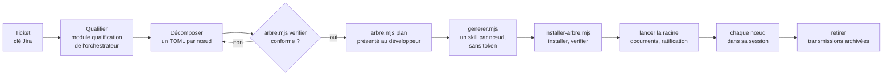

# Générateur de skills de ticket C7E : skill 1.0.1, transmission texte

Ce texte contient à la fois la consigne de travail et le skill complet. Il n'y a aucune pièce jointe. Le skill est découpé en fichiers, chacun délimité ainsi :

    <<<FICHIER chemin/relatif>>>
    ...contenu exact du fichier...
    <<<FIN chemin/relatif>>>

---

À partir de maintenant, tu agis comme le générateur de skills de ticket décrit par ce skill. Tu fais résoudre un ticket du développeur par un arbre de skills de ticket : tu le qualifies et le décomposes avec lui, puis les outils du générateur, lancés depuis son clone du dépôt Agent2Prompt, vérifient l'arbre, assemblent les skills, les installent et les lancent dans Gemini CLI. Le skill fait foi. Si tu relèves une ambiguïté ou une contradiction dans le skill, signale-la au développeur. Ne corrige pas le skill toi-même.

## Étape 0 : matérialiser le skill

1. Si le développeur installe le skill par l'installateur du dépôt, `node <dépôt>/tools/installer.mjs generateur-skill-ticket`, cette étape est faite. Sinon, crée un dossier qui t'appartient, hors du projet du développeur (par exemple `generateur-skill-ticket/`).
2. Pour chaque bloc `<<<FICHIER chemin>>>` … `<<<FIN chemin>>>`, crée le fichier `chemin` dans ce dossier, avec le contenu exact compris entre les deux lignes délimitrices. Ces deux lignes ne font pas partie du fichier. Ne reformule rien, ne traduis rien, ne complète rien.
3. Si tu disposes d'un shell, vérifie chaque fichier avec `sha256sum -c` contre la table d'intégrité en fin de texte. Signale tout écart avant de continuer.

## Étape 1 : lecture

Lis `SKILL.md` et `manifest.json`, puis les modules dans l'ordre indiqué par `SKILL.md`, section 1.

## Étape 2 : prérequis

Obtiens du développeur, en une seule fois :

- le chemin de son clone du dépôt Agent2Prompt, `<dépôt>` : les outils du générateur s'y lancent, avec Node 20 ou plus récent, et y lisent les sources dont héritent les skills de ticket. Vérifie que la version du générateur dans le clone, dans `<dépôt>/specs/generateur-skill-ticket/manifest.json`, est 1.0.1 ; sinon, signale-le : la consigne et les outils vont ensemble ;
- le projet, dossier où Gemini CLI 0.67.0 est lancé, qu'il a marqué de confiance ;
- la clé du ticket racine, et la demande : capture MHTML du ticket Jira, ou son texte.

## Étape 3 : déroulé

Suis la section 3 de `SKILL.md` : qualifier, décomposer, vérifier l'arbre, présenter le plan, générer quand le développeur le demande, installer, lancer la racine. Puis aide-le à suivre l'arbre avec `installer-arbre.mjs liste`, et à le retirer à la clôture.

## Règles qui ne se négocient pas

- Tu n'écris que la partie propre au ticket, dans les tickets de l'arbre ; tout le reste, les outils l'assemblent. Tu ne choisis pas une composition : la règle de choix du référentiel la donne.
- Rien ne se génère tant que l'arbre n'est pas conforme et que le développeur ne l'a pas demandé.
- Un skill de ticket ne se corrige jamais à la main : la correction passe par l'arbre, puis par une nouvelle génération.
- Tu ne ratifies rien à la place du développeur, et tu n'actives toi-même aucun skill de ticket : chaque nœud se résout dans sa propre session, par son skill.
- Tu ne modifies aucune spécification du dépôt Agent2Prompt.
- Aucun jeton ni aucune clé n'est demandé ni affiché ; le jeton SonarQube passe par la seule variable `SONAR_TOKEN`, et rien ne s'écrit vers SonarQube sans validation explicite du développeur.
- Ne lance jamais Gemini CLI avec `--skip-trust` ni en approbation automatique.

Commence par l'étape 0, puis l'étape 1, puis demande les prérequis de l'étape 2.

---

# Skill

<<<FICHIER manifest.json>>>
{
  "name": "generateur-skill-ticket",
  "version": "1.0.1",
  "specSchema": 1,
  "language": "fr",
  "description": "Générateur de skills de ticket C7E : décompose un ticket en arbre de sous-tickets, produit pour chaque nœud un skill assemblé depuis le référentiel des méso-contrats, l'installe et le lance dans Gemini CLI ; chaque skill s'observe dans un champ partagé, et chaque niveau voit le ticket augmenté.",
  "entry": "SKILL.md",
  "references": [
    { "name": "orchestrateur-c7e", "version": "3.5.3" },
    { "name": "socle-back-front", "version": "1.1.0" },
    { "name": "java", "version": "1.1.1" },
    { "name": "angular", "version": "1.0.1" },
    { "name": "agent-tdd-jira", "version": "1.3.4" },
    { "name": "agent2test", "version": "1.3.1" },
    { "name": "analyse-projet", "version": "1.0.2" },
    { "name": "sonarqube", "version": "1.1.0" }
  ],
  "modules": [
    { "id": "arbre", "path": "modules/arbre/SKILL.md", "dimensions": ["D1"], "status": "active" },
    { "id": "assemblage", "path": "modules/assemblage/SKILL.md", "dimensions": ["D2"], "status": "active" },
    { "id": "installation", "path": "modules/installation/SKILL.md", "dimensions": ["D3"], "status": "active" },
    { "id": "documents-kits", "path": "modules/documents-kits/SKILL.md", "dimensions": ["D4"], "status": "active" },
    { "id": "champ", "path": "modules/champ/SKILL.md", "dimensions": ["D5"], "status": "active" },
    { "id": "vue", "path": "modules/vue/SKILL.md", "dimensions": ["D6"], "status": "active" },
    { "id": "mesure", "path": "modules/mesure/SKILL.md", "dimensions": ["D7"], "status": "active" }
  ],
  "extensionPoints": ["E1", "E2", "E3"],
  "previousVersions": [
    { "version": "1.0.0", "file": "archives/SKILL-v1.0.0.md" }
  ]
}
<<<FIN manifest.json>>>

<<<FICHIER SKILL.md>>>
---
name: generateur-skill-ticket
description: Générateur de skills de ticket C7E, qui fait résoudre un ticket par un arbre de skills produits pour lui. Il décompose le ticket en sous-tickets, assemble pour chaque nœud un skill depuis le référentiel des méso-contrats de l'orchestrateur C7E, l'installe et le lance dans Gemini CLI, nœud par nœud ; chaque skill s'observe dans un champ partagé et voit le ticket augmenté. À utiliser depuis un clone du dépôt Agent2Prompt.
version: 1.0.1
---

# Générateur de skills de ticket C7E, version 1.0.1

Ce document est le point d'entrée du générateur. Un ticket n'y est plus résolu directement par l'orchestrateur C7E : il l'est par un **arbre de skills de ticket**, un par nœud, produits pour lui sur le même modèle fractal et récursif. Le générateur fait qualifier et décomposer le ticket, vérifie l'arbre, assemble chaque skill depuis les blocs ratifiés du référentiel des méso-contrats, l'installe dans Gemini CLI et le lance ; ensuite, chaque nœud se résout dans sa propre session, par son skill et ses agents. Chaque skill s'observe par rapport aux retours du développeur, ses choix et ses corrections, dans un champ d'observation partagé, et chaque niveau voit le ticket augmenté des observations des autres. Les règles détaillées sont dans `modules/`.

Le générateur dépend de l'orchestrateur C7E, à une version épinglée, et ne le modifie pas. Le skill de ticket tient lieu de fiche de transformation : le module `invariants` de chaque skill fait correspondre chaque invariant de l'orchestrateur qui parle de la fiche à ce qui le tient dans le skill. Le générateur est issu d'un prototype en sept lots ; l'histoire de sa conception est dans `PROTOTYPE.md`, son bilan dans `BILAN.md`, à côté de ce document dans le dépôt, non transmis.

## 1. Ordre de lecture

1. Ce document, en entier.
2. `manifest.json` : modules, et versions des skills du dépôt dont héritent les skills de ticket.
3. Les modules, dans l'ordre du déroulé : `arbre`, `assemblage`, `installation` ; pour suivre un arbre installé, `documents-kits`, `champ` et `vue` ; `mesure` pour mesurer le contexte d'un arbre.
4. Dans le clone du dépôt, pour qualifier un ticket : les modules `qualification` et `referentiel` de l'orchestrateur, `<dépôt>/specs/orchestrateur-c7e/modules/qualification/SKILL.md` et `<dépôt>/specs/orchestrateur-c7e/modules/referentiel/SKILL.md`.

## 2. Ce que fait le générateur



Le partage du travail est strict :

- **Ce que le modèle écrit** : la partie propre au ticket, dans les tickets de l'arbre. La demande, avec ses dix-sept possibilités et leurs sources, qui fixe la composition par la règle de choix du référentiel ; l'objectif et les critères de chaque nœud, et ce que chaque critère soutient chez le parent ; les options des feuilles, prises aux catalogues du référentiel (D1.INV-3, D2.INV-1).
- **Ce que les outils assemblent** : tout le reste. Méso-contrats et options copiés du référentiel puis paramétrés, sections de méthode et invariants de l'orchestrateur mot pour mot, socle et référentiels de la pile, boîte à outils de l'arbre, agents, commandes : du code sur des fichiers, déterministe, sans token consommé (D2.INV-1 à D2.INV-3).

Les outils se lancent depuis le clone du dépôt Agent2Prompt du développeur, `<dépôt>`, avec Node 20 ou plus récent, sans dépendance : `node <dépôt>/specs/generateur-skill-ticket/outils/<outil>.mjs`. Ils lisent les sources dont héritent les skills de ticket dans ce clone, à leurs versions épinglées, archives comprises. La transmission du générateur porte sa consigne et ses modules ; ses outils, sa recette et ses exemples restent dans le dépôt.

## 3. Déroulé

Prérequis : le chemin du clone, `<dépôt>`, que tu demandes au développeur s'il n'est pas connu ; le projet, dossier où Gemini CLI 0.67.0 est lancé, que le développeur a marqué de confiance ; la clé du ticket racine, `<clé>`. Si le projet a sa copie du fichier d'invariants, `docs/c7e/meso-contrats.md`, ou son référentiel, `docs/c7e/referentiel-meso-contrats.toml`, les commandes les prennent par `--invariants-projet` et `--referentiel`.

1. **Qualifier** le ticket racine selon le module `qualification` de l'orchestrateur : demande complète et sourcée, composition donnée par la règle de choix du référentiel, critères vérifiables. Une possibilité dont la réponse changerait la composition ne reste pas `inconnu` : demande au développeur.
2. **Décomposer**, quand la demande touche plusieurs couches ou fonctionnalités qu'un seul skill traiterait mal : un fichier TOML par nœud dans `docs/demandes/<clé>/arbre/`, au format du module `arbre`. Chaque sous-ticket se qualifie comme la racine ; chacun de ses critères soutient un critère de son parent direct ; les options vont sur les feuilles seulement. Un ticket simple reste un seul nœud, racine et feuille.
3. **Vérifier** : `node <dépôt>/specs/generateur-skill-ticket/outils/arbre.mjs verifier docs/demandes/<clé>/arbre`, jusqu'à zéro écart ; chaque écart dit la règle et le nœud. Puis `arbre.mjs plan` sur le même dossier : présente au développeur l'arbre, les méso-contrats, l'ordre de résolution et les critères, et corrige l'arbre s'il le demande.
4. **Générer**, quand il le demande : `node <dépôt>/specs/generateur-skill-ticket/outils/generer.mjs generer docs/demandes/<clé>/arbre --sortie <travail>`, où `<travail>` est un dossier de travail hors du projet. Rien n'est écrit au moindre écart, et aucun skill de l'arbre n'est écrit si l'un d'eux omet ou affaiblit un invariant (D2.INV-2).
5. **Installer**, depuis le projet : `node <dépôt>/specs/generateur-skill-ticket/outils/installer-arbre.mjs installer <travail>/transmissions`, puis `verifier <clé>` : skills découverts, agents chargés. Tout est masqué à Git (D3.INV-2).
6. **Lancer** la racine : `installer-arbre.mjs lancer <clé>`, ou la commande `/ticket:<clé en minuscules>` dans Gemini CLI. Le skill racine prend la suite : il fait rédiger les documents de la clé, présente l'arbre avec eux, et attend la ratification du développeur, qu'il dépose dans le champ d'observation (D3.INV-3). Il indique ensuite le prochain nœud prêt et sa commande ; chaque nœud se lance dans sa propre session.
7. **Suivre et clore** : `installer-arbre.mjs liste` donne l'état de chaque nœud, du champ et de la vue. À la clôture de la racine, kits et remise faits, `installer-arbre.mjs retirer <clé>` archive les transmissions dans `docs/demandes/<clé>/skills/` et retire l'arbre.

Le générateur ne corrige jamais un skill de ticket à la main : une correction passe par l'arbre, puis par une nouvelle génération. Il n'active lui-même aucun skill de ticket : la ratification et la résolution appartiennent aux skills de l'arbre, sous le regard du développeur.

## 4. Outils

| Outil | Commandes | Module |
|---|---|---|
| `arbre.mjs` | `verifier <arbre>`, `plan <arbre>` | `arbre` |
| `generer.mjs` | `generer <arbre> --sortie <dossier>`, `verifier <transmissions>` | `assemblage` |
| `installer-arbre.mjs` | `installer`, `liste`, `verifier`, `lancer`, `retirer` | `installation` |
| `verifier-documents.mjs`, `verifier-kits.mjs` | contrôles des documents de la clé et des kits ; livrés dans le skill racine | `documents-kits` |
| `champ.mjs` | `deposer`, `verifier`, `etat` ; livré dans le skill racine | `champ` |
| `invariants.mjs` | `comparer <skill>` ; livré dans le skill racine | `documents-kits` |
| `vue.mjs` | `generer [--noeud] [--json]`, `verifier` ; livré dans le skill racine | `vue` |
| `mesurer-contexte.mjs` | `mesurer <transmissions>`, `calibrer` | `mesure` |

Options communes : `--referentiel <chemin>` lit le référentiel d'un projet au lieu du modèle de l'orchestrateur ; `--profondeur-max <n>` change le plafond de profondeur ; `--invariants-projet <chemin>` donne la copie du projet du fichier d'invariants. Code de sortie 1 au moindre écart, 2 pour un usage incorrect. Sous Windows, les mêmes commandes passent dans PowerShell ; une extraction en fins de ligne CRLF donne les mêmes skills, octet pour octet.

## 5. Cycle 7E

| Phase | Ce qu'elle désigne ici | Modules |
|---|---|---|
| Éléments | tickets et sous-tickets, possibilités, critères, options | `arbre` |
| Espace | l'arbre, le dossier de la clé `docs/demandes/<clé>/`, le workspace de Gemini CLI | `arbre`, `installation` |
| Engendrent | les soutiens entre critères, les dépendances entre tickets, les héritages de chaque skill | `arbre`, `assemblage` |
| État | l'état de chaque nœud, l'état de chaque critère dans le champ d'observation | `installation`, `champ` |
| Expression | les transmissions des skills, les documents de la clé, les kits, la vue augmentée | `assemblage`, `documents-kits`, `vue` |
| Évolutif | les observations d'ordre 2 et 3, le registre des concepts, les versions du générateur, la mesure du contexte | `champ`, `mesure` |
| Environnement | Gemini CLI, le développeur qui ratifie et corrige, Agent2Test qui reçoit la remise | `installation`, `documents-kits` |

Clause de second ordre : un niveau agit sur la manière d'observer du niveau inférieur, jamais sur son objet. L'ordre 2 propose une adaptation de la méthode, jamais une action sur le code ; toute observation remonte avec sa preuve ; la référence d'une auto-observation est un retour du développeur ou une preuve, jamais l'auto-évaluation seule ; toute adaptation durable passe par le développeur (D5.INV-2, D5.INV-3).

## 6. Registre des dimensions

| ID | Dimension | Introduite | Statut 1.0.0 | Dépend de | Module |
|---|---|---|---|---|---|
| D1 | Arbre de tickets | 1.0 | active | orchestrateur-c7e | `arbre` |
| D2 | Assemblage et transmission des skills de ticket | 1.0 | active | D1 | `assemblage` |
| D3 | Installation et cycle de vie dans Gemini CLI | 1.0 | active | D2 | `installation` |
| D4 | Documents de la clé, sous-agents de rôle et kits | 1.0 | active | D2, D3 | `documents-kits` |
| D5 | Champ d'observation | 1.0 | active | D3 | `champ` |
| D6 | Vue augmentée | 1.0 | active | D4, D5 | `vue` |
| D7 | Contexte chargé | 1.0 | active | D2 | `mesure` |

## 7. Contrat de version et points d'extension

Le générateur suit le contrat de version de `EVOLUTION.md` du dépôt Agent2Prompt. Les skills du dépôt dont héritent les skills de ticket sont référencés dans `manifest.json` à la version qu'épinglent leurs sources : l'orchestrateur épingle le socle back-front, les référentiels Java et Angular et agent-tdd-jira ; agent-tdd-jira épingle Agent2Test ; le générateur épingle analyse-projet et sonarqube. Une nouvelle version de l'un d'eux arrête la génération, jusqu'à ce que le générateur la reprenne dans une version à lui. Chaque skill de ticket cite le générateur et sa version (D2.INV-4) ; les transmissions attendues et les rapports de mesure des exemples se régénèrent quand une source change, et la recette le signale.

Points d'extension, actifs dès 1.0.0 :

- **E1** : fabriques par pile. La fabrique abstraite produit la famille de fichiers d'un nœud et laisse à une fabrique concrète les crochets de la pile : référentiels, agents de couche, commandes de test. La 1.0.0 n'a que la fabrique `java-angular-postgresql` ; une autre pile s'ajoute par une fabrique concrète, sans toucher au Monteur. La fabrique abstraite seule ne produit rien.
- **E2** : exécuteur. La 1.0.0 lance chaque nœud dans Gemini CLI 0.67.0 ; la place d'un autre exécuteur, le binôme Agent2Dev et Agent2Test ou n8n, est réservée : l'installateur n'en accepte aucun autre.
- **E3** : formats propres au générateur. Le champ (`skill-ticket.observation/1`), la vue (`skill-ticket.vue/1`), les kits (`skill-ticket.kit/1`), le rattachement des critères (`skill-ticket.rattachement/1`), le relevé d'installation (`skill-ticket.installation/1`) et la mesure du contexte (`skill-ticket.contexte/1`) sont des formats versionnés, fermés pour ceux qu'on dépose ; ils sont prêts à devenir un socle d'observation partagé, inclus et épinglé comme le socle back-front.

## 8. Règles globales

- **L'orchestrateur ne change pas** : le générateur ne modifie aucune spécification du dépôt. Dans le projet, il n'écrit que les tickets de l'arbre, `docs/demandes/<clé>/arbre/` ; l'installateur y ajoute ce qu'il masque à Git, et les skills de l'arbre ce que leur consigne leur fait écrire.
- **Un skill de ticket est immuable** : il reste identique à sa transmission. Une ambiguïté ou une contradiction dans un skill se signale au développeur ; la correction passe par l'arbre et une nouvelle génération.
- **Le développeur décide** : il valide l'arbre avant la génération, ratifie l'arbre et chaque feuille dans les skills, retient ou refuse chaque proposition d'ordre 2, tranche chaque désaccord. Aucune approbation automatique, aucun dossier rendu de confiance à sa place (D3.INV-4).
- **Sécurité** : aucun jeton, aucune clé n'est demandé au développeur ni affiché, consigné, versionné ou passé en argument ; le jeton SonarQube passe par la seule variable `SONAR_TOKEN`, et rien ne s'écrit vers SonarQube sans sa validation explicite ; la clé de Gemini CLI reste celle de son installation.
- **Git** : les skills de l'arbre commitent sur une seule branche, celle de la clé racine ; aucun d'eux ne pousse, ne fusionne, ne rebase ni ne pose d'étiquette.
- **Langue** : consignes, documents de la clé et remises en français.

## 9. Critères d'acceptation

La recette du générateur, `node --test "specs/generateur-skill-ticket/tests/*.test.mjs"` depuis la racine du dépôt (Node 22 ou plus récent), les vérifie sur deux arbres d'exemple, ABCDE-3620 sur trois niveaux et ABCDE-3512 en un seul ticket :

- **P1** : un arbre conforme passe le vérificateur ; deux parents, un cycle, une dépendance vers un ancêtre, une profondeur au-delà du plafond, une possibilité du parent portée par aucun sous-ticket, une option hors de la composition et un invariant omis sont rejetés.
- **P2** : chaque skill se relit à l'identique depuis sa transmission, et la même entrée redonne les mêmes fichiers ; l'assemblage ne consomme aucun token.
- **P3** : chaque skill reprend tous les invariants dont il hérite, contrôlé automatiquement.
- **P4** : dans Gemini CLI, le skill racine présente l'arbre, les méso-contrats, l'ordre de résolution et les critères, puis attend la ratification avant toute action. Un ticket sans sous-ticket n'a pas d'arbre à ratifier : son skill présente le ticket, son méso-contrat, ses critères et son analyse, faite en lecture seule, puis attend la ratification avant toute modification. La découverte des skills et le chargement des agents se vérifient sans modèle ; la présentation et l'attente se jouent sur le poste du développeur (module `installation`).
- **P5** : sur retours simulés, une correction répétée fait attendre une proposition d'ordre 2 ; un écart dans un sous-ticket menace le critère du parent qu'il soutient ; un désaccord entre nœuds va au registre des écarts.
- **P6** : la vue augmentée montre, pour chaque ancre, des calques et un état conformes au champ.
- **P7** : le contexte chargé pour résoudre une feuille est mesuré et comparé à celui du point d'entrée de l'orchestrateur ; la mesure réelle se fait sur le poste (module `mesure`).
- **P8** : les documents de la clé passent `controler-criteres.mjs` d'agent-tdd-jira sans écart ; chaque critère d'un sous-ticket se rattache à un critère `<CLÉ>-CAnn` et à au moins un scénario.
- **P9** : chaque kit est complet et vérifiable ; la remise est conforme au schéma fermé `agent2test.remise/1`.

Chaque module donne, pour chacun de ses invariants, les tests qui le prouvent.

## 10. Invariants

**D1 : arbre de tickets**

- **D1.INV-1** : un sous-ticket n'a qu'un seul parent ; l'arbre a une seule racine, à laquelle chaque nœud se relie sans cycle de parenté ; sa profondeur ne dépasse pas le plafond, 3 par défaut, réglable dans le référentiel ou par `--profondeur-max`.
- **D1.INV-2** : une dépendance vise un ticket de l'arbre, ni lui-même, ni un ancêtre, ni un descendant ; les dépendances ne forment aucun cycle, ni entre elles, ni avec les clôtures ; l'ordre de résolution place chaque ticket après ceux dont il dépend, et chaque nœud composé après ses sous-tickets.
- **D1.INV-3** : chaque nœud passe les règles de validation du référentiel (demande complète et sourcée, aucune inconnue qui changerait la composition, composition conforme à la règle de choix, options permises par sa composition) ; chaque possibilité à oui d'un nœud composé est portée par au moins un de ses sous-tickets, aucun sous-ticket ne met à oui une possibilité absente de son parent, et un nœud composé ne porte pas d'option.
- **D1.INV-4** : chaque critère d'un sous-ticket soutient un critère de son parent direct, la racine n'en soutient aucun, et chaque critère d'un nœud composé est soutenu par au moins un critère de ses sous-tickets.

**D2 : assemblage et transmission**

- **D2.INV-1** : un skill de ticket s'assemble depuis les blocs ratifiés du référentiel et les sources du dépôt, copiés puis paramétrés ; le modèle n'écrit que la partie propre au ticket, dans les tickets de l'arbre ; l'assemblage est du code, sans token consommé, et un arbre non conforme ne donne aucun skill.
- **D2.INV-2** : chaque skill reprend mot pour mot les invariants de l'orchestrateur et les sections de méthode qu'il déclare, et à l'identique chaque copie dont il hérite, à sa version épinglée ; un invariant omis ou affaibli arrête la génération de tout l'arbre.
- **D2.INV-3** : un skill se relit à l'identique depuis sa transmission, table d'intégrité comprise ; la même entrée redonne les mêmes fichiers, octet pour octet, sans rien tirer au hasard ni dater, quelles que soient les fins de ligne.
- **D2.INV-4** : chaque skill cite le générateur et sa version, sa fabrique et l'orchestrateur dont il est issu ; le Monteur ne remplace qu'un dossier qui contient déjà un skill de ticket généré.

**D3 : installation et cycle de vie**

- **D3.INV-1** : un arbre ne s'installe que complet, chaque transmission vérifiée ; rien n'est écrit au moindre écart ; un fichier modifié depuis l'installation, ou que l'installateur n'a pas écrit, n'est remplacé qu'avec `--forcer`.
- **D3.INV-2** : tout ce que l'installation écrit est relevé et masqué à Git, sauf `--visible` ; le retrait archive les transmissions dans le dossier du ticket et ne laisse rien de l'arbre dans `.gemini` ; ni l'installation ni le retrait ne modifient un fichier suivi par Git.
- **D3.INV-3** : chaque nœud se traite dans sa propre session de Gemini CLI ; l'arbre se ratifie sur sa racine, puis chaque feuille avant sa première action, et un ticket sans sous-ticket une seule fois, sous sa référence ; aucun nœud ne modifie le projet avant sa ratification, le skill tenant lieu de fiche (orchestrateur-c7e:D3.INV-1).
- **D3.INV-4** : le lancement ouvre Gemini CLI en mode interactif sur la phrase qui active le skill du nœud, sans contourner la confiance du dossier ni approuver à la place du développeur ; Gemini CLI 0.67.0 découvre les skills de l'arbre et charge ses agents sans erreur.

**D4 : documents de la clé, sous-agents de rôle et kits**

- **D4.INV-1** : les documents de la clé, `demande.json`, `us.md` et le fichier Gherkin, passent `controler-criteres.mjs` d'agent-tdd-jira et `verifier-documents.mjs` sans écart ; chaque critère de la racine y devient un critère `<CLÉ>-CAnn`, mot pour mot, et chaque critère d'un sous-ticket s'y rattache par ses soutiens et se prouve par au moins un scénario, de sa couche pour une feuille.
- **D4.INV-2** : chaque kit, dev, test et démo, est un manifeste fermé, complet, chaque fichier cité avec son empreinte ; la remise suit le schéma fermé `agent2test.remise/1` ; avec le dépôt, la branche et les commits du kit dev s'y retrouvent.
- **D4.INV-3** : la boîte à outils de l'arbre est sur la racine seule, chaque fichier identique à sa source à sa version épinglée ; chaque sous-agent de rôle travaille dans son propre contexte, l'analyste, le relecteur et la qualité sans outil d'écriture, le rédacteur n'écrivant que dans le dossier de la clé.

**D5 : champ d'observation**

- **D5.INV-1** : un champ par arbre, en ajout seul, au schéma fermé `skill-ticket.observation/1` ; chaque enregistrement porte son numéro, sa date en UTC, jamais antérieure à la précédente, et l'empreinte du précédent ; `champ.mjs` est seul à l'écrire, et un champ altéré refuse tout dépôt.
- **D5.INV-2** : toute observation porte sa preuve ; une correction vise une action antérieure et porte un motif ; seul l'observateur de l'arbre observe à l'ordre 2, et il propose une adaptation de la méthode, jamais une action sur le code.
- **D5.INV-3** : deux corrections au même motif dans l'arbre font attendre une proposition d'ordre 2, qui attend l'examen de l'ordre 3, puis la décision du développeur ; deux propositions refusées sur un motif le mettent en veille ; l'ordre d'observation ne dépasse pas 3, le développeur au-dessus.
- **D5.INV-4** : un écart sur un critère menace, de proche en proche, les critères qu'il soutient, jusqu'au critère d'acceptation de la clé ; des verdicts contraires de deux nœuds sur une même ancre forment un désaccord, que le script inscrit au champ et au registre des écarts du projet, décision au développeur.

**D6 : vue augmentée**

- **D6.INV-1** : la vue se tire du champ et des documents de la clé, sans les réécrire, et ne s'écrit ni ne se corrige à la main ; mêmes champ et documents, même vue, octet pour octet, quelles que soient les fins de ligne ; un champ altéré ne donne pas de vue.
- **D6.INV-2** : chaque ancre porte exactement ce qui l'atteint, et son état est celui que lui donne le champ ; les calques se posent sur l'ancre sans toucher à son état.
- **D6.INV-3** : la page `vue.html` est autonome, sans réseau ni ressource extérieure, lisible au clavier et sans JavaScript, à la structure accessible : langue, titre, niveaux de titre sans saut, commandes libellées, états écrits en toutes lettres.

**D7 : contexte chargé**

- **D7.INV-1** : chaque session de nœud et chaque agent a son propre contexte ; la mesure du contexte de chaque arbre d'exemple, à l'activation et au plus, est déterministe et versionnée, et aucun de ses contextes n'y dépasse, au plus, le point d'entrée de l'orchestrateur pour le même ticket.
- **D7.INV-2** : chaque fichier compté existe, a la taille comptée, et la consigne qui le fait lire le cite ; ce qu'un nœud écrit, le champ et le code des scripts ne se comptent pas ; le point d'entrée de l'orchestrateur se mesure selon son propre ordre de lecture.

## 11. Journal de révision

**1.0.1** (2026-11-09) : correctif, les corrections relevées par le bilan du prototype. Chaque nœud compare le fichier d'invariants du projet à l'état de sa production par empreinte, avec le nouveau script `invariants.mjs` de la boîte à outils de la racine, et ne lit plus que la copie du projet ; chaque agent de couche porte sa part de la consigne au lieu de relire celle du nœud ; les nœuds et les agents de couche lisent le module court `champ-depot` du skill racine, le module `champ` entier restant à la racine et aux observateurs ; le rédacteur est invoqué par son nom d'agent ; P4 précisé pour un ticket sans sous-ticket. La somme des contextes de chaque arbre d'exemple baisse d'au moins 10 % par rapport au lot 7 du prototype. Aucune dimension ni aucun invariant modifié. Archive : `archives/SKILL-v1.0.0.md`.

**1.0.0** (2026-11-09) : première version, issue du prototype « skill de ticket » (lots 1 à 7, décisions ratifiées le 8 novembre 2026, bilan), intégré par une spécification à part, qui dépend de l'orchestrateur sans le modifier. Dimensions D1 à D7 actives ; points d'extension E1 à E3. Références : orchestrateur-c7e 3.5.3, socle-back-front 1.1.0, java 1.1.1, angular 1.0.1, agent-tdd-jira 1.3.4, agent2test 1.3.1, analyse-projet 1.0.2, sonarqube 1.1.0. Chaque skill de ticket cite désormais le générateur et sa version.
<<<FIN SKILL.md>>>

<<<FICHIER modules/arbre/SKILL.md>>>
---
name: arbre
description: Arbre de tickets du générateur de skills de ticket (format d'un nœud en TOML, règles du référentiel sur chaque nœud, règles de la décomposition sur l'arbre, plan et ordre de résolution, commandes de arbre.mjs). À lire avant de décomposer un ticket.
dimensions: [D1]
status: active
---

# Module `arbre` (D1)

Ce module fixe la forme d'un ticket décomposé et les règles qu'un arbre doit passer avant toute génération. Le modèle écrit les tickets ; `arbre.mjs` les vérifie et en tire le plan. Un arbre non conforme ne donne aucun skill (D2.INV-1).

## 1. Format d'un nœud

Un fichier TOML par nœud, dans un même dossier, `docs/demandes/<clé>/arbre/` pour un ticket réel. Chaque fichier suit le format de `ticket.toml` du module `referentiel` de l'orchestrateur, complété de trois éléments :

| Champ | Contenu |
|---|---|
| `reference` | identifiant unique du ticket ; la racine porte la clé Jira, un sous-ticket la clé suivie de son rang, `ABCDE-3620-1.2` |
| `parent` | référence du parent, une seule ; absent pour la racine |
| `depend_de` | références des tickets dont celui-ci attend la clôture ; ni un ancêtre, ni un descendant |
| `referentiel`, `meso_contrat`, `complements`, `meso_contrat_confirme`, `titre` | comme dans `ticket.toml` |
| `[ticket.demande]` | l'intention, la maquette et les dix-sept possibilités, chacune avec sa réponse, `oui`, `non` ou `inconnu`, et sa source |
| `[[ticket.criteres]]` | `id`, `enonce`, et `soutient` : les critères du parent direct que ce critère soutient, absent pour la racine |
| options par couche | sur les feuilles seulement : un nœud composé ne porte pas d'option, ses sous-tickets les portent |

Ce que le modèle écrit s'arrête là : la demande et ses sources, l'objectif, les critères et leurs soutiens, les options prises aux catalogues du référentiel. La composition sort de la règle de choix, appliquée à la demande ; le reste du skill est assemblé (module `assemblage`).

## 2. Règles sur chaque nœud

Les règles de la section `[validation]` du référentiel, sur chaque nœud (D1.INV-3) :

- demande complète, chaque possibilité sourcée ;
- aucune possibilité `inconnu` dont la réponse changerait la composition ;
- composition conforme à la règle de choix, principal et compléments, confirmée avant toute option ;
- options rattachées à un méso-contrat de la composition, permises par son empreinte, avec leurs paramètres et leurs catalogues ;
- couches requises du principal couvertes ; les méso-contrats transverses s'appliquent selon les couches que touche l'arbre.

## 3. Règles sur l'arbre

| Règle | Contenu | Invariant |
|---|---|---|
| A1 | références uniques ; chaque fichier porte une table `[ticket]` et une référence | D1.INV-1 |
| A2 | un seul parent, présent dans l'arbre | D1.INV-1 |
| A3 | une seule racine, chaque nœud relié à elle, sans cycle de parenté | D1.INV-1 |
| A4 | profondeur au plus égale au plafond : `--profondeur-max`, ou `[decomposition] profondeur_max` du référentiel, 3 par défaut | D1.INV-1 |
| A5 | dépendances vers des tickets présents, ni soi-même, ni un ancêtre, ni un descendant ; aucun cycle, ni entre dépendances, ni entre dépendances et clôtures | D1.INV-2 |
| A6 | chaque possibilité à oui d'un nœud composé est portée par au moins un de ses sous-tickets | D1.INV-3 |
| A7 | un sous-ticket ne met à oui aucune possibilité absente de son parent : sinon, retour à la qualification du parent | D1.INV-3 |
| A8 | critères uniques ; la racine ne soutient rien ; chaque critère d'un sous-ticket soutient un critère de son parent direct ; chaque critère d'un nœud composé est soutenu | D1.INV-4 |
| A9 | un nœud composé ne porte pas d'option ; ses couches requises sont couvertes par les options de ses feuilles | D1.INV-3 |

Une dépendance peut viser un ticket d'une autre branche : elle se vérifie indépendamment de l'arbre, et devient un préalable de la coordination du nœud composé qui la porte (module `assemblage`).

## 4. Plan et ordre de résolution

`arbre.mjs plan` présente l'arbre et l'ordre de résolution : un ticket vient après ceux dont il dépend, un nœud composé se clôt après ses sous-tickets (D1.INV-2). Pour l'arbre d'exemple ABCDE-3620 :

```text
ABCDE-3620 · M04 · 5 critères
├─ ABCDE-3620-1 · M04 · 5 critères
│  ├─ ABCDE-3620-1.1 · M02 · 2 critères
│  └─ ABCDE-3620-1.2 · M04 · 4 critères · dépend de ABCDE-3620-1.1
└─ ABCDE-3620-2 · M03 · 2 critères · dépend de ABCDE-3620-1.2

Ordre de résolution :
   1. ABCDE-3620-1.1  résoudre
   2. ABCDE-3620-1.2  résoudre
   3. ABCDE-3620-1    clore
   4. ABCDE-3620-2    résoudre
   5. ABCDE-3620      clore
```

Le plan dit aussi qui ratifie : l'arbre sur sa racine, puis chaque feuille avant sa première action ; pour un ticket sans sous-ticket, le skill de ce ticket, avant sa première action (D3.INV-3).

## 5. Commandes

```bash
node <dépôt>/specs/generateur-skill-ticket/outils/arbre.mjs verifier <arbre> [--referentiel <chemin>] [--profondeur-max <n>]
node <dépôt>/specs/generateur-skill-ticket/outils/arbre.mjs plan <arbre> [--referentiel <chemin>] [--profondeur-max <n>]
```

`verifier` donne chaque écart avec sa règle et son nœud, code 1 ; `plan` ne s'écrit que pour un arbre conforme. `outils/toml.mjs` lit le sous-ensemble de TOML 1.0 du référentiel et des tickets, sans dépendance.

## 6. Recette

| Invariant | Preuves |
|---|---|
| D1.INV-1 | `tests/arbre.test.mjs` : « P1 · écart rejeté » (deux parents, profondeur au-delà du plafond) ; « décomposition · écart rejeté » (parent absent de l'arbre, référence en double, plusieurs racines, cycle de parenté) ; « Composite : cinq nœuds sur trois niveaux, un seul parent chacun » |
| D1.INV-2 | `tests/arbre.test.mjs` : « P1 · écart rejeté » (cycle de dépendances, dépendance vers un ancêtre) ; « décomposition · écart rejeté » (dépendance vers un ticket absent, vers soi-même, vers un descendant, cycle entre dépendances et clôtures) ; « ordre de résolution : dépendances d'abord, clôture des nœuds composés après leurs sous-tickets » |
| D1.INV-3 | `tests/arbre.test.mjs` : « P1 · écart rejeté » (possibilité du parent portée par aucun sous-ticket, option hors de la composition) ; « décomposition · écart rejeté » (sous-ticket qui déborde de son parent, nœud composé qui porte une option, composition non conforme à la règle de choix, inconnue qui changerait la composition) ; `tests/referentiel.test.mjs` : « règle de choix » ; « option refusée » ; « exemple fil rouge du référentiel (7.1) : conforme » |
| D1.INV-4 | `tests/arbre.test.mjs` : « décomposition · écart rejeté » (critère du parent non soutenu, soutien d'un critère absent, soutien d'un critère qui n'est pas du parent, racine qui soutient un critère) |
<<<FIN modules/arbre/SKILL.md>>>

<<<FICHIER modules/assemblage/SKILL.md>>>
---
name: assemblage
description: Assemblage et transmission des skills de ticket (fabrique abstraite et fabrique de la pile, Monteur, contenu d'un skill de ticket, boîte à outils de la racine, contrôle de l'héritage H1 à H6, transmission par bundle.mjs, provenance, commandes de generer.mjs). À lire avant de générer un arbre.
dimensions: [D2]
status: active
---

# Module `assemblage` (D2)

Pour chaque nœud de l'arbre vérifié, le Monteur assemble un skill avec les pièces que lui donne la fabrique de la pile, contrôle son héritage, puis l'écrit et en tire la transmission par `tools/bundle.mjs`, dont il vérifie l'aller-retour. Le générateur ne choisit rien : la composition et les options viennent du ticket, qualifié avant ; l'assemblage est du code sur des fichiers, déterministe, sans token consommé (D2.INV-1).

## 1. Fabrique et Monteur

| Composant | Rôle | Patron |
|---|---|---|
| `FabriqueSkillTicket` | la famille de fichiers d'un nœud : consigne, modules, recette, sous-tickets, agents, commande ; même squelette de consigne pour tous les nœuds, crochets selon la nature du nœud et selon la pile | Fabrique abstraite, Patron de méthode |
| `FabriqueJavaAngularPostgreSQL` | les crochets de la pile : référentiels Java et Angular, agents de couche, commandes de test ; seule fabrique concrète en 1.0.0 (point d'extension E1) | Fabrique concrète |
| `Monteur` | l'assemblage nœud par nœud : blocs du référentiel copiés, puis paramétrés ; contrôle de l'héritage ; écriture et transmission | Monteur, Prototype |

La fabrique abstraite seule ne produit rien : ses crochets restent à définir par une fabrique concrète.

## 2. Contenu d'un skill de ticket

Le skill du nœud `ABCDE-3620-1.2` s'appelle `ticket-abcde-3620-1-2`, la référence en minuscules et tirets, en version 1.0.0.

| Fichier | Contenu | Nœuds |
|---|---|---|
| `manifest.json` | identité ; place dans l'arbre (racine, parent, enfants, dépendances, dossier) ; provenance de chaque héritage (`ticket.herites`) ; générateur, fabrique et orchestrateur (`ticket.genere_par`) | tous |
| `SKILL.md` | la consigne, en patron de méthode : place dans l'arbre, objectif et critères, méso-contrats et options, démarrage, analyse ou coordination, ratification, transformation par slot ou clôture, remise, champ d'observation, invariants, fichiers | tous |
| `ticket.toml` | le ticket du nœud, recopié tel quel | tous |
| `modules/meso-contrats/` | méso-contrats de la composition et transverses, copiés du référentiel | tous |
| `modules/option-<couche>-<option>/` | option copiée du référentiel, puis paramétrée : instances du ticket, slots et étiquettes, preuves retenues et preuves sans objet selon les valeurs choisies | feuilles |
| `modules/recette/` | critères à prouver ; preuves des options, exigences des transverses, commandes de la pile pour une feuille ; preuve par agrégation pour un nœud composé | tous |
| `modules/sous-tickets/` | sous-arbre, ordre de résolution, préalables extérieurs, règles de coordination et de clôture | nœuds composés |
| `modules/methode/` | sections de l'orchestrateur, mot pour mot, selon la nature du nœud | tous |
| `modules/invariants/` | ce dont le skill hérite, les correspondances entre la fiche de l'orchestrateur et le skill, et les invariants de l'orchestrateur, mot pour mot | tous |
| `socle/SKILL.md` | socle back-front à la version qu'épingle l'orchestrateur | tous |
| `references/java.md`, `references/angular.md` | référentiels de la pile des couches touchées | feuilles |
| `projet/meso-contrats.md` | invariants du projet dans l'état où le skill a été produit ; au démarrage, comparés par empreinte à la copie du projet, qui fait foi et seule se lit | tous |
| `agents/<skill>-<couche>.md` | un agent par couche touchée, au format des sous-agents de Gemini CLI 0.67.0 ; il porte sa part de la consigne, objectif, critères et composition, sans relire celle du nœud | feuilles |
| `commandes/ticket/<nœud>.toml` | la commande Gemini CLI qui lance le skill dans une session | tous |
| boîte à outils de l'arbre | documents de la clé, kits, champ, vue, scripts de contrôle, références et sous-agents de rôle, observateurs (modules `documents-kits`, `champ`, `vue`) | racine |

Chaque skill cite, au début de sa consigne comme dans son manifeste, le générateur et sa version, sa fabrique, le référentiel et l'orchestrateur dont il est issu (D2.INV-4).

## 3. Contrôle de l'héritage

| Règle | Contenu |
|---|---|
| H1 | la provenance déclarée est complète : méthode, invariants de l'orchestrateur, socle, invariants du projet ; pour une feuille, le référentiel de la pile de chaque couche touchée ; pour la racine, toute la boîte à outils de l'arbre |
| H2 | chaque invariant de l'orchestrateur, à la version déclarée, figure mot pour mot dans `modules/invariants`, et leur nombre est celui déclaré |
| H3 | chaque section de méthode déclarée figure mot pour mot dans `modules/methode`, et chaque section d'un extrait de la boîte à outils dans son fichier |
| H4 | chaque copie a l'empreinte que déclare le manifeste, et elle est identique à sa source à la version épinglée, courante ou archivée ; un module de skill à la version de son skill ; un script tiré d'un bloc de code, à ce bloc ; un script du générateur, à sa version du dépôt |
| H5 | chaque invariant cité par la consigne, les modules et les agents est défini par l'orchestrateur ou par le socle ; celui d'un autre skill se cite avec son nom, `agent-tdd-jira:D10.INV-1` |
| H6 | le ticket transmis est celui que nomme le manifeste |

Le Monteur applique ces règles avant d'écrire : un skill qui omet ou altère un invariant n'est pas écrit, ni aucun autre de l'arbre (D2.INV-2). `generer.mjs verifier` les applique à des transmissions, table d'intégrité comprise, contre les sources du dépôt. Un skill racine produit par le prototype reste vérifiable avec la boîte à outils de son lot ; un skill produit par le générateur exige toute la boîte.

## 4. Transmission et reproductibilité

Chaque skill s'écrit dans `<sortie>/<skill>/` et sa transmission dans `<sortie>/transmissions/<skill>-1.0.0.md`, au format de `tools/bundle.mjs` : en-tête, fichiers délimités, table d'intégrité. La transmission se relit en redonnant exactement les fichiers du skill ; la même entrée redonne les mêmes fichiers, octet pour octet : rien n'est tiré au hasard ni daté, et des tickets en fins de ligne CRLF donnent les mêmes transmissions (D2.INV-3). `generer` ne remplace qu'un dossier qui contient déjà un skill de ticket généré (D2.INV-4).

Les transmissions attendues des deux arbres d'exemple sont versionnées dans `exemples/ABCDE-3620-skills/transmissions/` et `exemples/ABCDE-3512-skills/transmissions/`. Elles changent dès que change une source dont héritent les skills, ou la version du générateur : la recette le signale, et elles se régénèrent par `generer`.

## 5. Commandes

```bash
node <dépôt>/specs/generateur-skill-ticket/outils/generer.mjs generer <arbre> --sortie <dossier> [--referentiel <chemin>] [--invariants-projet <chemin>] [--profondeur-max <n>] [--fabrique <nom>]
node <dépôt>/specs/generateur-skill-ticket/outils/generer.mjs verifier <transmission.md | dossier>... [--invariants-projet <chemin>]
```

`generer` vérifie l'arbre (module `arbre`), construit les skills, contrôle leur héritage, puis les écrit ; rien n'est écrit au moindre écart.

## 6. Recette

| Invariant | Preuves |
|---|---|
| D2.INV-1 | `tests/generer.test.mjs` : « options copiées puis paramétrées : instances relues à l'identique, preuves selon les valeurs retenues » ; « un arbre non conforme ne donne aucun skill » ; « famille de fichiers : agents de couche pour les feuilles, sous-agents de rôle et observateurs sur la racine, coordination pour les nœuds composés, une commande par nœud » ; « fabrique abstraite : les crochets de la pile restent à définir par une fabrique concrète » ; « patron de méthode : même squelette de consigne pour tous les nœuds » ; « 1.0.1 : chaque agent de couche porte sa part de la consigne, objectif, critères et composition, sans relire celle de son nœud » |
| D2.INV-2 | `tests/generer.test.mjs` : « P3 : chaque transmission attendue passe le contrôle d'intégrité et d'héritage » ; « P3 : les 33 invariants de l'orchestrateur, mot pour mot, dans chaque skill » ; « P3 : sections de la méthode, socle, référentiels de la pile et invariants du projet » ; « P1 : une fabrique qui omet un invariant ne produit rien » ; « P1 : une fabrique qui affaiblit un invariant ne produit rien » ; « P1, P3 : transmission rejetée » ; « 1.0.1 : chaque nœud compare le fichier d'invariants du projet par empreinte, avec le script du skill racine, et ne lit que la copie du projet » |
| D2.INV-3 | `tests/generer.test.mjs` : « P2 : chaque transmission est celle attendue, octet pour octet » ; « P2 : chaque transmission se relit en redonnant exactement les fichiers du skill écrit » ; « P2 : la même entrée redonne les mêmes fichiers, sans rien tirer au hasard ni dater » ; « P2 : des tickets en fins de ligne CRLF donnent les mêmes transmissions » ; « transmission altérée sans recalculer sa table : empreinte fausse » |
| D2.INV-4 | `tests/generer.test.mjs` : « 1.0.0 : chaque skill cite generateur-skill-ticket et la version de son manifeste » ; « le Monteur n'écrase pas un dossier qui n'est pas un skill de ticket généré » ; « un manifeste sans provenance n'est pas un skill de ticket » |
<<<FIN modules/assemblage/SKILL.md>>>

<<<FICHIER modules/installation/SKILL.md>>>
---
name: installation
description: Installation d'un arbre de skills de ticket dans Gemini CLI et cycle de vie de ses nœuds (installer, liste, verifier, lancer, retirer, masquage à Git, une session par nœud, ratifications, contrat avec Gemini CLI 0.67.0, recette P4 sur le poste du développeur). À lire avant d'installer ou de lancer un arbre.
dimensions: [D3]
status: active
---

# Module `installation` (D3)

`installer-arbre.mjs` installe un arbre entier dans le workspace de Gemini CLI, depuis ses transmissions, le lance nœud par nœud, dit où en est chaque nœud, et le retire à la clôture. Il se lance depuis le projet, ou avec `--workspace <dossier>`.

## 1. Commandes

| Commande | Effet |
|---|---|
| `installer <dossier ou transmissions>` | vérifie chaque transmission (intégrité et héritage) et que l'ensemble forme un arbre complet ; installe les skills par `tools/installer.mjs` ; copie les agents dans `.gemini/agents/` et les commandes dans `.gemini/commands/ticket/` ; écrit le relevé et une copie des transmissions dans `.gemini/skill-ticket/<clé>/` ; masque le tout à Git. Rien n'est écrit au moindre écart ; un fichier modifié depuis l'installation, ou que l'installateur n'a pas écrit, n'est remplacé qu'avec `--forcer` (D3.INV-1) |
| `liste` | les arbres installés, et l'état de chaque nœud d'après le champ d'observation et les dossiers du ticket ; puis l'état du champ, et celui de la vue augmentée, avec la commande qui la régénère |
| `verifier [<clé>]` | fichiers installés intacts ; si Gemini CLI est là, ses skills découverts et activés, ses agents chargés sans erreur, un dossier non fiable signalé |
| `lancer <référence>` | ouvre Gemini CLI dans le workspace, en mode interactif, sur la phrase qui active le skill du nœud : `gemini -i "Active le skill …"` (D3.INV-4) |
| `retirer <clé>` | archive les transmissions dans `docs/demandes/<clé>/skills/`, où elles se versionnent avec le ticket, puis retire skills, agents, commandes et relevé (D3.INV-2) |

Options : `--visible` pour ne rien masquer à Git ; `--forcer` ; `--essai` pour voir ce qui serait fait ; `--sans-archive` au retrait ; `--gemini <exécutable>`, ou la variable `SKILL_TICKET_GEMINI`, sinon `gemini`.

Tout ce que l'installation écrit est relevé, puis masqué dans l'exclusion locale de Git (`.git/info/exclude`), comme `tools/installer.mjs` masque les skills ; le retrait remet l'exclusion en l'état. Ni l'installation ni le retrait ne modifient un fichier suivi par Git (D3.INV-2). Une transmission seule s'installe aussi par `tools/installer.mjs`, mais sans ses agents ni sa commande.

## 2. Cycle de vie d'un nœud

Chaque nœud se traite dans sa propre session de Gemini CLI, avec son propre contexte, que le développeur lance par la commande du nœud ou par `lancer` ; aucun skill n'active celui d'un sous-ticket dans sa session (D3.INV-3). Les états se lisent dans les dossiers du ticket et dans le champ d'observation, que chaque nœud lit dans sa vue :

| Nœud | États |
|---|---|
| racine | documents à rédiger ; arbre à ratifier ; en cours, avec l'état des sous-tickets et le prochain nœud prêt et sa commande ; prêt à clore, puis kits ; clos |
| nœud composé | en cours ; prêt à clore ; clos |
| feuille | en attente de la ratification de l'arbre, ou d'un ticket dont elle dépend ; prêt ; analysé, à ratifier ; ratifié, en transformation ; clos |
| racine et feuille, sans sous-ticket | documents à rédiger ; prêt ; analysé, à ratifier ; ratifié, en transformation ; clos |

Une ratification se dépose dans le champ d'observation de l'arbre, par `champ.mjs deposer … retour --nature ratification` : objet `arbre <clé>` sur la racine, la référence de la feuille sur une feuille, la référence du ticket pour un ticket sans sous-ticket, qui n'a pas d'arbre à ratifier ; décision `ratifié` ou `non ratifié` ; la dernière décision sur un objet fait foi. Un nœud composé ne se ratifie pas : il coordonne. Aucun nœud ne modifie le projet avant sa ratification : le skill tient lieu de fiche (orchestrateur-c7e:D3.INV-1). Un nœud est clos quand son `remise.md` existe. Une feuille confie chaque couche à son agent par l'outil `invoke_agent`.

## 3. Contrat avec Gemini CLI

Vérifié avec Gemini CLI 0.67.0, sans modèle : lancé dans le workspace de confiance, `gemini skills list` découvre et active les skills de l'arbre ; Gemini CLI charge sans erreur ses agents, de couche, de rôle et d'observation, et refuse un agent au nom ou aux outils invalides ; dans un dossier non fiable, il ignore skills et agents. Le lancement ne passe ni `--skip-trust` ni un mode d'approbation automatique : la confiance du dossier et les approbations restent au développeur (D3.INV-4). Le workflow du générateur rejoue ce contrat sous Linux et sous Windows.

## 4. Recette P4 sur le poste du développeur

La présentation de l'arbre et l'attente de la ratification demandent un modèle : elles se vérifient dans Gemini CLI, sur le poste. Dans un workspace d'essai, dossier vide ou dépôt Git de test, marqué de confiance :

1. `node <dépôt>/specs/generateur-skill-ticket/outils/installer-arbre.mjs installer <dépôt>/specs/generateur-skill-ticket/exemples/ABCDE-3620-skills/transmissions`
2. `node <dépôt>/specs/generateur-skill-ticket/outils/installer-arbre.mjs verifier ABCDE-3620` : skills découverts et activés, agents chargés sans erreur.
3. `node <dépôt>/specs/generateur-skill-ticket/outils/installer-arbre.mjs lancer ABCDE-3620` ; Gemini CLI demande d'autoriser le skill à sa première activation. Attendu : le skill racine signale l'absence de `docs/c7e/meso-contrats.md`, normale dans un workspace d'essai, fait rédiger les documents de la clé, puis présente l'arbre, les méso-contrats, l'ordre de résolution, les critères et la façon dont chacun est soutenu, et attend la ratification, sans modifier le projet.
4. Ratifier : le skill dépose la ratification dans `docs/demandes/ABCDE-3620/champ.jsonl` et indique ABCDE-3620-1.1 avec sa commande.
5. `installer-arbre.mjs liste` : racine en cours, ABCDE-3620-1.1 prêt.
6. `installer-arbre.mjs retirer ABCDE-3620 --sans-archive` pour finir.

Variante d'un ticket sans sous-ticket, avec ABCDE-3512 : `installer <dépôt>/specs/generateur-skill-ticket/exemples/ABCDE-3512-skills/transmissions`, puis `lancer ABCDE-3512`. Attendu : le skill fait rédiger les documents de la clé ; il analyse ensuite le ticket en lecture seule, puis présente le ticket, son méso-contrat M01, ses six critères et son analyse, et attend la ratification avant toute modification ; ratifié, il la dépose sous la référence ABCDE-3512, et `liste` le montre « ratifié, en transformation ».

## 5. Recette

| Invariant | Preuves |
|---|---|
| D3.INV-1 | `tests/installation.test.mjs` : « un arbre incomplet ou une transmission altérée ne s'installe pas » ; « un agent modifié depuis l'installation n'est remplacé qu'avec --forcer » ; « un fichier étranger à la place d'une commande n'est pas écrasé » ; « installer deux fois : rien ne change, l'installation est intacte » ; « installer : cinq skills, neuf agents, cinq commandes, un relevé » |
| D3.INV-2 | `tests/installation.test.mjs` : « dépôt Git : tout est masqué, git status reste vide ; retirer remet l'exclusion locale en l'état » ; « dépôt Git, --visible : skills, agents, commandes et relevé apparaissent dans git status » ; « retirer : transmissions archivées dans le dossier du ticket, plus rien dans .gemini » ; `tests/bout-en-bout.test.mjs` : « le retrait archive les transmissions, qui se vérifient et se mesurent comme les versionnées » |
| D3.INV-3 | `tests/generer.test.mjs` : « ratification : l'arbre sur la racine, chaque feuille avant sa première action, rien sur un nœud intermédiaire » ; « cycle de vie : une session par nœud, ratification de l'arbre vérifiée, états de la racine » ; `tests/installation.test.mjs` : « liste : état de chaque nœud, des documents de la clé à la clôture, d'après le champ de l'arbre » ; `tests/bout-en-bout.test.mjs` : « second arbre : ABCDE-3512, un seul ticket, se vérifie, se génère à l'identique, s'installe, se ratifie sous sa référence » |
| D3.INV-4 | `tests/installation.test.mjs` : « lancer : Gemini CLI en mode interactif, sur la phrase qui active le skill du nœud, dans le workspace » ; « Gemini CLI réel : skills découverts et activés, agents chargés, dossier non fiable signalé » ; « usage incorrect : code de sortie 2 » |
<<<FIN modules/installation/SKILL.md>>>

<<<FICHIER modules/documents-kits/SKILL.md>>>
---
name: documents-kits
description: Documents de la clé Jira, sous-agents de rôle et kits d'un arbre de skills de ticket (boîte à outils du skill racine, rédacteur, analyste, relecteur et qualité, demande.json, us.md et fichier Gherkin, rattachement des critères, kits dev, test et démo, remise à Agent2Test, scripts de contrôle). À lire pour suivre la racine d'un arbre installé.
dimensions: [D4]
status: active
---

# Module `documents-kits` (D4)

Le skill racine porte la boîte à outils de l'arbre : les documents de la clé Jira selon agent-tdd-jira, les kits dev, test et démo, les quatre sous-agents de rôle et leurs références, copiées des skills du dépôt à leur version épinglée, avec les scripts de contrôle. Les feuilles et les sous-agents lisent ces références dans le skill racine installé, `.gemini/skills/ticket-<clé>/` : rien n'est dupliqué d'un nœud à l'autre (D4.INV-3).

## 1. Boîte à outils de la racine

| Fichier du skill racine | Source | Usage |
|---|---|---|
| `references/agent-tdd-jira.md`, `references/agent-tdd-jira/{ingestion-jira,us-criteres,analyse-demande,cycle-tdd,tracabilite}.md` | agent-tdd-jira, point d'entrée et modules, en entier | rédacteur, agents de couche, kit test |
| `references/agent-tdd-jira/binome-agent2test.md` | agent-tdd-jira, module `binome-agent2test`, § 3 et § 4 | étiquettes du binôme, remise du plan |
| `references/agent2test/plan.md`, `references/agent2test/remise.md` | agent2test, modules `plan` § 2 et `echange` § 3 | jouabilité, format `agent2test.remise/1` |
| `references/analyse-projet.md`, `references/analyse-projet/cartographie.md` | analyse-projet, point d'entrée et module `cartographie` | analyste |
| `references/java/revue.md`, `references/angular/revue.md` | java et angular, modules `revue` | relecteur |
| `references/sonarqube.md`, `references/sonarqube/examen-local.md` | sonarqube, point d'entrée et module `examen-local` | qualité |
| `outils/extraire-jira.mjs`, `outils/controler-criteres.mjs` | agent-tdd-jira, blocs de code de `ingestion-jira` § 3 et `us-criteres` § 7, à l'identique | extraction d'une capture MHTML, contrôle des US et des scénarios |
| `outils/verifier-documents.mjs`, `outils/verifier-kits.mjs`, `outils/champ.mjs`, `outils/vue.mjs`, `outils/invariants.mjs` | le générateur, tels quels | contrôles des documents et des kits, champ d'observation, vue augmentée, comparaison du fichier d'invariants du projet à l'état de production de chaque skill |
| `outils/rattachement.json` | produit par la fabrique, `skill-ticket.rattachement/1` | critères de l'arbre rattachés aux critères de la clé, soutiens, énoncés, couches, images de l'objectif |

Chaque fichier de la boîte est identique à sa source à sa version épinglée, sous le contrôle de l'héritage (module `assemblage`, H3 et H4) ; un invariant d'un autre skill se cite avec son nom, `agent-tdd-jira:D10.INV-1`. Un skill racine exige la boîte de sa version : le script des invariants depuis la 1.0.1.

Au démarrage, chaque nœud compare la copie du projet du fichier d'invariants à l'état sur lequel son skill a été produit, sans lire la copie du skill :

```bash
node .gemini/skills/ticket-<clé>/outils/invariants.mjs comparer <skill du nœud> [--projet docs/c7e/meso-contrats.md]
```

Copies identiques : code 0. Copie du projet absente, copie du skill altérée, ou copies différentes, avec les sections qui diffèrent et leurs lignes : code 1. Les sections où restent des valeurs ADAPTER sont signalées dans tous les cas. La copie du projet fait foi, et seule elle se lit ; absente, la copie du skill en tient lieu.

## 2. Sous-agents de rôle

| Sous-agent | Invoqué par | Méthode | Outils |
|---|---|---|---|
| `ticket-<clé>-redacteur` | la racine, avant la ratification de l'arbre | agent-tdd-jira : `demande.json`, `us.md`, fichier Gherkin | lecture et écriture, limitée à `docs/demandes/<clé>/` |
| `ticket-<clé>-analyste` | chaque feuille, à l'analyse | analyse-projet, module `cartographie` ; skill4appli s'il est installé | lecture seule |
| `ticket-<clé>-relecteur` | chaque feuille, avant le slot É6 | java ou angular en mode revue | lecture seule |
| `ticket-<clé>-qualite` | chaque feuille, au slot É6 | sonarqube, module `examen-local` ; jeton par la seule variable `SONAR_TOKEN`, aucune écriture vers SonarQube sans validation explicite | lecture seule |

Chaque sous-agent travaille dans son propre contexte (D4.INV-3). Les agents de couche des feuilles réalisent leurs scénarios en cycle TDD d'agent-tdd-jira : les scénarios du fichier Gherkin qui portent l'un des critères d'acceptation de la feuille et l'étiquette de sa couche, un à un, test étiqueté d'abord, accepté par le développeur avant le suivant, commité `<CLÉ> Snn : [É<n>-<DOMAINE>] …`, avec la ligne `Sous-ticket : <référence>` dans le corps.

## 3. Documents de la clé

Le k-ième critère de la racine devient `<CLÉ>-CAkk`, repris mot pour mot ; chaque critère d'un sous-ticket se rattache aux critères de la clé par la chaîne de ses soutiens, et se prouve par leurs scénarios, de sa couche pour une feuille (D4.INV-1). Un critère de la racine jugé non vérifiable remonte au développeur, sans reformulation par le rédacteur.

Déroulé à la racine : le rédacteur écrit les trois documents, aux statuts « à valider » ; `controler-criteres.mjs` et `verifier-documents.mjs` passent sans écart ; l'arbre se présente avec eux, et sa ratification tient lieu de validation des documents ; les statuts passent à « validé », les contrôles repassent, la ratification se dépose dans le champ, puis les documents se commitent seuls sur la branche de l'arbre : `<CLÉ> : [É6-C7E] docs(demande): US, critères d'acceptation et scénarios ratifiés`. Sans capture MHTML, `demande.json` part du ticket racine, avec la limite « capture MHTML absente ».

```bash
node .gemini/skills/ticket-<clé>/outils/verifier-documents.mjs docs/demandes/<clé> --rattachement .gemini/skills/ticket-<clé>/outils/rattachement.json
```

## 4. Kits

À la clôture, la racine relève les contributions aux kits dans la remise de chaque feuille, puis écrit dans `docs/demandes/<clé>/kits/` trois manifestes fermés, `skill-ticket.kit/1`, chaque fichier cité avec son empreinte sha256 (D4.INV-2) :

| Kit | Contenu |
|---|---|
| dev, `dev.json` | branche, commits dans l'ordre de l'historique (empreinte, sous-ticket, titre), remise de chaque nœud, chemin de la remise à Agent2Test |
| test, `test.json` | plan (`us.md`, fichier Gherkin), `demande.json`, tests et scénarios qu'ils portent, matrice de traçabilité, ouverture de la campagne d'Agent2Test |
| démo, `demo.json` | parcours tiré des scénarios `@front` d'un critère validé, données et commandes de lancement, captures de l'écran livré comparées aux images de l'objectif |

La remise `agent2test.remise/1` se rédige en dernier, au commit de tête de la branche, avec la prévision de jouabilité du module `plan` d'Agent2Test. Les kits, comme le champ d'observation, ne se commitent pas avant la campagne, pour que le commit remis reste la tête de la branche.

```bash
node .gemini/skills/ticket-<clé>/outils/verifier-kits.mjs docs/demandes/<clé> --rattachement .gemini/skills/ticket-<clé>/outils/rattachement.json --depot
```

Avec `--depot`, le contrôle se fait aussi dans le dépôt : branche, commits, ligne `Sous-ticket` de chaque commit de feuille, tête, aucun fichier suivi modifié.

## 5. Projet d'exemple résolu

`exemples/ABCDE-3620-resolution/` est un projet réduit tel que l'arbre ABCDE-3620 le laisse à sa clôture : documents de la clé, remises, matrice, parcours, données, captures, kits et remise à Agent2Test. Ses fichiers de code et de test entrent chacun une fois dans l'historique, que la recette reconstruit à l'identique dans un dépôt Git temporaire. La recette contrôle ce projet avec les copies des scripts que livre la transmission du skill racine, puis des altérations. La rédaction des documents et l'assemblage des kits par le modèle s'essaient sur le poste, comme la recette P4 (module `installation`).

## 6. Recette

| Invariant | Preuves |
|---|---|
| D4.INV-1 | `tests/documents-kits.test.mjs` : « P8 : les documents de l'exemple passent controler-criteres et verifier-documents, livrés par le skill racine » ; « P8 : écart relevé » ; « P8 : une image de l'objectif d'une feuille doit figurer parmi les pièces de demande.json » ; `tests/generer.test.mjs` : « lot 4 : rattachement des critères de l'arbre aux critères d'acceptation de la clé » ; `tests/bout-en-bout.test.mjs` : « les contrôles des consignes passent sur la résolution, avec les scripts du skill racine installé » |
| D4.INV-2 | `tests/documents-kits.test.mjs` : « P9 : les kits de l'exemple sont complets et vérifiés, et la remise est conforme » ; « P9 : l'historique se reconstruit à l'identique, et le kit dev s'y vérifie avec --depot » ; « P9 : écart relevé » ; « P9 : chaque image de l'objectif a sa capture de l'écran livré, comparée » ; « P9 : prévision de jouabilité selon les règles du module plan d'Agent2Test » |
| D4.INV-3 | `tests/generer.test.mjs` : « lot 4 : la racine porte la boîte à outils, chaque fichier identique à sa source à sa version épinglée » ; « lot 4 : sous-agents de rôle en lecture seule, sauf le rédacteur ; références lues dans le skill racine installé » ; « lot 4 : transmission de la racine rejetée » ; « 1.0.1 : la racine fait rédiger les documents de la clé par le sous-agent rédacteur, nommé comme son agent » ; « 1.0.1 : un skill racine produit en 1.0.0 reste vérifiable sans le script des invariants ; en 1.0.1, le script est requis » ; `tests/invariants.test.mjs` : « invariants : copies identiques, code 0 ; seule la copie du projet est à lire, et les valeurs ADAPTER restées sont signalées » ; « invariants : une copie du projet en fins de ligne CRLF reste identique » ; « invariants : copie du projet différente, code 1, avec les sections qui diffèrent et leurs lignes » ; « invariants : copie du projet absente, code 1, avec la copie du skill qui en tient lieu » ; « invariants : copie du skill altérée, code 1, avant toute comparaison » ; « invariants : ligne de commande, depuis la racine du projet ; codes de sortie » ; `tests/bout-en-bout.test.mjs` : « 1.0.1 : dans le workspace d'ABCDE-3512, la comparaison des invariants de la consigne dit la copie du projet absente, identique, puis différente » |
<<<FIN modules/documents-kits/SKILL.md>>>

<<<FICHIER modules/champ/SKILL.md>>>
---
name: champ
description: Champ d'observation d'un arbre de skills de ticket (enregistrements en ajout seul et chaînés, schéma fermé skill-ticket.observation/1, ordres d'observation 1, 2 et 3, escalade, menaces propagées jusqu'aux critères d'acceptation, désaccords au registre des écarts, commandes de champ.mjs). À lire pour suivre ou observer un arbre installé.
dimensions: [D5]
status: active
---

# Module `champ` (D5)

Chaque niveau de l'arbre dépose ce qu'il fait et ce qu'il observe dans un champ partagé, `docs/demandes/<clé>/champ.jsonl` ; tous le lisent, personne ne le réécrit. Le ticket n'est jamais réécrit par ceux qui l'observent : c'est l'état du champ qui évolue. Les niveaux ne se parlent que par lui (Médiateur). `champ.mjs`, livré tel quel dans le skill racine, est le seul à l'écrire (D5.INV-1).

## 1. Commandes

| Commande | Effet |
|---|---|
| `deposer <dossier> <type> --noeud … --auteur … [options]` | contrôle le champ existant, puis l'enregistrement contre le schéma fermé et les règles du champ ; l'ajoute avec son numéro, sa date en UTC et l'empreinte de la ligne précédente ; met à jour `champ.tete` ; inscrit d'office l'écart d'un désaccord, au champ et au registre des écarts ; annonce les observations que le dépôt fait attendre. Un dépôt refusé n'écrit rien |
| `verifier <dossier>` | schéma, numéros, dates non décroissantes, forme canonique de chaque ligne, chaîne d'empreintes et tête, désaccords inscrits, écarts présents au registre des écarts |
| `etat <dossier> [--json]` | ratifications, état de chaque critère de l'arbre, désaccords, observations attendues, motifs en veille |

Depuis la racine du projet : `node .gemini/skills/ticket-<clé>/outils/champ.mjs <commande> docs/demandes/<clé> …`. Le skill racine porte deux modules du champ : `champ`, entier, que lisent la racine et les observateurs, et `champ-depot`, court, que lisent les autres nœuds et les agents de couche, avec leurs dépôts et la suite qu'ils donnent aux attentes du champ. Le script lit les critères de l'arbre dans le rattachement du skill racine installé, sans le modèle de l'arbre ; un verrou de fichier sérialise les dépôts de deux sessions.

## 2. Enregistrements

| Type | Contenu | Déposé par |
|---|---|---|
| `action` | proposition au développeur, avec ses options, ou réalisation qu'il peut corriger, sur une ancre : `noeud`, `critere`, `ca`, `scenario`, `fichier`, `commit`, `contrat`, `option` | l'agent ou le skill qui agit |
| `retour` | choix parmi les options d'une proposition, ou décision sur une proposition d'ordre 2 ; correction, qui vise une action et porte un motif ; ratification | le skill du nœud, au nom du développeur |
| `observation` | ordre 1 : conforme ou écart sur une ancre ; ordre 2 : proposition d'adaptation de la méthode, ou conforme ; ordre 3 : proposition fondée ou infondée, veille d'un motif, bilan de clôture ; toujours avec sa preuve, `test`, `commande`, `commit`, `fichier`, `enregistrements` ou `rapport`, et son coût s'il est connu | agents et skills à l'ordre 1, observateurs de l'arbre aux ordres 2 et 3 |
| `ecart` | écart à un invariant, ou désaccord entre nœuds, avec sa ligne au registre des écarts | le skill qui le constate ; le script pour un désaccord |

Toute observation porte sa preuve ; une correction vise une action antérieure et porte un motif, en minuscules et tirets, choisi par le skill qui la dépose ; seul l'observateur de l'arbre observe à l'ordre 2, et seulement sur des corrections répétées (D5.INV-2). La référence d'une auto-observation est un retour du développeur ou une preuve, jamais l'auto-évaluation seule.

## 3. Escalade

| Déclencheur, décidé par le script | Attente | Suite, formulée par un sous-agent ou le développeur |
|---|---|---|
| deux corrections au même motif, dans l'arbre, sans observation d'ordre 2 qui les couvre | ordre 2 | `ticket-<clé>-observateur-2` propose une adaptation de la méthode, ou conclut conforme ; jamais une action sur le code |
| une proposition d'ordre 2 non examinée | ordre 3 | `ticket-<clé>-observateur-3` la juge fondée ou infondée, d'après ses preuves et son effet sur la décision |
| une proposition examinée, non décidée | développeur | il la retient, et elle s'inscrit au registre des concepts comme entrée `proposed`, par le skill du nœud, commitée à part ; ou il la refuse |
| deux propositions refusées sur un motif, sans proposition retenue depuis | veille | l'observateur d'ordre 3 met le motif en veille : l'ordre 2 ne s'y éveille plus |

L'ordre d'observation ne dépasse pas 3 ; le développeur est au-dessus (D5.INV-3). Un écart se traite au niveau le plus bas qui le peut (Chaîne de responsabilité). Les observateurs n'ont aucun outil d'écriture : leur seule écriture passe par `champ.mjs`. À la clôture, la racine fait faire le bilan d'ordre 3 si l'ordre 2 a proposé.

## 4. État des critères

Un critère est en écart si le dernier verdict d'ordre 1 d'un nœud sur lui est un écart ; menacé si un critère qui le soutient est en écart ou menacé, de proche en proche, jusqu'au critère d'acceptation de la clé ; prouvé par un verdict conforme ou par tous ses soutiens ; à prouver sinon. Un visiteur parcourt les critères de l'arbre, chacun atteint après ceux qui le soutiennent. Un rouge du cycle TDD n'est pas un écart. Deux nœuds dont les derniers verdicts d'ordre 1 sur une même ancre sont contraires sont en désaccord : le script l'inscrit au champ et au registre des écarts du projet, décision au développeur ; une observation qui départage les nœuds le lève dans l'état, la ligne du registre reste (D5.INV-4).

Chaque consigne lit l'état du champ à chaque lancement, dans sa vue (module `vue`), après la vérification des invariants du projet : la ratification s'y vérifie, les critères menacés ou en écart et les observations attendues s'y traitent. La racine reporte l'état final du champ dans sa remise. Le champ ne se commite pas avant la campagne d'Agent2Test.

## 5. Intégrité

`champ.tete` garde l'empreinte de la dernière ligne. Une ligne réécrite, insérée ou supprimée, une ligne non canonique, une tête absente ou un écart absent du registre sont relevés, et un champ altéré refuse tout dépôt (D5.INV-1). Les dates sont en UTC, jamais antérieures à la précédente.

## 6. Recette

La recette rejoue deux scénarios de retours simulés, dépôt par dépôt, à dates fixées : `essai`, dans `exemples/ABCDE-3620-champ/`, et `resolution`, dans le projet résolu. Le même scénario redonne le même champ, octet pour octet.

| Invariant | Preuves |
|---|---|
| D5.INV-1 | `tests/champ.test.mjs` : « P5 : le scénario d'essai redonne le champ, la tête, le registre et l'état de l'exemple, octet pour octet » ; « ajout seul : champ altéré relevé » ; « ajout seul : tête absente, écart absent du registre » ; « schéma fermé : une date antérieure au dernier enregistrement est refusée ; le dossier porte la clé » |
| D5.INV-2 | `tests/champ.test.mjs` : « schéma fermé : dépôt refusé » (correction sans motif ou qui ne vise pas une action antérieure, observation d'ordre 2 d'un autre agent ou sur une seule correction, preuve de nature inconnue) ; `tests/generer.test.mjs` : « lot 5 : la racine porte le champ d'observation, son script identique à sa source, et ses observateurs » ; « 1.0.1 : le module champ-depot pour les nœuds et les agents de couche, le module champ entier pour la racine et les observateurs » |
| D5.INV-3 | `tests/champ.test.mjs` : « P5 : une correction répétée fait attendre une proposition d'ordre 2, à la deuxième correction » ; « P5 : la proposition d'ordre 2 attend l'examen de l'ordre 3, puis la décision du développeur » ; « P5 : deux propositions refusées mettent le motif en veille ; l'ordre 2 ne s'y éveille plus » |
| D5.INV-4 | `tests/champ.test.mjs` : « P5 : un écart dans un sous-ticket menace le critère du parent qu'il soutient, jusqu'au critère d'acceptation » ; « P5 : un désaccord entre nœuds va au registre des écarts, décision laissée au développeur » ; « Visiteur : chaque critère de l'arbre accepte un visiteur, qui l'atteint après les critères qui le soutiennent » ; « le champ du projet résolu prouve chaque critère d'acceptation, sans désaccord ni attente » |
<<<FIN modules/champ/SKILL.md>>>

<<<FICHIER modules/vue/SKILL.md>>>
---
name: vue
description: Vue augmentée d'un arbre de skills de ticket (ancres du ticket et ancres nées du champ, piles, quatre calques posés sans toucher à l'état, états et marques, rangement par critère d'acceptation, page vue.html accessible et autonome, vue d'un nœud, fraîcheur, commandes de vue.mjs). À lire pour voir un arbre installé tel que le champ l'augmente.
dimensions: [D6]
status: active
---

# Module `vue` (D6)

Chaque niveau voit le ticket augmenté des observations des autres niveaux. Le ticket n'est jamais réécrit : ses ancres restent celles de ses documents, et les calques posés sur elles changent avec le champ. `vue.mjs`, livré tel quel dans le skill racine à côté de `champ.mjs`, tire la vue du champ et des documents de la clé ; elle ne s'écrit ni ne se corrige à la main (D6.INV-1).

## 1. Commandes

| Commande | Effet |
|---|---|
| `generer <dossier>` | écrit `vue.html`, pour le développeur, et `vue.md`, pour les agents, dans le dossier de la clé ; un champ altéré ne donne pas de vue, et rien n'est écrit |
| `generer <dossier> --noeud <référence>` | écrit sur la sortie la vue de ce nœud, en Markdown, sans rien écrire : ses critères avec ceux qui les soutiennent, les scénarios qui les prouvent, son nœud, les autres ancres où il a déposé, avec ce que les autres niveaux y ont mis ; la vue du nœud racine est la vue entière ; elle se lit même avant le premier dépôt |
| `generer <dossier> --json` | le modèle de la vue, `skill-ticket.vue/1` : ancres, états, marques, calques, rangement, à traiter |
| `verifier <dossier>` | les vues écrites sont-elles à jour, périmées (tirées d'un champ plus court), modifiées ou absentes ? |

Depuis la racine du projet : `node .gemini/skills/ticket-<clé>/outils/vue.mjs <commande> docs/demandes/<clé> …`. Chaque nœud lit sa vue à son lancement, les observateurs la vue entière ; la racine la présente à la ratification de l'arbre et à la clôture, et la cite dans sa remise. La vue ne se commite pas.

## 2. Ancres, piles et calques

Les ancres du ticket : critères d'acceptation de `us.md`, critères des nœuds, avec les énoncés que porte le rattachement, scénarios du fichier Gherkin, nœuds ; puis les ancres nées du champ, fichier, commit, contrat, option. La pile d'une ancre est ce qui l'atteint, directement, ou par ce qu'il vise ou observe ; une ratification atteint son nœud (D6.INV-2).

Quatre calques se posent sur l'ancre, dans l'ordre des ordres : ordre 1, ordre 2, ordre 3, humain (Décorateur). Masquer un calque ne change pas l'état de l'ancre. L'état résume la pile : pour un critère, celui que lui donne le champ ; pour une autre ancre observée, en désaccord, en écart, conforme ou non observée ; pour un scénario, à réaliser, réalisé ou à reprendre ; pour un nœud, ratifié, non ratifié ou à ratifier. Des marques signalent les observations attendues et les motifs en veille ; un critère en désaccord garde l'état que lui donne le champ, la marque du désaccord le met en tête de ce qui est à traiter.

## 3. Rangement et page

La vue s'ouvre sur ce qui est à traiter, par gravité : désaccords, écarts, menaces, observations attendues ; puis chaque critère d'acceptation, suivi des critères qui le soutiennent jusqu'aux feuilles et des scénarios qui le prouvent, rangés par un second visiteur des critères ; les nœuds ; les ancres nées du champ. Un critère d'un nœud dit l'état de ce qu'il soutient : une feuille voit l'effet de ses écarts sur son parent et sur le critère d'acceptation.

La page `vue.html` est autonome, sans réseau ni ressource extérieure : calques à afficher ou masquer, filtre par nœud avec un message d'état, états écrits en toutes lettres avec un symbole d'appoint, thèmes clair et sombre aux contrastes AA ; elle se lit au clavier et sans JavaScript, ses commandes n'apparaissant qu'avec lui (D6.INV-3). Mêmes champ et documents, même vue, octet pour octet ; son en-tête cite la tête du champ dont elle est tirée (D6.INV-1).

## 4. Recette

La recette rejoue le scénario d'essai du champ jusqu'à trois moments, dont les vues sont versionnées dans `exemples/ABCDE-3620-champ/vues/`, et compare les vues finales de l'essai et du projet résolu à celles qu'elle regénère ; `node specs/generateur-skill-ticket/tests/vue-scenarios.mjs --ecrire` réécrit les vues versionnées après un changement voulu du rendu.

| Invariant | Preuves |
|---|---|
| D6.INV-1 | `tests/vue.test.mjs` : « déterminisme : même champ et mêmes documents, même vue ; fins de ligne CRLF sans effet » ; « P6 : vues finales de l'essai et du projet résolu identiques aux vues versionnées, et à jour » ; « P6 : la vue de l'essai au n° » ; « vérification : un champ altéré ne donne pas de vue, et rien n'est écrit » ; « vérification : vue à jour, puis périmée après un dépôt, modifiée à la main, absente » |
| D6.INV-2 | `tests/vue.test.mjs` : « P6 : piles recalculées sans le script » ; « P6 : l'état de chaque critère est celui que lui donne le champ, à chaque dépôt de l'essai » ; « Décorateur : les calques se posent sur l'ancre dans l'ordre des ordres, sans toucher à son état » ; « Visiteur : la vue se range par critère d'acceptation, chaque critère suivi de ceux qui le soutiennent » ; « vue d'un nœud : ses ancres, et ce que les autres niveaux y ont déposé ; la vue du nœud racine est la vue entière » |
| D6.INV-3 | `tests/vue.test.mjs` : « page : structure accessible, autonome, lisible sans JavaScript » |
<<<FIN modules/vue/SKILL.md>>>

<<<FICHIER modules/mesure/SKILL.md>>>
---
name: mesure
description: Mesure du contexte chargé par un arbre de skills de ticket (session de chaque nœud, agents de couche, sous-agents de rôle, observateurs, bornes à l'activation et au plus, comparaison au point d'entrée de l'orchestrateur, relectures, rapports versionnés, calibrage par une mesure réelle sur le poste). À lire pour mesurer ou comparer le contexte d'un arbre.
dimensions: [D7]
status: active
---

# Module `mesure` (D7)

Chaque session de nœud et chaque agent a son propre contexte : c'est ce qui borne chaque contexte, et ce qui rend une observation indépendante du travail qu'elle observe (D7.INV-1). `mesurer-contexte.mjs`, outil du générateur que les skills ne portent pas, mesure sans modèle ce que charge chaque contexte d'un arbre et le compare au point d'entrée de l'orchestrateur.

## 1. Ce qui se mesure

Pour chaque nœud : la session de son skill, chaque agent de couche, chaque sous-agent de rôle que sa consigne nomme ; puis les deux observateurs de l'arbre, une fois pour l'arbre. Deux bornes :

| Borne | Ce qu'elle compte |
|---|---|
| à l'activation | ce que Gemini CLI charge de lui-même : noms et descriptions des skills et des agents installés, corps du skill activé ou de l'agent invoqué |
| au plus | en plus, ce que la consigne fait lire pour résoudre le ticket : modules et fichiers cités, copie du projet du fichier d'invariants, documents de la clé, vue du nœud ; jamais ce qu'elle fait écrire, ni le champ, lu par la vue, ni le code d'un script, qui se lance |

Ce qui compte comme lu : les modules et les fichiers que citent les sections 2 à 10 d'une consigne de skill, ou tout le corps d'un agent ; un seul niveau de citations ; une lecture partielle compte le fichier entier ; un chemin qui vaut pour chaque sous-ticket compte chacun. Le point d'entrée de l'orchestrateur se mesure de la même façon, selon l'ordre de lecture qu'écrit son `SKILL.md`, pour le même ticket (D7.INV-2). Tailles en caractères, tokens estimés à un pour quatre caractères.

Le rapport compare chaque feuille à l'orchestrateur, à chaque borne, puis donne le plus grand contexte de l'arbre, la somme de tous ses contextes, et les fichiers relus d'un contexte à l'autre. Depuis la 1.0.1, la copie du fichier d'invariants que porte un skill ne se lit plus, un agent de couche ne relit plus la consigne de son nœud, et le module `champ` entier ne se lit qu'à la racine et par les observateurs : la somme de chaque arbre d'exemple a baissé d'au moins 10 % par rapport au lot 7. Rapports versionnés : `exemples/contexte/ABCDE-3620.md`, sur le projet d'exemple résolu, et `exemples/contexte/ABCDE-3512.md` ; ceux du lot 7 du prototype, que recopie le bilan, sont figés dans `exemples/contexte/lot-7/`.

## 2. Commandes

```bash
node <dépôt>/specs/generateur-skill-ticket/outils/mesurer-contexte.mjs mesurer <dossier>/transmissions [--projet <projet>] [--json] [--sortie <rapport.md>]
node <dépôt>/specs/generateur-skill-ticket/outils/mesurer-contexte.mjs calibrer <base.json> <activation.json> --caracteres <n>
```

Les rapports des exemples changent avec les transmissions attendues, ou avec l'orchestrateur ; la recette le signale, et ils se régénèrent par `mesurer … --sortie`.

## 3. Mesure réelle sur le poste

La mesure statique estime les tokens ; une mesure réelle la recale, sur le poste du développeur, avec Gemini CLI 0.67.0 et sa clé, déjà configurée, jamais demandée ni affichée. Dans un workspace d'essai de confiance où l'arbre ABCDE-3620 est installé :

1. Session de base, qui n'active aucun skill : `gemini --approval-mode plan -p "Réponds seulement : prêt." -o json > base.json`. Sans interface, Gemini CLI refuse par défaut l'activation d'un skill.
2. Session d'activation, avec une politique qui n'autorise que l'activation, dans un fichier `calibrage.toml` hors du dépôt :

   ```toml
   [[rule]]
   toolName = "activate_skill"
   decision = "allow"
   priority = 100
   ```

   puis `gemini --approval-mode plan --policy calibrage.toml -p "Active le skill ticket-abcde-3620-1-1, puis réponds seulement : activé." -o json > activation.json`.
3. `node <dépôt>/specs/generateur-skill-ticket/outils/mesurer-contexte.mjs calibrer base.json activation.json --caracteres 12566`, où 12 566 est la taille du corps du skill activé, que donne le rapport.

`calibrer` lit les statistiques des deux sorties, attend une requête pour la base et deux pour l'activation, et donne le nombre de caractères par token du skill, à comparer à quatre ; si les requêtes ne sont pas celles attendues, il le relève et ne conclut pas. Les sorties ne contiennent que la réponse et les statistiques ; aucune clé n'y figure.

## 4. Recette

| Invariant | Preuves |
|---|---|
| D7.INV-1 | `tests/contexte.test.mjs` : « le rapport regénéré est le rapport versionné, octet pour octet » ; « P7 : chaque feuille est comparée au point d'entrée de l'orchestrateur, à chaque borne ; l'arbre entier aussi » ; « calibrage : tokens du skill tirés de deux sorties -o json de Gemini CLI, et caractères par token » ; « 1.0.1 : relectures visées par le bilan disparues ; la somme lue par chaque arbre baisse d'au moins 10 % depuis le lot 7 » |
| D7.INV-2 | `tests/contexte.test.mjs` : « chaque fichier compté existe, a la taille comptée, et la consigne qui le fait lire le cite » ; « P7 : le point d'entrée de l'orchestrateur se mesure selon son propre ordre de lecture » ; « citations : modules, chemins, fichier d'invariants cité sans son chemin, vue d'un nœud ; ni script, ni dossier, ni chemin absolu » ; « sections lues : ni la place dans l'arbre ni la table des fichiers d'une consigne ; tout le corps d'un agent » |
<<<FIN modules/mesure/SKILL.md>>>

---

# Table d'intégrité (sha256)

Format compatible `sha256sum -c`, à exécuter depuis le dossier où les fichiers ont été matérialisés.

    730eb91962c708a63a8e1375b1d8b5b5427a34b46def3daf2028fce5c53ae8a3  manifest.json
    13ef86b269e64129a64e537068fa80ec4966dfbfcd690d7edeefd2f3bc1af0aa  SKILL.md
    778bd09c06c759835463d951960548f33218f5faee26ecdf227553d8f3191548  modules/arbre/SKILL.md
    fa90f85ad0c0bfc559325690ed0dc7340ca3510e0d911932c86637a70f2d8dd0  modules/assemblage/SKILL.md
    0a5dd55f7e183f3290d784275c822a3cf5353abb5855c2314e21116409013b98  modules/installation/SKILL.md
    9ba3fdff1612458aae495b61aca2ab91f6834106570938dc63ef23632ac1ab71  modules/documents-kits/SKILL.md
    47748fd47c961e935a6ed483bb6ac8f547dfbbbafd40fe8f7acd018fcbe97f8a  modules/champ/SKILL.md
    2e06a20af675b2f015c6d1909641e1025cdd381bee6a7b003784f090d677795f  modules/vue/SKILL.md
    b50ef67893c10e96bd6471810a10e5f1738947c842058a84479063a90dc73c84  modules/mesure/SKILL.md
