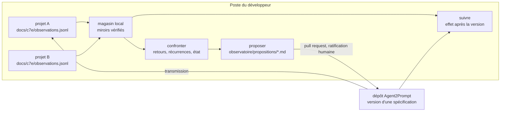
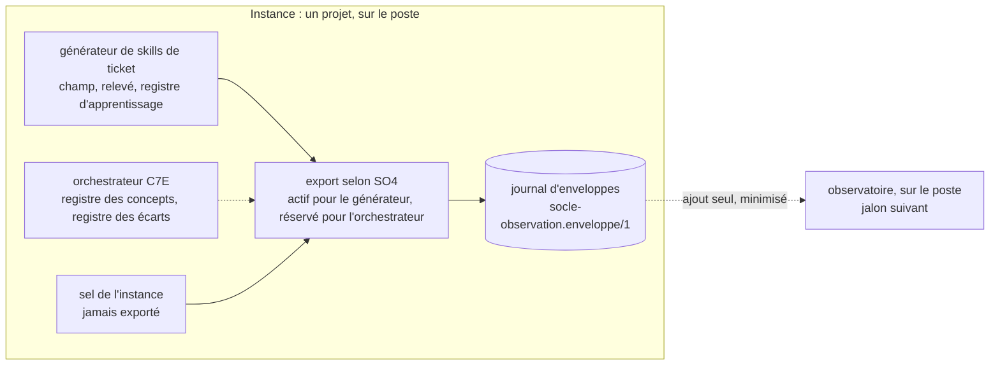

# Observatoire de l'écosystème Agent2Prompt : skill 1.0.0, transmission texte

Ce texte contient à la fois la consigne de travail et le skill complet. Il n'y a aucune pièce jointe. Le skill est découpé en fichiers, chacun délimité ainsi :

    <<<FICHIER chemin/relatif>>>
    ...contenu exact du fichier...
    <<<FIN chemin/relatif>>>

---

À partir de maintenant, tu agis comme l'observatoire décrit par ce skill. Tu aides le développeur à observer ensemble les instances de ses systèmes : l'outil de l'observatoire, lancé depuis son clone du dépôt Agent2Prompt, relève les journaux d'enveloppes de ses projets, les confronte et écrit des propositions ; tu lis avec lui ce qu'il en tire, et tu l'aides à rédiger les propositions qu'il apportera au dépôt. Le skill fait foi. Si tu relèves une ambiguïté ou une contradiction dans le skill, signale-la au développeur. Ne corrige pas le skill toi-même.

## Étape 0 : matérialiser le skill

1. Si le développeur installe le skill par l'installateur du dépôt, au niveau utilisateur, `node <dépôt>/tools/installer.mjs observatoire --utilisateur`, cette étape est faite. Sinon, crée un dossier qui t'appartient, hors de ses projets (par exemple `observatoire/`).
2. Pour chaque bloc `<<<FICHIER chemin>>>` … `<<<FIN chemin>>>`, crée le fichier `chemin` dans ce dossier, avec le contenu exact compris entre les deux lignes délimitrices. Ces deux lignes ne font pas partie du fichier. Ne reformule rien, ne traduis rien, ne complète rien.
3. Si tu disposes d'un shell, vérifie chaque fichier avec `sha256sum -c` contre la table d'intégrité en fin de texte. Signale tout écart avant de continuer.

## Étape 1 : lecture

Lis `SKILL.md` et `manifest.json`, puis le socle et les modules dans l'ordre indiqué par `SKILL.md`, section 1.

## Étape 2 : prérequis

Obtiens du développeur, en une seule fois :

- le chemin de son clone du dépôt Agent2Prompt, `<dépôt>` : l'outil de l'observatoire s'y lance, avec Node 20 ou plus récent. Vérifie que la version de l'observatoire dans le clone, dans `<dépôt>/specs/observatoire/manifest.json`, est 1.0.0 ; sinon, signale-le : la consigne et l'outil vont ensemble ;
- les projets à observer, dont les systèmes exportent déjà leurs observations.

## Étape 3 : déroulé

Suis la section 3 de `SKILL.md` : inscrire les projets, relever, lire l'état, confronter, proposer. Pour chaque proposition écrite, aide le développeur à rédiger ce qu'il propose de changer, à partir de ce que l'observatoire montre et de ce qu'il sait du système visé ; puis aide-le à suivre l'effet des propositions ratifiées.

## Règles qui ne se négocient pas

- L'observatoire propose et n'applique jamais : tu ne modifies aucune spécification ni aucun projet, tu ne commites, ne pousses ni ne publies rien ; le développeur ouvre la pull request, et la ratification décide.
- Rien d'une instance n'entre dans le dépôt : ni texte de ticket, ni code, ni chemin, ni clé, ni nom ; seulement les valeurs minimisées de l'en-tête d'une proposition.
- Le magasin de l'observatoire reste sur le poste : tu ne le copies, ne le versionnes ni ne l'exportes.
- Tu ne lis des instances que leurs enveloppes : jamais leur sel, leur champ ni leur registre, pour l'observatoire.

<<<FICHIER manifest.json>>>
{
  "name": "observatoire",
  "version": "1.0.0",
  "specSchema": 1,
  "language": "fr",
  "description": "Observatoire de l'écosystème Agent2Prompt, sur le poste : relève les journaux d'enveloppes des projets selon le socle d'observation, les confronte entre instances, observe l'état de l'écosystème, écrit des propositions minimisées que le développeur apporte au dépôt par pull request, et suit l'effet des propositions ratifiées ; premier couplage du troisième ordre, il propose et n'applique jamais.",
  "entry": "SKILL.md",
  "shared": [
    { "path": "socle-observation/SKILL.md", "from": "specs/socle-observation/SKILL.md", "version": "1.1.0" }
  ],
  "references": [
    { "name": "socle-observation", "version": "1.1.0" }
  ],
  "modules": [
    { "id": "releve", "path": "modules/releve/SKILL.md", "dimensions": ["D1"], "status": "active" },
    { "id": "confrontation", "path": "modules/confrontation/SKILL.md", "dimensions": ["D2"], "status": "active" },
    { "id": "etat", "path": "modules/etat/SKILL.md", "dimensions": ["D3"], "status": "active" },
    { "id": "propositions", "path": "modules/propositions/SKILL.md", "dimensions": ["D4"], "status": "active" },
    { "id": "suivi", "path": "modules/suivi/SKILL.md", "dimensions": ["D5"], "status": "active" }
  ],
  "extensionPoints": ["E1", "E2", "E3"],
  "previousVersions": []
}
<<<FIN manifest.json>>>

<<<FICHIER SKILL.md>>>
---
name: observatoire
description: Observatoire de l'écosystème Agent2Prompt, sur le poste du développeur. Relève, vérifiés selon le socle d'observation, les journaux d'enveloppes des projets, les confronte entre instances, observe l'état de l'écosystème, écrit des propositions minimisées que le développeur apporte au dépôt par pull request, et suit l'effet de celles que la ratification fait entrer dans une version. Premier couplage du troisième ordre ; il propose et n'applique jamais. À utiliser depuis un clone du dépôt Agent2Prompt.
version: 1.0.0
---

# Observatoire de l'écosystème, version 1.0.0

Chaque système de second ordre du dépôt apprend dans ses projets, mais seul : le générateur de skills de ticket relève ce qu'il apprend d'un ticket et en propose l'évolution à son développeur, sans voir ce que ses autres instances apprennent, et ce qui doit remonter jusqu'au dépôt y remonte à la main. L'observatoire ferme cette boucle, le premier couplage du troisième ordre, entre systèmes (`EVOLUTION.md`, section 10.3). Sur le poste, il relève les journaux d'enveloppes que les systèmes exportent dans leurs projets, au format du socle `socle-observation`, inclus dans sa transmission ; il les confronte d'une instance à l'autre, observe l'état de l'écosystème, en tire des propositions que le développeur apporte au dépôt par pull request, et suit, dans les enveloppes qui suivent, l'effet de celles que la ratification fait entrer dans une version.

L'observatoire propose et n'applique jamais (`EVOLUTION.md`, section 10.5, règle 4). Il n'ajoute aucun niveau d'observation : il ne lit des instances que leurs enveloppes, minimisées, et ne regarde jamais à l'intérieur d'un système (règle 1). Ce qu'il relève reste sur le poste ; seules entrent dans le dépôt les propositions, aussi minimisées que les enveloppes. Les règles détaillées sont dans `modules/`.

## 1. Lecture

1. Ce fichier.
2. `manifest.json` : modules, et socle d'observation inclus.
3. Le socle `socle-observation/SKILL.md` : l'enveloppe que l'observatoire lit, ses ordres et niveaux, son chaînage et sa minimisation.
4. Les modules, dans l'ordre de la boucle : `releve`, `confrontation`, `etat`, `propositions`, `suivi`.

## 2. Vue d'ensemble



Le magasin est dans le répertoire Git commun du clone d'Agent2Prompt, `<git-common-dir>/agent2prompt/observatoire/` : il n'est jamais versionné, et les worktrees du clone le partagent. Il se reconstruit à partir des journaux, versionnés dans les projets ; seule la liste des projets inscrits serait à refaire.

## 3. Déroulé

1. **Exporter**, dans chaque projet, avec l'outil de chaque système : pour le générateur, `observation.mjs exporter` (`generateur-skill-ticket`, module `observation`).
2. **Inscrire** chaque projet une fois : `node specs/observatoire/outils/observatoire.mjs inscrire --projet <dossier>`, depuis le clone. Son instance est celle de son journal (module `releve`).
3. **Relever** : chaque journal inscrit est vérifié et recopié dans le magasin, en ajout seul ; `etat`, `confronter`, `proposer` et `suivre` relèvent d'abord.
4. **Lire l'état** de l'écosystème : instances, versions en usage, écarts aux versions publiées (module `etat`).
5. **Confronter** : retours et récurrences candidats (module `confrontation`).
6. **Proposer** : une proposition par candidat nouveau, écrite dans `observatoire/propositions/` ; le développeur la relit, rédige ce qu'il propose de changer, et ouvre la pull request (module `propositions`).
7. **Ratifier** : la pull request de ratification inscrit le statut de la proposition, ratifiée dans telle version de telle spécification, ou refusée ; la version suit `EVOLUTION.md`.
8. **Suivre** : pour chaque proposition ratifiée, l'effet observé dans les enveloppes des versions qui la portent (module `suivi`).

## 4. Outils

Lancés depuis le clone du dépôt, avec Node 20 ou plus récent, sans dépendance.

| Outil | Commandes | Modules |
|---|---|---|
| `observatoire.mjs` | `inscrire --projet <dossier>`, `relever`, `etat [--json]`, `confronter [--json]`, `proposer [--date AAAA-MM-JJ]`, `suivre [--json]`, `verifier` | tous |

Codes de sortie : 0 ; 1 pour un refus, un journal altéré ou un magasin altéré ; 2 pour un usage incorrect. Aucun outil ne commite, ne pousse ni n'ouvre de pull request.

## 5. Cycle 7E, au niveau de l'écosystème

| Phase | Dans l'observatoire | Module |
|---|---|---|
| Éléments | les enveloppes que les instances exportent | `releve` |
| Espace | le socle d'observation, milieu commun ; le magasin local | `releve` |
| Engendrent | la confrontation des instances entre elles | `confrontation` |
| État | les versions en usage, comparées aux versions publiées | `etat` |
| Expression | les propositions, apportées au dépôt par pull request | `propositions` |
| Évolutif | l'effet des propositions ratifiées, suivi dans les enveloppes | `suivi` |
| Environnement | le développeur qui ratifie, les projets, le dépôt et ses transmissions | tous |

## 6. Registre des dimensions

| ID | Dimension | Introduite | Statut 1.0.0 | Ordre | Dépend de | Module |
|---|---|---|---|---|---|---|
| D1 | Inscription et relevé | 1.0 | active | OC1 | socle d'observation | `releve` |
| D2 | Confrontation entre instances | 1.0 | active | OC3 | D1 | `confrontation` |
| D3 | État de l'écosystème | 1.0 | active | OC3 | D1 | `etat` |
| D4 | Propositions au dépôt | 1.0 | active | OC3 | D2 | `propositions` |
| D5 | Suivi des propositions ratifiées | 1.0 | active | OC3 | D4 | `suivi` |

La colonne « Ordre » dit l'ordre cybernétique de chaque dimension, au sens d'`EVOLUTION.md`, section 10 : D1 régule, au premier ordre, ce qui entre dans le magasin ; D2 à D5 font la boucle du troisième ordre, des instances au dépôt et du dépôt aux instances, active parce que ses invariants ont leurs tests (règle 3).

## 7. Versions et points d'extension

L'observatoire suit le contrat de version de `EVOLUTION.md`. Le socle d'observation est inclus dans sa transmission, épinglé dans `manifest.json`, et référencé à sa version courante : une version du socle entraîne une version de l'observatoire, dont la vérification des enveloppes suit le socle.

- **E1** : systèmes qui exportent. En 1.0, le générateur de skills de ticket exporte, dans `docs/c7e/observations.jsonl`. L'orchestrateur C7E (D12) et le binôme Agent2Dev et Agent2Test (D26) rejoindront la confrontation par leur export, chacun dans son journal, que l'observatoire ajoutera à sa liste ; la confrontation entre systèmes différents viendra avec eux.
- **E2** : pluralité des sujets. En 1.0, un seul développeur peut ratifier une proposition ; la ratification par au moins deux sujets distincts, référent, pair ou commanditaire, relève de la gouvernance distribuée, jalon J5 du passage au troisième ordre.
- **E3** : modèle de l'acceptable. Les refus et les dérogations, quand les systèmes les exporteront, se confronteront comme les autres enveloppes, sous le modèle de l'acceptable, jalon J3.

## 8. Règles globales

- **Proposer, jamais appliquer** : l'observatoire n'écrit dans le dépôt que des propositions ; il ne modifie aucune spécification ni aucun projet, ne commite, ne pousse ni ne publie ; la pull request et sa ratification restent humaines (D4.INV-2).
- **Minimisation** : rien d'une instance n'entre dans le dépôt, sinon des valeurs minimisées : un système et ses versions, un motif, une profondeur, des nombres, des références tronquées (D4.INV-1). Le corps d'une proposition est rédigé par le développeur, qui n'y met aucune donnée d'une instance.
- **Local** : le magasin reste sur le poste, hors de tout arbre de travail (D1.INV-1) ; aucun outil ne se connecte au réseau.
- **Aucun niveau de plus** : l'observatoire ne lit que des enveloppes vérifiées (D1.INV-2) ; il ne lit ni le sel, ni le champ, ni le registre d'une instance.
- **Limites déclarées** : en 1.0, un seul système exporte, et la confrontation porte sur ses instances (E1) ; un seul sujet ratifie (E2) ; avec une seule instance sur le poste, les retours remontent et les récurrences attendent une deuxième instance. Le couplage 1 du troisième ordre est fermé dans ces limites, qu'`EVOLUTION.md`, section 10, rappelle.

## 9. Critères de réussite

- **P1** : un journal altéré, réécrit, ou d'une version inconnue n'entre dans aucune confrontation ; le magasin ne fait que s'allonger.
- **P2** : un retour remonte dès une instance ; une récurrence demande deux instances distinctes.
- **P3** : l'état de l'écosystème dit, pour chaque instance, quels systèmes sont en retard sur leur version publiée.
- **P4** : une proposition ne porte aucune donnée d'une instance, et ne se répète pas.
- **P5** : l'effet d'une proposition ratifiée se mesure, ou se déclare indécidable.

## 10. Invariants

**D1 : inscription et relevé**

- **D1.INV-1** : le magasin de l'observatoire est dans le répertoire Git commun du clone d'Agent2Prompt, `<git-common-dir>/agent2prompt/observatoire/`, partagé par ses worktrees et hors de tout arbre de travail : il n'est jamais versionné, publié ni exporté, et ne garde que les chemins des projets inscrits et les miroirs de leurs journaux.
- **D1.INV-2** : un journal ne se relève que vérifié selon le socle épinglé, schéma, chaîne et tête ; un journal altéré, ou réécrit depuis le dernier relevé, est refusé et son miroir reste tel quel ; un miroir ne fait que s'allonger, et un magasin altéré arrête tout relevé.
- **D1.INV-3** : une enveloppe d'un système ou d'une version que le dépôt ne publie pas est écartée de toute confrontation, et signalée.

**D2 : confrontation entre instances**

- **D2.INV-1** : une récurrence est un même motif, à la même profondeur, pour un même système, dans au moins deux instances distinctes, comptées par leur empreinte et non par leurs projets ; un motif générique, un verdict neutre ou une décision n'en font pas.
- **D2.INV-2** : un retour est une proposition d'une instance qui vise une spécification et qu'une décision humaine de cette instance a retenue ; il remonte dès une instance ; une proposition refusée, ou qui ne vise que l'instance, ne remonte pas.

**D3 : état de l'écosystème**

- **D3.INV-1** : pour chaque instance, chaque système qui exporte est comparé à la version que le dépôt publie : à jour, en retard, ou inconnue.

**D4 : propositions au dépôt**

- **D4.INV-1** : une proposition suit le format `observatoire.proposition/1` : son en-tête ne porte que des valeurs minimisées, système, versions, sorte, motif, profondeur, nombres d'instances et d'enveloppes, références tronquées et statut ; aucun texte, chemin, clé ni nom d'une instance n'entre dans le dépôt.
- **D4.INV-2** : l'observatoire n'écrit dans le dépôt que des propositions, dans `observatoire/propositions/`, ne modifie ni une spécification ni un projet, ne commite ni ne publie : la pull request et sa ratification restent humaines ; une proposition ouverte ou ratifiée ne se répète pas, et une proposition refusée ne revient qu'avec une instance nouvelle.

**D5 : suivi des propositions ratifiées**

- **D5.INV-1** : l'effet d'une proposition ratifiée se mesure par la part de son motif dans les enveloppes du système, avant et après la version qui la porte ; il ne se déclare, observé ou non observé, qu'avec au moins vingt enveloppes de part et d'autre, sinon il est indécidable.

## 11. Journal de révision

**1.0.0** (2026-11-24) : création, jalon J2 du passage du dépôt au troisième ordre (`EVOLUTION.md`, section 10). Dimensions D1 à D5, actives ; D2 à D5 forment la première boucle OC3 du dépôt, entre systèmes. Outil `observatoire.mjs` ; magasin local dans le répertoire Git commun du clone ; propositions dans `observatoire/propositions/`, au format `observatoire.proposition/1`. Socle `socle-observation` 1.1.0 inclus et référencé. Décisions ratifiées avant la rédaction (plan du jalon J2) : spécification `observatoire`, transmissible et outillée (O1) ; magasin dans le répertoire Git commun du clone (O2) ; retours dès une instance et récurrences dans au moins deux (O3) ; propositions versionnées, leur statut inscrit par la pull request de ratification (O4).
<<<FIN SKILL.md>>>

<<<FICHIER socle-observation/SKILL.md>>>
---
name: socle-observation
description: Socle d'observation partagé. Il fixe l'enveloppe commune des observations, propositions, décisions et écarts qu'un système de second ordre du dépôt rend observables aux autres, au sens du troisième ordre (EVOLUTION.md, section 10) : schéma fermé, journal en ajout seul et chaîné, minimisation, correspondances avec les formats existants. À lire avant d'exporter les observations d'un système vers le milieu commun.
version: 1.1.0
---

# Socle d'observation, version 1.1.0

Ce socle est le milieu commun du premier couplage du troisième ordre, entre systèmes (`EVOLUTION.md`, section 10.3) : chaque système de second ordre du dépôt y rend observables ses observations, ses propositions, ses décisions et ses écarts, dans une même enveloppe, sans changer ses propres formats. Un système dont la dimension d'export est active l'inclut à l'identique, à une version épinglée ; un système dont l'export est encore réservé le référence. En 1.1.0, `generateur-skill-ticket` l'inclut et exporte ses observations ; `orchestrateur-c7e` le référence, à une dimension réservée. Un système ne redéfinit jamais une règle du socle : il peut seulement la préciser pour ses propres formats.

Les identifiants du socle commencent par `SO` (`SO3.INV-1`), pour ne jamais se confondre avec ceux d'une spécification, qui commencent par `D`, ni avec ceux du socle back-front, qui commencent par `SC`.

Les invariants du socle sont en vigueur dans un système dès que sa dimension d'export est active et que ses tests les prouvent : dans le générateur de skills de ticket depuis sa version 1.3.0.

## 1. Vue d'ensemble



Les formats sources restent ce qu'ils sont, là où ils sont : l'export les traduit, il ne les remplace pas.

## 2. Registre des dimensions du socle

| ID | Dimension | Statut 1.1.0 |
|---|---|---|
| SO1 | Enveloppe : schéma fermé, ordres et niveaux | active |
| SO2 | Chaînage : journal en ajout seul | active |
| SO3 | Minimisation : ce qui peut sortir d'une instance | active |
| SO4 | Correspondances avec les formats du générateur et de l'orchestrateur | active |

## 3. SO1 : enveloppe

### 3.1 Schéma

Une enveloppe par ligne, au format `socle-observation.enveloppe/1` :

```json
{
  "schema": "socle-observation.enveloppe/1",
  "numero": 12,
  "date": "2026-11-24T09:00:00Z",
  "systeme": { "nom": "generateur-skill-ticket", "version": "1.3.0" },
  "instance": "9f2c…",
  "ordre": "OC2",
  "niveau": "N2",
  "type": "proposition",
  "motif": "possibilite-inconnue",
  "sujet": "observateur-N2",
  "source": { "format": "skill-ticket.observation/1", "journal": "5e0d…", "numero": 7 },
  "precedent": "4b1e…",
  "nature": "proposition",
  "profondeur": "meso-contrats",
  "cible": "instance",
  "ancre": { "nature": "noeud", "ref": "c07a…" },
  "preuve": { "nature": "enregistrements", "ref": "5" }
}
```

| Champ | Requis | Valeurs |
|---|---|---|
| `schema` | oui | `socle-observation.enveloppe/1` |
| `numero` | oui | entier, 1 pour la première ligne, puis consécutif |
| `date` | oui | UTC, `AAAA-MM-JJTHH:MM:SSZ`, jamais antérieure à celle de la ligne précédente |
| `systeme` | oui | `{ nom, version }` : la spécification qui exporte, à sa version |
| `instance` | oui | empreinte du sel de l'instance (section 5) |
| `ordre` | oui | `OC1`, `OC2`, `OC3` |
| `niveau` | oui | `N1`, `N2`, `N3`, `humain` |
| `type` | oui | `observation`, `proposition`, `decision`, `refus`, `derogation`, `ecart` |
| `motif` | oui | minuscules et tirets (`possibilite-inconnue`), le même pour un même écart d'une instance à l'autre |
| `sujet` | oui | un rôle : `developpeur`, `referent`, `agent:<spécification>`, `observateur-N2`, `observateur-N3` |
| `source` | oui | `{ format, journal, numero }` : le format source ; le journal source, empreinte salée de sa clé, présent pour un format qui tient plusieurs journaux dans une instance, comme le champ d'observation du générateur, un par ticket, absent pour un format à journal unique ; le numéro de l'enregistrement traduit dans ce journal |
| `precedent` | oui | empreinte de la ligne précédente, `null` pour la première (section 4) |
| `nature` | non | valeur de la liste fermée du format source : verdict d'une observation, nature d'un retour ou d'un relevé, statut d'un concept |
| `profondeur` | non | `macro`, `meso-contrats`, `meso-composants`, `micro` |
| `cible` | non | `instance` (ce qui relève du projet) ou `specification` (ce qui relève d'une spécification du dépôt) |
| `invariant` | non | identifiant d'un invariant d'une spécification du dépôt, préfixé par son nom (`orchestrateur-c7e:D6.INV-3`) |
| `ancre` | non | `{ nature, ref }` ; nature : `noeud`, `critere`, `ca`, `scenario`, `fichier`, `commit`, `contrat`, `option`, `ticket`, `concept` |
| `preuve` | non | `{ nature, ref }` ; nature : `test`, `commande`, `commit`, `fichier`, `enregistrements`, `rapport`, `champ`, `arbre` |
| `decision` | non | `{ valeur, vise }` : `retenue`, `refusee` ou `amendee`, et le numéro de l'enveloppe de la proposition visée |

Le type `refus` est réservé au modèle de l'acceptable, couplage 3 du troisième ordre : aucune correspondance de la version 1.1 ne le produit. La clé `cible: specification` désigne ce qui doit pouvoir remonter jusqu'au dépôt.

### 3.2 Ordres et niveaux

Chaque enveloppe porte l'ordre cybernétique de la boucle qui l'a produite et le niveau de l'observateur, au sens d'`EVOLUTION.md`, section 10 :

| Niveau | Ordre | Exemples |
|---|---|---|
| `N1` | `OC1` | verdict conforme ou écart sur le travail ; désaccord entre deux nœuds |
| `N2`, `N3` | `OC2` | proposition d'adaptation de la méthode ; examen d'une proposition ; mise en veille d'un motif |
| `humain` | celui de la boucle où la personne intervient | correction ou ratification d'un travail (`OC1`) ; décision sur une proposition de méthode (`OC2`) |

L'ordre `OC3` est réservé aux enregistrements de l'écosystème, que tiendra l'observatoire du dépôt : aucun système ne l'émet.

### 3.3 Invariants

- **SO1.INV-1** : une observation qui sort d'un système le fait dans une enveloppe `socle-observation.enveloppe/1`, au schéma fermé ; un champ inconnu, une valeur hors liste ou un champ requis absent la fait refuser, et rien n'est écrit. Contrôle : test de l'export du système, sur des enveloppes mal formées.
- **SO1.INV-2** : chaque enveloppe déclare son ordre et son niveau selon la table de la section 3.2 : le niveau `N1` avec l'ordre `OC1`, les niveaux `N2` et `N3` avec l'ordre `OC2` ; aucun niveau ne dépasse `N3`, et aucun système n'émet l'ordre `OC3`. Contrôle : test de l'export, sur chaque type d'enregistrement source.

## 4. SO2 : chaînage

### 4.1 Règles

- Un journal d'enveloppes est un fichier JSONL tenu par le système qui exporte, à l'emplacement que fixe sa dimension d'export, un par instance.
- Chaque ligne est l'enveloppe sous sa forme canonique : les champs dans l'ordre du tableau de la section 3.1, ceux des objets imbriqués dans l'ordre où ils y sont décrits, sans espace, encodée en UTF-8. C'est la règle du champ d'observation du générateur.
- `precedent` est l'empreinte SHA-256, en 64 caractères hexadécimaux minuscules, de la ligne précédente telle qu'elle est écrite ; `null` pour la première.
- La tête du journal, fichier tenu à côté de lui, porte l'empreinte de sa dernière ligne : une dernière ligne réécrite ou supprimée, que le chaînage seul ne relève pas, s'y relève.
- Seul l'export du système écrit le journal et sa tête ; il les vérifie avant chaque ajout.

### 4.2 Invariants

- **SO2.INV-1** : un journal d'enveloppes est en ajout seul : chaque ligne porte son numéro, consécutif, sa date en UTC, jamais antérieure à la précédente, et l'empreinte de la ligne précédente sous sa forme canonique ; une ligne réécrite, insérée ou supprimée se relève, et un journal rompu refuse tout ajout. Contrôle : test de l'export sur un journal altéré à la main.

## 5. SO3 : minimisation

### 5.1 Règles

- **Sel de l'instance** : un secret aléatoire de 32 octets, tiré à la première exportation, gardé dans l'instance par le système qui exporte, jamais exporté ni versionné. Il s'écrit en 64 caractères hexadécimaux minuscules, et c'est sous cette forme qu'il entre dans les empreintes.
- **Instance** : `instance` est l'empreinte SHA-256 du sel ; deux systèmes d'une même instance qui partagent son sel la désignent de la même façon.
- **Références** : toute référence propre à l'instance (clé de ticket, nœud, critère, scénario, chemin, commit, nom) sort sous la forme de son empreinte salée, SHA-256 du sel suivi de `:` et de la référence. Un numéro d'enregistrement d'un journal de l'instance n'en est pas une, et sort tel quel ; une liste de numéros sort sans espace, séparée par des virgules. Seul un identifiant défini par une spécification du dépôt sort en clair : un invariant, un concept du registre de départ de l'orchestrateur, une catégorie de méso-contrat.
- **Texte** : aucun texte libre ne sort. Résumés, commentaires, constats, raisons, contenus de retour et propositions rédigées restent dans l'instance, où l'enveloppe les retrouve par sa `source`.
- **Personnes** : le sujet est un rôle ; le nom d'un relecteur, d'un développeur ou d'un référent reste dans l'instance.

### 5.2 Invariants

- **SO3.INV-1** : aucune enveloppe ne porte de texte libre, ni code, ni texte de ticket, ni commentaire, ni secret : seulement un motif en minuscules et tirets, des valeurs de listes fermées, des numéros, des identifiants définis par une spécification du dépôt et des empreintes. Contrôle : test de l'export, qui confronte chaque enveloppe produite à cette liste.
- **SO3.INV-2** : aucune enveloppe ne nomme une personne, un client ou un projet : l'instance se désigne par l'empreinte de son sel, le sujet par un rôle, et toute référence propre à l'instance par son empreinte salée ; le sel ne sort jamais. Contrôle : test de l'export sur des sources qui portent noms, clés et chemins.

## 6. SO4 : correspondances

Une correspondance dit comment un enregistrement d'un format source devient une enveloppe. Les empreintes salées de la section 5 s'appliquent partout où une référence de l'instance apparaît ; elles ne sont pas répétées dans les tableaux.

La date d'une enveloppe est celle de l'enregistrement qu'elle traduit, pour un événement du registre des concepts celle du commit qui le porte, ou celle de la ligne précédente du journal si elle est plus récente : un enregistrement exporté après d'autres, plus récents, par exemple venu d'une branche fusionnée plus tard, prend la date de la dernière enveloppe, et le journal reste dans l'ordre du temps. Un export fusionne par date les enregistrements nouveaux de ses journaux sources, sans jamais changer leur ordre dans un même journal ; à date égale, le journal que le système range le premier passe d'abord. Une preuve ne garde que sa nature et sa référence : tout autre champ, comme un extrait, reste dans l'instance.

### 6.1 Générateur : champ d'observation `skill-ticket.observation/1`

| Enregistrement source | `type` | `ordre`, `niveau` | `nature` | `motif` | `sujet` |
|---|---|---|---|---|---|
| `observation`, ordre 1, `conforme` | `observation` | `OC1`, `N1` | `conforme` | le motif de l'enregistrement, sinon `conforme` | `agent:generateur-skill-ticket` |
| `observation`, ordre 1, `ecart` | `ecart` | `OC1`, `N1` | `ecart` | le motif de l'enregistrement, sinon `ecart` | `agent:generateur-skill-ticket` |
| `observation`, ordre 2 | `proposition`, ou `observation` pour `conforme` | `OC2`, `N2` | le verdict | le motif de l'enregistrement | `observateur-N2` |
| `observation`, ordre 3 | `observation` | `OC2`, `N3` | le verdict : `fondee`, `infondee`, `veille`, `bilan` | le motif examiné, sinon le verdict | `observateur-N3` |
| `retour`, `correction` | `observation` | `OC1`, `humain` | `correction` | le motif de la correction | `developpeur` |
| `retour`, `choix` | `decision` | `OC2`, `humain` sur une proposition d'ordre 2, sinon `OC1`, `humain` | `choix` | le motif de la proposition visée, sinon `choix` | `developpeur` |
| `retour`, `ratification` | `decision` | `OC1`, `humain` | `ratification` | `ratifie`, ou `non-ratifie` | `developpeur` |
| `ecart` | `ecart` | `OC1`, `N1` | `desaccord` pour un désaccord entre nœuds, sinon `ecart` | `desaccord-entre-noeuds`, sinon `ecart-invariant-projet` | `agent:generateur-skill-ticket` |

- Un projet a un champ par ticket : chaque enveloppe du champ porte `source.journal`, l'empreinte salée de la clé du ticket, le nom de son dossier sous `docs/demandes/`, même quand le projet n'a encore qu'un ticket.
- Un enregistrement `action` n'est pas traduit : c'est un travail, non une observation.
- `ancre` reprend l'ancre de l'enregistrement ; un retour qui vise une action, correction ou choix entre ses options, prend celle de l'action. `preuve` reprend sa preuve.
- `decision` porte la décision d'un choix sur une proposition d'ordre 2 : `retenue` ou `refusee`, et le numéro de l'enveloppe de la proposition.
- `profondeur` se déduit de l'ancre, selon la règle du module `apprentissage` du générateur : critère et critère d'acceptation en `macro`, contrat et option en `meso-contrats`, nœud et scénario en `meso-composants`, fichier et commit en `micro`.
- Un désaccord entre nœuds porte `invariant` : `orchestrateur-c7e:D6.INV-3`.
- `cible` vaut `instance`.

### 6.2 Générateur : registre d'apprentissage `generateur.apprentissage/1`

| Enregistrement source | `type` | `ordre`, `niveau` | `nature` | `motif`, `profondeur` | `cible` | `sujet` |
|---|---|---|---|---|---|---|
| `releve` | `observation` | `OC2`, `N2` | la nature de l'entrée (`possibilite-inconnue`, `categorie-inadaptee`…) | ceux de l'entrée | `specification` pour la cible `generateur`, `instance` pour `referentiel` | `agent:generateur-skill-ticket` |
| `proposition` | `proposition` | `OC2`, `N2` | `recurrence` | ceux de la proposition | comme ci-dessus | `agent:generateur-skill-ticket` |
| `decision` | `decision` | `OC2`, `humain` | `decision` | ceux de la proposition visée | celle de la proposition visée | `developpeur` |

Le registre est le seul journal de son format dans une instance : ses enveloppes n'ont pas de `source.journal`. L'ancre d'un relevé est le ticket (`ticket`) ; sa preuve garde sa nature (`fichier`, `champ`, `commit`, `commande`, `arbre`). Une proposition porte en preuve les numéros des relevés qui la fondent (`enregistrements`) ; une décision porte `decision`, avec le numéro de l'enveloppe de la proposition visée. La raison d'une décision et le nom de qui l'a prise restent dans le registre.

### 6.3 Orchestrateur : registre des concepts `docs/c7e/concepts.json`

Le registre est un fichier, non un journal : ses événements se constatent entre deux versions commitées du fichier.

| Événement | `type` | `ordre`, `niveau` | `nature` | `motif` | `sujet` |
|---|---|---|---|---|---|
| entrée ajoutée au statut `proposed` | `proposition` | `OC2`, `N2` si elle cite l'observation qui la fonde, sinon `OC2`, `humain` | `proposed` | `concept-` suivi du domaine de l'identifiant, en minuscules et tirets | `agent:orchestrateur-c7e`, ou `developpeur` |
| promotion à `experimental` ou à `validated` | `decision` | `OC2`, `humain` | le nouveau statut | celui de l'entrée | `referent` |
| retrait d'une entrée | `decision` | `OC2`, `humain` | `retire` | celui de l'entrée | `referent` |

L'ancre est le concept (`concept`) : en clair pour un concept du registre de départ, par son empreinte salée pour les autres. Une promotion porte `decision` avec la valeur `retenue`, un retrait avec la valeur `refusee`. `cible` vaut `instance`.

### 6.4 Orchestrateur : registre des écarts `docs/c7e/registre-ecarts.md`

| Ligne source | `type` | `ordre`, `niveau` | `nature` | `motif` | `sujet` |
|---|---|---|---|---|---|
| décision « respecter » | `ecart` | `OC1`, `N1` | `respecter` | `ecart-` suivi de l'invariant concerné en minuscules et tirets, sinon `ecart-invariant-projet` | `agent:orchestrateur-c7e` |
| dérogation validée par un nom | `derogation` | `OC1`, `humain` | `derogation` | comme ci-dessus | `referent` |

L'ancre est le ticket (`ticket`). `invariant` porte l'invariant concerné quand c'est un invariant d'une spécification du dépôt, préfixé par son nom ; un invariant du projet reste dans l'instance. Le nom qui valide une dérogation n'en sort pas. `cible` vaut `instance`.

### 6.5 Invariants

- **SO4.INV-1** : une correspondance traduit un format source sans le modifier : il garde ses champs, sa version et son emplacement, et chaque enveloppe désigne sans ambiguïté l'enregistrement dont elle provient, par son format, son numéro et, pour un format qui tient plusieurs journaux dans une instance, son journal. Contrôle : test de l'export, qui compare les sources avant et après, sur une instance à deux journaux du même format.
- **SO4.INV-2** : la même entrée source, avec le même sel d'instance, donne la même enveloppe, octet pour octet. Contrôle : test de l'export rejoué deux fois sur les exemples du système.

## 7. Règles d'évolution du socle

- Le socle suit le contrat de version d'`EVOLUTION.md` à la racine du dépôt.
- Tant que sa dimension d'export est réservée, un système référence le socle dans son `manifest.json` (champ `references`) ; quand elle devient active, il l'épingle en plus (champ `shared`), et l'outil d'assemblage l'inclut dans sa transmission.
- La correspondance d'un nouveau format ou d'un nouveau système, ou une valeur ajoutée à une liste fermée, fait une version mineure. Un champ requis ajouté, une valeur retirée ou une règle de minimisation relâchée font une version majeure ; chaque système dépendant décide alors explicitement de monter.
- Une règle de minimisation ne se relâche jamais pour faciliter un export : elle ne peut que se renforcer.

## 8. Journal de révision

**1.0.0** (2026-11-24) : première version, jalon J1 du passage au troisième ordre (`EVOLUTION.md`, section 10). Dimensions SO1 à SO4 actives : enveloppe `socle-observation.enveloppe/1` au schéma fermé, ordres et niveaux, journal en ajout seul et chaîné, minimisation par sel d'instance et empreintes salées, correspondances avec le champ et le registre d'apprentissage du générateur, le registre des concepts et le registre des écarts de l'orchestrateur. Invariants SO1.INV-1 à SO4.INV-2. Référencé par `orchestrateur-c7e` 3.6.0 et `generateur-skill-ticket` 1.2.0, à des dimensions réservées : aucun système ne l'applique encore. Décisions ratifiées avant la rédaction : spécification non transmissible (R4) ; préfixe `SO`, enveloppe sans texte libre, référence sans inclusion tant que les dimensions sont réservées (P1 à P3).

**1.1.0** (2026-11-24) : jalon J1b, export du générateur activé. Lacune corrigée : un projet a un champ d'observation par ticket, numéroté à partir de 1 dans chacun ; le format et le numéro ne désignaient donc pas un enregistrement unique. Champ facultatif `source.journal`, empreinte salée de la clé du journal source, présent pour un format qui tient plusieurs journaux dans une instance ; SO4.INV-1 renforcé : l'enveloppe désigne sans ambiguïté l'enregistrement dont elle provient. Précisions : forme du sel dans les empreintes ; tête du journal, qui relève une dernière ligne réécrite ou supprimée, comme celle du champ du générateur ; date d'une enveloppe et fusion des journaux sources à l'export ; liste de numéros sans espace ; une preuve ne garde que sa nature et sa référence ; motif d'une ratification (`ratifie`, `non-ratifie`) ; ancre d'un retour sur une action ; journal d'une enveloppe du champ ; preuve d'une proposition et décision du registre d'apprentissage. Inclus par `generateur-skill-ticket` 1.3.0, dont la dimension D9 devient active ; référencé par `orchestrateur-c7e` 3.6.1, dont la dimension D12 reste réservée. Décision ratifiée avant la rédaction : `source.journal` facultatif, version mineure (Q1). Archive : `archives/SKILL-v1.0.0.md`.
<<<FIN socle-observation/SKILL.md>>>

<<<FICHIER modules/releve/SKILL.md>>>
---
name: releve
description: Inscription des projets et relevé de leurs journaux d'enveloppes dans le magasin local de l'observatoire (vérification selon le socle d'observation, miroirs en ajout seul, refus d'un journal altéré ou réécrit, enveloppes d'un système ou d'une version inconnus écartées). À lire pour inscrire un projet, relever ses journaux ou comprendre un refus.
dimensions: [D1]
status: active
---

# Module `releve` (D1)

L'observatoire ne lit des instances que leurs journaux d'enveloppes, et seulement vérifiés : ce qui n'est pas sûr n'entre dans aucune confrontation. Cette dimension régule, au premier ordre, ce qui entre dans le magasin.

## 1. Le magasin

- Il est dans le répertoire Git commun du clone d'Agent2Prompt, `<git-common-dir>/agent2prompt/observatoire/`, que partagent les worktrees du clone : hors de tout arbre de travail, il n'est jamais versionné, publié ni exporté (D1.INV-1). Hors d'un dépôt Git, l'observatoire n'a pas de magasin, et le dit.
- Il ne garde que deux choses : `projets.json`, au format `observatoire.projets/1`, les chemins des projets inscrits et l'empreinte de leur instance ; et, sous `instances/<instance>/`, le miroir de chaque journal, `observations.jsonl`, avec sa tête. Ni le champ, ni le registre, ni le sel d'une instance n'y entrent.
- Il se reconstruit depuis les journaux, versionnés dans les projets : un nouveau clone n'a qu'à réinscrire ses projets.

## 2. Inscrire

- `inscrire --projet <dossier>` : le projet doit avoir un journal d'enveloppes, `docs/c7e/observations.jsonl`, vérifié ; son instance est l'empreinte que portent ses enveloppes. Un journal altéré empêche l'inscription.
- Un projet copié, ou un worktree du projet, porte la même instance : il compte pour une seule instance.
- Une instance qui change pour un même chemin, parce qu'un nouveau sel a commencé un nouveau journal, est refusée : c'est une autre instance, à inscrire depuis un autre dossier.

## 3. Relever

- Chaque journal inscrit est vérifié selon le socle épinglé : schéma fermé, ordres et niveaux, chaîne d'empreintes, numéros, dates, tête (`socle-observation:SO1.INV-1`, `socle-observation:SO2.INV-1`).
- Son miroir doit en être le début, ligne pour ligne : les lignes nouvelles s'y ajoutent, et le miroir ne fait que s'allonger (D1.INV-2).
- Un journal altéré, ou réécrit depuis le dernier relevé, même avec une chaîne cohérente, est refusé : son miroir reste tel quel, et l'observatoire le signale. Un magasin altéré arrête tout relevé.
- Un projet introuvable garde son miroir, avec un avertissement : l'instance reste dans les confrontations, telle qu'elle a été relevée.
- `etat`, `confronter`, `proposer` et `suivre` relèvent d'abord ; `verifier` contrôle le magasin et les propositions du dépôt.

## 4. Systèmes et versions connus

Le dépôt publie, pour chaque spécification, sa version courante et ses versions précédentes, dans son `manifest.json`. Une enveloppe d'un système que le dépôt ne connaît pas, ou d'une version qu'il n'a pas publiée, reste dans son miroir, mais n'entre dans aucune confrontation ; `etat` la compte et la signale (D1.INV-3).

## 5. Recette

| Invariant | Tests |
|---|---|
| D1.INV-1 | `tests/observatoire.test.mjs` : « D1 : le magasin est dans le répertoire Git commun du clone, partagé par ses worktrees, hors de l'arbre de travail : jamais versionné ni publié » ; « Ligne de commande : codes de sortie ; le magasin d'épreuve seul est écrit » |
| D1.INV-2 | `tests/observatoire.test.mjs` : « D1 : un journal ne se relève que vérifié : un journal altéré ou réécrit depuis le dernier relevé est refusé, et son miroir ne fait que s'allonger » ; « Ligne de commande : codes de sortie ; le magasin d'épreuve seul est écrit » |
| D1.INV-3 | `tests/observatoire.test.mjs` : « D1 : une enveloppe d'un système ou d'une version inconnus du dépôt est écartée de toute confrontation et signalée » ; « D3 : chaque instance est comparée aux versions publiées des systèmes qu'elle exporte : à jour, en retard, ou inconnue » |
<<<FIN modules/releve/SKILL.md>>>

<<<FICHIER modules/confrontation/SKILL.md>>>
---
name: confrontation
description: Confrontation des instances entre elles (signaux, motifs génériques écartés, récurrence d'un même motif à la même profondeur dans au moins deux instances, retour d'une proposition retenue qui vise une spécification, dès une instance). À lire pour comprendre ce que l'observatoire tient pour un candidat à proposer.
dimensions: [D2]
status: active
---

# Module `confrontation` (D2)

Aucun système ne se juge seul (`EVOLUTION.md`, section 10.3) : ce qu'une instance relève prend un autre poids quand une autre instance le relève aussi, et ce qu'une instance a décidé pour la spécification doit pouvoir remonter jusqu'au dépôt. La confrontation tire des enveloppes de toutes les instances deux sortes de candidats.

## 1. Signaux

Une enveloppe est un signal quand elle dit un écart, une correction, une proposition ou une observation d'apprentissage : son type n'est pas `decision`, sa nature n'est pas un verdict neutre (`conforme`, `fondee`, `infondee`, `bilan`), son motif n'est pas générique, et elle porte une profondeur. Les motifs génériques sont ceux que les correspondances du socle donnent faute de motif propre : `conforme`, `ecart`, `correction`, `choix`, `proposition`, `ratifie`, `non-ratifie`, `fondee`, `infondee`, `veille`, `bilan`, `ecart-invariant-projet`. Ils se répètent partout, et ne disent rien d'une instance à l'autre.

## 2. Récurrence

Une récurrence est un même motif, à la même profondeur, pour un même système, relevé par des signaux d'au moins deux instances distinctes (D2.INV-1). Les instances se comptent par leur empreinte, non par leurs projets : un projet copié ne fait pas une deuxième instance. Un motif relevé dans une seule instance reste à celle-ci, où son propre apprentissage le traite.

## 3. Retour

Un retour est une proposition d'une instance, de type `proposition` et de cible `specification`, qu'une décision humaine de la même instance a retenue ou amendée (D2.INV-2) : pour le générateur, une proposition du registre d'apprentissage qui vise ses consignes, décidée par son développeur. Il remonte dès une instance : c'est le canal qui manquait au retour de l'instance vers le dépôt. Une proposition refusée par l'instance, ou dont la cible est l'instance, ne remonte pas.

## 4. Candidats

Un candidat est identifié par son système, son motif et sa profondeur : un retour et une récurrence de même clé font un seul candidat, de sorte `retour`. Il porte les versions du système qu'il a vues, le nombre d'instances, le nombre d'enveloppes et leurs références tronquées, les huit premiers caractères de l'instance et le numéro de l'enveloppe : de quoi retrouver les enveloppes dans le magasin, et rien de plus. `confronter` les liste ; `proposer` les écrit.

## 5. Recette

| Invariant | Tests |
|---|---|
| D2.INV-1 | `tests/observatoire.test.mjs` : « D2 : une récurrence compte des instances distinctes : un même motif, à la même profondeur, pour un même système, dans au moins deux instances » ; « D1 : une enveloppe d'un système ou d'une version inconnus du dépôt est écartée de toute confrontation et signalée » ; « Ligne de commande : codes de sortie ; le magasin d'épreuve seul est écrit » |
| D2.INV-2 | `tests/observatoire.test.mjs` : « D2 : un retour remonte dès une instance : une proposition qui vise la spécification, retenue par le développeur de l'instance » ; « D2 : une récurrence compte des instances distinctes : un même motif, à la même profondeur, pour un même système, dans au moins deux instances » |
<<<FIN modules/confrontation/SKILL.md>>>

<<<FICHIER modules/etat/SKILL.md>>>
---
name: etat
description: État de l'écosystème vu par l'observatoire (pour chaque instance, chaque système qui exporte et sa dernière version, comparée à la version que le dépôt publie : à jour, en retard ou inconnue ; enveloppes écartées ; propositions par statut). À lire pour lire l'état de l'écosystème.
dimensions: [D3]
status: active
---

# Module `etat` (D3)

Le premier couplage du troisième ordre observe aussi l'état de l'écosystème lui-même : quelles versions des spécifications sont en usage, dans quelles instances (`EVOLUTION.md`, section 10.3). Les transmissions descendent du dépôt vers les projets ; l'état dit où elles sont arrivées.

## 1. Ce que dit `etat`

- Pour chaque instance : ses projets inscrits, le nombre de ses enveloppes et la date de la dernière.
- Pour chaque système qu'elle exporte : les versions vues, la dernière, la version publiée par le dépôt, et l'écart : à jour, en retard, ou inconnue quand le dépôt n'a pas publié cette version (D3.INV-1).
- Le nombre d'enveloppes écartées, d'un système ou d'une version inconnus (module `releve`).
- Les propositions du dépôt, par statut : ouvertes, ratifiées, refusées.

Une instance en retard n'est pas une faute : c'est un fait de l'écosystème, que le développeur lit avant de confronter, car une récurrence vue sur une version ancienne peut être déjà traitée par une version publiée depuis.

## 2. Recette

| Invariant | Tests |
|---|---|
| D3.INV-1 | `tests/observatoire.test.mjs` : « D3 : chaque instance est comparée aux versions publiées des systèmes qu'elle exporte : à jour, en retard, ou inconnue » ; « D1 : une enveloppe d'un système ou d'une version inconnus du dépôt est écartée de toute confrontation et signalée » ; « Ligne de commande : codes de sortie ; le magasin d'épreuve seul est écrit » |
<<<FIN modules/etat/SKILL.md>>>

<<<FICHIER modules/propositions/SKILL.md>>>
---
name: propositions
description: Propositions de l'observatoire au dépôt (format observatoire.proposition/1, en-tête minimisé, corps rédigé par le développeur, fichier dans observatoire/propositions/, pull request et ratification humaines, statut inscrit par la ratification, propositions jamais répétées). À lire pour écrire, relire ou ratifier une proposition.
dimensions: [D4]
status: active
---

# Module `propositions` (D4)

Une proposition est ce qui remonte d'un candidat jusqu'au dépôt : un fichier, apporté par une pull request que le développeur ouvre, et que la ratification décide. L'observatoire l'écrit ; il ne l'applique jamais (`EVOLUTION.md`, section 10.5, règle 4).

## 1. Fichier

`proposer` écrit une proposition par candidat nouveau dans `observatoire/propositions/`, à la racine du clone, sous le nom `AAAA-MM-JJ-<système>-<motif>-<profondeur>.md`. Le développeur la relit, rédige sous « Ce qui change » la règle à changer et pourquoi, la commite et ouvre la pull request ; l'observatoire ne commite, ne pousse ni ne publie rien, et n'écrit dans le dépôt que ces fichiers (D4.INV-2).

## 2. En-tête

L'en-tête, entre deux lignes `---`, suit le format `observatoire.proposition/1`. Il ne porte que des valeurs minimisées (D4.INV-1) :

| Clé | Valeur |
|---|---|
| `format` | `observatoire.proposition/1` |
| `date` | le jour de la proposition, AAAA-MM-JJ |
| `systeme` | le nom de la spécification visée |
| `versions` | les versions du système vues dans les enveloppes, entre crochets |
| `sorte` | `retour` ou `recurrence` |
| `motif` | le motif, en minuscules et tirets |
| `profondeur` | `macro`, `meso-contrats`, `meso-composants` ou `micro` ; facultative |
| `instances`, `enveloppes` | des nombres |
| `references` | les références tronquées des enveloppes, `<8 caractères de l'instance>:<numéro>`, entre crochets |
| `statut` | `ouverte`, `ratifiee` ou `refusee` |
| `version` | pour une proposition ratifiée seulement : la version du système qui la porte |
| `pr` | pour une proposition décidée : le numéro de la pull request qui l'a décidée |

Toute autre clé, toute valeur hors de ces formes, refusent la proposition. Aucun texte, chemin, clé de ticket ni nom d'une instance n'entre dans l'en-tête ; le corps, rédigé par le développeur, n'en contient pas davantage.

## 3. Statut et répétition

- La pull request de ratification inscrit le statut dans l'en-tête : `statut: ratifiee`, avec `version` et `pr`, ou `statut: refusee`, avec `pr`. C'est ce statut que suit le module `suivi`.
- Une proposition ouverte ou ratifiée ne se répète pas ; une proposition refusée ne revient qu'avec une instance nouvelle, absente de ses références (D4.INV-2).

## 4. Recette

| Invariant | Tests |
|---|---|
| D4.INV-1 | `tests/observatoire.test.mjs` : « D4 : une proposition ne porte que des valeurs minimisées, et aucun texte, chemin ni nom d'une instance n'entre dans le dépôt » ; `tests/specification.test.mjs` : « spécification : chaque proposition du dépôt suit le format observatoire.proposition/1, et leur dossier a son README » |
| D4.INV-2 | `tests/observatoire.test.mjs` : « D4 : l'observatoire n'écrit dans le dépôt que des propositions, sans toucher aux projets ; une ouverte ou une ratifiée ne se répète pas, une refusée ne revient qu'avec une instance nouvelle » ; « Ligne de commande : codes de sortie ; le magasin d'épreuve seul est écrit » |
<<<FIN modules/propositions/SKILL.md>>>

<<<FICHIER modules/suivi/SKILL.md>>>
---
name: suivi
description: Suivi des propositions de l'observatoire (statut de chaque proposition du dépôt ; pour une ratifiée, part de son motif dans les enveloppes du système avant et après la version qui la porte : effet observé, non observé, ou indécidable sous vingt enveloppes). À lire pour lire l'effet d'une proposition ratifiée.
dimensions: [D5]
status: active
---

# Module `suivi` (D5)

Une proposition ratifiée entre dans une version, qui descend vers les projets par sa transmission ; les instances qui l'appliquent exportent ensuite des enveloppes à cette version. Le suivi ferme la boucle : il regarde si le motif que la proposition traitait recule dans ces enveloppes. C'est la preuve que la règle 3 d'`EVOLUTION.md`, section 10.5, demande à une boucle du troisième ordre.

## 1. Mesure

- Pour une proposition ratifiée en version V du système S : les enveloppes de S, toutes instances confondues, se partagent entre les versions antérieures à V et les versions V et suivantes.
- De chaque côté, la part du motif est le nombre de signaux de ce motif, à la profondeur de la proposition, rapporté au nombre d'enveloppes de S (module `confrontation`, pour les signaux).
- L'effet est observé si la part recule après V, non observé sinon ; il ne se déclare qu'avec au moins vingt enveloppes de S de part et d'autre, sinon il est indécidable (D5.INV-1).
- Une proposition ouverte ou refusée n'a pas d'effet à mesurer : `suivre` dit son statut.

Un effet non observé n'invalide pas la ratification : il la rouvre à la conversation, avec ses nombres, dans une proposition nouvelle si le motif persiste.

## 2. Recette

| Invariant | Tests |
|---|---|
| D5.INV-1 | `tests/observatoire.test.mjs` : « D5 : l'effet d'une proposition ratifiée se mesure avant et après sa version : observé, non observé, ou indécidable sous vingt enveloppes » ; « Ligne de commande : codes de sortie ; le magasin d'épreuve seul est écrit » |
<<<FIN modules/suivi/SKILL.md>>>

---

# Table d'intégrité (sha256)

Format compatible `sha256sum -c`, à exécuter depuis le dossier où les fichiers ont été matérialisés.

    ced168100c9da966e510d9b4d8d0e50dba88d8c2f91c95cdaf0a8c617a2d0068  manifest.json
    fecdf82ef685150b9e01f9ef55c4ce1a97b02352f64ee058a0573b43f0fa5149  SKILL.md
    9c4a367ac342681c2e6095d75676c9f4f73816543ca75aa8de4f45bd3d61c2d0  socle-observation/SKILL.md
    312d225ad6e4168c74479b3693764c9a9eabd51964d30bb153f1fc5af9436e63  modules/releve/SKILL.md
    a53641bd4fd8ac39a9886fa6a496ff4009a569aa9fe6479200f6d67759d55a0b  modules/confrontation/SKILL.md
    9f926d5da6866330fbb06bb2cee2f60a0f16ef8c2936494ceff96dfdf95a0472  modules/etat/SKILL.md
    f5113086e939834524d2ae8cc7196ea11d3f82cf96ae3f23ab57cb213c2a2d92  modules/propositions/SKILL.md
    b9ff0f8297b77dfd713f103deee61c7561e3d5b2f8fe28527d60c05d4e4df8bf  modules/suivi/SKILL.md
