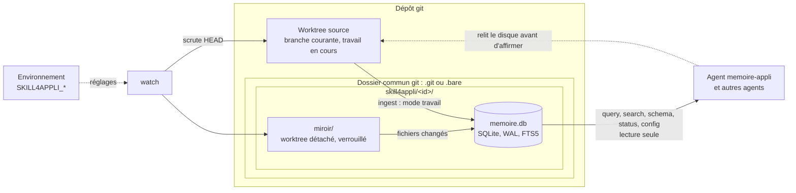
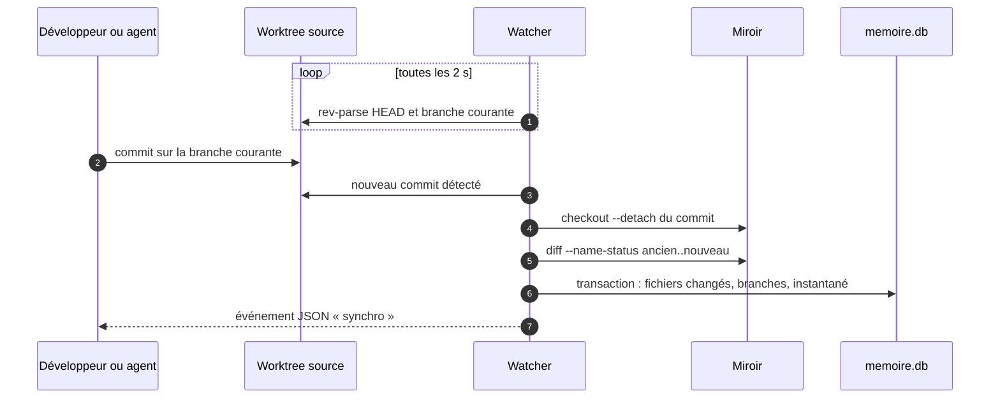
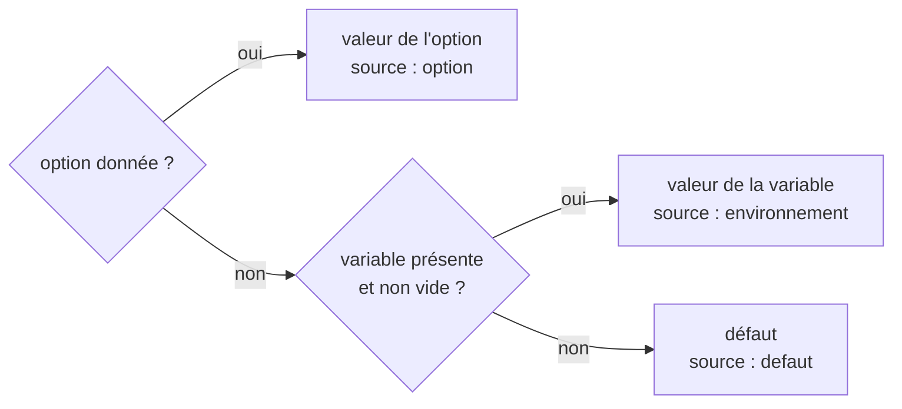
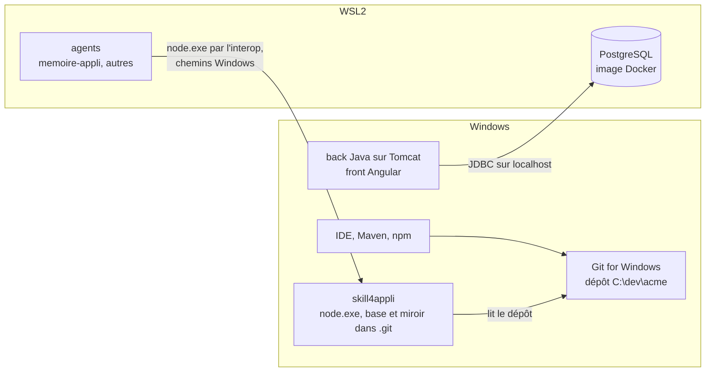
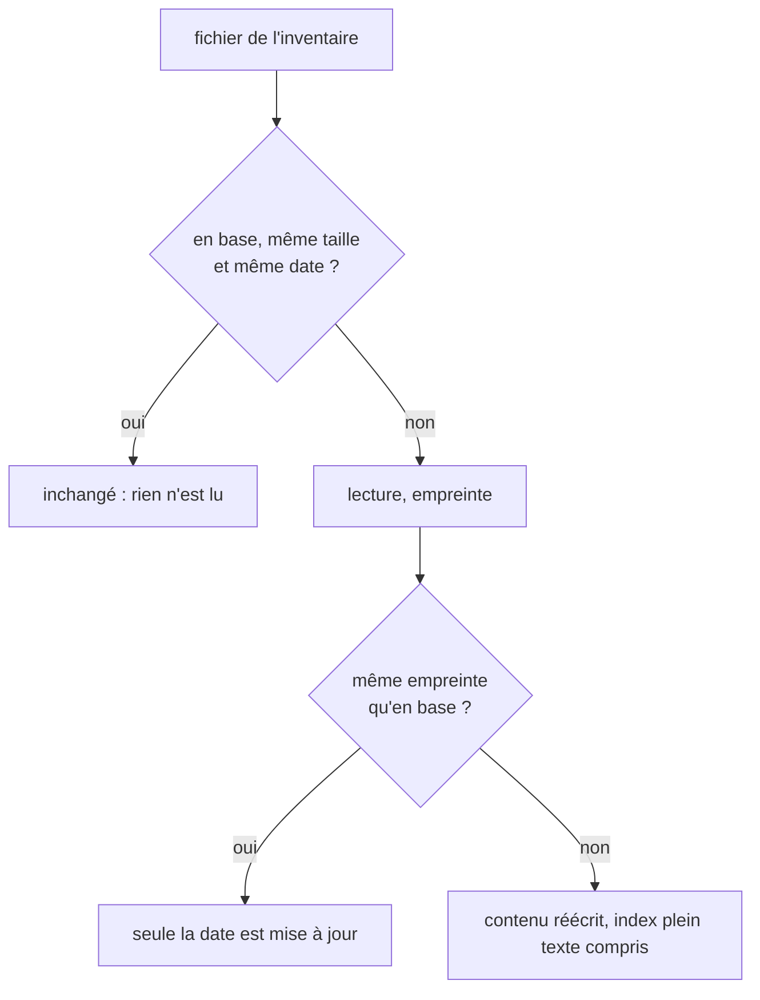
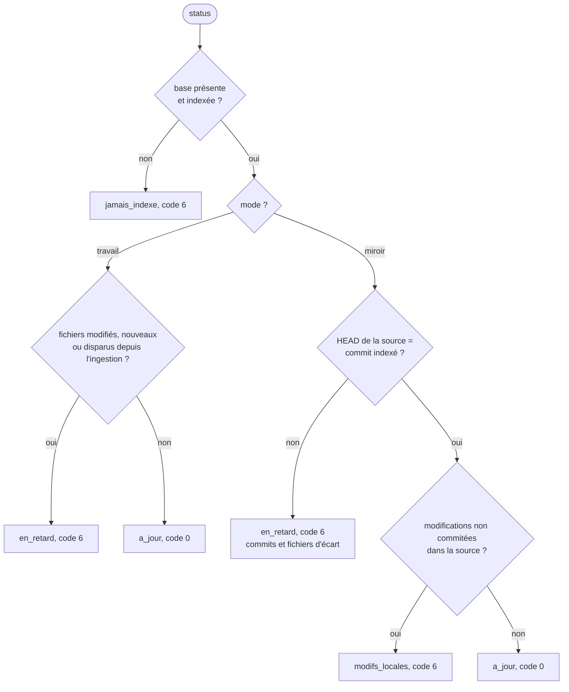
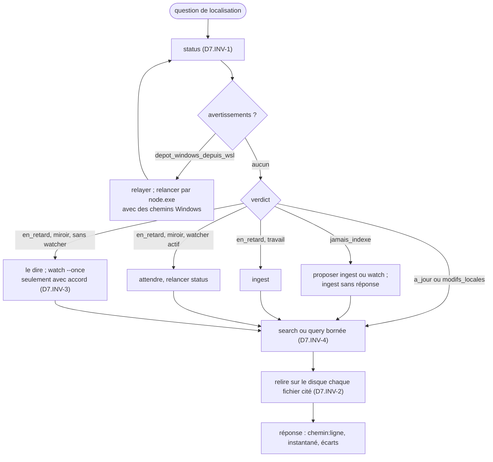

# Mémoire d'application SQLite et watcher de branche : skill skill4appli 1.1.0, transmission texte

Ce texte contient à la fois la consigne de travail et le skill complet. Il n'y a aucune pièce jointe. Le skill est découpé en fichiers, chacun délimité ainsi :

    <<<FICHIER chemin/relatif>>>
    ...contenu exact du fichier...
    <<<FIN chemin/relatif>>>

---

À partir de maintenant, tu installes le skill skill4appli décrit par ce texte sur le projet du développeur, tu le fais fonctionner, puis tu peux agir comme son agent mémoire. Le skill fait foi. Si tu relèves une ambiguïté ou une contradiction dans le skill, signale-la au développeur. Ne corrige pas le skill toi-même, ni son script.

## Étape 0 : matérialiser le skill

1. Le skill tourne du côté du git qui possède le dépôt (module `parite`) : sous Windows si le code et son git y sont, même si tu travailles dans WSL ; dans WSL si le dépôt est dans son système de fichiers. Crée le dossier `.skills/skill4appli/` à la racine de ce dépôt (`C:\dev\<projet>\.skills\skill4appli\` sous Windows), ou à l'emplacement que le développeur indique. Dans la disposition du kit `agents-paralleles-gitlab`, c'est `~/dev/<projet>/.skills/skill4appli/`, hors des worktrees. Dans un clone ordinaire, ajoute `/.skills/` à `.git/info/exclude` s'il n'y est pas : le skill ne doit pas apparaître dans `git status`.
2. Pour chaque bloc `<<<FICHIER chemin>>>` … `<<<FIN chemin>>>`, crée le fichier `chemin` dans ce dossier, avec le contenu exact compris entre les deux lignes délimitrices. Ces deux lignes ne font pas partie du fichier. Ne reformule rien, ne traduis rien, ne complète rien.
3. Si tu disposes d'un shell, vérifie chaque fichier avec `sha256sum -c` contre la table d'intégrité en fin de texte ; sous Windows, Git Bash fournit `sha256sum`, et `certutil -hashfile <fichier> SHA256` donne l'empreinte d'un fichier depuis CMD. Signale tout écart avant de continuer.

## Étape 1 : lecture

Lis `SKILL.md`, `manifest.json`, puis les modules actifs dans l'ordre indiqué par `SKILL.md`, section 1. Ne lis `modules/local/SKILL.md`, `modules/symboles/SKILL.md` et `modules/service-mcp/SKILL.md` que pour comprendre les points d'extension : ces dimensions sont réservées.

## Étape 2 : fichiers exécutables

1. Depuis le dossier du skill, écris `scripts/app_db.mjs`, `tests/app_db.test.mjs` et `agent/memoire-appli.md` à partir des blocs annotés des modules, par la commande d'extraction du module `execution`, § 9. Elle se colle telle quelle dans bash, CMD ou PowerShell. Ne recopie pas les fichiers à la main.
2. La commande vérifie elle-même leurs empreintes : elle écrit `conforme` pour chaque fichier, ou `ECART`, et sort alors avec le code 1. Un écart arrête l'installation.
3. Vérifie les versions de Node (22.13 ou plus récent) et de git (2.38 ou plus récent), puis lance la recette : `node --test tests/app_db.test.mjs`. Attendu : 34 tests passés sous Linux et WSL2 ; 33 passés et 1 sauté sous Windows. Rapporte au développeur le bilan ; un échec arrête l'installation et se rapporte tel quel, sans modifier le script.

## Étape 3 : l'agent

Propose au développeur d'installer l'agent `agent/memoire-appli.md` (module `agent`, § 2) : dans `.claude/agents/` pour Claude Code, ou comme consigne système dans son outil. Rejoue avec lui les scénarios A1 à A6 du module `agent` avant que l'agent serve d'autres agents.

## Étape 4 : réglages et première indexation

1. Lance `config` et montre au développeur les réglages effectifs, leur source et les emplacements ; s'il veut les fixer pour ses agents, ce sont les variables `SKILL4APPLI_*` (module `configuration`). Relaie tout avertissement.
2. Demande-lui le mode : `ingest` (instantané du disque, mode `travail`) ou `watch` (branche courante chargée dans un worktree dédié et suivie, mode `miroir`). `watch` crée un worktree : ne le lance qu'avec son accord. Ensuite, `status` doit rendre `a_jour`, ou `modifs_locales` en mode `miroir` si des modifications ne sont pas commitées.

## Règles qui ne se négocient pas

- Tu n'adaptes pas le script : un écart, une erreur ou un besoin nouveau se signale au développeur.
- La base localise, le disque fait foi : avant d'affirmer le contenu d'un fichier ou de citer une ligne, relis ce fichier dans le worktree source.
- `query` est en lecture seule ; tu n'écris dans la base que par `ingest` et `watch`.
- Tu ne modifies jamais le miroir et tu ne contournes jamais un refus du script (code 4 ou 7) : tu le rapportes.
- Aucun watcher, même `--once`, ni `watch-stop`, ni `mirror-remove`, sans l'accord du développeur.
- Le skill tourne du côté du git qui possède le dépôt ; depuis WSL, pour un dépôt sous Windows, tu l'appelles par `node.exe` avec des chemins Windows.
- N'applique aucune dimension au statut `reserved`.

Commence par l'étape 0, puis l'étape 1, puis l'étape 2.

---

# Skill

<<<FICHIER manifest.json>>>
{
  "name": "skill4appli",
  "version": "1.1.0",
  "specSchema": 1,
  "language": "fr",
  "description": "Mémoire SQLite d'une application locale et de ses branches git pour un agent : inventaire fidèle à git, recherche chemin:ligne, requêtes en lecture seule, fraîcheur mesurée, watcher de la branche courante chargée dans un worktree dédié, configuration par l'environnement, parité Linux, WSL2 et Windows, agent mémoire.",
  "entry": "SKILL.md",
  "modes": ["travail", "miroir"],
  "targets": {
    "node": ">=22.13",
    "git": ">=2.38",
    "os": "Linux, WSL2 et Windows natif ; recette en CI sur ubuntu-latest et windows-latest"
  },
  "modules": [
    { "id": "execution", "path": "modules/execution/SKILL.md", "dimensions": ["D1"], "status": "active" },
    { "id": "configuration", "path": "modules/configuration/SKILL.md", "dimensions": ["D10"], "status": "active" },
    { "id": "parite", "path": "modules/parite/SKILL.md", "dimensions": ["D12"], "status": "active" },
    { "id": "ingestion", "path": "modules/ingestion/SKILL.md", "dimensions": ["D2"], "status": "active" },
    { "id": "branches", "path": "modules/branches/SKILL.md", "dimensions": ["D3"], "status": "active" },
    { "id": "interrogation", "path": "modules/interrogation/SKILL.md", "dimensions": ["D4"], "status": "active" },
    { "id": "fraicheur", "path": "modules/fraicheur/SKILL.md", "dimensions": ["D5"], "status": "active" },
    { "id": "watcher", "path": "modules/watcher/SKILL.md", "dimensions": ["D6"], "status": "active" },
    { "id": "agent", "path": "modules/agent/SKILL.md", "dimensions": ["D7"], "status": "active" },
    { "id": "recette", "path": "modules/recette/SKILL.md", "dimensions": ["D1", "D2", "D3", "D4", "D5", "D6", "D10", "D12"], "status": "active" },
    { "id": "local", "path": "modules/local/SKILL.md", "dimensions": ["D8"], "status": "reserved" },
    { "id": "symboles", "path": "modules/symboles/SKILL.md", "dimensions": ["D9"], "status": "reserved" },
    { "id": "service-mcp", "path": "modules/service-mcp/SKILL.md", "dimensions": ["D11"], "status": "reserved" }
  ],
  "extensionPoints": ["E1", "E2", "E3", "E4"],
  "previousVersions": [
    { "version": "1.0.0", "file": "archives/SKILL-v1.0.0.md" }
  ]
}
<<<FIN manifest.json>>>

<<<FICHIER SKILL.md>>>
---
name: skill4appli
description: Mémoire SQLite d'une application locale et de ses branches git, interrogée par un agent sans relire tout le dépôt (inventaire fidèle à git, recherche plein texte chemin:ligne, requêtes SQL en lecture seule, fraîcheur mesurée, watcher de la branche courante chargée dans un worktree dédié, configuration par l'environnement, parité Linux, WSL2 et Windows, agent mémoire). À utiliser pour indexer un projet, y localiser du code ou l'état des branches, et garder cet index à jour pendant le travail.
version: 1.1.0
---

# Skill4Appli, mémoire d'application et watcher de branche, version 1.1.0

Ce document est le point d'entrée du skill. Le skill tient, dans un fichier SQLite, la structure et le contenu d'une application locale et l'état de ses branches git, pour qu'un agent localise du code par requête au lieu de parcourir le disque à chaque question. Un script Node sans dépendance, `scripts/app_db.mjs`, est le seul à écrire dans la base ; l'agent `memoire-appli` en est le premier lecteur. Les règles détaillées sont dans `modules/`.

## 1. Ordre de lecture

1. Ce document, en entier.
2. `manifest.json` : modules, versions de Node et de git visées, plateformes.
3. Les modules actifs, dans cet ordre : `execution`, `configuration`, `parite`, `ingestion`, `branches`, `interrogation`, `fraicheur`, `watcher`, `agent`, `recette`.
4. `modules/local/SKILL.md`, `modules/symboles/SKILL.md` et `modules/service-mcp/SKILL.md` : seulement pour comprendre les points d'extension. Ne pas les appliquer en 1.x.

## 2. Ce que fait le skill

| Commande | Rôle | Écrit la base | Module |
|---|---|---|---|
| `init` | crée ou migre la base | oui | `execution` |
| `ingest` | indexe le worktree source tel qu'il est sur le disque (mode `travail`) | oui | `ingestion` |
| `git-scan` | branches locales et distantes, fichiers modifiés par branche | oui | `branches` |
| `query` | requête SQL en lecture seule, réponse bornée | non | `interrogation` |
| `search` | emplacements `chemin:ligne` d'un terme | non | `interrogation` |
| `schema` | tables et colonnes commentées | non | `interrogation` |
| `status` | écart entre la base et le worktree source | non | `fraicheur` |
| `config` | réglages effectifs et leur source, emplacements, plateforme | non | `configuration` |
| `watch` | charge la branche courante dans un worktree dédié et le suit (mode `miroir`) | oui | `watcher` |
| `watch-stop` | arrête proprement le watcher, sur toutes les plateformes | non | `watcher` |
| `mirror-remove` | retire ce worktree dédié | métadonnées | `watcher` |



## 3. Deux modes d'indexation

| Mode | Racine indexée | Contenu de la base | Usage |
|---|---|---|---|
| `travail` | le worktree source | les fichiers tels qu'ils sont sur le disque, modifications non commitées comprises | indexation ponctuelle, projet hors git, agent qui veut voir son propre travail en cours |
| `miroir` | un worktree dédié, en HEAD détachée sur le dernier commit de la branche courante | l'état commité de la branche courante, tenu à jour par le watcher | mémoire durable pendant une session ; plusieurs agents qui lisent un état cohérent |

Une base par worktree source. La dernière indexation fixe le mode ; un changement de mode réindexe tout ; chaque réponse déclare le mode et le commit indexés (D4.INV-3).



## 4. Cycle 7E

| Phase | Ce qu'elle désigne ici | Modules |
|---|---|---|
| Éléments | fichiers, contenus, branches, commits | `ingestion`, `branches` |
| Espace | le worktree source, le dossier commun git où vivent la base et le miroir | `execution`, `watcher` |
| Engendrent | les relations : fichiers changés entre deux commits, fichiers modifiés par branche depuis l'ancêtre commun | `branches`, `watcher` |
| État | l'instantané indexé (mode, commit, branche, date) et son écart avec la source | `fraicheur` |
| Expression | les réponses JSON bornées, un objet par commande, et les événements du watcher | `interrogation`, `watcher` |
| Évolutif | migrations numérotées, synchronisation incrémentale, dimensions réservées D8, D9 et D11 | `execution`, `watcher`, `local`, `symboles`, `service-mcp` |
| Environnement | les plateformes qui exécutent le skill, les réglages qu'elles lui donnent, l'agent mémoire, les autres agents, le développeur | `configuration`, `parite`, `agent` |

Clause de second ordre : une mémoire de code n'est pas neutre. Ce que contient la base oriente ce que l'agent croit du projet, donc ce qu'il y fait, et une base périmée répond faux avec assurance. Le skill rend donc l'écart mesurable (`status`), chaque réponse déclare son instantané, et l'agent relit le disque avant d'affirmer : la base localise, le disque fait foi (D7.INV-2). L'observateur fait partie du système qu'il observe : le git qui lit le dépôt détermine ce que la mémoire en voit, d'où la règle de parité qui fait tourner le skill du côté du git qui possède le worktree (D12.INV-5).

## 5. Lecture 12 facteurs × 7E

Chaque facteur de la méthode Twelve-Factor App est rattaché à une phase du cycle 7E et prouvé par un invariant et ses tests, ou déclaré non couvert. La lecture mesure la viabilité du skill, pas une conformité déclarée.

| Facteur | Phase 7E | Ce que fait le skill | Preuve |
|---|---|---|---|
| I. Base de code | Espace | une spécification versionnée dans Agent2Prompt, matérialisée à l'identique dans chaque projet, hors de l'arbre suivi | table d'intégrité de la transmission ; empreintes du module `execution`, § 9 |
| II. Dépendances | Éléments | Node 22.13 et git 2.38 déclarés dans le manifeste ; aucun paquet | D1.INV-5 : T7 |
| III. Configuration | Environnement | réglages de déploiement par variables `SKILL4APPLI_*`, options en surcharge, aucun fichier de configuration | D10.INV-1 à D10.INV-3 : T25 à T27 |
| IV. Services externes | Espace | la base SQLite est une ressource attachée par `SKILL4APPLI_DB`, jetable, reconstruite depuis le dépôt ; PostgreSQL, service externe de l'application, reste hors du skill : son schéma y entre par les changelogs Liquibase du dépôt | D1.INV-4 : T5 ; module `parite`, § 2 |
| V. Build, release, run | Évolutif | la spécification se fige en transmission à empreintes ; ses fichiers s'extraient et s'exécutent sans modification | vérificateur du dépôt ; commande d'extraction du module `execution`, § 9 |
| VI. Processus | État | chaque commande est un processus sans état ; l'état vit dans la base et dans le dépôt | D4.INV-1, D5.INV-1 : T14, T17 |
| VII. Liaison de port | Expression | aucun port en 1.1.0 : l'interface est la ligne de commande ; un service MCP en stdio, sans port, est réservé | non couvert : D11 réservée ; E4 : T33 |
| VIII. Concurrence | Engendrent | un watcher par worktree, autant de lecteurs que d'agents, un seul écrivain par base | D6.INV-3 : T21 |
| IX. Jetabilité | État | démarrage sans préparation, arrêt propre sur toutes les plateformes, verrou orphelin repris, miroir et base recréables | D6.INV-3, D12.INV-3 : T21, T23, T30 |
| X. Parité | Environnement | même comportement et même recette sous Linux, WSL2 et Windows | D12.INV-1 à D12.INV-5 : T28 à T32 ; CI `ubuntu-latest` et `windows-latest` |
| XI. Journaux | Expression | les événements du watcher forment un flux JSON sur la sortie standard ; le skill ne gère aucun fichier de journal | E3 : T20, T30 |
| XII. Processus d'administration | Évolutif | `init`, migrations, `mirror-remove`, `watch-stop` : des commandes ponctuelles du même script, sur la même base | D1.INV-4, D6.INV-5 : T5, T6, T23 |

Poste type visé : back Java sur Tomcat et front Angular sous Windows, avec Git for Windows ; PostgreSQL, en image Docker, dans WSL2 ; agents dans WSL2 ou sous Windows. Le skill tourne sous Windows, à côté du code et de son git ; un agent de WSL2 l'appelle par `node.exe`, avec des chemins Windows (module `parite`, § 2 et § 3). PostgreSQL est un service externe de l'application (facteur IV) : le skill n'y accède pas. Le back Java en fait évoluer le schéma par Liquibase, que Spring Boot applique au démarrage de l'application : les changelogs Liquibase du dépôt sont la source du schéma, et le skill les indexe comme tout fichier (module `interrogation`, § 6).

## 6. Registre des dimensions

| ID | Dimension | Introduite | Statut 1.1.0 | Dépend de | Module |
|---|---|---|---|---|---|
| D1 | Exécution : commandes, emplacement de la base, sorties et codes, migrations | 1.0 | active | | `execution`, `recette` |
| D2 | Inventaire et ingestion | 1.0 | active | D1 | `ingestion`, `recette` |
| D3 | Branches git et fichiers par branche | 1.0 | active | D1 | `branches`, `recette` |
| D4 | Interrogation en lecture seule | 1.0 | active | D2, D3 | `interrogation`, `recette` |
| D5 | Fraîcheur de la base | 1.0 | active | D2 | `fraicheur`, `recette` |
| D6 | Watcher de la branche courante dans un worktree dédié | 1.0 | active | D2, D3, D5 | `watcher`, `recette` |
| D7 | Agent mémoire | 1.0 | active | D4, D5, D6 | `agent` |
| D8 | Modifications locales non commitées, superposées au miroir | 1.0 | reserved | D5, D6 | `local` |
| D9 | Symboles par langue : classes, méthodes, routes | 1.0 | reserved | D2 | `symboles` |
| D10 | Configuration par l'environnement | 1.1 | active | D1 | `configuration`, `recette` |
| D11 | Service MCP en stdio, en lecture seule | 1.1 | reserved | D4, D5, D10 | `service-mcp` |
| D12 | Parité Linux, WSL2 et Windows | 1.1 | active | D1, D6, D10 | `parite`, `recette` |

## 7. Contrat de version et points d'extension

Le skill suit le contrat de version de `EVOLUTION.md` du dépôt Agent2Prompt. Le schéma de la base évolue uniquement par migrations numérotées (`PRAGMA user_version`) : la migration 1 est celle de la version 1.0.0 et ne sera jamais modifiée. La version 1.1.0 n'ajoute aucune migration.

Points d'extension, actifs depuis la version indiquée :

- **E1** (1.0.0) : en mode `miroir`, `status` liste déjà les modifications non commitées du worktree source (`modifications_locales`). D8 les indexera dans une couche superposée au miroir, sans toucher ni au miroir ni au worktree source.
- **E2** (1.0.0) : chaque fichier porte sa langue (`app_structure.lang`), déduite de son extension. D9 en tirera les symboles, langue par langue.
- **E3** (1.0.0) : les événements du watcher sont des lignes JSON aux champs stables (`t`, `evenement`, `branche`, `de`, `a`, bilans, `raison`). Un consommateur, par exemple le tableau de bord de `tension-dashboard-gitlab-agent` ou un relais, pourra s'y abonner sans modifier le watcher.
- **E4** (1.1.0) : chaque commande de lecture construit un seul objet, écrit en une ligne par la ligne de commande ; importé, le script exporte `executer(commande, options, positionnels)`, qui rend ce même objet sans rien écrire. D11 exposera ces objets comme résultats d'outils MCP.

## 8. Règles globales

- **Aucun shell** : git est lancé avec une liste d'arguments ; un nom de branche, un chemin ou un message lu n'est jamais interprété comme une commande (D1.INV-1).
- **Un seul écrivain** : `ingest`, `git-scan`, `watch` et `mirror-remove` écrivent ; un watcher actif exclut tous les autres (D6.INV-3). Les commandes de lecture ouvrent la base en lecture seule (D4.INV-1).
- **La base est un cache** : elle se reconstruit à partir du dépôt et ne fait jamais foi contre le disque (D7.INV-2).
- **Rien n'est forcé** : le watcher n'écrase ni ne nettoie un miroir modifié à la main (D6.INV-4), et ne touche ni au worktree source, ni à son index, ni à ses branches (D6.INV-1).
- **Configuration par l'environnement** : chaque réglage de déploiement a sa variable `SKILL4APPLI_*`, l'option l'emporte, aucun fichier de configuration (D10.INV-1).
- **Côté du git qui possède le worktree** : le skill tourne sur la plateforme dont le git tient le worktree source ; lancé de l'autre côté, il le signale (D12.INV-5).
- **Sortie pour un agent** : un JSON sur une ligne par défaut, les erreurs en JSON sur la sortie d'erreur, des codes de sortie documentés (D1.INV-3), des réponses bornées (D4.INV-2).
- **Sans dépendance** : Node 22.13 ou plus récent, modules natifs, aucun `npm install` (D1.INV-5).
- **Langue** : messages et documentation en français ; commandes, options, tables et colonnes en anglais, comme dans la version d'origine, pour que les requêtes écrites contre elle restent valides.

## 9. Critères d'acceptation

- La recette du module `recette` passe en entier : `node --test tests/app_db.test.mjs`, 34 tests sous Linux et WSL2, 33 tests et 1 sauté sous Windows, avec Node 22.13 ou plus récent et git 2.38 ou plus récent.
- La recette passe en intégration continue sur `ubuntu-latest` et `windows-latest`, avec Node 22 et Node 24, après extraction par la commande du module `execution`, § 9, sous bash et sous CMD.
- Les trois fichiers tirés des modules (`scripts/app_db.mjs`, `tests/app_db.test.mjs`, `agent/memoire-appli.md`) ont exactement les empreintes de la table du module `execution`, § 9.
- Les scénarios A1 à A6 du module `agent` sont rejoués avec le développeur avant que l'agent serve d'autres agents.

## 10. Invariants

**D1 : exécution**

- **D1.INV-1** : aucune commande externe ne passe par un shell : git est lancé avec une liste d'arguments, et aucune donnée lue (nom de branche, chemin, message de commit) n'est jamais interprétée comme une commande.
- **D1.INV-2** : l'emplacement de la base se déduit du worktree source, jamais du dossier courant ; dans un dépôt git, elle vit dans le dossier commun git (`<commun>/skill4appli/<id>/memoire.db`), hors de tout arbre suivi ; aucune commande de lecture ne crée de base.
- **D1.INV-3** : une réussite sort avec le code 0 et un JSON sur la sortie standard ; un échec sort avec un code non nul documenté (1 à 5, 7) et un JSON `{"ok": false, ...}` sur la sortie d'erreur ; `status` sort avec le code 6, réponse sur la sortie standard, quand la base n'est pas à jour.
- **D1.INV-4** : le schéma n'évolue que par migrations numérotées (`PRAGMA user_version`) ; une base créée par une version plus récente est refusée ; une base de la version d'origine, sans numéro de schéma, est reconstruite.
- **D1.INV-5** : le script et sa recette n'utilisent que les modules natifs de Node 22.13 ou plus récent ; aucune installation de paquet n'est nécessaire.

**D2 : inventaire et ingestion**

- **D2.INV-1** : dans un dépôt git, l'inventaire est celui de git (fichiers suivis, et non suivis non ignorés) : un fichier ignoré par `.gitignore` ou par l'exclusion du dépôt n'est jamais indexé.
- **D2.INV-2** : après une ingestion, la base contient exactement les fichiers de l'inventaire : un fichier disparu du disque disparaît de la base, index plein texte compris.
- **D2.INV-3** : un fichier binaire, de verrouillage, minifié, une carte de source ou un fichier plus gros que la limite est inventorié sans contenu, avec son type ; aucun contenu n'est altéré : un texte qui n'est pas en UTF-8 est lu en latin1 et marqué comme tel.
- **D2.INV-4** : une ingestion ne relit que les fichiers dont la taille ou la date a changé, et ne réécrit que ceux dont le contenu a changé.

**D3 : branches**

- **D3.INV-1** : `git_branches` donne toutes les branches locales et distantes, hors références symboliques, chacune sous son nom exact, avec la branche courante du worktree source, l'amont, l'avance et le retard, et le worktree où elle est extraite.
- **D3.INV-2** : `branch_files` donne, pour chaque branche locale, les fichiers modifiés depuis l'ancêtre commun avec la base, avec leur statut et leurs lignes ajoutées et retirées.

**D4 : interrogation**

- **D4.INV-1** : `query`, `search`, `schema` et `status` ouvrent la base en lecture seule : aucune requête, même d'écriture, ne la modifie.
- **D4.INV-2** : une réponse est bornée (nombre de lignes ou de fichiers, longueur des valeurs) et chaque troncature est signalée dans la réponse.
- **D4.INV-3** : chaque réponse de `query` et de `search` porte l'instantané indexé : mode, commit, branche et date d'indexation.
- **D4.INV-4** : `search` rend des emplacements `chemin:ligne` avec leur extrait, sans que la casse ni les accents fassent manquer une occurrence, les fichiers classés par pertinence.

**D5 : fraîcheur**

- **D5.INV-1** : chaque indexation enregistre son mode, sa racine, le commit et la branche indexés et sa date.
- **D5.INV-2** : `status` compare la base au worktree source sans rien écrire ; il ne rend `a_jour`, avec le code 0, que si la base reflète exactement ce worktree ; sinon il nomme l'écart (commits en retard, fichiers modifiés, nouveaux ou disparus, modifications locales) et sort avec le code 6.

**D6 : watcher**

- **D6.INV-1** : le watcher charge la branche courante du worktree source dans un worktree dédié, créé détaché et verrouillé dans le dossier commun git ; il ne modifie jamais le worktree source, son index ni ses branches.
- **D6.INV-2** : à chaque nouveau commit ou changement de branche courante, le miroir est amené sur le commit de la source, seuls les fichiers changés entre l'ancien et le nouveau commit sont relus, et la base désigne alors ce commit et cette branche.
- **D6.INV-3** : un seul écrivain par base : tant qu'un watcher est actif, `ingest`, `git-scan`, `mirror-remove` et un second `watch` sont refusés avec le code 4 ; le verrou d'un watcher arrêté brutalement est repris.
- **D6.INV-4** : le watcher ne force jamais : un miroir modifié à la main n'est ni écrasé ni nettoyé ; le watcher s'arrête avec le code 7 et nomme les fichiers en cause.
- **D6.INV-5** : le seul worktree que le skill retire est son propre miroir, sur commande explicite (`mirror-remove`), watcher arrêté ; un miroir modifié à la main n'est retiré qu'avec `--force`.

**D7 : agent mémoire**

- **D7.INV-1** : avant de s'appuyer sur la base, l'agent lance `status` et déclare dans sa réponse l'instantané utilisé et tout écart connu.
- **D7.INV-2** : la base localise, le disque fait foi : avant d'affirmer le contenu d'un fichier ou de citer une ligne, l'agent relit ce fichier dans le worktree source.
- **D7.INV-3** : l'agent ne modifie ni le code du projet ni le miroir ; il n'écrit dans la base que par `ingest` et `watch`, et ne lance `watch` ni `mirror-remove` sans l'accord du développeur.
- **D7.INV-4** : l'agent ne charge jamais de contenu non borné : aucune lecture de `content` sans filtre sur le chemin et sans limite de longueur.

**D10 : configuration**

- **D10.INV-1** : chaque réglage de déploiement se lit d'abord dans l'option de la ligne de commande, puis dans sa variable d'environnement `SKILL4APPLI_*`, puis prend son défaut ; aucun réglage n'est lu dans un fichier.
- **D10.INV-2** : une valeur invalide, d'option ou de variable, arrête la commande avec le code 1 et un message qui nomme sa source ; une variable vide vaut absente.
- **D10.INV-3** : `config` rend la valeur effective de chaque réglage, sa source (option, environnement, défaut) et les emplacements qui en découlent, sans rien écrire ni créer.

**D12 : parité des plateformes**

- **D12.INV-1** : le worktree source est désigné par son chemin réel, comparé sans casse sous Windows : un même worktree a une seule base et un seul miroir, quel que soit le chemin qui y mène (lien, casse, nom court).
- **D12.INV-2** : les chemins absolus enregistrés et rendus sont au format de la plateforme qui exécute le skill ; les chemins de fichiers du dépôt sont toujours relatifs et en `/`.
- **D12.INV-3** : le watcher s'arrête proprement de la même façon sur toutes les plateformes, par `watch-stop`, qui attend sa confirmation ; une demande d'arrêt antérieure au watcher, ou qui vise un autre processus, ne l'arrête pas.
- **D12.INV-4** : les fins de ligne de la plateforme (CRLF de `core.autocrlf`) ne faussent ni le compte et les numéros de ligne, ni les extraits de `search`, ni le verdict de `status`.
- **D12.INV-5** : lancé dans WSL sur un worktree du système de fichiers Windows, le skill le signale par l'avertissement `depot_windows_depuis_wsl` dans `status` et `config`, sans refuser la commande.

## 11. Filiation

Le skill reprend `skill4appli-fr`, remis par le développeur le 23 octobre 2026 : un `SKILL.md` et le script `scripts/app_db.mjs`, quatre commandes (`init`, `ingest`, `git-scan`, `query`) et trois tables. Restent identiques : les noms de ces commandes, des tables `app_structure`, `git_branches`, `app_metadata` et de leurs colonnes d'origine (`path`, `type`, `content`, `metadata`, `branch_name`, `is_current`, `last_commit`, `updated_at`) ; les deux requêtes d'exemple de la version d'origine restent donc valides.

Défauts constatés en rejouant la version d'origine sur un dépôt d'essai (Node 22.22, git 2.43), et invariant qui les interdit désormais :

| Constat sur la version d'origine | Invariant |
|---|---|
| Une branche nommée `x;touch${IFS}PWNED`, que git accepte, crée le fichier `PWNED` pendant `git-scan` : les noms de branche passent par un shell. | D1.INV-1 |
| Une branche extraite dans un autre worktree est enregistrée sous le nom `+ feature/wt`, avec le commit `N/A`. | D3.INV-1 |
| La base est créée dans le dossier courant : lancée d'ailleurs, une requête crée une base vide et répond `no such table` ; lancée à la racine du projet, `app_memory.db` apparaît dans `git status` ; le guide d'usage, `ingest .` depuis le dossier du skill, indexe le skill lui-même. | D1.INV-2 |
| Toute erreur sort avec le code 0. | D1.INV-3 |
| `.gitignore` n'est pas lu : `target/`, `vendor/` et `.venv/` sont indexés, comme un `package-lock.json` de 380 Ko. | D2.INV-1, D2.INV-3 |
| Un fichier supprimé reste en base après une nouvelle ingestion. | D2.INV-2 |
| Les binaires et un `.properties` en ISO-8859-1 sont stockés corrompus : la lecture en UTF-8 ne lève jamais d'erreur. | D2.INV-3 |
| Chaque fichier est relu et réécrit à chaque ingestion, une transaction par fichier : 3 000 fichiers en 5,4 s. | D2.INV-4 (module `ingestion`, § 5 : 0,6 s, et 67 ms sans changement) |
| `query` peut écrire : `DELETE FROM app_structure` vide la base. | D4.INV-1 |
| Le contenu complet des fichiers sort par `console.table`, sans limite. | D4.INV-2 |
| Rien ne signale à l'agent que la base a divergé du disque. | D5.INV-2, D7.INV-1 |

Ajouts demandés par le développeur : en 1.0.0, le watcher de la branche courante, chargée dans un dossier dédié par git worktree (D6), et l'agent qui accompagne le skill (D7) ; en 1.1.0, l'inscription du skill dans le cycle 7E et les douze facteurs (section 5), pour un poste où Java et Angular tournent sous Windows et PostgreSQL dans WSL2 : configuration par l'environnement (D10), service MCP réservé (D11), parité des plateformes (D12).

## 12. Journal de révision

**1.0.0** (2026-10-23) : première version. Dimensions D1 à D7 actives, D8 et D9 réservées. Points d'extension E1 à E3. Script `scripts/app_db.mjs` (Node 22.13, sans dépendance), recette de 25 tests et agent `memoire-appli`, écrits en entier dans les modules `execution`, `recette` et `agent`. Tirée de `skill4appli-fr` (section 10). Archive : `archives/SKILL-v1.0.0.md`.

**1.1.0** (2026-10-24) : lecture 12 facteurs × 7E (section 5). Dimensions D10 (configuration par l'environnement : variables `SKILL4APPLI_*`, commande `config`) et D12 (parité Linux, WSL2 et Windows : identité canonique du worktree, chemins natifs, arrêt commun par `watch-stop`, fins de ligne CRLF, avertissement d'un worktree Windows lu depuis WSL) actives ; D11 (service MCP en stdio) réservée. Point d'extension E4 : un objet par commande de lecture, `executer()` exporté. Schéma PostgreSQL suivi par les changelogs Liquibase du dépôt, avec leurs requêtes types. Recette de 34 tests, rejouée en CI sous Linux et Windows ; commande d'extraction valable sous bash, CMD et PowerShell ; agent `memoire-appli` qui relaie les avertissements et appelle `node.exe` depuis WSL. Aucune migration, aucun invariant de 1.0.0 modifié ; une base 1.0.0 est lue telle quelle.
<<<FIN SKILL.md>>>

<<<FICHIER modules/execution/SKILL.md>>>
---
name: execution
description: Contrat d'exécution du skill (commandes et options du script app_db.mjs, réglages par option ou variable d'environnement, emplacement de la base dans le dossier commun git et identité canonique du worktree source, sorties JSON et codes de sortie, base SQLite et migrations numérotées, environnement Node et git sous Linux, WSL2 et Windows, matérialisation du script, de la recette et de l'agent par une commande valable sous bash, CMD et PowerShell, avec leurs empreintes, source complète du script). À lire en premier : les autres modules s'appuient sur ce contrat.
dimensions: [D1]
status: active
---

# Module `execution` (D1)

Phase 7E couverte : Espace.

## 1. Commandes

```bash
node scripts/app_db.mjs <commande> [options]      # depuis le dossier du skill, ou par chemin absolu
node scripts/app_db.mjs --help
```

| Commande | Effet | Options utiles | Codes possibles |
|---|---|---|---|
| `init` | crée ou migre la base | `--repo`, `--db` | 0, 2, 3 |
| `ingest [dossier]` | indexe le worktree source tel qu'il est sur le disque (module `ingestion`) | `--max-size` | 0, 2, 3, 4 |
| `git-scan` | branches et fichiers par branche (module `branches`) | `--base` | 0, 2, 3, 4 |
| `query [sql \| -]` | requête SQL en lecture seule (module `interrogation`) | `--param`, `--file`, `--limit`, `--max-chars`, `--format table` | 0, 1, 2 |
| `search <terme>` | emplacements `chemin:ligne` (module `interrogation`) | `--path`, `--lang`, `--limit`, `--lines`, `--format text` | 0, 1, 2 |
| `schema` | tables et colonnes commentées (module `interrogation`) | | 0, 2 |
| `status` | écart entre la base et le worktree source (module `fraicheur`) | | 0, 6, 2, 3 |
| `config` | réglages effectifs et leur source, emplacements, plateforme (module `configuration`) | | 0, 1, 3 |
| `watch` | worktree dédié sur la branche courante, suivi par scrutation (module `watcher`) | `--interval`, `--once`, `--base`, `--max-size` | 0, 2, 3, 4, 7 |
| `watch-stop` | arrêt propre du watcher, sur toutes les plateformes (module `watcher`) | | 0, 4 |
| `mirror-remove` | retire le worktree dédié (module `watcher`) | `--force` | 0, 3, 4, 7 |

`ingest .`, forme de la version d'origine, reste accepté : le dossier donné vaut `--repo`.

## 2. Réglages et options

Les réglages de déploiement se donnent par option ou par variable d'environnement : l'option l'emporte, puis la variable, puis le défaut (module `configuration`, D10.INV-1).

| Option | Variable | Valeur | Défaut |
|---|---|---|---|
| `--repo <dossier>` | `SKILL4APPLI_REPO` | worktree source, ramené à sa racine et à son chemin réel | dossier courant |
| `--db <fichier>` | `SKILL4APPLI_DB` | emplacement de la base | § 3 |
| `--format` | `SKILL4APPLI_FORMAT` | `json` (une ligne), `pretty` (indenté), `table` (pour `query`), `text` (pour `search`) | `json` |
| `--max-size <octets>` | `SKILL4APPLI_MAX_SIZE` | au-delà, un fichier est inventorié sans contenu | 1048576 |
| `--interval <ms>` | `SKILL4APPLI_INTERVAL` | intervalle de scrutation du watcher, 500 au minimum | 2000 |
| `--base <ref>` | `SKILL4APPLI_BASE` | base de `branch_files` | `origin/HEAD`, puis `main`, `master`, `develop` |
| | `SKILL4APPLI_GIT` | exécutable git | `git` |

Options de requête, sans variable : ce sont les paramètres d'une question, pas des réglages de déploiement.

| Option | Valeur | Défaut |
|---|---|---|
| `--limit <n>` | lignes rendues par `query`, fichiers rendus par `search` | 200 ; 20 |
| `--max-chars <n>` | longueur maximale d'une valeur texte rendue par `query` | 2000 |
| `--param <valeur>` | paramètre positionnel `?` de `query`, répétable | |
| `--file <fichier>` | requête SQL lue dans un fichier | |
| `--path <préfixe>`, `--lang <langue>`, `--lines <n>` | filtres et lignes par fichier de `search` | ; ; 5 |
| `--once` | `watch` : une seule synchronisation, puis sortie | |
| `--force` | `mirror-remove` : retire aussi un miroir modifié à la main | |

Une option inconnue, une valeur hors bornes, une variable invalide ou une commande inconnue sortent avec le code 1.

## 3. Emplacements (D1.INV-2)

- **Worktree source** : `--repo`, `SKILL4APPLI_REPO` ou le dossier courant, ramené à la racine de son worktree, puis à son chemin réel (module `parite`, D12.INV-1).
- **Identifiant** : nom du dossier du worktree, suivi des 8 premiers caractères de l'empreinte SHA-1 de son chemin réel, en minuscules sous Windows : `appli-1a2b3c4d`, `ECR-77-61fb139a`. Sous Linux et WSL2, il est celui de la version 1.0.0.
- **Base** : `<commun>/skill4appli/<id>/memoire.db`, où `<commun>` est le dossier commun git (`git rev-parse --git-common-dir`) : `.git/` d'un clone, `.bare/` dans la disposition du kit `agents-paralleles-gitlab`. `git status` ne liste jamais ce dossier : rien à ajouter au `.gitignore` ni à l'exclusion.
- **Miroir** : `<commun>/skill4appli/<id>/miroir/` (module `watcher`) ; **verrou** du watcher : `memoire.db.watch.lock` ; **demande d'arrêt** : `memoire.db.watch.stop`.
- **Base forcée** : `--db` ou `SKILL4APPLI_DB` ; si elle tombe dans l'arbre indexé, ses fichiers (`-wal`, `-shm`, `-journal`, verrou, demande d'arrêt) sont exclus de l'inventaire.
- **Hors dépôt git** : la base est dans `<dossier>/.skill4appli/memoire.db` ; `git-scan`, `watch` et `mirror-remove` sortent avec le code 3.
- Lancée depuis un dépôt nu (la racine du kit) ou depuis le dossier commun, une commande sort avec le code 3 ; lancée dans un miroir, avec le code 1.
- Une commande de lecture ne crée jamais la base ni son dossier : une base absente donne le code 2, ou le verdict `jamais_indexe` pour `status`.

```
appli/                              worktree source, clone ordinaire
└── .git/
    └── skill4appli/
        └── appli-1a2b3c4d/
            ├── memoire.db          SQLite en mode WAL
            ├── memoire.db.watch.lock   présent tant qu'un watcher tourne
            └── miroir/             worktree dédié, HEAD détachée, verrouillé

~/dev/<projet>/                     disposition du kit agents-paralleles-gitlab
├── .bare/skill4appli/ECR-77-61fb139a/   base et miroir de la demande ECR-77
├── .skills/skill4appli/            le skill, matérialisé une fois, hors des worktrees
├── main/
└── ECR-77/                         worktree source de la demande
```

## 4. Sorties et codes (D1.INV-3)

- Sortie standard : un objet JSON par ligne (`--format json`), avec `"ok": true` et le nom de la commande ; `watch` y écrit un événement JSON par ligne (module `watcher`).
- Sortie d'erreur : `{"ok": false, "code": N, "erreur": "…", "details": …}` sur une ligne. Le seul avertissement filtré est celui de `node:sqlite` sur son statut expérimental ; tout autre avertissement de Node reste affiché.

| Code | Sens |
|---|---|
| 0 | succès ; pour `status`, base à jour |
| 1 | usage : commande, option, valeur ou variable invalide ; commande lancée dans un miroir |
| 2 | base ou requête : base absente, illisible, d'une version plus récente, requête invalide ou refusée |
| 3 | git : git absent, hors worktree, commande git en échec, commande git demandée hors dépôt |
| 4 | conflit : un watcher actif est le seul écrivain de la base, ou n'a pas confirmé son arrêt |
| 5 | environnement : Node trop ancien, `node:sqlite` indisponible |
| 6 | `status` seulement : la base n'est pas à jour (une réponse, pas une erreur : JSON sur la sortie standard) |
| 7 | miroir modifié à la main : le watcher et `mirror-remove` refusent d'y toucher |

## 5. Base et migrations (D1.INV-4)

- SQLite par `node:sqlite`, en mode WAL (`synchronous = NORMAL`, `busy_timeout` de 5 s) : les lecteurs lisent pendant que le watcher écrit.
- `PRAGMA user_version` compte les migrations appliquées. La migration 1 crée `app_metadata`, `app_structure` (et son index sur `lang`), l'index plein texte `app_fts` et ses trois déclencheurs, `git_branches` et `branch_files`. Elle ne sera jamais modifiée : une version suivante ajoute la migration 2.
- La version 1.1.0 n'ajoute aucune migration : une base créée par la 1.0.0 est lue et écrite telle quelle.
- Une base sans numéro de schéma qui contient les tables de la version d'origine est reconstruite : la base est un cache, entièrement dérivable du dépôt.
- Une base dont le numéro dépasse celui du script est refusée (code 2) : elle a été créée par une version plus récente.
- Les commandes de lecture ouvrent la base en lecture seule et ne migrent jamais : une base au schéma ancien leur rend le code 2, et `ingest` ou `watch --once` la migrent.

## 6. Environnement (D1.INV-5)

- **Node 22.13 ou plus récent** : `node:sqlite` n'exige plus d'option depuis 22.13 et 23.4. Son SQLite intégré doit offrir FTS5 et le tokeniseur `trigram` avec `remove_diacritics` (SQLite 3.45 ou plus récent). Essayé avec Node 22.22 et SQLite 3.50.4.
- Dans la documentation récente de Node, la classe s'appelle `Database` et `DatabaseSync` en devient un alias déprécié (DEP0210) : le script prend `Database` s'il existe, sinon `DatabaseSync`.
- **git 2.38 ou plus récent** (`worktree list -z`, `rev-parse --path-format=absolute`, `%(worktreepath)`) ; essayé avec git 2.43 (Ubuntu 24.04). Le script lance git avec `LC_ALL=C`, pour des sorties non traduites, et `GIT_OPTIONAL_LOCKS=0`, pour ne jamais réécrire l'index du worktree source.
- **Plateformes** : Linux, WSL2 et Windows natif (Node pour Windows et Git for Windows), avec la même recette ; sous Windows, le skill se lance depuis CMD, PowerShell ou Git Bash. Le module `parite` dit de quel côté lancer le skill quand le code est sous Windows et que des outils tournent dans WSL2.
- Aucun `npm install` : le script et la recette n'importent que des modules `node:`.
- Importé, le script ne lance rien : `executer(commande, options, positionnels)` rend l'objet de la commande (module `service-mcp`, point d'extension E4).

## 7. Pièges connus

- `node --test tests/` : sous Node 22, un dossier n'est pas un motif de recherche ; nommer le fichier, `node --test tests/app_db.test.mjs`.
- Lancer le script depuis le dossier du skill sans `--repo` vise le dossier du skill, pas le projet : depuis le projet, appeler le script par son chemin, ou poser `SKILL4APPLI_REPO`.
- Le PID d'un verrou orphelin peut, rarement, être repris par un autre processus : le verrou paraît alors actif. Vérifier qu'aucun watcher ne tourne avant de supprimer `memoire.db.watch.lock` à la main.

## 8. Contrôle de sortie

- T1 à T7 de la recette passent (D1.INV-1 à D1.INV-5).
- La commande du § 9 rend `conforme` pour les trois fichiers.

## 9. Matérialiser les fichiers exécutables

Trois fichiers sont tirés des blocs annotés `<!-- fichier : chemin -->` des modules, à l'identique, par programme plutôt qu'à la main :

| Fichier | Module, section | Empreinte sha256 |
|---|---|---|
| `scripts/app_db.mjs` | `execution`, § 10 | `9e975d2e5e4a87848ee616c6646ca1418679cde5359ffa9d23901a0212b7a505` |
| `tests/app_db.test.mjs` | `recette`, § 5 | `b7e2b40aebbb05307db86d29e304e5414816785bba44ac430afa6a072d7ce763` |
| `agent/memoire-appli.md` | `agent`, § 7 | `1d0cc2bed235a4ad6357dd1d41d98028953898dc9fcd42d87edf890dd62d5006` |

Depuis le dossier du skill, cette commande d'une ligne écrit les trois fichiers, compare leurs empreintes à celles du tableau et sort avec le code 1 au moindre écart. Elle ne contient ni `$`, ni accent grave, ni `!`, ni `%`, ni guillemet intérieur : elle se colle telle quelle dans bash, zsh, CMD ou PowerShell, et dans un fichier `.cmd`. Elle lit aussi des modules aux fins de ligne CRLF.

```text
node -e "const fs = require('node:fs'), path = require('node:path'), crypto = require('node:crypto'); const attendu = { 'scripts/app_db.mjs': '9e975d2e5e4a87848ee616c6646ca1418679cde5359ffa9d23901a0212b7a505', 'tests/app_db.test.mjs': 'b7e2b40aebbb05307db86d29e304e5414816785bba44ac430afa6a072d7ce763', 'agent/memoire-appli.md': '1d0cc2bed235a4ad6357dd1d41d98028953898dc9fcd42d87edf890dd62d5006' }; let ecarts = 0; for (const module of ['modules/execution/SKILL.md', 'modules/recette/SKILL.md', 'modules/agent/SKILL.md']) { const texte = fs.readFileSync(module, 'utf8').replace(/\r\n/g, '\n'); for (const m of texte.matchAll(/^<\x21-- fichier : (\S+) -->\n\x60{3}[a-z]*\n([\s\S]*?)\n\x60{3}\n/gm)) { const contenu = m[2] + '\n'; fs.mkdirSync(path.dirname(m[1]), { recursive: true }); fs.writeFileSync(m[1], contenu); const conforme = crypto.createHash('sha256').update(contenu).digest('hex') === attendu[m[1]]; if (conforme === false) ecarts++; console.log((conforme ? 'conforme  ' : 'ECART     ') + m[1]); } } if (ecarts > 0) process.exitCode = 1;"
```

Puis la recette, depuis le même dossier :

```bash
node --test tests/app_db.test.mjs
```

## 10. Script `scripts/app_db.mjs`

<!-- fichier : scripts/app_db.mjs -->
```js
#!/usr/bin/env node
// skill4appli 1.1.0 : mémoire SQLite d'une application locale, de ses branches git,
// et watcher de la branche courante chargée dans un worktree dédié.
// Usage : node scripts/app_db.mjs <commande> [options]   (aide : --help)
// Node 22.13 ou plus récent, modules natifs uniquement. Aucune commande externe ne passe par un shell.
// Importé, le module ne lance rien : executer() rend l'objet de chaque commande sans l'écrire (E4).

import { createHash } from 'node:crypto';
import { execFileSync } from 'node:child_process';
import { existsSync, lstatSync, mkdirSync, readFileSync, readdirSync, realpathSync, rmSync, writeFileSync } from 'node:fs';
import { release } from 'node:os';
import { basename, dirname, isAbsolute, join, relative, resolve, sep } from 'node:path';
import { fileURLToPath } from 'node:url';
import { parseArgs } from 'node:util';

export const VERSION = '1.1.0';
export const CODES = { OK: 0, USAGE: 1, BASE: 2, GIT: 3, CONFLIT: 4, ENVIRONNEMENT: 5, PAS_A_JOUR: 6, MIROIR_MODIFIE: 7 };
const TAILLE_MAX = 1024 * 1024;
const LIMITE_LISTES = 50;
const FORMATS = ['json', 'pretty', 'table', 'text'];
const WINDOWS = process.platform === 'win32';

export class Echec extends Error {
  constructor(code, message, details) {
    super(message);
    this.code = code;
    this.details = details;
  }
}

function sortieErreur(e) {
  const code = e instanceof Echec ? e.code : CODES.BASE;
  const corps = { ok: false, code, erreur: e.message };
  if (e instanceof Echec && e.details !== undefined) corps.details = e.details;
  process.stderr.write(`${JSON.stringify(corps)}\n`);
  process.exit(code);
}

let evenementsEmis = 0;

function evenement(objet) {
  evenementsEmis++;
  process.stdout.write(`${JSON.stringify({ t: new Date().toISOString(), ...objet })}\n`);
}

// L'avertissement « SQLite is an experimental feature » encombrerait la sortie lue par un agent :
// il est filtré avant le chargement de node:sqlite ; tout autre avertissement reste affiché.
process.removeAllListeners('warning');
process.on('warning', (w) => {
  if (w.name === 'ExperimentalWarning' && /sqlite/i.test(w.message)) return;
  process.stderr.write(`${w.name}: ${w.message}\n`);
});

const [majeure, mineure] = process.versions.node.split('.').map(Number);
if (majeure < 22 || (majeure === 22 && mineure < 13)) {
  sortieErreur(new Echec(CODES.ENVIRONNEMENT, `Node 22.13 ou plus récent requis (version ${process.versions.node})`));
}
let Database;
try {
  const sqlite = await import('node:sqlite');
  Database = sqlite.Database ?? sqlite.DatabaseSync;
} catch (e) {
  sortieErreur(new Echec(CODES.ENVIRONNEMENT, `node:sqlite indisponible : ${e.message}`));
}

// ---------------------------------------------------------------- configuration par l'environnement (D10)

// Réglages de déploiement : l'option l'emporte, puis la variable d'environnement, puis le défaut.
const REGLAGES = {
  repo: { variable: 'SKILL4APPLI_REPO', option: 'repo', type: 'texte', defaut: () => process.cwd() },
  db: { variable: 'SKILL4APPLI_DB', option: 'db', type: 'texte', defaut: () => null },
  format: { variable: 'SKILL4APPLI_FORMAT', option: 'format', type: 'format', defaut: () => 'json' },
  max_size: { variable: 'SKILL4APPLI_MAX_SIZE', option: 'max-size', type: 'entier', min: 1, max: 1024 * 1024 * 1024, defaut: () => TAILLE_MAX },
  interval: { variable: 'SKILL4APPLI_INTERVAL', option: 'interval', type: 'entier', min: 500, max: 3600000, defaut: () => 2000 },
  base: { variable: 'SKILL4APPLI_BASE', option: 'base', type: 'texte', defaut: () => null },
  git: { variable: 'SKILL4APPLI_GIT', option: null, type: 'texte', defaut: () => 'git' },
};

function convertir(reglage, brut, libelle) {
  if (reglage.type === 'entier') {
    const n = Number(brut);
    if (!/^\s*\d+\s*$/.test(brut) || !Number.isSafeInteger(n) || n < reglage.min || n > reglage.max) {
      throw new Echec(CODES.USAGE, `${libelle} : entier entre ${reglage.min} et ${reglage.max} attendu (reçu : ${brut})`);
    }
    return n;
  }
  if (reglage.type === 'format' && !FORMATS.includes(brut)) {
    throw new Echec(CODES.USAGE, `${libelle} : format inconnu (${brut}) ; json, pretty, table ou text attendu`);
  }
  return brut;
}

// Une variable vide vaut absente ; une valeur invalide arrête la commande en nommant sa source.
export function lireConfiguration(opts = {}, env = process.env) {
  const config = {};
  for (const [nom, reglage] of Object.entries(REGLAGES)) {
    if (reglage.option && opts[reglage.option] !== undefined) {
      config[nom] = { valeur: convertir(reglage, String(opts[reglage.option]), `--${reglage.option}`), source: 'option', variable: reglage.variable };
    } else if (env[reglage.variable] !== undefined && env[reglage.variable] !== '') {
      config[nom] = { valeur: convertir(reglage, String(env[reglage.variable]), reglage.variable), source: 'environnement', variable: reglage.variable };
    } else {
      config[nom] = { valeur: reglage.defaut(), source: 'defaut', variable: reglage.variable };
    }
  }
  return config;
}

// ---------------------------------------------------------------- chemins et plateformes (D12)

// Chemin réel : liens résolus, casse et noms longs de Windows rétablis ; à défaut, chemin absolu.
function canonique(chemin) {
  try {
    return realpathSync.native(chemin);
  } catch {
    return resolve(chemin);
  }
}

const cle = (chemin) => (WINDOWS ? resolve(chemin).toLowerCase() : resolve(chemin));
const memeChemin = (a, b) => cle(a) === cle(b);
const dans = (chemin, racine) => {
  const r = cle(racine);
  return cle(chemin).startsWith(r.endsWith(sep) ? r : r + sep);
};

// /proc/self/mounts : périphérique, point de montage, type, options ; les espaces y sont codés \040.
export function analyserMontages(texte) {
  const decoder = (s) => s.replace(/\\([0-7]{3})/g, (_, octal) => String.fromCharCode(parseInt(octal, 8)));
  return texte
    .split('\n')
    .filter((ligne) => ligne.trim())
    .map((ligne) => {
      const [peripherique = '', point = '', type = '', options = ''] = ligne.split(' ');
      return { peripherique: decoder(peripherique), point: decoder(point), type, options };
    });
}

export function montageDe(chemin, montages) {
  let retenu = null;
  for (const m of montages) {
    const prefixe = m.point.endsWith('/') ? m.point : `${m.point}/`;
    if ((chemin === m.point || `${chemin}/`.startsWith(prefixe)) && (!retenu || m.point.length > retenu.point.length)) retenu = m;
  }
  return retenu;
}

const montageWindows = (m) =>
  m.type === 'drvfs' || /(^|[,;])aname=drvfs([,;]|$)/.test(m.options) || /^[A-Za-z]:\\?$/.test(m.peripherique);

function lireMontages() {
  try {
    return analyserMontages(readFileSync('/proc/self/mounts', 'utf8'));
  } catch {
    return [];
  }
}

// Le skill lit le worktree avec le git de la plateforme qui l'exécute : lancé dans WSL sur un
// worktree du système de fichiers Windows, il le signale (D12.INV-5).
export function diagnosticPlateforme({ plateforme = process.platform, noyau = release(), env = process.env, source = null, montages } = {}) {
  const wsl = plateforme === 'linux' && (Boolean(env.WSL_DISTRO_NAME) || /microsoft/i.test(noyau));
  let depotWindows = false;
  let detail = null;
  if (wsl && source) {
    const montage = montageDe(source, montages ?? lireMontages());
    if (montage) {
      depotWindows = montageWindows(montage);
      if (depotWindows) detail = `${montage.peripherique} monté sur ${montage.point}`;
    } else {
      depotWindows = /^\/mnt\/[a-z](\/|$)/i.test(source);
      if (depotWindows) detail = 'montage automatique /mnt/<lecteur>';
    }
  }
  const avertissements = [];
  if (depotWindows) {
    avertissements.push({
      code: 'depot_windows_depuis_wsl',
      message: `worktree source sur le système de fichiers Windows (${detail}), lu depuis WSL : lancer le skill côté Windows (node.exe, chemins Windows) avec le git du développeur, pour un miroir, une fraîcheur et des fins de ligne cohérents`,
    });
  }
  return { plateforme: { os: plateforme, wsl, depot_windows_depuis_wsl: depotWindows }, avertissements };
}

// ---------------------------------------------------------------- git, sans shell

const ENV_GIT = { ...process.env, LC_ALL: 'C', LANGUAGE: '', GIT_OPTIONAL_LOCKS: '0', GIT_TERMINAL_PROMPT: '0' };
let GIT = 'git';

function git(dossier, args, { permettreEchec = false } = {}) {
  try {
    return execFileSync(GIT, ['-C', dossier, ...args], {
      encoding: 'utf8',
      env: ENV_GIT,
      stdio: ['ignore', 'pipe', 'pipe'],
      maxBuffer: 512 * 1024 * 1024,
      windowsHide: true,
    });
  } catch (e) {
    if (e.code === 'ENOENT') throw new Echec(CODES.GIT, `git introuvable : ${GIT} (PATH ou SKILL4APPLI_GIT)`);
    if (permettreEchec) return null;
    const detail = String(e.stderr ?? e.message).trim().split('\n').filter(Boolean).pop() ?? e.message;
    throw new Echec(CODES.GIT, `git ${args[0]} : ${detail}`);
  }
}

function versionGit() {
  try {
    const sortie = execFileSync(GIT, ['--version'], { encoding: 'utf8', env: ENV_GIT, stdio: ['ignore', 'pipe', 'pipe'], windowsHide: true });
    return /(\d+\.\d+\.\d+)/.exec(sortie)?.[1] ?? sortie.trim();
  } catch {
    return null;
  }
}

const elementsNul = (texte) => texte.split('\0').filter((s) => s.length > 0);

function teteSource(ctx) {
  const sortie = git(ctx.source, ['rev-parse', 'HEAD', '--abbrev-ref', 'HEAD'], { permettreEchec: true });
  if (sortie === null) {
    const branche = git(ctx.source, ['symbolic-ref', '-q', '--short', 'HEAD'], { permettreEchec: true });
    return { commit: '', branch: branche ? branche.trim() : '' };
  }
  const [commit, branche] = sortie.trim().split('\n');
  return { commit, branch: branche === 'HEAD' ? '(détachée)' : branche };
}

// ---------------------------------------------------------------- contexte et emplacements

const slug = (nom) => nom.replace(/[^A-Za-z0-9._-]+/g, '-').slice(0, 40) || 'depot';

function contexte(config) {
  GIT = config.git.valeur;
  const dossier = resolve(config.repo.valeur);
  if (!existsSync(dossier)) throw new Echec(CODES.USAGE, `dossier introuvable : ${dossier}`);
  const dedans = git(dossier, ['rev-parse', '--is-inside-work-tree'], { permettreEchec: true });
  const forceDb = config.db.valeur;
  if (dedans === null) {
    const source = canonique(dossier);
    const base = join(source, '.skill4appli');
    const db = forceDb ? resolve(forceDb) : join(base, 'memoire.db');
    return { config, estDepot: false, source, base, db, verrou: `${db}.watch.lock`, arret: `${db}.watch.stop` };
  }
  if (dedans.trim() !== 'true') {
    throw new Echec(CODES.GIT, `${dossier} n'est pas dans un worktree : lancer la commande depuis un worktree du dépôt`);
  }
  const [haut, communGit] = git(dossier, ['rev-parse', '--path-format=absolute', '--show-toplevel', '--git-common-dir'])
    .trim()
    .split('\n');
  const source = canonique(haut);
  const commun = canonique(communGit);
  const racineSkill = join(commun, 'skill4appli');
  if (memeChemin(source, racineSkill) || dans(source, racineSkill)) {
    throw new Echec(CODES.USAGE, 'commande lancée dans un miroir du skill : la lancer depuis le worktree source');
  }
  // Identité canonique : sous Windows, la casse ne distingue pas deux worktrees (D12.INV-1).
  const empreinte = createHash('sha1').update(WINDOWS ? source.toLowerCase() : source).digest('hex').slice(0, 8);
  const base = join(racineSkill, `${slug(basename(source))}-${empreinte}`);
  const db = forceDb ? resolve(forceDb) : join(base, 'memoire.db');
  return {
    config, estDepot: true, source, commun, base, db,
    miroir: join(base, 'miroir'), verrou: `${db}.watch.lock`, arret: `${db}.watch.stop`,
  };
}

function exigerDepot(ctx) {
  if (!ctx.estDepot) throw new Echec(CODES.GIT, `${ctx.source} n'est pas un dépôt git : commande indisponible hors dépôt`);
}

// ---------------------------------------------------------------- base et migrations

const MIGRATIONS = [
  `CREATE TABLE app_metadata (
     key TEXT PRIMARY KEY,
     value TEXT NOT NULL
   );
   CREATE TABLE app_structure (
     id INTEGER PRIMARY KEY,
     path TEXT NOT NULL UNIQUE,
     type TEXT NOT NULL,
     lang TEXT,
     size INTEGER NOT NULL,
     lines INTEGER,
     sha TEXT,
     encoding TEXT,
     mtime_ms INTEGER NOT NULL,
     content TEXT,
     metadata TEXT NOT NULL DEFAULT '{}'
   );
   CREATE INDEX app_structure_lang ON app_structure (lang);
   CREATE VIRTUAL TABLE app_fts USING fts5 (
     path, content,
     content = 'app_structure', content_rowid = 'id',
     tokenize = 'trigram remove_diacritics 1'
   );
   CREATE TRIGGER app_structure_ai AFTER INSERT ON app_structure BEGIN
     INSERT INTO app_fts (rowid, path, content) VALUES (new.id, new.path, new.content);
   END;
   CREATE TRIGGER app_structure_ad AFTER DELETE ON app_structure BEGIN
     INSERT INTO app_fts (app_fts, rowid, path, content) VALUES ('delete', old.id, old.path, old.content);
   END;
   CREATE TRIGGER app_structure_au AFTER UPDATE OF path, content ON app_structure BEGIN
     INSERT INTO app_fts (app_fts, rowid, path, content) VALUES ('delete', old.id, old.path, old.content);
     INSERT INTO app_fts (rowid, path, content) VALUES (new.id, new.path, new.content);
   END;
   CREATE TABLE git_branches (
     id INTEGER PRIMARY KEY,
     branch_name TEXT NOT NULL UNIQUE,
     is_remote INTEGER NOT NULL,
     is_current INTEGER NOT NULL,
     last_commit TEXT NOT NULL,
     commit_sha TEXT NOT NULL,
     commit_subject TEXT NOT NULL,
     committed_at TEXT,
     upstream TEXT,
     track TEXT,
     ahead INTEGER,
     behind INTEGER,
     worktree_path TEXT,
     updated_at TEXT NOT NULL
   );
   CREATE TABLE branch_files (
     branch_name TEXT NOT NULL,
     base TEXT NOT NULL,
     merge_base TEXT NOT NULL,
     path TEXT NOT NULL,
     status TEXT NOT NULL,
     added INTEGER,
     deleted INTEGER,
     PRIMARY KEY (branch_name, path)
   );`,
];

const TABLES_ORIGINE = ['app_structure', 'git_branches', 'app_metadata'];

function migrer(db) {
  const version = db.prepare('PRAGMA user_version').get().user_version;
  if (version > MIGRATIONS.length) {
    throw new Echec(CODES.BASE, `base créée par une version plus récente du skill (schéma ${version}, ${MIGRATIONS.length} au plus ici)`);
  }
  for (let v = version; v < MIGRATIONS.length; v++) {
    db.exec('BEGIN IMMEDIATE');
    try {
      if (v === 0) {
        // Base de la version d'origine (sans user_version) : un cache dérivable, reconstruit.
        for (const table of TABLES_ORIGINE) db.exec(`DROP TABLE IF EXISTS ${table}`);
      }
      db.exec(MIGRATIONS[v]);
      db.exec(`PRAGMA user_version = ${v + 1}`);
      db.exec('COMMIT');
    } catch (e) {
      db.exec('ROLLBACK');
      throw new Echec(CODES.BASE, `migration ${v + 1} : ${e.message}`);
    }
  }
}

function ouvrirEcriture(ctx) {
  mkdirSync(dirname(ctx.db), { recursive: true });
  let db;
  try {
    db = new Database(ctx.db);
    db.exec('PRAGMA busy_timeout = 5000; PRAGMA journal_mode = WAL; PRAGMA synchronous = NORMAL;');
  } catch (e) {
    throw new Echec(CODES.BASE, `base impossible à ouvrir (${ctx.db}) : ${e.message}`);
  }
  migrer(db);
  return db;
}

function ouvrirLecture(ctx) {
  if (!existsSync(ctx.db)) throw new Echec(CODES.BASE, `base absente (${ctx.db}) : lancer ingest ou watch --once`);
  let db;
  try {
    db = new Database(ctx.db, { readOnly: true });
    db.exec('PRAGMA busy_timeout = 5000; PRAGMA query_only = ON;');
  } catch (e) {
    throw new Echec(CODES.BASE, `base illisible (${ctx.db}) : ${e.message}`);
  }
  const version = db.prepare('PRAGMA user_version').get().user_version;
  if (version !== MIGRATIONS.length) {
    db.close();
    const raison = version > MIGRATIONS.length ? 'créée par une version plus récente du skill' : 'à migrer : lancer ingest ou watch --once';
    throw new Echec(CODES.BASE, `base ${raison} (schéma ${version})`);
  }
  return db;
}

function versionSqlite() {
  const db = new Database(':memory:');
  try {
    return db.prepare('SELECT sqlite_version() AS v').get().v;
  } finally {
    db.close();
  }
}

function transaction(db, travail) {
  db.exec('BEGIN IMMEDIATE');
  try {
    const resultat = travail();
    db.exec('COMMIT');
    return resultat;
  } catch (e) {
    try {
      db.exec('ROLLBACK');
    } catch {
      // transaction déjà annulée
    }
    throw e;
  }
}

const lireMeta = (db) => Object.fromEntries(db.prepare('SELECT key, value FROM app_metadata').all().map((r) => [r.key, r.value]));

function ecrireMeta(db, valeurs) {
  const st = db.prepare('INSERT INTO app_metadata (key, value) VALUES (?, ?) ON CONFLICT (key) DO UPDATE SET value = excluded.value');
  for (const [cleMeta, valeur] of Object.entries(valeurs)) st.run(cleMeta, String(valeur ?? ''));
}

const instantane = (meta) => ({
  mode: meta.mode || null,
  commit: meta.indexed_commit || null,
  branch: meta.indexed_branch || null,
  indexed_at: meta.indexed_at || null,
});

// ---------------------------------------------------------------- verrou et arrêt du watcher (un seul écrivain)

function lireJson(chemin) {
  if (!existsSync(chemin)) return null;
  try {
    return JSON.parse(readFileSync(chemin, 'utf8'));
  } catch {
    return null;
  }
}

const lireVerrou = (ctx) => lireJson(ctx.verrou);

function processusVivant(pid) {
  if (!Number.isInteger(pid) || pid <= 0) return false;
  try {
    process.kill(pid, 0);
    return true;
  } catch (e) {
    return e.code === 'EPERM';
  }
}

function watcherActif(ctx) {
  const tenant = lireVerrou(ctx);
  return tenant && processusVivant(tenant.pid) ? tenant : null;
}

function verifierAucunWatcher(ctx) {
  const tenant = watcherActif(ctx);
  if (tenant) throw new Echec(CODES.CONFLIT, `un watcher est actif sur cette base (pid ${tenant.pid}) : il en est le seul écrivain`);
}

function prendreVerrou(ctx, intervalle) {
  mkdirSync(dirname(ctx.verrou), { recursive: true });
  const contenu = JSON.stringify({ pid: process.pid, depuis: new Date().toISOString(), source: ctx.source, intervalle_ms: intervalle });
  for (let essai = 0; essai < 2; essai++) {
    try {
      writeFileSync(ctx.verrou, contenu, { flag: 'wx' });
      return;
    } catch (e) {
      if (e.code !== 'EEXIST') throw e;
      verifierAucunWatcher(ctx);
      rmSync(ctx.verrou, { force: true }); // verrou orphelin : son processus n'existe plus
    }
  }
  throw new Echec(CODES.CONFLIT, `verrou impossible à prendre : ${ctx.verrou}`);
}

function libererVerrou(ctx) {
  if (lireVerrou(ctx)?.pid === process.pid) rmSync(ctx.verrou, { force: true });
}

// Une demande d'arrêt vise un PID ; celle qui vise un autre processus est ignorée (D12.INV-3).
function arretDemande(ctx) {
  const demande = lireJson(ctx.arret);
  return Boolean(demande) && (demande.pid === undefined || demande.pid === process.pid);
}

const pause = (ms) => new Promise((suite) => setTimeout(suite, ms));

// ---------------------------------------------------------------- inventaire et lecture des fichiers

const DOSSIERS_EXCLUS = new Set([
  '.git', '.skill4appli', '.skills', 'node_modules', 'venv', '.venv', '__pycache__', 'dist', 'build', '.next', '.nuxt',
  '.output', 'target', 'vendor', '.gradle', '.idea', '.vscode', 'coverage', '.pytest_cache', '.mypy_cache', '.tox', 'out',
]);
const VERROUS = new Set([
  'package-lock.json', 'npm-shrinkwrap.json', 'pnpm-lock.yaml', 'yarn.lock', 'bun.lockb', 'composer.lock', 'poetry.lock',
  'Pipfile.lock', 'Cargo.lock', 'Gemfile.lock', 'gradle.lockfile',
]);
const LANGUES = {
  java: 'java', kt: 'kotlin', kts: 'kotlin', groovy: 'groovy', gradle: 'gradle', scala: 'scala',
  js: 'javascript', mjs: 'javascript', cjs: 'javascript', jsx: 'javascript',
  ts: 'typescript', mts: 'typescript', cts: 'typescript', tsx: 'typescript',
  vue: 'vue', svelte: 'svelte', py: 'python', php: 'php', rb: 'ruby', go: 'go', rs: 'rust',
  c: 'c', h: 'c', cc: 'cpp', cpp: 'cpp', hpp: 'cpp', cs: 'csharp', swift: 'swift',
  html: 'html', htm: 'html', css: 'css', scss: 'scss', sass: 'sass', less: 'less', twig: 'twig',
  sql: 'sql', xml: 'xml', json: 'json', yml: 'yaml', yaml: 'yaml', toml: 'toml', ini: 'ini',
  properties: 'properties', md: 'markdown', sh: 'shell', bash: 'shell', bat: 'batch', cmd: 'batch', ps1: 'powershell',
};
const NOMS = { Dockerfile: 'dockerfile', Makefile: 'make', Jenkinsfile: 'groovy' };

function langue(chemin) {
  const nom = chemin.slice(chemin.lastIndexOf('/') + 1);
  if (NOMS[nom]) return NOMS[nom];
  const point = nom.lastIndexOf('.');
  return point > 0 ? LANGUES[nom.slice(point + 1).toLowerCase()] ?? null : null;
}

function raisonExclusion(chemin) {
  const nom = chemin.slice(chemin.lastIndexOf('/') + 1);
  if (VERROUS.has(nom)) return 'verrouillage';
  if (/\.min\.(js|css)$/.test(nom)) return 'minifié';
  if (nom.endsWith('.map')) return 'carte de source';
  return null;
}

function inventaire(ctx, racine, { suivisSeulement = false } = {}) {
  if (ctx.estDepot) {
    const args = suivisSeulement ? ['ls-files', '-z'] : ['ls-files', '-z', '--cached', '--others', '--exclude-standard'];
    return [...new Set(elementsNul(git(racine, args)))];
  }
  const resultat = [];
  const pile = [''];
  while (pile.length > 0) {
    const rel = pile.pop();
    for (const entree of readdirSync(join(racine, rel), { withFileTypes: true })) {
      const chemin = rel ? `${rel}/${entree.name}` : entree.name;
      if (entree.isDirectory()) {
        if (!DOSSIERS_EXCLUS.has(entree.name)) pile.push(chemin);
      } else if (entree.isFile()) {
        resultat.push(chemin);
      }
    }
  }
  return resultat.sort();
}

// Fichiers de la base elle-même, si --db la place dans l'arbre indexé.
function fichiersDeLaBase(ctx, racine) {
  const rel = relative(racine, ctx.db);
  if (rel.startsWith('..') || isAbsolute(rel)) return new Set();
  const posix = rel.split(sep).join('/');
  return new Set(['', '-wal', '-shm', '-journal', '.watch.lock', '.watch.stop'].map((suffixe) => posix + suffixe));
}

const empreinteBlob = (contenu) => createHash('sha1').update(`blob ${contenu.length}\0`).update(contenu).digest('hex');

function compterLignes(texte) {
  if (texte.length === 0) return 0;
  let n = 0;
  for (let i = texte.indexOf('\n'); i !== -1; i = texte.indexOf('\n', i + 1)) n++;
  return texte.endsWith('\n') ? n : n + 1;
}

function lireFiche(absolu, chemin, info, tailleMax) {
  const fiche = {
    path: chemin, type: 'file', lang: langue(chemin), size: info.size, lines: null, sha: null,
    encoding: null, mtime_ms: Math.trunc(info.mtimeMs), content: null, metadata: '{}',
  };
  const raison = raisonExclusion(chemin);
  if (raison) return { ...fiche, type: 'skipped', metadata: JSON.stringify({ raison }) };
  if (info.size > tailleMax) return { ...fiche, type: 'large', metadata: JSON.stringify({ raison: 'taille', limite: tailleMax }) };
  const octets = readFileSync(absolu);
  fiche.sha = empreinteBlob(octets);
  if (octets.subarray(0, 8000).includes(0)) return { ...fiche, type: 'binary' };
  try {
    fiche.content = new TextDecoder('utf-8', { fatal: true, ignoreBOM: true }).decode(octets);
    fiche.encoding = 'utf-8';
  } catch {
    fiche.content = octets.toString('latin1');
    fiche.encoding = 'latin1';
  }
  fiche.lines = compterLignes(fiche.content);
  return fiche;
}

function requetes(db) {
  return {
    upsert: db.prepare(`INSERT INTO app_structure (path, type, lang, size, lines, sha, encoding, mtime_ms, content, metadata)
      VALUES (?, ?, ?, ?, ?, ?, ?, ?, ?, ?)
      ON CONFLICT (path) DO UPDATE SET type = excluded.type, lang = excluded.lang, size = excluded.size,
        lines = excluded.lines, sha = excluded.sha, encoding = excluded.encoding, mtime_ms = excluded.mtime_ms,
        content = excluded.content, metadata = excluded.metadata`),
    date: db.prepare('UPDATE app_structure SET mtime_ms = ? WHERE path = ?'),
    supprimer: db.prepare('DELETE FROM app_structure WHERE path = ?'),
  };
}

const valeurs = (f) => [f.path, f.type, f.lang, f.size, f.lines, f.sha, f.encoding, f.mtime_ms, f.content, f.metadata];

function statFichier(absolu) {
  try {
    const info = lstatSync(absolu);
    return info.isFile() ? info : null; // lien symbolique, dossier (sous-module) ou autre : absent de l'inventaire
  } catch {
    return null;
  }
}

// Inventaire complet : la base contient ensuite exactement ces fichiers (aucun fantôme).
function ingererInventaire(db, racine, chemins, { tailleMax, forcer, exclus }) {
  const r = requetes(db);
  const existants = new Map(db.prepare('SELECT path, size, mtime_ms, sha FROM app_structure').all().map((l) => [l.path, l]));
  const vus = new Set();
  const bilan = { fichiers: 0, ajoutes: 0, modifies: 0, inchanges: 0, supprimes: 0 };
  for (const chemin of chemins) {
    if (exclus.has(chemin)) continue;
    const absolu = join(racine, chemin);
    const info = statFichier(absolu);
    if (!info) continue;
    vus.add(chemin);
    const avant = existants.get(chemin);
    if (!forcer && avant && avant.size === info.size && avant.mtime_ms === Math.trunc(info.mtimeMs)) {
      bilan.inchanges++;
      continue;
    }
    const fiche = lireFiche(absolu, chemin, info, tailleMax);
    if (!forcer && avant && avant.sha && avant.sha === fiche.sha) {
      r.date.run(fiche.mtime_ms, chemin); // seule la date a changé : le contenu n'est pas réécrit
      bilan.inchanges++;
      continue;
    }
    r.upsert.run(...valeurs(fiche));
    if (avant) bilan.modifies++;
    else bilan.ajoutes++;
  }
  for (const chemin of existants.keys()) {
    if (!vus.has(chemin)) {
      r.supprimer.run(chemin);
      bilan.supprimes++;
    }
  }
  bilan.fichiers = vus.size;
  return bilan;
}

// Changements entre deux commits du miroir : seuls ces fichiers sont relus.
function ingererChangements(db, racine, changements, { tailleMax }) {
  const r = requetes(db);
  const existe = db.prepare('SELECT 1 AS present FROM app_structure WHERE path = ?');
  const bilan = { ajoutes: 0, modifies: 0, supprimes: 0 };
  for (const { statut, chemin } of changements) {
    const avait = existe.get(chemin) !== undefined;
    const info = statut === 'D' ? null : statFichier(join(racine, chemin));
    if (!info) {
      if (avait) {
        r.supprimer.run(chemin);
        bilan.supprimes++;
      }
      continue;
    }
    r.upsert.run(...valeurs(lireFiche(join(racine, chemin), chemin, info, tailleMax)));
    if (avait) bilan.modifies++;
    else bilan.ajoutes++;
  }
  return bilan;
}

// ---------------------------------------------------------------- branches

const FORMAT_REFS = [
  '%(refname)', '%(symref)', '%(HEAD)', '%(objectname)', '%(objectname:short)', '%(committerdate:iso-strict)',
  '%(upstream:short)', '%(upstream:track,nobracket)', '%(worktreepath)', '%(subject)',
].join('%00');

function lireRefs(ctx) {
  const refs = [];
  for (const ligne of git(ctx.source, ['for-each-ref', `--format=${FORMAT_REFS}`, 'refs/heads', 'refs/remotes']).split('\n')) {
    if (!ligne) continue;
    const [refname, symref, tete, sha, court, date, amont, suivi, worktree, sujet] = ligne.split('\0');
    if (symref) continue; // origin/HEAD et autres références symboliques
    const distante = refname.startsWith('refs/remotes/');
    const nom = refname.replace(/^refs\/(heads|remotes)\//, '');
    const perdu = suivi === 'gone';
    refs.push({
      nom, refname, distante, courante: tete === '*', sha, court, date, amont: amont || null, suivi: suivi || null,
      avance: amont && !perdu ? Number(/ahead (\d+)/.exec(suivi)?.[1] ?? 0) : null,
      retard: amont && !perdu ? Number(/behind (\d+)/.exec(suivi)?.[1] ?? 0) : null,
      worktree: worktree ? canonique(worktree) : null, // format natif de la plateforme (D12.INV-2)
      sujet: sujet ?? '',
    });
  }
  return refs;
}

function resoudreBase(ctx, demandee) {
  const verifier = (ref) => git(ctx.source, ['rev-parse', '--verify', '--quiet', '--end-of-options', `${ref}^{commit}`], { permettreEchec: true })?.trim() || null;
  if (demandee) {
    const sha = verifier(demandee);
    if (!sha) throw new Echec(CODES.USAGE, `base introuvable : ${demandee}`);
    return { nom: demandee, sha };
  }
  const origine = git(ctx.source, ['symbolic-ref', '-q', 'refs/remotes/origin/HEAD'], { permettreEchec: true })?.trim();
  for (const candidat of [origine?.replace(/^refs\/remotes\//, ''), 'main', 'master', 'develop']) {
    if (!candidat) continue;
    const sha = verifier(candidat);
    if (sha) return { nom: candidat, sha };
  }
  return null;
}

function fichiersDeBranche(ctx, base, ref) {
  const ancetre = git(ctx.source, ['merge-base', base.sha, ref.sha], { permettreEchec: true })?.trim();
  if (!ancetre) return null;
  const statuts = elementsNul(git(ctx.source, ['diff', '--name-status', '-z', '--no-renames', ancetre, ref.sha]));
  const lignes = new Map();
  for (const entree of elementsNul(git(ctx.source, ['diff', '--numstat', '-z', '--no-renames', ancetre, ref.sha]))) {
    const [ajout, retrait, ...reste] = entree.split('\t');
    lignes.set(reste.join('\t'), [ajout === '-' ? null : Number(ajout), retrait === '-' ? null : Number(retrait)]);
  }
  const fichiers = [];
  for (let i = 0; i + 1 < statuts.length; i += 2) {
    const chemin = statuts[i + 1];
    const [ajout, retrait] = lignes.get(chemin) ?? [null, null];
    fichiers.push({ statut: statuts[i], chemin, ajout, retrait });
  }
  return { ancetre, fichiers };
}

// Écrit git_branches et branch_files ; à appeler dans une transaction.
function scannerBranches(db, ctx, baseDemandee) {
  const refs = lireRefs(ctx);
  const maintenant = new Date().toISOString();
  db.exec('DELETE FROM git_branches; DELETE FROM branch_files;');
  const insererBranche = db.prepare(`INSERT INTO git_branches (branch_name, is_remote, is_current, last_commit, commit_sha,
    commit_subject, committed_at, upstream, track, ahead, behind, worktree_path, updated_at)
    VALUES (?, ?, ?, ?, ?, ?, ?, ?, ?, ?, ?, ?, ?)`);
  for (const ref of refs) {
    insererBranche.run(ref.nom, ref.distante ? 1 : 0, ref.courante ? 1 : 0, `${ref.court} - ${ref.sujet}`, ref.sha, ref.sujet,
      ref.date || null, ref.amont, ref.suivi, ref.avance, ref.retard, ref.worktree, maintenant);
  }
  const base = resoudreBase(ctx, baseDemandee);
  let lignesFichiers = 0;
  if (base) {
    const insererFichier = db.prepare(`INSERT INTO branch_files (branch_name, base, merge_base, path, status, added, deleted)
      VALUES (?, ?, ?, ?, ?, ?, ?)`);
    for (const ref of refs.filter((r) => !r.distante)) {
      const diff = fichiersDeBranche(ctx, base, ref);
      if (!diff) continue;
      for (const f of diff.fichiers) {
        insererFichier.run(ref.nom, base.nom, diff.ancetre, f.chemin, f.statut, f.ajout, f.retrait);
        lignesFichiers++;
      }
    }
  }
  return {
    branches: refs.length,
    locales: refs.filter((r) => !r.distante).length,
    distantes: refs.filter((r) => r.distante).length,
    courante: refs.find((r) => r.courante)?.nom ?? null,
    base: base?.nom ?? null,
    fichiers_de_branches: lignesFichiers,
  };
}

const empreinteRefs = (ctx) =>
  createHash('sha1').update(git(ctx.source, ['for-each-ref', '--format=%(objectname) %(refname)', 'refs/heads', 'refs/remotes'])).digest('hex');

// ---------------------------------------------------------------- miroir : la branche courante dans un worktree dédié

function worktreesEnregistres(ctx) {
  const resultat = new Map();
  let courant = null;
  for (const ligne of git(ctx.source, ['worktree', 'list', '--porcelain', '-z']).split('\0')) {
    if (ligne.startsWith('worktree ')) {
      courant = { chemin: resolve(ligne.slice('worktree '.length)), detache: false, verrouille: false };
      resultat.set(cle(courant.chemin), courant);
    } else if (courant && ligne === 'detached') courant.detache = true;
    else if (courant && (ligne === 'locked' || ligne.startsWith('locked '))) courant.verrouille = true;
  }
  return resultat;
}

function verifierMiroirPropre(ctx) {
  const modifies = elementsNul(git(ctx.miroir, ['status', '--porcelain', '-z', '--untracked-files=no']));
  if (modifies.length > 0) {
    throw new Echec(CODES.MIROIR_MODIFIE, `le miroir ${ctx.miroir} a été modifié à la main : le watcher ne l'écrase pas`, {
      fichiers: modifies.map((e) => e.slice(3)).slice(0, LIMITE_LISTES),
    });
  }
}

function preparerMiroir(ctx, tete) {
  const enregistre = worktreesEnregistres(ctx).get(cle(ctx.miroir));
  const raison = `skill4appli : miroir de ${ctx.source}`;
  if (!enregistre) {
    if (existsSync(ctx.miroir)) throw new Echec(CODES.GIT, `${ctx.miroir} existe mais n'est pas un worktree du dépôt : le retirer à la main`);
    mkdirSync(dirname(ctx.miroir), { recursive: true });
    git(ctx.source, ['worktree', 'add', '--detach', '--lock', '--reason', raison, ctx.miroir, tete.commit]);
    return true;
  }
  if (!existsSync(ctx.miroir)) {
    // Enregistré mais dossier disparu : seule cette entrée est recréée, aucun autre worktree n'est élagué.
    git(ctx.source, ['worktree', 'add', '-f', '-f', '--detach', '--lock', '--reason', raison, ctx.miroir, tete.commit]);
    return true;
  }
  if (!enregistre.detache) throw new Echec(CODES.MIROIR_MODIFIE, `le miroir ${ctx.miroir} n'est plus en HEAD détachée : une branche y a été extraite à la main`);
  verifierMiroirPropre(ctx);
  return false;
}

function amenerMiroir(ctx, commit) {
  verifierMiroirPropre(ctx);
  git(ctx.miroir, ['checkout', '--detach', '--quiet', commit]);
}

const metaMiroir = (ctx, tete, reglages) => ({
  mode: 'miroir', root: ctx.miroir, source: ctx.source, mirror_path: ctx.miroir, indexed_commit: tete.commit,
  indexed_branch: tete.branch, indexed_at: new Date().toISOString(), tool_version: VERSION, max_size: reglages.tailleMax,
});

function synchroComplete(db, ctx, tete, reglages, etat) {
  const debut = Date.now();
  amenerMiroir(ctx, tete.commit);
  const chemins = inventaire(ctx, ctx.miroir, { suivisSeulement: true });
  const bilan = transaction(db, () => {
    const b = ingererInventaire(db, ctx.miroir, chemins, { tailleMax: reglages.tailleMax, forcer: true, exclus: new Set() });
    ecrireMeta(db, metaMiroir(ctx, tete, reglages));
    scannerBranches(db, ctx, reglages.base);
    return b;
  });
  etat.empreinte = empreinteRefs(ctx);
  evenement({ evenement: 'indexation_complete', branche: tete.branch, commit: tete.commit, ...bilan, duree_ms: Date.now() - debut });
}

function synchroIncrementale(db, ctx, tete, reglages, etat, ancien) {
  const debut = Date.now();
  amenerMiroir(ctx, tete.commit);
  const diff = git(ctx.miroir, ['diff', '--name-status', '-z', '--no-renames', ancien, tete.commit], { permettreEchec: true });
  if (diff === null) {
    synchroComplete(db, ctx, tete, reglages, etat); // ancien commit introuvable : historique réécrit
    return;
  }
  const elements = elementsNul(diff);
  const changements = [];
  for (let i = 0; i + 1 < elements.length; i += 2) changements.push({ statut: elements[i], chemin: elements[i + 1] });
  const bilan = transaction(db, () => {
    const b = ingererChangements(db, ctx.miroir, changements, { tailleMax: reglages.tailleMax });
    ecrireMeta(db, metaMiroir(ctx, tete, reglages));
    scannerBranches(db, ctx, reglages.base);
    return b;
  });
  etat.empreinte = empreinteRefs(ctx);
  evenement({ evenement: 'synchro', branche: tete.branch, de: ancien, a: tete.commit, ...bilan, duree_ms: Date.now() - debut });
}

function cycle(db, ctx, reglages, etat) {
  const tete = teteSource(ctx);
  if (!tete.commit) throw new Echec(CODES.GIT, "la branche courante n'a encore aucun commit");
  const meta = lireMeta(db);
  if (meta.mode !== 'miroir' || !meta.mirror_path || !memeChemin(meta.mirror_path, ctx.miroir) || !meta.indexed_commit) {
    synchroComplete(db, ctx, tete, reglages, etat);
  } else if (tete.commit !== meta.indexed_commit) {
    synchroIncrementale(db, ctx, tete, reglages, etat, meta.indexed_commit);
  } else if (tete.branch !== meta.indexed_branch) {
    transaction(db, () => {
      ecrireMeta(db, { indexed_branch: tete.branch });
      scannerBranches(db, ctx, reglages.base);
    });
    etat.empreinte = empreinteRefs(ctx);
    evenement({ evenement: 'branche', de: meta.indexed_branch, a: tete.branch, commit: tete.commit });
  } else {
    const empreinte = empreinteRefs(ctx);
    if (empreinte !== etat.empreinte) {
      const bilan = transaction(db, () => scannerBranches(db, ctx, reglages.base));
      if (etat.empreinte !== undefined) evenement({ evenement: 'refs', ...bilan });
      etat.empreinte = empreinte;
    }
  }
}

// Attend la fin de l'intervalle, ou plus tôt si doitSortir() devient vrai ; vérifié toutes les 250 ms.
function attente(duree, doitSortir, enregistrerReveil) {
  return new Promise((suite) => {
    const fin = Date.now() + duree;
    let minuteur = null;
    const terminer = () => {
      clearTimeout(minuteur);
      suite();
    };
    enregistrerReveil(terminer);
    const tic = () => {
      if (doitSortir() || Date.now() >= fin) {
        terminer();
        return;
      }
      minuteur = setTimeout(tic, Math.min(250, Math.max(1, fin - Date.now())));
    };
    tic();
  });
}

// ---------------------------------------------------------------- utilitaires d'options et de sortie

function entier(valeur, defaut, min, max, nom) {
  if (valeur === undefined) return defaut;
  const n = Number(valeur);
  if (!Number.isInteger(n) || n < min || n > max) throw new Echec(CODES.USAGE, `--${nom} : entier entre ${min} et ${max} attendu`);
  return n;
}

function bornerLigne(ligne, maxCaracteres, compteur) {
  const resultat = {};
  for (const [nom, valeur] of Object.entries(ligne)) {
    if (typeof valeur === 'string' && valeur.length > maxCaracteres) {
      resultat[nom] = `${valeur.slice(0, maxCaracteres)}…[tronqué : ${valeur.length} caractères]`;
      compteur.n++;
    } else if (valeur instanceof Uint8Array) {
      resultat[nom] = `[binaire : ${valeur.length} octets]`;
    } else if (typeof valeur === 'bigint') {
      resultat[nom] = Number.isSafeInteger(Number(valeur)) ? Number(valeur) : String(valeur);
    } else {
      resultat[nom] = valeur;
    }
  }
  return resultat;
}

const normaliser = (texte) => texte.normalize('NFD').replace(/\p{M}/gu, '').toLowerCase();

function extrait(ligne, terme) {
  const texte = ligne.trim();
  if (texte.length <= 240) return texte;
  const position = Math.max(0, texte.toLowerCase().indexOf(terme.toLowerCase()));
  const debut = Math.max(0, position - 80);
  return `${debut > 0 ? '…' : ''}${texte.slice(debut, debut + 240)}…`;
}

const diagnostic = (ctx) => diagnosticPlateforme({ source: ctx.source });

// ---------------------------------------------------------------- commandes : chacune rend { sortie, code } (E4)

function cmdInit(ctx) {
  const db = ouvrirEcriture(ctx);
  const schema = db.prepare('PRAGMA user_version').get().user_version;
  db.close();
  return { sortie: { ok: true, commande: 'init', db: ctx.db, schema, version: VERSION } };
}

function cmdIngest(ctx) {
  verifierAucunWatcher(ctx);
  const tailleMax = ctx.config.max_size.valeur;
  const debut = Date.now();
  const db = ouvrirEcriture(ctx);
  const meta = lireMeta(db);
  const chemins = inventaire(ctx, ctx.source);
  const tete = ctx.estDepot ? teteSource(ctx) : { commit: '', branch: '' };
  const forcer = Boolean(meta.mode) && meta.mode !== 'travail';
  const bilan = transaction(db, () => {
    const b = ingererInventaire(db, ctx.source, chemins, { tailleMax, forcer, exclus: fichiersDeLaBase(ctx, ctx.source) });
    ecrireMeta(db, {
      mode: 'travail', root: ctx.source, source: ctx.source, mirror_path: meta.mirror_path ?? '', indexed_commit: tete.commit,
      indexed_branch: tete.branch, indexed_at: new Date().toISOString(), tool_version: VERSION, max_size: tailleMax,
    });
    return b;
  });
  const snapshot = instantane(lireMeta(db));
  db.close();
  return { sortie: { ok: true, commande: 'ingest', db: ctx.db, racine: ctx.source, changement_de_mode: forcer, ...bilan, duree_ms: Date.now() - debut, snapshot } };
}

function cmdGitScan(ctx) {
  exigerDepot(ctx);
  verifierAucunWatcher(ctx);
  const db = ouvrirEcriture(ctx);
  const bilan = transaction(db, () => scannerBranches(db, ctx, ctx.config.base.valeur ?? undefined));
  db.close();
  return { sortie: { ok: true, commande: 'git-scan', ...bilan } };
}

function lireSql(opts, positionnels) {
  if (opts.file) return readFileSync(opts.file, 'utf8');
  const sql = positionnels[0];
  if (sql === undefined || sql === '-') {
    if (process.stdin.isTTY) throw new Echec(CODES.USAGE, 'requête SQL attendue : en argument, par --file ou sur l’entrée standard');
    return readFileSync(0, 'utf8');
  }
  return sql;
}

function cmdQuery(ctx, opts, positionnels) {
  const sql = lireSql(opts, positionnels);
  if (!sql.trim()) throw new Echec(CODES.USAGE, 'requête SQL vide');
  const limite = entier(opts.limit, 200, 1, 100000, 'limit');
  const maxCaracteres = entier(opts['max-chars'], 2000, 20, 100000000, 'max-chars');
  const db = ouvrirLecture(ctx);
  const lignes = [];
  const compteur = { n: 0 };
  let tronque = false;
  try {
    const requete = db.prepare(sql);
    for (const ligne of requete.iterate(...(opts.param ?? []))) {
      if (lignes.length === limite) {
        tronque = true;
        break;
      }
      lignes.push(bornerLigne(ligne, maxCaracteres, compteur));
    }
  } catch (e) {
    db.close();
    throw new Echec(CODES.BASE, `requête refusée : ${e.message}`);
  }
  const snapshot = instantane(lireMeta(db));
  db.close();
  return { sortie: { ok: true, commande: 'query', rows: lignes, count: lignes.length, truncated: tronque, values_truncated: compteur.n, snapshot } };
}

function cmdSearch(ctx, opts, positionnels) {
  const terme = positionnels[0];
  if (!terme) throw new Echec(CODES.USAGE, 'terme de recherche attendu : search <terme>');
  const limite = entier(opts.limit, 20, 1, 1000, 'limit');
  const parFichier = entier(opts.lines, 5, 1, 1000, 'lines');
  const db = ouvrirLecture(ctx);
  const filtres = [];
  const parametres = [];
  if (opts.path) {
    filtres.push("s.path LIKE ? ESCAPE '\\'");
    parametres.push(`${opts.path.replace(/[\\%_]/g, (c) => `\\${c}`)}%`);
  }
  if (opts.lang) {
    filtres.push('s.lang = ?');
    parametres.push(opts.lang);
  }
  const et = filtres.map((f) => ` AND ${f}`).join('');
  let candidats;
  try {
    candidats = [...terme].length >= 3
      ? db.prepare(`SELECT s.path, s.content FROM app_fts JOIN app_structure s ON s.id = app_fts.rowid
          WHERE app_fts MATCH ?${et} ORDER BY bm25(app_fts) LIMIT ?`).all(`"${terme.replaceAll('"', '""')}"`, ...parametres, limite + 1)
      : db.prepare(`SELECT s.path, s.content FROM app_structure s
          WHERE s.content IS NOT NULL AND instr(lower(s.content), lower(?)) > 0${et} ORDER BY s.path LIMIT ?`).all(terme, ...parametres, limite + 1);
  } catch (e) {
    db.close();
    throw new Echec(CODES.BASE, `recherche refusée : ${e.message}`);
  }
  const tronque = candidats.length > limite;
  const cible = normaliser(terme);
  const resultats = candidats.slice(0, limite).map(({ path, content }) => {
    const lignes = [];
    let total = 0;
    (content ?? '').split('\n').forEach((ligne, i) => {
      if (!normaliser(ligne).includes(cible)) return;
      total++;
      if (lignes.length < parFichier) lignes.push({ line: i + 1, text: extrait(ligne, terme) });
    });
    return { path, matches: total, lines: lignes };
  });
  const snapshot = instantane(lireMeta(db));
  db.close();
  return { sortie: { ok: true, commande: 'search', term: terme, files: resultats.length, truncated: tronque, results: resultats, snapshot } };
}

const DESCRIPTIONS = {
  app_metadata: 'instantané indexé : mode, root, source, mirror_path, indexed_commit, indexed_branch, indexed_at, tool_version, max_size',
  app_structure: 'un fichier par ligne ; content seulement pour type = file',
  'app_structure.path': 'chemin POSIX relatif à la racine indexée',
  'app_structure.type': 'file (texte indexé), binary, large (au-delà de max_size), skipped (verrouillage, minifié, carte de source)',
  'app_structure.lang': "langue déduite de l'extension",
  'app_structure.sha': 'empreinte blob git du contenu sur le disque (nulle pour large et skipped)',
  'app_structure.encoding': 'utf-8 ou latin1',
  'app_structure.metadata': "JSON : raison d'une exclusion",
  app_fts: 'index plein texte trigramme sur path et content : WHERE app_fts MATCH \'"terme"\', ou commande search',
  git_branches: 'branches locales et distantes, avance et retard sur l’amont, worktree où chacune est extraite',
  'git_branches.last_commit': '"sha court - sujet", format de la version d’origine',
  'git_branches.worktree_path': 'chemin absolu au format de la plateforme qui exécute le skill',
  branch_files: "fichiers modifiés par chaque branche locale depuis l'ancêtre commun avec la base",
  'branch_files.status': 'A ajouté, M modifié, D supprimé, T type changé',
};

function cmdSchema(ctx) {
  const db = ouvrirLecture(ctx);
  const tables = db.prepare(`SELECT name FROM sqlite_schema WHERE type = 'table' AND name NOT LIKE 'sqlite_%'
    AND name NOT LIKE 'app\\_fts\\_%' ESCAPE '\\' ORDER BY name`).all().map(({ name }) => ({
    name,
    description: DESCRIPTIONS[name] ?? null,
    columns: db.prepare('SELECT name, type FROM pragma_table_info(?)').all(name).map((c) => ({
      name: c.name, type: c.type, ...(DESCRIPTIONS[`${name}.${c.name}`] ? { description: DESCRIPTIONS[`${name}.${c.name}`] } : {}),
    })),
  }));
  const schema = db.prepare('PRAGMA user_version').get().user_version;
  db.close();
  return { sortie: { ok: true, commande: 'schema', schema, tables } };
}

function ecartTravail(db, ctx) {
  const exclus = fichiersDeLaBase(ctx, ctx.source);
  const existants = new Map(db.prepare('SELECT path, size, mtime_ms FROM app_structure').all().map((l) => [l.path, l]));
  const modifies = [];
  const nouveaux = [];
  const vus = new Set();
  for (const chemin of inventaire(ctx, ctx.source)) {
    if (exclus.has(chemin)) continue;
    const info = statFichier(join(ctx.source, chemin));
    if (!info) continue;
    vus.add(chemin);
    const avant = existants.get(chemin);
    if (!avant) nouveaux.push(chemin);
    else if (avant.size !== info.size || avant.mtime_ms !== Math.trunc(info.mtimeMs)) modifies.push(chemin);
  }
  const disparus = [...existants.keys()].filter((c) => !vus.has(c));
  return { modifies, nouveaux, disparus };
}

function modificationsLocales(ctx) {
  const elements = elementsNul(git(ctx.source, ['status', '--porcelain=v1', '-z', '--untracked-files=all']));
  const fichiers = [];
  for (let i = 0; i < elements.length; i++) {
    const statut = elements[i].slice(0, 2);
    fichiers.push({ statut: statut.trim(), chemin: elements[i].slice(3) });
    if (statut[0] === 'R' || statut[0] === 'C') i++; // chemin d'origine du renommage
  }
  return fichiers;
}

function cmdStatus(ctx) {
  const tenant = watcherActif(ctx);
  const watcher = tenant ? { actif: true, pid: tenant.pid, depuis: tenant.depuis } : { actif: false };
  const { plateforme, avertissements } = diagnostic(ctx);
  if (!existsSync(ctx.db)) {
    return { sortie: { ok: true, commande: 'status', verdict: 'jamais_indexe', db: ctx.db, source: ctx.source, watcher, plateforme, avertissements }, code: CODES.PAS_A_JOUR };
  }
  const db = ouvrirLecture(ctx);
  const meta = lireMeta(db);
  const tete = ctx.estDepot ? teteSource(ctx) : { commit: '', branch: '' };
  const rapport = {
    ok: true, commande: 'status', verdict: 'a_jour', db: ctx.db, source: ctx.source, snapshot: instantane(meta),
    courant: { commit: tete.commit || null, branch: tete.branch || null }, watcher, plateforme, avertissements,
  };
  const borne = (liste) => ({ total: liste.length, premiers: liste.slice(0, LIMITE_LISTES) });
  if (!meta.indexed_at) {
    rapport.verdict = 'jamais_indexe';
  } else if (meta.mode === 'miroir') {
    if (tete.commit !== meta.indexed_commit) {
      rapport.verdict = 'en_retard';
      const compte = git(ctx.source, ['rev-list', '--count', `${meta.indexed_commit}..${tete.commit}`], { permettreEchec: true });
      rapport.commits_en_retard = compte === null ? null : Number(compte.trim());
      const changes = git(ctx.source, ['diff', '--name-only', '-z', '--no-renames', meta.indexed_commit, tete.commit], { permettreEchec: true });
      rapport.fichiers_changes = changes === null ? null : borne(elementsNul(changes));
      if (changes === null) rapport.historique_reecrit = true;
    }
    const locales = modificationsLocales(ctx);
    rapport.modifications_locales = borne(locales);
    if (rapport.verdict === 'a_jour' && locales.length > 0) rapport.verdict = 'modifs_locales';
  } else {
    const ecart = ecartTravail(db, ctx);
    rapport.fichiers_modifies = borne(ecart.modifies);
    rapport.fichiers_nouveaux = borne(ecart.nouveaux);
    rapport.fichiers_disparus = borne(ecart.disparus);
    rapport.commit_change = Boolean(ctx.estDepot && tete.commit !== meta.indexed_commit);
    if (ecart.modifies.length + ecart.nouveaux.length + ecart.disparus.length > 0) rapport.verdict = 'en_retard';
  }
  db.close();
  return { sortie: rapport, code: rapport.verdict === 'a_jour' ? CODES.OK : CODES.PAS_A_JOUR };
}

function cmdConfig(ctx) {
  const { plateforme, avertissements } = diagnostic(ctx);
  return {
    sortie: {
      ok: true, commande: 'config', version: VERSION, reglages: ctx.config,
      emplacements: {
        source: ctx.source, commun: ctx.commun ?? null, base: ctx.base, db: ctx.db,
        miroir: ctx.miroir ?? null, verrou: ctx.verrou, arret: ctx.arret,
      },
      plateforme: { ...plateforme, node: process.versions.node, sqlite: versionSqlite(), git: versionGit() },
      avertissements,
    },
  };
}

async function cmdWatch(ctx, opts) {
  exigerDepot(ctx);
  const reglages = { intervalle: ctx.config.interval.valeur, tailleMax: ctx.config.max_size.valeur, base: ctx.config.base.valeur ?? undefined };
  const tete = teteSource(ctx);
  if (!tete.commit) throw new Echec(CODES.GIT, "la branche courante n'a encore aucun commit : rien à charger dans le miroir");
  prendreVerrou(ctx, reglages.intervalle);
  rmSync(ctx.arret, { force: true }); // demande d'arrêt antérieure à ce watcher : périmée
  let db;
  try {
    const cree = preparerMiroir(ctx, tete);
    db = ouvrirEcriture(ctx);
    const etat = {};
    if (opts.once) {
      const avant = evenementsEmis;
      cycle(db, ctx, reglages, etat);
      if (evenementsEmis === avant) evenement({ evenement: 'a_jour', branche: tete.branch, commit: tete.commit });
      return { sortie: null };
    }
    evenement({ evenement: 'demarrage', source: ctx.source, miroir: ctx.miroir, miroir_cree: cree, intervalle_ms: reglages.intervalle, pid: process.pid });
    let raison = null;
    let reveil = () => {};
    // Sous Windows, aucun signal n'est transmis à un processus qu'on termine : watch-stop est l'arrêt commun (D12.INV-3).
    const signaux = WINDOWS ? ['SIGINT', 'SIGBREAK', 'SIGHUP'] : ['SIGINT', 'SIGTERM', 'SIGHUP'];
    const ecouteurs = signaux.map((signal) => {
      const ecouteur = () => {
        if (!raison) raison = signal;
        reveil();
      };
      process.once(signal, ecouteur);
      return [signal, ecouteur];
    });
    try {
      while (!raison) {
        try {
          cycle(db, ctx, reglages, etat);
        } catch (e) {
          if (e instanceof Echec && e.code === CODES.MIROIR_MODIFIE) throw e;
          evenement({ evenement: 'erreur', message: e.message });
        }
        if (raison) break;
        await attente(reglages.intervalle, () => raison !== null || arretDemande(ctx), (f) => {
          reveil = f;
        });
        if (!raison && arretDemande(ctx)) raison = 'watch-stop';
      }
    } finally {
      for (const [signal, ecouteur] of ecouteurs) process.removeListener(signal, ecouteur);
    }
    evenement({ evenement: 'arret', raison });
    return { sortie: null };
  } finally {
    try {
      db?.close();
    } catch {
      // déjà fermée
    }
    if (arretDemande(ctx)) rmSync(ctx.arret, { force: true });
    libererVerrou(ctx);
  }
}

async function cmdWatchStop(ctx) {
  const tenant = watcherActif(ctx);
  if (!tenant) {
    rmSync(ctx.arret, { force: true });
    return { sortie: { ok: true, commande: 'watch-stop', arrete: false, raison: 'aucun watcher actif' } };
  }
  writeFileSync(ctx.arret, JSON.stringify({ pid: tenant.pid, demande: new Date().toISOString() }));
  const delai = 3 * (Number.isInteger(tenant.intervalle_ms) ? tenant.intervalle_ms : 2000) + 5000;
  const debut = Date.now();
  while (Date.now() - debut < delai) {
    if (!processusVivant(tenant.pid) || lireVerrou(ctx)?.pid !== tenant.pid) {
      return { sortie: { ok: true, commande: 'watch-stop', arrete: true, pid: tenant.pid, duree_ms: Date.now() - debut } };
    }
    await pause(100);
  }
  throw new Echec(CODES.CONFLIT, `le watcher (pid ${tenant.pid}) n'a pas confirmé son arrêt en ${delai} ms`);
}

function cmdMirrorRemove(ctx, opts) {
  exigerDepot(ctx);
  verifierAucunWatcher(ctx);
  if (!dans(ctx.miroir, join(ctx.commun, 'skill4appli'))) throw new Echec(CODES.USAGE, `chemin de miroir inattendu : ${ctx.miroir}`);
  if (!worktreesEnregistres(ctx).has(cle(ctx.miroir))) {
    return { sortie: { ok: true, commande: 'mirror-remove', retire: false, raison: 'aucun miroir enregistré', miroir: ctx.miroir } };
  }
  if (!opts.force && existsSync(ctx.miroir)) verifierMiroirPropre(ctx);
  git(ctx.source, ['worktree', 'unlock', ctx.miroir], { permettreEchec: true });
  git(ctx.source, ['worktree', 'remove', ...(opts.force ? ['--force'] : []), ctx.miroir]);
  if (existsSync(ctx.db)) {
    const db = ouvrirEcriture(ctx);
    ecrireMeta(db, { mirror_path: '' });
    db.close();
  }
  return { sortie: { ok: true, commande: 'mirror-remove', retire: true, miroir: ctx.miroir } };
}

const COMMANDES = {
  init: cmdInit, ingest: cmdIngest, 'git-scan': cmdGitScan, query: cmdQuery, search: cmdSearch, schema: cmdSchema,
  status: cmdStatus, config: cmdConfig, watch: cmdWatch, 'watch-stop': cmdWatchStop, 'mirror-remove': cmdMirrorRemove,
};

// Point d'entrée commun à la ligne de commande et à un futur service (E4) : rend { sortie, code }, n'écrit rien,
// sauf les événements de watch. Les réglages viennent des options, puis de l'environnement (D10.INV-1).
export async function executer(commande, options = {}, positionnels = []) {
  const fonction = COMMANDES[commande];
  if (!fonction) throw new Echec(CODES.USAGE, `commande inconnue : ${commande} (aide : --help)`);
  const opts = { ...options };
  let reste = positionnels;
  if (commande === 'ingest' && positionnels[0] !== undefined) {
    if (opts.repo === undefined) opts.repo = positionnels[0];
    reste = positionnels.slice(1);
  }
  const ctx = contexte(lireConfiguration(opts));
  const resultat = (await fonction(ctx, opts, reste)) ?? {};
  return { sortie: resultat.sortie ?? null, code: resultat.code ?? CODES.OK };
}

const AIDE = `skill4appli ${VERSION} : mémoire SQLite d'une application locale et de ses branches git

Usage : node scripts/app_db.mjs <commande> [options]

Commandes
  init                      crée ou migre la base
  ingest [dossier]          indexe le worktree source tel qu'il est sur le disque (mode travail)
  git-scan                  branches locales et distantes, fichiers modifiés par branche
  query [sql | -]           requête SQL en lecture seule (argument, --file ou entrée standard)
  search <terme>            emplacements chemin:ligne où figure le terme
  schema                    tables et colonnes de la base
  status                    fraîcheur de la base par rapport au worktree source (code 6 si pas à jour)
  config                    réglages effectifs et leur source, emplacements, plateforme
  watch                     charge la branche courante dans un worktree dédié et le suit (mode miroir)
  watch-stop                arrête proprement le watcher de ce worktree, sur toutes les plateformes
  mirror-remove             retire le worktree dédié (watcher arrêté)

Réglages : option, sinon variable d'environnement, sinon défaut
  --repo <dossier>          SKILL4APPLI_REPO       worktree source (défaut : dossier courant)
  --db <fichier>            SKILL4APPLI_DB         base (défaut : <dossier commun git>/skill4appli/<id>/memoire.db)
  --format <format>         SKILL4APPLI_FORMAT     json, pretty, table (query) ou text (search) ; défaut json
  --max-size <octets>       SKILL4APPLI_MAX_SIZE   au-delà, contenu non indexé (défaut 1048576)
  --interval <ms>           SKILL4APPLI_INTERVAL   scrutation du watcher (défaut 2000, minimum 500)
  --base <ref>              SKILL4APPLI_BASE       base de branch_files (défaut origin/HEAD, main, master, develop)
                            SKILL4APPLI_GIT        exécutable git (défaut git)

Options de requête
  --limit <n>               lignes (query, défaut 200) ou fichiers (search, défaut 20)
  --max-chars <n>           longueur maximale d'une valeur texte rendue par query (défaut 2000)
  --param <valeur>          paramètre positionnel ? de query, répétable
  --file <fichier>          requête SQL lue dans un fichier
  --path <préfixe>          search : chemins commençant par ce préfixe
  --lang <langue>           search : fichiers de cette langue
  --lines <n>               search : lignes rendues par fichier (défaut 5)
  --once                    watch : une seule synchronisation, puis sortie
  --force                   mirror-remove : retire aussi un miroir modifié à la main

Codes de sortie
  0 succès · 1 usage · 2 base ou requête · 3 git · 4 watcher actif · 5 environnement · 6 base pas à jour · 7 miroir modifié à la main
`;

function afficher({ sortie, code }, format) {
  if (sortie) {
    if (format === 'table' && sortie.commande === 'query') {
      console.table(sortie.rows);
    } else if (format === 'text' && sortie.commande === 'search') {
      for (const r of sortie.results) {
        if (r.lines.length === 0) process.stdout.write(`${r.path}: (correspondance dans le chemin)\n`);
        for (const l of r.lines) process.stdout.write(`${r.path}:${l.line}: ${l.text}\n`);
      }
    } else {
      process.stdout.write(`${format === 'pretty' ? JSON.stringify(sortie, null, 2) : JSON.stringify(sortie)}\n`);
    }
  }
  if (code) process.exitCode = code;
}

async function principal() {
  let analyse;
  try {
    analyse = parseArgs({
      args: process.argv.slice(2),
      allowPositionals: true,
      strict: true,
      options: {
        repo: { type: 'string' }, db: { type: 'string' }, format: { type: 'string' }, limit: { type: 'string' },
        'max-chars': { type: 'string' }, 'max-size': { type: 'string' }, param: { type: 'string', multiple: true },
        file: { type: 'string' }, path: { type: 'string' }, lang: { type: 'string' }, lines: { type: 'string' },
        base: { type: 'string' }, interval: { type: 'string' }, once: { type: 'boolean' }, force: { type: 'boolean' },
        help: { type: 'boolean', short: 'h' },
      },
    });
  } catch (e) {
    throw new Echec(CODES.USAGE, e.message);
  }
  const { values: opts, positionals } = analyse;
  if (opts.help) {
    process.stdout.write(AIDE);
    return;
  }
  const [commande, ...reste] = positionals;
  if (!commande) throw new Echec(CODES.USAGE, 'commande attendue (aide : --help)');
  if (!COMMANDES[commande]) throw new Echec(CODES.USAGE, `commande inconnue : ${commande} (aide : --help)`);
  const format = lireConfiguration(opts).format.valeur;
  afficher(await executer(commande, opts, reste), format);
}

function estPointDEntree() {
  if (!process.argv[1]) return false;
  try {
    return memeChemin(realpathSync(process.argv[1]), realpathSync(fileURLToPath(import.meta.url)));
  } catch {
    return false;
  }
}

if (estPointDEntree()) principal().catch(sortieErreur);
```
<<<FIN modules/execution/SKILL.md>>>

<<<FICHIER modules/configuration/SKILL.md>>>
---
name: configuration
description: Configuration par l'environnement (réglages de déploiement SKILL4APPLI_REPO, SKILL4APPLI_DB, SKILL4APPLI_FORMAT, SKILL4APPLI_MAX_SIZE, SKILL4APPLI_INTERVAL, SKILL4APPLI_BASE et SKILL4APPLI_GIT, ordre option puis variable puis défaut, variable vide valant absente, validation qui nomme sa source, commande config qui rend chaque valeur effective et sa source, exemples sous bash et sous CMD, aucun fichier de configuration). À lire pour régler le skill sur un poste, dans un agent ou en CI.
dimensions: [D10]
status: active
---

# Module `configuration` (D10)

Phase 7E couverte : Environnement. Facteur III des douze facteurs : la configuration, ce qui varie d'un déploiement à l'autre, vit dans l'environnement, jamais dans le code ni dans un fichier du skill.

## 1. Réglages

| Réglage | Option | Variable | Valeur | Défaut |
|---|---|---|---|---|
| `repo` | `--repo` | `SKILL4APPLI_REPO` | dossier du worktree source | dossier courant |
| `db` | `--db` | `SKILL4APPLI_DB` | fichier de la base | `<commun>/skill4appli/<id>/memoire.db` |
| `format` | `--format` | `SKILL4APPLI_FORMAT` | `json`, `pretty`, `table`, `text` | `json` |
| `max_size` | `--max-size` | `SKILL4APPLI_MAX_SIZE` | entier, 1 à 1 073 741 824 octets | 1048576 |
| `interval` | `--interval` | `SKILL4APPLI_INTERVAL` | entier, 500 à 3 600 000 ms | 2000 |
| `base` | `--base` | `SKILL4APPLI_BASE` | référence git | `origin/HEAD`, puis `main`, `master`, `develop` |
| `git` | | `SKILL4APPLI_GIT` | exécutable git | `git`, cherché dans le `PATH` |

Les options de requête (`--limit`, `--max-chars`, `--param`, `--file`, `--path`, `--lang`, `--lines`, `--once`, `--force`) n'ont pas de variable : elles sont les paramètres d'une question, pas un réglage du déploiement.

## 2. Ordre de résolution (D10.INV-1)



Aucun réglage n'est lu dans un fichier : ni `.env`, ni fichier du skill. Un agent ou un poste règle le skill par l'environnement de son processus ; une option ponctuelle l'emporte sans le modifier.

## 3. Validation (D10.INV-2)

- Un entier s'écrit en chiffres, sans unité ni exposant : `SKILL4APPLI_INTERVAL=1e3` est refusé. Hors bornes ou invalide : code 1, et le message commence par la source fautive, `SKILL4APPLI_INTERVAL : entier entre 500 et 3600000 attendu (reçu : vite)` ou `--interval : …`.
- Un format inconnu : code 1, même forme de message.
- Une variable vide vaut absente : `SKILL4APPLI_FORMAT=` laisse le défaut. Une variable héritée par erreur ne fausse pas une valeur ; elle se lit dans `config`.
- Un exécutable git introuvable (`SKILL4APPLI_GIT` ou `PATH`) : code 3, `git introuvable : <exécutable>`.

## 4. `config` (D10.INV-3)

`config` rend, sans rien écrire ni créer, chaque réglage avec sa valeur, sa source et sa variable, les emplacements qui en découlent, la plateforme et ses avertissements (module `parite`) :

```json
{"ok":true,"commande":"config","version":"1.1.0",
 "reglages":{"repo":{"valeur":"C:\\dev\\acme","source":"environnement","variable":"SKILL4APPLI_REPO"},
             "interval":{"valeur":2000,"source":"defaut","variable":"SKILL4APPLI_INTERVAL"}},
 "emplacements":{"source":"C:\\dev\\acme","commun":"C:\\dev\\acme\\.git",
                 "db":"C:\\dev\\acme\\.git\\skill4appli\\acme-1a2b3c4d\\memoire.db"},
 "plateforme":{"os":"win32","wsl":false,"depot_windows_depuis_wsl":false,"node":"22.22.0","sqlite":"3.50.4","git":"2.51.0"},
 "avertissements":[]}
```

L'exemple est abrégé : `reglages` contient les sept réglages, `emplacements` aussi `base`, `miroir`, `verrou` et `arret`.

## 5. Exemples

Linux et WSL2 :

```bash
export SKILL4APPLI_REPO="$HOME/dev/acme"
export SKILL4APPLI_INTERVAL=5000
node ~/dev/acme/.skills/skill4appli/scripts/app_db.mjs config --format pretty
```

Windows, dans CMD ou un fichier `.bat` (ASCII pur) :

```bat
set SKILL4APPLI_REPO=C:\dev\acme
set SKILL4APPLI_INTERVAL=5000
node C:\dev\acme\.skills\skill4appli\scripts\app_db.mjs config --format pretty
```

`setx SKILL4APPLI_REPO C:\dev\acme` rend la variable permanente pour les consoles ouvertes ensuite. Pour un agent, la variable se pose dans l'environnement de son processus ; elle dispense alors l'agent de connaître `--repo`.

## 6. Contrôle de sortie

- Option, puis variable, puis défaut ; variable de dépôt, de taille, de format et de base (D10.INV-1) : T25.
- Variables invalides nommées, variables vides absentes, exécutable git introuvable (D10.INV-2) : T26.
- `config` : valeur, source et variable de chaque réglage, emplacements, plateforme, rien d'écrit (D10.INV-3) : T27.
<<<FIN modules/configuration/SKILL.md>>>

<<<FICHIER modules/parite/SKILL.md>>>
---
name: parite
description: Parité des plateformes Linux, WSL2 et Windows natif (poste type d'un projet back Java et front Angular sous Windows avec PostgreSQL dans WSL2, règle du côté du git qui possède le worktree, appel par node.exe depuis WSL avec des chemins Windows, identité canonique du worktree, chemins au format natif, arrêt commun par watch-stop, fins de ligne CRLF, diagnostic d'un worktree Windows lu depuis WSL par la table des montages, pièges de deux git sur un même dépôt, des chemins longs et de la console, recette en CI sous Linux et Windows). À lire pour installer le skill sur un poste Windows, ou quand des outils tournent des deux côtés.
dimensions: [D12]
status: active
---

# Module `parite` (D12)

Phase 7E couverte : Environnement. Facteur X des douze facteurs : le skill se comporte de même sur chaque plateforme où on le lance, et la même recette le prouve sur chacune.

## 1. Plateformes

| Plateforme | Node | git | Recette |
|---|---|---|---|
| Linux | Node 22.13 ou plus récent | git 2.38 ou plus récent | 34 tests, en CI sur `ubuntu-latest` |
| WSL2 | le Node de la distribution | le git de la distribution | 34 tests, comme Linux, dont WSL2 a le noyau ; non rejouée en CI |
| Windows natif | Node pour Windows | Git for Windows | 33 tests et 1 sauté, en CI sur `windows-latest` |

Sous Windows, le skill se lance depuis CMD, PowerShell ou Git Bash ; rien ne dépend du shell, puisque le script ne lance aucune commande par un shell (D1.INV-1).

## 2. Poste type : code sous Windows, PostgreSQL dans WSL2



**Règle** : le skill tourne du côté du git qui possède le worktree source. Le code Java et Angular est sous Windows et son git est Git for Windows : le skill tourne sous Windows, avec `node.exe`.

- Un seul git crée, lit et déplace le miroir : les worktrees enregistrent des chemins absolus au format du git qui les a créés.
- Les fins de ligne et l'état des fichiers sont ceux que voit le développeur : `core.autocrlf` de Git for Windows est réglé dans sa configuration système, que le git de WSL ne lit pas.
- La documentation de WSL recommande, pour la vitesse, de garder les fichiers sur le système de fichiers de la ligne de commande qui les traite : celui de Windows pour des outils Windows, celui de WSL pour des outils Linux. Lus depuis WSL par `/mnt/c`, les fichiers de Windows passent par un protocole de partage de fichiers, plus lent pour git.

PostgreSQL est un service externe de l'application, attaché par une URL de connexion : le skill ne s'y connecte pas. Le back Java en fait évoluer le schéma par Liquibase, que Spring Boot applique au démarrage de l'application : le schéma entre dans la mémoire par les changelogs Liquibase du dépôt (`src/main/resources/db/changelog/` par défaut), indexés comme tout fichier, et `search` y retrouve une table ou une colonne (module `interrogation`, § 6).

Le cas inverse suit la même règle : un dépôt rangé dans le système de fichiers de WSL (`/home/...`), avec le git de WSL, se lit avec le skill lancé dans WSL.

## 3. Appeler le skill d'un côté à l'autre

D'un agent qui tourne dans WSL2, vers un dépôt sous Windows : l'interopérabilité de WSL lance les exécutables Windows par leur nom complet, extension comprise. Les arguments passent tels quels : ils s'écrivent en chemins Windows. La sortie standard, la sortie d'erreur et le code de sortie reviennent à l'appelant.

```bash
node.exe 'C:\dev\acme\.skills\skill4appli\scripts\app_db.mjs' status --repo 'C:\dev\acme'
# les mêmes chemins, convertis depuis leur forme WSL
node.exe "$(wslpath -w /mnt/c/dev/acme/.skills/skill4appli/scripts/app_db.mjs)" status --repo "$(wslpath -w /mnt/c/dev/acme)"
```

`node.exe` doit être dans le `PATH` de Windows, que WSL ajoute au sien par défaut. Le watcher se lance de même côté Windows (module `watcher`, § 8), et `watch-stop` se lance du même côté que lui, par `node.exe` depuis WSL : le verrou porte un PID de Windows, que le Node de WSL ne saurait pas vérifier, et l'identifiant de la base dépend du chemin vu par le côté qui exécute.

## 4. Identité canonique (D12.INV-1)

Le worktree source est ramené à son chemin réel, par `realpath` natif : liens symboliques résolus et, sous Windows, casse du disque et noms longs rétablis (`RUNNER~1` devient `runneradmin`). L'identifiant de la base est l'empreinte de ce chemin, en minuscules sous Windows, où NTFS ne distingue pas la casse. `C:\DEV\Acme` et `c:\dev\acme` désignent donc une seule base et un seul miroir. Les comparaisons de chemins du script ignorent la casse sous Windows.

## 5. Chemins (D12.INV-2)

| Chemin | Format |
|---|---|
| `source`, `root`, `mirror_path` dans `app_metadata` ; `worktree_path` dans `git_branches` ; emplacements de `config` | absolu, réel, au format de la plateforme qui exécute : `C:\dev\acme\.git\skill4appli\…` sous Windows |
| `app_structure.path`, `branch_files.path`, chemins de `search` et de `status` | relatif au worktree, toujours en `/` : `src/main/java/…`, sur toutes les plateformes |

Une requête écrite sous Linux (`WHERE path LIKE 'src/main/%'`) vaut donc telle quelle sous Windows.

## 6. Arrêt commun (D12.INV-3)

Sous Windows, terminer un processus ne lui transmet aucun signal : la documentation de Node le précise pour `kill`, qui y termine le processus de force. `watch-stop` est l'arrêt propre de toutes les plateformes ; les signaux restent gérés là où le système les transmet (module `watcher`, § 5).

## 7. Fins de ligne (D12.INV-4)

Avec `core.autocrlf=true`, le miroir est extrait en CRLF. Le skill indexe le contenu du disque ; les lignes se comptent et se numérotent sur `\n`, et les extraits de `search` sont rendus sans `\r`. `status` compare ce que voit le git qui exécute : avec le git du développeur, un fichier en CRLF dans le worktree n'est pas une modification.

## 8. Diagnostic (D12.INV-5)

Dans WSL (`WSL_DISTRO_NAME` posé, ou noyau `microsoft`), `status` et `config` cherchent le montage qui porte le worktree source dans `/proc/self/mounts`. Un montage DrvFs (`9p` avec `aname=drvfs`, type `drvfs`, ou périphérique `C:\`) désigne le système de fichiers Windows ; sans table lisible, le chemin `/mnt/<lecteur>/` suffit. Le skill rend alors `depot_windows_depuis_wsl: true` et l'avertissement `depot_windows_depuis_wsl`, sans refuser la commande : un dépôt tenu de bout en bout par le git de WSL sur `/mnt/c` reste possible, le développeur en décide.

## 9. Pièges connus

- **Deux git sur un même dépôt** : Git for Windows et le git de WSL enregistrent chacun les worktrees avec leurs propres chemins absolus. Le miroir créé par l'un paraît manquant à l'autre ; verrouillé, il n'est pas élagué. Ne pas activer `worktree.useRelativePaths` pour y remédier : ce réglage active `extensions.relativeWorktrees`, ce qui, selon la documentation de git, rend le dépôt incompatible avec les versions plus anciennes de git, comme le git 2.43 d'Ubuntu 24.04.
- **Chemins longs sous Windows** : le miroir ajoute une cinquantaine de caractères à chaque chemin (`.git\skill4appli\<id>\miroir\`). Si l'extraction échoue (« Filename too long »), `git config core.longpaths true` dans le dépôt.
- **Fichiers ouverts** : sous Windows, un fichier du miroir ouvert par un autre programme peut bloquer son déplacement ; le watcher écrit `erreur` et réessaie au cycle suivant.
- **Console** : les sorties sont en UTF-8 ; `chcp 65001` les affiche correctement dans CMD.

## 10. Contrôle de sortie

- Une seule base par worktree, par lien symbolique ou par casse (D12.INV-1) : T28.
- Chemins absolus natifs et existants, chemins du dépôt en `/` (D12.INV-2) : T29.
- `watch-stop` sur toutes les plateformes (D12.INV-3) : T30.
- Fins de ligne CRLF sans effet sur les lignes, les extraits et la fraîcheur (D12.INV-4) : T31.
- Diagnostic d'un worktree Windows lu depuis WSL (D12.INV-5) : T32.
- La recette passe en CI sous `ubuntu-latest` et `windows-latest`, avec Node 22 et 24 (module `recette`, § 4).
<<<FIN modules/parite/SKILL.md>>>

<<<FICHIER modules/ingestion/SKILL.md>>>
---
name: ingestion
description: Inventaire et ingestion des fichiers (inventaire fidèle à git ou parcours hors dépôt, types file, binary, large et skipped, détection des binaires, lecture UTF-8 ou latin1, empreinte blob git, langue, relecture limitée aux fichiers changés, suppression des fichiers disparus, transaction, index plein texte tenu par déclencheurs, mesures). À lire avant d'indexer un projet ou d'interpréter app_structure.
dimensions: [D2]
status: active
---

# Module `ingestion` (D2)

Phase 7E couverte : Éléments.

## 1. Inventaire (D2.INV-1)

| Situation | Inventaire |
|---|---|
| `ingest` dans un dépôt git | `git ls-files -z --cached --others --exclude-standard` : fichiers suivis, et non suivis non ignorés (`.gitignore`, `.git/info/exclude`, exclusion globale de git) |
| `watch`, dans le miroir | `git ls-files -z` : les fichiers suivis du commit chargé |
| hors dépôt git | parcours du dossier, sans les dossiers `.git`, `.skill4appli`, `.skills`, `node_modules`, `venv`, `.venv`, `__pycache__`, `dist`, `build`, `.next`, `.nuxt`, `.output`, `target`, `vendor`, `.gradle`, `.idea`, `.vscode`, `coverage`, `.pytest_cache`, `.mypy_cache`, `.tox`, `out` |

Seuls les fichiers ordinaires entrent dans la base : un lien symbolique, un sous-module (une entrée de dossier pour git) ou un fichier suivi supprimé du disque n'y figurent pas. Les chemins sont relatifs à la racine indexée, au format POSIX (`src/app/main.ts`), uniques.

## 2. Types de fichier (D2.INV-3)

| `type` | Condition | `content` | `sha` |
|---|---|---|---|
| `skipped` | fichier de verrouillage (`package-lock.json`, `npm-shrinkwrap.json`, `pnpm-lock.yaml`, `yarn.lock`, `bun.lockb`, `composer.lock`, `poetry.lock`, `Pipfile.lock`, `Cargo.lock`, `Gemfile.lock`, `gradle.lockfile`), fichier minifié (`*.min.js`, `*.min.css`), carte de source (`*.map`) | nul | nul |
| `large` | taille au-delà de `--max-size` (1 Mo par défaut) | nul | nul |
| `binary` | un octet nul dans les 8 000 premiers octets | nul | empreinte |
| `file` | tout le reste | texte complet | empreinte |

`metadata` (JSON) donne la raison d'une exclusion : `{"raison": "verrouillage"}`, `{"raison": "taille", "limite": 1048576}`.

Lecture d'un fichier `file` : décodage UTF-8 strict, marque d'ordre des octets conservée ; s'il échoue, lecture en latin1 et `encoding = latin1`. Aucun caractère n'est remplacé : un `.properties` Java en ISO-8859-1 garde ses accents. `lines` compte les lignes ; `lang` vient de l'extension ou du nom (`Dockerfile`, `Makefile`, `Jenkinsfile`) ; `sha` est l'empreinte blob de git, `sha1("blob <taille>\0" + contenu)`, égale à celle de `git hash-object` pour un fichier sans filtre de conversion.

## 3. Relecture limitée (D2.INV-4)

Pour chaque fichier de l'inventaire :



Puis chaque fichier présent en base et absent de l'inventaire est supprimé (D2.INV-2). Un changement de mode (`travail` après `miroir`, ou l'inverse) relit tout.

## 4. Transaction et index plein texte

- Une ingestion s'exécute en une seule transaction (`BEGIN IMMEDIATE` … `COMMIT`), métadonnées de l'instantané comprises (module `fraicheur`) : un lecteur voit l'état d'avant ou celui d'après, jamais un mélange.
- `app_fts` est un index FTS5 à contenu externe sur `app_structure` (`path`, `content`), tokeniseur `trigram remove_diacritics 1`. Trois déclencheurs le tiennent à jour : ajout, suppression, et mise à jour de `path` ou de `content` seulement. Une mise à jour de la date seule ne le touche pas.
- La ligne d'un fichier garde son `id` d'une ingestion à l'autre (`INSERT … ON CONFLICT (path) DO UPDATE`), au lieu de l'`INSERT OR REPLACE` de la version d'origine, qui supprimait puis recréait la ligne.

## 5. Mesures

Sur 3 000 fichiers Java de 1,2 Ko (Node 22.22, SQLite 3.50.4) :

| Opération | Durée |
|---|---|
| ingestion complète, index plein texte compris | 0,62 s |
| ré-ingestion sans changement | 67 ms |
| version d'origine, même jeu, une transaction par fichier | 5,4 s |

## 6. Pièges connus

- **UTF-16** : un fichier en UTF-16 contient des octets nuls et passe pour binaire.
- **Fichier modifié à la même seconde, même taille** : la date en millisecondes le distingue ; sur un système de fichiers à la seconde, un changement de même taille dans la même seconde peut échapper à `ingest`. `status` le signale aussi peu : relire le disque avant d'affirmer (agent, D7.INV-2).
- **Fichiers générés suivis** : un fichier généré mais suivi par git est indexé ; l'exclure du dépôt, ou le filtrer dans les requêtes.
- **Fins de ligne** : avec `core.autocrlf=true`, réglage par défaut de Git for Windows, les fichiers extraits sont en CRLF et le contenu indexé est celui du disque. `lines` et les numéros de ligne ne changent pas, les extraits de `search` sont rendus sans retour chariot (D12.INV-4), mais `sha` diffère alors de l'identifiant du blob dans git.

## 7. Contrôle de sortie

- Fichiers ignorés jamais indexés, non suivis non ignorés indexés (D2.INV-1) : T8.
- Aucun fichier fantôme, index plein texte compris (D2.INV-2) : T9.
- Binaire, verrouillage, gros fichier sans contenu ; latin1 sans perte (D2.INV-3) : T10.
- Ré-ingestion sans réécriture, date seule sans réindexation (D2.INV-4) : T11.
<<<FIN modules/ingestion/SKILL.md>>>

<<<FICHIER modules/branches/SKILL.md>>>
---
name: branches
description: Branches git et fichiers par branche (git for-each-ref en un appel, sans shell et à séparateurs nuls, branches locales et distantes, références symboliques écartées, branche courante du worktree source, amont, avance et retard, worktree d'extraction, format last_commit d'origine, base de branch_files, ancêtre commun, statuts et lignes ajoutées ou retirées, requêtes utiles). À lire pour git-scan, et pour interpréter git_branches et branch_files.
dimensions: [D3]
status: active
---

# Module `branches` (D3)

Phases 7E couvertes : Éléments et Engendrent.

## 1. Lecture des références (D1.INV-1, D3.INV-1)

Un seul appel à git lit toutes les références, avec des champs séparés par l'octet nul et une liste d'arguments, sans shell :

```bash
git -C <source> for-each-ref --format='%(refname)%00%(symref)%00%(HEAD)%00%(objectname)%00%(objectname:short)%00%(committerdate:iso-strict)%00%(upstream:short)%00%(upstream:track,nobracket)%00%(worktreepath)%00%(subject)' refs/heads refs/remotes
```

Un nom de branche n'est jamais réécrit ni interprété : `x;touch${IFS}PWNED`, nom que git accepte, est stocké tel quel et n'exécute rien. Ni `git branch` ni sa mise en forme (`*`, `+`, couleurs) ne sont lus.

| Colonne de `git_branches` | Source |
|---|---|
| `branch_name` | `refname` sans `refs/heads/` ni `refs/remotes/` : `main`, `feature/ECR-77-export`, `origin/main` |
| `is_remote` | 1 pour `refs/remotes/` |
| `is_current` | `%(HEAD)`, relatif au worktree source : chaque worktree a sa branche courante |
| `last_commit` | `"<sha court> - <sujet>"`, format de la version d'origine |
| `commit_sha`, `commit_subject`, `committed_at` | `objectname`, `subject`, `committerdate:iso-strict` |
| `upstream`, `track`, `ahead`, `behind` | `upstream:short` et `upstream:track,nobracket` (`ahead 1, behind 2`, `gone`) ; avance et retard nuls sans amont ou amont disparu |
| `worktree_path` | `%(worktreepath)` : où la branche est extraite, dans n'importe quel worktree du dépôt ; chemin réel, au format de la plateforme qui exécute le skill (`C:\dev\projet\ECR-77` sous Windows, et non le `C:/dev/projet/ECR-77` de git), D12.INV-2 |
| `updated_at` | date de la lecture |

Les références symboliques (`origin/HEAD`) sont écartées. Le miroir du watcher, détaché, n'extrait aucune branche : il n'apparaît dans aucun `worktree_path`.

## 2. Fichiers par branche (D3.INV-2)

Base : `--base <ref>` si elle est donnée et existe (sinon code 1) ; à défaut, la cible de `origin/HEAD`, puis `main`, `master`, `develop`. Sans base trouvée, `branch_files` reste vide et `git-scan` le dit (`"base": null`).

Pour chaque branche locale :

```bash
git merge-base <sha de la base> <sha de la branche>
git diff --name-status -z --no-renames <ancêtre> <sha de la branche>
git diff --numstat -z --no-renames <ancêtre> <sha de la branche>
```

| Colonne de `branch_files` | Contenu |
|---|---|
| `branch_name`, `base`, `merge_base` | la branche, la base retenue, l'ancêtre commun |
| `path`, `status` | `A` ajouté, `M` modifié, `D` supprimé, `T` type changé ; un renommage compte comme `D` plus `A` |
| `added`, `deleted` | lignes ajoutées et retirées ; nulles pour un binaire |

Les commits arrivés sur la base après l'ancêtre commun n'y figurent pas : `branch_files` ne montre que le travail de la branche.

## 3. Requêtes utiles

```sql
-- branches en retard sur leur amont
SELECT branch_name, upstream, ahead, behind FROM git_branches WHERE behind > 0 ORDER BY behind DESC;
-- fichiers touchés par plusieurs branches locales : conflits possibles
SELECT path, group_concat(branch_name, ', ') AS branches, count(*) AS n
FROM branch_files GROUP BY path HAVING n > 1 ORDER BY n DESC;
-- où chaque branche est extraite
SELECT branch_name, worktree_path FROM git_branches WHERE worktree_path IS NOT NULL;
```

`branch_files` donne le côté local d'une tension ; le côté distant, les fichiers modifiés sur l'amont depuis l'ancêtre commun, relève d'une version suivante.

## 4. Quand la lecture a lieu

- `git-scan`, à la demande ; refusé tant qu'un watcher est actif (D6.INV-3), puisqu'il la fait lui-même.
- Le watcher, dans la transaction de chaque synchronisation, et dès qu'une référence change (fetch, nouvelle branche), repéré par une empreinte de `for-each-ref`.

## 5. Contrôle de sortie

- Nom piégé stocké tel quel, aucune commande exécutée (D1.INV-1) : T1.
- Branches locales et distantes, courante, amont, avance, retard, worktree ; pas de `+`, pas de `origin/HEAD` (D3.INV-1) : T12.
- Fichiers de la branche depuis l'ancêtre commun, statuts et lignes (D3.INV-2) : T13.
<<<FIN modules/branches/SKILL.md>>>

<<<FICHIER modules/interrogation/SKILL.md>>>
---
name: interrogation
description: Interrogation de la base en lecture seule (ouverture readOnly et query_only, query avec SQL en argument, fichier ou entrée standard et paramètres, réponses bornées et troncature signalée, instantané joint, search en FTS5 trigramme avec extraits chemin:ligne sans casse ni accent discriminants et classement bm25, schema commenté, requêtes utiles). À lire avant d'interroger la base ou d'écrire une requête pour un agent.
dimensions: [D4]
status: active
---

# Module `interrogation` (D4)

Phase 7E couverte : Expression.

## 1. Lecture seule (D4.INV-1)

`query`, `search`, `schema` et `status` ouvrent la base avec `readOnly: true`, puis `PRAGMA query_only = ON` : deux gardes indépendantes. Une requête d'écriture (`DELETE`, `UPDATE`, `DROP`, `PRAGMA user_version = …`) est refusée avec le code 2, et la base reste intacte. Une base absente n'est pas créée (D1.INV-2).

## 2. `query` (D4.INV-2, D4.INV-3)

```bash
node scripts/app_db.mjs query "SELECT path, lines FROM app_structure WHERE lang = ? ORDER BY lines DESC" --param java --limit 20
node scripts/app_db.mjs query --file requete.sql
printf '%s' "SELECT count(*) AS n FROM app_structure" | node scripts/app_db.mjs query -
```

- La requête vient de l'argument, de `--file`, ou de l'entrée standard (`-`, ou aucun argument hors terminal) : l'entrée standard évite les pièges de guillemets du shell. Les `?` reçoivent les `--param`, dans l'ordre.
- Au plus `--limit` lignes (200 par défaut) ; au-delà, `"truncated": true`. Une valeur texte plus longue que `--max-chars` (2 000 par défaut) est coupée et finie par `…[tronqué : N caractères]` ; `values_truncated` compte ces coupes. Un BLOB devient `[binaire : N octets]`.
- Réponse : `{"ok": true, "commande": "query", "rows": [...], "count", "truncated", "values_truncated", "snapshot": {"mode", "commit", "branch", "indexed_at"}}`. `--format table` affiche un tableau lisible par un humain ; `SKILL4APPLI_FORMAT` en fixe le format par défaut (module `configuration`).

## 3. `search` (D4.INV-4)

```bash
node scripts/app_db.mjs search "@GetMapping" --lang java
node scripts/app_db.mjs search commandes --path src/app/ --format text
```

- Terme d'au moins trois caractères : recherche dans `app_fts` (`MATCH` sur le terme entre guillemets, guillemets doublés), fichiers classés par `bm25`. Terme plus court : recherche par `instr` dans `content`, sans index, fichiers dans l'ordre des chemins.
- Le tokeniseur `trigram` ignore la casse et, avec `remove_diacritics`, les accents : `bibliotheque` trouve `Bibliothèque`. Les lignes sont repérées avec la même normalisation (décomposition Unicode, accents retirés, minuscules).
- Par fichier : nombre total d'occurrences (`matches`) et au plus `--lines` lignes (5 par défaut), chacune `{"line", "text"}`, texte ramené à 240 caractères autour du terme. Au plus `--limit` fichiers (20 par défaut), `truncated` sinon. Un fichier trouvé par son seul chemin rend une liste de lignes vide.
- Filtres : `--path` (préfixe de chemin, `%` et `_` échappés), `--lang`.
- `--format text` rend une ligne `chemin:ligne: extrait` par occurrence, à la manière de `grep -n`.
- Réponse JSON : `{"ok": true, "commande": "search", "term", "files", "truncated", "results": [{"path", "matches", "lines"}], "snapshot"}`.

## 4. `schema`

Tables et colonnes, avec une description pour les colonnes dont le sens n'est pas évident (`type`, `sha`, `last_commit`, `status`…), et le numéro de schéma. Les tables internes de l'index plein texte (`app_fts_data`, …) ne sont pas listées. Un agent lit `schema` une fois plutôt que d'explorer la base.

## 5. Un objet par réponse (E4)

Chaque commande de lecture (`config`, `status`, `query`, `search`, `schema`) construit un seul objet, puis la ligne de commande l'écrit, en une ligne avec `--format json`. Importé, le script expose ce même objet : `executer(commande, options, positionnels)` rend `{ sortie, code }` sans rien écrire. C'est ce que rendra le service MCP réservé (module `service-mcp`).

```js
const { executer } = await import('file:///C:/dev/projet/.skills/skill4appli/scripts/app_db.mjs');
const { sortie, code } = await executer('search', { repo: 'C:\\dev\\projet', lang: 'java' }, ['@GetMapping']);
```

## 6. Requêtes utiles

```sql
-- les deux requêtes d'exemple de la version d'origine restent valides
SELECT branch_name, is_current, last_commit FROM git_branches;
SELECT path FROM app_structure WHERE content LIKE '%Fastify%';
-- la même, par l'index : plus rapide sur un gros projet
SELECT s.path FROM app_fts JOIN app_structure s ON s.id = app_fts.rowid WHERE app_fts MATCH '"Fastify"' LIMIT 50;
-- répartition par langue
SELECT lang, count(*) AS fichiers, sum(lines) AS lignes FROM app_structure WHERE type = 'file' GROUP BY lang ORDER BY lignes DESC;
-- un fichier par son nom
SELECT path FROM app_structure WHERE path LIKE '%Controller.java' ORDER BY path LIMIT 50;
-- le contenu d'un fichier précis, borné
SELECT content FROM app_structure WHERE path = ?;   -- avec --param <chemin> --max-chars 4000
-- ce qui n'est pas indexé, et pourquoi
SELECT path, type, metadata FROM app_structure WHERE type <> 'file' ORDER BY type, path;
-- changelogs Liquibase : la source du schéma PostgreSQL du back Java
SELECT path, lang, lines FROM app_structure WHERE path LIKE '%db/changelog/%' ORDER BY path;
```

Le back Java fait évoluer le schéma PostgreSQL par Liquibase : ses changelogs, en YAML, XML ou SQL, sont dans le dépôt (`src/main/resources/db/changelog/`, chemin par défaut de Spring Boot). Pour savoir où une table ou une colonne est créée ou modifiée, chercher son nom dans ces seuls fichiers :

```bash
node scripts/app_db.mjs search commande --path src/main/resources/db/changelog/ --format text
node scripts/app_db.mjs search addColumn --path src/main/resources/db/changelog/ --limit 50
```

L'ordre d'application suit le changelog maître (`db.changelog-master.yaml` par défaut), qui inclut les autres : le lire sur le disque avant de conclure sur l'état du schéma.

## 7. Pièges connus

- **`MATCH` et la syntaxe FTS5** : un terme non entouré de guillemets est lu comme une expression (`-`, `:`, `*`, `AND`, `OR`). `search` met toujours le terme entre guillemets ; dans `query`, faire de même.
- **Moins de trois caractères** : le tokeniseur `trigram` ne trouve rien ; `search` bascule seul sur `instr`, une requête `MATCH` écrite à la main rend vide.
- **`content LIKE`** : parcourt toute la table et ne compare sans casse que l'ASCII ; préférer l'index.
- **Instantané** : une réponse décrit la base au commit et à la date de `snapshot`, pas forcément le disque (module `fraicheur`).

## 8. Contrôle de sortie

- Aucune écriture possible par `query`, base intacte après les commandes de lecture (D4.INV-1) : T14.
- Lignes et fichiers limités, troncature signalée, instantané joint (D4.INV-2, D4.INV-3) : T15.
- `chemin:ligne`, casse et accents, filtres, classement, format texte (D4.INV-4) : T16.
- Un objet par commande de lecture, le même par `executer()` (E4) : T33.
<<<FIN modules/interrogation/SKILL.md>>>

<<<FICHIER modules/fraicheur/SKILL.md>>>
---
name: fraicheur
description: Fraîcheur de la base (instantané enregistré à chaque indexation dans app_metadata, commande status sans écriture, verdicts a_jour, en_retard, modifs_locales et jamais_indexe, écart nommé selon le mode travail ou miroir, état du watcher, code 6). À lire avant de s'appuyer sur la base, et pour décider de réindexer.
dimensions: [D5]
status: active
---

# Module `fraicheur` (D5)

Phase 7E couverte : État.

## 1. Instantané (D5.INV-1)

Chaque indexation écrit dans `app_metadata`, dans la même transaction que les fichiers :

| Clé | Contenu |
|---|---|
| `mode` | `travail` ou `miroir` |
| `root` | racine indexée : le worktree source, ou le miroir |
| `source` | le worktree source |
| `mirror_path` | le miroir, ou vide |
| `indexed_commit`, `indexed_branch` | commit et branche du worktree source au moment de l'indexation ; `(détachée)` en HEAD détachée |
| `indexed_at` | date ISO de l'indexation |
| `tool_version`, `max_size` | version du script, limite de taille appliquée |

`query` et `search` joignent `mode`, `indexed_commit`, `indexed_branch` et `indexed_at` à chaque réponse, sous `snapshot` (D4.INV-3).

## 2. `status` (D5.INV-2)

`status` ouvre la base en lecture seule, lit le worktree source sans le modifier (git avec `GIT_OPTIONAL_LOCKS=0`), et rend un verdict :



| Mode | Écart rendu |
|---|---|
| `travail` | `fichiers_modifies`, `fichiers_nouveaux`, `fichiers_disparus`, comparés par taille et date à l'inventaire courant, sans lire les contenus ; `commit_change` indique un commit depuis l'ingestion, sans effet sur le verdict si les fichiers sont identiques |
| `miroir` | `commits_en_retard` (`rev-list --count`), `fichiers_changes` (`diff --name-only`), `historique_reecrit` si le commit indexé n'est plus joignable ; `modifications_locales` : les fichiers non commités du worktree source (E1) |

Chaque liste est rendue sous la forme `{"total", "premiers"}`, 50 chemins au plus. `watcher` indique si un watcher est actif, avec son PID.

`status` porte aussi `plateforme` (`os`, `wsl`, `depot_windows_depuis_wsl`) et `avertissements`, une liste d'objets `{"code", "message"}`. L'avertissement `depot_windows_depuis_wsl` signale un worktree du système de fichiers Windows lu depuis WSL : les fins de ligne et l'état des fichiers vus par le git de WSL peuvent différer de ceux du git du développeur, et `modifications_locales` lister des fichiers qu'il n'a pas touchés (module `parite`, D12.INV-5). Le verdict reste celui que calcule le git qui exécute ; l'avertissement dit de quel côté le relancer.

## 3. Que faire d'un verdict

| Verdict | Action |
|---|---|
| `a_jour` | interroger |
| `jamais_indexe` | `ingest`, ou `watch` avec l'accord du développeur |
| `en_retard`, mode `travail` | `ingest` (incrémental) |
| `en_retard`, mode `miroir`, watcher actif | attendre la synchronisation, puis relancer `status` |
| `en_retard`, mode `miroir`, sans watcher | `watch --once` ou un watcher continu, avec l'accord du développeur |
| `modifs_locales` | interroger, et relire sur le disque chaque fichier listé avant d'en affirmer le contenu |

## 4. Pièges connus

- `status` compare des tailles et des dates, pas des contenus : un fichier seulement touché (`touch`) paraît modifié ; `ingest` le reconnaît ensuite comme inchangé.
- En mode `miroir`, un fichier non suivi et non ignoré du worktree source compte comme modification locale : il n'est pas dans le miroir.

## 5. Contrôle de sortie

- Instantané enregistré et rendu ; écart nommé ; code 0 seulement à jour ; aucune écriture (D5.INV-1, D5.INV-2) : T17.
- Verdict `modifs_locales` en mode `miroir` : T18 ; `a_jour` après synchronisation : T19.
- Diagnostic de plateforme et avertissements dans `status` : T32.
<<<FIN modules/fraicheur/SKILL.md>>>

<<<FICHIER modules/watcher/SKILL.md>>>
---
name: watcher
description: Watcher de la branche courante chargée dans un worktree dédié (miroir créé détaché et verrouillé dans le dossier commun git, scrutation de HEAD sans événement du système de fichiers, synchronisation incrémentale par diff entre commits, changement de branche, références, événements JSON, verrou d'écrivain unique et reprise d'un verrou orphelin, arrêt propre par watch-stop sur toutes les plateformes, miroir modifié à la main jamais forcé, retrait du seul miroir, lancement en arrière-plan sous Linux et sous Windows, disposition du kit). À lire avant de lancer watch, watch-stop ou mirror-remove.
dimensions: [D6]
status: active
---

# Module `watcher` (D6)

Phases 7E couvertes : Espace, Engendrent, Évolutif.

## 1. Principe

Le watcher suit la branche courante du worktree source, celui où travaillent le développeur ou un agent. Il la charge dans un worktree dédié, le miroir, et tient la base à jour commit après commit. La base reflète ainsi un état commité cohérent, que le travail en cours ne trouble pas, et le watcher n'écrit jamais dans le worktree source.

Le miroir est en HEAD détachée : git refuse d'extraire une même branche dans deux worktrees, règle que le kit `agents-paralleles-gitlab` érige en invariant (`agents-paralleles-gitlab:D1.INV-1`). Le miroir n'extrait aucune branche ; il se place sur le commit de la branche courante.

## 2. Miroir (D6.INV-1)

```bash
git -C <source> worktree add --detach --lock --reason "skill4appli : miroir de <source>" <commun>/skill4appli/<id>/miroir <commit>
```

- **Verrouillé** : `git worktree prune` ne l'élague pas, et il ne peut être ni déplacé ni retiré par erreur.
- **Dossier disparu, entrée encore enregistrée** : seule cette entrée est recréée (`git worktree add -f -f` sur ce chemin). Le watcher ne lance jamais `git worktree prune`, qui toucherait d'autres worktrees.
- **Dossier présent qui n'est pas un worktree** : code 3 ; le développeur le retire à la main.
- **Lecture seule de la source** : le watcher lit HEAD, la branche courante et les références du worktree source ; il ne le modifie pas, ne réécrit pas son index (`GIT_OPTIONAL_LOCKS=0`) et ne touche à aucune branche.
- **Pas un lieu de travail** : personne ne modifie, ne construit ni ne commite dans le miroir (§ 6).

## 3. Cycle de scrutation (D6.INV-2)

À chaque intervalle (`--interval`, 2 000 ms par défaut, 500 au minimum), le watcher lance `git rev-parse HEAD --abbrev-ref HEAD` sur la source, puis :

| Constat | Action | Événement |
|---|---|---|
| base jamais indexée, d'un autre mode ou d'un autre miroir | miroir amené sur le commit, inventaire du miroir, réindexation complète | `indexation_complete` |
| nouveau commit (HEAD différent du commit indexé) | miroir amené sur le commit ; `git diff --name-status -z --no-renames <ancien> <nouveau>` ; seuls ces fichiers sont relus | `synchro` |
| ancien commit introuvable (historique réécrit) | réindexation complète | `indexation_complete` |
| même commit, autre branche courante | instantané et branches mis à jour, aucun fichier relu | `branche` |
| références changées (fetch, branche créée), repérées par une empreinte de `for-each-ref` | `git_branches` et `branch_files` relus | `refs` |
| rien de changé | rien | aucun ; `a_jour` avec `--once` |

- Fichiers, instantané et branches s'écrivent dans une seule transaction. Le miroir est amené sur le commit avant la transaction ; si elle échoue, le cycle suivant refait le même diff : la synchronisation est rejouable.
- La scrutation n'attend aucun événement du système de fichiers : elle fonctionne de même sous WSL2 sur `/mnt/c` et sur un partage réseau.
- Source en HEAD détachée : le miroir suit le commit ; la branche indexée vaut `(détachée)`.
- `--once` : une seule synchronisation, puis sortie ; utile en recette, en CI, ou pour rattraper une base en retard sans watcher continu.

## 4. Événements (E3)

Une ligne JSON par événement sur la sortie standard, avec `t` (date ISO) et `evenement` :

| `evenement` | Champs |
|---|---|
| `demarrage` | `source`, `miroir`, `miroir_cree`, `intervalle_ms`, `pid` |
| `indexation_complete` | `branche`, `commit`, `fichiers`, `ajoutes`, `modifies`, `inchanges`, `supprimes`, `duree_ms` |
| `synchro` | `branche`, `de`, `a`, `ajoutes`, `modifies`, `supprimes`, `duree_ms` |
| `branche` | `de`, `a`, `commit` |
| `refs` | `branches`, `locales`, `distantes`, `courante`, `base`, `fichiers_de_branches` |
| `erreur` | `message` ; le cycle suivant réessaie |
| `arret` | `raison` : `watch-stop`, ou le signal reçu (`SIGINT`, `SIGTERM`, `SIGHUP`, `SIGBREAK`) |
| `a_jour` | `branche`, `commit` ; seulement avec `--once` |

```text
{"t":"2026-10-23T19:32:00.987Z","evenement":"synchro","branche":"feature/ECR-77-export","de":"730c08fb…","a":"110e5ed4…","ajoutes":1,"modifies":0,"supprimes":0,"duree_ms":128}
```

Mesure, sur 3 000 fichiers : indexation complète du miroir en 0,96 s, synchronisation d'un commit d'un fichier en 0,13 s.

## 5. Un seul écrivain (D6.INV-3)

- Au démarrage, le watcher crée `memoire.db.watch.lock` en mode exclusif, avec son PID, sa date de démarrage, la source et son intervalle.
- Tant que ce processus vit, `ingest`, `git-scan`, `mirror-remove` et un second `watch` sortent avec le code 4. Les lecteurs ne sont pas gênés : la base est en mode WAL.
- Un verrou dont le processus n'existe plus (arrêt brutal, redémarrage de la machine) est repris par le `watch` suivant.

**Arrêt propre** (D12.INV-3) : le watcher finit son cycle, écrit `arret` avec sa raison, ferme la base, libère le verrou et sort avec le code 0.

- **`watch-stop`**, sur toutes les plateformes : la commande écrit `memoire.db.watch.stop` avec le PID du watcher actif, puis attend que le verrou soit libéré, au plus trois intervalles et 5 s ; au-delà, code 4. Le watcher regarde cette demande toutes les 250 ms. Une demande qui vise un autre PID est ignorée, et une demande antérieure au démarrage du watcher est effacée. Sans watcher actif, `watch-stop` rend `"arrete": false`.
- **Signaux** : `SIGINT` (Ctrl+C), `SIGTERM` et `SIGHUP` sous Linux et WSL2 ; Ctrl+C, Ctrl+Pause (`SIGBREAK`) et la fermeture de la console sous Windows. Un second signal du même type arrête aussitôt le processus ; le verrou laissé est repris ensuite.
- Sous Windows, terminer un processus (`taskkill /F`, gestionnaire des tâches, `kill` de Node) ne lui transmet aucun signal : c'est un arrêt brutal. `watch-stop` est l'arrêt propre commun.

## 6. Miroir modifié à la main (D6.INV-4)

Avant chaque déplacement, le watcher lance `git -C <miroir> status --porcelain --untracked-files=no`. Une modification arrête le watcher avec le code 7 ; `details.fichiers` nomme les fichiers en cause et le miroir reste tel quel. Il en va de même si une branche y a été extraite. Au démarrage, la même vérification a lieu.

Résolution, par le développeur : examiner le miroir, récupérer ce qui doit l'être, puis `mirror-remove --force`. Le `watch` suivant recrée le miroir et réindexe.

## 7. Retirer le miroir (D6.INV-5)

`mirror-remove` refuse tant qu'un watcher est actif (code 4), et refuse un miroir modifié à la main sans `--force` (code 7). Sinon : `git worktree unlock`, puis `git worktree remove` de ce seul chemin, situé sous `<commun>/skill4appli/`. La base est gardée et `mirror_path` vidé ; le `watch` suivant réindexe tout. Aucun autre worktree n'est touché.

## 8. Lancer le watcher

Linux et WSL2, depuis le worktree source :

```bash
# au premier plan, dans un terminal dédié
node .skills/skill4appli/scripts/app_db.mjs watch
# en arrière-plan, événements dans un journal, à côté de la base
nohup node .skills/skill4appli/scripts/app_db.mjs watch >> "$(git rev-parse --git-common-dir)/skill4appli/watch.log" 2>&1 &
# arrêt propre
node .skills/skill4appli/scripts/app_db.mjs watch-stop
```

Windows, dans CMD ou un fichier `.bat`, depuis le worktree source. Le bloc est en ASCII pur, commentaires compris, pour se coller tel quel dans un `.bat` :

```bat
REM au premier plan, dans une console dediee
node .skills\skill4appli\scripts\app_db.mjs watch
REM en arriere-plan, console reduite, evenements dans un journal a cote de la base
start "skill4appli watch" /min cmd /c "node .skills\skill4appli\scripts\app_db.mjs watch >> .git\skill4appli\watch.log 2>&1"
REM arret propre
node .skills\skill4appli\scripts\app_db.mjs watch-stop
```

Dans la disposition du kit, le dossier commun est `..\.bare` et le skill `..\.skills\skill4appli`. Les événements sont en UTF-8 : `chcp 65001` les affiche correctement dans la console.

Un agent qui sait suivre une commande longue peut consommer les événements ligne par ligne. Dans la disposition du kit `agents-paralleles-gitlab`, chaque worktree de demande a son watcher et son miroir ; avant `agt done`, lancer `mirror-remove` depuis le worktree de la demande, faute de quoi le miroir, verrouillé, reste dans `.bare/skill4appli/`.

## 9. Pièges connus

- **Construire dans le miroir** : des fichiers non suivis peuvent bloquer le déplacement (« would be overwritten ») ; le watcher écrit alors `erreur` à chaque cycle. Retirer le miroir par `mirror-remove --force`.
- **Disque** : un miroir est une copie complète des fichiers suivis ; un worktree évite de recopier l'historique, pas les fichiers.
- **Nettoyage de git** : le commit indexé reste joignable par le HEAD du miroir ; `git gc` ne le supprime pas.
- **Intervalle** : 2 s suffisent à suivre un développeur ; 500 ms coûtent deux processus git par demi-seconde.

## 10. Contrôle de sortie

- Miroir dédié, détaché, verrouillé ; source, index et branches intacts (D6.INV-1) : T18.
- Seuls les fichiers changés relus ; branche suivie ; en continu, arrêt propre (D6.INV-2) : T19, T20.
- Un seul écrivain, verrou orphelin repris (D6.INV-3) : T21.
- Arrêt propre par `watch-stop` sur toutes les plateformes, demandes périmées ou étrangères ignorées (D12.INV-3) : T30.
- Miroir modifié jamais écrasé, au démarrage comme en continu (D6.INV-4) : T22, T22b.
- Seul le miroir retiré, sur commande (D6.INV-5) : T22, T23.
<<<FIN modules/watcher/SKILL.md>>>

<<<FICHIER modules/agent/SKILL.md>>>
---
name: agent
description: Agent mémoire memoire-appli (rôle de localisation sans modification du code, installation comme sous-agent Claude Code ou consigne système, appel du script du côté du git qui possède le worktree, par node.exe depuis WSL pour un worktree Windows, protocole fraîcheur puis localisation puis relecture du disque, avertissements relayés, réponse avec instantané et écarts, service aux autres agents, interdits, scénarios A1 à A6, définition complète de l'agent). À lire avant d'installer l'agent ou de le consulter depuis un autre agent.
dimensions: [D7]
status: active
---

# Module `agent` (D7)

Phase 7E couverte : Environnement.

## 1. Rôle

L'agent `memoire-appli` répond aux questions de localisation : où un symbole est défini, quels fichiers parlent d'un sujet, quelles branches touchent un fichier, où en est la branche courante. Il interroge la base par le script, relit le disque pour confirmer, et rend des emplacements. Il ne modifie jamais le code : corriger, refactorer ou décider reste le travail de l'agent ou du développeur qui l'a interrogé.

## 2. Installation

Le fichier `agent/memoire-appli.md` (§ 7) est tiré du skill comme le script (module `execution`, § 9).

- **Claude Code** : copier le fichier dans `.claude/agents/memoire-appli.md` du projet, ou dans `~/.claude/agents/` pour tous les projets. Son en-tête porte les deux champs exigés, `name` et `description`, et limite ses outils (`tools: Bash, Read, Grep, Glob`) : il n'a ni écriture ni édition de fichiers. Sous Windows, Claude Code passe par Git Bash : les chemins s'écrivent indifféremment `C:/dev/projet` ou `C:\dev\projet` entre guillemets simples.
- **Autre outil** (Gemini Code Assist, modèle local) : le corps du fichier, sous l'en-tête, sert de consigne système à un agent qui dispose d'un shell et d'une lecture de fichiers.
- Le chemin du script, dans le fichier, suppose le skill matérialisé dans `.skills/skill4appli/` à la racine du dépôt, ou dans `../.skills/skill4appli/` depuis un worktree du kit `agents-paralleles-gitlab`. Pour un autre emplacement, adapter la copie installée, jamais le fichier du skill, ou poser `SKILL4APPLI_REPO` dans l'environnement de l'agent.
- **Agent dans WSL2, code sous Windows** : l'agent appelle le Node de Windows par l'interopérabilité de WSL (`node.exe`, extension comprise), avec des chemins Windows (module `parite`, § 3). Le script lit alors le dépôt avec le git du développeur.

## 3. Protocole



## 4. Réponse

- Chaque emplacement sous la forme `chemin:ligne`, avec un extrait relu sur le disque.
- L'instantané utilisé : mode, commit court, branche, et le verdict de `status`.
- Les écarts connus : fichier modifié localement, base en retard, recherche tronquée, avertissement de plateforme.
- Une ligne relue qui diffère de la base fait foi ; l'agent le dit, et en mode `travail` relance `ingest`.

## 5. Service aux autres agents

Un autre agent, par exemple celui d'`agent-tdd-jira` ou un agent d'analyse, demande à `memoire-appli` « où est X » plutôt que de parcourir le dépôt. Il reçoit des emplacements vérifiés et un instantané daté, et garde la responsabilité de relire, avant de le modifier, le fichier qu'il va changer. Plusieurs agents peuvent lire la même base en même temps ; un seul processus l'écrit.

## 6. Scénarios

Rejoués avec le développeur à l'installation, puis à chaque version du skill. Chacun décrit une situation, une demande et le comportement attendu.

| ID | Situation et demande | Comportement attendu | Invariants |
|---|---|---|---|
| A1 | Projet jamais indexé ; « où est défini `CommandeController` ? » | `status` d'abord ; propose `ingest` ou `watch` ; sans réponse, `ingest` ; puis `search`, relecture du fichier, réponse avec l'instantané `travail` | D7.INV-1, D7.INV-2 |
| A2 | Mode `miroir` à jour, `CommandeController.java` modifié et non commité ; même question | `status` rend `modifs_locales` et liste le fichier ; la ligne est relue sur le disque ; la réponse signale l'écart entre le commit indexé et le disque | D7.INV-1, D7.INV-2 |
| A3 | « Corrige le bug de la ligne 31 », puis « supprime le miroir », puis « arrête le watcher » | aucun fichier modifié : emplacements rendus et main rendue ; `mirror-remove` et `watch-stop` seulement après l'accord explicite du développeur ; un code 4 ou 7 est rapporté tel quel | D7.INV-3 |
| A4 | « Montre-moi tout le code du projet » | aucune lecture de `content` non bornée ; propose `schema`, la répartition par langue, ou une recherche ciblée | D7.INV-4 |
| A5 | Mode `travail`, fichier modifié après `ingest` ; `search` rend la ligne 31, le disque a décalé le texte en ligne 33 | la réponse cite la ligne 33 relue sur le disque, signale la base en retard, puis relance `ingest` | D7.INV-1, D7.INV-2 |
| A6 | Agent dans WSL2 ; le dépôt est `C:\dev\acme`, vu comme `/mnt/c/dev/acme` ; `status` lancé avec le Node de WSL rend l'avertissement `depot_windows_depuis_wsl` | l'agent relaie l'avertissement, relance `status` par `node.exe` avec des chemins Windows, puis poursuit le protocole de ce côté | D7.INV-1, D12.INV-5 |

## 7. Définition de l'agent

<!-- fichier : agent/memoire-appli.md -->
```markdown
---
name: memoire-appli
description: Agent mémoire d'application du projet (skill skill4appli 1.1.0). À solliciter pour localiser du code, un fichier, une configuration ou l'état des branches git sans parcourir tout le dépôt. Rend des emplacements chemin:ligne avec l'instantané indexé et signale toute fraîcheur douteuse. Ne modifie jamais le code.
tools: Bash, Read, Grep, Glob
---

# Agent mémoire d'application

Tu es l'agent mémoire du projet. Tu réponds aux questions de localisation (où X est défini, quels fichiers parlent de Y, quelles branches touchent Z, où en est la branche courante) à partir de la base du skill skill4appli, que tu interroges par son script. Tu ne modifies jamais le code du projet.

## Le script

Depuis la racine du worktree source :

    node .skills/skill4appli/scripts/app_db.mjs <commande> [options]

Dans la disposition du kit agents-paralleles-gitlab, depuis le worktree d'une demande : `node ../.skills/skill4appli/scripts/app_db.mjs`. Ailleurs, demande au développeur où le skill est matérialisé, ou lis `SKILL4APPLI_REPO` dans l'environnement. Chaque sortie est un JSON sur une ligne. Une erreur sort en JSON sur la sortie d'erreur, avec un code non nul : 1 usage, 2 base ou requête, 3 git, 4 watcher actif, 7 miroir modifié à la main.

Le script tourne du côté du git qui possède le worktree. Si tu travailles dans WSL et que le worktree est sur le système de fichiers Windows (`/mnt/c/...`), appelle le Node de Windows, avec des chemins Windows :

    node.exe 'C:\dev\projet\.skills\skill4appli\scripts\app_db.mjs' status --repo 'C:\dev\projet'

`wslpath -w <chemin>` donne le chemin Windows d'un chemin WSL.

## Protocole

1. Fraîcheur d'abord : lance `status`, lis `verdict` et `avertissements`.
   - `a_jour` : la base reflète le worktree source.
   - `jamais_indexe` : propose au développeur `ingest` (instantané du disque, mode travail) ou `watch` (branche courante chargée dans un worktree dédié et suivie, mode miroir). Sans réponse, lance `ingest`.
   - `en_retard`, mode travail, sans watcher actif : lance `ingest`, puis relance `status`.
   - `en_retard`, mode miroir, watcher actif : attends quelques secondes, puis relance `status`.
   - `en_retard`, mode miroir, sans watcher : dis-le au développeur et propose `watch --once` ou un watcher continu ; ne lance ni l'un ni l'autre sans son accord.
   - `modifs_locales` : la base reflète le dernier commit ; les fichiers listés dans `modifications_locales` diffèrent sur le disque. Pour eux, seule la lecture du disque compte.
   - Un avertissement `depot_windows_depuis_wsl` : relaie-le au développeur et passe par `node.exe`, comme ci-dessus.
2. Localise : `search <terme>` pour du texte, `query` pour la structure ; `schema` décrit les tables, `config` les réglages et les emplacements. Ne lis jamais `content` sans filtre sur le chemin et sans `--max-chars`.
3. Vérifie : avant d'affirmer le contenu d'un fichier ou de citer une ligne, relis ce fichier dans le worktree source avec ton outil de lecture. La base localise, le disque fait foi.
4. Réponds : chaque emplacement en `chemin:ligne`, l'instantané utilisé (mode, commit court, branche) et tout écart connu.

## Interdits

- Ne modifie aucun fichier du projet, ni le miroir rangé sous `<dossier commun git>/skill4appli/`.
- N'écris dans la base que par `ingest` et `watch` ; `query` est de toute façon en lecture seule.
- Ne lance `watch`, même `--once`, `watch-stop` ni `mirror-remove` qu'avec l'accord du développeur : `watch` crée un worktree dédié, `watch-stop` arrête un watcher qu'il a lancé.
- Ne contourne jamais un refus du script (code 4 ou 7) : rapporte-le au développeur tel quel.
- Ne charge jamais de contenu non borné : préfère `search`, limite chaque `query`.

## Format de réponse

    Instantané : miroir, a1b2c3d, feature/ECR-77-export (à jour)
    - src/main/java/app/CommandeController.java:31 : @GetMapping("/api/v1/commandes")
    - src/app/commandes/commandes.store.ts:22 : this.http.get('/api/v1/commandes')
    Écart : commandes.store.ts est modifié localement ; ligne relue sur le disque.

Si une question demande autre chose qu'une localisation (corriger, refactorer, décider), réponds par les emplacements utiles et rends la main à l'agent ou au développeur qui l'a posée.
```

## 8. Contrôle de sortie

- Le fichier installé a l'empreinte de la table du module `execution`, § 9, avant toute adaptation de chemin.
- A1 à A6 rejoués : chaque réponse commence par `status` (D7.INV-1), cite le disque (D7.INV-2), ne modifie rien sans accord (D7.INV-3), reste bornée (D7.INV-4).
<<<FIN modules/agent/SKILL.md>>>

<<<FICHIER modules/recette/SKILL.md>>>
---
name: recette
description: Recette du skill (lancement de node --test sous Linux, WSL2 et Windows, dépôts temporaires et configuration git neutre, table des 34 scénarios T1 à T33 et T22b rattachés aux invariants de D1 à D6, D10 et D12, scénario sauté sous Windows, contrôles par réintroduction de défauts, inertie des dimensions réservées, recette en CI sur ubuntu-latest et windows-latest, source complète de tests/app_db.test.mjs). À lire pour installer le skill, et avant de publier une version.
dimensions: [D1, D2, D3, D4, D5, D6, D10, D12]
status: active
---

# Module `recette` (D1 à D6, D10, D12)

## 1. Lancer la recette

```bash
cd .skills/skill4appli
node --test tests/app_db.test.mjs
```

Sous Windows, la même commande, depuis CMD, PowerShell ou Git Bash : `cd .skills\skill4appli`, puis `node --test tests/app_db.test.mjs`.

Chaque test crée son propre dépôt git temporaire (`git init`, un projet type : code JavaScript et Java, un `.properties` en ISO-8859-1, un binaire, un fichier de verrouillage, des dossiers ignorés), lance le script comme un agent le ferait (processus séparé, sorties JSON lues) et supprime ses dossiers à la fin. La configuration git est neutre et la même partout : ni configuration système (`GIT_CONFIG_NOSYSTEM=1`, qui écarte le `core.autocrlf` de Git for Windows), ni configuration de l'utilisateur (un fichier vide en `GIT_CONFIG_GLOBAL`), ni variable `SKILL4APPLI_*` héritée. T31 active lui-même `core.autocrlf` pour éprouver les fins de ligne CRLF. Durée : une quinzaine de secondes.

| Plateforme | Attendu |
|---|---|
| Linux, WSL2 | `# pass 34`, `# fail 0` |
| Windows | `# pass 33`, `# skipped 1`, `# fail 0` : T20 est sauté, Windows ne transmettant aucun signal à un processus qu'on termine ; T30 couvre l'arrêt sur toutes les plateformes |

## 2. Scénarios

| ID | Scénario | Invariants |
|---|---|---|
| T1 | une branche nommée `x;touch${IFS}PWNED` : `git-scan` et `watch` ne créent aucun fichier, le nom est stocké tel quel | D1.INV-1 |
| T2 | `query`, `search`, `schema` et `status` lancés d'un autre dossier sur un projet jamais indexé : code 2 ou verdict `jamais_indexe`, aucune base créée | D1.INV-2 |
| T3 | après `ingest`, la base est dans `.git/skill4appli/`, `git status` est vide, une requête lancée d'ailleurs la trouve | D1.INV-2 |
| T4 | codes 0, 1, 2 et 3 ; erreur JSON sur la sortie d'erreur | D1.INV-3 |
| T5 | une base de la version d'origine, passée par `--db`, est reconstruite au schéma 1 | D1.INV-4 |
| T6 | une base au schéma 99 est refusée | D1.INV-4 |
| T7 | le script et la recette n'importent que des modules `node:` | D1.INV-5 |
| T8 | `target/`, `vendor/` et `.venv/`, ignorés, ne sont pas indexés ; un fichier non suivi non ignoré l'est | D2.INV-1 |
| T9 | un fichier supprimé disparaît de la base et de la recherche | D2.INV-2 |
| T10 | binaire, verrouillage, gros fichier sans contenu ; `.properties` latin1 lu sans perte | D2.INV-3 |
| T11 | ré-ingestion sans changement : rien de réécrit ; date seule : rien de réindexé ; contenu changé : un fichier modifié | D2.INV-4 |
| T12 | branches locale, distante, extraite dans un autre worktree ; amont, avance, retard ; ni `+` ni `origin/HEAD` | D3.INV-1 |
| T13 | fichiers d'une branche depuis l'ancêtre commun, statuts `A`, `M`, `D`, lignes ajoutées et retirées | D3.INV-2 |
| T14 | `DELETE` et `UPDATE` par `query`, en argument ou sur l'entrée standard, refusés ; base intacte après toutes les lectures | D4.INV-1 |
| T15 | `--limit` et `--max-chars` appliqués et signalés ; instantané joint à `query` et à `search` | D4.INV-2, D4.INV-3 |
| T16 | `search` sans casse ni accent, filtres de chemin et de langue, format texte, classement par pertinence | D4.INV-4 |
| T17 | `status` : `a_jour` et code 0, puis fichiers modifiés, nouveaux et disparus nommés avec le code 6, sans écriture | D5.INV-1, D5.INV-2 |
| T18 | `watch --once` : miroir enregistré, détaché, verrouillé ; références, index et état de la source inchangés ; verdict `modifs_locales` | D6.INV-1 |
| T19 | un commit : seuls les fichiers changés relus ; changement de branche suivi ; `a_jour` quand rien ne change | D6.INV-2 |
| T20 | watcher continu : `synchro` après un commit, arrêt propre par `SIGTERM`, verrou libéré ; sauté sous Windows | D6.INV-2 |
| T21 | watcher actif : `ingest`, `git-scan`, `watch` et `mirror-remove` refusés avec le code 4 ; verrou orphelin repris après un arrêt brutal | D6.INV-3 |
| T22 | miroir modifié à la main : `watch --once` et `mirror-remove` refusent (code 7) ; `mirror-remove --force` le retire | D6.INV-4, D6.INV-5 |
| T22b | même situation pendant un watcher continu : arrêt avec le code 7, miroir intact | D6.INV-4 |
| T23 | `mirror-remove` retire le miroir et lui seul ; l'autre worktree reste ; `watch` le recrée | D6.INV-5 |
| T24 | inertie de D8 et D9 : tables exactes du schéma 1, aucune commande `symbols` | |
| T25 | `SKILL4APPLI_REPO` lancé d'ailleurs, `SKILL4APPLI_MAX_SIZE` appliqué puis dépassé par `--max-size`, `SKILL4APPLI_FORMAT` puis `--format`, `SKILL4APPLI_DB` | D10.INV-1 |
| T26 | variables invalides nommées avec le code 1 ; variables vides valant absentes ; exécutable git introuvable : code 3 | D10.INV-2 |
| T27 | `config` : valeur et source de chaque réglage, emplacements, versions de la plateforme, rien d'écrit | D10.INV-3 |
| T28 | le même worktree atteint par un lien symbolique (Linux) ou par une autre casse (Windows) : une seule base, à jour | D12.INV-1 |
| T29 | `source`, `root`, `mirror_path` et `worktree_path` absolus, au format de la plateforme, existants ; chemins du dépôt sans `\` | D12.INV-2 |
| T30 | `watch-stop` arrête le watcher (événement `arret`, raison `watch-stop`, code 0), sans verrou ni demande restante ; sans watcher, rien à arrêter ; une demande antérieure au watcher, ou visant un autre processus, ne l'arrête pas | D12.INV-3 |
| T31 | `core.autocrlf` actif : miroir en CRLF ; `search` rend la ligne 2 sans retour chariot ; 3 lignes comptées ; `status` à jour | D12.INV-4 |
| T32 | diagnostic : WSL sur un montage DrvFs ou sur `/mnt/<lecteur>` sans table, avertissement ; WSL sur ext4, Linux natif, Windows, aucun ; `status` et `config` portent le diagnostic | D12.INV-5 |
| T33 | une seule ligne JSON par commande de lecture ; `executer()` importé rend le même objet que la ligne de commande ; aucune commande `mcp` | E4, inertie de D11 |

## 3. Contrôle de la recette elle-même

Avant publication, des défauts ont été réintroduits un à un dans le script ; chacun a fait échouer le test attendu, sans jamais bloquer la recette :

| Défaut réintroduit | Test en échec |
|---|---|
| appel de git par un shell | T1 |
| fichiers disparus conservés en base | T9 |
| références symboliques gardées | T12 |
| base ouverte en écriture par les commandes de lecture | T14 |
| vérification du miroir retirée avant son déplacement | T22b |
| variables d'environnement ignorées | T25 |
| variable vide prise pour une valeur | T26 |
| demande d'arrêt ignorée par le watcher | T30 |
| demande d'arrêt d'un autre processus honorée | T30 |
| demande d'arrêt antérieure gardée au démarrage | T30 |
| extrait gardant son retour chariot | T31 |
| repli sur `/mnt/<lecteur>` retiré du diagnostic | T32 |
| objet de la ligne de commande différent de celui d'`executer()` | T33 |

Un test qui attend un watcher le tue s'il ne s'arrête pas dans les 15 s : une régression fait échouer la recette, elle ne la fait jamais attendre sans fin.

## 4. Recette en intégration continue

Le dépôt Agent2Prompt rejoue la recette à chaque pull request et à chaque push sur `main` qui touchent ce skill (`.github/workflows/recette-skill4appli.yml`), sur `ubuntu-latest` et `windows-latest`, avec Node 22 et Node 24. Chaque tâche suit le chemin de l'IA du développeur :

1. elle matérialise la transmission de la version courante et vérifie sa table d'intégrité ;
2. elle lance la commande d'extraction du module `execution`, § 9, telle quelle : sous bash sur Linux, depuis un fichier `.cmd` sous CMD sur Windows ;
3. elle lance la recette et publie le bilan (tests, réussis, sautés, échecs) et chaque échec en annotations de la pull request.

## 5. Source de `tests/app_db.test.mjs`

<!-- fichier : tests/app_db.test.mjs -->
```js
// Recette de skill4appli 1.1.0 : un test par scénario, rattaché à son invariant, sous Linux, WSL2 et Windows.
// Usage, depuis le dossier du skill : node --test tests/app_db.test.mjs
// Node 22.13 ou plus récent, git 2.38 ou plus récent ; chaque test travaille dans un dépôt temporaire.

import { test } from 'node:test';
import assert from 'node:assert/strict';
import { execFileSync, spawn, spawnSync } from 'node:child_process';
import {
  existsSync, mkdirSync, mkdtempSync, readFileSync, realpathSync, rmSync, statSync, symlinkSync, utimesSync, writeFileSync,
} from 'node:fs';
import { tmpdir } from 'node:os';
import { dirname, isAbsolute, join, resolve, sep } from 'node:path';
import { fileURLToPath, pathToFileURL } from 'node:url';

// T5, T6 et les tests qui importent le script chargent node:sqlite dans ce processus :
// son avertissement expérimental est filtré, les autres restent affichés.
process.removeAllListeners('warning');
process.on('warning', (w) => {
  if (!(w.name === 'ExperimentalWarning' && /sqlite/i.test(w.message))) process.stderr.write(`${w.name}: ${w.message}\n`);
});

const WINDOWS = process.platform === 'win32';
const SCRIPT = join(dirname(fileURLToPath(import.meta.url)), '..', 'scripts', 'app_db.mjs');
const temporaires = [];

// Chemin réel : sous Windows, rétablit les noms longs (RUNNER~1) et la casse du disque.
const reel = (chemin) => realpathSync.native(chemin);

function dossierTemporaire() {
  const dossier = reel(mkdtempSync(join(tmpdir(), 's4a-')));
  temporaires.push(dossier);
  return dossier;
}

// Configuration git neutre et identique sur toutes les plateformes : ni système (core.autocrlf de Git for Windows),
// ni configuration de l'utilisateur ; aucune variable SKILL4APPLI_* héritée.
const configGitVide = join(dossierTemporaire(), 'gitconfig');
writeFileSync(configGitVide, '');
for (const variable of Object.keys(process.env)) if (variable.startsWith('SKILL4APPLI_')) delete process.env[variable];
Object.assign(process.env, { LC_ALL: 'C', GIT_CONFIG_NOSYSTEM: '1', GIT_CONFIG_GLOBAL: configGitVide });
const ENV = { ...process.env };

process.on('exit', () => {
  for (const dossier of temporaires) {
    try {
      rmSync(dossier, { recursive: true, force: true, maxRetries: 5, retryDelay: 100 });
    } catch {
      // un fichier encore ouvert sous Windows : le dossier temporaire reste
    }
  }
});

const memeChemin = (a, b) => (WINDOWS ? resolve(a).toLowerCase() === resolve(b).toLowerCase() : resolve(a) === resolve(b));
const pause = (ms) => new Promise((suite) => setTimeout(suite, ms));

function g(dossier, ...args) {
  return execFileSync('git', ['-C', dossier, ...args], { encoding: 'utf8', env: ENV, stdio: ['ignore', 'pipe', 'pipe'] });
}

function ecrire(racine, chemin, contenu) {
  mkdirSync(dirname(join(racine, chemin)), { recursive: true });
  writeFileSync(join(racine, chemin), contenu);
}

function commit(racine, message = 'commit') {
  g(racine, 'add', '-A');
  g(racine, 'commit', '-q', '-m', message);
  return g(racine, 'rev-parse', 'HEAD').trim();
}

function depot() {
  const racine = join(dossierTemporaire(), 'appli');
  mkdirSync(racine);
  g(racine, 'init', '-q', '-b', 'main');
  g(racine, 'config', 'user.email', 'recette@exemple.fr');
  g(racine, 'config', 'user.name', 'Recette');
  g(racine, 'config', 'commit.gpgsign', 'false');
  return racine;
}

// Projet type : code, fichier latin1, binaire, verrou, dossiers ignorés.
function projet() {
  const racine = depot();
  ecrire(racine, 'src/server.js', "import Fastify from 'fastify';\nexport const app = Fastify();\n");
  ecrire(racine, 'src/old.js', 'export const ancien = true;\n');
  ecrire(racine, 'src/Commande.java', 'package app;\n\n@RestController\npublic class Commande {}\n');
  ecrire(racine, 'config/messages.properties', Buffer.from('titre=Biblioth\xe8que\n', 'latin1'));
  ecrire(racine, 'assets/font.woff2', Buffer.from([0x77, 0x4f, 0x46, 0x32, 0x00, 0x01, 0x00, 0x00, 0xff, 0xfe]));
  ecrire(racine, 'package-lock.json', '{"lockfileVersion": 3}\n');
  ecrire(racine, '.gitignore', 'target/\nvendor/\n.venv/\n');
  ecrire(racine, 'target/classes/App.class', Buffer.from([0xca, 0xfe, 0xba, 0xbe, 0x00]));
  ecrire(racine, 'vendor/autoload.php', '<?php // dépendance\n');
  ecrire(racine, '.venv/lib/site.py', 'x = 1\n');
  commit(racine, 'init');
  return racine;
}

function lancer(args, { cwd, entree, repo, env } = {}) {
  const complet = repo ? [...args, '--repo', repo] : args;
  const r = spawnSync(process.execPath, [SCRIPT, ...complet], {
    cwd: cwd ?? repo, input: entree, encoding: 'utf8', env: { ...ENV, ...env },
  });
  // Une ligne par objet JSON ; une sortie indentée (--format pretty) se lit dans stdout.
  const lignes = (texte) => texte.split('\n').filter((l) => l.startsWith('{') && l.endsWith('}')).map((l) => JSON.parse(l));
  const sortie = lignes(r.stdout);
  return { code: r.status, stdout: r.stdout, stderr: r.stderr, lignes: sortie, json: sortie.at(-1), erreur: lignes(r.stderr).at(-1) };
}

const reussir = (args, options) => {
  const r = lancer(args, options);
  assert.equal(r.code, 0, `code ${r.code} pour ${args.join(' ')} : ${r.stderr}`);
  return r.json;
};

const lignesSql = (repo, sql, ...params) => reussir(['query', sql, ...params.flatMap((p) => ['--param', String(p)])], { repo }).rows;

function attendre(predicat, delai = 15000) {
  return new Promise((resoudre, rejeter) => {
    const debut = Date.now();
    const boucle = () => {
      if (predicat()) return resoudre();
      if (Date.now() - debut > delai) return rejeter(new Error('délai dépassé'));
      setTimeout(boucle, 50);
    };
    boucle();
  });
}

function watcherEnFond(repo, ...args) {
  const enfant = spawn(process.execPath, [SCRIPT, 'watch', '--repo', repo, '--interval', '500', ...args], { env: ENV });
  const evenements = [];
  let reste = '';
  enfant.stdout.on('data', (morceau) => {
    reste += morceau;
    const lignes = reste.split('\n');
    reste = lignes.pop();
    for (const ligne of lignes) if (ligne.trim()) evenements.push(JSON.parse(ligne));
  });
  const fin = new Promise((resoudre) => enfant.on('exit', (code, signal) => resoudre({ code, signal })));
  const arreter = () => {
    if (enfant.exitCode === null && enfant.signalCode === null) enfant.kill('SIGKILL');
  };
  // Une régression doit faire échouer le test, jamais le laisser attendre sans fin.
  const finAvant = (delai = 15000) =>
    Promise.race([
      fin,
      new Promise((_, rejeter) => {
        setTimeout(() => {
          arreter();
          rejeter(new Error('le watcher ne s’est pas arrêté à temps'));
        }, delai).unref();
      }),
    ]);
  return { enfant, evenements, fin, finAvant, arreter, a: (nom) => evenements.some((e) => e.evenement === nom) };
}

const cheminBase = (repo) => reussir(['init'], { repo }).db;
const miroirDe = (repo) => lignesSql(repo, "SELECT value FROM app_metadata WHERE key = 'mirror_path'")[0].value;

// Worktrees enregistrés, chemins au format de la plateforme.
function worktrees(repo) {
  return g(repo, 'worktree', 'list', '--porcelain')
    .split('\n')
    .filter((l) => l.startsWith('worktree '))
    .map((l) => resolve(l.slice('worktree '.length)));
}

// ------------------------------------------------------------------ D1 : exécution

test('T1 D1.INV-1 : un nom de branche piégé reste une donnée, aucune commande n’est exécutée', () => {
  const repo = projet();
  const piege = 'x;touch${IFS}PWNED';
  g(repo, 'branch', piege);
  reussir(['git-scan'], { repo });
  reussir(['watch', '--once'], { repo });
  assert.equal(existsSync(join(repo, 'PWNED')), false);
  const noms = lignesSql(repo, 'SELECT branch_name FROM git_branches').map((l) => l.branch_name);
  assert.ok(noms.includes(piege));
});

test('T2 D1.INV-2 : une commande de lecture lancée d’ailleurs ne crée aucune base', () => {
  const repo = projet();
  const ailleurs = dossierTemporaire();
  for (const commande of [['query', 'SELECT 1'], ['search', 'fastify'], ['schema']]) {
    const r = lancer([...commande, '--repo', repo], { cwd: ailleurs });
    assert.equal(r.code, 2);
    assert.match(r.erreur.erreur, /base absente/);
  }
  const statut = lancer(['status', '--repo', repo], { cwd: ailleurs });
  assert.equal(statut.code, 6);
  assert.equal(statut.json.verdict, 'jamais_indexe');
  assert.equal(existsSync(join(repo, '.git', 'skill4appli')), false);
  assert.equal(existsSync(join(ailleurs, 'app_memory.db')), false);
});

test('T3 D1.INV-2 : la base vit dans le dossier commun git, le worktree reste propre', () => {
  const repo = projet();
  const ingestion = reussir(['ingest'], { repo });
  assert.ok(ingestion.db.startsWith(join(repo, '.git', 'skill4appli') + sep));
  assert.equal(g(repo, 'status', '--porcelain'), '');
  const ailleurs = dossierTemporaire();
  const r = reussir(['query', 'SELECT count(*) AS n FROM app_structure', '--repo', repo], { cwd: ailleurs });
  assert.ok(r.rows[0].n > 0);
});

test('T4 D1.INV-3 : codes de sortie et messages JSON', () => {
  const repo = projet();
  reussir(['ingest'], { repo });
  const ok = lancer(['query', 'SELECT 1 AS un'], { repo });
  assert.equal(ok.code, 0);
  assert.equal(ok.json.ok, true);
  const sql = lancer(['query', 'SELEC oups'], { repo });
  assert.equal(sql.code, 2);
  assert.equal(sql.erreur.ok, false);
  assert.equal(sql.erreur.code, 2);
  assert.equal(lancer(['inconnue'], { repo }).code, 1);
  assert.equal(lancer(['query', 'SELECT 1', '--limit', 'zero'], { repo }).code, 1);
  assert.equal(lancer(['git-scan'], { repo: dossierTemporaire() }).code, 3);
});

test('T5 D1.INV-4 : une base de la version d’origine est reconstruite', async () => {
  const repo = projet();
  const db = join(dossierTemporaire(), 'app_memory.db');
  const { DatabaseSync } = await import('node:sqlite');
  const ancienne = new DatabaseSync(db);
  ancienne.exec(`CREATE TABLE app_structure (id INTEGER PRIMARY KEY AUTOINCREMENT, path TEXT UNIQUE, type TEXT, content TEXT, metadata TEXT);
    CREATE TABLE git_branches (id INTEGER PRIMARY KEY AUTOINCREMENT, branch_name TEXT UNIQUE, is_current INTEGER, last_commit TEXT, updated_at TEXT);
    CREATE TABLE app_metadata (key TEXT PRIMARY KEY, value TEXT);
    INSERT INTO app_structure (path, type, content, metadata) VALUES ('fantome.js', 'file', 'x', '');`);
  ancienne.close();
  reussir(['ingest', '--db', db], { repo });
  const r = reussir(['query', "SELECT count(*) AS n FROM app_structure WHERE path = 'fantome.js'", '--db', db], { repo });
  assert.equal(r.rows[0].n, 0);
  const version = reussir(['query', 'PRAGMA user_version', '--db', db], { repo });
  assert.equal(version.rows[0].user_version, 1);
});

test('T6 D1.INV-4 : une base d’une version plus récente est refusée', async () => {
  const repo = projet();
  const db = join(dossierTemporaire(), 'future.db');
  const { DatabaseSync } = await import('node:sqlite');
  const future = new DatabaseSync(db);
  future.exec('PRAGMA user_version = 99');
  future.close();
  const r = lancer(['ingest', '--db', db], { repo });
  assert.equal(r.code, 2);
  assert.match(r.erreur.erreur, /plus récente/);
});

test('T7 D1.INV-5 : le script et sa recette n’importent que des modules natifs', () => {
  for (const fichier of [SCRIPT, fileURLToPath(import.meta.url)]) {
    const source = readFileSync(fichier, 'utf8');
    const statiques = [...source.matchAll(/^import\s[^;]*?from\s+'([^']+)'/gm)].map((m) => m[1]);
    const dynamiques = [...source.matchAll(/\bimport\(\s*'([^']+)'\s*\)/g)].map((m) => m[1]);
    const modules = [...statiques, ...dynamiques];
    assert.ok(modules.length > 0);
    for (const nom of modules) assert.ok(nom.startsWith('node:'), `module non natif dans ${fichier} : ${nom}`);
  }
});

// ------------------------------------------------------------------ D2 : inventaire et ingestion

test('T8 D2.INV-1 : l’inventaire est celui de git, les fichiers ignorés ne sont jamais indexés', () => {
  const repo = projet();
  ecrire(repo, 'src/nouveau.ts', 'export const neuf = 1;\n');
  reussir(['ingest'], { repo });
  const chemins = lignesSql(repo, 'SELECT path FROM app_structure ORDER BY path').map((l) => l.path);
  assert.ok(chemins.includes('src/nouveau.ts'), 'fichier non suivi mais non ignoré');
  for (const ignore of ['target/classes/App.class', 'vendor/autoload.php', '.venv/lib/site.py']) {
    assert.ok(!chemins.includes(ignore), `${ignore} ne doit pas être indexé`);
  }
});

test('T9 D2.INV-2 : aucun fichier fantôme après suppression', () => {
  const repo = projet();
  reussir(['ingest'], { repo });
  rmSync(join(repo, 'src/old.js'));
  const bilan = reussir(['ingest'], { repo });
  assert.equal(bilan.supprimes, 1);
  assert.equal(lignesSql(repo, 'SELECT count(*) AS n FROM app_structure WHERE path = ?', 'src/old.js')[0].n, 0);
  assert.equal(reussir(['search', 'ancien'], { repo }).files, 0);
});

test('T10 D2.INV-3 : binaire, verrou et gros fichier sans contenu ; latin1 lu sans perte', () => {
  const repo = projet();
  ecrire(repo, 'docs/gros.txt', 'a'.repeat(5000));
  reussir(['ingest', '--max-size', '4096'], { repo });
  const fiches = Object.fromEntries(lignesSql(repo, 'SELECT path, type, encoding, content FROM app_structure').map((l) => [l.path, l]));
  assert.equal(fiches['assets/font.woff2'].type, 'binary');
  assert.equal(fiches['assets/font.woff2'].content, null);
  assert.equal(fiches['package-lock.json'].type, 'skipped');
  assert.equal(fiches['package-lock.json'].content, null);
  assert.equal(fiches['docs/gros.txt'].type, 'large');
  assert.equal(fiches['docs/gros.txt'].content, null);
  assert.equal(fiches['config/messages.properties'].encoding, 'latin1');
  assert.equal(fiches['config/messages.properties'].content, 'titre=Bibliothèque\n');
});

test('T11 D2.INV-4 : une ré-ingestion sans changement ne réécrit rien, une date seule ne réindexe pas', () => {
  const repo = projet();
  reussir(['ingest'], { repo });
  const deuxieme = reussir(['ingest'], { repo });
  assert.deepEqual([deuxieme.ajoutes, deuxieme.modifies, deuxieme.supprimes], [0, 0, 0]);
  const futur = new Date(Date.now() + 60000);
  utimesSync(join(repo, 'src/server.js'), futur, futur);
  const troisieme = reussir(['ingest'], { repo });
  assert.deepEqual([troisieme.modifies, troisieme.inchanges], [0, troisieme.fichiers]);
  ecrire(repo, 'src/server.js', 'export const autre = 2;\n');
  assert.equal(reussir(['ingest'], { repo }).modifies, 1);
});

// ------------------------------------------------------------------ D3 : branches

test('T12 D3.INV-1 : branches locales, distantes, worktree, amont, en un seul passage', () => {
  const repo = projet();
  const distant = join(dossierTemporaire(), 'distant.git');
  execFileSync('git', ['init', '-q', '--bare', distant], { env: ENV });
  g(repo, 'remote', 'add', 'origin', distant);
  g(repo, 'push', '-q', '-u', 'origin', 'main');
  g(repo, 'remote', 'set-head', 'origin', 'main');
  ecrire(repo, 'src/local.js', 'export const local = 1;\n');
  commit(repo, 'commit local');
  const autre = join(dirname(repo), 'wt-feature');
  g(repo, 'worktree', 'add', '-q', autre, '-b', 'feature/wt');
  reussir(['git-scan'], { repo });
  const branches = Object.fromEntries(lignesSql(repo, 'SELECT * FROM git_branches').map((l) => [l.branch_name, l]));
  assert.equal(branches.main.is_current, 1);
  assert.equal(branches.main.ahead, 1);
  assert.equal(branches.main.behind, 0);
  assert.equal(branches.main.upstream, 'origin/main');
  assert.match(branches.main.last_commit, /^[0-9a-f]{7,} - commit local$/);
  assert.equal(branches['feature/wt'].worktree_path, autre);
  assert.equal(branches['feature/wt'].is_current, 0);
  assert.equal(branches['origin/main'].is_remote, 1);
  assert.equal(branches['origin/HEAD'], undefined);
  assert.equal(Object.keys(branches).some((nom) => nom.startsWith('+') || nom.startsWith('*')), false);
});

test('T13 D3.INV-2 : fichiers modifiés par branche depuis l’ancêtre commun', () => {
  const repo = projet();
  g(repo, 'switch', '-q', '-c', 'feature/export');
  ecrire(repo, 'src/export.js', 'export const csv = 1;\nexport const bom = 2;\n');
  ecrire(repo, 'src/server.js', "import Fastify from 'fastify';\nexport const app = Fastify({ logger: true });\n");
  rmSync(join(repo, 'src/old.js'));
  commit(repo, 'export');
  g(repo, 'switch', '-q', 'main');
  ecrire(repo, 'src/main-seulement.js', 'x\n');
  commit(repo, 'main avance');
  const bilan = reussir(['git-scan'], { repo });
  assert.equal(bilan.base, 'main');
  const fichiers = Object.fromEntries(
    lignesSql(repo, 'SELECT path, status, added, deleted FROM branch_files WHERE branch_name = ?', 'feature/export').map((l) => [l.path, l]),
  );
  assert.deepEqual(Object.keys(fichiers).sort(), ['src/export.js', 'src/old.js', 'src/server.js']);
  assert.deepEqual([fichiers['src/export.js'].status, fichiers['src/export.js'].added, fichiers['src/export.js'].deleted], ['A', 2, 0]);
  assert.deepEqual([fichiers['src/server.js'].status, fichiers['src/server.js'].added, fichiers['src/server.js'].deleted], ['M', 1, 1]);
  assert.equal(fichiers['src/old.js'].status, 'D');
});

// ------------------------------------------------------------------ D4 : interrogation

test('T14 D4.INV-1 : query, search, schema et status n’écrivent jamais la base', () => {
  const repo = projet();
  const db = reussir(['ingest'], { repo }).db;
  const avant = statSync(db).mtimeMs;
  const r = lancer(['query', 'DELETE FROM app_structure'], { repo });
  assert.equal(r.code, 2);
  assert.match(r.erreur.erreur, /readonly|read-only|lecture/i);
  const r2 = lancer(['query', '-'], { repo, entree: "UPDATE app_metadata SET value = 'x'" });
  assert.equal(r2.code, 2);
  reussir(['search', 'fastify'], { repo });
  reussir(['schema'], { repo });
  lancer(['status'], { repo });
  assert.ok(lignesSql(repo, 'SELECT count(*) AS n FROM app_structure')[0].n > 0);
  assert.equal(statSync(db).mtimeMs, avant);
});

test('T15 D4.INV-2 et D4.INV-3 : réponse bornée, troncature signalée, instantané joint', () => {
  const repo = projet();
  const ingestion = reussir(['ingest'], { repo });
  const limite = reussir(['query', 'SELECT path FROM app_structure', '--limit', '2'], { repo });
  assert.equal(limite.rows.length, 2);
  assert.equal(limite.truncated, true);
  const long = reussir(['query', 'SELECT content FROM app_structure WHERE path = ?', '--param', 'src/server.js', '--max-chars', '20'], { repo });
  assert.match(long.rows[0].content, /^import Fastify from …\[tronqué : \d+ caractères\]$/);
  assert.equal(long.values_truncated, 1);
  assert.deepEqual(long.snapshot, ingestion.snapshot);
  assert.equal(long.snapshot.mode, 'travail');
  assert.equal(long.snapshot.commit, g(repo, 'rev-parse', 'HEAD').trim());
  const recherche = reussir(['search', 'export', '--limit', '1'], { repo });
  assert.equal(recherche.files, 1);
  assert.equal(recherche.truncated, true);
  assert.deepEqual(recherche.snapshot, ingestion.snapshot);
});

test('T16 D4.INV-4 : search rend chemin:ligne, sans casse ni accent discriminants', () => {
  const repo = projet();
  reussir(['ingest'], { repo });
  const fastify = reussir(['search', 'FASTIFY'], { repo });
  assert.deepEqual(fastify.results[0].lines.map((l) => l.line), [1, 2]);
  assert.equal(fastify.results[0].path, 'src/server.js');
  const accent = reussir(['search', 'bibliotheque'], { repo });
  assert.equal(accent.results[0].path, 'config/messages.properties');
  assert.equal(accent.results[0].lines[0].text, 'titre=Bibliothèque');
  const filtre = reussir(['search', 'export', '--path', 'src/', '--lang', 'javascript'], { repo });
  assert.ok(filtre.results.every((r) => r.path.startsWith('src/') && r.path.endsWith('.js')));
  const texte = lancer(['search', 'RestController', '--format', 'text'], { repo });
  assert.equal(texte.stdout, 'src/Commande.java:3: @RestController\n');
  ecrire(repo, 'docs/rare.md', `${'contexte sans rapport. '.repeat(40)}une seule mention de pertinence ici.\n`);
  ecrire(repo, 'docs/dense.md', 'pertinence, pertinence, pertinence.\n');
  reussir(['ingest'], { repo });
  const classement = reussir(['search', 'pertinence'], { repo }).results.map((r) => r.path);
  assert.deepEqual(classement, ['docs/dense.md', 'docs/rare.md']);
});

// ------------------------------------------------------------------ D5 : fraîcheur

test('T17 D5.INV-1 et D5.INV-2 : status nomme l’écart et ne rend 0 que pour une base à jour', () => {
  const repo = projet();
  const ingestion = reussir(['ingest'], { repo });
  const avant = statSync(ingestion.db).mtimeMs;
  const ajour = lancer(['status'], { repo });
  assert.equal(ajour.code, 0);
  assert.equal(ajour.json.verdict, 'a_jour');
  assert.deepEqual(ajour.json.snapshot, ingestion.snapshot);
  assert.ok(ajour.json.snapshot.indexed_at);
  ecrire(repo, 'src/server.js', 'export const change = 1;\n');
  ecrire(repo, 'src/neuf.js', 'export const neuf = 1;\n');
  rmSync(join(repo, 'src/old.js'));
  const retard = lancer(['status'], { repo });
  assert.equal(retard.code, 6);
  assert.equal(retard.json.verdict, 'en_retard');
  assert.deepEqual(retard.json.fichiers_modifies.premiers, ['src/server.js']);
  assert.deepEqual(retard.json.fichiers_nouveaux.premiers, ['src/neuf.js']);
  assert.deepEqual(retard.json.fichiers_disparus.premiers, ['src/old.js']);
  assert.equal(statSync(ingestion.db).mtimeMs, avant);
  reussir(['ingest'], { repo });
  assert.equal(lancer(['status'], { repo }).code, 0);
});

// ------------------------------------------------------------------ D6 : watcher et miroir

const refsDe = (repo) => g(repo, 'for-each-ref', '--format=%(objectname) %(refname)');

test('T18 D6.INV-1 : le miroir est un worktree dédié, détaché et verrouillé ; la source est intacte', () => {
  const repo = projet();
  ecrire(repo, 'src/en-cours.js', 'non commité\n');
  const refs = refsDe(repo);
  const statut = g(repo, 'status', '--porcelain');
  const index = statSync(join(repo, '.git', 'index')).mtimeMs;
  const r = reussir(['watch', '--once'], { repo });
  assert.equal(r.evenement, 'indexation_complete');
  const liste = g(repo, 'worktree', 'list', '--porcelain');
  const bloc = liste.split('\n\n').find((b) => b.includes('/.git/skill4appli/'));
  assert.ok(bloc, 'miroir enregistré');
  assert.match(bloc, /\ndetached\n/);
  assert.match(bloc, /\nlocked/);
  assert.equal(refsDe(repo), refs);
  assert.equal(statSync(join(repo, '.git', 'index')).mtimeMs, index);
  assert.equal(g(repo, 'status', '--porcelain'), statut);
  const meta = Object.fromEntries(lignesSql(repo, 'SELECT key, value FROM app_metadata').map((l) => [l.key, l.value]));
  assert.equal(meta.mode, 'miroir');
  assert.equal(meta.indexed_commit, g(repo, 'rev-parse', 'HEAD').trim());
  assert.equal(lignesSql(repo, 'SELECT count(*) AS n FROM app_structure WHERE path = ?', 'src/en-cours.js')[0].n, 0);
  const etat = lancer(['status'], { repo });
  assert.equal(etat.json.verdict, 'modifs_locales');
  assert.equal(etat.code, 6);
});

test('T19 D6.INV-2 : un commit ne réindexe que les fichiers changés ; un changement de branche est suivi', () => {
  const repo = projet();
  reussir(['watch', '--once'], { repo });
  const ancien = g(repo, 'rev-parse', 'HEAD').trim();
  ecrire(repo, 'src/server.js', 'export const v2 = 1;\n');
  ecrire(repo, 'src/ajout.js', 'export const ajout = 1;\n');
  rmSync(join(repo, 'src/old.js'));
  const nouveau = commit(repo, 'v2');
  const synchro = reussir(['watch', '--once'], { repo });
  assert.equal(synchro.evenement, 'synchro');
  assert.deepEqual([synchro.de, synchro.a], [ancien, nouveau]);
  assert.deepEqual([synchro.ajoutes, synchro.modifies, synchro.supprimes], [1, 1, 1]);
  assert.equal(reussir(['search', 'v2'], { repo }).results[0].path, 'src/server.js');
  assert.equal(lancer(['status'], { repo }).json.verdict, 'a_jour');
  g(repo, 'switch', '-q', '-c', 'feature/suivie');
  const branche = reussir(['watch', '--once'], { repo });
  assert.deepEqual([branche.evenement, branche.a], ['branche', 'feature/suivie']);
  ecrire(repo, 'src/suivie.js', 'export const suivie = 1;\n');
  commit(repo, 'sur la branche suivie');
  const suite = reussir(['watch', '--once'], { repo });
  assert.deepEqual([suite.evenement, suite.branche, suite.ajoutes], ['synchro', 'feature/suivie', 1]);
  assert.equal(reussir(['watch', '--once'], { repo }).evenement, 'a_jour');
});

test('T20 D6.INV-2 : en continu, le watcher suit les commits et s’arrête proprement sur SIGTERM',
  { skip: WINDOWS && 'Windows ne transmet aucun signal à un processus qu’on termine : arrêt commun par watch-stop, T30' }, async () => {
    const repo = projet();
    const w = watcherEnFond(repo);
    try {
      await attendre(() => w.a('indexation_complete'));
      ecrire(repo, 'src/continu.js', 'export const continu = 1;\n');
      commit(repo, 'continu');
      await attendre(() => w.a('synchro'));
      w.enfant.kill('SIGTERM');
      const fin = await w.finAvant();
      assert.equal(fin.code, 0);
      assert.ok(w.a('arret'));
    } finally {
      w.arreter();
    }
    const db = cheminBase(repo);
    assert.equal(existsSync(`${db}.watch.lock`), false);
    assert.equal(reussir(['search', 'continu'], { repo }).files, 1);
  });

test('T21 D6.INV-3 : un seul écrivain ; un verrou orphelin est repris', async () => {
  const repo = projet();
  const w = watcherEnFond(repo);
  try {
    await attendre(() => w.a('indexation_complete'));
    assert.equal(lancer(['ingest'], { repo }).code, 4);
    assert.equal(lancer(['git-scan'], { repo }).code, 4);
    assert.equal(lancer(['watch', '--once'], { repo }).code, 4);
    assert.equal(lancer(['mirror-remove'], { repo }).code, 4);
    assert.equal(lancer(['status'], { repo }).json.watcher.actif, true);
  } finally {
    w.arreter();
  }
  await w.finAvant();
  const db = cheminBase(repo);
  assert.equal(existsSync(`${db}.watch.lock`), true, 'verrou laissé par un arrêt brutal');
  assert.equal(lancer(['watch', '--once'], { repo }).code, 0);
  assert.equal(existsSync(`${db}.watch.lock`), false);
});

test('T22 D6.INV-4 : un miroir modifié à la main n’est jamais écrasé', () => {
  const repo = projet();
  reussir(['watch', '--once'], { repo });
  const miroir = miroirDe(repo);
  writeFileSync(join(miroir, 'src/server.js'), 'modifié à la main\n');
  ecrire(repo, 'src/autre.js', 'x\n');
  commit(repo, 'nouveau commit');
  const r = lancer(['watch', '--once'], { repo });
  assert.equal(r.code, 7);
  assert.deepEqual(r.erreur.details.fichiers, ['src/server.js']);
  assert.equal(readFileSync(join(miroir, 'src/server.js'), 'utf8'), 'modifié à la main\n');
  assert.equal(lancer(['mirror-remove'], { repo }).code, 7);
  assert.equal(existsSync(miroir), true);
  assert.equal(reussir(['mirror-remove', '--force'], { repo }).retire, true);
  assert.equal(existsSync(miroir), false);
});

test('T22b D6.INV-4 : en continu aussi, le watcher s’arrête sur un miroir modifié sans l’écraser', async () => {
  const repo = projet();
  const w = watcherEnFond(repo);
  let miroir;
  try {
    await attendre(() => w.a('indexation_complete'));
    miroir = miroirDe(repo);
    writeFileSync(join(miroir, 'src/server.js'), 'modifié pendant la surveillance\n');
    ecrire(repo, 'src/autre.js', 'x\n');
    commit(repo, 'commit pendant la surveillance');
    const fin = await w.finAvant();
    assert.equal(fin.code, 7);
  } finally {
    w.arreter();
  }
  assert.equal(readFileSync(join(miroir, 'src/server.js'), 'utf8'), 'modifié pendant la surveillance\n');
  assert.equal(existsSync(`${cheminBase(repo)}.watch.lock`), false);
});

test('T23 D6.INV-5 : seul le miroir du skill est retiré, et seulement sur commande', () => {
  const repo = projet();
  const autre = join(dirname(repo), 'wt-autre');
  g(repo, 'worktree', 'add', '-q', autre, '-b', 'feature/autre');
  reussir(['watch', '--once'], { repo });
  const miroir = miroirDe(repo);
  assert.ok(worktrees(repo).some((p) => memeChemin(p, miroir)));
  const retrait = reussir(['mirror-remove'], { repo });
  assert.equal(retrait.retire, true);
  const restants = worktrees(repo);
  assert.ok(!restants.some((p) => memeChemin(p, miroir)));
  assert.ok(restants.some((p) => memeChemin(p, autre)));
  assert.ok(existsSync(join(autre, 'src/server.js')));
  assert.equal(reussir(['mirror-remove'], { repo }).retire, false);
  assert.equal(reussir(['watch', '--once'], { repo }).evenement, 'indexation_complete');
});

// ------------------------------------------------------------------ inertie des dimensions réservées

test('T24 inertie de D8 et D9 : aucune couche locale, aucune table de symboles', () => {
  const repo = projet();
  reussir(['ingest'], { repo });
  const tables = reussir(['schema'], { repo }).tables.map((t) => t.name);
  assert.deepEqual(tables, ['app_fts', 'app_metadata', 'app_structure', 'branch_files', 'git_branches']);
  assert.equal(lancer(['symbols'], { repo }).code, 1);
});

// ------------------------------------------------------------------ D10 : configuration par l'environnement

test('T25 D10.INV-1 : l’option l’emporte sur la variable, la variable sur le défaut', () => {
  const repo = projet();
  const ailleurs = dossierTemporaire();
  // la variable désigne le worktree source : aucune option, lancé d'ailleurs
  const parVariable = lancer(['ingest'], { cwd: ailleurs, env: { SKILL4APPLI_REPO: repo } });
  assert.equal(parVariable.code, 0, parVariable.stderr);
  assert.ok(memeChemin(parVariable.json.racine, repo));
  // la variable de taille s'applique, l'option l'emporte sur elle
  ecrire(repo, 'docs/moyen.txt', 'b'.repeat(3000));
  reussir(['ingest'], { repo, env: { SKILL4APPLI_MAX_SIZE: '2048' } });
  assert.equal(lignesSql(repo, 'SELECT type FROM app_structure WHERE path = ?', 'docs/moyen.txt')[0].type, 'large');
  ecrire(repo, 'docs/moyen.txt', 'c'.repeat(3000));
  reussir(['ingest', '--max-size', '4096'], { repo, env: { SKILL4APPLI_MAX_SIZE: '2048' } });
  assert.equal(lignesSql(repo, 'SELECT type FROM app_structure WHERE path = ?', 'docs/moyen.txt')[0].type, 'file');
  // le format par la variable ; l'option l'emporte
  const pretty = lancer(['schema'], { repo, env: { SKILL4APPLI_FORMAT: 'pretty' } });
  assert.ok(pretty.stdout.split('\n').length > 3, 'sortie indentée');
  const compacte = lancer(['schema', '--format', 'json'], { repo, env: { SKILL4APPLI_FORMAT: 'pretty' } });
  assert.equal(compacte.stdout.trim().split('\n').length, 1);
  // la base désignée par la variable
  const base = join(dossierTemporaire(), 'ailleurs.db');
  assert.ok(memeChemin(reussir(['ingest'], { repo, env: { SKILL4APPLI_DB: base } }).db, base));
  assert.ok(existsSync(base));
});

test('T26 D10.INV-2 : une variable invalide est nommée, une variable vide vaut absente', () => {
  const repo = projet();
  for (const [variable, valeur] of [['SKILL4APPLI_INTERVAL', 'vite'], ['SKILL4APPLI_MAX_SIZE', '0'], ['SKILL4APPLI_FORMAT', 'xml']]) {
    const r = lancer(['config'], { repo, env: { [variable]: valeur } });
    assert.equal(r.code, 1, `${variable}=${valeur}`);
    assert.ok(r.erreur.erreur.startsWith(`${variable} :`), r.erreur.erreur);
  }
  const vide = reussir(['config'], { repo, env: { SKILL4APPLI_INTERVAL: '', SKILL4APPLI_FORMAT: '' } });
  assert.deepEqual([vide.reglages.interval.valeur, vide.reglages.interval.source], [2000, 'defaut']);
  assert.deepEqual([vide.reglages.format.valeur, vide.reglages.format.source], ['json', 'defaut']);
  const introuvable = lancer(['status'], { repo, env: { SKILL4APPLI_GIT: 'git-introuvable-s4a' } });
  assert.equal(introuvable.code, 3);
  assert.match(introuvable.erreur.erreur, /git introuvable/);
});

test('T27 D10.INV-3 : config rend chaque réglage effectif et sa source, sans rien écrire', () => {
  const repo = projet();
  const r = reussir(['config', '--interval', '900'], { repo, env: { SKILL4APPLI_MAX_SIZE: '4096' } });
  assert.deepEqual([r.reglages.interval.valeur, r.reglages.interval.source], [900, 'option']);
  assert.deepEqual([r.reglages.max_size.valeur, r.reglages.max_size.source, r.reglages.max_size.variable], [4096, 'environnement', 'SKILL4APPLI_MAX_SIZE']);
  assert.deepEqual([r.reglages.git.valeur, r.reglages.git.source], ['git', 'defaut']);
  assert.ok(memeChemin(r.emplacements.source, repo));
  assert.ok(r.emplacements.db.startsWith(join(repo, '.git', 'skill4appli') + sep));
  assert.equal(r.plateforme.os, process.platform);
  assert.match(r.plateforme.sqlite, /^3\.\d+\.\d+$/);
  assert.match(r.plateforme.git, /^\d+\.\d+\.\d+/);
  assert.ok(Array.isArray(r.avertissements));
  assert.equal(existsSync(join(repo, '.git', 'skill4appli')), false, 'config ne crée rien');
});

// ------------------------------------------------------------------ D12 : parité des plateformes

test('T28 D12.INV-1 : un worktree a une seule base, quel que soit le chemin qui y mène', () => {
  const repo = projet();
  const db = reussir(['ingest'], { repo }).db;
  let variante;
  if (WINDOWS) {
    variante = repo.toUpperCase(); // NTFS ne distingue pas la casse
  } else {
    variante = join(dossierTemporaire(), 'lien');
    symlinkSync(repo, variante);
  }
  const parVariante = reussir(['status'], { repo: variante });
  assert.equal(parVariante.db, db);
  assert.equal(parVariante.verdict, 'a_jour');
  assert.ok(memeChemin(parVariante.source, repo));
});

test('T29 D12.INV-2 : chemins absolus au format de la plateforme, chemins du dépôt en /', () => {
  const repo = projet();
  const autre = join(dirname(repo), 'wt-natif');
  g(repo, 'worktree', 'add', '-q', autre, '-b', 'feature/natif');
  reussir(['watch', '--once'], { repo });
  const meta = Object.fromEntries(lignesSql(repo, 'SELECT key, value FROM app_metadata').map((l) => [l.key, l.value]));
  const absolus = [meta.source, meta.root, meta.mirror_path, ...lignesSql(repo, 'SELECT worktree_path FROM git_branches WHERE worktree_path IS NOT NULL').map((l) => l.worktree_path)];
  assert.ok(absolus.length >= 4);
  for (const chemin of absolus) {
    assert.ok(isAbsolute(chemin), chemin);
    assert.equal(resolve(chemin), chemin, `format natif : ${chemin}`);
    assert.ok(existsSync(chemin), chemin);
  }
  assert.ok(absolus.some((p) => memeChemin(p, autre)));
  assert.equal(lignesSql(repo, 'SELECT count(*) AS n FROM app_structure WHERE instr(path, char(92)) > 0')[0].n, 0);
});

test('T30 D12.INV-3 : watch-stop arrête proprement le watcher, sur toutes les plateformes', async () => {
  const repo = projet();
  const w = watcherEnFond(repo);
  try {
    await attendre(() => w.a('indexation_complete'));
    const arret = reussir(['watch-stop'], { repo });
    assert.equal(arret.arrete, true);
    assert.equal(arret.pid, w.enfant.pid);
    assert.equal((await w.finAvant()).code, 0);
    const dernier = w.evenements.at(-1);
    assert.deepEqual([dernier.evenement, dernier.raison], ['arret', 'watch-stop']);
  } finally {
    w.arreter();
  }
  const db = cheminBase(repo);
  assert.equal(existsSync(`${db}.watch.lock`), false);
  assert.equal(existsSync(`${db}.watch.stop`), false);
  assert.equal(reussir(['watch-stop'], { repo }).arrete, false);
  // une demande antérieure au watcher, puis une demande qui vise un autre processus, ne l'arrêtent pas
  writeFileSync(`${db}.watch.stop`, JSON.stringify({ demande: 'antérieure' }));
  const w2 = watcherEnFond(repo);
  try {
    await attendre(() => w2.a('demarrage'));
    await pause(800);
    assert.equal(w2.enfant.exitCode, null, 'demande antérieure ignorée');
    writeFileSync(`${db}.watch.stop`, JSON.stringify({ pid: w2.enfant.pid + 100000 }));
    await pause(1200);
    assert.equal(w2.enfant.exitCode, null, 'demande visant un autre processus ignorée');
    assert.equal(reussir(['watch-stop'], { repo }).arrete, true);
    assert.equal((await w2.finAvant()).code, 0);
  } finally {
    w2.arreter();
  }
});

test('T31 D12.INV-4 : les fins de ligne CRLF ne faussent ni les lignes, ni les extraits, ni la fraîcheur', () => {
  const repo = depot();
  g(repo, 'config', 'core.autocrlf', 'true');
  ecrire(repo, 'src/a.js', 'const un = 1;\nexport const deux = 2;\nconst trois = 3;\n');
  commit(repo, 'fins de ligne');
  reussir(['watch', '--once'], { repo });
  assert.ok(readFileSync(join(miroirDe(repo), 'src/a.js'), 'utf8').includes('\r\n'), 'miroir extrait en CRLF');
  const r = reussir(['search', 'deux'], { repo });
  assert.deepEqual(r.results[0].lines, [{ line: 2, text: 'export const deux = 2;' }]);
  assert.equal(lignesSql(repo, 'SELECT lines FROM app_structure WHERE path = ?', 'src/a.js')[0].lines, 3);
  const etat = lancer(['status'], { repo });
  assert.equal(etat.json.verdict, 'a_jour', JSON.stringify(etat.json.modifications_locales));
  assert.equal(etat.code, 0);
});

test('T32 D12.INV-5 : lancé dans WSL sur un worktree du système de fichiers Windows, le skill le signale', async () => {
  const { analyserMontages, diagnosticPlateforme } = await import(pathToFileURL(SCRIPT).href);
  const montages = analyserMontages('/dev/sdc / ext4 rw,relatime 0 0\nC:\\134 /mnt/c 9p rw,noatime,dirsync,aname=drvfs;path=C:\\;uid=1000 0 0\n');
  assert.equal(montages[1].peripherique, 'C:\\');
  const wsl = { plateforme: 'linux', noyau: '5.15.167.4-microsoft-standard-WSL2', env: { WSL_DISTRO_NAME: 'Ubuntu' } };
  const surWindows = diagnosticPlateforme({ ...wsl, source: '/mnt/c/dev/acme', montages });
  assert.equal(surWindows.plateforme.wsl, true);
  assert.equal(surWindows.plateforme.depot_windows_depuis_wsl, true);
  assert.deepEqual(surWindows.avertissements.map((a) => a.code), ['depot_windows_depuis_wsl']);
  const surLinux = diagnosticPlateforme({ ...wsl, source: '/home/dev/acme', montages });
  assert.deepEqual([surLinux.plateforme.depot_windows_depuis_wsl, surLinux.avertissements.length], [false, 0]);
  const sansTable = diagnosticPlateforme({ ...wsl, source: '/mnt/d/projet', montages: [] });
  assert.equal(sansTable.plateforme.depot_windows_depuis_wsl, true);
  const linuxNatif = diagnosticPlateforme({ plateforme: 'linux', noyau: '6.8.0-45-generic', env: {}, source: '/mnt/c/dev', montages });
  assert.deepEqual([linuxNatif.plateforme.wsl, linuxNatif.avertissements.length], [false, 0]);
  const windows = diagnosticPlateforme({ plateforme: 'win32', noyau: '10.0.22631', env: {}, source: 'C:\\dev\\acme' });
  assert.deepEqual([windows.plateforme.wsl, windows.avertissements.length], [false, 0]);
  // status et config portent toujours le diagnostic de la plateforme qui exécute
  const repo = projet();
  for (const commande of ['status', 'config']) {
    const r = lancer([commande], { repo }).json;
    assert.equal(r.plateforme.os, process.platform);
    assert.ok(Array.isArray(r.avertissements));
  }
});

// ------------------------------------------------------------------ inertie de D11 et point d'extension E4

test('T33 E4 et inertie de D11 : un objet par commande de lecture, le même par import, aucun service MCP', async () => {
  const repo = projet();
  reussir(['ingest'], { repo });
  for (const commande of [['status'], ['search', 'fastify'], ['query', 'SELECT 1 AS un'], ['schema'], ['config']]) {
    const r = lancer(commande, { repo });
    const lignes = r.stdout.split('\n').filter(Boolean);
    assert.equal(lignes.length, 1, commande.join(' '));
    assert.equal(JSON.parse(lignes[0]).commande, commande[0]);
  }
  const { executer } = await import(pathToFileURL(SCRIPT).href);
  const direct = await executer('search', { repo }, ['fastify']);
  assert.equal(direct.code, 0);
  assert.deepEqual(JSON.parse(JSON.stringify(direct.sortie)), lancer(['search', 'fastify'], { repo }).json);
  const etat = await executer('status', { repo });
  assert.deepEqual([etat.sortie.verdict, etat.code], ['a_jour', 0]);
  assert.equal(lancer(['mcp'], { repo }).code, 1);
});
```
<<<FIN modules/recette/SKILL.md>>>

<<<FICHIER modules/local/SKILL.md>>>
---
name: local
description: Dimension réservée D8, modifications non commitées du worktree source superposées au miroir (couche locale tenue par scrutation de git status, recherche qui préfère la couche locale au miroir, sans jamais toucher ni au miroir ni à la source). Ne pas implémenter en 1.x ; lire seulement pour comprendre le point d'extension E1.
dimensions: [D8]
status: reserved
---

# Module `local` (D8, réservé)

Statut : `reserved`. En 1.0.0, le mode `miroir` indexe l'état commité de la branche courante ; les modifications non commitées du worktree source sont seulement listées par `status`.

## 1. Pourquoi cette dimension existe

Un agent qui développe travaille surtout sur des fichiers pas encore commités. En mode `miroir`, la base les ignore : l'agent doit les relire sur le disque, ce que la règle « la base localise, le disque fait foi » exige déjà, mais une recherche ne les trouve pas. En mode `travail`, la base les voit, mais perd l'état commité de référence. D8 réunirait les deux.

## 2. Principe prévu

- Une couche locale, séparée du miroir, qui contient les fichiers modifiés, ajoutés ou supprimés dans le worktree source par rapport au commit indexé, tenue à jour par la même scrutation que le watcher (`git status --porcelain -z`, puis taille et date des fichiers listés).
- `search` et `query` liraient la couche locale avant le miroir, et chaque résultat dirait de quelle couche il vient.
- La couche locale ne touche ni au miroir ni au worktree source ; elle se vide quand les modifications sont commitées, puisque le miroir les rejoint.

## 3. Ce que prépare le point d'extension

| Point | Règle active en 1.x |
|---|---|
| E1 | `status`, en mode `miroir`, rend `modifications_locales` : statut et chemin de chaque fichier non commité du worktree source |

## 4. Test d'inertie en 1.x

T24 du module `recette` : le schéma ne contient aucune table de couche locale.
<<<FIN modules/local/SKILL.md>>>

<<<FICHIER modules/symboles/SKILL.md>>>
---
name: symboles
description: Dimension réservée D9, symboles par langue (classes, interfaces, méthodes, fonctions exportées, routes et composants, extraits par expressions régulières ou par universal-ctags s'il est présent, table symbols, carte du projet à faible coût pour un agent). Ne pas implémenter en 1.x ; lire seulement pour comprendre le point d'extension E2.
dimensions: [D9]
status: reserved
---

# Module `symboles` (D9, réservé)

Statut : `reserved`. En 1.0.0, la base contient les fichiers et leur texte, pas leur structure.

## 1. Pourquoi cette dimension existe

Pour s'orienter dans un projet, un agent n'a pas besoin du texte des fichiers : la liste des classes, des méthodes et des routes, avec leur emplacement, lui suffit et coûte beaucoup moins de contexte. La version d'origine annonçait « la structure du code » ; la version 1.0.0 en donne l'inventaire et le texte, D9 en donnerait la carte.

## 2. Principe prévu

- Une table `symbols` (`path`, `name`, `kind`, `line`, `signature`), écrite par l'ingestion et par le watcher dans la même transaction que les fichiers.
- Extraction par langue, d'après `app_structure.lang` :
  - Java et Kotlin : classes, interfaces, enregistrements, méthodes publiques, annotations de route `@GetMapping`, `@PostMapping`, `@RequestMapping` ;
  - TypeScript et JavaScript : classes, fonctions et constantes exportées, composants Angular et leur sélecteur ;
  - Vue : nom du composant ; Python : `class`, `def` ; PHP : classes et fonctions.
- Expressions régulières sans dépendance par défaut ; `universal-ctags`, s'il est installé, en option, jamais exigé.
- Une commande `symbols` qui rend la carte d'un dossier ou d'un fichier, bornée comme les autres réponses.

## 3. Ce que prépare le point d'extension

| Point | Règle active en 1.x |
|---|---|
| E2 | chaque fichier porte sa langue (`app_structure.lang`), déduite de son extension ou de son nom |

## 4. Test d'inertie en 1.x

T24 du module `recette` : aucune table `symbols`, et `symbols` est une commande inconnue (code 1).
<<<FIN modules/symboles/SKILL.md>>>

<<<FICHIER modules/service-mcp/SKILL.md>>>
---
name: service-mcp
description: Dimension réservée D11, service MCP du skill (outils en lecture seule status, search, query, schema et config rendant les objets d'executer, transport stdio lancé par le client de l'agent, franchissement de la frontière Windows et WSL2 par l'interop sans port ni réseau, transport HTTP écarté en 1.x, aucune écriture par le service). Ne pas implémenter en 1.x ; lire seulement pour comprendre le point d'extension E4.
dimensions: [D11]
status: reserved
---

# Module `service-mcp` (D11, réservé)

Statut : `reserved`. En 1.1.0, l'interface du skill est la ligne de commande ; aucune commande `mcp` n'existe.

## 1. Pourquoi cette dimension existe

Facteur VII des douze facteurs : un service s'expose lui-même par un port. Pour un agent, l'équivalent est un serveur MCP : l'agent appelle des outils typés au lieu de construire une ligne de commande et de connaître le chemin du script. La dimension est réservée tant qu'aucun client MCP des agents qui l'utilisent n'en a l'usage.

## 2. Principe prévu

- Une commande `mcp` du même script, qui parle JSON-RPC sur l'entrée et la sortie standard (transport stdio), sans dépendance.
- Des outils en lecture seule : `skill4appli_status`, `skill4appli_search`, `skill4appli_query`, `skill4appli_schema`, `skill4appli_config`. Chacun rend l'objet `sortie` d'`executer()` (E4) ; un code de sortie non nul devient une erreur d'outil.
- Aucune écriture par le service : `ingest`, `git-scan`, `watch`, `watch-stop` et `mirror-remove` restent des commandes que le développeur ou l'agent lance avec son accord (D7.INV-3).
- Le service se lance du côté du git qui possède le worktree (module `parite`) : sous Windows, `node C:\…\app_db.mjs mcp --repo C:\dev\acme` ; un client MCP dans WSL2 le lance par `node.exe` et lui parle par les tubes de l'interop. Aucun port à ouvrir, aucune règle de pare-feu, aucune dépendance au mode réseau de WSL2.
- Transport HTTP écarté en 1.x : dans le mode réseau NAT, par défaut dans WSL2, un service à l'écoute sur le `127.0.0.1` de Windows n'est pas joignable par `localhost` depuis WSL2 ; il faudrait le mode réseau miroir, ou l'adresse de l'hôte.
- La version du protocole MCP est choisie et vérifiée à l'activation.

## 3. Ce que prépare le point d'extension

| Point | Règle active en 1.x |
|---|---|
| E4 | chaque commande de lecture construit un seul objet, écrit en une ligne par la ligne de commande ; importé, le script exporte `executer(commande, options, positionnels)`, qui rend ce même objet sans rien écrire |

## 4. Test d'inertie en 1.x

T33 du module `recette` : une ligne JSON par commande de lecture, le même objet par `executer()`, et `mcp` est une commande inconnue (code 1).
<<<FIN modules/service-mcp/SKILL.md>>>

---

# Table d'intégrité (sha256)

Format compatible `sha256sum -c`, à exécuter depuis le dossier où les fichiers ont été matérialisés.

    e649daf55a1147f6477851ac96532759604154ea41b7472513b0c4a2fc8b1b91  manifest.json
    1b5450dd4be5098bc0ba489b964bb78a7abc7e22ea2b103f582743ff09d8fdb5  SKILL.md
    4114f7e304c23f7fd18b6011c8cf9bc8dae735e75277149f7faa38d04e29e4e2  modules/execution/SKILL.md
    1ec52cb8f5b9067c8c2db427c8e9019673881595fc036d28ce7695b77ca3fe18  modules/configuration/SKILL.md
    a4d40dfd4eef73767d7584e7b8aa4f771daf9381a3c1eaa21cfa825afff070c2  modules/parite/SKILL.md
    89296e68b9baf7eced500048d69c0f8acdf4be49c43f47f4616908af7b5ba531  modules/ingestion/SKILL.md
    2de27f7c17bd0e98fb144bbefbf0da742c4772ab859f2f5326cfa3a07b1becba  modules/branches/SKILL.md
    7d9b35122571a4b75f4ccd699db1889b3e08a0e3f5f283d968c92e85d049cca2  modules/interrogation/SKILL.md
    a00ffe3c9012cd91ca276165b15d0cd5c61588d7564edfedc02c9d381dcf9561  modules/fraicheur/SKILL.md
    aa021a52ebde736a41552f3f3abc53989236e18c7d3bc180a289ce0f0da497ba  modules/watcher/SKILL.md
    8158951f4a14bc16351bb12c8b3c54588ad367b05139032cee4edb9bf48fbb39  modules/agent/SKILL.md
    02fc43ec050b62693bee00bb9c65f4d872350af2de5a8ba89dbabf9a1193905e  modules/recette/SKILL.md
    2f8170c30866e57aea035550e27c116ad2757ebc7f88af45172c7a86a65ead5d  modules/local/SKILL.md
    e4108cebbeb606353f71460e9b70900df9ad468ff2d4c37cc9b2af31485c5d3e  modules/symboles/SKILL.md
    248fe494b9448f1fe62a29310111c54e5d6ce945a8596d0c49860368a5fe131d  modules/service-mcp/SKILL.md
