# Tension Dashboard & Assistant GitLab : spécification 2.2.0, transmission texte

Ce texte contient à la fois la consigne de travail et la spécification complète. Il n'y a aucune pièce jointe. La spécification est découpée en fichiers, chacun délimité ainsi :

    <<<FICHIER chemin/relatif>>>
    ...contenu exact du fichier...
    <<<FIN chemin/relatif>>>

---

Tu vas construire le projet décrit par cette spécification. Elle fait foi. Si tu relèves un écart ou une ambiguïté, signale-le au développeur. Ne corrige pas la spécification toi-même.

## Étape 0 : matérialiser la spécification

1. Crée un dépôt de projet vide. À sa racine, crée le dossier `spec/`.
2. Pour chaque bloc `<<<FICHIER chemin>>>` … `<<<FIN chemin>>>`, crée le fichier `spec/chemin` avec le contenu exact compris entre les deux lignes délimitrices. Ces deux lignes ne font pas partie du fichier. Ne reformule rien, ne traduis rien, ne complète rien.
3. Si tu disposes d'un shell, vérifie chaque fichier avec `sha256sum` contre la table d'intégrité en fin de texte. Signale tout écart avant de continuer.
4. Le dossier `archives/` cité par `manifest.json` n'est pas transmis. Ne le recrée pas : il contient les versions antérieures, conservées par le développeur.

Les chemins internes à la spécification (`modules/...`, `SKILL.md`) sont relatifs à `spec/`. Les fichiers de code (`src/...`, `test/...`) se placent à la racine du projet, à côté de `spec/`.

## Étape 1 : lecture, sans écrire de code

1. Lis `spec/SKILL.md` en entier, puis `spec/manifest.json`.
2. Lis les modules actifs dans cet ordre : `tension`, `etats`, `verdict-journal`, `messagerie`, `dashboard`, `effecteur-gitlab`.
3. Ne lis `spec/regulation-inter-agents.md` que pour comprendre les points d'extension E1 à E6. Ne l'implémente pas : son statut est `reserved`.

## Étape 2 : plan, sans code

Soumets au développeur :

- l'arborescence des fichiers à créer, en reprenant la section « Fichiers à produire » de chaque module ;
- les choix techniques que la spécification ne couvre pas ;
- tes questions.

Attends la validation du développeur avant d'écrire la moindre ligne de code.

## Étape 3 : implémentation par étapes

Après validation, implémente dans cet ordre. Chaque étape doit passer tous ses tests avant la suivante.

1. **Noyau pur** : `src/core/model.js`, `src/core/tension.js`, `src/core/bounds.js`, `src/core/states.js`. Aucune entrée-sortie.
2. **Persistance** : `src/store/schema.js` (migration 1 exactement telle que décrite dans le module `verdict-journal`, section 2.1), `src/store/journal.js`, `src/core/replay.js`.
3. **Git en lecture** : `src/git/snapshot.js`, testé sur des dépôts temporaires.
4. **Messagerie** : `src/core/envelope.js`, `src/agents/messenger.js`, `src/cli/tension-arbitrer.js`.
5. **Tableau de bord** : `src/dashboard/*`, en lecture seule.
6. **Effecteur GitLab** : `src/assistant/*`, en dry-run par défaut.

Le premier livrable attendu est l'étape 1 de l'implémentation : le noyau pur et ses tests.

## Règles qui ne se négocient pas

- Chaque module et chaque test cite l'invariant qu'il vérifie, par exemple `// D2.INV-1`. Un invariant sans test n'est pas implémenté.
- N'implémente aucune dimension au statut `reserved`.
- Aucun `--force` ni `--force-with-lease`. Aucun `shell: true`. Aucun secret dans les journaux, les messages ou les URL.
- Les tests n'accèdent à aucun réseau.
- Aucune dépendance hors de la stack de `spec/SKILL.md` sans validation du développeur.
- Identifiants de code en anglais. Commentaires, messages au développeur et journaux en français.
- N'invente ni champ, ni endpoint, ni comportement absent de la spécification. En cas de doute, pose une question.
- Ne modifie jamais les fichiers de `spec/`.

## Compte rendu à la fin de chaque étape

- fichiers créés ou modifiés ;
- invariants couverts, et tests qui les vérifient ;
- résultat de `npm test` ;
- écarts avec la spécification, ou ambiguïtés rencontrées.

## À vérifier sur la machine réelle

- **Git** : `git merge-tree --write-tree --name-only` doit être disponible, à partir de Git 2.38. Si l'option manque, documente la méthode de repli et signale-le.
- **GitLab** : les endpoints du module `effecteur-gitlab`, section 5, n'ont pas été testés sur une instance réelle. Ne les considère pas comme vérifiés tant que le développeur ne l'a pas confirmé.

Commence par l'étape 0, puis l'étape 1.

---

# Spécification

<<<FICHIER manifest.json>>>
{
  "name": "tension-dashboard-gitlab-agent",
  "version": "2.2.0",
  "specSchema": 1,
  "language": "fr",
  "description": "Agent de surveillance des fichiers sous tension, tableau de bord et assistant GitLab à garde-fous.",
  "entry": "SKILL.md",
  "runtime": {
    "node": ">=20",
    "git": ">=2.38"
  },
  "modules": [
    { "id": "tension", "path": "modules/tension/SKILL.md", "dimensions": ["D1"], "status": "active" },
    { "id": "etats", "path": "modules/etats/SKILL.md", "dimensions": ["D2"], "status": "active" },
    { "id": "verdict-journal", "path": "modules/verdict-journal/SKILL.md", "dimensions": ["D5", "D6"], "status": "active" },
    { "id": "messagerie", "path": "modules/messagerie/SKILL.md", "dimensions": ["D3", "D7"], "status": "active" },
    { "id": "dashboard", "path": "modules/dashboard/SKILL.md", "dimensions": ["D3"], "status": "active" },
    { "id": "effecteur-gitlab", "path": "modules/effecteur-gitlab/SKILL.md", "dimensions": ["D4"], "status": "active" },
    { "id": "regulation-inter-agents", "path": "regulation-inter-agents.md", "dimensions": ["D8", "D9", "D10"], "status": "reserved", "activation": "3.0.0" }
  ],
  "extensionPoints": ["E1", "E2", "E3", "E4", "E5", "E6"],
  "previousVersions": [
    { "version": "2.1.0", "file": "archives/SKILL-v2.1.0.md" },
    { "version": "2.0.0", "file": "archives/SKILL-v2.0.0.md" }
  ]
}
<<<FIN manifest.json>>>

<<<FICHIER SKILL.md>>>
---
name: tension-dashboard-gitlab-agent
description: Construire un agent de surveillance des fichiers sous tension (modifiés à la fois localement et à distance) avec delta en caractères, machine d'états, messagerie signée HMAC, tableau de bord Fastify et WebSocket, et assistant GitLab à garde-fous. À utiliser pour produire, étendre ou tester ce système de coordination Git.
version: 2.2.0
---

# Tension Dashboard & Assistant GitLab, spécification 2.2.0

Ce document est le point d'entrée du package. Il donne la vue d'ensemble, l'ordre de lecture, le registre des dimensions et les règles communes à tous les modules. Les détails techniques sont dans `modules/`. Le fichier `manifest.json` déclare quels modules sont actifs.

Versions antérieures : `archives/SKILL-v2.1.0.md` (monolithe) et `archives/SKILL-v2.0.0.md`.

## 1. Ordre de lecture

1. Ce document, sections 2 à 10.
2. `manifest.json` : modules actifs et réservés.
3. Les modules actifs, dans cet ordre :
   1. `modules/tension/SKILL.md` : calcul du delta, chevauchement, conflit, classes.
   2. `modules/etats/SKILL.md` : machine d'états et bornes de configuration.
   3. `modules/verdict-journal/SKILL.md` : journal, schéma SQLite, verdict de fenêtre.
   4. `modules/messagerie/SKILL.md` : enveloppe signée, client d'arbitrage.
   5. `modules/dashboard/SKILL.md` : tableau de bord en lecture seule.
   6. `modules/effecteur-gitlab/SKILL.md` : plan d'exécution, garde-fous, GitLab.
4. `regulation-inter-agents.md` : seulement pour comprendre les points d'extension. Ne pas l'implémenter en 2.x.

## 2. Mode de travail pour l'IA qui produit le code

1. Lisez tous les modules actifs avant d'écrire la moindre ligne de code.
2. Proposez le plan de fichiers et listez les choix non couverts par la spécification. Attendez la validation du développeur.
3. Implémentez par étapes : noyau pur (`tension`, `etats`), puis base et journal (`verdict-journal`), puis messagerie et client d'arbitrage, puis tableau de bord, puis effecteur GitLab. Chaque étape doit passer ses tests avant la suivante.
4. En cas d'ambiguïté, posez une question. N'inventez ni champ, ni endpoint, ni comportement absent de la spécification.
5. Les identifiants de code sont en anglais. Les commentaires, les messages destinés au développeur et les journaux sont en français.
6. Chaque module et chaque test cite l'invariant qu'il vérifie, par exemple `// D2.INV-1`. Un invariant sans test n'est pas implémenté.
7. N'implémentez aucun module au statut `reserved` dans `manifest.json`.

## 3. Objectif et carte du système

Le développeur voit en temps réel les fichiers sous tension entre ses modifications locales et la branche distante. Pour chaque fichier : le niveau de tension, le delta en caractères de chaque côté, la chronologie et une recommandation. Il choisit ainsi le meilleur moment pour pousser.

L'agent ne pousse jamais seul vers une branche partagée. Il exécute uniquement des plans validés.

```mermaid
flowchart LR
  subgraph LOCAL["Poste du développeur"]
    WT["Arbre de travail"]
    GIT[(".git")]
    TR["Tracker"]
    AN["Analyste"]
    DE["Décideur"]
    ME["Messager"]
    AR["Client tension-arbitrer"]
    RS["Resolver"]
    GL["Assistant GitLab"]
    DB[("SQLite")]
    DASH["Tableau de bord<br/>Fastify + WS<br/>127.0.0.1 (lecture seule)"]
  end
  GITLAB["GitLab API v4<br/>dépôt, MR, pipelines"]
  DEV(("Développeur"))

  WT --> TR
  GIT --> TR
  TR <-->|"git fetch, diff"| GITLAB
  TR --> AN --> DE
  DE --> DB
  ME --> DB
  DE -->|"transitions"| ME
  ME -->|"TENSION_ALERT signé"| DEV
  DEV --> AR
  AR -->|"ARBITRAGE signé"| ME
  AN -->|"niveaux, verdict"| DASH
  DE -->|"plan validé"| GL
  RS -.->|"proposition, validation requise"| GL
  GL -->|"push, MR"| GITLAB
  GL -->|"PLAN_RESULT"| ME
```

## 4. Cycle 7E

L'énoncé de l'Axiome 7E est : « Les Éléments dans l'Espace Engendrent un État d'Expression Évolutif de l'Environnement ». Chaque phase correspond à un composant, à des tests et à des dimensions du registre.

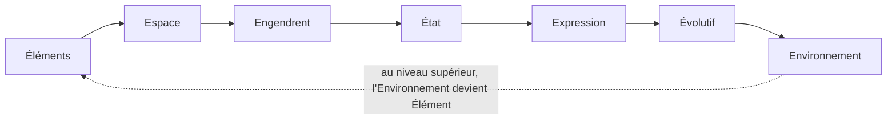

| Phase | Rôle dans le système | Module | Dimensions |
|---|---|---|---|
| Éléments | fichiers, hunks, classes de fichiers | `tension` | D1 |
| Espace | ancêtre commun B, arbre de travail, `origin` | `tension` | D1 |
| Engendrent | chevauchement, conflit | `tension` | D1 |
| État | niveau par fichier, machine d'états, bornes | `etats` | D2 |
| Expression | alertes signées, arbitrage, tableau de bord | `messagerie`, `dashboard` | D3, D7 |
| Évolutif | horodatages, volatilité, verdict, journal | `verdict-journal` | D5, D6 |
| Environnement | GitLab, pipelines, autres développeurs | `effecteur-gitlab` | D4 |

Récursion : chaque phase peut devenir un cycle à son propre niveau. Le premier niveau à implémenter est le fichier. Les niveaux du dépôt et de la chaîne d'agents relèvent de la version 3.0 (dimensions D8 à D10).

Clause de second ordre : le tableau de bord influence le comportement du développeur. Le journal enregistre donc le verdict affiché et l'action choisie, au même niveau que les événements Git (D5.INV-1).

## 5. Registre des dimensions

Une dimension est un axe de la spécification, avec ses invariants et ses tests. Le statut indique si elle est implémentée dans la version courante.

| ID | Dimension | Introduite | Statut 2.2.0 | Dépend de | Module |
|---|---|---|---|---|---|
| D1 | Tension par fichier (Δ, chevauchement, conflit) | 1.0 | active | | `tension` |
| D2 | Machine d'états et bornes de configuration | 1.0 | active | D1 | `etats` |
| D3 | Messagerie signée et tableau de bord en lecture seule | 1.0 | active | D2 | `messagerie`, `dashboard` |
| D4 | Effecteur GitLab à garde-fous | 2.0 | active | D2, D6 | `effecteur-gitlab` |
| D5 | Verdict de fenêtre et clause de second ordre | 2.0 | active | D1, D2, D6 | `verdict-journal` |
| D6 | Journal en ajout seul et rejeu déterministe | 2.0 | active | | `verdict-journal` |
| D7 | Arbitrage humain par client signé | 2.1 | active | D3, D6 | `messagerie` |
| D8 | Communication directe inter-agents | 3.0 | reserved | D3, D6 | `regulation-inter-agents` |
| D9 | Régulation de second niveau (méta-niveau) | 3.0 | reserved | D6, D8 | `regulation-inter-agents` |
| D10 | Rapport de couplage et gestion des interblocages | 3.0 | reserved | D6, D8 | `regulation-inter-agents` |

Statuts : `active` (implémentée et testée), `reserved` (points d'extension posés, fonctionnalité absente), `superseded` (remplacée ; la version de remplacement est indiquée).

## 6. Contrat de version et points d'extension

### 6.1 Contrat

1. Chaque version déclare son numéro dans le frontmatter de ce document et dans `manifest.json`. Elle ajoute une entrée à la section 10.
2. Une version ajoute au moins une dimension ou un point d'extension. Sinon, c'est un correctif : seul le numéro de patch change.
3. Une dimension `reserved` ne passe à `active` que si ses invariants ont des tests dans la suite de la version.
4. Une dimension `active` ne sort du registre qu'en passant à `superseded`, avec la version de remplacement et une section de migration.
5. Un invariant ne s'affaiblit jamais. Il peut être remplacé par un invariant plus fort, signalé dans la section 10.
6. Le schéma SQLite évolue uniquement par migrations numérotées. Une migration publiée n'est jamais modifiée. Tant qu'aucune base n'a appliqué la migration 1, elle peut encore être complétée. Ce cas est signalé dans la section 10.
7. Chaque événement du journal porte `spec_version`. Un journal écrit dans une version reste rejouable dans toute version de la même famille majeure.
8. Avant de publier une nouvelle version, la précédente est archivée dans `archives/SKILL-vX.Y.Z.md`. Une archive n'est jamais éditée.

### 6.2 Points d'extension

Un point d'extension n'est pas une fonctionnalité. En 2.x, il n'a qu'un test qui prouve qu'il est inerte. La version 3.0 l'activera sans réécrire le code existant.

- **E1** : `journal.actor` est un ensemble ouvert. En 2.x, seules les valeurs `tracker`, `analyst`, `decider`, `messenger`, `assistant` et `developer` sont écrites. Les valeurs `meta` et `agent` sont réservées à D8 et D9, et refusées en écriture.
- **E2** : l'enveloppe signée réserve les champs `to` et `thread`. En 2.x, un message qui les porte est rejeté et journalisé `UNSUPPORTED_FIELD`.
- **E3** : la table `rules` est créée vide par la migration 1 et n'est lue par aucun composant en 2.x.
- **E4** : `src/core/bounds.js` déclare les bornes dans le code. Aucune source de configuration ne peut les modifier.
- **E5** : le dossier `reports/` est réservé à D10. Il n'est pas créé en 2.x.
- **E6** : le chargement des modules est piloté par `manifest.json`. Un module absent du manifeste, ou au statut `reserved`, n'est jamais chargé en 2.x.

## 7. Règles globales

- **Secrets** : `TENSION_HMAC_SECRET` et les tokens GitLab viennent de l'environnement ou d'un fichier en permissions 600. Ils n'apparaissent jamais dans le dépôt, dans `config.json`, dans les journaux, dans les messages ou dans les URL.
- **Réseau** : le tableau de bord et l'écoute des messages se font sur `127.0.0.1` par défaut. Les tests n'accèdent à aucun réseau.
- **Écriture** : seul l'effecteur écrit dans Git ou GitLab, et seulement à partir d'un plan validé. Le tracker ne modifie ni l'arbre de travail ni les branches locales. Seul `git fetch` met à jour les refs de suivi.
- **Journal** : chaque événement est en ajout seul, horodaté, versionné (`spec_version`) et tenu à jour sans lire l'horloge au moment du rejeu.
- **Langue** : identifiants en anglais ; commentaires, messages au développeur et journaux en français.

## 8. Critères d'acceptation globaux

- `npm test` passe, sans accès réseau.
- Chaque invariant de la section 9 apparaît dans au moins un test. Un script vérifie cette correspondance.
- `tension.js` n'importe ni `fs`, ni `child_process`, ni module réseau.
- Le serveur n'écoute que sur `127.0.0.1` par défaut.
- Aucun secret n'apparaît dans les journaux, les messages, le dépôt ou les URL.
- Aucun `--force` ni `--force-with-lease` dans le code de l'effecteur.
- Le mode dry-run est le défaut de l'effecteur.
- Le journal est en ajout seul, imposé par triggers.
- Un module `reserved` n'est pas chargé.

## 9. Invariants

Chaque invariant est vérifié par au moins un test de son module.

- **D1.INV-1** : un fichier modifié d'un seul côté est `mono_cote`, quel que soit son Δ, sauf `generated` (`exclu`).
- **D1.INV-2** : sans chevauchement ni conflit, un fichier n'est jamais `critique`, sauf `binary` ou `sensitive`.
- **D1.INV-3** : un fichier `binary` ou `sensitive` modifié des deux côtés est toujours `critique`.
- **D2.INV-1** : toute transition absente de la table du module `etats` est refusée et journalisée.
- **D2.INV-2** : un fichier `gelé` ne change d'état que par ARBITRAGE ou REMIND.
- **D2.INV-3** : une valeur de configuration hors bornes empêche le démarrage.
- **D3.INV-1** : un message dont la signature, l'horodatage ou le nonce est invalide n'a aucun effet.
- **D3.INV-2** : aucun secret n'apparaît dans les messages, les journaux ou le dépôt.
- **D3.INV-3** : le tableau de bord n'expose aucune route d'écriture.
- **D4.INV-1** : aucun commit déjà présent sur `origin` n'est réécrit.
- **D4.INV-2** : aucun fichier `gelé` n'est modifié par l'effecteur, ni dans l'arbre, ni dans les commits rejoués.
- **D4.INV-3** : la procédure 2.x n'emploie ni `--force` ni `--force-with-lease`.
- **D4.INV-4** : sans `--execute`, l'effecteur n'écrit rien.
- **D5.INV-1** : chaque verdict affiché et chaque action du développeur sont journalisés.
- **D6.INV-1** : la table `journal` n'accepte ni UPDATE ni DELETE.
- **D6.INV-2** : le rejeu d'un même journal produit exactement le même état final.
- **D7.INV-1** : aucun arbitrage n'est appliqué sans événement `DEV_ACTION` signé correspondant.

## 10. Journal de révision

**2.0.0** : spécification monolithique de l'agent, de l'effecteur GitLab et du tableau de bord. Archive : `archives/SKILL-v2.0.0.md`.

**2.1.0** : registre des dimensions D1 à D10, contrat de version, invariants `Dn.INV-k`, points d'extension E1 à E5, client d'arbitrage (D7), corrections du stash sur fichiers gelés, du statut du tracker, du seuil de volatilité paramétré, de `testCmd` sans shell et de la persistance des relances. Archive : `archives/SKILL-v2.1.0.md`.

**2.2.0** : passage en package modulaire avec `manifest.json` et modules par dimension. Ajout de schémas Mermaid (architecture, cycle 7E, machine d'états, séquences HMAC et GitLab, modèle de données). Ajout du point d'extension E6. Corrections :

- C12, confirmation de fusion : la version 2.1.0 imposait un `confirm_token` à usage unique sans lieu de stockage. La table `confirm_tokens` est ajoutée à la migration 1. Cette migration n'ayant encore été appliquée nulle part, elle peut être complétée (section 6.1, règle 6).
- C13, `merge-tree` : les noms de fichiers en conflit s'obtiennent avec `--name-only`. La disponibilité de cette option doit être vérifiée sur la version de Git installée.
- C14, détection des renommages : `git diff` est appelé avec `--no-renames` pour que les chemins de fichiers restent stables.
- C15, binaires : un fichier binaire est détecté par `git diff --numstat` (colonnes `-` et `-`), et non par heuristique sur le contenu.
- C16, canonicalisation : la sérialisation canonique suit RFC 8785 (JCS) de préférence. Une implémentation maison est acceptée si elle est testée contre des vecteurs de référence.
- C17, notation des scénarios : ceux de l'effecteur s'appellent G1 à G10. Le préfixe E désigne désormais uniquement les points d'extension, pour éviter toute confusion.
- C18, catalogue du journal : ajout de `EXECUTION_REFUSED` (refus de l'étape 0 ou d'une garde) et de `PIPELINE_RETRY` (compteur de relances lu dans le journal).
<<<FIN SKILL.md>>>

<<<FICHIER modules/tension/SKILL.md>>>
---
name: tension
description: Module de calcul de tension par fichier (delta en caractères, hunks, chevauchement, conflit, classes de fichiers et niveaux stable, modéré, critique). À lire avant d'écrire src/core/tension.js ou src/git/snapshot.js.
dimensions: [D1]
status: active
---

# Module `tension` (D1)

Ce module répond à une question : pour chaque fichier, qu'est-ce qui diverge entre le local et le distant, et est-ce que cela se réconcilie sans risque ?

Phases 7E couvertes : Éléments, Espace, Engendrent.

## 1. Entrées et sorties

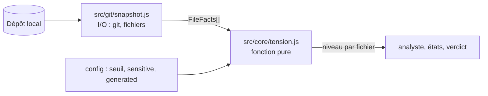

- `snapshot.js` lit Git et le système de fichiers. Il produit des `FileFacts`.
- `tension.js` ne fait aucune entrée-sortie. Il prend des `FileFacts` et une configuration, et retourne un niveau. Il est testable sans dépôt.

## 2. Modèle de données (`FileFacts`)

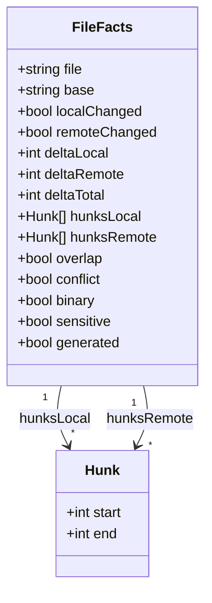

| Champ | Signification |
|---|---|
| `file` | chemin relatif à la racine du dépôt |
| `base` | SHA de l'ancêtre commun B, ou `null` si le fichier est absent de B |
| `localChanged` | `git diff B` (arbre de travail, commits locaux inclus) est non vide pour ce fichier |
| `remoteChanged` | `git diff B origin/<branche>` est non vide pour ce fichier |
| `deltaLocal`, `deltaRemote` | caractères insérés plus supprimés, mesurés depuis B |
| `deltaTotal` | `deltaLocal + deltaRemote` |
| `hunksLocal`, `hunksRemote` | intervalles de lignes exprimés dans les coordonnées de B |
| `overlap` | au moins un hunk local chevauche un hunk distant |
| `conflict` | `git merge-tree` signale ce fichier en conflit |
| `binary`, `sensitive`, `generated` | classes issues de la configuration et de Git |

## 3. Calcul du delta

### 3.1 Algorithme

```
entrée : B (SHA), côté ∈ {local, remote}
1. diff = git diff --no-color --no-renames --no-ext-diff -U0 B [origin/<branche>]
   (sans origin/<branche> pour le côté local : la comparaison se fait avec l'arbre de travail)
2. pour chaque fichier de diff :
   a. si git diff --numstat indique "-" "-" → binary = vrai, delta = 0, passer au suivant
   b. pour chaque ligne du corps du hunk :
      - ignorer les lignes qui commencent par "+++", "---" ou "\"
      - si la ligne commence par "+" ou "-" : compter len([...ligne[1:-1]]) caractères
        (points de code Unicode, sans le signe ni le caractère de fin de ligne)
   c. delta_côté = somme des comptes de tous les hunks
   d. pour chaque en-tête @@ -a,b +c,d @@ : produire un intervalle sur B (voir 3.2)
```

### 3.2 Intervalles de hunks

- En-tête `@@ -a,b +c,d @@` :
  - si `b > 0` : intervalle `[a, a + b − 1]` ;
  - si `b = 0` (insertion pure après la ligne `a`) : intervalle `[a, a + 1]`.
- Deux intervalles X et Y se chevauchent si `X.start ≤ Y.end + 1` et `Y.start ≤ X.end + 1`. Les hunks adjacents comptent donc comme chevauchement, comme pour Git.

Cas de test :

| Hunk A | Hunk B | Résultat | Raison |
|---|---|---|---|
| `[1,3]` | `[4,5]` | chevauchement | adjacents |
| `[1,3]` | `[5,6]` | pas de chevauchement | ligne 4 libre |
| insertion après 3, soit `[3,4]` | `[6,8]` | pas de chevauchement | |

### 3.3 Exemple travaillé

Diff local sur `src/a.ts` (une ligne remplacée, une ligne ajoutée) :

```diff
@@ -10,2 +10,3 @@
-const a = 1;
+const a = 2;
+const b = 3;
```

- Intervalle sur B : `b = 2`, donc `[10, 10 + 2 − 1] = [10, 11]`.
- Caractères : `const a = 1;` compte 12, `const a = 2;` compte 12, `const b = 3;` compte 12.
- `deltaLocal` = 12 (supprimé) + 12 (ajouté) + 12 (ajouté) = **36**.

Ce cas est une vérification unitaire : le module doit retourner exactement 36 et l'intervalle `[10, 11]`.

## 4. Calcul de la tension

### 4.1 Conflit

```bash
git merge-tree --write-tree --name-only <local> <remote>
# code 0 : fusion propre
# code 1 : conflits, les noms des fichiers conflictuels suivent l'identifiant d'arbre
```

- `conflict` vaut vrai si le fichier figure dans la liste.
- Un conflit modify/delete compte comme conflit.
- Vérifier la présence de `--name-only` avec `git merge-tree -h` sur la version installée. Si l'option manque, extraire les noms depuis la sortie complète et le documenter.

### 4.2 Chevauchement

- `overlap` est calculé à partir des hunks, sans appel à Git. C'est une estimation rapide.
- `merge-tree` fait foi pour `conflict`. Le chevauchement sert à classer les fichiers qui fusionnent proprement.

## 5. Classes de fichiers

Configuration (globs, évalués avant tout calcul) :

- `generated` : lock files, `dist/**`. Exclus du delta et de l'affichage de tension.
- `binary` : détecté par `--numstat`. Aucun delta en caractères.
- `sensitive` : migrations, configuration de sécurité, secrets de déploiement. Toute tension est critique.

## 6. Niveaux de tension

`classify(file, config)` est une fonction pure. Les règles s'évaluent dans cet ordre, et la première qui correspond l'emporte.

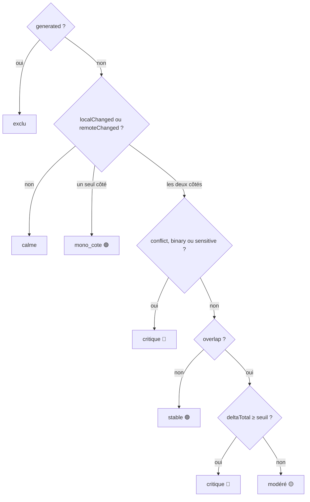

| Ordre | Condition | Niveau | Invariant |
|---|---|---|---|
| 1 | `generated` | `exclu` | D1.INV-1 |
| 2 | ni local ni distant modifié | `calme` | |
| 3 | un seul côté modifié, y compris `sensitive` | `mono_cote` | D1.INV-1 |
| 4 | `conflict`, `binary` ou `sensitive` (les deux côtés modifiés) | `critique` | D1.INV-3 |
| 5 | pas de chevauchement | `stable`, quel que soit le delta | D1.INV-2 |
| 6 | `deltaTotal ≥ seuil` (300 par défaut) | `critique` | |
| 7 | sinon | `modere` | |

Un fichier de 1 000 caractères modifié dans une zone sans chevauchement reste stable. L'indicateur de volume s'affiche, mais aucune alerte n'est émise.

## 7. Pièges connus

- **Fichier `generated` en conflit** : il est exclu du calcul, mais Git le signale au rebase. L'effecteur doit alors le traiter par régénération, jamais par fusion manuelle. Ce cas doit figurer dans les tests de l'effecteur.
- **Renommages** : sans `--no-renames`, un fichier renommé peut apparaître sous deux chemins et fausser le calcul (C14).
- **Fin de ligne** : un changement de fins de ligne (CRLF/LF) produit un delta énorme pour un contenu inchangé. Prévoir un test, et signaler ce cas au développeur plutôt que de le classer critique silencieusement.
- **Encodage** : compter en points de code Unicode (`[...s].length`), pas en octets ni en unités UTF-16.
- **Chemins** : `git diff` peut quoter les chemins contenant des caractères spéciaux. Utiliser `-z` ou `core.quotePath=false` et normaliser.
- **Fichier absent de B** : `base` vaut `null`. Le delta est alors la totalité du fichier, et le chevauchement est faux par définition. Un fichier nouveau des deux côtés est un conflit potentiel, à traiter comme `critique` par la règle 4 si `merge-tree` le signale.

## 8. Tests (scénarios de rejeu)

| # | Entrée | Attendu | Invariant |
|---|---|---|---|
| 1 | `generated`, modifié des deux côtés | `exclu` | D1.INV-1 |
| 2 | rien modifié | `calme` | |
| 3 | un seul côté, 1 000 caractères | `mono_cote` | D1.INV-1 |
| 4 | deux côtés, pas de chevauchement, Δ 800 | `stable` | D1.INV-2 |
| 5 | deux côtés, chevauchement, Δ 120, fusion propre | `modere` | |
| 6 | deux côtés, chevauchement, Δ 340, fusion propre | `critique` | |
| 7 | deux côtés, conflit, Δ 10 | `critique` | |
| 8 | `binary`, deux côtés | `critique` | D1.INV-3 |
| 9 | `sensitive`, deux côtés, pas de chevauchement | `critique` | D1.INV-3 |
| 10 | chevauchement, Δ = 300 exactement, fusion propre | `critique` | |
| 11 | chevauchement, Δ = 299, fusion propre | `modere` | |
| 12 | `sensitive`, un seul côté modifié | `mono_cote` | D1.INV-1 |
| 13 | exemple travaillé de la section 3.3 | Δ = 36, intervalle `[10, 11]` | |
| 14 | paires de hunks de la section 3.2 | chevauchement, pas de chevauchement, pas de chevauchement | |

Chaque test de `tension.js` est unitaire et sans I/O. Les scénarios 13 et 14 testent aussi `snapshot.js` sur un dépôt temporaire créé par le test.

## 9. Fichiers à produire

- `src/core/model.js` : types `FileFacts`, `Hunk`, énumérations des niveaux.
- `src/core/tension.js` : `classify`, `overlaps`, sans I/O.
- `src/git/snapshot.js` : appels Git, lecture des `FileFacts`, création de dépôts temporaires pour les tests.
- `test/tension.test.js`, `test/snapshot.test.js` : `node:test`, aucun réseau.
<<<FIN modules/tension/SKILL.md>>>

<<<FICHIER modules/etats/SKILL.md>>>
---
name: etats
description: Module de machine d'états par fichier (calme, sous_tension, gelé, résolu_auto, résolu) et de validation des bornes de configuration. À lire avant d'écrire src/core/states.js ou src/core/bounds.js, ou pour comprendre le gel d'un fichier.
dimensions: [D2]
status: active
---

# Module `etats` (D2)

Ce module répond à deux questions : dans quel état se trouve chaque fichier, et quelles transitions sont permises. Il vérifie aussi que la configuration reste dans les bornes autorisées.

Phase 7E couverte : État.

## 1. Vue d'ensemble

```mermaid
flowchart LR
  TIER["tension<br/>niveau par fichier"] --> SM["states.js<br/>machine d'états"]
  EV["événements<br/>BOTH_CHANGED, SYNC_OK, ARBITRAGE..."] --> SM
  SM -->|"transition permise"| DB[("table states + journal")]
  SM -->|"transition refusée"| REJ["TRANSITION_REJECTED"]
  SM -->|"gelé"| GEL["effecteur bloqué pour ce fichier"]
  BND["bounds.js<br/>bornes déclarées"] --> CFG["chargement de config.json"]
  CFG -->|"hors bornes"| STOP["refus au démarrage"]
```

## 2. Machine d'états par fichier

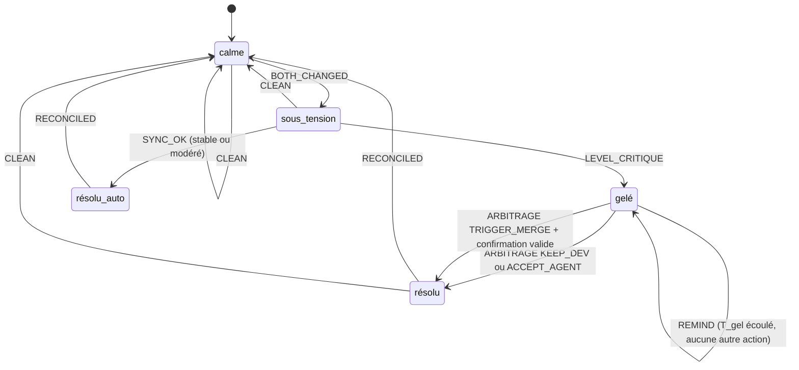

Note sur le diagramme : `CLEAN` est valable depuis tous les états. Il est omis sur les autres arcs pour la lisibilité, et doit être implémenté comme une transition générique.

### 2.1 Table des transitions

| De | Événement | Garde | Vers | Action |
|---|---|---|---|---|
| calme | BOTH_CHANGED | aucune | sous_tension | journaliser |
| sous_tension | LEVEL_CRITIQUE | niveau = critique | gelé | geler le fichier pour l'effecteur, émettre `TENSION_ALERT` |
| sous_tension | SYNC_OK | niveau ∈ {stable, modere} | résolu_auto | journaliser |
| résolu_auto | RECONCILED | aucune | calme | journaliser |
| gelé | ARBITRAGE | choix ∈ {KEEP_DEV, ACCEPT_AGENT} | résolu | appliquer le choix, lever le gel |
| gelé | ARBITRAGE | choix = TRIGGER_MERGE et confirmation valide | résolu | lancer le resolver dans une branche temporaire |
| gelé | REMIND | `tGelMin` écoulé | gelé | émettre un rappel, rien d'autre |
| résolu | RECONCILED | aucune | calme | journaliser |
| tout état | CLEAN | fichier identique des deux côtés | calme | journaliser |

Toute combinaison absente de la table est refusée : journaliser `TRANSITION_REJECTED` avec l'état, l'événement et le fichier, puis ne rien modifier (D2.INV-1).

### 2.2 Règles du gel

- **Par fichier** : le gel ne touche jamais les autres fichiers. Un fichier gelé ne bloque pas le travail sur les autres.
- **Persistant** : l'état `gelé` est écrit dans la table `states` dans la même transaction que son événement. Un redémarrage ne lève pas le gel.
- **Sans transition automatique** : un fichier gelé ne change d'état que par ARBITRAGE (D2.INV-2). Le rappel `REMIND` reste dans le même état. Il ne lève jamais le gel.
- **Protégé en aval** : l'effecteur consulte cette table avant toute opération (module `effecteur-gitlab`, D4.INV-2).

## 3. Bornes de configuration

Les bornes sont déclarées dans le code, dans `src/core/bounds.js` (point d'extension E4). Aucune source de configuration ne peut les modifier.

```js
// src/core/bounds.js — déclarées dans le code, jamais lues depuis la configuration
export const BOUNDS = Object.freeze({
  seuil:            { min: 150, max: 500, defaut: 300 },
  tStabMin:         { min: 5,   max: 30,  defaut: 10 },
  tGelMin:          { min: 15,  max: 120, defaut: 30 },
  tVolatileH:       { min: 6,   max: 72,  defaut: 24 },
  fetchIntervalSec: { min: 30,  max: 300, defaut: 60 },
});
```

Validation au chargement :

```
pour chaque clé k de BOUNDS :
  si config[k] est absent → utiliser defaut
  sinon si config[k] n'est pas un entier, ou hors [min, max] → ERREUR_CONFIG, arrêt au démarrage
journaliser CONFIG_LOADED avec les valeurs retenues
```

Une valeur hors bornes empêche le démarrage (D2.INV-3). Le message d'erreur indique la clé, la valeur reçue et les bornes.

Pour `testCmd`, la validation vérifie qu'il s'agit d'une liste de chaînes. Une chaîne seule est refusée (D2.INV-3). Le module `effecteur-gitlab` l'exécute sans shell.

## 4. Pièges connus

- **Gel perdu au redémarrage** : si `states` n'est pas persisté avant l'envoi de `TENSION_ALERT`, un redémarrage peut réémettre l'alerte ou lever le gel. Écrire d'abord, émettre ensuite.
- **Doubles événements** : un même `BOTH_CHANGED` reçu deux fois ne doit pas produire deux transitions. Le module traite les événements de façon idempotente, à partir de l'identifiant d'événement.
- **Transitions concurrentes** : deux événements sur le même fichier doivent être sérialisés. Une transaction SQLite par événement suffit en mono-poste.
- **Bornes et valeurs par défaut** : la valeur par défaut doit toujours appartenir à l'intervalle borné. Un test le vérifie pour chaque clé.

## 5. Tests (scénarios de rejeu)

### 5.1 Scénarios de transitions

| # | Séquence d'événements | État final | Invariant |
|---|---|---|---|
| T1 | BOTH_CHANGED, LEVEL_CRITIQUE, ARBITRAGE KEEP_DEV, puis RECONCILED | calme | |
| T2 | BOTH_CHANGED, SYNC_OK, RECONCILED | calme | |
| T3 | BOTH_CHANGED, LEVEL_CRITIQUE, REMIND | gelé (inchangé) | D2.INV-2 |
| T4 | ARBITRAGE sans BOTH_CHANGED préalable | refusé, `TRANSITION_REJECTED` | D2.INV-1 |
| T5 | ARBITRAGE TRIGGER_MERGE sans confirmation | refusé | D7.INV-1 |
| T6 | BOTH_CHANGED sur un fichier déjà gelé | refusé, `TRANSITION_REJECTED` | D2.INV-1 |
| T7 | BOTH_CHANGED, LEVEL_CRITIQUE, redémarrage du processus, puis REMIND | gelé, toujours persistant | D2.INV-2 |
| T8 | BOTH_CHANGED reçu deux fois | une seule transition, une entrée de journal | |

### 5.2 Scénarios de configuration

| # | Entrée | Attendu | Invariant |
|---|---|---|---|
| C1 | `seuil` = 600 | refus au démarrage | D2.INV-3 |
| C2 | `testCmd` = `"npm test"` (chaîne) | refus au démarrage | D2.INV-3 |
| C3 | `tVolatileH` absent | valeur par défaut 24 retenue, journalisée | D2.INV-3 |
| C4 | `fetchIntervalSec` = 30 (borne basse) | accepté | D2.INV-3 |
| C5 | valeur par défaut hors de son intervalle (test sur `BOUNDS`) | échec du test | D2.INV-3 |

## 6. Fichiers à produire

- `src/core/states.js` : table des transitions, fonction `applyEvent(state, event, guards)` qui retourne la nouvelle valeur ou un refus.
- `src/core/bounds.js` : constante `BOUNDS` et `validateConfig(config)`.
- `test/states.test.js`, `test/bounds.test.js` : scénarios T1 à T8 et C1 à C5.
<<<FIN modules/etats/SKILL.md>>>

<<<FICHIER modules/verdict-journal/SKILL.md>>>
---
name: verdict-journal
description: Module de persistance (schéma SQLite versionné, journal en ajout seul, rejeu déterministe) et de verdict de fenêtre de push (Attendre, Synchroniser d'abord, Pousser). À lire avant de créer la base, d'écrire le journal ou de calculer le verdict affiché au développeur.
dimensions: [D5, D6]
status: active
---

# Module `verdict-journal` (D5, D6)

Ce module tient deux rôles. Il persiste tout ce qui s'est passé, dans un journal qui ne s'efface jamais. Il calcule aussi le verdict affiché au développeur : c'est la sortie visible qui influence son choix, donc qui doit être journalisée (clause de second ordre).

Phases 7E couvertes : Évolutif, et l'Expression du verdict.

## 1. Modèle de données

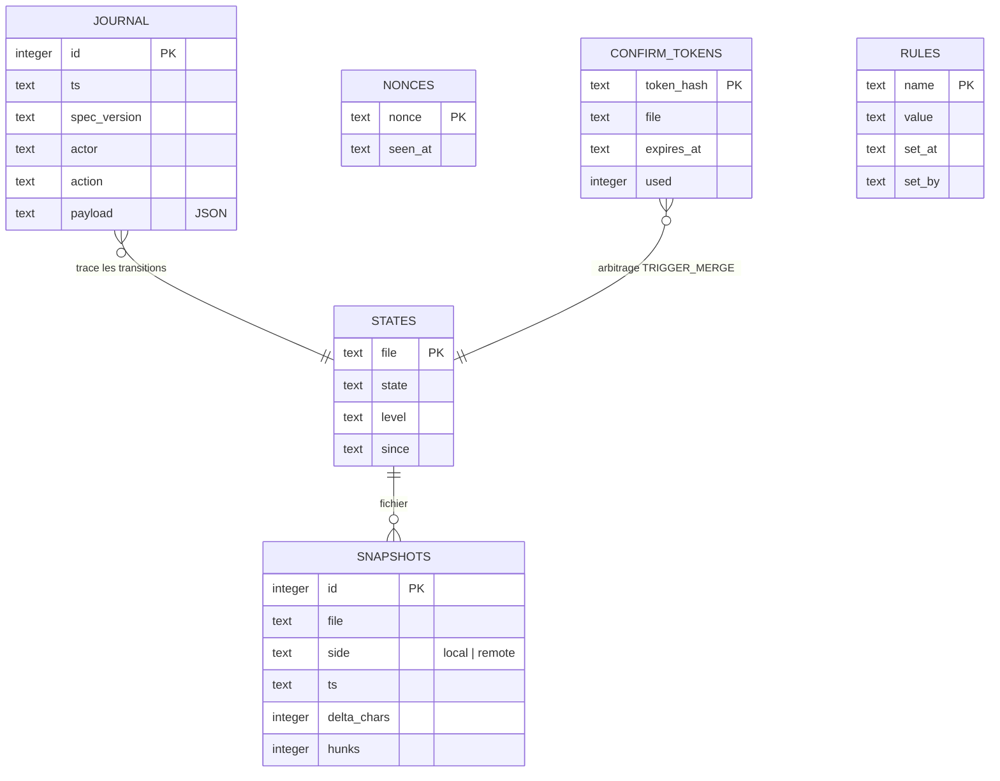

`RULES` est réservée à la dimension D9 et reste vide en 2.x (point E3).

## 2. Migrations

Version de schéma : `PRAGMA user_version`.

```
au démarrage :
  v = PRAGMA user_version
  pour chaque migration m (numérotée) avec m > v, dans l'ordre :
    BEGIN;
    exécuter le SQL de m;
    PRAGMA user_version = m;
    COMMIT;
```

Une migration publiée n'est jamais modifiée. Une évolution future ajoute une migration 2, 3, etc. Tant que la migration 1 n'a été appliquée nulle part, elle peut être complétée (section 6.1, règle 6 du point d'entrée).

### 2.1 Migration 1 (base 2.2.0)

```sql
CREATE TABLE snapshots (
  id INTEGER PRIMARY KEY,
  file TEXT NOT NULL,
  side TEXT NOT NULL CHECK (side IN ('local', 'remote')),
  ts TEXT NOT NULL,
  delta_chars INTEGER NOT NULL,
  hunks INTEGER NOT NULL
);

CREATE TABLE states (
  file TEXT PRIMARY KEY,
  state TEXT NOT NULL,
  level TEXT NOT NULL,
  since TEXT NOT NULL
);

CREATE TABLE journal (
  id INTEGER PRIMARY KEY,
  ts TEXT NOT NULL,
  spec_version TEXT NOT NULL,
  actor TEXT NOT NULL,   -- ensemble ouvert, point E1 du point d'entrée
  action TEXT NOT NULL,
  payload TEXT NOT NULL  -- JSON
);

CREATE TRIGGER journal_no_update BEFORE UPDATE ON journal
BEGIN SELECT RAISE(ABORT, 'journal en ajout seul'); END;

CREATE TRIGGER journal_no_delete BEFORE DELETE ON journal
BEGIN SELECT RAISE(ABORT, 'journal en ajout seul'); END;

CREATE TABLE nonces (
  nonce TEXT PRIMARY KEY,
  seen_at TEXT NOT NULL
);

CREATE TABLE confirm_tokens (
  token_hash TEXT PRIMARY KEY,  -- HMAC-SHA256 du jeton : le jeton clair n'est jamais stocké
  file TEXT NOT NULL,
  expires_at TEXT NOT NULL,
  used INTEGER NOT NULL DEFAULT 0 CHECK (used IN (0, 1))
);

CREATE TABLE rules (            -- réservée à D9 : créée vide, jamais lue en 2.x (point E3)
  name TEXT PRIMARY KEY,
  value TEXT NOT NULL,
  set_at TEXT NOT NULL,
  set_by TEXT NOT NULL
);
```

### 2.2 Ce que garantissent les triggers

- `journal` refuse tout `UPDATE` et tout `DELETE`, quel que soit le code qui l'appelle (D6.INV-1). La garantie ne repose pas sur une convention.
- Une correction se fait par un nouvel événement, par exemple `CORRECTION` avec `payload.refers_to`. Elle ne modifie jamais l'ancienne ligne.

## 3. Catalogue des événements

| Action | Acteur | Déclenchement | Payload minimal |
|---|---|---|---|
| `CONFIG_LOADED` | `tracker` | démarrage | valeurs retenues, clés par défaut |
| `GIT_COMMAND` | `assistant` | avant chaque commande Git d'écriture | commande, arguments, branche |
| `GIT_RESULT` | `assistant` | après chaque commande Git | code de sortie, durée |
| `API_CALL` | `assistant` | avant chaque appel GitLab | méthode, chemin, sans token |
| `BOTH_CHANGED` | `analyst` | fichier modifié des deux côtés | fichier, niveaux |
| `TRANSITION_REJECTED` | `decider` | transition hors table | état, événement, fichier |
| `TENSION_ALERT` | `messenger` | passage à critique | enveloppe signée |
| `VERDICT_DISPLAYED` | `analyst` | verdict affiché | verdict, fichiers du plan, horodatages |
| `DEV_ACTION` | `developer` | action choisie par le développeur | action, fichier, verdict affiché |
| `MESSAGE_REJECTED` | `messenger` | signature, horodatage ou nonce invalide | motif, sans contenu sensible |
| `UNSUPPORTED_FIELD` | `messenger` | champ `to` ou `thread` présent (E2) | nom du champ |
| `STASH_SKIPPED` | `assistant` | arbre propre, aucun stash | |
| `PLAN_RESULT` | `assistant` | fin de plan | branche, MR, pipeline, relances |
| `EXECUTION_REFUSED` | `assistant` | étape 0 ou garde en échec | fichiers gelés touchés, motif |
| `PIPELINE_RETRY` | `assistant` | relance d'une pipeline (une seule en 2.x) | `pipeline_id`, compteur après relance |

Un acteur hors de cette liste est refusé en écriture (E1).

## 4. Verdict de fenêtre de push

Entrée : les fichiers du plan, dans `plan.json` (`{"files": [...], "branch": "..."}`), ou à défaut les fichiers de `git status --porcelain`.

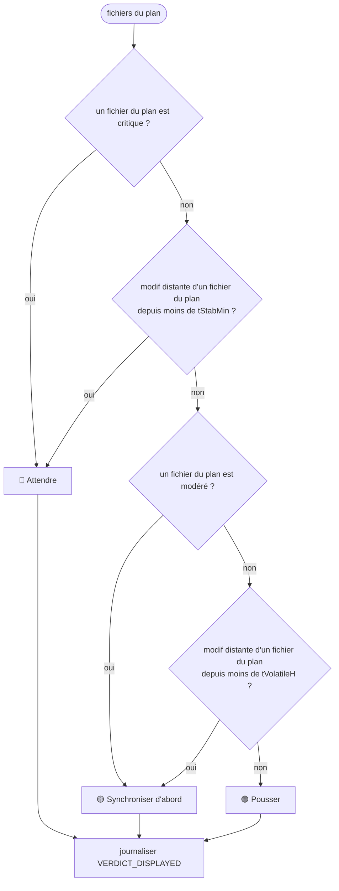

Séquence affichée, dans cet ordre : intégrer le distant, traiter les fichiers `stable` et `mono_cote`, traiter les `modere`, traiter les `critique` après arbitrage.

Le verdict est recalculé à chaque cycle de surveillance. Chaque changement de verdict produit un `VERDICT_DISPLAYED`. Un verdict identique au précédent n'est pas réémis, afin de ne pas noyer le journal.

## 5. Rejeu déterministe

Le rejeu reconstruit l'état final à partir du journal seul.

```
fonction replay(evenements) :
  etat = état initial vide
  pour chaque ev dans evenements (ordre de id) :
    si ev.action est une transition :
      etat = applyEvent(etat, ev)   // fonction pure, sans horloge
    sinon :
      ignorer pour l'état, conserver pour l'historique
  retourner etat
```

Règles :

- le rejeu ne lit jamais l'horloge : `ts` est une donnée de l'événement ;
- le rejeu ne fait aucun appel réseau, aucune commande Git ;
- le rejeu ne modifie pas la table `journal` (D6.INV-1) ;
- deux rejeux successifs du même journal produisent le même état (D6.INV-2).

## 6. Pièges connus

- **Journal trop bavard** : les verdicts identiques répétés saturent la base. Ne journaliser que les changements, comme indiqué en section 4.
- **Secrets dans le payload** : `API_CALL` et `GIT_COMMAND` ne contiennent jamais le token ni l'URL avec identifiants (section 7 du point d'entrée).
- **Horloge dans le rejeu** : un `Date.now()` dans `applyEvent` rend le rejeu non déterministe. Le lint doit l'interdire dans `src/core/`.
- **Confirm token** : stocker le jeton en clair permettrait à quiconque lit la base de fusionner. Stocker son HMAC, et comparer en temps constant (`crypto.timingSafeEqual`).
- **Purge des nonces** : la purge doit être au moins aussi longue que la fenêtre de 300 s, sinon un message ancien pourrait être rejoué.

## 7. Tests (scénarios de rejeu)

### 7.1 Journal et rejeu (D6)

| # | Situation | Attendu | Invariant |
|---|---|---|---|
| J1 | `UPDATE` sur `journal` | refusé par trigger | D6.INV-1 |
| J2 | `DELETE` sur `journal` | refusé par trigger | D6.INV-1 |
| J3 | rejeu deux fois du même journal | mêmes transitions, même état final | D6.INV-2 |
| J4 | événement avec un acteur `meta` en 2.x | refusé en écriture | E1 |
| J5 | migration 1 appliquée sur base vide, puis relancée | `user_version` = 1, aucune modification au second passage | |

### 7.2 Verdict (D5)

| # | Plan | Historique distant | Attendu | Invariant |
|---|---|---|---|---|
| V1 | un fichier critique | aucun | 🔴 | D5.INV-1 |
| V2 | fichier du plan modifié à distance il y a 5 min | récent | 🔴 | D5.INV-1 |
| V3 | fichier `modere` | distant il y a 2 h | 🟡 | D5.INV-1 |
| V4 | fichiers `stable` seulement | aucun depuis 24 h | 🟢 | D5.INV-1 |
| V5 | changement de verdict | n'importe lequel | `VERDICT_DISPLAYED` journalisé une fois | D5.INV-1 |
| V6 | verdict identique deux cycles de suite | aucun | une seule entrée journalisée | |

## 8. Fichiers à produire

- `src/store/schema.js` : migrations numérotées, application via `PRAGMA user_version`.
- `src/store/journal.js` : écriture seule, lecture pour le rejeu.
- `src/core/verdict.js` : calcul du verdict à partir des niveaux, sans I/O.
- `src/core/replay.js` : `replay(evenements)`, pure.
- `test/schema.test.js`, `test/verdict.test.js`, `test/replay.test.js`.
<<<FIN modules/verdict-journal/SKILL.md>>>

<<<FICHIER modules/messagerie/SKILL.md>>>
---
name: messagerie
description: Module de messagerie signée HMAC entre l'agent et le développeur (enveloppe, vérification, nonces, alertes TENSION_ALERT) et de client d'arbitrage tension-arbitrer avec confirmation à deux temps pour la fusion. À lire avant d'écrire le messager, le client CLI ou toute entrée qui peut déclencher une action.
dimensions: [D3, D7]
status: active
---

# Module `messagerie` (D3, D7)

Ce module définit comment un message entre dans le système, comment il est vérifié, et comment le développeur peut répondre à une alerte. Un message qui n'a pas passé la vérification n'a aucun effet. C'est la règle la plus importante de ce module.

Phase 7E couverte : Expression.

## 1. Vue d'ensemble

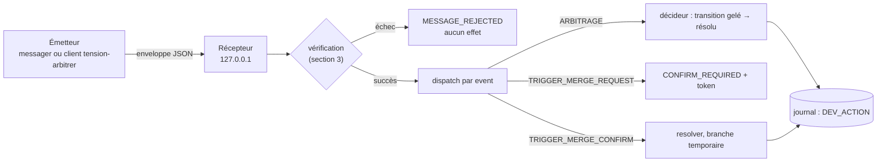

## 2. Enveloppe

```json
{
  "header": { "ts": "2026-10-15T23:10:00Z", "nonce": "b3f1c2...", "sig": "9a4e..." },
  "body": { "event": "ARBITRAGE", "file": "src/agents/orchestrator.ts", "choice": "KEEP_DEV" }
}
```

- `ts` : horodatage ISO 8601 UTC.
- `nonce` : 16 octets aléatoires, en hexadécimal, à usage unique.
- `sig` : `HMAC-SHA256(secret, canonicalJSON(body) + ts + nonce)`, en hexadécimal.
- `canonicalJSON` : RFC 8785 (JCS) de préférence. Une implémentation maison est acceptée si elle est testée contre des vecteurs de référence.
- Champs réservés en 2.x : `to` et `thread` (point E2). Un message qui les porte est rejeté.

## 3. Vérification (ordre strict)

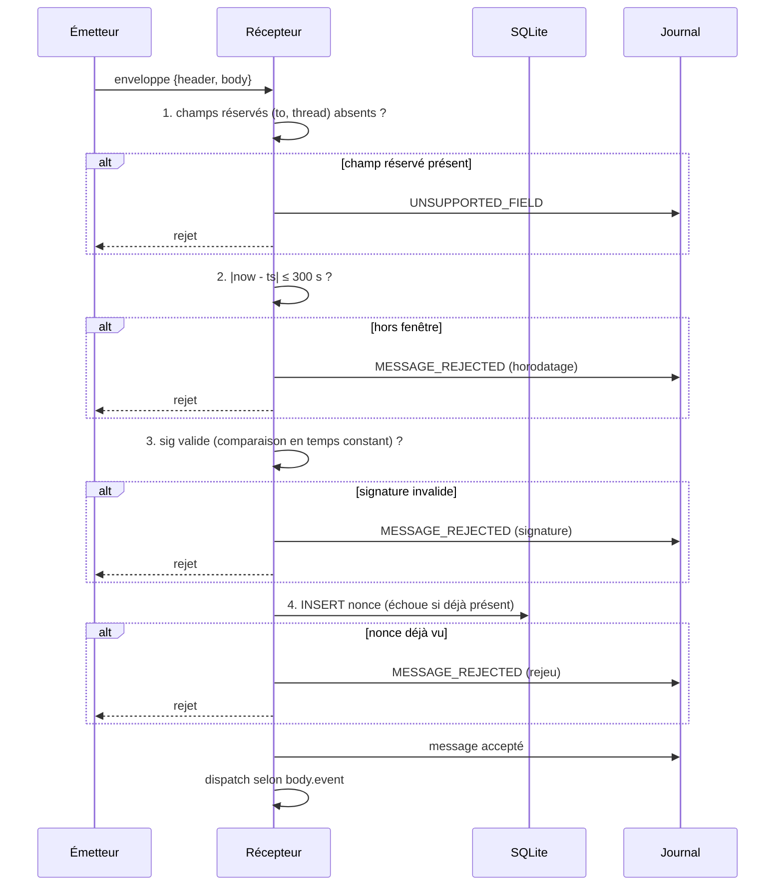

Points à respecter :

- **Le nonce n'est inséré qu'après une signature valide.** Sinon, un émetteur non authentifié pourrait remplir la table `nonces` à volonté.
- **La comparaison de signature est en temps constant** (`crypto.timingSafeEqual`). Les deux buffers doivent avoir la même longueur. Vérifier la longueur avant la comparaison, et rejeter si elle diffère.
- **Purge des nonces** : supprimer les nonces dont `seen_at` dépasse 300 s.
- **Secret** : `TENSION_HMAC_SECRET` dans l'environnement, ou fichier en permissions 600. Le secret n'est jamais journalisé, même partiellement.

## 4. Catalogue des messages

| Événement | Sens | Corps | Effet |
|---|---|---|---|
| `TENSION_ALERT` | agent → développeur | fichier, niveau, delta, chronologie, action recommandée | notification, aucune action |
| `ARBITRAGE` | développeur → agent | `file`, `choice` ∈ {`KEEP_DEV`, `ACCEPT_AGENT`} | transition `gelé` → `résolu` |
| `TRIGGER_MERGE_REQUEST` | développeur → agent | `file` | répond `CONFIRM_REQUIRED` avec un token, aucune fusion |
| `CONFIRM_REQUIRED` | agent → développeur | `file`, `confirm_token`, `expires_in_s` = 300 | affiché une seule fois |
| `TRIGGER_MERGE_CONFIRM` | développeur → agent | `file`, `confirm_token` | seul message qui déclenche la fusion |
| `DEV_ACTION` | journal | action, fichier, verdict affiché | journalisation (D5, D7) |
| `PLAN_RESULT` | agent → développeur | section 9 du module `effecteur-gitlab` | notification |

Message entrant d'un type inconnu : rejet, `MESSAGE_REJECTED` avec le motif `UNKNOWN_EVENT`.

## 5. Confirmation de fusion à deux temps

La fusion est l'action la plus risquée du système. Elle exige deux messages distincts, séparés par une confirmation humaine.

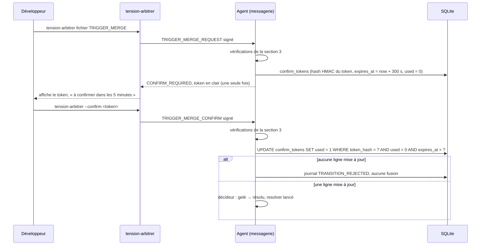

- Le token est généré par `crypto.randomBytes(32)`. Seul son HMAC est stocké.
- Un token est à usage unique. Le second usage échoue par la condition `used = 0`.
- Un token expiré ne sert plus. Le développeur doit relancer `TRIGGER_MERGE_REQUEST`.

## 6. Client d'arbitrage `tension-arbitrer` (D7)

Le tableau de bord est en lecture seule (D3.INV-3). Le client est le seul canal par lequel le développeur répond à une alerte.

```
tension-arbitrer <fichier> KEEP_DEV
tension-arbitrer <fichier> ACCEPT_AGENT
tension-arbitrer <fichier> TRIGGER_MERGE        # affiche un token à confirmer
tension-arbitrer --confirm <token>               # exécute la fusion après confirmation
```

- Le client signe chaque message avec le même protocole que le messager (section 2).
- Il lit le secret comme le messager. Il ne l'affiche jamais, même en cas d'erreur.
- Il n'agit que sur un fichier au statut `gelé`. Sinon, il affiche le statut et n'envoie rien, pour éviter un arbitrage sur un fichier qui n'attend rien.
- Chaque commande produit un événement `DEV_ACTION` côté agent, qui contient le verdict affiché au moment de l'action (D7.INV-1, D5.INV-1).

## 7. Pièges connus

- **Rejeu entre redémarrages** : la table `nonces` doit être persistante. Un cache en mémoire permettrait de rejouer un message après un redémarrage.
- **Horloge désynchronisée** : une horloge décalée de plus de 300 s rejette tous les messages légitimes. Journaliser l'écart observé, et signaler le problème au développeur plutôt que d'élargir la fenêtre.
- **Token dans les logs** : le `confirm_token` ne doit apparaître que dans la sortie du client, jamais dans le journal.
- **Confirmation rejouée** : le même token, présenté deux fois, doit échouer la seconde fois. Ce cas est testé (M7 ci-dessous).

## 8. Tests (scénarios de rejeu)

### 8.1 Vérification des messages (D3)

| # | Entrée | Attendu | Invariant |
|---|---|---|---|
| M1 | signature altérée | rejeté, `MESSAGE_REJECTED`, aucun effet | D3.INV-1 |
| M2 | nonce déjà vu | rejeté, aucun effet | D3.INV-1 |
| M3 | horodatage à plus de 300 s | rejeté, aucun effet | D3.INV-1 |
| M4 | champ `to` présent | rejeté, `UNSUPPORTED_FIELD` | D3.INV-1 |
| M5 | le journal et les messages sont inspectés après un échec de signature | aucune valeur de `TENSION_HMAC_SECRET` | D3.INV-2 |
| M6 | nonce présenté avec une signature invalide | nonce non inséré dans `nonces` | D3.INV-1 |
| M7 | `TRIGGER_MERGE_CONFIRM` avec un token déjà utilisé | rejeté, aucune fusion | D7.INV-1 |
| M8 | `TRIGGER_MERGE_CONFIRM` après expiration du token | rejeté, aucune fusion | D7.INV-1 |

### 8.2 Client d'arbitrage (D7)

| # | Situation | Attendu | Invariant |
|---|---|---|---|
| A1 | ARBITRAGE sans signature valide | rejeté, aucun effet | D3.INV-1 |
| A2 | ARBITRAGE valide sur un fichier gelé | `DEV_ACTION` journalisé avec le verdict affiché | D7.INV-1 |
| A3 | `tension-arbitrer` sur un fichier non gelé | aucun message envoyé, statut affiché | D7.INV-1 |
| A4 | le client affiche une erreur quelconque | aucune valeur de secret dans la sortie | D3.INV-2 |

## 9. Fichiers à produire

- `src/agents/messenger.js` : réception, vérification (section 3), dispatch, émission de `TENSION_ALERT`.
- `src/core/envelope.js` : canonicalisation, calcul et vérification de la signature, sans I/O.
- `src/cli/tension-arbitrer.js` : client d'arbitrage.
- `test/messenger.test.js`, `test/envelope.test.js`, `test/arbitrer.test.js`.
<<<FIN modules/messagerie/SKILL.md>>>

<<<FICHIER modules/dashboard/SKILL.md>>>
---
name: dashboard
description: Module du tableau de bord temps réel (Fastify, WebSocket, lecture seule sur 127.0.0.1) affichant les fichiers sous tension, leurs deltas, leur chronologie et le verdict de fenêtre. À lire avant d'écrire src/dashboard/* ou de modifier l'interface.
dimensions: [D3]
status: active
---

# Module `dashboard` (D3, volet tableau de bord)

Ce module présente l'état du système au développeur. Il ne calcule rien et n'écrit rien. Toute donnée affichée vient de la base ou de l'analyste.

Phase 7E couverte : Expression (côté visuel).

## 1. Principes

- **Lecture seule** : aucune route d'écriture (D3.INV-3). Les arbitrages passent par le client signé du module `messagerie`.
- **Aucun calcul** : le tableau de bord ne lance ni `git`, ni calcul de delta. Il consomme les états et les snapshots déjà produits.
- **Local par défaut** : écoute sur `127.0.0.1`. Un autre hôte exige une variable explicite `DASHBOARD_HOST`, et un avertissement dans le journal.
- **Accessible** : l'interface respecte les exigences RGAA 4.1 et WCAG 2.2 que le projet vise. La couleur n'est jamais le seul support d'information (critère 1.4.1).

## 2. Architecture

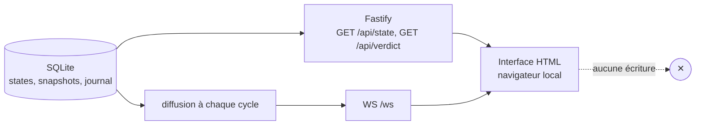

## 3. Routes et messages

| Méthode | Chemin | Rôle | Corps |
|---|---|---|---|
| GET | `/api/state` | état courant de chaque fichier | liste de `{file, state, level, deltaLocal, deltaRemote, since}` |
| GET | `/api/verdict` | verdict de fenêtre et séquence | `{verdict, sequence, computedAt}` |
| WS | `/ws` | diffusion à chaque cycle | `{type: "state", payload: ...}` ou `{type: "verdict", payload: ...}` |
| POST, PUT, PATCH, DELETE | toute route | refus | `405 Method Not Allowed`, aucun effet |

Exemple de message WebSocket :

```json
{
  "type": "state",
  "payload": {
    "file": "src/agents/orchestrator.ts",
    "state": "gelé",
    "level": "critique",
    "deltaLocal": { "insertions": 180, "suppressions": 40 },
    "deltaRemote": { "insertions": 210, "suppressions": 30 },
    "since": "2026-10-15T23:10:00Z"
  }
}
```

## 4. Mise en page

```text
VERDICT : 🔴 Attendre     calculé à 23:14:02     tStabMin = 10 min
Séquence : 1 intégrer le distant, 2 stable et mono_cote, 3 modéré, 4 critique

Niveau     Fichier                 Δ local      Δ distant    Dernier    Action
🔴 CRIT    src/agents/orch.ts      +180 −40     +210 −30     23:10      Arbitrage requis
🟡 MOD     src/api/routes.ts       +12 −3       +8 −1        22:40      Synchroniser
🟢 STAB    README.md               +4 −0        +0 −0        22:10      Pousser
⚪ EXCL    dist/bundle.js          —            —            —          Exclu
```

Le schéma ci-dessus est une maquette textuelle. La mise en page réelle est libre, à condition de respecter les colonnes obligatoires de la section 4 et l'accessibilité de la section 5.

Colonnes obligatoires : niveau, fichier, Δ local, Δ distant, dernière modification de chaque côté, volatilité (commits distants sur 24 h), recommandation, état de la machine.

## 5. Accessibilité

- **Niveau** : pictogramme, libellé textuel et couleur. Jamais la couleur seule (1.4.1).
- **Contraste** : 4,5:1 minimum pour le texte, 3:1 pour les pictogrammes et les contours (1.4.3, 1.4.11). Les trois couleurs doivent être vérifiées à la fois sur fond clair et sur fond sombre.
- **Clavier** : le tableau est navigable aux flèches, chaque ligne est atteignable au Tab, et le focus est visible (2.4.7).
- **Tableau** : `<table>` avec `<caption>`, `<th scope="col">`, et un résumé du niveau par ligne lu par les lecteurs d'écran.
- **Mises à jour** : les changements de niveau sont annoncés par une région `aria-live="polite"`, pas `assertive`, pour ne pas interrompre la lecture. Une alerte critique est annoncée une seule fois.
- **Mouvement** : pas d'animation au rafraîchissement, ou désactivée si `prefers-reduced-motion` est actif (2.3.3).

## 6. Pièges connus

- **Dépendance à l'analyste** : si l'analyste est en retard, le tableau affiche l'horodatage de son dernier calcul. Il ne l'efface jamais. Un indicateur « données anciennes » apparaît au-delà de deux cycles.
- **Reconnexion WebSocket** : après une coupure, le client redemande `/api/state` avant de recevoir les messages suivants, pour ne pas afficher un état partiel.
- **Données sensibles** : les noms de fichiers et les deltas exposés sont des informations de travail. L'écoute locale et l'absence de route d'écriture limitent l'exposition. Ne jamais afficher de contenu de fichier, seulement des métadonnées.
- **Fuseau horaire** : les horodatages sont stockés en UTC et affichés dans le fuseau du poste.

## 7. Tests (scénarios de rejeu)

| # | Situation | Attendu | Invariant |
|---|---|---|---|
| M6 | `POST`, `PUT`, `PATCH`, `DELETE` sur n'importe quelle route | `405`, aucune écriture en base | D3.INV-3 |
| B1 | `GET /api/state` après un cycle | liste conforme à la table `states` | |
| B2 | message WebSocket après un changement de niveau | un seul message `state` pour ce changement | |
| B3 | serveur démarré sans `DASHBOARD_HOST` | écoute sur `127.0.0.1` uniquement | |
| B4 | `DASHBOARD_HOST` = `0.0.0.0` | avertissement journalisé | |
| B5 | rendu d'un niveau en noir et blanc | le libellé et le pictogramme suffisent à lire le niveau | |
| B6 | fichier de niveau `critique` | annonce `aria-live="polite"` une seule fois | |

## 8. Fichiers à produire

- `src/dashboard/server.js` : création de l'application Fastify, routes, WebSocket.
- `src/dashboard/views/` : interface, sans dépendance de rendu lourde.
- `src/dashboard/serialize.js` : conversion des lignes de base en objets d'affichage, sans I/O.
- `test/dashboard.test.js` : routes, WebSocket sur un port aléatoire local, refus des écritures.
<<<FIN modules/dashboard/SKILL.md>>>

<<<FICHIER modules/effecteur-gitlab/SKILL.md>>>
---
name: effecteur-gitlab
description: Module de l'assistant GitLab (effecteur) qui exécute un plan validé en garde-fous stricts (pré-vérification, sauvegarde, stash, rebase, résolution en branche temporaire, tests, push sans force, MR en draft, relance de pipeline bornée). À lire avant d'écrire src/assistant/gitlab.js ou toute commande Git d'écriture.
dimensions: [D4]
status: active
---

# Module `effecteur-gitlab` (D4)

Ce module est le seul autorisé à écrire dans Git ou GitLab. Il n'agit qu'à partir d'un plan validé par le développeur, ou par une règle explicitement configurée. Par défaut, il ne fait rien : c'est le mode dry-run.

Phase 7E couverte : Environnement.

## 1. Rôle dans le système

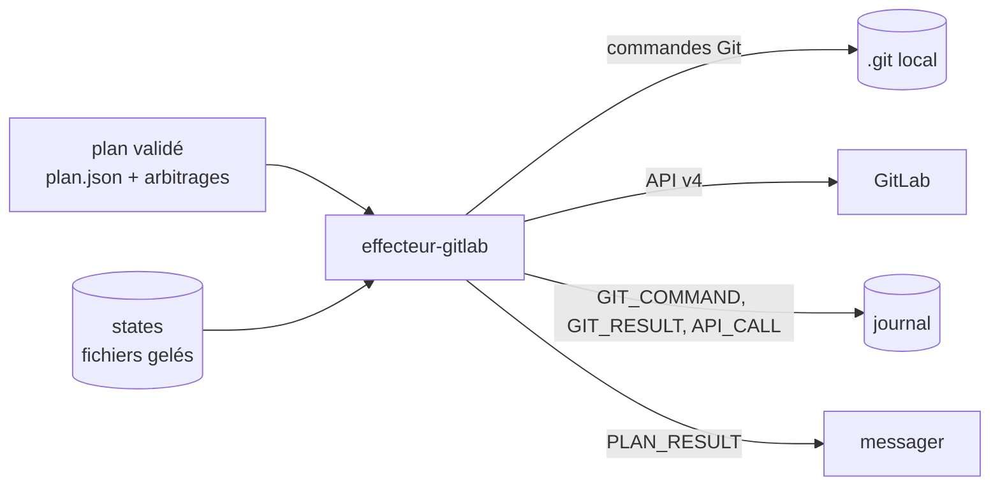

## 2. Séquence d'exécution

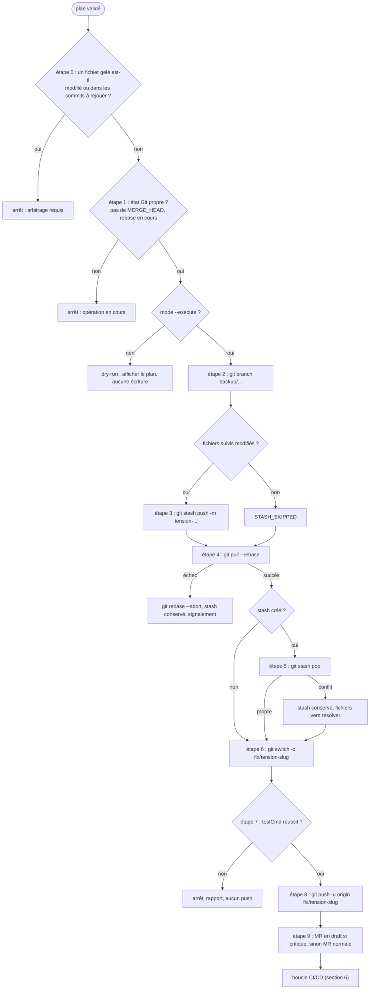

Le diagramme montre le chemin complet. Chaque étape journalise sa commande avant exécution, puis son résultat.

### 2.1 Détail des étapes

| Étape | Commande ou action | Garde | Écrit |
|---|---|---|---|
| 0 | calcul des fichiers gelés touchés | D4.INV-2 | rien |
| 1 | `git status --porcelain`, présence de `.git/MERGE_HEAD`, `rebase-merge`, `rebase-apply` | arbre et état Git | rien |
| 2 | `git branch backup/<branche>-<horodatage>` au SHA courant | sauvegarde avant toute écriture | une référence |
| 3 | `git stash push -m tension-<horodatage>` si des fichiers suivis sont modifiés | sinon `STASH_SKIPPED` | un stash |
| 4 | `git pull --rebase <remote> <branche>` | échec : `git rebase --abort`, pas de force | l'historique local |
| 5 | `git stash pop` si un stash existe | conflit : le stash n'est jamais supprimé | l'arbre |
| 6 | `git switch -c fix/tension-<slug>` depuis HEAD | pas de branche partagée | une branche |
| 7 | `testCmd` (liste d'arguments, sans shell) | doit réussir | rien |
| 8 | `git push -u <remote> fix/tension-<slug>` | branche nouvelle, donc sans force | le distant |
| 9 | `POST /projects/:id/merge_requests` | `Draft:` si un fichier était critique | GitLab |

### 2.2 Étape 0 : pré-vérification (détail)

```
gelés     = { fichiers avec states.state = 'gelé' }
arbre     = git status --porcelain (fichiers suivis)
base      = git merge-base HEAD <remote>/<branche>
rejoues   = git diff --name-only <base>..HEAD

si (gelés ∩ arbre) ≠ ∅  ou  (gelés ∩ rejoues) ≠ ∅ :
  refuser, afficher la liste, journaliser EXECUTION_REFUSED
```

Pourquoi cette étape existe : `git pull --rebase` exige un arbre propre, donc le stash porte sur tous les fichiers suivis modifiés. Un fichier gelé ne peut pas être protégé par un stash partiel. Il doit donc être bloqué en amont, et l'arbitrage doit être rendu avant toute exécution.

## 3. Garde-fous

- **Commits déjà publiés** : pour chaque commit de `git rev-list <remote>/<branche>..HEAD`, vérifier `git branch -r --contains <sha>`. Si ce commit est présent sur une autre branche distante, arrêter : il serait réécrit alors qu'il est partagé (D4.INV-1).
- **Branches protégées** : aucune fusion automatique dans `main`, `develop` ou toute branche protégée. La liste est lue dans la configuration.
- **Aucun force** : la procédure 2.x n'emploie ni `--force` ni `--force-with-lease`. Une branche nouvelle n'en a pas besoin (D4.INV-3). Le code est scanné pour le vérifier (G7).
- **Dry-run par défaut** : sans `--execute`, l'effecteur affiche le plan et n'écrit rien (D4.INV-4).
- **Journal avant exécution** : chaque commande est écrite dans le journal avant son lancement, avec ses arguments.
- **Restauration documentée** : la sortie indique la commande de restauration. Elle n'est jamais exécutée par l'agent.
- **Secrets** : aucun token dans une URL de dépôt. Utiliser un credential helper ou un en-tête HTTP `PRIVATE-TOKEN`.
- **Stash conservé** : un stash qui subsiste après un conflit n'est jamais effacé automatiquement.
- **Test avant push** : `testCmd` doit réussir avant l'étape 8.

### 3.1 Interdits (liste fermée)

| Interdit | Raison |
|---|---|
| `git push --force` et `--force-with-lease` | réécriture distante (D4.INV-3) |
| réécrire un commit présent sur une autre branche distante | commit partagé (D4.INV-1) |
| écrire sur un fichier au statut `gelé` | arbitrage non rendu (D4.INV-2) |
| `git stash drop` ou `git stash clear` par l'agent | perte possible de travail |
| `git reset --hard` par l'agent | perte possible de travail |
| fusion automatique dans une branche protégée | risque de régression partagée |
| `shell: true` pour `testCmd` | injection de commande |

## 4. Boucle CI/CD

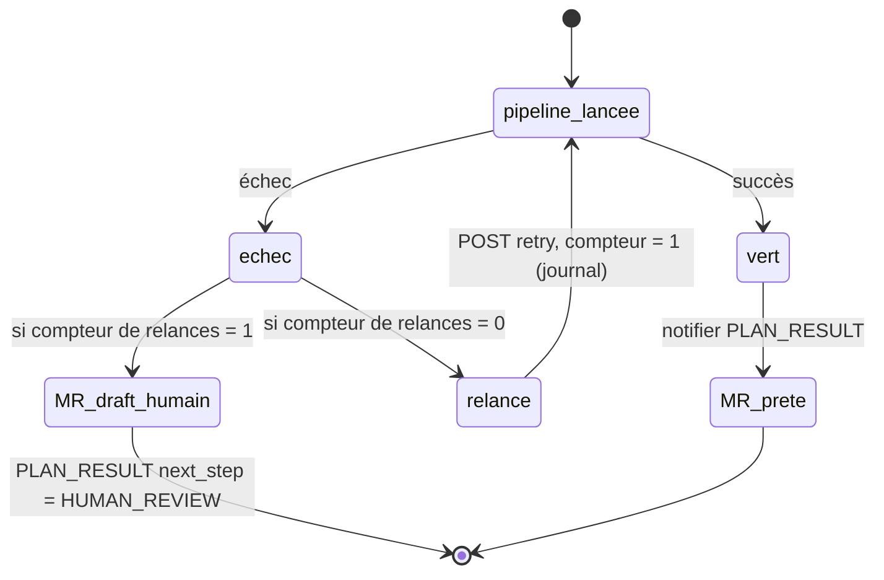

- **Une seule relance**, et son compteur est lu dans le journal avant toute décision. Un redémarrage ne remet pas le compteur à zéro (scénario G5).
- **Aucun merge automatique**, jamais. Même une MR verte reste à la main du développeur.
- **MR en draft** si un fichier du plan était `critique` ou si la pipeline reste en échec.

## 5. API GitLab v4

| Opération | Méthode et chemin | Corps ou paramètres |
|---|---|---|
| Créer la MR | `POST /projects/:id/merge_requests` | `source_branch`, `target_branch`, `title` (préfixe `Draft:` si draft) |
| Lister les pipelines | `GET /projects/:id/merge_requests/:iid/pipelines` | |
| Relancer | `POST /projects/:id/pipelines/:pipeline_id/retry` | aucun |

Variables : `GITLAB_URL`, `GITLAB_PROJECT_ID`.

Tokens séparés :

- **Tracker** : `GITLAB_TOKEN_READ`, portée `read_repository`.
- **Effecteur** : `GITLAB_TOKEN_WRITE`, portées `api` et `write_repository`, expiration 30 jours.

Un token ne sort jamais du module. L'appel `API_CALL` journalise la méthode et le chemin, sans l'en-tête d'authentification.

## 6. Dry-run : exemple de sortie

```
MODE DRY-RUN (aucune écriture). Pour exécuter : --execute
Plan : fix/tension-orchestrator-delta, depuis main
  [0] pré-vérification ..................... OK (aucun fichier gelé touché)
  [1] état Git ............................. OK
  [2] git branch backup/feature-x-20261016T0014 (SHA a1b2c3d)
  [3] git stash push -m tension-20261016T0014 (3 fichiers suivis)
  [4] git pull --rebase origin feature-x
  [5] git stash pop
  [6] git switch -c fix/tension-orchestrator-delta
  [7] npm test (liste d'arguments, sans shell)
  [8] git push -u origin fix/tension-orchestrator-delta
  [9] MR draft : non (aucun fichier critique)
Restauration si nécessaire : git reset --hard backup/feature-x-20261016T0014
  (à exécuter par le développeur uniquement)
```

## 7. Rétro-signalement

```json
{
  "event": "PLAN_RESULT",
  "branch": "fix/tension-orchestrator-delta",
  "mr_iid": 42,
  "mr_state": "draft",
  "pipeline_status": "failed",
  "retries": 1,
  "next_step": "HUMAN_REVIEW"
}
```

Valeurs de `next_step` : `NONE` (MR prête), `HUMAN_REVIEW` (échec persistant). Aucune autre valeur n'est définie en 2.x.

## 8. Pièges connus

- **Conflit au pop après un rebase réussi** : le stash est conservé, et les fichiers en conflit passent au resolver. L'effecteur ne tente pas de les résoudre lui-même.
- **Fichiers non suivis** : ils ne sont pas stashés. Si le rebase les heurte, Git refuse, et l'effecteur s'arrête sans rien toucher.
- **Relance du compteur** : un redémarrage sans lecture du journal permettrait une relance infinie. Le compteur doit toujours être relu.
- **Branche déjà existante** : `git switch -c fix/tension-<slug>` échoue si la branche existe. L'effecteur doit alors arrêter, et ne jamais la supprimer.
- **Shell et arguments** : `testCmd` en liste d'arguments évite les injections. Ne jamais concaténer de chaîne pour construire la commande.

## 9. Tests (scénarios de rejeu)

| # | Situation | Attendu | Invariant |
|---|---|---|---|
| G1 | fichier gelé modifié dans l'arbre | refus à l'étape 0, aucune commande d'écriture | D4.INV-2 |
| G2 | plan valide, sans `--execute` | plan affiché, aucune écriture | D4.INV-4 |
| G3 | commit de la plage présent sur une autre branche distante | arrêt, aucune réécriture | D4.INV-1 |
| G4 | arbre propre | `STASH_SKIPPED`, aucun stash créé | |
| G5 | un échec de pipeline déjà relancé (compteur à 1 dans le journal), puis redémarrage | aucune seconde relance | |
| G6 | conflit au `stash pop` | stash conservé, fichiers transmis au resolver | |
| G7 | analyse statique du code de l'effecteur | aucune occurrence de `--force` ni `--force-with-lease` | D4.INV-3 |
| G8 | fichier `generated` en conflit au rebase | traitement par régénération signalé, jamais fusion manuelle | |
| G9 | `testCmd` en chaîne au lieu d'une liste | refus au démarrage | D2.INV-3 |
| G10 | branche `fix/tension-...` déjà existante | arrêt, la branche n'est pas supprimée | |

Chaque scénario utilise un dépôt temporaire, créé par le test, avec un remote local (chemin de fichier). Aucun test n'accède à GitLab réel : l'API est simulée.

## 10. Fichiers à produire

- `src/assistant/gitlab.js` : orchestration des étapes, dry-run, journalisation.
- `src/assistant/git-ops.js` : fonctions Git d'écriture, une par commande, avec garde.
- `src/assistant/gitlab-api.js` : client API v4, sans logs de token.
- `src/assistant/guards.js` : pré-vérification (étape 0), commits publiés, branches protégées.
- `test/effecteur.test.js`, `test/guards.test.js`, `test/static-scan.test.js` (G7).
<<<FIN modules/effecteur-gitlab/SKILL.md>>>

<<<FICHIER regulation-inter-agents.md>>>
# Régulation de second niveau inter-agents

Dimensions D8, D9 et D10 du registre de `SKILL.md` (section 5, version 2.2.0). Statut en 2.2.0 : `reserved`, déclarées dans `manifest.json`. Elles s'activent en version 3.0. Les points d'extension qui les préparent sont décrits dans `SKILL.md`, section 6.2 : E1 à E5 depuis la 2.1.0, E6 depuis la 2.2.0.

Cette section remplace, pour la communication entre agents, le canal unique, la répartition des agents et le périmètre hors version qui figuraient dans la version 2.0.0 (`archives/SKILL-v2.0.0.md`).

## 0. Décisions retenues

- Les agents peuvent s'échanger directement des messages signés. Le développeur est le médiateur de tout conflit entre agents.
- Le méta-niveau construit les règles de régulation et les applique, à l'intérieur d'une enveloppe bornée (section 2).
- En cas d'interblocage, aucune rupture automatique. Le système produit une analyse approfondie et un rapport destiné au développeur, qui détermine la feuille de route.

## 1. Principe

Les agents forment un réseau d'observateurs couplés. Le méta-niveau observe le protocole : qui parle à qui, sur quel sujet, avec quels effets. Il construit des règles de coordination et les applique.

Distinction centrale :

- **Règles de régulation** (ordre de réponse, temporisation, plafonds de messages, bornes de seuils) : construites et appliquées par le méta-niveau, dans l'enveloppe de la section 2.
- **Arbitrages de contenu** (ACCEPT_AGENT, KEEP_DEV, TRIGGER_MERGE, et toute décision sur le code) : réservés au développeur. Le méta-niveau ne tranche jamais un désaccord entre agents sur le contenu d'un fichier.

## 2. Enveloppe d'autonomie

Les règles sont classées en trois catégories. Les bornes sont déclarées dans `src/core/bounds.js` (point d'extension E4 de `SKILL.md`, section 6.2, et module `etats`), un module que le méta-niveau ne peut pas modifier. Seul un commit relu par le développeur peut les changer.

| Catégorie | Exemples | Pouvoir du méta-niveau |
|---|---|---|
| Intangibles | HMAC, écoute sur `127.0.0.1`, interdits Git du module `effecteur-gitlab`, journal en ajout seul, listes `sensitive` et `generated` | Aucun, à l'exécution |
| Bornées | `seuil` (150 à 500), `tStabMin` (5 à 30), `tGelMin` (15 à 120), `tVolatileH` (6 à 72), `fetchIntervalSec` (30 à 300) | Modifier, dans les bornes, au plus une fois par paramètre et par 24 h |
| De coordination | ordre de réponse entre agents, temporisation entre messages, plafond de messages par fil et par heure (bornes : 5 à 60) | Créer et modifier, dans les bornes |

Le méta-niveau n'écrit jamais dans `config.json`, ni dans les fichiers du dépôt. Il écrit uniquement dans la table `rules` (créée vide en 2.1.0, point d'extension E3) et dans le journal. La valeur `meta` de `journal.actor` est réservée à cette dimension (E1).

## 3. Séquence d'un changement de règle

Chaque changement suit cet ordre fixe, sans saut :

1. **Observation** : la métrique qui motive le changement, avec sa fenêtre et sa valeur.
2. **Proposition** : valeur avant, valeur après, vérification des bornes.
3. **Application** : immédiate si la règle est dans l'enveloppe, refusée sinon.
4. **Journal** : événement `RULE_CHANGED` avec `before`, `after`, `motif`, `metric`, `acteur = meta`.
5. **Évaluation** : après 24 h d'observation, comparaison de la métrique cible à sa valeur de référence.
6. **Retour arrière** : automatique si la métrique cible se dégrade au-delà du seuil fixé dans le code. Événement `RULE_REVERTED`.
7. **Rapport** : le changement figure dans le rapport de couplage (section 6).

Amortissement :

- un paramètre ne change pas plus d'une fois par 24 h ;
- une règle annulée ne peut pas être réappliquée avant 72 h ;
- toute règle peut être gelée par le développeur, avec l'événement `RULE_LOCK`. Une règle gelée ne change plus, quelle que soit la métrique.

Le développeur peut annuler n'importe quel changement d'une seule commande. L'annulation est journalisée comme `RULE_REVERTED` avec `acteur = developer`.

## 4. Métriques de couplage

Toutes calculées uniquement à partir du journal, de façon déterministe :

- `alerts_per_hour` : alertes émises par heure, globalement et par fichier.
- `arbitration_load` : nombre d'événements `ARBITRATION_NEEDED` par jour. Cette métrique mesure la charge du médiateur humain : c'est un goulot potentiel.
- `arbitrage_reversal_rate` : part des arbitrages suivis d'un retour arrière dans les 24 h.
- `wait_cycles` : nombre de cycles détectés dans le graphe d'attente.
- `wait_p95` : durée d'attente au 95ᵉ centile avant levée d'un gel.
- `reply_latency` : délai médian entre un message entre agents et sa réponse.
- `oscillations` : nombre de changements de niveau d'un même fichier en une heure.

## 5. Graphe d'attente et interblocage

- Nœuds : les agents et les fichiers gelés.
- Arête `A → B` : A attend une réponse ou la levée d'un gel qui dépend de B.
- Détection : parcours en profondeur du graphe à chaque cycle de surveillance.
- Réaction : aucune rupture automatique. Les fichiers du cycle restent gelés. Les autres fichiers continuent normalement.
- Le méta-niveau génère le rapport d'analyse (section 6) et émet `DEADLOCK_REPORT_READY` vers le développeur, avec le chemin du cycle et l'emplacement du rapport.

## 6. Rapport de couplage pour la feuille de route

Déclenchement : à l'ouverture d'un cycle d'attente, à la demande, et chaque semaine.

Contenu, dans cet ordre :

1. **Synthèse** : état du système, en une demi-page maximum.
2. **Incidents** : pour chaque cycle, le chemin, la durée, les agents et fichiers impliqués, et les événements qui l'ont précédé, avec leur horodatage.
3. **Métriques** de la période, avec leur tendance.
4. **Règles modifiées** : avant, après, motif, résultat, annulations éventuelles.
5. **Analyse** : hypothèses explicitement étiquetées comme telles, avec un niveau de confiance et la liste des données manquantes.
6. **Options** : pour chaque problème identifié, au moins deux options, dont « ne rien faire ». Chaque option indique son coût, son risque, son effet attendu sur les métriques et sa réversibilité.
7. **Feuille de route suggérée** : ordonnée, présentée comme une proposition. La décision revient au développeur.

Le rapport est déterministe : à partir du même journal, il produit le même contenu. Il est écrit dans `reports/` avec un horodatage, puis passé en lecture seule.

## 7. Communication directe entre agents

- Même enveloppe HMAC que le module `messagerie`, complétée par deux champs : `to` (agent destinataire) et `thread` (identifiant de la conversation). Ces deux champs sont réservés en 2.x (point E2) : un message qui les porte est rejeté. Ils sont activés en 3.0.
- Un agent peut demander une information, signaler un état, proposer une option.
- Un agent ne peut ni engager une action sur un fichier qui relève d'un autre agent, ni répondre à un arbitrage à la place du développeur.
- Toute demande d'arbitrage de contenu déclenche `ARBITRATION_NEEDED` vers le développeur. L'échange sur ce fil est alors suspendu.
- Chaque message entre agents est journalisé dans son intégralité. Aucun canal non journalisé.
- Plafond : le nombre de messages par fil et par heure est borné (section 2). Au-delà, le fil est fermé et `ARBITRATION_NEEDED` est émis.

## 8. Tests à ajouter à la suite de rejeu

- Détection d'un cycle à deux nœuds et d'un cycle à trois nœuds. Aucun faux positif sur un graphe en chaîne.
- Changement de seuil hors bornes : refusé, événement `RULE_REJECTED`.
- Deux changements du même paramètre en moins de 24 h : le second est refusé.
- Dégradation simulée après un changement : retour arrière automatique, événement `RULE_REVERTED`.
- Tentative de changement d'une règle intangible : refusée, quelle que soit la source.
- Règle gelée par `RULE_LOCK` : aucun changement ultérieur.
- Fil de messages qui dépasse le plafond : fil fermé, `ARBITRATION_NEEDED` émis.
- Génération du rapport deux fois à partir du même journal : contenus identiques.
- Aucun arbitrage de contenu appliqué sans événement humain correspondant dans le journal.

## 9. Critères d'acceptation complémentaires

- Aucune règle intangible n'est modifiable à l'exécution.
- Chaque changement de règle est annulable en une commande par le développeur.
- Le méta-niveau n'a aucune écriture sur le dépôt ni sur `config.json`.
- Le taux de charge du médiateur (`arbitration_load`) figure en tête du rapport de couplage.

## 10. Valeurs à ratifier

- Bornes numériques de la section 2.
- Fenêtre d'évaluation (24 h) et délai de réapplication après annulation (72 h).
- Plafond de messages par fil et par heure.
- Cadence du rapport hebdomadaire.
<<<FIN regulation-inter-agents.md>>>

---

# Table d'intégrité (sha256)

Format compatible `sha256sum -c`, à exécuter depuis `spec/`.

    f6ab2b3b9d5d28c24d1b9653689b7d035a875dd35eb1b1f20f482bc6578080cf  manifest.json
    b73a46ac3c55e9bfbb439b44d6716d333af0fb3a3c53bc8f089d08a9d706a33b  SKILL.md
    fed6e3a52508096c2666bbce56dfa4e4dd39a9638490344464139c7663f43b48  modules/tension/SKILL.md
    b1ceacc3461db4c7c38b3598b8edf247ee11611489eb057c86bc6ca36e001234  modules/etats/SKILL.md
    3af13348643ec82539e55dc8adc68e3fee5f2b00243bf364c87d4d798ffe9f3d  modules/verdict-journal/SKILL.md
    1cb4a4206c4572b362385ea6eab15c4f541b5cea8bf7e7e0e39daa9d1c7d2a32  modules/messagerie/SKILL.md
    aed006e8383217ef63e8cab8e6d672542e1d7700bb5536f7e5e5463a9cc6b6a6  modules/dashboard/SKILL.md
    f37fc128fe03ef23e0ffc561f437b0aa64b9bed23dec5342bcc54928339f37fb  modules/effecteur-gitlab/SKILL.md
    cfa91de7db37d629dd7bb12fcecb9a25e7f36ef9282263985f8473be484981f2  regulation-inter-agents.md
